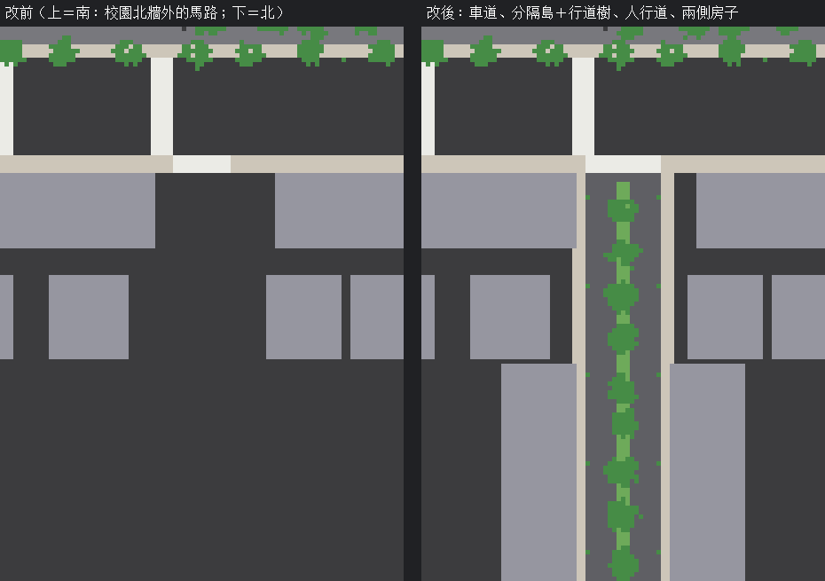

# XS-NORTH-ROAD-1107：校園北牆外，新生南路往北那一段做成像樣的路（LAWWW2-B 2026-11-07）

**起因**：`TODO_SHORTCUTS.md` XS-GATE-NORTH-1105 先將就第 6 點：
> 新生南路往北那一段只是把對面的房子空出來。路面就是城市底色的柏油，沒有車道線、分隔島、行道樹。

**派工**：LAWWW-B 07:46：「b) 新生南路往北那一段車道線、分隔島、行道樹：同意。區域配置是我的檔，請出模型＋patch」。

**狀態**：**READY_FOR_ART_REVIEW**（場景美術：BB／使用者看）。
- 只是遠景：北牆外本來就走不到（`nav.blockOutside`），導航不動；
- 遊戲內畫面要 CC 拍。

## 為什麼不做 GLB

旁邊整段北牆外的馬路都是 `zones3d.js` 用程式畫的：
- 人行道 `ground()`、車道線、斑馬線 `zebraMesh`；
- 路名牌、行道樹 `TK.tree`、路燈 `W3.lampPost`、對面的房子 `TK.bgCity`。

往北那一段照同一套畫，材質、樹、路燈、房子都和旁邊一樣，不會一段像別的地方。所以只有 patch（`xs_north_road_1107.patch`，對開發 `fa05ed8c5`，`git apply --check` OK）。

## 改了什麼（`src/zones3d.js`）

路口（x `XSG.xh` −56）往北，z −167 → −262：
1. **車道**：16 m（兩向各兩線 3.5 m），路面蓋過路口北側那一條人行道（路口不是人行道）。白虛線（車道之間，4 m 畫、4 m 空）、靠人行道的白實線。
2. **中央分隔島**：2 m。緣石＋草，上面一排行道樹（10 m 一棵，9 棵）。新生南路蓋在瑠公圳上，中間是一長條綠帶。
3. **兩側人行道**：3 m，從路口北側那一條人行道往北接；兩側路燈 20 m 一盞（燈臂朝馬路）。
4. **兩排房子空出來的寬度**：±7 → ±11 m（放得下車道＋兩側人行道）。
5. **z −214 以北補兩排面向這條路的房子**：本來空出來以後，第二排背後是一大片城市底色，路直直通到空地，又是「路口外面平的」。和對面那兩排同一套 `TK.bgCity`、同一組牆色。
6. **路口北邊那一條斑馬線**：12 → 16 m，和車道一樣寬。

**效能**：
- 新的網格 6 個：路面、兩條人行道、分隔島緣石、草、合併的車道線；
- 行道樹、路燈併進原本的 props／trees 合併，房子併進原本的 `TK.bgCity`。
- 實際的 draw call 要 CC 量。

## 測試（Node，開發 `fa05ed8c5`）

**新測試 `tests/xs_north_road_unit.js`**（在 patch 裡）。在 Node 建校園，從上往下打射線：
- ① 路的範圍（x ± 10.5 m、z −171～−258）沒有 12 m 以上的東西（房子不壓到車道、人行道）；
- ② 兩側（x ± 19 m、z −216～−256）打得到房子（八成以上）：路不是通到空地；
- ③ 往北那一段打到的是新的路面（不是城市底色），有分隔島、車道線、兩側人行道；
- ④ 路口北邊的斑馬線 16 m 寬。

| | 開發原樣 | 加 patch |
|---|---|---|
| `xs_north_road_unit` | **FAIL 3**（②③④；① 是防退步，改前也過） | **ALL PASS** |
| 會建校園的 24 支 `*_unit.js` | — | 24 支全部 ALL PASS（含 `xs_gate_north_unit` ⑥b、`campus_backdrop_ground_unit`） |

## 還沒驗

- 遊戲內畫面（CC）：
  - 從側門、體育館門口往北牆外看；
  - 北牆外的路口往北看；
  - 白天、晚上（路燈）。
- 往北那一段兩側的房子是 `TK.bgCity` 的遠景方塊，和對面那兩排一樣。近看會是方塊，但北牆外走不到，最近也在 25 m 以外。
