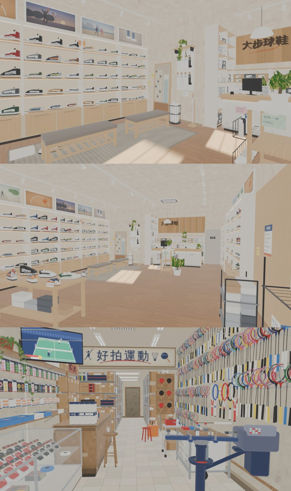

# 大步球鞋、好拍運動走得進去（XS-SHOPS-REST-1105 ②③，LAWWW2-C 2026-11-05）

- **第 1 版進遊戲**（D141；LAWWW-C 04:51 排的順序：大口漢堡 → 大步 → 好拍 → 運動廣場）。
- 模型：CC〔帳號 A 的建模子代理〕的 v2b，GLB 和 `claude/cc-testing` 一模一樣。
  - `dabu.glb`：2,434,276 B，59,506 三角形（含 instancing），12 材質。
  - `haopai.glb`：3,134,624 B，55,496 三角形，11 材質。
  - 配置：`src/data/dabu_layout.js` v2、`haopai_layout.js` v2，CC 的原檔，沒改。
  - CC 已經改到第 3 版（v1 → v2 → v2b），ref_match 五項 PASS（CC 的 `docs/story_planning/CC/shots/model/dabu/`）。
- 這一包做的：
  - 兩個區域 `xs_dabu`、`xs_haopai`，共用一個新模組 `src/xsshop3d.js`（`XSS`），之後新生南路的一層店也可以用。
  - 座位、出入口、營業時間、店門擋。
  - 新生南路多一座停車架。
  - 測試、接線。
- 企劃：AA_620 第 1、2 節。
  - 大步：每天 11:00～22:00。
  - 好拍：12:00～21:00，週日休。
- 參考圖：使用者 11-03 生成的 `dabu_int.webp`、`dabu_ext.webp`、`haopai_int.webp`、`haopai_ext.webp`，在企劃線。這一包沒有重做疊圖（D141）。
- 驗收狀態：INTEGRATED（Node 模擬）。瀏覽器沒跑（D131）。

## 1. 玩家可以做什麼

- 新生南路上兩間店的店門變成「進大步球鞋」「進好拍運動」。進去站在店門內 1.6 m，面向店裡。
- **大步球鞋**：
  - 兩張試穿長凳，4 個位子「坐下試穿」。
  - 試穿、看看籃球鞋、看看（兩處）、買東西、照鏡子都走得到。互動點資料在 `XSS.INTERACT('dabu')`，台詞由 LAWWW 照 AA_620 接（阿哲帶玩家看籃球鞋、店員蹲下按鞋頭）。
- **好拍運動**：
  - 高腳凳「坐著等穿線」（照座面 0.72 m 抬高）、紅色圓凳「坐一下」。
  - 看看球拍牆、買東西、穿線都走得到（`XSS.INTERACT('haopai')`）。
- **關門的時候**：店門照營業時間擋，出現「下次開門」的提示，和山嵐、南洋一樣。
- 牆照模型的方向淡出；燈的光暈晚上亮（大步 16 個、好拍 11 個，合成一個網格）。

三張都是 `glb_preview.py` eevee（均勻光，不是遊戲畫面）。

## 2. 先將就的（D141：給使用者看的清單；不擋玩）

1. **窗外沒有街景**：兩間的正面玻璃外面是暗的。
2. **燈光**：沒有烘光照，用即時光（每間兩盞）加 GLOW_ 光暈。
3. **互動點還沒有按鈕**：試穿、看看、買東西、穿線等等，由 LAWWW 照 AA_620 接。
4. **大步的倉庫格子擋起來**：隔間牆後面的倉庫（模型裡本來就封起來）原本有 85 個點站得住、走不到。我在 `xsshop3d.js` 把整塊擋起來。
5. **擋起來的兩個小點**：大步長凳 B 尾端 1 個點、好拍特價桶旁邊 2 個點。四周都站不住，跑步一步 0.4 m 可能跳進去（v9.3 #31），所以擋起來，旁邊走道照舊。
6. **新生南路多一座停車架** (−8.6, −22)：在好拍門口北邊 1.2 m 的路邊。
   - 原因：`bike_park_1104_unit` 要每個出口 12 m 內有停車處，原本從好拍出來最近的是 13.2 m。
   - 從大步出來是 10.2 m，本來就合格。
7. **店門字括號套括號**：例如「進大步球鞋（球鞋）」，和山嵐、大口漢堡一樣，是 `xinsheng3d.js` 照 type 組出來的。
8. **好拍很窄**：面寬 4.4 m，前段走道 1.3～1.9 m，模型照參考圖做。鏡頭在窄的地方會貼近，靠牆淡出。

## 3. 測試（Node，不用瀏覽器）

`node tests/xsshop_unit.js`：ALL PASS，兩間各 9 項，共 18 項（套上接線 patch 以後含 ⑧ 營業時間）。

| | 檢查（每一間） |
|---|---|
| ① | 登記、正式模型 |
| ② | 進來的位置站得住、在出口範圍外面；店門走得到 |
| ③ | 座位的走近點走得到；高腳凳抬高 |
| ④ | 互動點走得到 |
| ⑤ | 沒有小孤島（每 0.1 m 一點） |
| ⑥ | 新生南路的店門、走出來的位置 |
| ⑦ | WALL_ 都有 dir、GLOW_ 都有 glow |
| ⑧ | 營業時間（週四開關的時間、週日）、名字、story3d.js 店門擋 |

照實寫：

- 修改前：區域不存在，① 就 FAIL。
- 第一次跑 FAIL 2 項，都是 ⑤ 小孤島：
  - 大步：倉庫 85 點，加上後來找到的長凳尾端 1 點。
  - 好拍：特價桶旁邊 2 點。
  - 照上面「先將就」第 4、5 條擋起來以後 PASS。
- 第一次寫 ⑧ 的時候算錯了週日。`calendar.js` 的 7 是週日，不是 0。改了測試；配置沒錯，`week[0]` 本來就是週日。

在乾淨的開發分支 `685337469`＋大口漢堡那一包（`../dakou_zone_1105/`，兩個 patch＋新檔案）＋這一包上，下面 38 支 ALL PASS：

- `xsshop_unit`、`dakou_unit`、`seat_reach_unit`（xs_dabu 4 個、xs_haopai 2 個座位都碰得到「坐下」）、`bike_park_1104_unit`、`bike_shop_park_unit`、`xinsheng_unit`、`shanlan_unit`、`nanyang_unit`、`tongxian_unit`、`spawn_exit_unit`、`placemap_unit`。
- 其他 27 支：calendar_hours、quick_travel、exit_ring、scene_bg_keys、rooms_glb、wz_offbeat、aa653_shops、mokuyobi_aa618、aa619_guitar_zone、gg_shops2_1104、prop_restand、v3_typhoon2、shop_rename_1104、lamppost_nav、aa117_notes、aa347_y1、crowd、indoor_crowd、presence、wall_dir_inherit、bike、bike_seat、campus_bikes、wz_shops、wz_shops2、wz_interiors_aa659、wz_lin_v1c。
- 改了 `story3d.js`，所以另外跑了讀 `story3d.js` 的前 40 支 `*_unit.js`，ALL PASS。
- 瀏覽器沒跑（D131）。

## 4. 接法（LAWWW-C）

1. **先接大口漢堡那一包**（`../dakou_zone_1105/README.md`）。這一包的 patch 前後文接在大口漢堡那幾行後面，單獨套在 `685337469` 上會失敗。
2. 拿檔案：`git checkout <本包 SHA> -- $(cat docs/art-rebuild/second_ai/wip/xs_shops_1105/files.txt)`。共 23 個檔：
   - 程式：`src/xsshop3d.js`、`tests/xsshop_unit.js`。
   - CC 的配置：`dabu_layout.js`、`haopai_layout.js`。
   - CC 的模型：兩顆 GLB、兩個 json。
   - CC 的 Blender 腳本 6 支、貼圖 10 個。
3. 套 patch：`git apply docs/art-rebuild/second_ai/wip/xs_shops_1105/xs_shops_wire_1105.patch`。內容：
   - `index.html`：在 `dakou3d.js` 後面載入三個檔。
   - `places.js`：名字、營業時間。
   - `story3d.js`：店門照營業時間擋，兩行。
   - `zones3d.js`：停車架。
   - `seat_reach_unit`：加三個檔。
   - `LICENSES.md`：兩列。
4. 劇情（LAWWW，AA_620）：試穿（店員蹲下）、阿哲的籃球鞋、穿線轉暗二十分鐘、柏翰來穿線。

## 5. 檢查清單（RULES_2D_TO_3D 第 7 步）

- [x] 參考圖的種類：使用者生成的圖。
- [x] 「最重要的那一塊」：大步的鞋牆＋試穿長凳、好拍的球拍牆＋穿線機（上面第一、三張，參考圖的鏡頭）。
- [x] 店名原創（D77）；鞋子、球拍沒有真實品牌標誌。
- [x] 沒有複製貼上：模型是 CC 的，這一包沒有改模型。
- [x] 走得到、坐得下，都寫進 Node 測試。區域原本不存在，① 就 FAIL。
- [x] 驗收狀態：INTEGRATED（Node 模擬）。遊戲內截圖要等瀏覽器。
