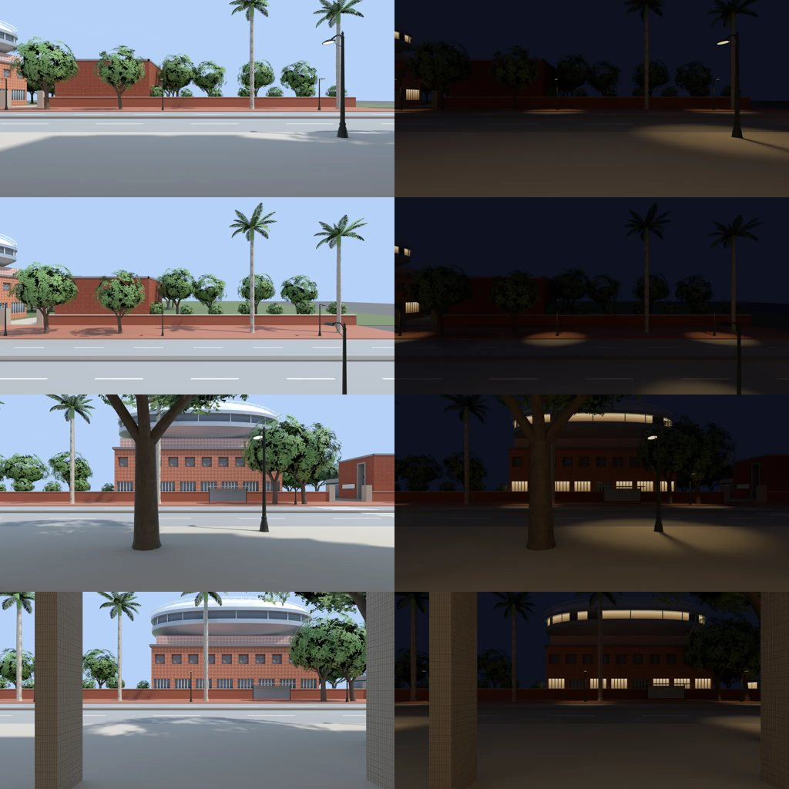
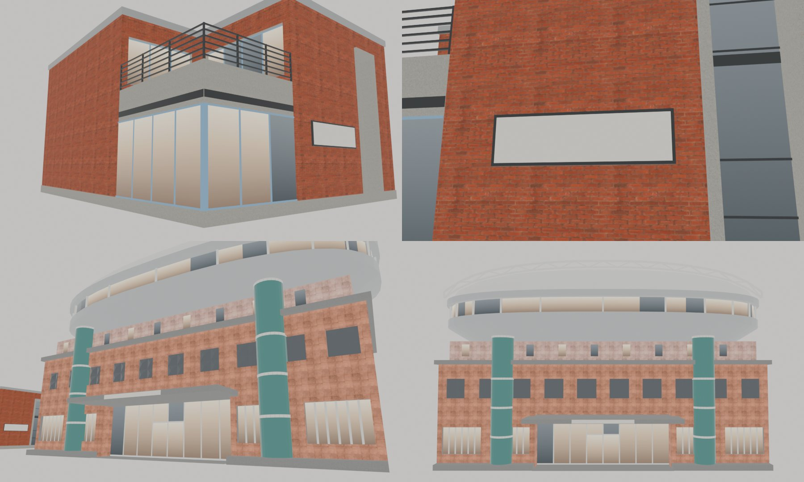

# 望月台、體育館正式外觀＋新生南路圍牆後面照新配置＋大口、大步、好拍的窗外（XS-NORTH-EXT-1105＋XS-WINCARD-1105，LAWWW2-C 2026-11-05）

- 使用者 09:4x：「做啊」（接著做：新生南路三間店的窗外 → 木曜日 → 望月台、體育館正式外觀）。
- 順序改了：
  - 新生南路那一區的圍牆後面，還是「側門開在西牆」那一版（洞洞館、校史館）。
  - 側門搬到北牆（XS-GATE-NORTH-1105）以後，圍牆後面應該是望月台和體育館。
  - 所以先做望月台、體育館的 Blender 外觀，再改新生南路圍牆後面，最後拍三間店的窗外。
- 使用者 10:0x：「你去台大官網找新月台照片 新體育館照片!!!!」→ 望月台、體育館照官網照片重做（第 2 版，見第一節），窗外照片用第 2 版重拍。
- 狀態：**已做，交 patch**。Node 驗過；瀏覽器沒跑（D131），請 CC 拍。

上圖是 Blender Cycles 渲染，**不是遊戲畫面**。

## 一、望月台、體育館的正式外觀（`tools/blender/env_second/campus_xsnorth.py`，第 2 版）

- 使用者 10:0x：「你去台大官網找新月台照片 新體育館照片!!!!」
- 第 1 版是照文字猜的（白牆、木簷、筒形屋頂），和照片不像，已經換掉。

上圖是 Blender 預覽，**不是遊戲畫面**；招牌的字由遊戲畫上去，所以這裡是空白的。

### 參考照片（只在工作區看，**沒有放進 repo**）

| 建築 | 來源 | 用了哪幾張 |
|---|---|---|
| 新月台 | 臺大焦點新聞〈NTU Hub & Store於臺大新月台開幕〉 https://www.ntu.edu.tw/spotlight/2025/2340_20250108.html | 外觀 3 張（揭牌、正面斜看）、室內 4 張 |
| 綜合體育館 | 臺大校友雙月刊〈新綜合體育館的誕生與經營〉 https://ntualumnibm.ntu.edu.tw/bm.bimonthly.article/detail/sn/2233 | 外觀 2 張（白天斜看、夜景空拍）、室內 3 張 |
| 綜合體育館 | 維基百科〈國立臺灣大學綜合體育館〉上的 Wikimedia Commons 照片 https://zh.wikipedia.org/zh-tw/國立臺灣大學綜合體育館 | 操場看過去、正面夜景、站牌 |

- 紀念品店官網（souvenir.ntu.edu.tw）的照片放在別的網站，這個環境連不上；體育中心官網（ntusportscenter.ntu.edu.tw）也連不上。
- 校友雙月刊的文字：
  - 「基座維持校園傳統的沈穩外觀，漸次往上展現…新穎、科技造型」；
  - 「屋頂膜…晚上透出微微亮光，極像一座燈籠」；
  - 屋頂是空間金屬桁架。

### 照片的特徵 → 遊戲版（像但不照抄，D136）

- **望月台**（新月台）：
  - 紅磚兩層樓，平屋頂，灰色金屬收邊；牆腳是灰色石材。
  - **東南角**是一樓淡藍框玻璃店面，正面、南面兩邊轉角；照片是正面的左邊角落。
  - 玻璃上面是清水混凝土帶，夾一條黑色細帶；二樓是露台，黑色橫條欄杆；露台後面兩面紅磚牆，有咖啡座的長窗。
  - 正面一大片紅磚牆：
    - 古銅色底、暖色字的招牌「望月台」，小字「CAMPUS STORE・CAFÉ」。D77：真的招牌是「NTU 新月台 HUB & STORE」，遊戲用自己的名字。
    - 招牌右邊一道深色直條開口（樓梯間），清水混凝土框，裡面看得到欄杆。
  - 大小 13.2 × 16.8 m、高 8.4 m：500 個三角形、7 個材質、245 KB。
  - 材質：Poly Haven `red_brick`、`granular_concrete`（CC0）。
- **體育館**（綜合體育館）：
  - 基座：
    - 一樓、二樓是鮭魚粉磁磚；
    - 一樓兩翼是橫條窗＋白色直條遮陽；
    - 二樓一排方形深窗，裡面是淺灰的三角格柵（四片三角形往外凸）；
    - 灰色腰帶；三樓是淡粉色、往內退。
  - 上面：
    - 一圈**銀白色往外懸挑的橢圓環**，下緣是碗底的弧面；
    - 環上一圈水平長窗＋白色細柱，再上面是簷口；
    - 最上面是**白色薄膜淺圓頂**，拱高 3.4 m；
    - 兩道白色鋼桁架拱沿長向跨過圓頂。
  - 正面（南）：
    - 一樓玻璃大廳往內退 1.5 m，前面有雨遮，招牌「體育館」藍底白字（照片的站牌是藍色）；
    - 大廳兩邊各一根**藍綠色玻璃圓柱**，白色環帶；
    - 外牆比範圍退 0.8 m（花台），圓柱貼齊範圍。
  - 大小 30 × 14 m（真的大很多），圓頂頂端 19.5 m（桁架 20.5 m）：4,192 個三角形、9 個材質、530 KB。
  - 材質：Poly Haven `large_floor_tiles_02`（磁磚）、`granular_concrete`（CC0）。
- 兩棟共同：
  - 本體範圍和套件一樣（`XSG.moon`、`XSG.gym`），所以導航、鏡頭碰撞、門口都不用改。
    - 體育館的懸挑環在 11 m 以上，往北超出北牆 1.2 m、往東西各 1.5 m；人走不到那麼高，不影響導航。
  - 載入後藏起同 `ckTag` 的套件；招牌的字由遊戲畫在 `wz_plates_atlas` 上。
  - 窗玻璃用 `ck_glass`，晚上和其他校園地標一樣亮燈。

## 二、新生南路圍牆後面（`src/xinsheng3d.js`）

- 換算照北牆的側門：新生南路 (x, z) ↔ 校園 (−101.4 − (z − 10), −141 + (x − 18.4))。
  - 往校園走（+x）＝校園往南（+z）；
  - 沿街往北（−z）＝校園往東（+x）。
- 圍牆後面：
  - 側門南邊（z 15～32）是望月台；
  - 側門北邊（z −1～−31）是體育館；
  - 門洞裡面是小廣場的鋪面；
  - 再過去是校園西北角的樹林（照校園的範圍種，避開望月台、停車場、體育館、步道）。
- 兩棟用同一組 GLB（包一層「轉 90°＋平移」），套件版當備用。
- 拿掉洞洞館、校史館：那是西牆側門的換算，北牆側門看不到。
- 街的兩頭（z > 32.6＝校園西牆以西、z < −35.4＝辛亥路那一段）不在校園北牆上，照舊只種樹。

## 三、三間店的窗外（`src/dakou3d.js`、`src/xsshop3d.js`）

| 店 | 視差窗（店內座標） | 照片拍的位置（新生南路座標） | 看到什麼 |
|---|---|---|---|
| 大口漢堡一樓正面 | (0, 1.6, 8.3)，12.4 × 5.84 | (−16.2, 1.6, 40.4) 朝東 | 騎樓、馬路、紅磚人行道、圍牆，圍牆後面是望月台 |
| 大口漢堡二樓正面 | (0, 5.2, 8.4)，12.4 × 3.4 | (−16.1, 5.2, 40.4) 朝東 | 同上，高一層，看得到圍牆裡面 |
| 大步球鞋 | (−0.1, 1.6, 6.23)，8 × 3.2 | (−16.27, 1.6, −16.6) 朝東 | 馬路對面的圍牆、候車亭，圍牆後面是體育館 |
| 好拍運動 | (0, 1.6, 7.23)，4.8 × 3.2 | (−16.27, 1.6, −23.2) 朝東 | 同上，體育館更正面 |

- 換算：街 x＝立面 −16.5＋（店內 z − d/2），街 z＝店的中心 − 店內 x。
- 用 `Z3.shopViewPane`（WINVIEW 第三包）：
  - 放進 `z.wins`（白天／晚上換照片、照時段調色、黃昏慢慢換夜景）；
  - 放進 `z.winParts`（鏡頭在牆外時跟著前牆藏）。
- 大口的二樓兩片放在二樓那一組，剖面視角時跟著藏。
- 大口正面有了視差窗以後，BB 的夜景卡 `NIGHT_FRONT` 不再顯示，白天、晚上都用同一套照片，和其他店一樣（西側見下面）。
- 照片 8 張：`assets/models/env/views/{xs_dakou,xs_dakou_2f,xs_dabu,xs_haopai}_{day,night}.webp`，1024 × 512，不鏡像。
- 大口的西側窗**不放**視差窗：
  - 店內的西牆對到新生南路的南邊；
  - 店的範圍 z 33.4～47.4，隔壁那一棟從 z 48 開始，中間只有 0.6 m；
  - 新生南路的外觀模型在那裡是一面實牆，鏡頭放上去只拍到牆（試拍過，整張黑）。
  - 所以西側照舊：晚上是 BB 的夜景卡 `NIGHT_WEST`，白天外面暗；正面的 `NIGHT_FRONT` 不再顯示。

### 怎麼拍的

- 工具：`tools/blender/env_second/wz_window_view.py`，這一包加了三個選項：
  - `--slabs`：程式畫的地面、圍牆、候車亭（方塊）；
  - `--trees`：照種類種樹，用 `street_trees.glb` 的範本，照高度縮放；
  - `--lamps`：路燈，用 `street_props.glb` 的範本。
- 另外，白天校園地標的窗玻璃不發光。
- 場景資料是 Node 建出遊戲真的新生南路區域匯出來的，在這個資料夾：
  - `slabs.json`：地面、圍牆、斑馬線、候車亭；
  - `trees.json`：55 棵（椰子 6、樟樹 39、榕樹 10）；
  - `lamps.json`、`pools.json`：路燈 13 盞。
- 模型：
  - `xinsheng_street.glb`（店面那一側）；
  - `campus_moon.glb`、`campus_gymext.glb`，放在 (159.4, 0, −91.4)、轉 90°。
- 參數：
  - 2048 × 1024、48 samples；
  - 白天照遊戲 14:00 的太陽；
  - 晚上 `--lamp-k 4 --exposure -0.7`，加路燈光圈。
- 重拍：`bash docs/art-rebuild/second_ai/wip/xs_wincard_1105/render.sh <輸出資料夾>`。

## 測試（Node，不用瀏覽器）

- `node tests/xs_north_ext_unit.js`：ALL PASS（5 項）。修改前（XS-GATE-NORTH 那一版）FAILED 5。
  - ① 校園：望月台、體育館的正式模型接上、套件藏起來、範圍對、招牌有字。
  - ② 新生南路：望月台在側門南邊、體育館在北邊、貼圍牆；兩顆正式模型接上、和套件同位置、套件藏起來。
  - ③ 洞洞館、校史館拿掉；樹避開望月台、體育館。
- `node tests/xs_wincard_1105_unit.js`：ALL PASS。修改前（開發分支 `56035ba30`，沒有視差窗、沒有照片）FAILED 12。
  - ① 片數、照片名字、照片檔；
  - ②③ 在玻璃外面、面向店裡、中心＝照片拍的位置；
  - ④ 在 `z.wins`／`winParts`、換時段、照片設進材質、正面的夜景卡不顯示。
- 回歸：讀到新生南路、大口、大步、好拍、校園 XSG、視差窗（`shopViewPane`、`ggViewPanes`、`winParts`）、`ground_zfight`、手機地圖的 48 支 `*_unit.js`：
  - 46 支 ALL PASS；
  - `shop_npc_unit` FAILED 9、`shop_crowd_new_unit` 沒有結果：**沒改的 `56035ba30` 也一樣**（`shop_npc` 要讀企劃線的 commit，這個 checkout 沒有）。
- 套在最新的開發分支 `e6335d264` 上：`git apply --check` 通過；套上以後 xs_wincard、xs_north_ext、xs_gate_north、ground_zfight、xinsheng、dakou、xsshop、placemap、nav_buildings 九支 ALL PASS。

## 先將就的

1. 望月台、體育館是第 2 版 Blender 外觀，照官網照片做（像但不照抄）。沒有拿遊戲截圖和照片同角度比過（要瀏覽器）。使用者看過之前是 MODEL_READY。
2. 體育館比真的小很多：
   - 遊戲 30 × 14 m、圓頂頂端 19.5 m；真的大約 40 m 高、看台四千人。
   - 遊戲的校園是壓縮過的；所以橢圓環很扁，圓頂從地面幾乎看不到（照片從操場看也只看得到一點）。
3. 體育館的薄膜圓頂晚上不會亮。照片說「晚上屋頂膜透出微微亮光，像一座燈籠」，要做得另外接夜間材質（像窗玻璃那樣）。
4. 體育館沒有做：
   - 照片右邊那座很寬的戶外大樓梯（上二樓）；
   - 側面的坡道、二樓平台、計分板。
   - 那些在範圍外面，要動導航。
5. 望月台沒有做：
   - 門前抬高的鋪面、台階、矮牆欄杆（照片有）；
   - 樓梯間開口上方的圓燈。
   - 二樓露台走不上去（只是外觀）。
6. 三角格柵、桁架都是簡化的：格柵一窗四片三角形；桁架是上下兩根＋斜桿，沒有球節。
7. 窗外照片是一張平面照片加視差，不是真的 3D：近的樹、路燈和遠的體育館在同一個平面上。
8. 大口的西側窗沒有街景：
   - 外面 0.6 m 就是隔壁的牆；
   - 照舊用 BB 的夜景卡 `NIGHT_WEST`（晚上），白天暗。
   - 室內有窗、外觀沒有，兩邊對不上，是本來就有的。
9. 候車亭、圍牆、地面是照遊戲的套件做成方塊，和遊戲裡一樣簡單。
10. 沒有在開的車、沒有路人、沒有停著的機車（新生南路區域本來就沒有）。
11. BB 的大口正面夜景卡 `NIGHT_FRONT` 不再顯示（西側的 `NIGHT_WEST` 照舊）。如果 BB 要留正面那張，把 `dakou3d.js` 那一段隱藏夜景卡拿掉就好，但晚上視差窗會擋住它。
12. 大口二樓：室內和外觀本來就對不上。
   - 店內二樓的窗和一樓同一面（街 x −16.1）；
   - 新生南路的外觀模型二樓蓋在騎樓上面，往外 3 m（x −13.1）。
   - 照片從店內窗的位置拍，把 4.6 m 以內剪掉（不然拍到的是自己這一棟二樓的窗卡）；
   - 所以照片裡看不到騎樓的頂。
13. 瀏覽器沒跑（D131）。請 CC 拍：
   - 大口一樓靠窗吧台往外看、二樓靠窗往外看；
   - 大步、好拍店門內往外看；
   - 新生南路側門對面往校園看（望月台、體育館）；
   - 校園小廣場看望月台、體育館門口；
   - 白天、晚上。

## 接法（LAWWW-C）

1. 拿模型、照片：`git checkout <這一包的 commit> -- assets/models/env/second_ai/campus_{moon,gymext}.{glb,json} assets/models/env/views/{xs_dakou,xs_dakou_2f,xs_dabu,xs_haopai}_{day,night}.webp`。
2. `git apply docs/art-rebuild/second_ai/wip/xs_wincard_1105/xs_north_wincard_1105.patch`：
   - 程式：`src/assets3d.js`、`src/zones3d.js`、`src/xinsheng3d.js`、`src/dakou3d.js`、`src/xsshop3d.js`；
   - 兩支新測試；
   - `LICENSES.md` 兩列。
   - 在開發分支 `56035ba30` 上做的；在最新的 `e6335d264` 上 `--check` 通過。
