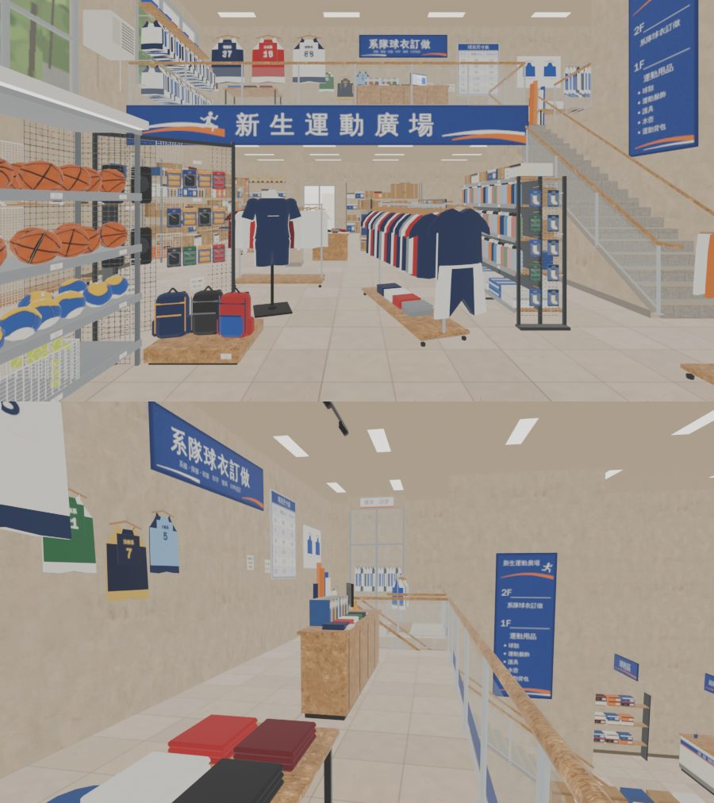

# 新生運動廣場走得進去（XS-SPORTS-V1-1105，LAWWW2-C 2026-11-05）

- **第 1 版進遊戲**（D141）。LAWWW-C 04:51 說「三間接完直接做 v1，不要等」。
  - 查了以後，CC〔帳號 A 的建模子代理〕已經做好室內，在 `claude/cc-testing`：v1、v2 退回，v3 照參考圖重做，v3b、v3c 是小修。LAWWW2 把 v3 標成 MODEL_READY。
  - 已經超過 3 版，所以不重做，直接接（D141）。
- 模型：`xinsheng_sports.glb` v3c，和 cc-testing 一模一樣。
  - 檔案 3,799,984 B（3.8 MB），12 材質。
  - 三角形（instancing 照畫出來的算）：一樓 59,994、二樓 33,794。
  - 配置：`src/data/xinsheng_sports_layout.js` v3，CC 的原檔，沒改。
- 這一包做的：區域 `xs_xsports`（`src/xsports3d.js`）、兩層導航、樓梯、座位、出入口、營業時間、測試、接線。
- 企劃：AA_620 第 1、2 節、3-2、3-4。
  - 一般運動用品，加系隊球衣訂做。
  - 每天 11:00～22:00。
  - 二樓牆上掛系隊球衣樣品。
- 參考圖：使用者 11-03 生成的 `xinsheng_sports_int`。CC 的對照圖在 `docs/story_planning/CC/shots/model/xinsheng/`（`xinsheng_v3c_ref_vs_render.jpg`，ref_match 五項 PASS）。
- 驗收狀態：INTEGRATED（Node 模擬）。瀏覽器沒跑（D131）。

## 1. 玩家可以做什麼

- 新生南路上運動廣場的店門變成「進新生運動廣場」。進去站在店門內 1.6 m，面向店裡。
- **一樓**：
  - 前段是兩層樓高的挑空：球架、護具牆、人台、衣架、水壺架。
  - 後段在夾層下面：貨架、獎盃櫃、外套衣架。
  - 左牆、東邊各有一面球鞋牆。
  - 試穿椅「坐下試穿」。
  - 看看球架、看看球鞋、收銀台買東西都走得到。互動點資料在 `XP3.INTERACT`，台詞由 LAWWW 照 AA_620 接。
- **樓梯**：x 2.5～4.0，從一樓往北爬上二樓。
  - 21 階，每階 0.1786 m、踏面 0.255 m，約 35°，真的走得上去（D38 第 4 點）。
  - 上半段兩層共用，和山嵐、大口漢堡一樣。
  - GLB 的 20 個踏面和導航算的一樣高。
- **二樓（夾層）**：後段一條，z −3.6～0。
  - 系隊球衣牆「看看」、訂做櫃台「系服訂做」（AA_620 3-2）都走得到。
  - 夾層前緣、樓梯洞兩邊是玻璃欄杆。挑空和後牆後面的倉庫站不住。
- **鏡頭**：
  - 人在一樓、鏡頭拉高過二樓地板時，二樓那一組藏起來（剖面視角）。二樓那一組包括：L1_ 開頭的網格、二樓高度那一段的牆、挑空的天花板和燈。
  - 人在樓梯上時，鏡頭不穿過二樓樓板。
- 光暈：GLOW_ 39 個，照高度分到一樓、二樓兩組，晚上亮。

兩張都是 `glb_preview.py` eevee（均勻光，不是遊戲畫面）。

## 2. 先將就的（D141：給使用者看的清單；不擋玩）

1. **擋起來的五個小角落**：家具中間站得住、但走不到的地方。跑步一步 0.4 m 可能跳進去、出不來（v9.3 #31）。
   - 一樓中間：斜衣架 A、圓形衣架、水壺架圍起來的一塊（約 0.6 × 1.7 m）。三邊的縫都不到人的寬度 0.64 m。
   - 一樓：球鞋展示台和貨架中間一點；樓梯西牆和柱子中間一條。
   - 二樓東邊：衣架前面到欄杆那一條；裁縫圓凳旁邊一點。
   - 結果：這幾處走不進去，看得到。要讓人走進去，得請 CC 把衣架拉開一點（配置的 blocks 和模型一起改）。
2. **裁縫車前的圓凳只給 NPC 坐**：CC 的配置寫「店員用，可以不開放」。它被裁縫桌、衣架、樣衣間圍住，走近點站不住，所以玩家不出「坐」。
3. **二樓東邊比較擠**：
   - 樓梯洞東邊到裁縫桌、樣衣間那一區，走得到的只有靠樓梯口的地方。
   - 裁縫桌、布料、樣衣間要從樓梯口那邊看。
4. **窗外**：左牆的大窗、正面的玻璃，窗外的行道樹是模型裡的貼圖。正面玻璃外面是暗的。
5. **燈光**：沒有烘光照。用即時光三盞，加上模型裡會亮的日光燈材質、GLOW_ 光暈。
6. **互動點還沒有按鈕**：看看、買東西、系服訂做，由 LAWWW 照 AA_620 接。
7. **店門字括號套括號**：「進新生運動廣場（運動用品（兩層））」，和山嵐一樣，是 `xinsheng3d.js` 照 type 組出來的。
8. **效能**：一樓 59,994 三角形，在 6 萬上限邊上（CC 已經減過）。

## 3. 測試（Node，不用瀏覽器）

`node tests/xsports_unit.js`：ALL PASS（17 項；套上接線 patch 以後含 ⑩）

| | 檢查 |
|---|---|
| ① | 登記、正式模型 |
| ② | 兩層同尺寸同原點、二樓 3.75、三塊樓板；進來的位置；店門走得到 |
| ③ | 樓梯一階一階的高度、坡度、GLB 的 20 個踏面 |
| ④ | 一樓 → 樓梯 → 二樓、二樓 → 一樓；找路經過樓梯 |
| ⑤ | 座位、5 個互動點走得到；按鈕帶樓層 |
| ⑥ | 挑空、倉庫、樓梯洞兩邊的欄杆站不住；一樓從樓梯頂、兩側走不出去 |
| ⑦ | 兩層沒有小孤島 |
| ⑧ | 新生南路的店門、走出來的位置 |
| ⑨ | GLB 分兩層（L1_ 在二樓高度；夾層前緣的招牌、樓梯間、挑空除外）；WALL_ 34 塊都有 dir |
| ⑩ | 營業時間 11:00～22:00、店門擋 |

照實寫：

- 修改前：區域不存在，① 就 FAIL。
- 第一次跑 FAIL 4 項：
  - ③ 測試寫錯：踏面頂點在樓梯兩邊，我取的範圍把兩邊去掉了。
  - ⑥ 測試寫錯：「樓梯洞站不住」不成立，樓梯洞裡面就是樓梯的上半段，本來就走得上去。改成檢查洞兩邊的欄杆。
  - ⑨ 測試寫錯：夾層前緣下面掛的主招牌（底 2.85 m）屬於二樓那一組，是對的。
  - ⑦ **真的有問題**：一樓 3 處、二樓 2 處小孤島。照上面「先將就」第 1 條擋起來。擋了以後，裁縫圓凳走不到了，照第 2 條處理。

在乾淨的開發分支 `685337469`＋大口漢堡包＋大步好拍包＋這一包上：

- 39 支 ALL PASS：`xsports_unit`、`xsshop_unit`、`dakou_unit`、`seat_reach_unit`、`bike_park_1104_unit`、`bike_shop_park_unit`、`xinsheng_unit`、`shanlan_unit`、`nanyang_unit`、`tongxian_unit`、`spawn_exit_unit`、`placemap_unit`，以及另外 27 支（同大步好拍包的 README）。
- 讀 `story3d.js` 的前 40 支 `*_unit.js`：ALL PASS。
- 瀏覽器沒跑（D131）。

## 4. 接法（LAWWW-C）

1. 先依序接 `../dakou_zone_1105/`、`../xs_shops_1105/`。這一包的 patch 前後文接在它們後面。
2. 拿檔案：`git checkout <本包 SHA> -- $(cat docs/art-rebuild/second_ai/wip/xsports_1105/files.txt)`。共 14 個檔：
   - 程式：`xsports3d.js`、測試。
   - CC 的配置、GLB、json。
   - CC 的 Blender 腳本 3 支、貼圖 6 個。
3. 套 patch：`git apply docs/art-rebuild/second_ai/wip/xsports_1105/xsports_wire_1105.patch`。內容：
   - `index.html`：在 `xsshop3d.js` 後面載入兩個檔。
   - `places.js`：名字、營業時間。
   - `story3d.js`：店門擋，一行。
   - `seat_reach_unit`：加兩個檔。
   - `LICENSES.md`：一列。
4. 劇情（LAWWW，AA_620 3-2、3-4）：系服訂做、二樓的系隊球衣、Alison 週日挑運動服。

## 5. 檢查清單（RULES_2D_TO_3D 第 7 步）

- [x] 參考圖的種類：使用者生成的圖。
- [x] 「最重要的那一塊」：夾層前緣的主招牌＋玻璃欄杆＋後牆的系隊球衣（上面第一張，參考圖的鏡頭）。
- [x] 店名原創、系名虛構（D77）。
- [x] 沒有複製貼上：模型是 CC 的，這一包沒有改模型。
- [x] 走得到、坐得下、上下樓梯，都寫進 Node 測試。區域原本不存在，① 就 FAIL。
- [x] 驗收狀態：INTEGRATED（Node 模擬）。遊戲內截圖要等瀏覽器。
