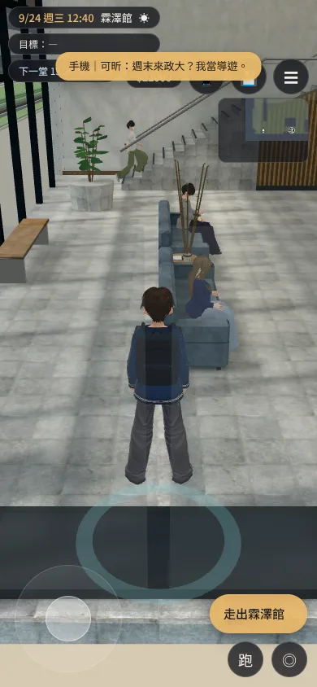
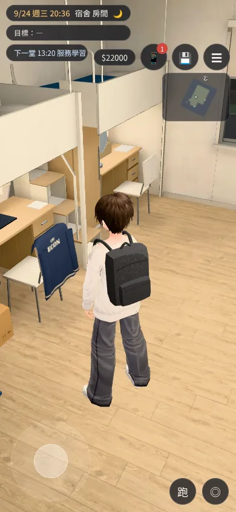

# 系外套穿在身上（SK02-LINE-JACKET-1030；LAWWW-B 子代理 2026-10-30）

- 起因：使用者 10-30「我選了穿去霖澤上課 結果我的衣服在遊戲裡面也沒換」。
- 模型：LAWWW2-B `b84ce8d27`（祐廷 VRM 的 `JACKET_ECON`、宿舍 L2 椅背的 `JACKET_CHAIR`）。穿不穿由 `src/story3d.js` 的 `STORY.jacketSync` 照規則決定。
- 截圖：`python3 tools/shots/jacket_wear_shots.py http://127.0.0.1:8893/index.html docs/art-rebuild/test_shots/jacket_wear_1030`，ALL PASS。
  - 手機直向 390×844，Playwright＋SwiftShader 模擬，**不是 iPhone 實機**。
  - [前置／捷徑] 讀檔放時間、地點、旗標（`ECON_JACKET:'wear'`、`SK02_DAY:6`）。**外套沒有手動打開**，是遊戲照規則穿上、掛上的。
  - SK02 事件本身（系辦三選一）用真的事件跑：`node tests/sk02_jacket_wear_unit.js`。

## ① 霖澤館一樓大廳：第 8 天（9/24 週三）12:40

系辦選了「穿去霖澤館上課」以後，這天是第一次霖澤館的課。遊戲自己穿上（`JACKET_ECON` 顯示），規則回 `{wear:true}`。

## ② 同一天 20:35 回到宿舍 203

進房間就脫下來，掛在祐廷（L2）的椅背上，背面的「ECON」朝走道。身上換回灰色上衣。

## 沒拍的

- 推搖桿走路那張：SwiftShader 1.8 秒幾乎沒走動，和 ① 一樣，拿掉了。
- 大一冷天上課日、大二起掛椅背、沒拿外套：這幾種只有 Node 測試，沒有截圖。
