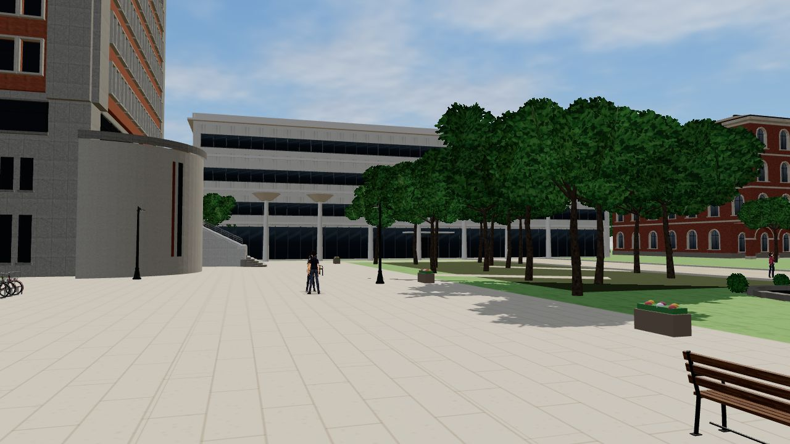
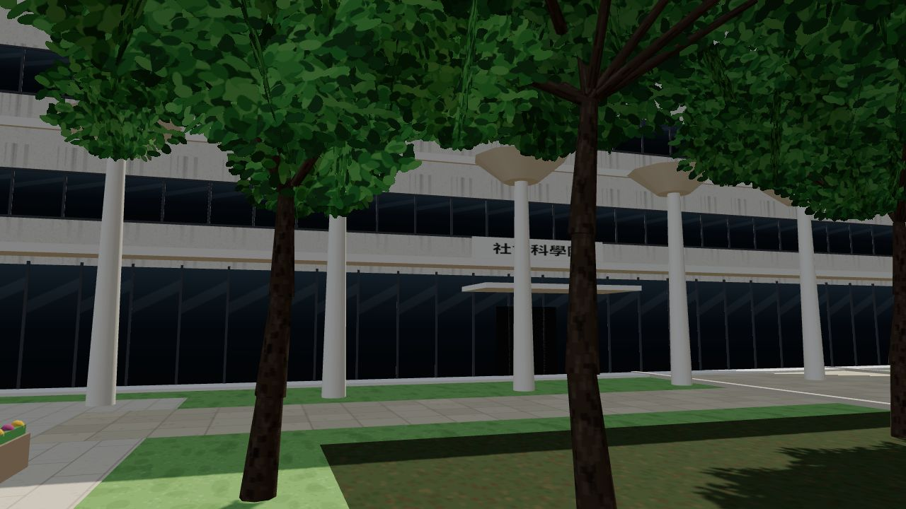
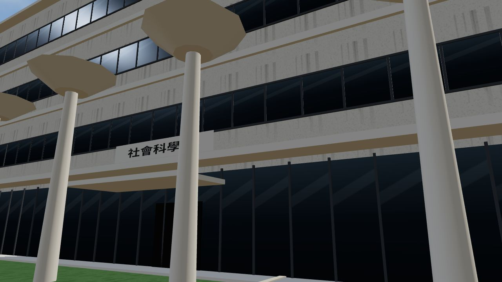
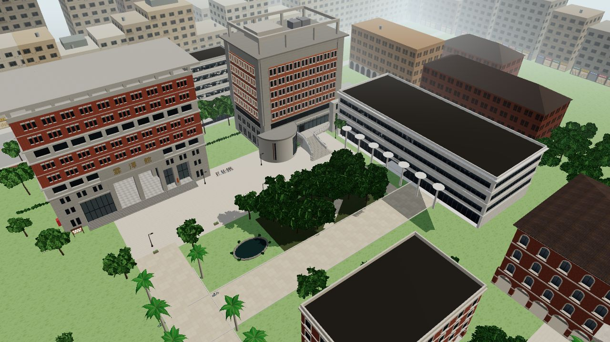
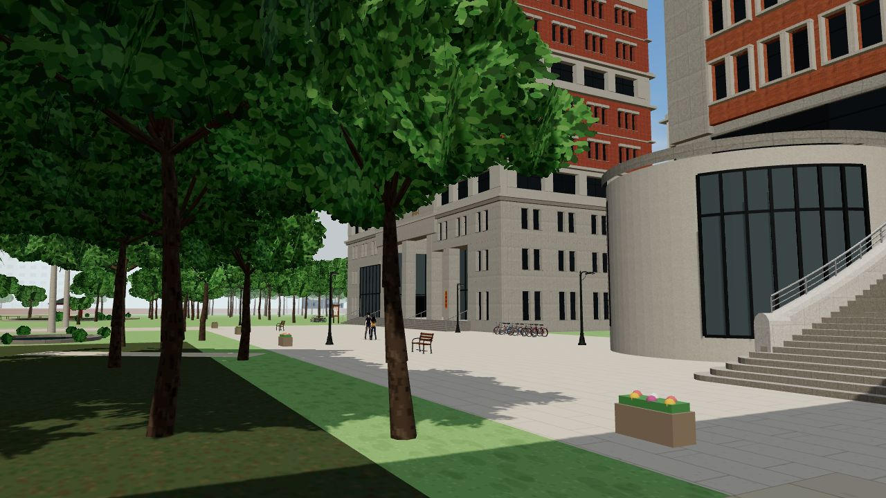
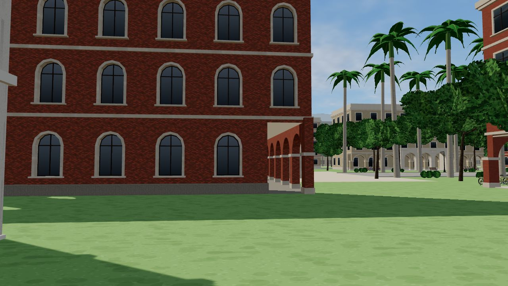
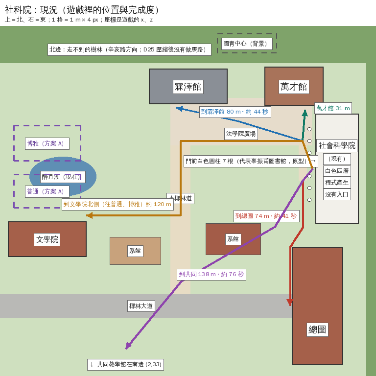
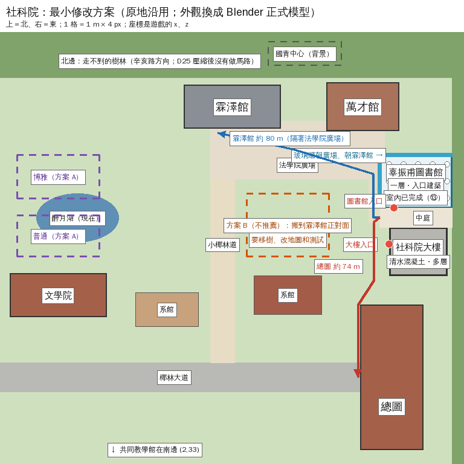

# 社會科學院（新社科院＋辜先生紀念圖書館）：現況與最小修改方案

> **2026-10-20 位置更正（X75，`PROJECT_DECISIONS.md` D107）**：使用者指出社科院不在法律系出去的左手邊、應該在西南。查證臺大官方交通資訊後，整組搬到霖澤館西南、小椰林道西邊（x −13～17、z −93～−43），轉 180°（大樓在北、正門朝小椰林道，圖書館在南，和真實一樣）。下面第 3 節的座標（x 95–125）是搬家以前的；現在的座標以 `src/data/socsci_layout.js`（`tools/gen_socsci_layout.py` 換算）為準，LAWWW2 的模型本身沒有重匯。

使用者 2026-10-13 定案（`docs/PROJECT_DECISIONS.md` D56）：
- 遊戲是現代首都帝大平行校園。
- 新社科院從經濟系大一第一天就存在，在法律系館A對面，也就是辜先生紀念圖書館所在的建築區域。
- 取消徐州路校區。
- 普通、共同、博思、社科院是跨學年共用的場景。

使用者要先看五件事：
1. 現有社科院的位置與完成度；
2. 要不要新模型；
3. 對校園地圖的影響；
4. 可以沿用的場景；
5. 最小修改方案與實際畫面。

## 0. 結論

| # | 問題 | 回答 |
|---|---|---|
| 1 | 位置與完成度 | **已經有**。 位置：校園 (110,-70)，法學院廣場東側、法律系館B南邊、總圖北邊，正面朝西（朝廣場）。 外觀：程式產生的白色四層樓（`CK.modern`），門前 7 根白色圓柱代表辜先生紀念圖書館（同一個白色造型的 Blender 版已經交來、還沒接，見第 2 點）。 有的：導航阻擋、鏡頭碰撞、大地圖的「社會科學院」字樣。 沒有的：入口、室內、快速前往。 完成度：外觀是 `BLOCKOUT`（程序化套件，照 D38 不能當正式美術）。 |
| 2 | 要不要新模型 | **要，照真實外觀新做**（Blender，LAWWW2 做）： ・前面一層樓的辜先生紀念圖書館：玻璃牆、白色樹狀柱、荷葉柱頂； ・後面的清水混凝土教學大樓。 **更正（16:55）**：LAWWW2 10-11 已經交了一個社科院的 Blender 外觀（⑤，`451d032` 的 `campus_modern.glb`，`READY_FOR_ART_REVIEW`，**還沒接進遊戲**）。它是照現在的白色原型做的（同樣的位置與大小、真的開出來的帶狀長窗、玻璃大廳、漆面粉刷），**不是真實的社科院**（清水混凝土＋前面的圖書館）。在正式模型做好之前，可以先用它取代程序化的白色方盒（品質比較好，但造型照樣不對）。 **圖書館一樓室內已經有**：LAWWW2 的 ⑬（`f3212c0`，`MODEL_READY`），65 個座位，還沒接進遊戲。 **大樓室內**（系辦、迎新用的教室）先用現有的教學館模板（`src/teach3d.js`），不需要新模型。 |
| 3 | 對地圖的影響 | 照最小方案，**只動社科院這一塊**（x 95–125、z -98～-42）。 映月湖、法律系館A、法律系館B、總圖、椰影大道、往法律系館B的小路都不動。 這一塊沒有劇情站位、舊存檔的出生點，舊存檔不受影響。 |
| 4 | 可以沿用的 | 社科院的位置、導航與大地圖標示；LAWWW2 的圖書館室內（⑬）；教學館模板（大廳、門牌、教室、座位、人流）；活動系統（演講、迎新都可以放在社科院的教室）；事件介面（`room`、`term`、`activity`）；快速前往、大地圖、目標導航；共同、博思、普通三棟的室內（課照課表放）。 |
| 5 | 最小方案 | 原地沿用、分三步（第 3 節）。實際畫面在第 2 節，方案圖在第 3 節。 |

## 1. 真實位置（查證）

這個開發環境連不到 map.ntu.edu.tw，下面用可以讀到的公開資料交叉確認。**請使用者有空時用官方地圖再對一次。**

| 事實 | 來源 |
|---|---|
| 社科院在復興南路二段的校門口旁，面對辛亥路二段 | [forgemind（伊東豐雄＋宗邁建築師事務所）](https://forgemind.net/media/toyo-ito-%E5%8F%B0%E7%81%A3%E5%A4%A7%E5%AD%B8%E7%A4%BE%E7%A7%91%E9%99%A2%E5%9C%96%E6%9B%B8%E9%A4%A8-%E4%BC%8A%E6%9D%B1%E8%B1%90%E9%9B%84-%E5%AE%97%E9%82%81%E5%BB%BA%E7%AF%89%E5%B8%AB%E4%BA%8B%E5%8B%99/)、[1469goodthings](https://1469goodthings.wordpress.com/2016/07/28/2016-coss-ntu-by-toyo-ito/) |
| 圖書館是單層建築，佔地約 51×45 m、高約 6 m，在前面，是社科院的入口建築；後面是清水混凝土的教學大樓 | 同上；[wowlavie](https://www.wowlavie.com/article/ae1700697) |
| 從辛亥路校門進來，左邊是霖澤館；右手邊的大樓是社科院（兩棟隔著入口的路相對） | [霖澤館交通指引](https://www.hnl.com.tw/jz/maprz.html)、[社科院大樓交通資訊（PDF）](https://ir.ncu.edu.tw/images/%E8%87%BA%E5%A4%A7%E7%A4%BE%E6%9C%83%E7%A7%91%E5%AD%B8%E9%99%A2%E5%A4%A7%E6%A8%93%E7%9A%84%E4%BA%A4%E9%80%9A%E8%B3%87%E8%A8%8A.pdf) |
| 圖書館一樓：白色樹狀柱撐起屋頂、柱頂像荷葉、上百個天窗 | [天下雜誌](https://www.cw.com.tw/article/5140431) |
| 開放時間：第三方資料寫週一到週四 08:20–21:00；週五、週末、寒暑假查不到 | [蕃薯藤旅遊](https://travel.yam.com/article/120519)（**需查證**，請使用者像法圖那樣查官網） |

**遊戲和真實的差異**：法學院區照 D25、D31 壓縮過，霖澤館、萬才館朝南（朝玩家走得到的法學院廣場）。
- 社科院在廣場東側，**隔著法學院廣場和法律系館A斜對面**（步行約 80 m）。
- 真實是隔著辛亥路校門進來的那條路相對。
- 要做到「正對面」得把社科院搬到廣場南邊（第 3 節的方案 B），要移樹、改地圖和測試，不推薦。

## 2. 遊戲現況（實際畫面）

開發分支 `24e7770` 的遊戲畫面，上午 10:30。Playwright＋SwiftShader，1280×720 桌機尺寸，**不是手機實機**；隱藏了 HUD 和玩家。

| **從法律系館A前看過去**：左邊是法律系館B的弧形量體，中間的白色長樓是社科院，前面是白色圓柱 | **法學院廣場往東看**：黑森林的樹後面是社科院的正面，招牌「社會科學院」 |
|---|---|
|  |  |
| **社科院正面近看**：白色四層樓、橫向長窗、一樓玻璃、薄雨遮；白色圓柱是圓柱體加圓盤（原型，D38 不能當正式美術） | **俯瞰法學院區**（西南往東北看）：左＝法律系館A、中＝法律系館B、右＝社科院（朝西、朝廣場）、右下＝總圖 |
|  |  |
| **從社科院前往法律系館A看**：左邊是黑森林，廣場對面是法律系館A（穿堂），右邊是法律系館B的弧形量體與大樓梯 | **從社科院往南走**：左邊是總圖的側面，右邊遠處是椰影小徑 |
|  |  |

現況平面圖（`tools/dev_scratch/socsci_plan_diagram.py`，照 `src/zones3d.js` 的座標畫，不是遊戲截圖；步行距離是用遊戲的導航格算的）：

| 從社科院前 (97.5,-70) 走到 | 距離 | 走路（1.8 m/s） |
|---|---|---|
| 法律系館B入口 | 31 m | 約 17 秒 |
| 椰影小徑北端 | 70 m | 約 39 秒 |
| 總圖入口 | 74 m | 約 41 秒 |
| 法律系館A入口 | 80 m | 約 44 秒 |
| 文學院北側（往普通、博思的路口；兩棟照方案 A 放好後再量一次） | 119 m | 約 66 秒 |
| 共同教學館門口 | 138 m | 約 76 秒 |
| 大一女舍 | 248 m | 約 138 秒 |

## 3. 最小修改方案（原地沿用）

**配置**（社科院這一塊裡面重排，外面不動）：
- **辜先生紀念圖書館**放在靠廣場的那一半（x 95–125、z -92～-70）：
  - 玻璃牆朝西（朝廣場、朝法律系館A）、朝北（朝法律系館B），裡面看得到白色樹狀柱；
  - 入口在南邊的中庭。
  - LAWWW2 的室內是 30×22 m，照校園的壓縮比例，不另外改尺寸。
- **社科院大樓**（清水混凝土、多層）放在後面（x 99–123、z -62～-42），入口朝西（往法律系館B的小路）和北邊的中庭。
- 兩棟之間是中庭（z -70～-62），往西接到往法律系館B的小路。
- 門前 7 根白色圓柱拿掉，由圖書館本身取代。

**分三步做**（都先在開發分支，驗收後才發布）：

| 步驟 | 內容 | 誰 | 驗收狀態 |
|---|---|---|---|
| ① 入口＋圖書館室內（不等外觀） | 在現在的建築正面加「進入社科院圖書館」→ LAWWW2 的室內（⑬）。 大地圖、快速前往、目標導航加上。 開放時間先用查到的平日時間（**需查證**）。 | LAWWW | `MODEL_READY` → `INTEGRATED` → `FUNCTIONAL_VERIFIED` |
| ② 外觀換成正式模型 | Blender：一層樓的圖書館（玻璃、樹狀柱、荷葉柱頂、天窗）＋清水混凝土大樓。 導航阻擋照新的外形。 舊的白色樓和圓柱留作載入失敗時的備用（D38 分類 ③）。 | LAWWW2 建模、LAWWW 整合 | → `READY_FOR_ART_REVIEW`（使用者看過才算數） |
| ③ 大樓室內（需要時） | 用教學館模板做一樓大廳、系辦（門牌，例如經濟系、政治系）、一間辦迎新／演講的教室。 活動資料（迎新、演講）由 AA、BB 給、使用者批准後才放。 | LAWWW | 之後 |

**不做的**（D56）：徐州路校區、第二座校園、跨校區交通；杜可昕、經濟系朋友等還沒批准的人物劇情。

**方案 B（不推薦）**：把社科院搬到法學院廣場南邊（x 40–74、z -76～-50），和法律系館A正對面。
- 要移掉那裡的樹、改大地圖與目標導航、改 `campus_layout_nav` 等測試。
- 原本的位置會空出一塊要重新填。
- 使用者如果覺得「斜對面」不對，再改這個。

## 4. 五年日曆（D56 第五點）

已確認，開發分支 `24e7770`：
- 日曆前面加了經濟系大一上、下（2024-09-02、2025-02-17 開學，照 AA_106，**需查證**）。
- 補了 2024 年的農曆節日。
- `tests/calendar_hours_unit.js` 檢查 2024-08～2029-07 的每一天：日期、星期、學期、假日都算得出來，十個學期依序、不重疊、週次連續、學期之間有寒暑假。
- 法律系的第 1 天仍是 2025-09-17，**舊存檔不受影響**。
- 畫面的日期只寫學年、學期、日期、星期，例如「9/18 週三・經濟系大一上 第 3 週」，不寫西元年份。
- 2024 年也照 2025 年修正後的放假規則（平行世界、虛構年份）。

還沒做（等經濟系那一年的劇情與課表確認，`docs/TIMELINE_COMPAT_AUDIT.md`）：
- 每個存檔自己的起點；
- 「法律系第幾天」的換算（主線裡寫死的第 1、2 天）；
- 經濟系的課。
