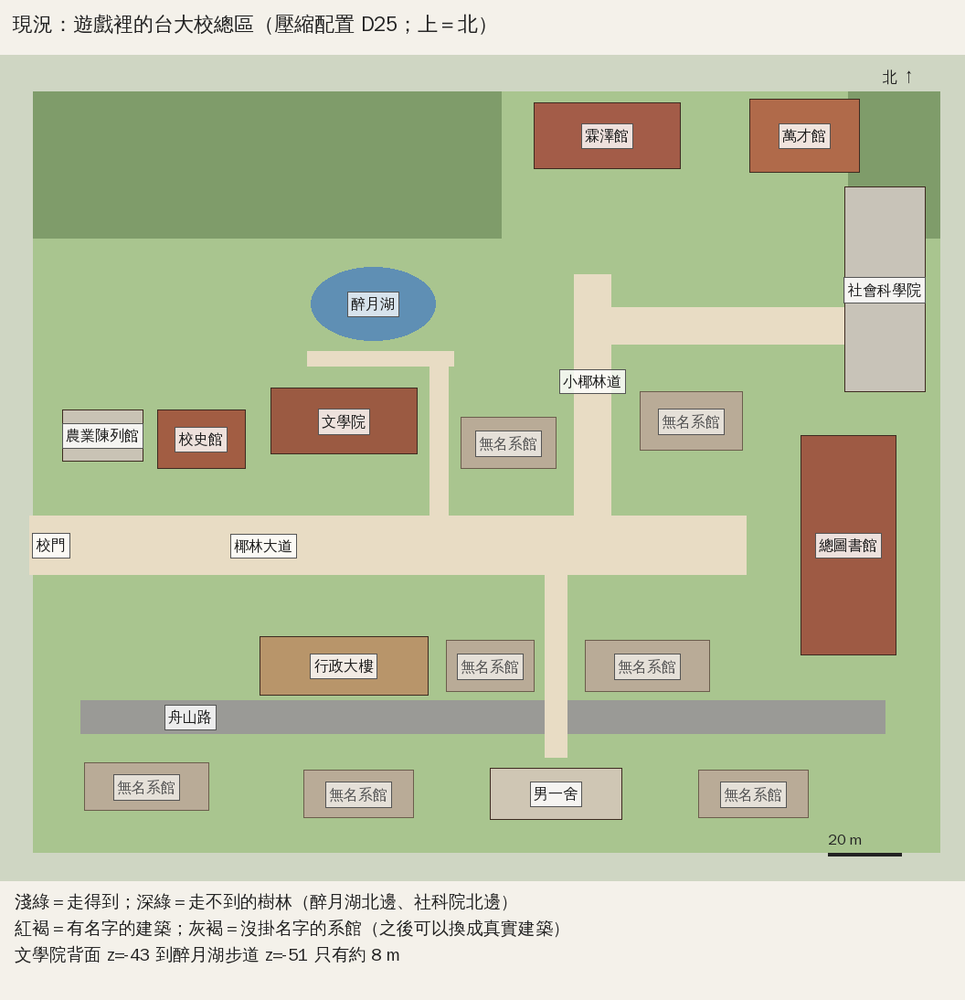
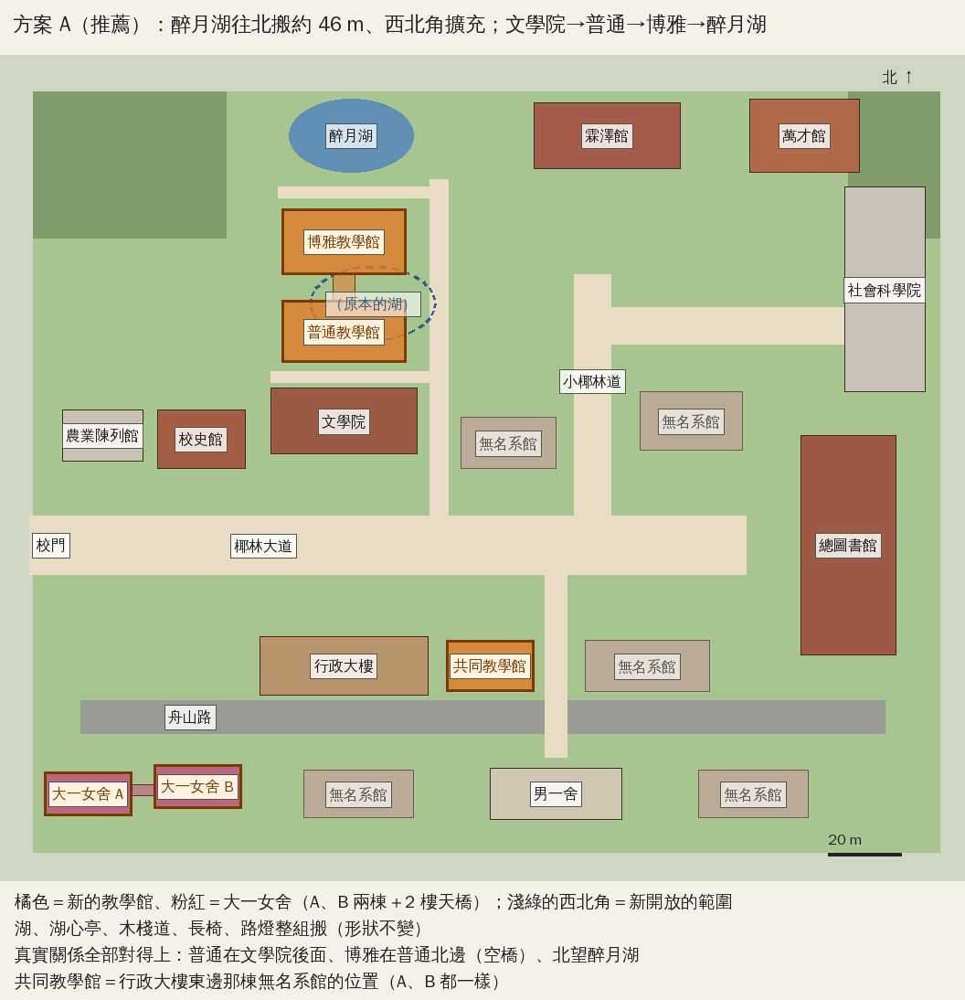
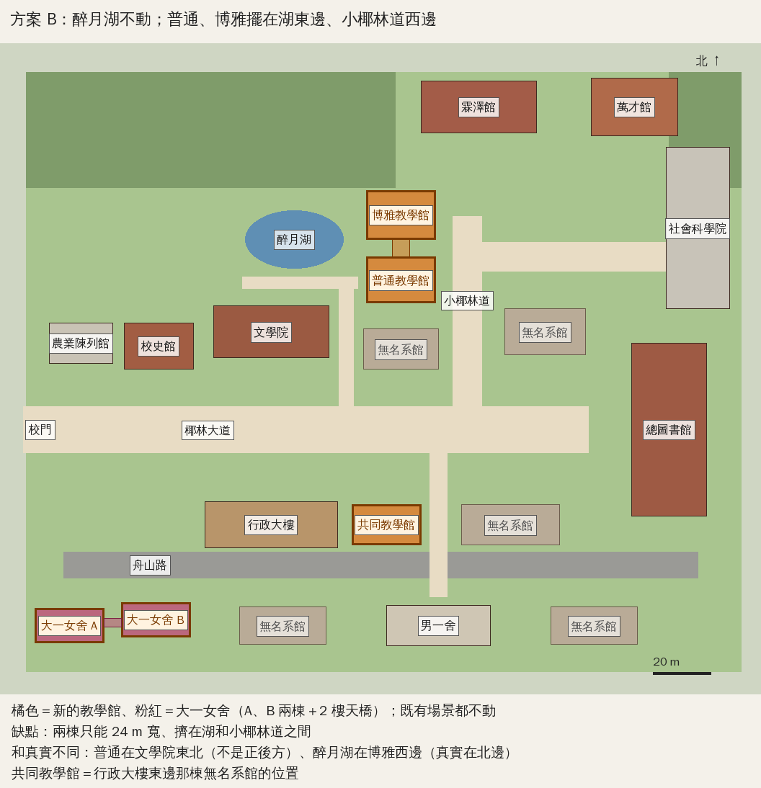
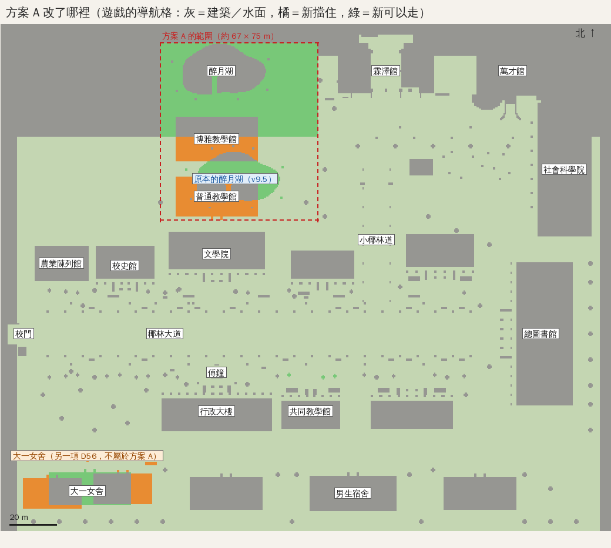
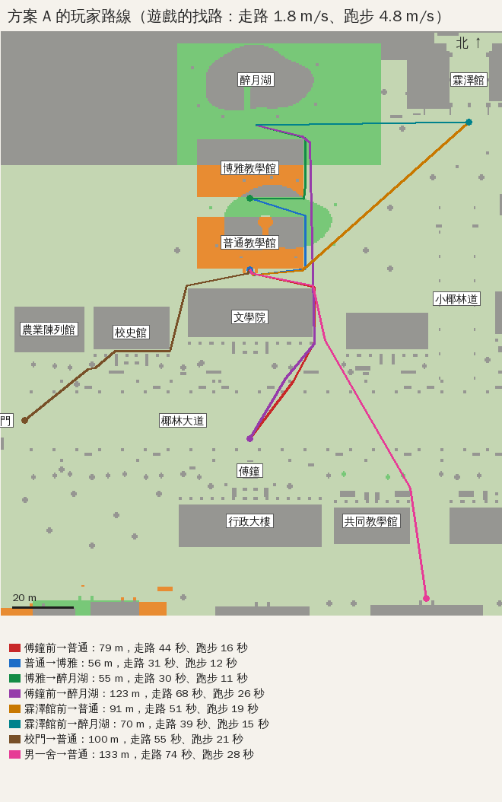

# 台大總校區三棟公共教學館：位置查證與配置規劃

使用者 2026-10-13 決定：先擴充首都帝大總校區，新增**普通教學館、共同教學館、博思教學館**。這三棟是整個遊戲反覆使用的公共教學空間，不是經濟系的一次性劇情場景：法律系的通識、共同課程、跨系活動會用到，之後的經濟系大一也會用到。經濟系的劇情、人物、課表等 AA、BB 企劃整合、使用者確認後才做。

分工：
- **LAWWW2**：外觀查證、照片與參考、Blender 模型、GLB。
- **LAWWW**：位置規劃、整合（碰撞、導航、入口、地圖、快速前往）、測試、版本與存檔相容。

這份文件記錄：真實位置的依據、遊戲現有座標的盤點、放得下放不下、配置方案、驗收與測試。

## 1. 真實位置（查證依據）

**限制**：這個開發環境連不到 https://map.ntu.edu.tw （DNS 查不到，台大其他網站也一樣）。使用者 2026-10-09 提供的「臺大校總區平面圖（2025.10.13 版）」有著作權，當時沒有放進 repo（D23）。下面的位置關係改用可以讀到的公開資料交叉確認，**不是憑印象**；請使用者有空時用官方地圖再對一次。

| 建築 | 位置關係（原文意思） | 來源 |
|---|---|---|
| 共同教學館 | 南臨舟山路、鹿鳴廣場；西邊隔著木造走廊和行政大樓相鄰；前方有「共同三松」。原名「共同科目教室」，2010 年改名 | [維基百科：國立臺灣大學共同教學館](https://zh.wikipedia.org/zh-tw/%E5%9C%8B%E7%AB%8B%E8%87%BA%E7%81%A3%E5%A4%A7%E5%AD%B8%E5%85%B1%E5%90%8C%E6%95%99%E5%AD%B8%E9%A4%A8)；[臺大法律系學生會〈校園介紹（下）— 實用地點〉](http://ntulawsa102.blogspot.com/2013/09/blog-post_8792.html)（兩處文字一致） |
| 普通教學館 | 舊稱普通大樓；位於文學院、小福利社、運動場、博雅教學館之間；二樓以天橋連博雅教學館 | [維基百科：國立臺灣大學普通教學館](https://zh.wikipedia.org/zh-tw/%E5%9C%8B%E7%AB%8B%E8%87%BA%E7%81%A3%E5%A4%A7%E5%AD%B8%E6%99%AE%E9%80%9A%E6%95%99%E5%AD%B8%E9%A4%A8)；[PTT NTU 板〈普通教學館〉](https://www.ptt.cc/bbs/NTU/M.1361952397.A.6F1.html)（「普通在文學院後面那棟」） |
| 博雅教學館 | 位於醉月湖、普通教學館、垂葉榕道之間；以空橋連接**南側**的普通教學館；北望醉月湖；2012 年啟用；建築師蔡元良（境向聯合建築師事務所），綠建築 | [維基百科：國立臺灣大學博雅教學館](https://zh.wikipedia.org/zh-tw/%E5%9C%8B%E7%AB%8B%E8%87%BA%E7%81%A3%E5%A4%A7%E5%AD%B8%E5%8D%9A%E9%9B%85%E6%95%99%E5%AD%B8%E9%A4%A8)；[中國時報〈台大博雅教學館 北望醉月湖畔〉](https://www.chinatimes.com/newspapers/20170503000573-260115)；[臺大土木系〈博雅教學館交通指引〉](https://www.ce.ntu.edu.tw/wp-content/uploads/2019/04/%E5%8D%9A%E9%9B%85%E6%95%99%E5%AD%B8%E5%A4%A7%E6%A8%93map.pdf)（從椰林大道左側第二條叉路往北，十字路口的右斜前方） |
| 醉月湖 | 舊稱牛湳池；在校本部舊體育館後方；2017 年在南側增加瑠公圳舊圳道景觀區 | [臺大訪客中心〈醉月湖〉](https://visitorcenter.ntu.edu.tw/News_Content_n_74842_s_81631.html)；維基百科「醉月湖」 |

**室內（教室的種類與大小）**：
- 來源：
  - [臺大教務處〈校屬 5 棟教學館教室容量表〉（115.08.21 版）](https://www.aca.ntu.edu.tw/WebUPD/aca/CDForms/%E6%A0%A1%E5%B1%AC5%E6%A3%9F%E6%95%99%E5%AD%B8%E9%A4%A8%E6%95%99%E5%AE%A4%E5%AE%B9%E9%87%8F%E8%A1%A8.pdf)
  - [〈教學館教室借用收費標準表〉](https://www.aca.ntu.edu.tw/WebUPD/aca/CDForms/%E6%95%99%E5%AD%B8%E9%A4%A8%E6%95%99%E5%AE%A4%E5%A0%B4%E5%9C%B0%E5%8F%8A%E8%A8%AD%E5%82%99%E5%80%9F%E7%94%A8%E6%94%B6%E8%B2%BB%E6%A8%99%E6%BA%96%E8%A1%A8.pdf)
  - 維基百科三棟的條目
- 經由搜尋摘要讀到；PDF 本身沙盒打不開。

| 建築 | 教室 | 公共空間 |
|---|---|---|
| 共同教學館 | 3 間階梯教室（678 人）、1 間未來教室、16 間錄播教室、24 間平面教室。教室編號照樓層：共 101（一樓，240 人階梯）、共 301（200 人階梯），最高到共 4xx | — |
| 博思教學館 | 7 間階梯教室（1,553 人）、1 間未來教室、1 間遠距教室、22 間錄播教室、14 間平面教室。博思 101（400 人，一樓）、102、103（約 280 人）。二樓 2 間階梯＋4 間討論教室；三樓 2 間階梯＋10 間討論教室 | **一樓有三處大型公共空間：沙發、桌椅，供學生自習與討論**（使用者記得的自習小桌） |
| 普通教學館 | 25 間教室、約 2,630 個座位（大教室多）；二樓空橋連博雅 | 還沒查到 |

→ 遊戲的模板要照這些修正：
- 共同的一樓要有階梯教室（共 101），其他是平面教室；
- 博思一樓是大階梯教室＋三處自習與討論的公共空間；
- 教室門牌照真實的編號規則。

從南往北，真實的關係是：

**椰影大道 → 文學院 → 普通教學館 →（空橋）→ 博思教學館 → 映月湖**

共同教學館在椰影大道南側、行政大樓東邊（中間是木造走廊），背面是舟山路。

三棟都不在法律學院旁邊，也不是排成一排：
- 共同在大道南側。
- 普通、博思在大道北側、文學院後面，往映月湖的方向。

還沒查證、要 LAWWW2 從照片確認的：
- 外觀（層數、材料、立面）；
- 正門與側門的位置；
- 木造走廊、空橋的樣子；
- 「共同三松」在哪一側；
- 「垂葉榕道」與「小福利社」的確切位置。

## 2. 遊戲現有的世界座標（盤點）

- 座標：x 往東、-z 往北，1 單位＝1 m。
- 校園照臺大平面圖「壓縮」（D25）：椰林大道大約 1:3.7（校門 x=-124 → 總圖 x≈87）。
- 刻意和真實不同的地方：
  - 法律學院放在椰影小徑北端。
  - 社科院在總圖北邊。
  - 舟山路是行政大樓後面的直路。
  - **醉月湖比真實靠近大道**（中心 (-30,-66)）。
- 走得到的範圍：x -123..125、z -124..84。西北角（x -123..5、z -124..-84）是走不到的樹林，社科院北邊（x 100..125）也是。
- 劇情、事件、人物資料都沒有用到映月湖的座標（已搜尋 `src/story3d.js`、`src/data/events.js`、`src/data/characters.js`、`src/guide3d.js`）。只有 `tests/campus_layout_nav.py` 的地點清單、大地圖地名（`src/data/places.js`）和校園本身用到。

現況（`tools/dev_scratch/teaching_plan_diagram.py` 依 `src/zones3d.js` 的座標畫，不是遊戲截圖）：

| 位置 | 現在是什麼 | 能不能放教學館 |
|---|---|---|
| 行政大樓東邊 (2,33)，24×14 | 第十八批補的**沒有名字的系館**（「大道南側、行政大樓東邊」） | **可以**：正好是共同教學館的真實位置——西邊隔 5 m 是行政大樓，南邊是舟山路。直接換掉這棟無名系館，不動其他東西 |
| 文學院背面 (z=-43) 到映月湖步道 (z=-51) | 約 8 m 的草地 | **放不下**普通＋博思 |
| 醉月湖東邊、小椰林道西邊（x -8..22、z -84..-40） | 草地、三棵樹 | 擠得下兩棟 24 m 寬的，但位置關係和真實不同（方案 B） |
| 映月湖北邊（x -70..5、z -124..-84） | 走不到的樹林（背景） | 校園往北擴充後可以用（方案 A） |

## 3. 配置方案

### 共同教學館（位置確定，兩個方案相同）

- 取代 (2,33) 的無名系館：ry=π，正面朝北、對著椰影大道，和行政大樓同方向；footprint 24×14（x -10..14、z 26..40）。
- 正門在北面中間。大道的樹牆在 x -2..6 本來就留了空，大道上的杜鵑叢在 x -2.4..2.4 有缺口，玩家可以直接從大道走到門口。
- 和行政大樓之間的 5 m 做有頂的木造走廊，玩家可以從走廊下走過。外觀等 LAWWW2 的照片查證。
- 課表系統原本的「共同課程教室」暫時上課點在 (45,22.6)（另一棟無名系館門口，做課表時放的）。共同教學館蓋好後移到它的正門。

### 普通、博思：兩個方案（需要使用者決定）

**方案 A（推薦）：映月湖往北搬、西北角擴充**

- **映月湖整組往北搬約 46 m**：中心 (-30,-66) → (-36,-112)。湖面、石砌湖岸、湖心亭、木棧道、長椅、路燈、蘆葦一起搬，形狀不變。原本走不到的西北角樹林（x -70..5、z -124..-84）改成走得到；樹林往西、往北退。
- 新的位置：
  - **普通教學館**在文學院正後方（中心約 (-38,-58.5)，34×17）。
  - **博思教學館**在普通北邊（中心約 (-38,-83)，34×18），二樓空橋連普通。
  - 博思的北邊是新的湖南岸步道和映月湖。
- 路：往映月湖的小路（x≈-12）往北延長到新的湖邊；文學院和普通之間加一條東西向的路。
- 和真實的關係**全部對得上**：普通在文學院後面、博雅在普通北邊（空橋）、博雅北望醉月湖。
- 影響：
  - 湖和湖心亭的位置改變（劇情沒有用到）。
  - `tests/campus_layout_nav.py` 的湖邊地點換成新座標（照樣檢查木棧道、湖心亭走得到、湖面不能走，不放寬標準）。
  - 舊存檔剛好站在舊湖面或新建築裡的，讀檔後照現有的規則移到最近站得住的地方（`OLD_SAVES` 測試）。
  - 大地圖的「映月湖」地名跟著改。
  - VISUAL_REVIEW 第 8 節的俯視圖要重拍。
- 這是「可以漸進擴充」的做法：只開放西北角一塊，其他地方都不動；之後要加新生教學館、小福利社等，也從這一塊往外長。

**方案 B：映月湖不動**

- 普通、博思擺在湖東邊、椰影小徑西邊（各 24 m 寬，中間空橋）。
- 優點：既有場景完全不動。
- 缺點：
  - 兩棟只能做 24 m 寬，擠在湖和椰影小徑之間。
  - **和真實不同**：普通在文學院東北，不是正後方；醉月湖在博雅西邊，真實在北邊。

使用者 2026-10-13 說「不要為了新增三棟建築而破壞既有場景的位置；若需要更大的校園世界，請提出可漸進擴充的方法」。方案 A 要搬動映月湖，所以**先請使用者決定**。在那之前：
- 共同教學館照常做（兩個方案相同）；
- 普通、博思只做外觀研究，還不放進遊戲。

## 3b. 大一女舍（使用者 2026-10-13 第二則：列為優先場景）

**查證**：
- 官方：[臺大學務處住宿服務組〈大一女舍簡介〉](https://osa_dorm.ntu.edu.tw/Freshman_House)：在校園內，鄰近公館捷運站 2、3 號出口、近公館商圈；**A、B 兩棟、各 5 層樓**。
- 官方：[〈學生宿舍地址〉](https://osa_dorm.ntu.edu.tw/CID-2)：地址是羅斯福路四段 1 號（校本部）。
- 學生整理的[〈女宿住宿懶人包〉](https://icheft.github.io/docs/NTU/girls-dorm.html)（非官方，可能較舊，請 LAWWW2 用照片再確認）：
  - 傳達室在 A 棟；A 棟出入口離捷運 3 號出口較近；B 棟靠近舟山路；
  - **兩棟 2 樓有天橋相連**；
  - 還沒拿到學生證前要從 A 棟進出，B 棟大門要刷學生證。
- 學生社群的整理：靠近公館的是大一女、女一、女二、女三、女五；女八、女九靠近新生教學館。
- **不是女一舍、不是水源 BOT**：名字、兩棟加天橋、位置都照上面的資料。

**遊戲位置**：
- 校園西南角、舟山路西段南側：靠校門與公館那一側，對應真實「近公館捷運站、B 棟靠舟山路」。
- 這裡目前是第二十批補的無名系館 (-92,66)，換掉，不動其他東西：
  - A 棟中心 (-108,68)、24×12、5 層，靠西；正門朝北，傳達室在正門旁。
  - B 棟中心 (-78,66)、24×12、5 層，靠東、離舟山路近一點；正門朝北對著舟山路，刷卡門。
  - 兩棟之間 6 m，2 樓有天橋；天橋下面可以走。
- 第一階段：
  - 外觀用校園套件，標 `BLOCKOUT`，等 LAWWW2 的模型；
  - 門口的等候位置（長椅、腳踏車架）；
  - 門禁：主角是男生，大門寫「男賓止步」，可以在門口等人，不能進去；
  - 地圖地名、快速前往、導航。
- 之後：門口傍晚與晚上的人（第 3 節的人流系統）。杜可昕、沛珊的事件等 AA、BB。

## 4. 第一階段的驗收（使用者列的 8 項）與測試

| 項目 | 做法 | 測試 |
|---|---|---|
| 1 正確的校園位置 | 本文件第 3 節 | 和第 1 節的位置關係對照（俯視算圖） |
| 2 外觀的主要辨識特徵 | LAWWW2 的 Blender GLB；GLB 到之前先用校園套件的方盒外觀，標 `BLOCKOUT`，掛正確的館名牌 | Blender 渲染＋遊戲截圖（同角度前後比較）；只有使用者能標 `ART_APPROVED` |
| 3 走在校園看得到 | 放在大道旁或主要步道旁 | 遊戲截圖（手機直向／橫向） |
| 4 地圖名稱與位置 | `PLACES.landmarks.campus` 加三個地名；大地圖、小地圖讀同一份 | `tests/minimap_direction.py`；大地圖截圖 |
| 5 清楚的入口 | 入口標記（和其他建築同一套）＋門口互動 | 截圖 |
| 6 走得到入口、不被錯誤碰撞擋住 | 導航阻擋來自套件（建築本體＋門廊），門口留通道 | `tests/campus_layout_nav.py`（新地點）、`tests/reachability_all.py`、`tools/dev_scratch/nav_islands.py`；**真實玩家流程**：從椰林大道點地面走到門口（不瞬移） |
| 7 快速前往與目標導航指向入口 | 手機「地點」與大地圖的快速前往；`guide3d.js` 的地名規則 | 快速前往後站得住、走得出來（玩家流程） |
| 8 不穿牆、不掉出場景、不卡在模型裡 | 建築阻擋＋鏡頭碰撞（`ckPlace`）；GLB 只換外觀，阻擋照套件 | `tests/p0_movement.py`、`tests/zone_transitions.py`；舊存檔站在新建築位置的讀檔測試 |

另外：
- 效能：比較校園的 draw call 與三角形數（放進前後）。雲端沙盒的 SwiftShader 只有 1–4 fps，量不出實機效能；手機實機效能**還沒驗證**。
- 回歸：既有總圖、法律學院、宿舍、其他區域照完整回歸跑（`tests/release_suite.sh`）。
- 舊存檔：`tests/save_compat_v7.py`、`tests/save_compat_live.py`。

室內（大廳、走廊、樓梯、電梯、普通教室、大階梯教室、休息區）是第二階段：
- 做成可重複使用的教學館模板（和法律系館A、B同一套分層導航）。
- 室內沒有查證的部分做成可替換的模板，**不宣稱和真實相同**。
- 第一階段的門口先寫清楚「室內整修中」，不用隱形牆。

## 5. 狀態

| 項目 | 狀態 |
|---|---|
| 三棟真實位置查證 | 完成（公開資料交叉確認；官方地圖沙盒連不到，請使用者再對一次） |
| 共同教學館位置 | 確定：(2,33) |
| 普通、博思位置 | 開發分支已照**方案 A** 做好（D55）；**等使用者驗收**（第 6 節：俯視圖、影響範圍、路線、替代方案） |
| 大一女舍 | 位置查證完成（學務處官方簡介）；規劃：校園西南角、舟山路西段南側（取代無名系館 (-92,66)） |
| LAWWW2 分派 | 2026-10-13 已送達（DELIVERED），等 ACK；法圖照原安排繼續 |
| 模型 | 還沒有（LAWWW2 先做法圖，再做三棟的參考研究、共同） |
| 整合進可玩的 3D 地圖（開發分支，外觀是 BLOCKOUT） | 共同教學館：外觀、門口、地圖、快速前往、**室內第一版**（大廳、走廊、樓梯、休息區、自習區；一樓東半是**共 101 階梯教室**（五排、40 個座位、兩側台階走道、講台在大廳那一端的門口）＋三間平面教室 102、201、202；課在 101 上）；大一女舍：A、B 兩棟＋天橋、門口長椅、男賓止步、地圖、快速前往；門口的人流（上課前後、早晚） |
| 室內（開發分支，2026-10-13 晚）| 共同、博思、普通三棟都用同一個模板（`src/teach3d.js`）：**博思**一樓 101、102 階梯教室（各 66 位）、沙發區、自習小桌、討論桌、講座資訊螢幕，二樓 201、202 討論教室；**普通**中間走廊、1F 101–104 與 2F 201、202 平面大教室、往博思的空橋（關著）。所有椅子都擋住（不能穿過椅子）。博思、普通的校園門口照方案 A 做好（開發分支），等使用者驗收方案 A |
| 測試 | 單元測試全部通過（`campus_public_unit`、`nav_teach_unit`（三棟）、`teach_class_unit`、`boya_lecture_unit`、`crowd_unit`、`quick_travel_unit`）；**瀏覽器的玩家流程（`flow_teaching_buildings.py`、`flow_classes.py`、`flow_boya_interior.py`）還沒跑** |
| 發布 | 都只在開發分支，沒有發布 |
| 效能（模型層面；在 Node 建區域、數合併前的網格與三角形） | 校園：v9.5 候選 1,239 個網格／58.9 萬三角形 → 開發分支 1,274／60.0 萬（+2.8%／+1.8%；共同教學館、大一女舍兩棟＋天橋、門口長椅與車架）；共同教學館室內 370 個網格／2.3 萬三角形（法圖室內 437／1.2 萬）。瀏覽器會合併靜態網格，draw call 比這少。**手機實際幀率沒有量**（雲端沙盒是 SwiftShader） |

## 6. 方案 A 驗收資料（2026-10-13 晚；ChatGPT 審查第六點）

圖都是用**遊戲自己的導航資料**畫的：
- 工具：`tools/layout/campus_nav_dump.js` 在 Node 裡蓋出校園、輸出導航格與找路結果，`tools/layout/plan_a_map.py` 畫圖。
- 比較的兩個版本：v9.5（`a4f2760`，線上版）和開發分支（`6ffafc0`）。

### 6-1 改了哪裡

- **範圍只有西北角**：文學院後面到新的湖，約 67 × 75 m（x −62～5、z −124～−48.5）。
  - 文學院本身、椰影大道、晨思鐘、法律系館A、B、總圖、椰影小徑、所有入口與快速前往的地點都沒動。
- **新擋住約 666 m²**（橘色）：普通教學館（34 × 16 m）、博思教學館（34 × 18 m）、搬過去的映月湖。
- **新可以走約 2,082 m²**（綠色）：
  - 原本的湖面；
  - 原本走不到的西北角樹林（湖北移後打開）。
- **映月湖整組保留**：湖面形狀、石砌湖岸、湖心亭、木棧道、長椅、路燈、蘆葦一起往北搬約 46 m，中心 (−30,−66) → (−36,−112)。
  - 湖在博思北邊，中間隔一條湖南岸步道。
- 圖上另外看得到的改動是**大一女舍**（左下，D56 的另一項，不屬於方案 A）。
- **劇情、事件、人物資料都沒有用到映月湖的座標**（第 2 節已搜尋），所以搬湖不影響劇情。

### 6-2 玩家怎麼走

| 路線 | 方案 A（開發分支） | v9.5 |
|---|---|---|
| 晨思鐘前 → 普通門口 | 79 m（走路 44 秒、跑步 16 秒） | —（沒有普通） |
| 普通門口 → 博思門口 | 56 m（31 秒／12 秒）：繞過普通東側到兩棟中間（二樓空橋之後再開） | — |
| 博思門口 → 映月湖南岸 | 55 m（30 秒／11 秒） | — |
| 晨思鐘前 → 映月湖南岸 | 123 m（68 秒／26 秒） | 73 m（40 秒／15 秒） |
| 法律系館A前 → 映月湖南岸 | 70 m（39 秒／15 秒） | 79 m（44 秒／16 秒） |
| 法律系館A前 → 普通門口（週五重修經原、下午回法律系館A） | 91 m（51 秒／19 秒） | — |
| 校門 → 普通門口 | 100 m（55 秒／21 秒） | — |
| 男一舍 → 普通門口 | 133 m（74 秒／28 秒） | — |

- 時間是遊戲裡的走路 1.8 m/s、跑步 4.8 m/s，不含轉彎。
- 也可以用手機「地點」快速前往「普通教學館」「博思教學館」（照距離算時間）。
- **玩家感受到的差別**：
  - 從椰影大道去映月湖多走約 50 m；
  - 從法律系館A去映月湖反而近一點。
  - 文學院後面原本看得到的湖，現在換成普通教學館；湖在博思後面。

### 6-3 有沒有「位置照真實、醉月湖不動、導航不變」的替代方案？

- **真實的順序**：椰林大道 → 文學院 → 普通 →（空橋）→ 博雅 → 醉月湖（博雅北望醉月湖）。
- **照這個順序放兩棟真實大小的教學館，需要約 54 m 的深度**：
  - 文學院背面 → 7.5 m 步道 → 普通 16 m → 7.5 m（空橋）→ 博思 18 m → 5 m 湖南岸步道。
- **v9.5 文學院背面到湖南岸步道只有約 8 m。**

| 方案 | 位置和真實一樣 | 醉月湖 | 現有導航與場景 | 結論 |
|---|---|---|---|---|
| **A（開發分支）**：湖往北搬 46 m | 全部對得上 | 保留（整組搬，形狀不變），就在博雅北邊 | 只改西北角；其他不變 | **推薦**。46 m 是放得下兩棟真實大小教學館的最小距離 |
| B：湖不動，兩棟放在湖東邊、小椰林道西邊 | 不對：普通在文學院東北（不是正後方）、湖在博雅西邊（真實在北邊） | 不動 | 只改湖東邊 | 可以做，但和真實位置不同 |
| C：湖不動、順序照真實 | 對 | 不動 | — | **放不下**：只有 8 m，要 54 m |
| D：湖只搬一部分（例如 20 m）、教學館縮小 | 對 | 保留 | 只改西北角 | 不推薦：博思兩間 66 人階梯教室、二樓教室已照現在的大小做好室內，縮小要重做室內 |
| E：搬文學院，讓出空間 | 對 | 不動 | 文學院、晨思鐘一帶的位置、存檔裡站在那裡的玩家都會受影響 | 不推薦：動到更多既有場景 |

結論：在「位置照真實、保留醉月湖、不動其他場景」三個條件下，方案 A 是改動最小的做法。

### 6-4 存檔相容

- **v9.5 的玩家如果站在舊湖邊存檔**，那個位置在方案 A 是普通教學館裡面。
  - 讀檔時引擎會移到最近站得住的地方（`E.unstick`）。
  - `tests/save_compat_v95.py` 用 v9.5 自己寫的存檔檢查：讀得進來、移到 15 m 內站得住的地方、走得到普通的門口。
- 其他地方的存檔位置不受影響（導航只在西北角改變）。

### 6-5 需要使用者決定

**方案 A 可以嗎？** 映月湖保留，整組往北搬約 46 m，到博思北邊；從椰影大道去映月湖會多走約 50 m。
- 可以：方案 A 和開發分支上已經做好、測過的課表、手機等一起進 v9.6（發布前跑完整回歸）。
- 想要別的：告訴我哪裡要改。B 可以在開發分支另外做一版給你比較（約半天）。

驗收狀態：位置與導航 `FUNCTIONAL_VERIFIED`（Node 導航測試、瀏覽器流程測試）；外觀是 `BLOCKOUT`（等 LAWWW2 的 Blender 模型）；**未經使用者確認**。
