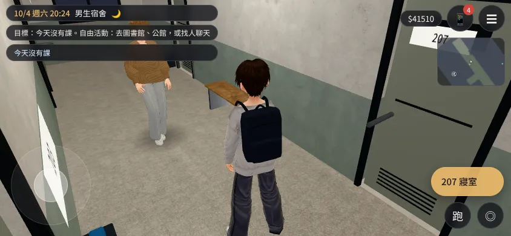

# BB_218　BB-C 瀏覽器實測紀錄

> **地名（2026-10-30 RENAME-1030）**：本檔的校名、館名已照 `docs/WORLD_NAMING.md` 換成新名（首都帝大、木柵大學、法律系館A／B、晨思鐘、椰影大道、映月湖、小松、學活……）。在遊戲改名以前測的版本，畫面上是舊名（霖澤館、萬才館……）；要看當時的原字，看 git 歷史（10-30 換名以前的版本）。使用者原話照留。

> - 測的是 LAWWW-C 分支 `claude/adoring-meitner-mqzst8`，在 BB-C 自己的容器裡開一份唯讀副本跑。測試腳本放在 scratchpad，不放進 repo。
> - 這是 Playwright 的手機模擬（橫向 844×390、觸控、`?lowres`），**不是實機**。
> - 玩法照 LAWWW 的 `tests/flow_v0_to1017.py`：
>   - 對話點過去，選項照偏好選；
>   - 空下來用手機「今天」去上課或跳過時間；
>   - 21:00 以後回宿舍睡覺；
>   - 不瞬移、不改旗標。
> - 這種玩法**不會主動找人聊天、不去社團**，所以要玩家自己去找人才會觸發的劇情，本來就測不到。

## 1. 大二上第 1～4 週（2026-10-17 21:3x～23:0x；LAWWW 版本 `b3bbc6d8`）
- **[前置／捷徑]**：
  - 讀檔到 2026-09-07 07:30 宿舍；
  - 主線旗標 `introDone`、`KX_FIRST_MSG`、`FAM_GROUP_SENT`、`CEREMONY_Y1`、`KAI_MOVEIN` 等；
  - BB 人物見過面，熟悉 40、信任 25、自在 25。
- **玩到 10/2（大二上第 4 週週五）**。LAWWW 派了寒暑假、美國交換，先停在這裡。
  - 9/7～10/2 每一天都過到；
  - 沒有 JS 錯誤；
  - 沒有用到卡住保險（walkFallbacks 0）。
- **卡住、看起來卡住的三次**：
  1. **9/8 早上**（只有第一次跑時）：可昕補發的「早安」訊息（`kexinFirstMsg` 的 morning 版，給舊存檔用的）回完以後，玩家停在 busy、沒有對話框，點畫面沒反應。
     - 原因是 BB 的起點存檔沒有 `KX_FIRST_MSG`，觸發了舊存檔的補發。
     - 重跑同一天沒有再發生，**沒有重現**。
     - 留意：真的帶舊存檔進來的玩家會走到這段（`story3d.js` 起床那一段）。
  2. **9/18 早上**：手機開著，對話被蓋住。重跑沒有發生，是測試程式太早打開手機，**不是遊戲的問題**。
  3. **9/21 早上**：起床約 4 秒後才出「早安。今天的課：……」的對話。玩家在這之前打開手機，對話就被壓在手機下面，看起來像卡住。
     - 按手機「收起來」就出現，可以繼續，**不會卡死**。
     - 小的操作問題：對話跳出來的時候手機開著。建議起床對話出現時自動收起手機，或手機開著時先不出。低優先。
- **演到的劇情**：9/8 選課 `ev_course_selection`，其他天是上課，包括課堂提問和題目。
- **企劃有、遊戲裡還沒有的**（玩到那幾天都沒出現，程式裡也找不到）：
  - 大二上第 2 週，可昕 K9「一門讓她不想滑手機的課」（`BB_97` 9-2，`ev_kexin_good_class`）：程式裡沒有。
  - 9/25（五）中秋烤肉大二版（`BB_97` 9-17、`AA_71`）：程式裡只有大一的 `ev_mid_autumn_bbq`。〔2026-10-18 更正（AA-C 清查）：`a7dfebf0` 已做，要接受邀約才會演；BB-C 原本沒找到〕
  - 這兩件不在三個優先項目裡，只是記下來。
- **小問題**：9/29 晚上的睡覺選單寫「睡到明天早上（14:30）」，因為隔天第一堂是 15:30 的服務學習。14:30 叫「早上」不對。建議改成「睡到上課前（14:30）」，或照時段顯示。低優先。

## 2. 寒假 `tests/flow_law_break.py`（2026-10-17 23:1x；LAWWW 版本 `3423e32a`）
**全部通過（ALL PASS，EXIT 0）。**
- PASS 走到床邊，出現「睡覺」。
- PASS 1/5 早上在宿舍醒來：有成績單和系統字「寒假宿舍照常開放。……」，沒有強制回家。
- PASS 寒假的床有「快轉」。
- PASS 過一週，字卡寫「宿舍」。
- PASS 回家以後住家裡：選單有「快轉」「睡覺」「回宿舍住」。
- PASS 一路快轉，字卡依序是 1/20 → 2/5 → 2/14 → 2/16 → 2/17 → 2/22。
- PASS 除夕在家演主線 2。
- PASS 選「回宿舍住」回到宿舍房間。
- PASS 黑幕沒有擋住對話。
- PASS 全程沒有 JS 例外。

## 3. 美國交換最小流程 `tests/flow_exch_min.py`（同一版）
跑了三次。除了下面兩項，其他都通過：出發、機場、登機、抵達社區、手機地點、回公寓、出門、沒有 JS 例外。
1. **「走到『交換申請』、互動鍵出現」**：三次裡兩次 FAIL、一次 PASS。**測試程式的問題。**
   - 起點的旗標沒有 `ROOM_Y2`，讀檔後先演大二搬房間（`roomY2InDorm`：「明天開學。今天搬進新的房間。」）。
   - `EXCH.tick` 要等玩家不忙才放「交換申請（志願表）」，測試在那之前就找，所以找不到。
   - 修法：測試的 BASE_FLAGS 加 `ROOM_Y2`（大三起的房間旗標如果有，也一起加），等劇情演完再找。
2. **「睡覺：隔天早上在美國的公寓醒來」**：三次都 FAIL。**測試程式的問題。**
   - 抵達是 17:06 左右。這時床的選單只有「小睡 30 分鐘／1 小時／2 小時、睡到傍晚、快轉」，**18:00 以後才有「睡到明天早上」**。
   - `pick` 找不到，按了第一個「小睡 30 分鐘」，日子沒換。
   - BB 另外把玩家直接放在公寓 18:30 測：選「睡到明天早上」，2028-08-03 07:30 在美國的公寓醒來，**遊戲是對的**。
   - 修法：測試先選「睡到傍晚」，或到 18:00 以後再按床。
   - 設計上可以考慮（給 LAWWW、AA，不急）：搭了十幾個小時飛機抵達那天，傍晚也給「睡到明天早上」（時差）。

## 4. 第二輪：不用 `?lowres`、看截圖（2026-10-17 23:3x；LAWWW 版本 `9bfd0bf8`）
照 LAWWW 新的做法：畫面檢查加上人眼看縮圖總表。手機模擬，橫向 844×390，不是真機。

### 4-1. 寒假 `flow_law_break.py`：玩到 2026-01-05 → 2/22，流程全部通過，畫面檢查 FAIL 4 次
**遊戲的問題（真的，玩家看得到）**：在家裡的選單，選項多、每個有兩行字時，橫向放不下。
- 1/12、2/16「快轉」選單（四個選項）：第四個「不用了」被下面還留著的對話框蓋住（媽媽「洗衣籃在後陽台……」、大伯「好好好，首都帝大的老師！」那一句沒有收掉）。
- 2/14 家裡的主選單（接起來：可昕的視訊／吃晚餐／快轉／睡覺／回宿舍住，五個）：只看得到前三個，第四個露出一條邊，第五個看不到；沒有捲動的提示。
- 選單最上面一格壓到右上的「紀錄」按鈕。
- 選單可以捲，所以點得到，不會卡關；但玩家不知道下面還有選項。
- 截圖：`screen_problem_01`～`04`（BB 的 scratchpad，沒有放進 repo）。
- 建議（給 LAWWW）：出選單時收掉上一句的對話框；或橫向時把第二行小字併到同一行、選項高度變小；放不下時在底部露出半格或加捲動提示。
- 第一輪（`?lowres`）同一段畫面檢查通過，這一輪沒開 lowres 才抓到。

### 4-2. 美國交換 `flow_exch_min.py`：玩到 2028-08-02 抵達 → 8/3 出門
- 兩個 FAIL 和第 3 節一樣，**都是測試程式的問題**（`ROOM_Y2`、17:06 的床選單），測試還沒照第 3 節改。
- 畫面檢查 4 次通過。
- 看截圖：公寓、社區是「臨時場景」（左上地點有標），社區是一片空地加一面牆；公寓窗外是台北的大樓。等 `BB_215`、`BB_217` 的正式場景，不算這一輪的問題。

### 4-3. `screen_smoke.py`：跑完補。

## 5. 第三輪排程（2026-10-17 23:5x 起；LAWWW 版本 `86f50db8`，家裡選單已修 `f5051865`、美國正式區域 `4782cc29`）
背景依序：flow_law_break → flow_exch_min（BB 的修正，LAWWW 已套 `e7c5c924`）→ flow_us_exchange（LAWWW2 交的）→ screen_smoke → 經濟系三段（到 9/8 → 9/9～10/17 → 10/17～8/29，照 `AA_274` 判）。這一輪同時記下遊戲裡實際出現的台詞，跑完對照 `AA_188` 2-6、2-7 和禁用表（D100a），有問題直接報 AA。
**排在後面**（要 `e7c5c924` 以後的版本）：[前置／捷徑] 讀檔到大一上期末週 2025-12-15～19，考憲法（上）。看三件事：真的開考、五題；成績單有分數，不是「未開考（題庫不足）」；考卷上沒有題目來源。
**再後面：寒暑假去她的縣市**（LAWWW `c83dd9ce`，D99 第二優先）：
1. [前置／捷徑] 2026-07-10 20:00 宿舍、有可昕聯絡方式：手機「朋友」→ 可昕「約」→「我去高雄找妳？」→ 選日子 → 隔天出發 → 高鐵字卡 → 高雄車站 → 港邊 → 送上車 → 回臺北。看地點字幕、深色底、選單和對話不互蓋。
2. 沛珊：7/03 還在臺北（營隊），7/06 起在台中；「我去台中找妳？」第一次三個選項（交往中才有第三個）。
3. 沛珊消失期 2027-03：交往中＝約得到、每晚 23:00 後一則、下午三小時、同月第二次不能約；沒交往＝沒有回覆。
### 5-0. 測試分工（LAWWW-C 01:34，使用者 01:3x「你跟 BB 先分工」）
- **BB**：經濟系從新遊戲走完（第二、三段）；`b0d5730a` 重看 9/4 微積分、體育的老師一句；AA 改台詞第一批的畫面驗證（`AA_278` 第 1 節）；發布候選出來以後從新遊戲走一整年（第 3 層）、最後驗收。
- **LAWWW（第 2 層，存檔捷徑）**：期末考、寒暑假去她的縣市、跨年大二～大四、C01 海邊／7/15 抽籤／明軒方奕廷以安不在臺北。下面這四項 BB 不跑了（寫好沒跑的 `test_tools/exam_probe.py` 交給 LAWWW 參考）。

- **BB 的測試佇列（LAWWW 02:32）**：118 巷＋學姊資料頁（`lane_probe.py`，排在經濟系 9/9→9/26 後面自動跑）→ v9.10 第 17c 項三張 CG（以安理由欄、語彤分一點時間、可昕春假回程，`d2b71c31`）→ ART-KH-BUS 四張背景在遊戲裡看（LAWWW `42985a6c`：7/25 KH_GO=bus 的 10:00／12:10／20:00；2025-12-31 選去高雄的愛河邊；大二～大四 ev_kx_nye_river_y2～y4 也用同一張）→ 第 79 組四張在遊戲裡看（LAWWW `d3c379e1`：E27 水餃店 2025-02-13 19:00；E35 7/10 21:00 新加地點字幕「家樓下」；gather、e22b 公館；e18a、e21a 總圖門口）→ 去她的縣市十張、7/19 三個分支的背景在遊戲裡看（LAWWW `4edc297d`）；e3b071d5 的改句以新句為準→ 新表情在對話裡看（LAWWW `5b9b043d`：明軒、阿哲、小語、芯慈；之前退回 neutral 的句子現在換表情、切換不跳；可昕 teasing 也看）→ 經濟系 9/27→10/17、10/17→8/29。
- **之後（不插隊）**：BUG-CLS-EARLY-1018（LAWWW `98a1c68c`）——經濟系第一週提早 20 分鐘以上進共同 102 坐下上課，上課對話時教室裡有同學、下課同學起身離開；法律系館A 201 也看一眼。
- **之後：學姊大一那一年的修錯（LAWWW `e2c78c34`，`AA_284` 第 1 節）**：①熱水（大一上第 14～15 週週一～四 21:30～21:45 法圖、第 3 階以上，開場「九點四十分，閉館的廣播響了……」；家聚或社博第一次見到的存檔也要演得到）②作息（平日白天總圖、週末不在；週三晚上法圖，週一二四 19～22 Café；法律系館B下午不固定；2/1～2/22 不在學校、朋友位置「在家」）③散步（2/2 17:00 以前「散步的話，等我考完。」，考完答應）④她畢業那天（大一下第 15 週週六 13:00）家族群組 Kevin 畢業照＋「學姊畢業快樂！！」→「謝謝。」⑤W3b 不在法服群組發文、改私訊，上一篇沒回就沒有下一篇 ⑥殘句：Café「今天寫了兩份考古題。」、家聚載人旁白「一路在問學弟妹下學期選什麼課」。

### 5-1. 第三輪結果（`86f50db8`）
- flow_law_break：ALL PASS；家裡選單兩欄，2/14 五項、快轉四項都看得到（`f5051865` 的修正有效）。
- flow_exch_min：兩個 FAIL 都是測試程式的時機（互動鍵晚一幀出現；醒來就跳成績通知），patch v2 `a3fb4842`。
- flow_us_exchange：一個 FAIL，遊戲的問題：公寓廚房冰箱和爐子的互動點只差 0.5 m，站在冰箱前選到「看爐子」；同一張截圖人在窄廚房裡看不到（牆沒淡出）。美國篇優先③。
- screen_smoke：ALL PASS，28 格看過。
- 經濟系第一段（新遊戲 9/1 → 9/8 過完，9/9 存檔）：ALL PASS，畫面檢查 42 次通過。看截圖、台詞紀錄另外找到兩個**遊戲問題**：
  1. 9/4（三）微積分 09:00、體育 15:20：對話框「數學系老師：undefined」「體育老師：undefined」（prof:null 的經濟系課，`classes3d.js` 244 行 ct.line 是 undefined）。
  2. 9/1 晚上 412 跟阿勳的對話：背景只拍到天花板，看不到房間和阿勳（screen_smoke 同樣重現）。
- 經濟系第二段（9/9 存檔 → 10/17）：跑到 2024-09-30（48 分鐘）時，背景工作碰到兩小時上限被停掉，沒有存檔。之後改成短段：`e6e75fd5` 上先重跑新遊戲到 9/4（看 undefined 修好沒有），再從 9/9 存檔跑到 9/26。
- 舊版（`86f50db8`）9/3～9/26 的台詞紀錄裡，「undefined」一共 13 句：國文、微積分、英文、體育四門課每週都出現。LAWWW `b0d5730a` 說修好了（經濟系 173 堂都掃過），新版重跑再對。
- **`e6e75fd5`（含 `b0d5730a`）重跑新遊戲 9/1 → 9/4：ALL PASS**，畫面檢查 32 次通過。undefined 0 句；9/3 國文「不要背註解。……」、通識，9/4 微積分「邊際成本，就是成本函數的導數。……」、體育「期中測驗：跑步。……」都有句子。**BUG-BB218-1018 第 1 點：FIXED（遊戲畫面確認）**。
- **經濟系第二段前半（9/9 存檔 → 9/26 過完，9/27 存檔；`e6e75fd5`）：ALL PASS**，畫面檢查 80 次通過，每天都過到、卡住保險 0、沒有 JS 例外。台詞 115 句：undefined 0、違反 0。看縮圖：共同教學館的小教室（微積分、英文、國文）只有祐廷一個人坐著，沒有其他同學（博雅的大講堂有）——記錄，P3，不擋流程。
- 接著：118 巷＋學姊資料頁（`lane_probe.py`，`lwwt2` 1b51a162 版）→ 經濟系 9/27 → 10/17（同版）。
- **118 巷＋學姊資料頁（`lane_probe.py`，LAWWW `5ecab8b8`，每段都是 [前置／捷徑] 讀檔到那天）：全部通過**（C1 第一次 FAIL 是測試等太短，重跑等到排程出現就 PASS）。
  - A 九間店門都走得到、互動鍵是店名；沒開的店（滇香小館）「鐵門拉下來一半」；一個人點餐（一一八茶飲）扣 50、走回後門回到校園。
  - B 平日中午常客站在店門口（柏翰自助餐、以安咖啡、沛珊蛋包飯、阿哲麵舖…），和柏翰一起：「幾位？裡面有位子。」→ 點餐 →「十二點四十了。我先……」。
  - C 2025-09-08 12:00 麵店團群組阿哲揪人（「走。」「今天不行。」）；回「走。」約 15 秒（遊戲 12:03）後排好 12:15 六張犁麵舖（阿哲、小語）；回「今天不行。」阿哲「好喔 下次」。
  - D 第 16 週（2025-12-15）、寒假（2026-01-12）巷子裡沒有常客。
  - E 學姊資料頁：2025-10「法律系・四年級」、2026「碩一」、2027「碩二」、2028-10「碩三」（那時在美國，朋友列表寫「美國／這學期不在學校」）。
  - F 地面：白天、晚上的巷口斑馬線、人行道、六張犁麵舖門口截圖看過，位置和走路對得上，晚上路面變暗，沒看到閃爍。**只有一點**：從校園讀檔到後門小廣場那一張，鏡頭前面是一棟建築的牆和草地，看不到後門（讀檔站位的鏡頭方向，不是 118 巷本身）。
- 台詞對照加一條（D100e，`AA_281`）：沒交往的玩家 2026-12-17 以前不該聽到沛珊說休學、重考。
- 台詞對照（工具在 `test_tools/`）：到 9/10 為止 108 句，沒有違反 `AA_188`／口氣表第 0 節的句子。
- **經濟系第二段後半（9/27 存檔 → 10/17 過完；LAWWW `5ecab8b8` 版開跑，遊戲開頭就載入了）：ALL PASS**，43.5 分鐘。畫面檢查 87 次通過；9/27～10/17 每一天都過到；宿營（ECON_CAMP_OPEN、遊覽車回答 E15_BUS）、10/17 交往（dating_kexin、KX_DATING_SINCE、E26_DAY、KX_CAR）都有；11 月不排 E15；卡住保險 0、黑幕擋對話 0、沒有 JS 例外。這段台詞 118 句：undefined 0；對照 `AA_188`、口氣表第 0 節、禁用表、品牌：**違反 0**。
- 這段的測試腳本沒給 SEG_TO，跑到 10/17 結束、沒有存段尾存檔；下一段 `flow_v0_home.py` 用它自己的 [前置／捷徑]（讀檔到 2024-10-19 晚上在家、和可昕交往中、宿營演過）從 10/19 開始，`5db604e8` 版（2026-10-18 04:2x 開跑）。
- **經濟系第三段（10/19 在家 → 8/29 搬進法律系宿舍，`5db604e8`）**：
  - 第一次跑卡在 2024-11-06 20:00 映月湖（E12）。原因是**測試腳本缺一步**：goto 型出遊演完人留在校園，腳本只會處理家裡的選單，遊戲時間照走，所以「4 分鐘沒進展」也不會觸發，要等到 24:00「已經凌晨了」才回家。BB 在自己的副本補「走到校門口『回臺北的家』」後重跑。順帶提的設計問題（演完沒提示怎麼回家），LAWWW 做了 `5ffde5b3`：手機「地點」最上面「回臺北的家」＋演完一行提示。**待測**。
  - 重跑結果：玩到 8/29 進法律系 PASS（22.6 分鐘、過到 51 天）；二月那場 E23、E27、E24c PASS；畫面檢查 261 次 PASS；卡住保險 0、黑幕 0、JS 例外 0；手機回覆 9 次。台詞 362 句：違反 0（營火「我叫 Kevin，不叫凱文」以後名字從凱文換成 Kevin，是劇情）。
  - FAIL 只有「考試、放榜」裡的 E37（8/30 木柵大學校門）。查出是**真的 bug（BUG-E37-TOLAW）**：`e37_probe.py` 在遊戲裡重現——8/28 21:00 私訊和約都有，8/29 轉法律系時 `toLaw` 把還沒去的約全部清掉，私訊又已經發過，不會再排，8/30 什麼都不會發生。LAWWW `9f189a5f` 修了。**修正版 `85439ced` 重跑 ALL PASS（FIXED，遊戲裡確認）**：8/29 16:09 搬進宿舍後約還在 → 宿舍床「睡到明天早上」→ 8/30 手機「今天」跳過時間到 14:00 →「出發：木柵大學校門 14:00」→ E37 演完（ev_y0_e37 done，18:40 回到宿舍）、沒有 JS 例外。
  - 同一次發現 **BUG-KXFIRST-0830**：經濟系玩上來的人 8/30（六、暑假、還沒開學）07:30 收到可昕「第一則訊息」morning 版（「今天的假設題……去上課吧。下課再跟我說你讀到哪了。」）。toLaw 把 KX_FIRST_MSG 重設成 false；交往快一年又收到「第一則」，而且那天沒課。已報 LAWWW-C（邏輯）、AA-C（台詞要不要換）。flow_v0_home 那一項檢查本身也停在 8/29，看不到 8/30，要改。
- **博雅 101 同學外觀（使用者 10-18 回報「有人禿頭、有人看起來很可怕」）**：`cfd18e2e` 重現，截圖在 `test_shots/boya101_1018/`：頭頂一塊白像禿頭、教室前面七個同學疊在一起身體互穿、一個女生臉特別白、第一排坐著的人看起來比較小。已交 LAWWW-C（3ae0a956），等它分派、修好重拍。
- **LAWWW 10-18 06:0x 要 BB 在瀏覽器順便看的（v9.10.1，開發分支）**：路人走路方向（0f897887）、劇情結束鏡頭慢慢轉回、椰影大道長椅佔位、「椰影大道的風」只在校園戶外、提早坐下上課有同學（98a1c68c）、宿舍同一層門牌（經濟系 410～417，d6643878）、住家裡出遊後手機「回臺北的家」（5ffde5b3）。

**寒暑假之二：跨年大二～大四（16 週制，LAWWW `894637db`）**：
1. [前置] 2026-12-31 20:00 宿舍、在麵店團群組、以安 FRIEND 以上：21:00 群組五句、以安「今年頂樓幾點？」→ 23:30「跨年：宿舍頂樓」→ 頂樓那一場；不去＝00:05 阿哲的照片、小語「人超多」。
2. 和可昕交往中：12/24 21:00「今年跨年，高雄還是頂樓？」；錢 2000 元看「高雄。」有沒有變灰；選高雄＝12/31 23:30 愛河邊；選頂樓＝23:59 她打視訊。
3. 2027-12-31、2028-12-31 各走一次頂樓（大三鹹酥雞、日本路線一句；大四芯慈的野餐墊）。
4. 和語彤交往中：00:01 電話（大二、大四）。
~~**另外排**：阿勳第八版 3D 人物的遊戲內截圖~~（LAWWW 01:32：412 那一場它自己在 `b0d5730a` 拍了，鏡頭已看得到房間和阿勳，阿勳標 ART_APPROVED `73b55ef8`，BB 不用拍）。**還要看**：換到 `b0d5730a` 以後 2024-09-04 微積分、體育的老師一句沒有 undefined。

**寒暑假之三（LAWWW `bdd980be`，和「去她的縣市」一起跑）**：
1. VAC-C08-12 C01 海邊：VA03_BEACH='went'、麵店團、2026-12-30 21:00 → 21:05 群組「今年還去海邊嗎」「一樣禮拜一」→「我去」→ 行事曆「海邊一日遊（禮拜一 08:50 臺北車站集合）」、2027-01-04；那天 21:00 阿哲「我明天回高雄」，2027-01-01 20:00 沒有這句。大四 2028-12-29 揪「照舊 禮拜二」→ 2029-01-02。第一次去 ev_va03_beach 第一句「（放寒假的第二個禮拜。……）」。
2. 7/15 抽籤：2026「抽到了！」「欸我們又同一間！！」（叫哥：「哥我們又同一間！！」）、柏翰「我也是。312。」；2027 阿哲「我二樓」、柏翰「507。」；2028「我又二樓」、「409。」。
3. 明軒 2026-08-12 約不到「回彰化了，不在臺北。」、偶遇不到；方奕廷 2026-07-10 約不到「上山做調查（沒有訊號），不在臺北。」、那天的訊息 7/20 15:00 才回。
4. 以安 2028-01-25 約不到「回台中了，不在臺北。」，1/29 起照常。

**AA 改台詞第一批（寒暑假在老家；AA-C 00:52 通知，等 AA 給 commit 再看畫面）**：
1. 學期末的飯：沛珊大一下「營隊完我就回台中了。」、大四上「寒假回台中，先在家附近的國小代課兩個禮拜，再去店裡幫忙。」
2. 可昕大四上學期末約會第二句「寒假我回高雄念書。……你來的話，我占兩個位子。」
3. 祐廷出國時可昕的訊息（vac_activities TRIP_MSG）：回來那則、中間那則、三句輪流句換成高雄版。
4. 玩家傳訊息給可昕：木柵大學三句只在學期中；放假在老家多兩句。
5. 閒聊階梯：可昕 K2-L8（大一下）、K6-L8（大三下，日本路線）。
- 怎麼看：照各句的觸發條件讀檔到那一天，確認遊戲畫面出現新句子、舊句子不再出現。
- AA 01:20 補兩處（等 commit）：K2-L8 玩家選項「兩個禮拜很快。」→「兩個多月很快。」；回憶 KX2_SUMMER「暑假她回家兩個禮拜」→「暑假她整段回高雄」。
- 2026-10-18 00:58 AA 已推 `0cd6d028`（對照表 `AA_278` 第 1 節）。**程式碼檢查（不是畫面）**：九句新句子都在、五句舊句子都不在；木柵大學三句帶「學期中」標籤，`msg3d.js` 94 行放假時不選。畫面驗證排在經濟系後面。

**只登記、不派**（LAWWW 照 D99）：`BB_217` 第 7 節 C 棟 208 的美術問題。

- **2026-10-18 07:xx P0 一批（LAWWW 開發分支 c16f5879～8a8bbf7b，lwwt2）**：
  - **BUG-ECON-SLEEPSKIP-1018＝FIXED**：`sleep_probe`（[前置] 新遊戲玩到 9/1 的存檔，9/2 起一空下來就去睡、否則讓事件模式自動跳）到 10/19，AA_292 事件表 #4～#29 全演、沒有 missed、卡住 0、JS 例外 0。`sleepjump_probe`（[捷徑] 放到床邊立刻按）：9/2 07:01 按床「睡到傍晚 18:00」→ 實際 12:20 接 E02；9/2 15:00 按床 → 9/5 會計第一堂。小問題：事件模式下床的選項字（睡到 18:00、會錯過…）和實際（下一個事件醒來）不一樣，已報。
  - **BUG-KX-MZU-1018＝FIXED**（`kxmap_probe`，截圖 `test_shots/kxmap_1018/`）：手機「朋友」可昕 9/2、10/20、10/21「在首都帝大」，2025-02-20「在家裡」，都沒有「木柵大學」。（大地圖上沒找到可昕的字，只看了手機。）
  - **BUG-DORM-AFTER-MOVEOUT-1018＝PARTIAL**：退宿後在家、在校園，手機「地點」都沒有宿舍 ✔；但 [捷徑] 讀檔到 10/21 15:00 人在校園（home.at=false），「地點」最上面**沒有**「回臺北的家」（game3d.js 370 行要 HOME.canGo 且不在家）。可能是我讀檔的狀態少了什麼，**沒確認**；下一班用真實流程（出遊演完、人留在校園）再看一次。
  - **新發現（已報 LAWWW）**：①經濟系 9/2（真存檔）手機「朋友」有**阿哲、阿凱**，那年還不認識；②退宿後在家打開手機跳出「宿舍門口東邊停著你的腳踏車…」提示。

- **QA-AA300-1018（LAWWW 52bf3f16，`aa300_probe.py` MODE=ff，?turbo，手機模擬）：ALL PASS，20.4 分鐘（turbo 下的真實時間，不等於玩家時間）**。紀錄 `test_shots/aa300_1018/aa300_run3.log`。前兩輪是測試腳本的問題（手機自己打開、有要回的訊息、遊戲在等回覆，舊腳本不回）卡住，已修腳本。
  - 9/2 以後的場（台詞紀錄整理）：E14 保齡球 9/13、E05 9/20、E08 系烤 9/21、L5a 拉花 10/12、聚會 10/15、E30 辦休學 10/17、E26 車上、便利貼、A3 搬出 10/19、E12 映月湖 11/6、E21a 跨年 12/31、E21 除夕電話 1/28、E23 民法 2/12、E27 水餃店 2/13、RH-L1 洗碗 2/22、R3 大安森林公園 4/1、E18b 生日 4/24、R7 保齡球再戰 5/24、RH-L5 粽子 5/31、RH-C0 衝刺班報名 6/8、RH-C4 管理人員 6/24、RH-L6 熱牛奶 6/28、E35h 考前一晚 7/10、exam1h 考場 7/11、kh_bus_h 成績 7/25、E36rh／E36h 放榜 8/13——**名單上的都有，只有「問補習班」沒有單獨一場**（12/31 的日期卡旁白寫「十二月，你一個人回去以前的補習班問重考班……」，要確認是不是故意改成旁白）。
  - 名單外的短場：9/2 07:00 阿勳兩句、9/13 21:53 拆箱兩句、10/19 18:00 便利貼一句、11/6 20:30「（臺北的家。20:30。）」、4/1・4/24・5/24 場後可昕的手機訊息。8/22～24 法律系宿營（法律系的，不算）。
  - 日期卡 71 張、旁白不重複；但同一天出現兩張「臺北的家」（1/3 21:00＋21:15、1/11 22:00＋22:15）——手機訊息回完又出一次。
  - 手機自己打開 11 次，都能回、回完繼續（共回 16 則）。**自動打開時停在「訊息」列表，沒有直接開到要回的那一則**。
  - **BUG-E37-LATE-0830（新）**：8/29 05:00 在家的選單沒有快轉，只能選「睡覺（隔天早上在家醒來）」→ 直接醒在 8/30 08:30，**8/29 搬宿舍那天整天被睡掉**；8/30 16:05 才搬進宿舍，接著「木柵大學校門 14:00」在 **22:43 之後**才演（E37 台詞時間 23:39，「木柵大學校門。她站在門口」）。約好下午兩點，晚上十一點去。
  - 台詞 502 句，對照 AA_188／口氣表 0 節／禁用表：違反 0。

- **開局二選一＋在家存檔（`start_save_probe.py`，?turbo）**：標題兩個按鈕都在；「從法律系開始」→ stage law、2025-08-29 22:40 宿舍、PLAYED_Y0 沒設 ✔。[捷徑] 讀檔到 2024-11-20 21:00 在家 → 選單存欄位 2 → 重新整理 → 讀欄位 2 讀得回來，5 秒內事件模式跳到 12/31 跨年（AA_300 應該如此）✔。**小問題 BUG-HOME-HUDZONE-1018**：在家時右上角地點、存檔列表都寫「首都帝大校園」。
- **BUG-DATE-0831-1018＝沒有重現**（`date0831_probe.py`，讀使用者自己的 day-18 存檔，8/29 22:42 宿舍，不用 turbo）：兩條路（床的選單一路睡／小睡；一空下來按手機「今天」的前往）都到 9/1 上完第一堂課。右上角、手機「今天」、換日字卡的日期**只有在換日字卡顯示的那一下**右上角還是前一天（字卡蓋著，看不到），字卡一結束就對。8/30 E37 照 14:00 出發。紀錄 `test_shots/date0831_1018/`。使用者走的那條路還沒找到（LAWWW 提的「8/31 14:00 開學典禮之後」這兩輪都沒出現）。

- **QA-AA300 v9.10.1 關卡（LAWWW 5e634610，`aa300_probe.py` MODE=ff END=2025-08-22，?turbo）**：新遊戲（經濟系開始）→ 8/22，14.5 分鐘（turbo 下），卡住 0、卡住保險 0、JS 例外 0；每句台詞比對右上角日期：0 不一致；台詞裡 undefined／英文代號 0；台詞 336 句違反 0；手機自動打開 12 次都回得了。紀錄 `test_shots/aa303_1018/run_ff_bus.log`。
  - 演到的場（台詞紀錄）：E14 9/13、E05 9/20、E08 9/21、L5a 10/12、聚會 10/15、E30 10/17、E26 車上、xiaofu 10/29、A3 10/31（傍晚回家拆箱便利貼）、跨年 12/31、除夕電話 1/28、**kh3 高雄 1/31（劇本裡有 bg kh_dome、kh_lotus_bench；畫面沒截到）**、E23 2/12、E27 2/13 14:00、E27b 2/14、E18b 4/24、RH-C0 6/8、RH-C4 6/24、RH-L6 6/28、E35h 7/10、exam1h 7/11 07:50、kh_bus_h 7/25、E36rh／E36h 8/13。
  - **BUG-E12-ARRIVE-LATE（新）**：11/6 映月湖**當面那場沒演**。日期卡 17:45 →「映月湖 17:45｜捷運＋公車 約 30 分鐘」→ 到的時候已經過了 E12 的時間窗（events.js time:[17.5,18]、story3d.js 1305 行 17.5～18 才放可昕）→ 直接收到手機版（回「那上課要訂特別的椅子。」）→ 回家。住家裡的人都從家出發、路上 30 分鐘，所以**當面版永遠趕不上**。另外 18:49 多一張「11/6（三）18:49｜捷運＋公車 約 30 分鐘」字卡、兩次「回臺北的家」。
  - 可能要 AA 看的：10/17 14:40 的日期卡旁白是「（隔天晚上，你們在總圖三樓念微積分。她看了五分鐘，還在第一行。）」——「隔天晚上」接在 10/17 下午的日期後面，讀起來時間對不上。
  - **第二輪（92b8eb5c，含 f483c2a9）KH_GO=home**（7/24 手機回「我在家查就好。」）：15.1 分鐘；卡住 0、JS 例外 0；台詞 348 句違反 0。**BUG-E12-ARRIVE-LATE＝FIXED**：11/6 17:45 直接到湖邊，E12 當面版演完、只回家一次、多的字卡沒了。7/25 在家版 07:30 簡訊 → 21:00 電話吵架 → 22:30 她打來和好（是電話）✔（AA_304）。紀錄 `run_ff_home_92b8eb5c.log`。「沒約高雄」：除夕電話兩個選項都記 KH_TRIP，走不到（LAWWW：正常）。
- **QA-PLAYTHROUGH「完全不開手機」（92b8eb5c，`qa_play.py` MODE=nophone，?turbo）＝PARTIAL**：新遊戲經濟系一路到 2025-08-29 搬進法律系宿舍，17 分鐘、卡住 0、JS 例外 0（不回手機也走得到法律系）。之後停在 8/29 晚上宿舍：法律系階段不再自動跳，這個玩法的腳本不會自己去睡，只能等時間走；**因為額度快到上限、收尾，沒跑到 8/30 E37**。紀錄 `test_shots/aa303_1018/run_nophone_partial.log`。下一班：腳本 nophone 模式也要在宿舍一空下來就去睡（跟 sleep 模式一樣），再從 8/29 接著跑。

## QA-REPRO-1020（LAWWW-C 派工 P0：使用者 10-20 13:0x 試玩 v9.10.2 回報 X64～X81；BB-C 2026-10-20 13:2x 起）

環境：LAWWW 開發分支 **0925c975**（含 557c7486），工作樹 lwwt3，port 8873，Playwright 手機模擬（橫向 844×390、觸控），雲端 SwiftShader。**不是真機**。截圖、紀錄：`test_shots/qa_repro_1020/`；腳本：`test_tools/x76_probe.py`、`x76b_probe.py`、`x77_probe.py`、`x77b_probe.py`、`x64_probe.py`、`perf_probe.py`。
存檔：使用者自己的 day-18（8/29 22:42 宿舍，法律系）、`docs/history/user_saves/2026-10-15_v97_day7.json`（9/23 週二）。使用者 10-20 給 LAWWW 的 9/25 存檔不在 GitHub 上，沒有用到。

- **X76 日期和課表對不上＝重現（原因找到）**（`x76_probe`、`x76b_probe`）：
  - **過了午夜，右上角的日期換成隔天、星期還是前一天；手機「今天」還是前一天**。
    - [捷徑] 8/30 23:54 熬夜到 00:00：右上角「**8/31 週六** 00:00」（8/31 是週日），手機「今天」「**8/30 週六**・暑假｜現在 00:03」。
    - [捷徑] 排一個 23:54 的宵夜出遊，照玩家按「出發」演完：00:30 右上角「**8/30 週五** 00:30」（8/30 是週六），手機「今天」「**8/29 週五**」。
    - 睡一覺以後三個地方又一致（9/1 週一：右上角、手機今天、週課表亮「週一」都對）。
    - 截圖：`x76_02_A_after_midnight.webp`、`x76b_02_B_after_outing.webp`。
  - 原因：`game3d.js` 55 行。右上角日期用 `CALENDAR.dateOf(G.day+floor(G.hour/24))`（使用者 10-15 要的「過午夜算隔天」），星期卻用 `WEEK[G.weekday]`（還是當天）。手機「今天」（`classes3d.js` `S.dayLabel`）和「週」課表亮的那一欄都用 `G.day`（不加午夜）。所以 00:00～睡覺前這段，三個地方互相對不上。
  - 程式碼裡還有一個沒在畫面重現的風險：`outings3d.js` 72、78 行「抵達」直接設 `G.day=floor(arrive/24)`，沒有更新 `G.weekday`。之後每次睡覺都用 `(G.weekday+1)%7` 往下加，所以抵達時間一旦跨過午夜，**星期會整局錯一天、睡覺也不會恢復**。我排的那場在 23:57 就到了，沒跨過午夜，所以沒重現；要從 00:00 以後出發的出遊才會發生。
  - 建議（給 LAWWW）：右上角的星期也用同一天的 `CALENDAR.dateOf(...).wd%7`；手機「今天」和週課表在 `G.hour>=24` 時決定要不要跟著換日（至少三處用同一個規則）；出遊抵達改 `G.day` 時一起設 `G.weekday`。
- **X77 地圖南方一直有個黃點、走不到＝沒找到走不到的東西，最可能是小地圖的「北」字**（`x77_probe`、`x77b_probe`）：
  - 校園 43 個互動點（門、入口標記、活動點）都用引擎的移動模擬（`E.simWalk`）從出生點、宿舍門口走過去。**43 個都走得到互動範圍**（`campus_interact.json`）。
  - 最南邊的幾個在 z 54～60：回宿舍、體育館、大一女舍 A／B 棟、女舍長椅，都走得到。
  - 校園、溫州街、公館在 10、15、19、21 點各看一次。大地圖的黃點（有名字的人）路線都到得了；坐著的人（小語在溫州街小公園、店員）站的格子本來就不能走，這是正常的。
  - **小地圖邊上永遠有一個黃色的「北」字**：深色小圓、黃字 `#ffd88a`，`game3d.js` 184 行。手機上看起來就是一個黃點。鏡頭朝南的時候，它在小地圖的**最下面**，玩家怎麼走都在邊上、到不了。截圖：`x77_minimap_north_badge.webp`，三張小地圖下緣或上緣的那個點。
  - 第二個可能：導航目的地離太遠時，金色圓點（`#ffc85a`）會被固定在小地圖邊上（`guide3d.js` 98 行）。
  - **要請使用者確認**：截一張有那個黃點的圖，或說是小地圖還是大地圖。如果是「北」，可以改成文字標示或換顏色。
- **X64 體育館樓梯方向反了＝重現**（`x64_probe`，[捷徑] 進體育館、放到樓梯口）：
  - **1F 往 B1 的樓梯井，台階畫反了**。紅龍和「下樓到 B1」的互動點在南邊（z≈17.6～18.2）；台階在北邊那一頭，越往北越高，最高一階在北端，接近地面高度。
  - 從紅龍那邊看下去，是一個直接掉下去的洞，樓梯頂在對面。
  - 側面放大：`x64_B1stairs_zoom.webp`；正面：`x64_04_03_stairsB1_front.webp`；從 B1 上樓回到 1F：`x64_09_08_back_1F.webp`，人面向樓梯井，看起來像要爬一段往上的樓梯。
  - B1 那一層的樓梯（底在 z 8、往 +z 上去，`x64_08_07`）和往 3F 的樓梯（`x64_02_01`，從紅龍往裡面爬上去）方向是對的。
  - 次要問題：從 B1 上來，出生點 (16.8,18.4) 朝向 π，面向剛上來的樓梯井；從 B1 往上走出來應該背對樓梯井。
  - **原因在 Blender 腳本**：`tools/blender/env_second/gym_interior.py` 約 241 行（往 B1 那一段）。
    - 目前寫 `zz = z0 + j*run`、高度 `-(j+1)*0.15`：第一階（最高）在北端 z0，往 z1（南端）越來越深。註解寫的也是「往 +z 下去」。
    - 可是欄杆的開口（`(x0,z1)→(x1-1.2,z1)` 留的那一段）、紅龍、「下樓到 B1」都在 z1 那一頭。B1 的配置也寫「往 +z 上去、底在 z 8」，表示 1F 這邊要從南端往 −z 下去。
    - 改成 `zz = z1 - (j+1)*run`（從 z1 往 −z 一階一階下去）、重新匯出 gym_interior.glb，就會和入口、B1 對上。遊戲的導航和互動點不用動。
- **X71 兩點半 Café 沒有 NPC＝部分重現，原因有兩個**（`x77_probe` 的 Café，v97 day7 存檔 9/23 週二）：
  - 10:00（還沒開門，[捷徑] 進去）：只有 1 個路人＋店員。
  - 15:00：路人 1＋店員＋劉晏如（不熟同學）＝3 個。
  - 19:00、21:00：溫學姊、林芷若（吧檯）、劉晏如、路人、店員＝5 個。截圖：`x77_14_cafe_15_view.webp`、`x77_21_cafe_19_view.webp`。
  - 原因一：e2c78c34（10-18，AA_284 1-2）把學姊從「Café 固定坐著」改成照作息，只在週一、二、四 19～22 才在。平日下午店裡只剩 1 個路人＋店員＋1 個同學。
  - 原因二：使用者 9/25 那個存檔是 X70（以安那天沒認識），女主角整局不照作息出現。557c7486 修好以後晚上有人，但白天還是少。
  - 照作息會在 Café 的人：以安平日 16～18、週末 14～17；芷若吧檯一三五 11～15、平日 19～22（大一上週五 13～17）；子晴平日 20:10～22；學姊一二四 19～22；芯慈一三 19～21；宥辰週末 14～17。
  - 平日 11～16 點幾乎沒有人。要不要多放路人，請 LAWWW 決定（`story3d.js` 310 行只放 seats[6] 一個路人）。
- **新發現（只記）**：使用者自己的 day-18 存檔（經濟系玩完、8/29 進法律系）身上有 **$349,910**。法律系新生有三十幾萬，經濟系那一年的錢可能只進不出，還沒查原因。
- **X69／X79 卡頓、建築旁的影子一直閃＝量到數字、影子閃的原因在程式碼看到**（`perf_probe`，不用 turbo，[捷徑] GAME.enter，等 8 秒，四個方向各量 4 秒）：
  - **SwiftShader 的 fps 只能比大小，不是手機幀率**。數字取四個方向裡最多的；`perf_rec.json`、`perf.log`。

    | 區域 | 15:00 calls | 15:00 三角形 | 15:00 投影子的物件 | 19:30 calls | 19:30 三角形 | 19:30 投影子的物件 |
    |---|---|---|---|---|---|---|
    | 校園 | 122* | 13 萬* | 22* | **516** | **99 萬** | **857** |
    | 溫州街 | **422** | **73 萬** | **419** | 359 | 52 萬 | 335 |
    | 公館 | 276 | 48 萬 | 551 | 414 | 64 萬 | 568 |
    | Café | 178 | 26 萬 | 24 | 264 | 41 萬 | 149 |
    | 宿舍 | 133 | 9 萬 | 15 | 153 | 14 萬 | 15 |

    \* 校園 15:00 是第一個量的區域，8 秒內正式模型可能還沒載完，數字偏低；19:30 那一筆比較準。
  - 溫州街、公館、校園大約是宿舍的 3～4 倍 draw calls、5～7 倍三角形。會投影子的物件有幾百個，陰影那一輪要再畫一次，所以這幾區最卡。
  - 另一個要查的地方：換過幾個區域以後，貼圖數一路上升（77→362→322→121→50→495→412→455→246→176，是 renderer.info 的累計值）。要用同一個區域進出兩次比，才知道是不是沒放掉，這次沒做。
  - **影子閃**：`engine3d.js` 144 行，太陽（陰影相機）每幀放在「玩家位置＋方向×60」，目標＝玩家，沒有對齊陰影貼圖的格子。68 行：1024×1024 蓋 44 m，一格約 4.3 cm。玩家一走、或時間往前（太陽角度每幀變），建築影子的邊緣就在格子間跳，這是典型的 shadow shimmering。修法：把陰影相機的位置在光的座標裡四捨五入到一格；太陽角度每幾分鐘遊戲時間才更新一次。**沒在畫面上確認**：SwiftShader 每秒 1～3 格，看不出閃，要真機看。
  - 先應急：設定的畫質「低」會關掉陰影（`engine3d.js` 118 行 `level==='low'` → `shadows=false`），可以請使用者試試卡頓和閃是不是一起好。
- **X81 8/30 幫可昕搬宿舍沒有出現＝經濟系路線有，「從法律系開始」的局沒有這段**：
  - 開發分支：讀使用者 day-18 存檔（經濟系玩完、8/29 進法律系），8/30 E37 有演（x76.log 第 8 行的「「我也以為我會在經濟系。」」就是 E37 的選項）。我的腳本在 8/30 早上選了「睡到傍晚」，所以是 18:00 才演；8/29 轉法律系把約清掉的問題（9f189a5f）v9.10.2 已經有修。
  - **從法律系開始的新局不會排 E37**：`story3d.js` 1385 行的條件是 `S.isEcon(G)||G.flags.PLAYED_Y0`。可是法律系開局的回顧（`S.LAW_START_RECAP`）也寫「你們說好要在一起」，可昕一樣是木柵大學的新生，`kexinFirstMsg` 也把 `dating_kexin` 設成 true。所以從法律系開始的玩家，8/30 沒有「載她搬宿舍」，對使用者來說就是「功能也沒有」。
  - 要問使用者兩件事：「語昕」是不是可昕；那一局是不是從法律系開始。如果是，要不要讓法律系開局也有 8/30 這段（台詞照 AA_303 第 2 節「法律系 8/30」，屬第 ② 級：新增日常事件，AA 和 BB 共識）。
- **X70 驗 557c7486（0925c975，`x70_probe.py`：照 `tests/flow_main_day12.py` 的真實流程，?start0＋turbo；`x70.log`）**：
  - 第一、二天照常：宿舍、讀案例、睡覺、阿哲、走樓梯上 201、自己走到座位、上完課（classDone）。卡住保險 0、JS 例外 0。
  - 下課在教室裡用手機「地點」去溫州街（15:31）：以安沒追上來，metAn／afternoonDone 都是 false。這就是使用者的情況。
  - 第 3 天 07:30 一醒來就查：afternoonDone 還是 false，查作息以安整天都是 null。**這是測試查太早**：S.tick 要等玩家空下來才跑。當天後來再看，afternoonDone、anMissed、anAfter 都變成 true，**開放這件事成立**。
  - 「以安照作息在 Café、第一次說話自我介紹」**沒驗到**：腳本走到 Café 已經 18:12，過了以安平日 16～18 的時段，店裡只有一位不熟同學。改用使用者 9/25 的存檔在 765ac675 以後驗（下一項）。
- **驗收 765ac675（開發分支 1a76148e，`accept1020.py`，使用者 9/25 存檔 `tests/repro_1020/user_save_day9.json`，標題「讀取」，?turbo；`acc.log`、截圖 `acc_*.webp`）**：
  - **X76＝FIXED（右上角那一部分）**：
    - 讀檔：右上角「9/25 週四 15:44」、手機今天「9/25 週四・第 4 週」、課表亮「週四」、G.weekday=4。存檔原本記成週五，已經對了。
    - 過午夜 00:01：右上角「9/26 週五」，日期和星期一起換了。手機「今天」和課表在睡覺前還是「9/25 週四」。規格沒要求這一項，只記下來。
    - 睡醒 9/26 08:09：右上角、手機、課表三個地方都是週五。
  - **X70＝女主角出現了**：9/26 09:00 普通教學館（經濟學原理）教室外有沈以安、小語、阿哲、許柏翰、吳芯慈、江明軒、賴宥辰、郭沛珊（`acc_06_class_0926.webp`）。走到以安旁邊，按鈕是「和沈以安說話」（`acc_07_talk_an.webp`）。
    - 她說的那一句**腳本沒抓到**：讀得太早，打字效果還沒出字。改用 ADV.history 重驗。
    - 總圖：手機「總圖」只到大廳（library_hall），09:15 大廳沒有人。語彤的作息在閱覽室（library 區域），重驗。
  - **X71**：
    - 客人坐的椅子走過去沒有「坐下」按鈕 ✔。
    - 15:57 Café：路人 2＋「抱著一疊講義的女生」1（有名字的不熟同學）＋店員。路人＝2，和規格一樣；加上那位同學是 3。
    - **20:01（下午在店裡，用手機「等到晚上」跳過去，人一直在 Café；跳完只等了約 3 秒）芷若 0、學姊 0，客人還是同樣三位。** LAWWW 說：補人每 3 秒一次，學姊確實只有進區域才生。重驗：跳完等 12 秒，再走出去、走進來各數一次。
    - 最後一筆「06_noon 09:58」**不算**：手機「兩點半」顯示「已閉館」，人在溫州街，數到的是街上的路人。
- **驗收 765ac675 第二輪（對照組，`accept1020b.py`，同一個存檔；`accb.log`、截圖 `accb_*.webp`）**：
  - **X71 Café（9/25 週四）**：
    - 15:58 店裡：路人 2＋講義女生（有名字的不熟同學）＋店員。路人 2 ✔。
    - **待在店裡**，用手機「等到晚上」跳到 20:00，再等 12 秒：芷若 0、學姊 0，還是同樣三位（`accb_02`）。可是這時查作息，**兩人都該在 cafe 到 22:00**。
    - **走出去、再走進來**（20:25）：溫學姊、芷若（吧檯）、路人 3、講義女生、店員都在（`accb_03`）。
    - 結論：18～22 路人 3 ✔、學姊和芷若照作息 ✔、客人的椅子坐不上去 ✔。**問題是人待在店裡、時段到了，該來的人不會走進來**，學姊、芷若都一樣，要走出去再進來才會出現。
    - 11～14 點**沒驗到**：腳本的錯，手機確認框被選成「先不要」，人一直留在教室。
  - **X70 以安第一次說話＝NOT FIXED**：
    - 重現：讀檔 → 睡到 9/26（五）→ 手機「直接去上課」經濟學原理 → 普通教學館 101 門口走廊 09:01，以安在。
    - 走到旁邊，按鈕寫「和沈以安說話」。按下去只有旁白「（她低頭在忙自己的事，沒有注意到你。）」（ADV.history 只有這一句）。met_an、FIRST_MET 都還是 false，anMissed=true；再按一次沒有對話。
    - 原因：照作息生出來的以安走 `S.talkCharacter`。`story3d.js` 731 行 unmetH（還沒見過的女主角）只給一句旁白就結束。557c7486 加的「你好，我是小安……」在 `talkAn`（legacy an）那一條，這裡走不到。所以第二天錯過她的玩家，**永遠認識不了以安**。
    - 另外：還沒認識，按鈕就寫了全名「沈以安」（AA 10-13 P1-1：認識前不露名字）。
    - 已報 LAWWW（P0）。
  - 總圖閱覽室 9/26 09:07（[捷徑] GAME.enter library）：溫學姊、小安、不認識的女生、法律系三年級男生、楊書豪（`accb_05`）。以安、學姊照作息在 ✔。
    - 閱覽室裡的以安名字顯示「小安」，可能是 legacy an 那一條。跟她說話會不會自我介紹，還沒測。

## REL-9103-1020 A 線驗收＋使用者 10-20 第一批（BB-C；Playwright 手機模擬 844×390 橫向、觸控、雲端 SwiftShader——**不是 iPhone 實機**）

- **X66 118 巷九間店＝PARTIAL**（**05f8f67f**，`x66_probe.py`，?turbo；`test_shots/x66_1020/`、`x66.log`、`x66_res.json`）。
  - 每間的做法：[前置] `L.load_state` 到該店營業中的時間（2025-09-08 週一或 9/9 週二，第一段營業時間中間），從門外人行道開始，照玩家操作。
  - 九間都通過的部分：
    - 門口按鈕是「進○○」，好家自助餐門口江明軒站著也不會蓋掉（d8b76104 那一輪會被蓋，05f8f67f 修好）。
    - 進得去、正式模型、站得住，進門不會站在「離開」上。
    - 店員 1 位，在配置的位置。
    - 點餐扣錢：自助餐 85、茶飲 50、家常菜 95、慢讀 70、Pasta 130、韓食 140、蛋包飯 120、麵舖 150、滇香 110。
    - 「離開○○」回到人行道，站得住，出來不會站在「進店」上。
  - 椅子：
    - 引擎移動模擬：每間的椅子互動點都走得到（自助餐 14、茶飲 2、家常菜 18、慢讀 14、Pasta 16、韓食 20、蛋包飯 15、麵舖 16、滇香 10）。只有韓食 (0.65,3.66) 最近 0.81 m，臨界，人應該還在坐下的範圍內。
    - 每間前 3 張椅子真的坐下、站起來：OK。兩張例外：
      - 家常菜 (-2.6,-2.94)：站的位置會被「自取的湯」蓋掉「坐下」。1201cfd6 已改成坐下優先，待重驗。
      - 麵舖 (-2.2,-3.075)：阿哲坐在那張，按鈕是「和阿哲說話」。這是對的，椅子有人。
  - 沒開的時間（9/8 03:00 韓食小廚）：按鈕是「韓食小廚（韓式）」，按下去「（鐵門拉下來一半。門上貼著營業時間。）」，不會進去 ✔。
  - **晚上門外的巷子變暗＝NOT FIXED**：
    - 9/8 20:32 在一一八茶飲裡面，從玻璃門看出去，巷子還是白天的亮度：淺灰路面、亮的店面（`30_night_inside_look_out.webp`）。
    - 同一時間在巷子裡是暗的（`29_night_lane_outside.webp`）。
  - **還沒測**：「與熟人一起吃飯」——阿哲、常客跟著進店、點餐時一起吃（只在麵舖看到阿哲坐在店裡）。用使用者存檔午餐時間另外驗。
- **X70 以安第一次認識＝FIXED**（**6a931b8e**，含 f8e98e9c、1201cfd6；`accept1020c.py`；使用者 9/25 存檔，標題「讀取」；`accc.log`、`accc_*.webp`）。
  - 流程：讀檔 → 宿舍睡到 9/26（五）08:10 → 手機「直接去上課」經濟學原理 → 普通教學館 101 門口，以安在 → 走到旁邊按「和沈以安說話」。
  - 第一次說話（ADV.history）：「沈以安：你好，我是沈以安。大家都叫我小安。」「沈以安：……同班的，你不記得？」。之後 met_an=true、FIRST_MET 有 heroine_01。
  - 第二次說話是一般閒聊：「你上課都抄在哪？手機還是紙本？」「那考前可以互借嗎？我民總有一段沒抄到。」，沒有再自我介紹 ✔。
  - 要確認：認識前，按鈕還是寫「和沈以安說話」。1201cfd6 說還沒認識的女主角一律「和不認識的女生說話」，同一次的芷若確實是「不認識的女生」，可是以安是全名。是不是刻意的例外（LAWWW 先前說以安同班、點名過），要 LAWWW 確認。
- **X71 待在 Café 不出去＝FIXED**（同一輪）。
  - 9/25（四）15:58 進 Café，人一直在店裡：手機「等到晚上」跳到 20:00 → 關手機、站著。
  - 等 5、10、15 秒：busy=false、busyDepth=0、busyWho=[]、站著、手機關著。
  - **20 秒內溫學姊從門口進來、芷若在吧檯**（芷若在吧檯後面出現，不是從門口走進來；芷若沒認識，所以顯示「不認識的女生」）。
  - 小問題：待在店裡跳到晚上，路人一直是 2 位；走出去再進來是 3 位。待在店裡不會把路人補到晚上的數量。
- **X66 補驗（e81175ab 以後，lwwt4 6a931b8e→最新；`x66b_probe.py`、`x66c_probe.py`）**：
  - **晚上從店裡看門外的巷子變暗＝FIXED**：
    - 一一八茶飲 9/8 20:32 玻璃門外是暗的藍灰，12:17 是亮的（`recheck_tea_20_inside_door.webp`／`recheck_tea_12_inside_door.webp`）。
    - Pasta 118 20:53 窗外也是暗的（`recheck_pasta_20_inside_door.webp`）。
    - 韓食、家常菜、慢讀 20:30 那一週都沒開，不測。
    - 腳本算的「門那一塊平均亮度」會把亮的門框、室內一起算進去（茶飲晚 142／午 180），不能當判準；以截圖為準。
  - **家常菜 (-2.6,-2.94) 椅子＝FIXED**：椅子中心、前後左右各 25 cm，按鈕都是「坐下」；走過去按下去真的坐下（`recheck_01_home_chair.webp`）。
    - 第一次補驗只等 4 秒，誤判成沒坐下；改等 30 秒才確認。
- **BUG-NAME-LABEL-1020＝FIXED**（**b00112c1**，`namecafe_probe.py`，使用者 9/25 存檔；`nc.log`）。
  - 9/26 普通 101 門口，以安的按鈕：認識前「和不認識的女生說話」，說完話以後「和沈以安說話」。
  - 第一輪腳本拿以安的舊位置走過去，她已經走進教室，人走到 12:32 還沒靠近，不算數。第二輪每次重讀她的位置。
- **BUG-CAFE-REFILL-1020＝PARTIAL**（同一輪，人一直在 Café，每 3 秒關手機、清對話，確認時間有在走）。
  - 15:58～16:00：路人 2、都坐著 ✔。
  - 手機跳到 20:00：20:01 多一位路人，20:03 坐下（2→3）✔。學姊、芷若也在 ✔。
  - [捷徑] 22:57（手機只能跳到 20:00）：22:59 兩位起身走向門口（leaving=2）✔。
  - **NOT FIXED：要離開的客人卡在門口、和站在門口的玩家疊在一起（穿模），到 23:05 都沒有離開，路人還是 3 位**（`nc_03_cafe_R3_2300.webp`）。
    - 玩家一進門就站在入口那一圈，這是很自然的位置；客人走到門口出不去，也沒有被移除。
  - 第一輪（`nc_run1.log`）跳到 20:00 以後時間一直停在 20.01／22.95：手機自己打開、遊戲暫停，是腳本沒關手機，那一輪不算。
- **118 巷和熟人一起吃飯＝NOT TESTED（下面的「卡死」是誤報，BB 撤回 2026-10-20 18:3x）**
  - **更正**：沒有卡死。按點餐以後先出招呼，再出菜單（咖哩蛋包飯 120／番茄醬蛋包飯 110／不用了）。我的 `drain()` 沒給偏好時會挑含「不」的選項，所以選了「不用了」：錢沒扣、按鈕又出現。「busy、沒有選項」是按下去那一瞬間，對話框還在打字。LAWWW 18:28 用同一支腳本追到的。重驗時改成點菜單品項。
  - 以下保留原本的紀錄，給之後對照（**以下的結論作廢**）：
- （作廢）118 巷和熟人一起吃飯＝NOT FIXED（新 bug，P0 卡死）（**5a6990dd** 重現；b00112c1 也一樣；`lunch118c_probe.py`；`lunch_diag.log`）。
  - [前置] 使用者 9/25 存檔改到 9/26（五）12:00 118 巷巷口，已認識以安。認識那一步另外驗過，FIXED。
  - 巷子裡等到 12:10～12:16：**沒有任何有名字的人站在店門口**（`lunch_01_lane118_arrive.webp`）。依設計，以安週五 12:10～13:00 應該在蛋包飯門口等。
  - 門口按鈕「進蛋包飯研究所（蛋包飯）」→ 進店：以安已經坐在吧檯高腳椅（seat、sit）✔（`lunch_03_omu_inside.webp`）。
  - **走到櫃台按「點餐（蛋包飯研究所）」→ 卡死**：
    - 按下去以後 busy=true、busyDepth 1、busyWho＝S.order（lane118.js:56）。ADV 沒開，沒有對話框、沒有選項，console 沒有訊息。
    - 2 分鐘以上時間停在 12:17、錢沒扣、按鈕還在（`lunch_04_omu_after_order.webp`）。
  - 同一間店沒有熟人時點餐正常（X66）。問題在有 companions 那一條：第一句 `GM.say(clerk, groupGreet)` 沒出來也沒結束。已報 LAWWW P0。
  - 前幾輪沒有走到這一步，都是腳本的問題：
    - 8:00 前在宿舍下午睡覺，床的選單只有小睡；
    - 手機自己打開、遊戲暫停，按床沒反應（`beddiag.py` 確認床正常）；
    - 走路太久，錯過 12:10～13:00。
- **觀察（輕微）**：9/26 09:08～09:11，同學從 101 唯一的門走進來上課，把門口堵住（`jam_exit_try_1.webp`），玩家約 1 分鐘（真實時間）出不去；同學坐下就通了，第二次 17 秒走到出口。先前一輪「到 12:20 都出不去」是腳本只試一次 400 秒，不是永久卡住。
- **CAFE-REFILL 卡門口重驗＝PARTIAL**（**5a6990dd**，含 e7c150a6 的 leaveStuck；`cafedoor_probe.py`；`cd.log`）。
  - 16:00 路人 2 ✔；跳到 20:00，20:01 進來一位、20:03 坐下 ✔。
  - [捷徑] 22:57：22:59 兩位起身 → **23:06～23:07 兩位都不見，剩 1 位** ✔。
  - **還沒好**：從 22:59 到 23:07（約 8 遊戲分鐘，真實約 50 秒），要走的客人一直和站在入口的玩家疊在一起，到被移除才分開（`cd_03_cafe_2306_overlap.webp`：23:06 兩個人的頭髮、腿疊在一起）。
  - 建議：要離開的人繞過玩家，或碰到玩家就算出門。

### B 線第一件 1A-02 交換路線（AA_315 1A-02，E1～E8；`route1a02_probe.py`；`route_run4.log`）
做法：[前置] 使用者 9/25 存檔改日期、旗標（交往用 `dating_heroine_xx`），從宿舍開始；觸發用真的睡覺、真的等過 11/18 12:00（[捷徑] 只用在把時間撥到 21:00、11:54 這種「前一刻」）。
- **E1 和學姊交往＝FIXED**（e7b96f70）：11/17 晚上宿舍沒有交換相關的按鈕 ✔；11/18 早上路線還沒定 ✔；12:00 以後 `EXCHANGE_ROUTE=US`、`EXCH_RULE=1` ✔。
- **E2 和以安交往＝FIXED**（e7b96f70）：同上，12:00 以後 `JP` ✔。
- E3、E7、E8（應該 TW）第一輪都是 null，**不是 bug**。
  - 原因：我的測試存檔從 2025 直接跳到 2027，沒有 `ROOM_Y2`／`ROOM_Y3`，一進宿舍就補演拆箱。S.tick 一直被擋，走不到 `routeDecide`。
  - `twdiag.py`（9b588db6，補上 `ROOM_Y2`／`ROOM_Y3`）：11/18 12:01 `routeDecide` 被呼叫、`routeDue=true`、寫入 TW ✔。用加了旗標的存檔重跑 E3／E8／E7／E6／E4（進行中）。
- E8 舊存檔：讀檔後，舊選單選過的 US 被清掉 ✔（routeMigrate）；11/18 的結果待重跑。
- E4 兩段同時交往（第一輪，e7b96f70）：
  - 11/10 選睡覺 → 演「（週三晚上的法學院圖書館。長桌只剩一個位子，以安坐下……）」（AA_253 第 3 節）✔。
  - knowsOf 睡前 [false,false] → 睡後 [true,true] ✔。
  - 11/11 22:30 的出遊被補演的拆箱蓋住，沒看到。待重跑。
- 睡覺被吃掉：
  - 11/17 22:00 被叫醒是**照企劃**（和可昕交往、三天沒見＝她打電話，AA_315 2-6）。電話結尾照路線，例如 E3「留下來？……好。」、E6「日本。好。那我們來排時差」。
  - **真的問題**是電話講完人醒著，LAWWW a335c23f 修成床的選單自動再出來（BUG-BED-RESUME，待驗）。
  - 11/16 那次「拆箱吃掉睡覺」是讀檔一進宿舍就開始補演拆箱、腳本剛好按床，LAWWW 用我的腳本確認。**撤回**。
- 待查：拆箱時「（拿出摩天輪的票根（夾在桌墊下））」可以一直重複選（E6 連選 8 次以上，選了不會從清單拿掉）。這是 1A-03 的範圍，下一項單獨驗。
- 教訓（給之後的 BB）：
  - 造跨年級存檔要補該年級已經發生的旗標（`ROOM_Y2`／`ROOM_Y3` 等），不然會一直補演，擋住要測的東西。
  - `drain()` 沒給偏好時會挑含「不」的選項，要「真的做」的地方一定要給偏好。
- **1A-02 第五輪（9b588db6＝v9.10.3 候選，補 ROOM_Y2／ROOM_Y3；`route_run5.log`）**：
  - **E3 只和可昕＝FIXED**：11/17 22:00 可昕電話（「……留下來？……好。那我們的日子不用排時差」）→ 11/18 12:00 以後 TW ✔。
  - **E8 舊存檔＝PARTIAL**：
    - 11/18 12:00 以後 TW ✔。
    - 但讀檔後（11/16 睡過一晚、到 11/17 21:00）舊的 US 還在，一直到 11/18 早上都是 US，截止才換成 TW。
    - e7b96f70 那一輪讀檔後就清掉了。AA_315 要「讀檔後清掉」。
  - **E7＝NOT FIXED（P2，已報 LAWWW）**：路線不是照 12:00 那一刻定，是照 12:00 以後第一次 tick 的狀態定。
    - 重現：11/17 沒交往 → [捷徑] 11/18 11:54 → 進教室上課坐到 13:13（`player.busy`，S.tick 第一行就 return）→ 13:22 還是 null → [捷徑] 開始和以安交往 → 下一次 tick 寫入 **JP**。AA 規則是截止那一刻沒交往＝TW、之後不變。
    - E6 也看到同一件事：睡覺選了睡到 11/18 18:00，醒來時路線還是 null，睡覺跳過 12:00 不會定。
  - **E4 兩段同時交往＝PARTIAL（前半 ✔）**：
    - 11/10 睡覺演法圖相遇 ✔；knowsOf [F,F]→[T,T] ✔。
    - 11/11 22:30 出遊只有一個選項「出發：兩點半 Café　打烊後兩點半 Café　22:30」✔。
    - 攤牌（「我們昨天在法圖認識的。」「我們不吵。也不想聽你解釋為什麼。」「你只要選一個。」）→ 腳本選「以安」→ 學姊「（把外套拿起來）那就這樣。」→ dating_heroine_05=false、dating_heroine_01=true ✔，路線還沒定 ✔。
    - 沒測：11/18 定成 JP；E5（選學姊那一邊）。
  - **E6＝NOT TESTED**：腳本把時間倒撥，這一輪無效，要重跑。
  - 11/17 22:00 被叫醒（可昕電話、或沒有台詞的醒來）每個情境都有。睡覺選單有沒有自動回來，這支腳本看不出來，BUG-BED-RESUME 單獨驗。
- **BUG-BED-RESUME-1020＝FIXED**（**a313f76a**，含 a335c23f；`bedresume_probe.py`；`bedresume_run1.log`、`bedresume_*.webp`）。
  - [前置]：使用者存檔改到 2027-11-16、和可昕交往、補 ROOM_Y2／Y3，睡一晚到 11/17。[捷徑] 21:00。
  - 第一局：按床選「睡到明天早上」→ 22:00 可昕電話（「我在想要不要交換。」→「問妳。」）→ 電話一講完，**床的選單自己出來**（22:04～22:07，五個選項，含「再撐一下」）→ 選「睡到明天早上」→ 11/18 08:17 醒來，出現平常的起床選單（直接去上課／翹課／先起床）✔。
  - 第二局：同樣的電話以後床選單自己出來 → 選「再撐一下」→ 40 秒後還在 11/17 22:24，沒有再跳 ✔。
- **X76 星期／日期一致＝FIXED（高雄三天兩夜 NOT TESTED）**（**afa6ad41**；`x76c_probe.py`；`test_shots/x76_1020/`、`x76d.log`）。Playwright 手機橫向模擬，不是 iPhone 實機。
  - 存檔：使用者 9/25（四）15:44 溫州街的存檔（v9.10.2 存的，存檔裡星期記成週五），標題「讀取」。
  - T1 讀檔：右上角「9/25 週四 15:44」＝手機「9/25 週四・大一上 第 4 週」＝課表亮「週四」，G.weekday=4 ✔（舊存檔的錯星期被改正）。週四 14:00 作息：以安、阿哲、柏翰、芯慈都在教室上課 ✔。
  - T2 [捷徑] 23:55 熬夜過午夜：右上角「9/26 週五 00:00」✔。手機「今天」和課表還是 9/25 週四，要睡過才換。只記下來，不算錯：還沒睡的那一晚算同一天，和睡覺規則一致。
  - T3 [捷徑] 過午夜排一個宵夜出遊（走 20 分鐘）→ 手機「出發」→ 回來：真正 9/26（五）、右上角「9/27 週六 00:30」、手機 9/26 週五、G.weekday=5 ✔。
  - T4 走回宿舍睡「睡到明天早上」→ 9/27（六）07:30，右上角＝手機＝G.weekday=6 ✔。
  - T5 選單 → 存檔分頁 → 欄位 2「存檔」（localStorage 真的寫入 day 11、07:32、宿舍）→ 重新整理 → 標題「讀取」欄位 2 → 右上角「9/27 週六 07:32」＝手機 ✔。
  - 第一次跑（a313f76a）T5 失敗，原因是腳本沒有先開選單就找存檔鍵，不是遊戲的問題。已修腳本，在 afa6ad41 重跑通過。
  - 沒有 JS 例外。
  - **NOT TESTED**：經濟系路線的高雄三天兩夜（跨兩晚的出遊）。
- **CAFE 23:00 第二次修正（716590fb）重驗＝PARTIAL（疊人從約 50 秒縮短到約 19 秒，還是疊）**（**43d0836f**；`cafedoor2_probe.py`；`test_shots/cafe2300_1020/`、`cd2.log`）。Playwright 手機橫向模擬，不是 iPhone 實機。
  - 流程：標題「讀取」使用者 9/25 存檔 → 走進 Café → 手機跳到 20:00，待在店裡 → 走到入口，站在 (0,5)（出口那一圈在 (0,5.6)）→ [捷徑] 22:57 → 站著不動，每秒量一次要走的客人和玩家的距離。
  - 20:00 以後店裡從 2 位變 3 位，第 3 位進門後坐下 ✔。22:57 兩位起身 ✔。23:00（起身後約 27 秒）兩位都不見，剩 1 位 ✔。
  - **還沒好**：起身後 9.6 秒第一位進到玩家 0.6 m 內（0.44 m），之後兩位一直疊在玩家身上（0.07～0.25 m），持續約 19 秒（遊戲約 3 分鐘），才被移除（`cd2_03_overlap_2.webp`：三個人疊成一團）。
  - 推測：716590fb 的條件（離玩家 0.6 m 內、離出口 3.5 m 內）9.6 秒時就成立了，但要等下一輪作息更新才移除，這一輪大約 20 秒。建議每一幀判斷，或要走的人繞過玩家。

## 第二批：大二下～大四每學期「真的有事件可玩」（BB-C 2026-10-20 20:xx；Playwright 手機橫向模擬、?turbo，不是 iPhone 實機）

**程式裡有沒有**：src 裡日期點的數量，作為初步估計。`docs` 企劃不算在內。
| 學期 | 日期點 | 主要檔案 |
|---|---|---|
| 大二下 | 88 | y2r2_3d.js 26、story3d.js 16、y2b3d.js 7 |
| 大三上 | 81 | story3d.js 23、y2b3d.js 12、group3d.js 4 |
| 大三下 | 37 | y34b3d.js 14、group3d.js 4 |
| 大四上 | 40 | y34b3d.js 14、story3d.js 9 |
| 大四下 | 34 | postgrad3d.js 10、y34b3d.js 4 |
| 畢業後 | 18 | postgrad3d.js 16 |

**瀏覽器實際玩**：每學期挑一件，分成「該參加」和「沒參加」兩個版本。
- 做法：[前置] 使用者 9/25 存檔改日期與旗標，從宿舍開始。補上 ROOM_Y2／Y3／Y4，不然會先演拆箱補演。
- 時間照走；只在觸發前幾分鐘用 [捷徑] 撥時鐘。訊息用手機介面點選回覆，出遊用「出發」選單。
- 每個版本檢查：台詞、手機訊息、旗標、記憶、同一句有沒有演兩次、有沒有黑幕蓋著。
- 腳本 `evsem_probe.py`；log 與截圖在 `test_shots/evsem_1020/`。測試版本 **afa6ad41**。

- **大四上 1B-19 以安「我決定了」＝PASS（三版）**：
  - **法律系館B版**：10/19 21:18 在法律系館B，讀書會去過 3 次。
    - 21:30 以安當面說「我決定了。考首都帝大法研所，商法組。」（正式立繪，`01_mid_…`）。
    - 三選一，選「什麼時候考？」→「明年二月。還有四個月。」。
    - 旗標 AN_CHOICE='here'，記憶 AN_CHOICE_TOLD「第一批知道」✔。
  - **在宿舍、在麵店團版**：22:00 麵店團群組收到以安那一則；AN_CHOICE='group'，記憶「聽說」✔；沒有演當面那幾句 ✔。
  - **在宿舍、不在群組版**：沒有訊息，也沒有 AN_CHOICE_TOLD 記憶 ✔。也就是「沒參加的不會拿到記憶」。
  - 觀察：腳本寫「法律系館B・研討室外的走廊」，畫面背景是模糊的法律系館B大廳。3D 場景裡沒有以安本人，是用立繪演。
- **大四下 1C-06「最後一學期」第一頓＝PASS（參加版）**：
  - 2029-02-22 16:48 宿舍，在麵店團。
  - 17:00 群組名稱改成「最後一學期」，訊息「開學第一頓。七點，長桌。」✔。
  - 18:45 跳出「出發：最後一學期的開學第一頓 阿鳳麵店 19:00」→ 長桌。阿姨「又一年」、小語「改回來啦。很難過耶。」、二選一 →「換什麼換。」✔。
  - 說話的人：小語、阿哲、阿姨。LAST_TERM_DINNER='went' ✔。
  - 不在群組的版本、2/25 改回「麵店團」：**NOT TESTED**。
- **大三下 1C-04、大三上 1C-02、大二下 1C-01（參加／沒參加）＝NOT TESTED**：情境已寫好；A 線（v9.10.3）優先，先停。
- 腳本誤判（不是遊戲問題，已修腳本）：
  - 對話紀錄每句會記兩筆（events3d.js 一次、GM.say 一次），腳本誤報「演了兩次」。
  - 腳本記錄的台詞沒有在每個情境之間清空，把前一個情境的台詞算進來。
- **待確認（可能是玩家看得到的小問題）**：同一句記兩筆，所以對話上方的「紀錄」面板可能每句出現兩次；ADV.history 最多 60 筆，等於只剩 30 句。還沒在畫面上開「紀錄」確認。
- 讀檔跳年時的補演：「大四，要怎麼過？」四選一、可昕「週五晚上七點，木柵大學」等，是存檔直接跳過去才出現的，照實記，不算錯。
- **CAFE 23:00 第三次修正（cf52fbbb，S.leaveTouch）重驗＝PARTIAL：判斷是對的，但在模擬環境裡跑得太少次**（`cafedoor2_probe.py`、`cafediag_probe.py`；`cd3.log`、`cdd.log`）。Playwright 手機模擬，不是 iPhone 實機。
  - 同一套流程（站在入口 (0,5)，[捷徑] 22:57）。要走的客人還是和玩家疊約 24 秒，最近 0.06 m（`cd3_02_overlap_1.webp`）。
  - 診斷：疊住的時候 leaveTouch 的條件全部成立——同一層、離玩家 0.06～0.28 m、離出口 0.54～0.82 m、沒有劇情鎖、沒在睡覺。手動呼叫 `STORY.leaveTouch(GAME)` 回傳 3，人立刻移除。所以判斷本身是對的。
  - 沒有移除的原因：leaveTouch 掛在 `S.tick`，而 `S.tick` 由 game3d.js 的 `E.frame%30===0` 呼叫，也就是每 30 幀才跑一次。雲端 SwiftShader 這段只有約 0.8 fps（6.1 秒走 5 幀），30 幀要約 37 秒。
  - 推算：實機 60 fps 時 30 幀約 0.5 秒，應該看不出疊在一起。**實機沒驗證**。
  - 建議：leaveTouch 放到主迴圈每一幀跑（只看要走的人，花費很小）。這樣低幀率的手機也不會疊。
- **X81 法律系開局 8/30 載可昕上山＋床邊選單被蓋掉＝FIXED**（**43d0836f**，含 778ca207、91fb70aa、b1be3639；`x81b_probe.py` MODE=alarm；`test_shots/x81_1021/`、`x81a.log`）。Playwright 手機橫向模擬、?turbo，不是 iPhone 實機。
  - 從標題按「從法律系開始」→ 回顧 → 宿營（點對話、選第一個選項）→ 8/29 搬宿舍。
  - 8/29 22:40 可昕對話串：「我到你家了。阿姨留我住一晚，還煮了麵。」「明天下午兩點，你回家開車，載我上山。行李兩箱。」→ 手機介面點「好。兩點。」→「嗯。不要遲到。」✔。出遊「臺北的家（載可昕上山）14:00」排好了，E37_LAW ✔。
  - 床的選單有「睡到明天下午14:00——但約好的時間：臺北的家」提醒 ✔。選它 → 8/30 13:16 被叫起來，跳出「出發：臺北的家（載可昕上山）14:00／捷運 約 30 分鐘」「晚一點」「不去了」✔（`02_x81_0830_wake.webp`）。
  - 出發 → 木柵大學宿舍那一段演完，最後有法律系版的「（你把車開回家，再搭捷運回宿舍。）」→ 8/30 19:00 回到宿舍，劇情鎖 0，沒有卡住紀錄 ✔。
  - **使用者卡住的那一刻（v9.10.2 _stuck：8/30 宿舍 bedScene）**：
    - 8/30 晚上按床，選單開著時，[捷徑] console 開一段有自己選單的劇情蓋上去。
    - 畫面換成蓋上去的選單 → 選 A → 床的選單原樣回來（busy、depth 1＝bedScene 還在等）✔（`06_x81_bed_back.webp`）。
    - 選「睡到明天早上」→ 8/31 07:30，depth 0、busy false ✔。v9.10.2 的話，這一步就是永遠等不到。
  - 第一輪（`x81.log`）的失敗是腳本造成的，不是遊戲：
    - 8/30 早上等太久逾時；
    - 回來的床選單被腳本預設選到「睡到傍晚（不設鬧鐘）」。
    - 那一輪也看到床的選單有回來。
  - 這一版還沒有「紀錄」去重複的修正（5fa58c16 之後），所以 log 裡同一句有兩筆。
  - **NOT TESTED**：用手機「跳時間」到出發前（MODE=skip）；梯子閒聊（1c98fbbf）。

## 看圖：CG-10「五年後的窗邊長桌」八張合成（BB_CG_BATCH2_1021 第 1 節；開發分支 999eab43 的 `assets/cg/epilogue/`；BB-C 2026-10-21）
- 看的是檔案本身（八張拼圖、伴侶那一區、放大 2 倍），**還沒在遊戲裡玩到尾聲看**。截圖在 `test_shots/cg10_1021/`。
- ✔ 人物大小、位置八張一致，都坐在祐廷右手邊的同一個位子；調暖以後和基底圖的暖黃光一致。阿凱沒調暖，看起來也不突兀。
- ✔ 髮邊：芷若、語彤、子晴頭髮外側乾淨，放大看不到淺灰楔形（`cg10_zoom.webp`）。芷若、可昕、沛珊的頭頂是圓的。
- ✔ 學姊的保溫瓶：在她右手邊的桌上、冰咖啡旁邊，完整看得到，沒被前景的頭擋住。
- ✔ 阿凱的前臂：伸向左邊拿手機那隻手，大半被前景的背影擋住。看得到的格紋袖子和原圖接得上，放大 2 倍沒有明顯的平塗或直線感。
- 已知：語彤那張沒有傘。物件圖層 CG-10b 的提示詞已經寫在 BB_132 第 91 組，等使用者回來生成。
- 小觀察（不用改）：八個人面前都是同一杯冰咖啡，是基底圖的東西。
- 判斷：可以用。BB 依 D59 驗收角色美術——各人的圖層原本就是 ART_APPROVED（README），合成結果沒有破綻。

## 看圖：法律系館A 202、法律系館B多功能教室（BB_HOLFF_ROOMS_1021 第二節；開發分支 `docs/art-rebuild/rooms_1020/` before／after；BB-C 2026-10-21）
- 場景美術只有使用者能標 ART_APPROVED，這裡只寫 BB 看圖的意見（狀態照舊 READY_FOR_ART_REVIEW）。看的是子代理拍的截圖，BB 還沒在遊戲裡走進去看。
- **法律系館B多功能教室**：
  - 修改前：灰白棋盤格地板、黑長桌、灰椅，像會議室。
  - 修改後：淺木地板、白色單人桌、青綠／黃／灰的可疊塑膠椅、投影幕、講桌筆電、角落疊起來的椅子、滅火器、分類垃圾桶。看得出是「多功能教室」，比修改前好很多。
  - 晚上那張室內燈正常，窗外是暗的 ✔。
- **法律系館A 202**：
  - 修改前：淺色長桌、灰椅。
  - 修改後：深色長桌、木頭椅子、墨綠黑板、藍灰窗簾、後面置物櫃。部分座位上有講義、紅色書包、外套，像有人在用的系館教室。
  - 坐下那張：講桌、黑板、桌面在鏡頭裡都清楚 ✔。
- 門口的深色方塊放大看是門墊（出口那一圈疊在上面），不是破圖。
- 小意見：
  - 202 的長桌顏色很深，坐下鏡頭裡桌面幾乎是黑的，講義看得比較清楚，桌面木紋看不太出來。
  - 多功能教室的三色椅子很鮮豔，和法律系館B其他地方的沉穩色調比，偏活潑。這是風格問題，給使用者決定。

## X69／X79 修正前後對照（A 線；BB-C 2026-10-21；`perf_probe.py`、`shadow_probe.py`；`test_shots/perf_1021/`）
- 修正前＝**1a76148e**（沒有陰影對齊、舊 GLB、騎車的人不剔除）；修正後＝**43d0836f**。
- 同一個存檔（使用者 9/25）、同一個位置。[捷徑] `GAME.enter` 到各區，鏡頭轉四個方向各量一次，取最大。
- 環境：雲端 SwiftShader、Playwright 手機橫向模擬，**不是 iPhone**。fps 只有 0～1.5，波動大，**不能當幀率結論**；看 draw calls 和三角形。

| 區域・時間 | draw calls 前 → 後 | 三角形 前 → 後 | 會投影子的 mesh 前 → 後 |
|---|---|---|---|
| 校園 15:00 | 614 → **391（−36%）** | 1,357,497 → **792,081（−42%）** | 1234 → 1236 |
| 溫州街 15:00 | 289 → **263（−9%）** | 524,538 → **368,531（−30%）** | 327 → 327 |
| 公館 15:00 | 311 → **256（−18%）** | 579,376 → **461,582（−20%）** | 551 → 551 |
| 校園 19:30 | 544 → **378（−31%）** | 1,079,191 → **706,837（−35%）** | 846 → 859 |
| 溫州街 19:30 | 331 → **346（+5%）** | 371,298 → **510,490（+37%）** | 327 → 335 |
| 公館 19:30 | 413 → **378（−8%）** | 637,334 → **570,430（−10%）** | 568 → 568 |

- **溫州街晚上變重**：三角形 +37%、draw calls +5%。下午反而變輕，可能是晚上才出現的東西變多了（例如 118 巷店面的燈或室內），原因沒查。已報 LAWWW。
- **影子閃（X79）**：時間 15:30 → +1、+2、+4、+8 分鐘各截一張，算相鄰兩張變了多少像素。

| 區域 | 修正前（每幀跟太陽） | 修正後（3 分鐘一跳、對齊格子） |
|---|---|---|
| 校園 | 0→1 分 38.5%（第一張還在穩定）、之後每分鐘 0.1～0.2% | 0→1 分 0.5%、1→2 分 **12.5%**、2→4 分 **0.0%**、4→8 分 **18.1%** |
| 溫州街 | 每分鐘 0.02～0.3% | 0→1 分 0.009%、1→2 分 4.0%、2→4 分 3.5%、4→8 分 1.8% |
| 公館 | 每分鐘 0～0.2% | 0→1 分 0、1→2 分 0.6%、2→4 分 0.017%、4→8 分 1.4% |

  - 解讀：修正後兩次更新之間影子完全不動（0.0%），所以不會「每一格都在抖」。代價是每次更新會一次跳一大段。校園榕樹下的光斑整片換位置（`campus_shadow_jump_1531_1532.webp`：上下兩張只差 1 遊戲分鐘，第三張白色是變化的地方）。
  - 照 `hourRate` 推算，遊戲 1 分鐘約實際 2.5 秒，所以大約每 7.5 秒跳一次。實機看起來是「穩定但偶爾跳一下」，還是比原本的閃好，**要使用者在 iPhone 上看**（SwiftShader 看不到真正的閃）。
- 判斷：**X69 數字＝改善（PARTIAL：溫州街晚上變重）**；**X79 影子＝行為照設計，實機觀感 NOT TESTED**。
- **CAFE 23:00 第四次修正（8f364352，含 245304c6：leaveTouch 改在主迴圈每一格跑）＝FIXED**（`cafedoor2_probe.py`；`cd4.log`、`cd4_after.webp`）。Playwright 手機模擬、SwiftShader 約 1 fps，不是 iPhone 實機。
  - 同樣的流程：使用者 9/25 存檔，進 Café，跳到 20:00；站在入口 (0,5)；[捷徑] 22:57。
  - 20:00 以後客人 2→3，坐下 ✔。22:58 兩位起身 ✔。
  - 第一位走到 1.38 m 時移除；第二位 1.5 秒後也移除，店裡剩 1 位 ✔。
  - 要走的人和玩家最近 **0.84 m**，0.6 m 內一次都沒有（第三次修正那一輪疊了約 24 秒）。
  - 沒有 JS 例外。

## X78 法律系的課搬教室＝FIXED（A 線；**dffd55f2**，含 0dc0460d；`x78_probe.py`；`test_shots/x78_1021/`、`x78.log`）
Playwright 手機橫向模擬、?turbo，不是 iPhone 實機。[前置] 使用者 9/25 存檔改到那一堂課開始前 24 分鐘、人在宿舍，補 ROOM_Y2／Y3，台灣路線。之後照玩家：手機「今天」→「直接去上課」→ 進教室跳出「坐中間的位子／自己找位子」→ 選「坐中間的位子」→ 上完課。
- **大二上 民法物權（法律系館B多功能教室，週二 13:20）**：
  - 第一次 2026-09-08：
    - 手機寫「法律系館B 多功能教室・鄭老師」✔。
    - 進到 `wancai_multi` ✔，教室裡已經有 4 個同學坐著（`01_…_in.webp`）。
    - 第一句是旁白「（法律系館B一樓的多功能教室。椅子是可以移動的那種，大家坐得比在 201 鬆。）」✔，接著「鄭老師：債是你和一個人之間的事。物權是你和全世界之間的事。」
    - `ROOM_FIRST_wancai_multi` 有記 ✔。
  - 第二次 9/15：同一間 ✔，沒有旁白 ✔，課照常上，下課前有一題。
- **大三上 證券交易法（法律系館A 202，週四 13:20）**：
  - 第一次 2027-09-09：
    - 手機寫「法律系館A 202・何老師」✔。
    - 進到 `linze_202` ✔。
    - 旁白「（二樓的 202 是平面教室。長桌一排一排，沒有階梯。坐後面也看得到黑板。）」✔，接著「何老師：股市裡大家看不到彼此。所以需要規則。」
  - 第二次 9/16：沒有旁白 ✔。
- 沒有 JS 例外。
- 小觀察：
  - 202 上課前 4 分鐘進門時，教室裡一個同學都沒有（`03_…_in.webp`，桌上只有講義和書包）；法律系館B那一間有人。選修課沒人一起上，還是同學要等開課才出現？沒查，給 LAWWW 參考。
  - 前兩輪是腳本問題，不是遊戲：
    - 選到「自己找位子」，沒坐下；
    - 課堂台詞是一般對話框、不走 ADV.log，腳本抓不到。改成攔 `GAME.say` 以後才抓到。
- **X68（118 巷熟人照作息吃飯、走路）**：NOT TESTED，下一項。
- **X69 重量：只量場景（LAWWW2 9aaa24a7 的量法）**（`perfenv_probe.py`；`pe_before.log`、`pe_after.log`）。
  - 做法：路人和 NPC 移出場景 → `renderer.shadowMap.needsUpdate=true` → `E.render()` → 讀 `renderer.info`，鏡頭四個方向各量一次。
  - 版本：**1a76148e → dffd55f2**（含 #47 光暈合批 114a69fa）。不是 iPhone，只比數字。

| 區域・時間 | draw calls（四個方向）前 → 後 | 三角形最大 前 → 後 |
|---|---|---|
| 溫州街 15:00 | 252/252/218/216 → 240/240/217/217（−5%） | 362k → 367k（＋1%） |
| **溫州街 19:30** | 303/303/236/236 → **253/253/229/228（−16%）** | 366k → 363k（−1%） |
| 校園 15:00 | 324/324/324/314 → 349/255/255/255（一個方向 +8%，另三個 −21%） | 688k → 731k（一個方向 +6%） |
| 校園 19:30 | 376/288/288/288 → 397/397/225/374（有升有降） | 713k → 746k（＋5%） |
| 公館 15:00 | 150/150/181/156 → 162/186/186/154 | 225k → 269k（**＋19%**） |
| 公館 19:30 | 162/210/225/185 → 172/208/207/180 | 235k → 271k（**＋15%**） |

  - **溫州街晚上沒有變重**：只看場景，draw calls 還少了 16%。上一次量到的 +37% 是路人站的位置和陰影那一輪算進去的雜訊，LAWWW2 的解釋對。
  - 校園扣掉人以後，場景本身差不多；之前看到的 −31～36% 大部分來自「騎車的人在畫面外不畫」（X69 的修正就是這個）。
  - 公館三角形多 15～19%，推測是新的 Blender 店面／背景（X86）。draw calls 沒有變多。
  - 判斷：**X69＝FIXED**（溫州街晚上的疑點排除；人多的地方明顯變輕）。公館的三角形增加記下來，實機幀率 NOT TESTED。

## X68 118 巷熟人照作息（AA_320）＝FIXED（A 線；**dffd55f2**；`x68_probe.py`；`test_shots/x68_1021/`）
P＋V，Playwright 手機模擬、?turbo，不是 iPhone 實機。[前置] 使用者 9/25 存檔改日期與時間、人放在 118 巷（店門外或巷子中間）。先用 `STORY.whereIs` 列出作息上該在 118 巷的人（只查不改），再照玩家走到門口按「進○○」，看店裡或巷子裡有沒有那個人。
| 時段 | 作息上 | 畫面上 |
|---|---|---|
| 10/20（一）18:12 巷子 | 江明軒（逛到 18:40） | ✔ 在巷子中間 |
| 10/1（三）18:06 巷口家常菜 | 陳語彤（吃到 18:40） | ✔ 坐在店裡；還沒認識，名牌是「不認識的女生」 |
| 10/1（三）18:12 蛋包飯研究所 | 吳芯慈（吃到 18:45） | ✔ 坐在店裡 |
| 9/30（二）18:18 韓食小廚 | 高子晴（吃到 18:50） | ✔ 坐在店裡；名牌「不認識的女生」 |
| 10/20（一）19:12 滇香小館 | 郭沛珊（吃到 19:45） | ✔ 坐在店裡 |
| 9/30（二）12:24 滇香小館 | 沈以安（吃到 13:00） | ✔ 坐在店裡（等 afternoonDone 以後） |
| 10/3（五）17:48 巷子 | 小語（逛到 18:30） | ✔ 在巷子中間（第三輪） |
| 9/30（二）18:12 好家自助餐 | 沒有人 | ✔ 對：學姊那一筆 AA_320 L8 是大二上起（terms 沒有 Y1S1） |
- 每一間的門口按鈕都是「進○○」，沒有被門口的人蓋掉 ✔。沒有 JS 例外。
- 前兩輪的假失敗（都不是遊戲問題）：
  - ①以安、小語「作息上沒有人」：讀檔後要等 S.tick 補上「主線第 3 天以後的開放」（`afternoonDone`，557c7486）。tick 每 30 格才跑，雲端模擬約 30～40 秒，實機約 0.5 秒。腳本原本只等 6 秒。
  - ②小語「作息上有、畫面上沒有」：截圖那一刻手機有待回覆的訊息（阿哲「週六中秋烤肉」），手機自己打開、遊戲暫停。關掉手機、重新進巷子後，小語在 (0.5, 14.2) ✔。
- 觀察（P3，給 LAWWW 參考，不退件）：腳本是用 console `GAME.enter` 重新進巷子，手機剛好自己打開時，那一刻的 E.npcs 還沒有小語。玩家照常走進巷子、關手機以後會不會馬上看到人，沒有單獨測。

## 寒暑假快轉（BB_HOLFF_ROOMS_1021 第一節）＋除夕三件退件（BB-C 2026-10-21；`holff_probe.py`；`test_shots/rel9103_1021/`）
P＋V，Playwright 手機模擬、?turbo，不是 iPhone 實機。[前置] 使用者 9/25 存檔改到各假期成績公布日 08:30 宿舍；麵店團、以安 FAMILIAR、沒交往；大三起台灣路線。照玩家：床 →「快轉」→「到下一個有事的日子」，手機跳出來按「跳過」；每一站等 40 秒（讓 S.tick 跑；實機約 0.5 秒）。
- **86beabca（修正前）**：
  - 大一寒假：1/14 18:30 旁白 ✔ → 1/15 21:30 成績單＋手機 ✔ → 1/31 21:00（清單寫 1/20）→ 2/5 18:30 ✔ → 2/16 12:00 ✔ → **2/16 17:00 旁白「初二。宿舍的餐廳沒開…」（除夕當天）✘** → 等 40 秒後 17:42 回家、年夜飯（大伯、謄本）✔ → 2/17 11:00 臺北的家 ✔ → 2/22 12:00 ✔。
  - 大一暑假：7/15 成績單、旁白 → 7/15 21:00 換房旁白＋手機 → 8/12 → 8/25 → 9/6 → 9/7 開學 ✔。
  - 大二寒假：1/20 → 1/28 成績單 → 2/5 12:00 → 2/5 17:00（同樣「初二」）→ 17:42 回家 ✔ → 2/6 11:00 家 ✔ → 2/16 → 2/21 → 2/23 開學 ✔。
  - 大二暑假：到 9/5「明天開學，今天搬進第三個房間」→ 拆箱選項 → 9/6 開學 ✔。
  - **大三寒假：除夕 17:00 等 40 秒還是沒回家** → 1/26 07:00、11:00、2/2 都在宿舍、用宿舍旁白、主線 9 沒演 ✘（重跑兩次都一樣）。
  - 成績單出現「未開考（題庫不足）」✘（大一上憲法、大一下憲法、大三上民訴與公司法）。
- **退件**（10-21 12:0x 給 LAWWW）：HOLFF-EVE-NARR（P2）、GRADE-NOBANK（P2）、HOLFF-EVE-SKIP（P3：停在除夕 17:00 時床還能快轉，3 秒內再按就跳過年夜飯）、HOLFF-Y3W-EVE（大三除夕沒回家）。
- **f72a2a21（v9.10.3 候選，含 5c637033）重驗**：
  - 大三寒假 1/25 12:00 成績單：「民事訴訟法甲上：缺考　刑事訴訟法：缺考　商事法總論及公司法：缺考　證券交易法：缺考」，沒有「題庫不足」✔（GRADE-NOBANK FIXED）。
  - 除夕 17:00 旁白：「棉被從櫃子裡拿出來，就沒再收回去。」，不再是「初二」✔（HOLFF-EVE-NARR FIXED）。
  - 除夕 17:00 點床：不出床的選單，直接「（臺北的家。17:43。）」年夜飯 ✔（`r_holff_02_Y3W_nobed.webp`）。HOLFF-EVE-SKIP FIXED；大三寒假沒回家也一起修掉 ✔。
  - 腳本把「點床沒有選單」判成「按不到床」，是誤判。大一寒假開頭的「按不到床」是手機自動打開（阿哲 10/1 的烤肉邀約待回覆）擋住點擊，也是腳本沒先關手機。兩處都已修腳本。大一、大三寒假從除夕以後到開學，會在下一輪完整補跑。
- 和清單不一樣、待 LAWWW 確認是不是清單舊了（**10-22 12:3x LAWWW 回覆：三個都不是遊戲的錯**——1/20、大三 1/19 是 1/15、1/10 手機按「跳過」以後同一次快轉自己接著跳到的站，腳本只在按下快轉 2.5 秒後記，所以記不到；1/31 21:00 只有在「法律系直屬家族」群組的存檔才停；1/10 21:3x 快轉途中打開的是對話列表（使用者 10-18 選 B）。更正清單在開發分支 `86d82b32`；腳本改成每一張日期卡記一站、手機跳出來記待回覆的 id＋截圖，12:38 起重跑）：
  - 大一寒假清單 1/20 那一站，實際停在 1/31 21:00（棉被旁白）。
  - 大三寒假清單 1/19 的旁白卡沒有停。
  - 大三寒假 1/10 21:30 姊姊的手機訊息沒有自動打開。
- P3：阿哲 10/1「週六中秋烤肉」的 ask 沒有期限，到隔年 1 月還掛「待回覆」。

- **10-22 完整補跑（開發分支 `e0a48b60`，腳本改成每一張日期卡記一站、手機跳出來記待回覆＋截圖；`r_holff2`；BB 帳號 A）：ALL PASS（七個假期都一路快轉到開學、不卡住、沒有 JS 例外）**。對 LAWWW 更正後的清單（開發分支 `86d82b32`）：
  - **大一寒假**：1/14 18:30 旁白卡 → 1/15 21:31 手機（阿哲「台北的人在幹嘛」）→ **1/20 18:30**（跳過以後自己接著跳到，這次記到了）→ 1/31 21:00 → 2/5 18:30 旁白卡「寒假第七週…」→ 2/6 21:41 手機（麵店團「要吃的這個週末來。」）→ 2/16 12:00 → 2/16 17:00 回家 → 2/17 11:00 → 2/22 12:00 → 2/24 開學＝**對得上**。
  - **大二寒假**：1/20 20:00 → 1/28 18:30 → 2/5 12:00 → 2/5 17:00 回家 → 2/6 11:00 → 2/16 旁白卡 → 2/21 12:00 → 2/23 開學＝**對得上**。
  - **大三寒假**：1/10 21:33 手機（姊姊「……就我們兩個。」；**打開的是對話列表，最上面就是姊姊、21:33、3 則、待回覆**，截圖 `r_holff2/18_Y3W_phone_2028-01-10_21.png`）→ **1/19 18:30 旁白卡**（記到了）→ 1/25 12:00 → 1/25 17:00 回家 → 1/26 07:43 → 1/26 11:00 → 2/2 18:30 旁白卡 → 2/18 21:30 手機（麵店團阿哲「開學前最後一頓…」）→ 2/20 12:00 → 2/22 開學＝**對得上**。
  - **大四寒假**：1/17 旁白卡（國考那一句）→ 1/24 → 2/12 12:00 → 2/12 17:00 回家 → 2/13 11:00 → 2/18 12:00 → 2/20 開學＝**對得上**（台灣路線、國考，沒有 2/3）。
  - **暑假比清單多停的（都是有選項、要回的訊息，照規則該停；記錄，不判 FAIL）**：大一暑假 7/9 13:01 麵店團「今天語彤生日！」、7/29 18:30 旁白卡「七月底。宿舍的走廊只開一半的燈。」（清單沒寫）；大二暑假 心慈 va09 四則（7/5、7/14、7/28、8/27）、9/4 12:15；大三暑假 以安在日本的訊息（7/2、7/7 七夕、7/16、7/30）、7/9 語彤生日、**8/6 起每個週日 19:31 家族群組「你們先講。我這裡早上七點。」四週都停**（學姊在美國；有選項的話照規則要停，但連續四週每週停一次，請 LAWWW／AA 看是不是要這樣）。**→ LAWWW 13:4x：照規則**（那四週是學姊在美國每週日的「爭論題」，`y34b3d.js` M6_Q，三個選項、記 ARGUED_GOOD，一週一次、保留；其他幾站也是有選項的訊息或摘要日），清單 LAWWW 之後補。
  - **每個假期開頭手機跳出阿哲 10/1 那則**（舊底檔沒有期限）：照 LAWWW 12:3x 只記錄；LAWWW `522dbf6a` 已修，驗證排在第一條線（`r_holff_zhe`）。**→ 驗證 PASS**（`cd262656`，0 次；見 RELEASE-9106-TEST 一節）。
  - **新觀察（UX，請 LAWWW 判斷）**：大三暑假、大四寒假手機自己打開時，**列表停在最下面**（看到的是 9/17「法律系（全班）」、8/13「走啦」和最底下的說明），最上面待回覆的那一則看不到（截圖 `r_holff2/21_…`～`30_…`）；大三寒假以前都在最上面。`game3d.js` 第 577 行 openPhone：有指定對話（th）才捲到最新，**列表不歸零**，會留著上一次打開對話時捲到最下面的位置。**→ LAWWW 修 `6d7b8ff6`（BUG-PHONE-LIST-SCROLL-1022）→ 驗證 PASS**（`57bab0c0`，9 次都停在最上面；見 RELEASE-9106-TEST 一節）。

## v9.10.3 發布前獨立回歸（候選 **f72a2a21**；LAWWW 10-21 12:22 請求；BB-C）
Playwright 手機模擬（844×390 橫向、CDP 觸控、SwiftShader、?turbo），不是 iPhone 實機。LAWWW 自己在跑 TESTING 第五節那 17 支；BB 這邊照玩家流程跑：
| # | 流程 | 結果 | 證據 |
|---|---|---|---|
| 1 | 使用者 v9.10.2 存檔（9/25）標題「讀取」→ 熬夜過午夜 → 跨午夜宵夜出遊 → 睡到 9/27 → 欄位 2 存檔 → 重新整理 → 讀取 | **PASS**（右上角＝手機＝星期，五個點都對；沒有 JS 例外） | `r_x76.log` |
| 2 | 寒暑假：大三寒假除夕回家、旁白、成績單 | **PASS**（見上一節）；大一寒假補跑中 | `r_holff.log` |
| 3 | 新遊戲「從法律系開始」→ 宿營 → 8/29 可昕兩則、回「好。兩點。」→ 睡到下午 → 13:16 出發 → E37 → 19:00 回宿舍 → 床邊選單被蓋後回來 → 8/31 | **PASS**（沒有 JS 例外） | `r_x81.log` |
| 4 | 新遊戲「從經濟系開始」一路快轉（30 分鐘版，不加 ?nofastecon）→ 9/1 入住 → 宿營 → 休學 → 搬回家 → 重考 → 分科 → 8/29 搬進法律系宿舍 → 8/30 14:00 開車（E37） | **ALL PASS**（跑完：96 分鐘、到 8/31 09:24、E37 演完、16 個停點、沒有卡住、沒用卡住保險、**沒有 JS 例外**、自動畫面檢查 136 次沒有黑畫面／蓋住／超框） | `test_shots/rel9103_1021/r_econ.log` |

### v9.10.3 判定（BB-C 2026-10-21 14:0x）：**可以發布**
- 依據：上表 1～4；沒有 P0／P1／P2。全部是 Playwright 手機模擬（不是 iPhone）。
- **沒測到的（如實）**：大一寒假（Y1W）在 f72a2a21 上從頭到開學的完整重跑沒有做（修正前那一輪除了除夕旁白都過；除夕旁白的修正在大三寒假驗過，同一段程式）；經濟系那一輪 8/30 以後到 9/2 還在跑（只剩宿舍空等）。
- **P3（下一版，不擋發布）**：
  1. **日期卡下面那一句比它講的日子早出現**：12/19 出「（十二月二十日，期末考考完了。…）」；3/16 出「（四月二日，牆上的倒數撕到一百。…）」（AA_348 清單寫 3/12→4/23 的跳躍才出，但快轉停在 3/16）；7/24（四）21:00 出「（星期六，你搭早上八點的客運南下。那天的海很藍。…）」，**接著**才收到可昕的訊息、回「好。我搭早上的客運。」——事情還沒發生就用過去式講完。建議：這種句子只在快轉**跨過**它講的那一天以後才出（`econff3d.js` 視窗起點改成那一天）。
  2. 手機打開時，上方的黃色通知條（「手機｜經濟系 大一（全班）｜你：被偷的東西…」）蓋住手機的分頁列（`r_econ/05_phone_stuck_24.png`）。
  3. 快轉時手機一直自己打開但「待回 0 則」（9/26、9/30、10/3…約隔 3 天一次）：玩家只能按掉，沒有事要做。AA_348 B8 要「至少隔 3 天」：9/29→9/30 只隔 1 天、10/9→10/11 隔 2 天。
  4. 8/30 床邊選單「出發：臺北的家樓下 14:00」下面那一行又是「臺北的家樓下　14:00」（`home3d.js` 的 hint 重複標題）——還沒看截圖確認畫面上是不是兩行重複。
- **AA_348 清單（BB_AA348_1021）對照**：1 日期卡句子 11/11、12/13、3/10 ✔，4/2 那句、7/24 海邊那句 ✘（P3-1）；2 B2 先日期卡再手機 ✔；3 B1 5/23 沒有保齡球、4/1 沒有停 ✔；4 B4、6 B5 **NOT TESTED**（腳本沒記訊息內文）；5 B6 3/24～27 沒有停 ✔；7 B8 PARTIAL（見 P3-3）。
- **經濟系那一輪跑完後補（14:2x）**：
  - 腳本報「手機打開以後關不掉」14 次：看截圖是**快轉中**的手機（右上角是「跳過」不是「收起來」），按了以後快轉接著跳下一站、手機又打開——是腳本把快轉的手機當成卡住，**不是遊戲錯**（沒有一次卡超過 4 分鐘）。
  - P3-5：快轉到 11/11 時，手機訊息列表還掛著 9/1 媽媽「到了要記得吃晚餐。」、8/25 第三小隊「睡飽了嗎」兩則未讀紅點（一兩個月前的舊訊息）——玩家每次快轉都看到它們。
  - P3-6：8/25 宿營回家那段對話「（回到家，你倒在床上，一覺睡到晚…）」時，右上角日期還是「8/23 週五 09:00」（實際 8/25 16:00）；只出現這一次。

## 看圖：LAWWW2 三件場景（GYM-GLOW-COPLANAR-1021 `09324bda`、ART-Y1-BOX-1021 `36c07603`、ART-US2-FIX-1018 `13707c1f`）——BB（帳號 A）2026-10-21 15:4x 判讀 BB-C 重跑的截圖

- **截圖**：`test_shots/artrev_1021/`（BB-C 14:1x 關手機重跑版，44 張；`r_artrev.log` ALL PASS、沒有 JS 例外；驗收工作樹＝開發分支 382236a5＋LAWWW2 三個 patch＋GLB，BB-C 本機的 lwwt6，沒有遠端備份）。玩家一般鏡頭、四個方向（y0～y3）。
- **結論：三件都還不能標驗收**——`r_artrev.log` 的「有光暈網格、亮度切換、旗標顯示對」是程式檢查；**畫面上看得到的部分沒問題，但三件要看的東西幾乎都不在鏡頭裡**，要重拍（下面「要補拍」）。
- **體育館 1F（13:02、20:30）＋B1（20:30）**：沒有錯位的光暈、沒有飄在鏡頭前的光暈（離鏡頭 3 m 淡出看起來有作用）；晚上落地窗變深藍、白天是亮白，切換對；B1 牆上燈的光暈大小合理（`14_gym_b1_20_y1`）。**看不到的**：天花板的燈和光暈本身（鏡頭往下看，拍不到天花板）、1F／B1 疊面會不會閃（靜態圖看不出來，要真機或錄影）。
- **大一 203（closed／closed_box／tape_text／tape_text_box／folded_tape 五組）**：五組畫面幾乎一樣——玩家都站在門口附近，**床底下的紙箱、地上的國界紙膠帶都不在畫面裡**；所以「封好／壓平」「中間那段有字／沒字」在玩家鏡頭下看不看得出來，**這批圖判斷不了**。log 裡「紙箱互動點 [-1.55, 0.628]」有找到，但玩家沒有走過去（`box` 那兩組和不近看的那兩組同一個畫面）。
- **C 棟 208（17:46、19:00）**：玩家在門外的走廊，**室內的泡麵袋、廚房吸頂燈、沙發上方版畫＋拍立得、B 門掛外套都看不到**。另外發現一個**真的問題（鏡頭）**：走廊上 y1 方向鏡頭卡進牆／屋簷裡（`38_c208_17_y1`：整個畫面是一大片米色平面），y2 方向一面木牆擋住三分之二畫面、看不到玩家（`39_c208_17_y2`）。→ 報 LAWWW（鏡頭碰撞，C 棟 2 樓走廊、208 門口）；待查 19:00 那組是不是一樣。
- **要補拍（`test_tools/artrev_probe.py` 下一版）**：①體育館 1F／B1 白天、晚上各一張**往上看天花板燈**的鏡頭 ②203 先走到紙箱互動點、鏡頭拉近對著床底，紙箱四種、膠帶有字／沒字各一張；再走到兩張書桌之間拍地上的膠帶 ③C208 **進到室內**：廚房（吸頂燈、泡麵袋）、客廳沙發牆（版畫、拍立得）、B 門（外套），17:00、19:00 各一輪 ④C208 走廊鏡頭卡牆的位置錄四個方向。
- **交付**：LAWWW2-C 已交班（帳號 C，D75 不傳訊息）；帳號 A 的 LAWWW2 回來以後交這一節（結果＝重拍再判，不是退件）。

## LAWWW2 三件補拍判定（`09324bda`→`77e990dc` 體育館光暈、`36c07603`→`7ef4ff56` 203 紙箱膠帶、`13707c1f`→`fc645c8b` C208）——BB（帳號 A）2026-10-21 16:0x

- **版本**：開發分支 `d0049d36`（三件都已整合）。Playwright 手機模擬 844×390、`?turbo`，**不是 iPhone**。【前置／捷徑】讀使用者 9/25 存檔、`GAME.enter`、設時間、設旗標、搬玩家、劇情鏡頭（只為了對準要看的東西）。
- **腳本**：`test_tools/artrev2_probe.py`（修 BB-C 版玩家沒搬到紙箱：`p.position.x` 設兩次、沒設 z）、`artrev3_probe.py`（往上看先藏玩家、光暈投影到畫面、膠帶站旁邊看、壓平紙箱低角度）、`artrev4_probe.py`（兩個待查，跑中）。截圖 `test_shots/artrev2_1021/`（44 張＋log）、`test_shots/artrev3_1021/`（28 張＋log）；兩次都 ALL PASS、沒有 JS 例外（程式檢查，畫面判讀在下面）。
- **角度照 LAWWW2（帳號 A）15:34 的要求**；artrev2 的「從玩家頭的位置往上看」那幾張拍到自己的頭髮（鏡頭放在玩家頭上，腳本的錯），artrev3 已重拍。

| 項目 | 判定 | 看到什麼（截圖） |
|---|---|---|
| 體育館 1F／B1 天花板燈與光暈 | **畫面通過** | 從中間往上看（玩家藏起來）白天、晚上：燈、光暈、桁架、天花板都正常，光暈沒有蓋到別的東西（artrev3 `27`～`33`、`34`～`49`；artrev2 `06`、`14`、`22`、`30`）。同角度偏 4 cm 的兩張（`27`/`28`、`31`/`32`、`34`/`35`、`40`/`41`）一樣，**靜態截圖沒看到閃**；真機會不會閃還沒測。B1 泳池上方的深色梁看起來是結構，不是飄著的東西。 |
| 體育館 1F 預設鏡頭的白色光柱 | **待查（artrev4）** | 玩家在中間、鏡頭在南：畫面左邊一道從上到地板的白霧（artrev2 `01` 13:01、`09` 20:30；artrev3 `30` 20:32 有、`26` 13:02 沒有）。把光暈網格投影到畫面：**畫面裡沒有任何光暈**（`r_artrev3.log`）→ 不是光暈網格；artrev4 照 artrev2 的步驟重拍、用射線找是哪個物件。 |
| 203 封好的紙箱 | **通過** | 「冬天的衣服」在床底下，近拍字清楚、沒有穿模（artrev2 `39`）；玩家鏡頭最大俯角時在畫面邊上也看得到字（artrev3 `10`）。 |
| 203 膠帶中間的字 | **不通過（要改）** | 字是「法律系可以無條件入境」（`dorm_y1_items.py`）。玩家站在旁邊，預設鏡頭、拉到最近、最大俯角（artrev3 `02`、`03`、`06`、`07`、`09`、`10`）都只看到一條薄荷綠的線、**看不到字**；劇情鏡頭貼近地面也只是一排小黑點（artrev2 `48`）。原因：貼圖上字 16 px 高、膠帶 3 cm 寬 → 地上大約 2 cm 一個字。**建議**：只寫兩三個大字（例如「國界」）佔滿膠帶寬度，或演 `ev_kai_tape2` 時給一個貼近的劇情鏡頭／2D 特寫；只加寬膠帶不夠。另外「站在紙箱互動點看膠帶」看不到——紙箱在房間西邊、膠帶在東邊 R2 床桌組，站紙箱旁鏡頭朝紙箱時膠帶在鏡頭背後。 |
| 203 壓平的紙箱 | **待查（artrev4）** | 書桌底下只看到一塊深藍色的東西，**沒看到咖啡色紙板**（artrev2 `51`、artrev3 `21`～`23`）。GLB 裡 `Y1_box_folded` 的貼圖區是咖啡色紙板＋倒過來的「冬天的衣服」（UV 對到 `flat` 那一塊，沒錯）；artrev4 用同一個鏡頭拍「顯示／藏起來」兩張比對、射線找那塊深藍色是什麼。 |
| 203 鏡頭（順手看到，不是這三件） | 報 LAWWW（P3） | 玩家站在 R2 書桌旁 (1.0, 0.25)：鏡頭在東被 R2 上鋪床架擋住整個畫面、鏡頭在南被浴室磁磚牆擋住（artrev3 `01`、`04`、`05`、`08`）。 |
| C208 廚房吸頂燈、沙發上方版畫、拍立得 | **通過** | 吸頂燈圓形、貼天花板（artrev2 `69`）；版畫（夕陽、山、湖，沒有字）和四張拍立得＋麻繩＋小夾子，沒有飄、沒有被窗簾擋（`71`、`72`；19:00 的 `95`、`96` 一樣）。 |
| C208 US2 泡麵袋 | **通過** | 兩包軟袋（黃、紅）＋三個碗在吧台，沒有穿進檯面（`73`、`74`、`75`）。平常藏著、9/13 演出才開，這裡用捷徑打開看。 |
| C208 B 門外套 | **不通過（要改）** | 從客廳看掛在門上正常（`66`、`68`）。**鏡頭在臥室 B 那一側時**（玩家在 A、B 門前面向西、鏡頭在東；或劇情鏡頭在臥室 B 裡）B 門板跟著牆淡出，但**外套、掛勾、「B」門牌沒有淡出 → 飄在門口半空**（`65`、`67`；19:00 `89`、`91`）。**建議**：`door_coat_bedB`、`door_coat_hook_bedB`、`PLATE_FACE_door_bedB` 放進那面牆（`bed_w`）的淡出群組（像 `life_art` 放進 `walls['W']`）；A 門的白板、C 門的貼紙也一起檢查。 |
| C208 走廊、室內鏡頭 | 報 LAWWW（**BUG-CAM-C208-1021**，16:0x 已傳重現步驟） | 走廊（玩家在出生點 (0.4, 4)）：鏡頭在北跑進屋頂裡、鏡頭在西被平台西端的牆擋住，看不到玩家（`57`、`58`；19:02 `81`、`82`）。室內：一進門 (-1, 2.2) 鏡頭在東（`62`、`86`）、廚房 (-2.6, 1.9) 鏡頭在南、在東（`77`、`78`、`101`、`102`）被牆擋住。 |

- **交付**：本節傳 LAWWW2（帳號 A）；C208 鏡頭的重現步驟 16:0x 已傳 LAWWW。兩個待查 artrev4 跑完補在下面。

### 兩個待查的結果（artrev4、artrev5；BB（帳號 A）2026-10-21 16:1x）
- **203 壓平的紙箱＝不通過（玩家看不到）**：紙箱有顯示、貼圖對（咖啡色紙板），但放在**祐廷書桌底下那個深藍色物品（`Y203_YUTING_items`）的正後方**——從書桌上方往下看，紙箱「顯示／藏起來」兩張一模一樣（artrev4 `11`/`12`）；鏡頭鑽到書桌底下才看到深藍色旁邊露出一條紙板邊（`13` 有、`14` 沒有）；射線從鏡頭往紙箱：先打到書桌、`Y203_YUTING_items`，才到 `Y1_box_folded`（`r_artrev4.log`）。**建議**：壓平的紙箱移到玩家看得到的地方（例如靠在衣櫃或書桌側面），或把深藍色那件挪開。
- **體育館 1F 白色光柱＝畫面問題，原因大致確定（P3）**：
  - 不是網頁元素：那一點的元素只有遊戲畫布；把畫布藏起來白霧就不見（artrev5 `02`）。
  - 屬於體育館區域：把區域群組藏起來就不見（`03`）；玩家藏起來還在（`04`）；宿舍、總圖大廳同一個鏡頭距離沒有（`06`、`07`）。
  - 射線在那個位置只打到球場地板（`gym_court_floor`），沒有半透明物件；光暈網格投影也確認畫面裡沒有光暈。
  - 鏡頭平移到別處（玩家搬到 (-6,0)、(0,-8)）白霧還在**螢幕同一個位置**，換俯角、距離只會淡一點（artrev4 `01`～`06`）。
  - → 最像是**光源在亮面球場地板上的高光**（地板 roughness 0.32）。位置不隨鏡頭平移，最符合平行光（太陽／月光的 DirectionalLight）；室內沒有窗也照到地板就不對。13:00 有一次有、一次沒有（從宿舍進來那次沒有），20:30 三次都有。
  - **建議（給 LAWWW2／LAWWW）**：先試把體育館的平行光（室內）關掉或降低鏡面反射，或把球場地板 roughness 調到 0.5～0.6，看白霧是否消失；同時確認從不同區域進體育館時光源狀態一致。

## 可昕補表情（AA，開發分支 de616dbc、d511ec27、5bc5f09a、f1d76f65；KX-EXPR-1018／X62）——文字層對照（BB（帳號 A）2026-10-21 16:1x）
- **範圍**：四個 commit 的新增行裡，可昕的 247 處 `expression`（一般物件 212＋有條件的巢狀物件 35）。只看文字和表情配不配，**還沒在遊戲裡看**。
- **結果：沒有明顯對不上的**（沒有難過的話配笑臉、生氣的話配大笑）。AA 點名的幾段都對：社團博覽會之後「氣死」＝annoyed、搬木柵大學宿舍「（擦汗）……好。這是我的床。」＝tired、重考期互相出題（第七條 teasing／serious、一百天 serious、四碗／一碗 teasing／laugh）。
- **表情圖都在**：用到的 11 種（annoyed、embarrassed、laugh、neutral、sad、serious、smile、surprised、teasing、thinking、tired）在 `assets/portraits/kexin/campus/` 都有，遊戲裡會真的換，不會退回同一張（使用者 X62「可昕不管什麼對話的表情都一樣」的原因之一）。
- **可以再斟酌（已傳 AA，由 AA 決定）**：「……我們大三了，可以吃好一點。」annoyed（像玩笑抱怨，teasing 可能更像她）；讀書會「我沒說。」annoyed（看前一句）；保齡球「那是戰術。」serious（想讓玩家看出是玩笑就用 teasing）。
- **還沒做**：遊戲裡實際看立繪切換與時機——QA-PLAYTHROUGH 經濟系那段順便截圖對照。

## TEST-01／BUG-08：期末考真實流程，手機直向 390×844（BB（帳號 A）2026-10-21 16:5x；`exam_portrait_probe.py`）
- **版本**：開發分支 `5e297de9`。Playwright 手機模擬**直向** 390×844（is_mobile、觸控、iPhone UA）、**不用 ?turbo**，**不是 iPhone**。
- **做法**：開發分支的 `tests/flow_exam_terms.py` 原封不動地跑（【前置／捷徑】讀檔到期末考那天 07:40 宿舍；之後手機「直接去上課」→ 選座位 → 五題 → 交卷），只換兩件事：直向、每次點對話前找畫面上「看得到、最上層」的「離開教室」。
- **截圖**：`test_shots/exam_port_1021/`（12 張＋log）。

| 學期 | 科目 | 題目 | 結果 |
|---|---|---|---|
| Y1S1 2025-12-15 | 憲法（上） | DISC_02＋AI_CON1_01／07／03／04 | 真的開考、1／5～5／5 都出現；全選 A＝答對 1 題、60 分 |
| Y2S1 2026-12-21 | 行政法 | ADM20_03／06／01／11／14（使用者的 20 題） | 同上；答對 0 題、0 分 |
| Y3S1 2027-12-20 | 民事訴訟法甲上 | AI_CP1_01／09／07／02／03 | 同上；答對 1 題、60 分 |

- **TEST-01＝PASS（直向）**：三科都真的開考、五題都出現、交卷有分數。題目最多 4 行，A～D 選項疊在題目上方，都看得完整、點得到（`05`、`14`、`24`）。題目、選項、對話裡沒有內部字（來源、AI_、Q0xx、undefined）。沒有 JS 例外。
- **BUG-08＝這次重現不了**：三場考試，題目 n／5 顯示時，直向畫面都沒有看得到的「離開教室」。看得到的兩次都在對話已經結束、玩家可以自己走動的時候（開考前、考完），本來就該有。
- **log 裡兩個 FAIL 不是遊戲問題**：「交卷有答對幾題」那一項，測試讀到的是打字到一半的句子（「交卷。」「交卷。答對 」）。遊戲的句子是「交卷。答對 k／5，score 分。」（`classes3d.js:512`），0 題也會說。這是 `flow_exam_terms.py` 的寫法問題：它應該讀完整的句子。
- **分數照設計**：答對 0～5 題＝0、60、70、80、90、100 分（`classes3d.js:501`，AA_126 1-2）。
- **小問題（P3）**：Y2S1、Y3S1 進教室、還沒坐下時，黑板寫的是「憲法：基本權的限制」，坐下後才換成「行政法：期末考」「民事訴訟法甲上：期末考」（`11`、`20`）。

## C208 B 門外套／門牌淡出重拍＝FIXED（LAWWW2 `46d20af9` → 開發分支 `ed65d8cd`；BB（帳號 A）2026-10-21 16:5x）
- **版本**：開發分支 `288ea053`（含 ed65d8cd）。腳本照舊 `artrev2_probe.py`（`ONLY=c208`），同角度、17:57 和 19:12 各一輪；Playwright 手機橫向、?turbo，不是 iPhone。截圖 `test_shots/c208_reshoot_1021/`（8 張）。
- **鏡頭在臥室 B 那一側**（玩家在 A、B 門前面向西、鏡頭在東；劇情鏡頭在臥室 B 裡看門）：外套、掛勾、「B」門牌跟著門板一起藏起來了，**門口沒有飄著的東西**（`10`、`12`、`34`、`36`；修之前是 artrev2 的 `65`、`67`、`89`、`91`）。
- **客廳那一側**：外套照舊掛在 B 門上、A 門的門牌和白板照舊看得到（`11`、`13`、`35`、`37`）。
- **還沒驗**：C208 走廊鏡頭卡牆（BUG-CAM-C208-1021，LAWWW2 另外交）、臥室 C 門板改到不淡出的牆（這次的角度拍不到臥室 C 那一側，下一輪補）。

## 203 膠帶字＋壓平紙箱同角度重拍＝FIXED（LAWWW2 `6437fcf6` → 開發分支 `0e8f585b`；BB（帳號 A）2026-10-21 17:1x）
- **版本**：開發分支 `47adae82`（含 0e8f585b）。腳本 `artrev3_probe.py` 第二版（`ONLY=dorm`，228fe480）：artrev3 第一次的角度（玩家站在膠帶旁走道 a (1.0,0.25)、b (0.9,0.9)；預設鏡頭四個方向、最近 2.2 m 四個方向、最近＋最大俯角 1.05 兩個方向）全部重拍，另外兩種狀態各一張正上方近拍；Playwright 手機橫向、?turbo，**不是 iPhone**。【前置／捷徑】讀 9/25 存檔、設旗標、搬玩家、劇情鏡頭。截圖 `test_shots/tape_box_reshoot_1021/`（13 張＋log）。
- **膠帶中間那段＝FIXED**：
  - 程式檢查（看物件真的顯示沒有，包含上層）：ev_kai_tape2 **沒演過**＝只顯示 `Y1_KAI_TAPE_MID`「國界」；**演過**＝只顯示 `Y1_KAI_TAPE_TEXT`「法律系免簽」——兩種狀態都 PASS，不會兩段一起出現。
  - 近拍（`01`、`02` 國界；`09`、`10` 法律系免簽）：字清楚、黑字在薄荷綠的膠帶上；從西邊看（`02`、`10`）字是正的。
  - 一般鏡頭（`12`、`16`、`19`、`20`）：4.8 cm 的膠帶明顯看得到，R2 床桌組外面一圈；**字太小，認不出來**（已知，LAWWW 開了 UX-KAI-TAPE-CAM-1021：劇情鏡頭貼近，P3）。預設鏡頭有幾個方向被床架、浴室牆擋住（`11`、`14`、`15`、`18`，已知 BUG-CAM-203-R2-1021）。
  - 小地方（P3，可以不改）：中間寫字那段比主膠帶窄一點點，兩端各有一個小階（`01` 放大才看得到），看起來像另外貼上去的一段。
- **壓平的紙箱＝FIXED（看得到）**：程式檢查 `Y1_BOX_FOLDED` 顯示、`Y1_BOX_WINTER`（封好的）藏起來＝PASS；位置 (-2.24, 0.31, 0.64)，靠在衣櫃門前。玩家站在房間中間、預設鏡頭朝西（`33`）就看得到；近拍（`36`、`37`、`38`）不再被書桌、深藍色的東西擋住。
- **新發現（P3，給 LAWWW2）：壓平紙箱上的「冬天的衣服」是左右鏡像**——字的順序反過來、每個字也是反的（`label_mirror_vs_flipped.webp`：左＝遊戲裡、右＝左右翻過來才是正的）。封好的紙箱那一面是正的（artrev2）。可能是這一面的 UV 翻了，或字貼在紙箱內側那一面。一般鏡頭看不清楚字，近看才會發現。

## ART-BALCONY-POTS 陽台盆栽＝PASS（沒有浮空、穿牆、閃面）（LAWWW2 `d0058082` → 開發分支 `e8b82e4a`；BB（帳號 A）2026-10-21 17:2x）
- **版本**：開發分支 `47adae82`（含 e8b82e4a）。腳本 `balcony_probe.py`（第一輪 43 張、第二輪 `EXTRA=1` 24 張）；Playwright 手機橫向 844×390、?turbo，**不是 iPhone**。【前置／捷徑】讀 9/25 存檔（關掉條件事件）、GAME.enter、設時間、搬玩家、藏玩家、劇情鏡頭。JS 例外 0。截圖 `test_shots/balcony_pots_1021/`（17 張＋兩輪 log）。
- **位置**：照 LAWWW2 README 的六處——溫州街 A3（巷口書房樓上）、C2（巷底轉角、陰影面）、W0（西端 17:36）、公館 G04（公館藥局）、G07（咖啡・輕食）、G10（影印・輸出）。每處拍：LAWWW2 的角度＋鏡頭偏 3 cm 再一張、陽台前上方 1.3 m 往下看、斜 45° 兩邊、一般遊戲鏡頭（預設、最近）；第二輪：欄杆外高處往下看（近、遠）、陽台兩端沿欄杆看；A3 另外晚上 20:30。
- **結果**：
  - 六處都看得到綠色葉子露出欄杆（`01`、`09`、`23`）；從上往下看三盆盆栽排在欄杆後面（`03`、`11`、`18`、`25`、`32`、`39`）。
  - **浮空、穿牆：沒看到**。盆子都在欄杆後面同一個高度、沒有插進牆或欄杆；第二輪遠一點往下看（`p2_02`、`p2_06`、`p2_14`）盆子貼著欄杆、後面是陽台地面。
  - **閃面：沒看到**。六組「LAWWW2 角度／偏 3 cm」兩張都一樣（`01`／`02` 等），盆子、欄杆、女兒牆沒有閃爍或破面。
  - 晚上 20:30（`08`）：盆栽是暗的剪影，和陽台一樣暗，沒有發亮或消失。
- **看不出來的**：花架（鐵花架、架面高 36 cm）本身從街上、斜上方都幾乎看不到（被女兒牆、欄杆、盆子擋住），所以「花架的腳有沒有落地」沒辦法從畫面確認；可以確認的是盆子沒有浮在半空。`p2_03` 這類沿陽台的近拍是鏡頭放得太近（G10 那張鏡頭在盆子裡面），是腳本的角度問題，不是遊戲。
- **觀察（給 LAWWW，不是缺陷）**：一般遊戲鏡頭朝下看玩家（`06`、`28`），平常走在街上**看不到二樓陽台**（公館還有騎樓天花板擋住）；盆栽主要在劇情鏡頭、或站遠一點沿街看才看得到。

## DONE-B01 課堂提問（AA 的 P0：課堂提問＋重新匯入）瀏覽器實玩＝PASS（BB（帳號 A）2026-10-21 17:2x；`done_b01_probe.py`）
- **版本**：開發分支 `47adae82`。**不用 ?turbo**；Playwright 手機模擬（第一段橫向 844×390、第二段直向 390×844），**不是 iPhone**。【前置／捷徑】讀 9/25 存檔改成那一堂課開始前、法律系館A二樓 201 門口；同學進教室前用 `GAME.advance` 推到上課前 8 分鐘（同 flow_classes）。之後都是真的操作：點「進入 201」→ 點地面走到座位 → 「坐下」→「上課：○○」→ 點對話 → 黑板那一題點選項。截圖 `test_shots/done_b01_1021/`（9 張＋log）。
- **第一段：10/2（四）13:20 民法總則第 5 週（這學期第一次提問）**——全部 PASS：
  - 課上完前「（下課前，教授在黑板角落寫了一題。）」→ 題幹＝題庫 CIVS_01 原文「依民法規定，下列何者為完全行為能力人？」→ 四個選項原文、順序沒洗牌（`02`）。
  - 故意選錯（A）→「答案是（B）。考點：行為能力。」（`03`）→ 周教授「期末考，會考這樣的題目。」（`04`）。
  - 紀錄 `ask['Y1S1:CIVS_01']='A'`；**不計分**：成績不動、出席照上課加一（civ_general 1 → 2）。
- **第二段：10/15（三）09:10 刑法總則（一）第 7 週（同一學期第二次提問，直向）**——全部 PASS：
  - 題幹＝題庫 CRIM45_34 原文（三行）、四個選項原文不洗牌；選項 (B)、(D) 換成兩行，**直向排得下、看得清楚**（`07`）。
  - 選（C）→「答案是（B）。考點：客觀歸責・風險實現。」（`08`）；**沒有**「期末考，會考這樣的題目。」（同一學期第二次）。
  - 紀錄 `ask['Y1S1:CRIM45_34']='C'`；成績不動、出席 crim_gen1 1 → 2。
- 兩段都沒有 JS 例外。
- **小地方（P3，不影響這個功能）**：直向下課時，字幕「下課了。吳老師收起講義。」的框蓋住「坐下」按鈕的左半（`09`）；直向 HUD「現在可以上課：09:10 刑法總則（一）」那一列尾巴被金額標籤蓋住（`09`）。

## BUG-GYM-LIGHT-LOAD-1021 體育館 1F 白色光柱＝FIXED（LAWWW2 `e920fa7e` 地板粗糙度 0.32→0.6 → 開發分支 `6a47ff46`；BB（帳號 A）2026-10-21 17:3x）
- **版本**：開發分支 `807b650a`（含 6a47ff46）。腳本 `gym_reshoot_probe.py`：和 artrev2 01／09、artrev4 01／07 同角度（讀 9/25 存檔 → GAME.enter('gym') → 玩家搬到 1F 中間 (0,0) → 鏡頭照進場的 yaw 鎖住）；③ 另外開一次頁面，把存檔的 zone 改成 gym 直接讀檔進體育館（不先經過別區）。Playwright 手機橫向 844×390、?turbo，**不是 iPhone**。JS 例外 0。截圖 `test_shots/gym_haze_reshoot_1021/`（修之前 2 張、修之後 4 張、放大對照 1 張）。
- **量法**：光柱那一塊（畫面左邊、搖桿上方，844×390 的 (90,150)–(250,250)）和右邊對稱那一塊（(594,150)–(754,250)，避開小地圖）的平均亮度差。

| 條件 | 修之前（artrev4） | 修之後 | 畫面 |
|---|---|---|---|
| ① 20:30（GAME.enter） | +43.8 | **+9.0** | 白色光柱不見了（`zoom_20_before_after`：左＝修之前、右＝修之後） |
| ② 13:00（GAME.enter） | +27.7 | **+3.9** | 看不到光柱 |
| ③ 20:30 直接讀檔進體育館（進場鏡頭／鎖 yaw） | — | **+3.3／+3.3** | 看不到光柱（進場鏡頭朝向和①不同，朝羽球網） |

- **判定 FIXED**：三種情況肉眼都看不出光柱的形狀，地板亮度均勻。量測上 20:30 那一塊還比右邊亮 +9.0（13:00 只剩 +3.9），放大看是地板整體的明暗，不是一道光柱；如果之後要再壓，就是 LAWWW 另開的 ENGINE-FILL-SPEC-1021（引擎補光 E.fill）。
- **沒測**：③ 只拍了 20:30；B1、3F 這次沒拍。

## QA-PLAYTHROUGH-1018 經濟系「天天睡覺」＋AA363-S2 生活費＋KX-EXPR 可昕表情（第一輪）（BB（帳號 A）2026-10-21 17:4x；`qa_play.py` MODE=sleep）
- **版本**：開發分支 `807b650a`——和 v9.10.3 候選 `b23483dd` 遊戲程式完全一樣（之間只改文件、測試），**算候選的驗收**。Playwright 手機橫向 844×390、?turbo，**不是 iPhone**。從標題「從經濟系前傳開始」開新遊戲，天天直接睡覺（空下來就去床邊／家裡選「睡覺」），手機要回的回第一個，沒有要回的按「跳過」。截圖、money／toasts／kexin 原始紀錄：`test_shots/qa_sleep_1021/`。
- **流程＝PASS**：玩到 2025-09-02（法律系），8/30 第一次去木柵大學（E37）演完；沒有卡住超過 4 分鐘、沒有用到卡住保險、沒有 JS 例外；自動畫面檢查 132 次都正常（黑畫面、被蓋住、文字超框、按鈕出界、人物不在畫面）。手機回覆 14 次、自動打開的手機收起來 43 次。
  - 第一次跑（16:55）在 2024-09-12 21:00 床邊空轉＝**測試腳本的問題**（事件接事件停在新訊息時遊戲自己打開手機、按鈕寫「跳過」，腳本沒按），已修（228fe480）重跑。
- **AA363-S2 生活費**（錢的每一次變動都記，`money.json`）：

| 項目 | 結果 |
|---|---|
| 9 月（開局，住宿舍） | 開局帳戶 20,000＋錢包 2,000（當月的）✔ |
| **10 月（住宿舍，10/31 才搬回家）** | **✘ 10/1 沒有匯 30,000；10/31 22:00 搬回家那晚才匯一筆 5,000**（提示「家裡匯來這個月的生活費：5,000 元」） |
| 11 月～隔年 8 月（休學在家） | 每月 5,000 ✔（11/3、12/13、1/3、2/2、3/10、4/23、6/8〔5、6 月一起 10,000〕、7/10、8/13——日期是跳日子之後才量到的那一刻，實際是每月 1 日匯） |
| 2/14 重考班、6/8 衝刺班 | 沒有扣錢 ✔ |
| 9/1 法律系 | 30,000 ✔ |

  - **原因（看程式）**：經濟系「事件接事件」跳日子（`src/econff3d.js` 的 `S.jumpTo`）每小時跑手機規則，但**不叫 `STORY.monthlyFunds`**；在家跳日子（`home3d.js` 的 `y0Jump`）有叫。所以 9/1～10/31 住宿舍那段，10/1 的生活費一直沒匯，10/31 `HOME` 搬家時才第一次叫到 → `allowanceMonth` 還是 9 → 照搬家後的 5,000 匯一次。照 AA363-S2，10 月應該是 10/1 匯 30,000（「從搬回家的下一個月起」才是 5,000）。
  - **重現步驟**：新遊戲「從經濟系前傳開始」→ 一路睡覺（或什麼都不做讓事件接事件跳）到 10/31 搬回家 → 看錢：10/1 前後沒有變化，10/31 搬家當晚 +5,000。
- **提示字（直向有沒有被擋）**：這一輪是橫向，而且量法錯了（`#toast` 是 `pointer-events:none`，`elementFromPoint` 會直接穿過它，18/18 都量成「被擋」＝假的），已改量法（30f54493）；直向的另外用存檔補拍（`qa_play` 改成跨過 11/1、12/1、2/14、6/8、9/1 之前存一份狀態，96a27934）。
- **KX-EXPR 可昕表情**（`kexin.json`）：133 句、有立繪 125 句（沒有的 8 句是手機、電話）。用到的表情圖都在 `assets/portraits/kexin/campus/`，遊戲裡真的會換。38 句「要的表情和顯示的圖不一樣」看起來是**量太早**（文字出現 0.45 秒就讀圖，讀到的常是上一句的表情）——已改成 1.5 秒後再讀一次（f64580b5），nophone 那一輪確認。

## BG-VAC-C16-C18-1021 七張背景：圖的內容＝BB 檢查通過（遊戲裡有沒有真的顯示，等 `vac_probe.py`）（BB（帳號 A）2026-10-21 18:1x）
- 圖：開發分支 `assets/bg/` 的 `legal_aid_office`、`law_firm_office`、`law_firm_meeting`、`court_gallery`、`intl_sg_court`、`intl_sg_campus`、`intl_sg_hawker`（都是 1672×941；e10b683a 六張＋3c1ca343 一張）。總表：`test_shots/vac_bg_1021/sheet_a.jpg`（前四張）、`sheet_b.jpg`（新加坡三張）。
- 照 AA_242 第 9～11 節的台詞逐張對：
  - `legal_aid_office`：櫃台＋後面一排灰色檔案櫃、玻璃隔間的小會議室（圓桌兩張椅）——對得上「櫃台後面一整排檔案櫃」「會議室很小」。白天。✅
  - `law_firm_office`：開放辦公區、靠走道的位子上一台筆電、藍色資料夾、識別證掛繩，後面法律書櫃、影印機——幾乎就是 C17 第一天那句（門禁卡、靠走道的位子、筆電、資料夾）。白天偏午後，17:00 的兩場也合。✅
  - `law_firm_meeting`：小會議室、長桌、玻璃窗外的臺北夜景（有 101）——面試是五月平日 19:00，夜景對。台詞「看得到整條忠孝東路」：畫面看得到城市燈光，看不出一條路（P3，不用重生）。✅
  - `court_gallery`：從旁聽席往前看，法官席三個位子、書記官席、兩邊當事人席（有螢幕、麥克風）——對得上「旁聽席第二排」。白天（11:00）。✅
  - `intl_sg_court`：新加坡法院外觀（圓盤屋頂的新館＋圓頂舊館、廣場、熱帶樹）。第一句是「法庭比你想的小」（在裡面），這張是外面——當開場的地點圖可以，選「我也是。」那段本來就走到法院外面的長椅（P3，不用重生）。✅
  - `intl_sg_campus`：雨後的熱帶校園，有頂的走廊、長椅、棕櫚——座談 14:00。✅
  - `intl_sg_hawker`：晚上的小販中心，攤位招牌是沒有字的色塊、圓桌上一堆盤子和冰茶、塑膠凳、後面是住宅大樓——對得上「旅館樓下的小吃中心，桌上一堆盤子」20:00。✅
- 七張都沒有人物、沒有看得懂的字或商標；畫風和現有背景一致（BB_118）。**判定：圖的內容 BB 檢查通過**；這是場景圖，ART_APPROVED 照 D59／D110 留給使用者。遊戲裡演到那一場時有沒有真的換成這張圖（不是深色底），由 `vac_probe.py` 量（ADV.begin 收到的圖＋#advBg 實際顯示的圖＋HEAD 200），結果補在下面。

## QA-PLAYTHROUGH-1018 經濟系「完全不開手機」＝PASS；生活費晚到（同 BUG-ECON-OCT-ALLOWANCE-1021）；可昕表情不一致＝讀碼找到疑似原因（BB（帳號 A）2026-10-21 18:2x；`qa_play.py` MODE=nophone，釘在 v9.10.3 候選 `b23483dd`）
- 玩法：標題「從經濟系前傳開始」，手機自己打開就按「跳過／收起來」（57 次），一則都不回；床都選「睡覺」。Playwright 手機橫向、?turbo，不是 iPhone。19 分鐘玩到 2025-09-02 08:11 法律系。
- **PASS**：140 次自動畫面檢查沒有黑畫面、被蓋住、文字超框、按鈕出界、人物不在畫面；E37（8/30 第一次去木柵大學）演完；沒卡住超過 4 分鐘、沒用到卡住保險、沒有 JS 例外。2 月、6 月沒有重考班／衝刺班的錯誤扣款。提示字被擋或超出畫面 0／25。
- **生活費（AA363-S2）**：十個月都有入帳、總數對（9 月起每月 5,000；9/1 法律系 30,000），**但七個月晚到**：10 月在 10/31、12 月在 12/13、3 月在 3/10、4 月在 4/23、5 月和 6 月在 6/8 一起補 10,000、7 月在 7/10、8 月在 8/13。原因同 BUG-ECON-OCT-ALLOWANCE-1021（`econff3d.js` 的 S.jumpTo 跳日子不叫 STORY.monthlyFunds，要等下一次正常的早上才補）。不回手機的玩法事件少、一跳就跨過月初，所以比「天天睡覺」晚得多。**沒有少錢**；嚴重度照 LAWWW 的 P2，修的時候請一起看這個玩法（月初那一天就入帳）。
- **可昕立繪表情（KX-EXPR／X62）**：131 句、有立繪 125 句。**用劇本原文比**（events.js 每句的 expression）：0.45 秒時 80 句對、27 句不對、18 句原文是變數字串比不了。上一輪說的「1.5 秒後再讀」不能用：腳本點得快，1.5 秒時常常已經是下一句。
  - 讀碼找到的疑似原因（**還沒用瀏覽器證實**）：`events3d.js:111` 每句先叫 `ADV.speaker(id, l.expression)`，接著 `GM.say`（`game3d.js:86`）又叫一次 `ADV.speaker(id, undefined)`；第二次沒帶表情就用 `ADV.slots` 記的表情，可是 `adv3d.js` 的 `render` 是 async，要等 `await loadImage` 之後才更新 `ADV.slots`——所以第二次拿到的是舊表情，兩次 render 各排一個 120 ms 的換圖，後面那個（舊表情）蓋掉前面那個（新表情）。9/13 保齡球那場六句照這個推，和實測一句不差（例：「（甩了一下太長的袖子）剛好。」劇本 smile、畫面 teasing＝上一個卡住的舊表情）。影響所有有表情的人物，不只可昕。
  - 證實方法：`test_tools/kx_expr_probe.py`（佇列 19，decline 之後）：讀這一輪存的 10/31 狀態，演 e14、e26、kh3、kh_madeup 四場，每句停 2 秒再讀台上的圖；A＝原樣、B＝測試頁裡暫時擋掉「同一個人、同一瞬間第二次沒帶表情的 ADV.speaker」。A 有錯、B 全對＝證實。結果補在下面。
- 截圖：`r_qa_nophone/` 每月一張＋14 張畫面總表（scratchpad，沒放進 repo）。

## v9.10.3 第三版（候選＝開發分支 `b23483dd`）發布判定：**GO**（BB（帳號 A）2026-10-21 18:3x；LAWWW 18:20 P0 請判定；D110 判定由 BB 決定）
- **看過的（都是 Playwright 手機橫向模擬、?turbo，不是 iPhone）**
  - LAWWW 的發布前五支（乾淨 worktree）：deploy_check（v9.10.3、JS 例外 0）、smoke_release、flow_v0_start、touch_flow_wenzhou、flow_exam_terms（大一上、大二上、大三上都真的開考五題）＝ALL PASS（LAWWW 18:1x～18:2x 回報，BB 沒有重跑）。
  - QA-PLAYTHROUGH 經濟系四種玩法：①天天睡覺 PASS（`807b650a`＝同一份遊戲程式）②完全不開手機 PASS（`b23483dd`，19 分鐘到 9/2）③邀約全拒絕：**經濟系那一段 PASS**（`b23483dd`；20 分鐘到 9/1 法律系、8/30 E37 演完；沒有 ⚠／卡住；手機自己跳 39 次按跳過、回覆 14 次都選最後一個）——到 9/1 早上床的選單「睡到傍晚」會問「照樣跳過，會錯過 09:10 的課？」，腳本「永遠選最後一個」一直選「先不要」，在原地繞，是**腳本的選法**不是遊戲卡住，BB 18:34 手動停掉（所以這一輪的錢、可昕表情摘要沒寫出來）④一直快轉：10-18 版做過（`econ_transcript_*_1018b`），**這個候選沒有重跑**（aa300 ff 排在佇列 20，約 18:50 起）。
  - 每月截圖 13 張：畫面正常；生活費提示字會疊在手機上排分頁鈕上面（`pointer-events:none`，不擋點，0／25 被擋；P3 畫面重疊，已知）。
- **已知、不擋**：BUG-ECON-OCT-ALLOWANCE-1021（生活費晚到，沒少錢，P2）；KX-EXPR 表情被舊的蓋掉（v7 就有，LAWWW 發布後修；`kx_expr_probe` 正在跑）；BUG-BG-CARDAY-1021（白天開車是深色底，P2；之前 `car` 本來就沒有圖，不是這一版退步）；深色底 70 段、兩張 CG 沒接（P2，BB_220★節）。
- **沒看過**：iPhone 實機；flow_v0_home ?lowres（BUG-ECON-HOME-SHOTS）、aa300 ff（BUG-0830-EMPTYSTOP 重跑）；寒暑假、C16～C18、美國交換（都在佇列 20，發布後的測試）。
- **判定 GO**：經濟系四種玩法裡三種在這個候選上走到法律系、沒有卡住或看不懂；第四種上一版做過、之後沒有改到快轉的程式以外的東西（這一點 BB 沒有逐行核對，aa300 ff 跑完會補）。發布後如果 aa300 ff 或 flow_v0_home 出事，BB 立刻回報。

## BUG-ADV-EXPR-RACE-1021（KX-EXPR）立繪表情被舊的蓋掉：修改前＝FAIL（重現）；修改後＝PASS（BB（帳號 A）2026-10-21 18:4x～；`kx_expr_probe.py`）
- 原因（BB 讀碼、LAWWW 確認，從 v7 就有）：`events3d.js:111` 先 `ADV.speaker(id, l.expression)`，`GM.say`（`game3d.js:86`）又叫一次 `ADV.speaker(id, undefined)`→用 `ADV.slots` 的表情；`adv3d.js` 的 `render` 是 async、`await loadImage` 之後才更新 `ADV.slots`，第二次拿到舊表情，兩個 120 ms 換圖照順序套用＝舊表情蓋掉新表情。LAWWW 發布後修（開發分支，v9.10.3 之後）。
- **修改前（候選 `b23483dd`）**：讀 qa_play nophone 存的 10/31 狀態，`EVENTS.run` 演 9/13 保齡球那場（ev_y0_e14），**每句停 2 秒（圖早就載好了）再讀**：「（甩了一下太長的袖子）剛好。」劇本 `smile`、畫面 `teasing`（ADV.slots 也卡在 teasing）＝**重現**，不是量法問題。其他 4 句對。
  - 同一場第二次跑一樣（18:4x 兩次）。第二場（10/17 告白 ev_y0_e26）兩次都在演到一半卡住、evaluate 不回來（12 分鐘），BB 停掉；改成每場開新瀏覽器、一場最多 9 分鐘（之後要查是不是 `EVENTS.run` 單獨演 e26 才會卡：e26 是出遊事件，平常從 OUT 進來）。
- **修改後＝PASS（開發分支 `a9da472a`，只跑 A 原樣，每場開新瀏覽器）**：四場可昕 **34 句對、0 句不對**（e14 5／0、e26 12／0、kh3 15／0、kh_madeup 2／0；3 句原文是變數字串比不了），`ADV.slots` 的表情也跟著句子變（修改前會卡在第一個）。**同一句「（甩了一下太長的袖子）剛好。」修改前 teasing、修改後 smile**＝修改前 FAIL、修改後 PASS。沒有 JS 例外。e26 這次沒有卡（上次卡住是同一個頁面連演好幾場留下的狀態，不是遊戲本身）。
- 判定：**BUG-ADV-EXPR-RACE-1021＝FIXED**（Playwright 手機模擬，不是 iPhone；只量了可昕四場，別的人物同一段程式，沒有逐一量）。

## BUG-ECON-OCT-ALLOWANCE-1021 經濟系生活費＝FIXED；第二輪「天天睡覺」整條＝PASS（BB（帳號 A）2026-10-21 19:0x～19:3x；`qa_play.py` MODE=sleep；開發分支 `b72960bf`）
- 怎麼跑：標題「從經濟系前傳開始」，一空下來就去睡（宿舍走去床邊、在家選「睡覺」），不瞬移、不改劇情狀態；玩到 2025-09-02 08:11（法律系）。Playwright 手機橫向模擬、?turbo，**不是 iPhone**。
- **生活費（頁面裡每 0.2 秒看一次錢，記的是「看到錢變了」的時間；快轉一次跳好幾天時會晚於 1 號）**：
  | 看到的時間 | 金額 | 是哪個月 |
  |---|---|---|
  | 2024-10-02 22:00（宿舍） | +30,000 | 10 月（**修改前這筆沒有**） |
  | 11-03、12-13、01-03、02-02、03-10、04-23 | 各 +5,000 | 11 月～4 月（10/31 搬回家以後） |
  | 2025-06-08 15:00 | +10,000 | 5 月＋6 月（一次快轉跨過 5/1、6/1，兩筆一起看到） |
  | 07-10、08-13 | 各 +5,000 | 7、8 月 |
  | 2025-09-01 08:10（法律系宿舍） | +30,000 | 法律系 9 月 |
  - 2/14 重考班、6/8 衝刺班沒有扣錢；另外只有 10/15 Café −100（自己點的）。
  - 判定：**每個月都有入帳、金額對＝FIXED**。
- 小問題（P3，只記錄）：12/13 14:00 那一筆的提示「家裡匯來這個月的生活費：5,000 元」被 2D 對話畫面蓋住（提示被擋 1／24 次），玩家那一次看不到入帳通知；錢有進來。
- **可昕立繪表情**：133 句、有立繪 125 句；**每句出現 0.45 秒時，畫面的圖和要的表情 125 句全對**（0 句不一樣）。qa_play 摘要寫的「42 句不一樣」是 1.5 秒後再看：腳本 0.45 秒就點下一句，其中 32 句看到的就是下一句要的表情——量法問題，不是 bug（BUG-ADV-EXPR-RACE-1021 已 FIXED，見上一節）。
- 其他：畫面檢查 134 次沒有黑畫面、被蓋住、文字超框；沒有卡住超過 4 分鐘；沒有用到卡住保險；JS 例外 0；8/30 第一次去木柵大學（E37）有演。
- 紀錄：`r_qa_sleep2.log`、`money.json`、`kexin.json`（BB 沙盒，沒有上傳：裡面有整份遊戲狀態）。

## 經濟系「一直快轉」（aa300 MODE=ff，開發分支 `94eba942`）＝ALL PASS；AA_368 H1／H2／H3＝PASS；BB218-P3 ①③⑥＝PASS、④ 這一版還沒修到（修在後面的 `2cd8cf5a`，aa368 重看）；BUG-0830-EMPTYSTOP＝PASS（BB（帳號 A）2026-10-21 19:2x～19:48）
- 怎麼跑：標題「從經濟系前傳開始」，選項裡有「快轉」「到下一個有事的日子」「跳過」「出發」就選，玩到 2025-09-02（法律系）。25.4 分鐘、16 個停點、110 張日期卡；沒卡住、沒用卡住保險、JS 例外 0；畫面檢查 176 次沒有黑畫面、被蓋住、文字超框；8/30 E37 有演。Playwright 手機橫向模擬、?turbo，**不是 iPhone**。對照用 `test_tools/aa300_check.py`。
- **AA_368（AA368-Y0-FIX-1021，`eb2bc150` 起）**：
  - H1：颱風假那句在 10/2 那張（9/24 那張是「系烤以後，經濟系的群組每天都有人講話…」）＝PASS。
  - H2：三月那句在 3/13，「四月二日」那句在 4/23＝PASS。
  - H3：2/8 可昕「我把高三的講義翻出來了。」「數學那本，每一頁都畫滿了。……」、沒有選項；舊的「如果可以重來一次選科系」沒有＝PASS。
  - 附：品妤「我高中的筆記還在，掃描放雲端了。…」3/16（大一下第 4 週）收到＝PASS。
- **BB218-P3**：
  - ①「十二月二十日，期末考考完了」在 12/31 那張、7/19（六）的約定在 7/24 那張（都不早於它講的那天）＝PASS。
  - ③ 手機小事 27 則，每一則和前面別的訊息都隔 3 天以上、不同一天＝PASS（a6441e98 的規則）。參考：快轉時手機自己打開、沒有要回的有 41 次（其中 7 組相隔不到 3 天），都是別的訊息（群組、劇情），照設計會停。
  - ⑥ 每句對話的右上角日期都等於真正的日期（0 次不一致）＝PASS。
  - ④ 8/30「出發：臺北的家樓下 14:00」底下小字還是「臺北的家樓下　14:00」——出遊提示（`outings3d.js`）的修正在 `2cd8cf5a`，比這次測的 `94eba942` 晚；aa368（`2b25a509`）會走到 8/30 重看。
  - ②、⑤ 用 `p3b_probe.py`（排隊中）。
- **BUG-0830-EMPTYSTOP-1018（BB-TEST-0830-ECONHOME-1021 ①）＝PASS**：8/28 21:00 → 8/29 05:00（日期卡，經濟系在家快轉的上限＝轉法律系那一刻，自己接下去）→ 8/29 16:05 搬進男生宿舍 → 22:41 床邊「睡到明天早上 07:30」→ 8/30 07:30。中間沒有凌晨 2:30 那種空停點。
- **觀察（P3，建議，不是 bug）**：8/30、8/31 早上宿舍床邊只有「小睡 30 分／1 小時／2 小時」「睡到傍晚（不設鬧鐘）18:00」「再撐一下」，沒有「到約好的時間」；腳本選小睡 30 分鐘，到 14:00 按了 12 次（8/31 到開學典禮 14 次）。**待查**：前一晚的選單在「睡到明天下午 14:00」後面有提醒「但約好的時間：臺北的家樓下 14:00」，早上的「睡到傍晚 18:00」沒有提醒——選了會不會睡過頭、錯過 8/30 載可昕（E37）？下一輪實測。

## AA368-Y0-FIX-1021 經濟系那一年的修正＝PASS（M6 修正後也 PASS）；BB218-P3 ④＝PASS（BB（帳號 A）2026-10-21 19:48～20:2x；`aa368_probe.py`；開發分支 `2b25a509`（N、W 第一輪、S）、`3893c523`（W、S3 重跑））
- 怎麼跑：N＝標題「從經濟系前傳開始」新遊戲，快轉到 10/25；W＝讀 qa_play 真的玩到 11/30 存的狀態【前置】，快轉到 12/12，之後一天一天過到 1/9，12/22 照玩家用手機傳訊息給可昕；S＝讀 6/7 的狀態【前置】，快轉到 8/30 晚上（7/24～7/26 一天一天過）；S3＝讀 6/7 狀態只看資料頁。Playwright 手機橫向模擬、?turbo，**不是 iPhone**。JS 例外 0。
- L9b：品妤 10/8「今天在社科院門口等公車，等了半小時。……」＝PASS。
- H1：颱風假那張日期卡在 10/2，10/1 以前沒有＝PASS。
- **M6＝PASS（修正後，`d22748f5`，含 LAWWW `87d815fb`「快過期的先排」）**：新遊戲 N 重跑，10/25 收到阿勳「星期三的微積分，老師看了一眼我旁邊的空位…」；品妤等公車那則改到 10/19（第 4 週起都能排，沒有上限）。以下是修正前的紀錄——阿勳那則 N 這一輪、aa300 快轉那一輪都沒收到。讀碼：`y0_xu_seat` 只能在第 8 週、10/23 以後、有 LEAVE_WEEK；手機小事要和別的訊息隔 3 天（`dpTooSoon`），10/22 阿凱傳過以後，這個範圍只剩 10/25 一個位置，兩輪都給了阿勳的另一則 `y0_xu_alarm`（第 4 週起都可以）。**建議（P3，給 LAWWW）**：快要過期的先排（或 `y0_xu_alarm` 只到第 7 週），不然這句玩家幾乎看不到。
- H5：12/22 傳「在幹嘛」→ 可昕回「在宿舍。品妤回家了，整間都是我的。」（寒假在臺北），沒有「剛下課」「明天八點的課」「期末考」＝PASS（重跑）。12/27（分享吃的）、1/2 這兩次沒傳到：一天一天過的時候從 12/22 直接到 12/31，**沒測**。
  - 第一輪寫 FAIL 是**測試腳本的錯**：等對話講完的時候腳本選了家裡選單的「睡覺」，從 12/22 推到 1/27 才傳；1/27 可昕回「在家。我媽叫我去買醬油。」是「寒假在高雄」（1/14～2/13），那一天是對的。
- M3：手機「朋友」→ 可昕「資料」，12/22「經濟系・一年級」、6/7「經濟系・一年級（休學中）」＝PASS（重跑）。第一輪讀成朋友列表那一列（那一列寫的是現在在哪：「在首都帝大」「在家裡」），是測試讀錯地方。
- M4：1/8 公館吃麵，旁白「（一月八日。期末考考完快三個禮拜了。她還沒回高雄，約你在公館吃麵。）」、可昕「……葉老師那封信，我又看了一次。」，沒有舊句＝PASS。
- H4：7/10 選「妳選一家。」→ 可昕「我家巷子裡那家」、7/14「巷子那家我問過了。」、7/24 日期卡客運南下＋巷子，沒有「公館巷子」＝PASS。
- M7 出發＝PASS：7/24 選項是「好。我搭半夜的客運下去。」（AA_371）→ 7/25 02:30 日期卡「臺北的家」＋「（凌晨兩點半，你搭上南下的夜班客運。）」，07:30「國道上」那句照舊。（第一輪判 FAIL 是腳本把「2.50」當字串比。）**回程 7/26 02:10＝PASS**（S7，`de6bbb8c`）：從 6/7 狀態照玩家玩到 7/25，只加記錄（不改遊戲）——那一場最後一句「（九點的客運開了。你在車上把肉粽吃完。）」之後，遊戲時間從 7/25 21:00 往後撥 5 小時 10 分到「7/25 26:10」（＝7/26 02:10；遊戲過午夜先寫成 26 點，之後才換日）。玩家看不到 02:10 這一刻：7/24 以前選過「快轉到下一個有事的日子」，演完以後照樣快轉到下一件事 8/13 才停，這是快轉的設計，不是 bug。（第一次 S7 只看「停下來的時間」，看不到；第二次加 GAME.advance 記錄才看到。）
- M8：8/30 經濟系路線（住宿舍）載可昕的結尾有「你把車開回家，再搭捷運回宿舍。」＝PASS。
- **BB218-P3 ④＝PASS**：8/30 選項「出發：臺北的家樓下 14:00」底下小字是「開車」，不再重複地點、時間；其他出遊是「走過去約 15 分鐘」。

## BB218-P3 ②⑤＝PASS；BUG-CAMP-CUT-1018（X09）宿營開頭不露出 3D＝PASS（看縮圖）（BB（帳號 A）2026-10-21 20:1x～20:5x；`p3b_probe.py`、`campcut_probe.py`；開發分支 `de6bbb8c`～`72560881`）
- **② 通知條＝PASS（第四輪）**：讀 qa_play 存的經濟系 11/30 狀態【前置】；讀檔 3 秒多以後，經濟系在家快轉到 11/24 23:00 停下來，手機自己打開（訊息列表，關閉鈕寫「跳過」）——就在這支手機上叫出通知條（`GAME.toast`【捷徑】，真的訊息進來也是同一個 #toast）：
  - 手機開著：橫向在 y=339（畫面高 390）、直向 y=793（844），在下面，不蓋分頁列，7 個分頁按鈕都點得到。截圖 `p3b` 02（scratchpad，不上傳）：通知條蓋住訊息列表最下面那一列的預覽字，分頁列完整。
  - 沒開手機：在上面（y=64）。筆記本開著：在下面。橫向、直向都一樣。
  - 前三輪沒測到是**腳本的錯**：把自己打開的手機當成「沒開」、照玩家收起來＝按了「跳過」→ 快轉到 12/13 補習班那一段，劇情中手機當然打不開。
- **⑤ 舊訊息紅點＝PASS**：未讀只算最近 14 天。對照：同一份狀態照修正前的算法，超過 14 天的對話串有 15～27 則「未讀」（9/1 媽媽、8/25 第三小隊…），修正後都是 0；13 天前的盧正勳（11/11）照樣掛 1。
- CG-APPROVED-MISSING：BCG-48「霧裡的大橋」、尾聲「五年後的窗邊長桌」都登記、圖讀得到（1672×941）＝PASS（I：整合檢查；劇情裡出現另外測）。
- **BUG-CAMP-CUT-1018＝PASS（看縮圖，`campcut` 第一輪 `72560881`）**：標題新遊戲（經濟系、法律系各一次），每 0.7 秒截一張到宿營第一天結束。經濟系 22 張、法律系 94 張：宿營開頭（法律系 8/22 08:30「首都帝大校門口」→ 遊覽車 → 活動中心；經濟系遊覽車 → 活動中心）全部是 2D 畫面，沒有一張露出 3D 校園（椰影大道）。腳本自動判定寫了 FAIL，是**判定寫錯**：2D 那一層（#adv）是 pointer-events:none，「畫面中間是什麼」永遠回 3D 畫布——已改成看 2D 那一層有沒有蓋著，重跑（campcut2，`72560881`）：經濟系 0 格＝PASS；法律系 3 格，都是 8/22 08:30「首都帝大校門口」那三句——2D 那一層沒有背景圖、畫面是深色底，看截圖沒有 3D（＝下面觀察 a 的缺圖），也算 PASS。
- **觀察（P3，給 LAWWW；背景由 BB 決定要不要新圖，D110）**：
  - 法律系 8/22 08:30「首都帝大校門口」那三句是黑底（缺校門口背景，＝BG-3DSHOT-1021 那一批的 ntu_gate）。
  - 法律系宿營 8/22 21:30「（九點半，小隊輔帶小隊走到後山的步道…）」用的是**白天、大太陽的步道背景**，句子是晚上——要嘛換夜晚版（或調暗），要嘛 BB 出一張夜間步道的提示詞。
  - 經濟系 12/13 補習班那一段播著的時候打開筆記本：劇情的「紀錄」「略過對話」兩個按鈕浮在筆記本上面（按得到）。

## BUG-E37-DORM-SLEEP-1021 8/30 早上「睡到傍晚」不會錯過載可昕＝PASS（BB（帳號 A）2026-10-21 20:5x；`oversleep_probe.py`；開發分支 `72560881`）
- 怎麼跑：標題「從法律系開始」新遊戲，對話點過去、選項照偏好，晚上去床邊睡，到 8/30 07:30 以後走到床邊。Playwright 手機橫向模擬、?turbo，**不是 iPhone**。
- 8/30 07:51 床邊選單：「小睡 30 分鐘／1 小時／2 小時」「**睡到傍晚（不設鬧鐘）18:00——但約好的時間：臺北的家（載可昕上山）14:00，13:20 會叫醒你**」「再撐一下」。
- 選「睡到傍晚」→ 13:21 醒來，接著是「出發：臺北的家（載可昕上山）14:00　捷運 約 30 分鐘」／「晚一點」／「不去了」→ 出發 → E37 有演（「（八月三十日。你開家裡的車，載她和兩個行李箱上山。）」…）。JS 例外 0。
- 註：LAWWW 20:11 訊息寫「13:10 會叫醒」，遊戲寫、也做到的是 **13:20**（14:00 減捷運 30 分鐘、再提早 10 分鐘）；字和實際叫醒的時間一致，算 PASS。腳本那一項照 LAWWW 的「13:10」比字所以寫了 FAIL，不是遊戲的錯。

## UI-MONEY-TOAST-ADV-1021 生活費提示排隊＝PASS（BB（帳號 A）2026-10-21 21:0x；`qa_play.py` MODE=sleep 第三輪；開發分支 `73ce13de`）
- 怎麼跑：標題「從經濟系前傳開始」新遊戲，一空下來就去睡（在家選「睡覺」），玩到 2025-09-02（法律系）。頁面裡記每一則 #toast 出現多久（毫秒）、0.6 秒時在不在最上層、在不在畫面裡。Playwright 手機橫向模擬、?turbo，**不是 iPhone**。
- 生活費的提示 11 則（10/2 30,000、11/3～8/13 每月 5,000、9/1 法律系 30,000）：**每一則都在最上層、在畫面裡，留在畫面上 1,500～4,337 毫秒**（最短 9/1 1,500、7/10 1,567、11/3 1,669）；全部 27 則提示沒有一則被擋或超出畫面。上一版（`b72960bf`，第二輪）24 則裡 12/13 那一則被 ADV 蓋住。
- E37 有演、沒卡住、沒用卡住保險、JS 例外 0；畫面檢查 138 次沒有黑畫面、被蓋住、文字超框。
- **觀察（P3，給 LAWWW）**：4/23 以後下一次停在 6/8，一次入帳 **+10,000**（5 月、6 月兩筆），提示卻只寫「家裡匯來這個月的生活費：5,000 元」——錢是對的，字少算一個月（`home3d.js` 293／335、`econff3d.js` 162 的跳日期迴圈每過一個月加一次錢，`mo=f` 只留最後一筆的字）。建議提示寫合計（例：「家裡匯來五月、六月的生活費：10,000 元」）。

## UX-GROUP-NOTICE-1018 答應活動的「排進行程」提示＝① 提示 PASS（收起手機以後才出現，P3 觀察）；② 10/4「出發」→ 烤肉＝重跑中（BB（帳號 A）2026-10-21 21:3x；`groupnotice_probe.py` ONLY_TOAST；開發分支 `78f4c813`）
- 怎麼跑：使用者 9/25 存檔改到 2025-10-01（三）20:50 宿舍【前置】；之後照玩家：21:00 阿哲私訊「週六中秋烤肉。河濱，下午三點。」→ 手機 → 訊息 → 阿哲 → 按「去。」→ 收起手機。頁面裡記每一則 GAME.toast。Playwright 手機橫向模擬、?turbo，**不是 iPhone**。
- 按「去。」以後：`BBQ_YES` 記到了；**手機開著的時候沒有提示**（手機開著遊戲暫停，排行程、跳提示在劇情的 tick 裡，`story3d.js` 的 S.phoneRules → `outings3d.js` OUT.plan → planToast）。
- **收起手機 5.1 秒後**（SwiftShader 1～4 fps；實機應該是半秒內）出現：「排進行程：10/4（六） 15:00　中秋烤肉。時間到會跳出「出發」，手機的「今天」也看得到。」——第一次是長的那一句、在畫面上 5.2 秒、在上方（138,64 寬 569）、沒被擋。行程 10/4 15:00 河濱「中秋烤肉」。
- **觀察（P3，給 LAWWW）**：玩家是在手機裡按「去。」的，眼睛還在手機上；提示要等收起手機才出現。可以考慮回覆的按鈕（`game3d.js` 453 `[data-ask]`）按完就跑一次 `STORY.phoneRules`，讓提示在手機開著時就出來（手機開著時提示條在下面、不蓋分頁，BB218-P3 ② 已驗）。不改也可以：收起手機一定看得到。
- ② 第一輪（`groupnotice` 21:10）照玩家過三天時，腳本在 10/2 上課選了「自己找位子走過去坐下」卻沒走去坐，時間停在上課，21:30 停掉（腳本的錯，不是遊戲）；已改成「直接去上課」「坐中間的位子」，`groupnotice3` 排在佇列重跑 10/4 出發。

## UX-KAI-TAPE-CAM-1021 阿凱的國界第二晚開場鏡頭＝走回房間、待在房間 PASS；讀檔後第一次進房間第一輪 FAIL（模型還沒載到就開演）→ **修正後（2469df7f）ALL PASS**（BB（帳號 A）2026-10-21 21:3x～21:5x；`tapecam_probe.py`；開發分支 `78f4c813`～`370e6aa0`）
- 怎麼跑：使用者 9/25 存檔改到 2025-10-30（四），ev_kai_tape 演過＋KAI_TAPE【前置／捷徑】。之後照玩家，四種走法：
  - W_L／W_P（橫向／直向）：17:50 在 203 → 走出房門 → 走廊等到 18:01 → 走回房門、點門進去。
  - S_L：17:57 人在 203 裡，等到 18:00。
  - C_L／C_P：18:05 讀檔在宿舍一樓（這次 203 的模型還沒載過）→ 走上二樓、點門進去。
  - 開場第一句（旁白「膠帶上多了一行麥克筆的大字：「法律系免簽」。」）出現後 0／1.8／5.3 秒各量一次：鏡頭有沒有用 ev.shot、字的模型投影到畫面的範圍、有沒有被對話框／字幕／立繪蓋住。另外截圖、把字那一塊另存。Playwright 手機模擬、?turbo，**不是 iPhone**。
- **W_L、W_P、S_L＝PASS**：鏡頭是 ev.shot（close，從房間那側往下看）。
  - 1.8 秒以後「法律系免簽」整段在畫面正中：橫向 376×24 px（字高約 24 px）、直向 342×22 px。
  - 沒被對話框、字幕、立繪蓋住；開場沒有立繪（portraitLater）。
  - 第二句阿凱說話時立繪才出來（在右邊，沒蓋到字）。
  - 演完以後地上是寫字那段、鏡頭回到跟隨。
  - 截圖：`test_shots/tapecam_1021/`。
- **C_L、C_P（橫向、直向）＝FAIL（遊戲的問題）**：
  - 進門那一刻 `dorm_y1_items.glb` 還沒載到，`Y1FILL.tapeShot` 拿不到 `Y1_KAI_TAPE_TEXT`，回 null，照原本的 talk 鏡頭（玩家背後、門口）。
  - 模型在演的途中才載到，當時 `setY1Items` 照「ev_kai_tape2 還沒演完」顯示**舊的「國界」**。
  - 結果玩家看到的是門口的鏡頭，地上的膠帶是「國界」，旁白卻說「法律系免簽」。橫向時膠帶在對話框後面；直向時膠帶在遠處只剩一條細線，字讀不到。
  - 演完 18 秒以後地上變成「法律系免簽」，演完以後是對的；第一輪說「演完還是國界」是我量太早（劇情的 tick 還沒跑）。
- 什麼時候會遇到：10/30～11/2 晚上，打開遊戲讀檔（存檔不在 203）以後第一次回房間。手機重開、讀自動存檔回宿舍，就是這一條。
- **建議（給 LAWWW 決定）**：ev_kai_tape2 等膠帶模型載好再開演。例如：
  - prereq 加「場景裡有 Y1_KAI_TAPE_TEXT」，讓進門那一刻不演、交給 Y1FILL.tick 的「進房間 2.5 秒以後」；
  - 或 tapeShot 拿不到時，事件先等模型（最多幾秒）。

- **修正後（LAWWW `2469df7f`：ev_kai_tape2 條件加 `Y1FILL.tapeReady`——模型載到才演、載不到待滿 12 秒照原本鏡頭）重跑＝ALL PASS**（BB 22:0x～22:2x；`tapecam_probe.py` SCEN=C_L,C_P,F_L,W_L＋C_L,F_L 計時）：
  - C_L、C_P（讀檔後第一次進門，橫向／直向）：開場是 ev.shot（close），1.8 秒後「法律系免簽」整段在畫面正中（橫向 376×24、直向 342×22 px）、沒被蓋；地上是寫字那段，不是「國界」；演完以後還是寫字那段。
  - W_L（從走廊走回房間，模型已經載過）：照舊 PASS。
  - F_L（新加：擋掉 `dorm_y1_items` 的下載＝模型載不到）：照原本的 talk 鏡頭演完，沒有卡住；地上沒有膠帶（模型本來就沒有）。
  - **進 203 到開演多久**（頁面裡記 Date.now()）：C_L **20.9 秒**（遊戲時間 7.7 分鐘；開演時模型已經在）；F_L **115.8 秒**（遊戲時間 42.7 分鐘）。
    - 這台模擬器（SwiftShader，每秒 1～4 格）載模型就要十幾秒，加上進房間 2.5 秒。
    - F_L 的「12 秒」是照每一格的 dt 累加，?turbo 每格最多算 0.1 秒，1～4 fps 下要將近兩分鐘；實機 60 fps 應該就是 12 秒左右。**實機的秒數沒有量過。**
    - 等的那段時間玩家可以自由走動；先走出房間的話，下次進來（11/2 03:00 以前）再演。

## BUG-CAFE-KIT-GLOW-1021 溫州街兩點半 Café 外觀上的套件光暈＝FIXED（修正前重現、修正後 0）（BB（帳號 A）2026-10-21 21:4x～22:0x；`cafeglow_probe.py`；開發分支 `825e8a2b`）
- 怎麼跑：使用者 9/25 存檔改到溫州街 13:00／17:50／20:30（quiet_events）【前置】；照玩家走到 Café 門口，預設鏡頭、拉遠各一張，另外劇情鏡頭從對街拍正面（只動鏡頭）。量 Café 套件建築底下的光暈（Sprite）：套件的（不是 formalGlow）看得到幾個；正式外觀自己的光暈另外數。Playwright 手機橫向模擬、?turbo，**不是 iPhone**。
- **修正前對照**：同一版（`825e8a2b`），只把 `zones3d.js` attachCafeExterior 那一行換回修正前（scratchpad `abserve.py`）。
- 數字（套件光暈 7 個，正式外觀光暈 14 個）：

| 時間 | 修正前：看得到的光暈（全部） | 修正後：套件光暈看得到 | 修正後：正式外觀光暈看得到 |
|---|---|---|---|
| 13:00 | 18（＝套件 7＋正式 11） | **0** | 11／14 |
| 17:50 | 21（7＋14） | **0** | 14／14 |
| 20:30 | 21（7＋14） | **0** | 14／14 |

- 畫面：修正前白天、晚上吊燈中間那一段（招牌下、兩盞提燈之間）多一團白黃色的霧；修正後那團霧沒有了，正式外觀的燈照常亮（`test_shots/cafeglow_1021/修正前後_*_對街.jpg`，上＝修正前、下＝修正後）。
- 註：LAWWW2 的單元測試量到「傍晚以後 7 個」；瀏覽器裡修正前**白天 13:00 也看得到那 7 個**（套件光暈白天亮度 0.55），修正後都沒有了。畫面是 READY_FOR_ART_REVIEW，美術由使用者判定，這裡只記看到什麼。

## BUG-EXAM-BOARD-1021 大二上期末考進 201 的黑板＝PASS（BB（帳號 A）2026-10-21 22:1x～22:2x；`examboard_probe.py`；開發分支 `a18ae441`）
- 怎麼跑：使用者 9/25 存檔改到 2026-12-21（一）08:30【前置】：direct＝讀檔直接在 201 裡（還沒坐下）；walk＝讀檔在法律系館A一樓，照玩家走上二樓、點「進入 201 階梯教室」，不坐下。黑板的字是 `W3.canvasTex('chalk_'＋三行字)` 畫的，包一層記下每一次的 key（不改遊戲）。Playwright 手機橫向模擬、?turbo，**不是 iPhone**。
- 兩種都 PASS：201 的黑板畫的是「行政法：期末考／不可以翻書／鈴響請停筆」（`CLS.examBoard` 也是這三行），不是第一週的「憲法：基本權的限制」；JS 例外 0。當天的課：09:10 行政法期末考（201）、13:20 日文（上）期末、15:30 體育期末。
- 第一輪（21:39）FAIL 是腳本的錯：走法律系館A樓梯時點地面一直點開大地圖，沒走進 201。這輪先收面板再點門。
- 註：截圖裡 12/21 跳出 2025 年「週六中秋烤肉」的手機提示，是讀檔從 2025-09-25 直接跳到 2026-12-21 補送舊排程（測試的捷徑造成的），不是遊戲的錯。

## BB-TEST-0830-ECONHOME-1021 ② 經濟系在家縮圖重拍＝flow_v0_home ALL PASS；上次剩的五格：2 格修好、1 格 PARTIAL、1 格缺圖、1 格沒再出現（BB（帳號 A）2026-10-21 22:21～22:5x；`tests/flow_v0_home.py` ?lowres；開發分支 `c6348e60`）
- 怎麼跑：LAWWW 的 flow_v0_home。【前置／捷徑】讀檔到 2024-10-19 19:00 臺北的家，之後照玩家玩：事件接事件、選第一個選項、手機按「跳過」，玩到 8/29 進法律系。screencheck 每段對話開頭、每次選項改變存一張縮圖，共 203 格（上一輪 261 格，號碼對不起來，用日期和內容對）。Playwright 手機橫向模擬，不是 iPhone。圖：`test_shots/econ_home_1021/`。
- flow_v0_home 自己的檢查 **ALL PASS**：8/29 進法律系；二月那一場 E23、E27、E24c 都演；考試、放榜（E35h、考場、對答案、7/25 成績公布、8/13 早上旁白＋晚上電話）；卡住保險 0、黑幕沒擋對話、JS 例外 0。104 天、手機回覆 1 次，約 31 分鐘。
- 上次（BB-C `1b706548`，開發分支 `5db604e8`）剩下的五格：

| 上次 | 這次看到 | 判定 |
|---|---|---|
| n031 12/3 豆花店，後半背景空白 | n007～n010：總圖門口（`library_gate_night`）→ 豆花店（`gongguan_douhua`）→ 選項 →「好答案。很像你。」整段都有背景 | **FIXED** |
| n093 2/13 整格全黑（上次標「可能」） | 2/13 四格（n035～n038）都有背景，沒有全黑 | **這一輪沒有出現** |
| n180 7/19「7/19（六）」疊在「看手機」按鈕上（上次標「可能」） | 在家改成事件接事件以後，這支流程不再經過在家選單；7/19 只有海邊那一格（n144） | **沒出現，無法重現**（那個選單已經收起來） |
| n212 8/22 旁白「校門口停了兩台遊覽車」，背景已經是車內 | `camp_y1.js`：這句演的時候是「首都帝大校門口」（深色底）；下一個節點換成遊覽車、緊接著出座位選項，選項出來時對話框還留著這句（n157） | **PARTIAL**（只剩選座位那一刻；P3，見下面建議 3） |
| n255 首都帝大校門口，背景空白 | 8/22 出發（n156）、8/24 回來（n200～n202）都還是深色底 | **NOT FIXED＝缺圖** `ntu_gate`（`BB_220` ③：先用 `bg3d_probe.py` 拍 3D 校門當構圖參考，再出提示詞；佇列裡） |

- 這一輪另外看到的：
  1. **P2｜7/10 看考場深色底**（n136～n138；`retake_home` 的 RH-O6，14:00「考場的高中」，沒有 `bg`）。**BB 決定（D110）接現成圖 `exam_hs_classroom`**：就是隔天 7/11 考試用的那張（`events.js` 2517 行，高中教室、單人桌椅），和台詞「三樓的一間教室。單人的桌椅一張一張隔開，門口貼著座位表」對得上，看到的就是隔天要坐的那間。改法：`docs/story_planning/retake_home/retake_home_v1.json` 的 RH-O6 加 `"bg": "exam_hs_classroom"`，重新產生 `src/data/retake_home.js`。
  2. **P3｜電話中，她的全身立繪站在臺北家的客廳**：n149～n151（7/25 成績公布那通，她人在高雄）、n154～n155（8/13 放榜那通）。`{scene:'電話'}` 沒給 bg＝家裡，這部分是對的；問題是說話的人照樣顯示全身立繪。同一天 n146～n147 的「可昕（手機）」就沒有立繪。給 LAWWW 判斷：「電話」場景要不要不顯示全身立繪，或縮小、加電話框。BB 不另外要圖。
  3. **P3｜n212 的小建議**（不改也可以）：遊覽車的 `{scene:'遊覽車上'}` 後面先加一句車上的旁白，再出座位選項，選的時候對話框就不會留著「校門口」那句。加句子是 AA 的範圍，這裡只提。
  4. **P3｜12/3 晚上（豆花演完以後），閒聊階梯 K0-Lx3 在臺北的家演**（n011～n012）：「（她手上拿著兩對耳環）草莓，還是叉子？」「你選。今天戴你選的。」豆花演完回家後接著演，她的全身立繪站在客廳。可是她那時候沒住你家（2/15 才住進來），句子也是白天見面時說的。測試腳本沒有自己叫閒聊，是遊戲排的。給 LAWWW 查是哪裡接上的（出遊結束後的閒聊？）。

## BUG-NAV-LAMPPOST-1021 路燈擋人＝PASS（修正前重現、修正後校園 10／公館 5／溫州街 2 盞都沒穿過）；椰影大道路面光圈＝PASS；榕樹氣根＝這一輪沒拍到，補拍排隊（BB（帳號 A）2026-10-21 22:41～23:00；`lamppost_probe.py`；開發分支 `ae968ffb` 之後）
- 怎麼跑：使用者 9/25 存檔改到各區域 20:30【前置】（quiet_events）；【捷徑】把玩家放在燈柱旁 1.6 m（兩邊都站得住的燈柱），轉鏡頭朝燈柱、搖桿往前直推 2.6 秒，逐格記玩家離燈柱最近多少（< 0.4 m＝穿過去）。修正前：同一版只把 `zones3d.js`、`wz_park_layout.js` 換回 ae968ffb~1（scratchpad `abserve.py`）。Playwright 手機橫向模擬，不是 iPhone。
- 結果：

| 區域 | 修正前（最近距離） | 修正後（最近距離） |
|---|---|---|
| 校園（椰影大道兩側，10 盞） | 10 盞都穿過去（0.26 m） | **0 盞穿過**（斜著推會沿著繞過去，最近 1.16 m） |
| 公館（5 盞） | 5 盞穿過（0.19～0.30 m） | **0 盞**（0.92～1.17 m） |
| 溫州街小公園（2 盞） | 1 盞穿過（0.26 m） | **0 盞**（1.48 m） |
| 118 巷 | 沒測到：腳本找不到「兩邊都站得住」的燈柱（巷子窄，燈柱靠牆） | 同左 |

- **P3 觀察（隱形牆的感覺）**：導航阻擋半徑 0.5（0.5 m 的格子）以後，人物中心停在離燈柱 1.1～1.6 m 的地方。正面直推的 3 盞（晨思鐘那側新增的 (-46.25, 11)、(-31.25, 11)、溫州街 (23.4, 23.4)）在 1.6 m 外**一步都推不動**，燈柱本身只有十幾公分粗，看起來像撞到看不見的牆。和樹（blockCircle 0.6）是同一種做法；要不要縮小，給 LAWWW 判斷。
- **椰影大道路面光圈**：修正前 0 個；修正後晚上 20:30 有 17 個、全部看得到，白天 13:00 全部看不到＝PASS。畫面：`test_shots/lamppost_1021/修正前後_椰林大道_2030_*.jpg`（上＝修正前、下＝修正後）。路面在燈下多了一圈暖色，很淡。畫面是 READY_FOR_ART_REVIEW，美術由使用者判定。
- **榕樹氣根（ART-ECON-3D-GAP 第一批）**：這一輪校園記到 63 棵樹、公館 7 棵，榕樹 0 棵——腳本站在椰影大道，法學院那一區（黑森林，dark 0.72＝榕樹）沒有載入。補拍：`banyan_probe.py`（黑森林北側、溫州街小公園的大樹，修正前後 GLB 對照），排在佇列最前面。

## ART-ECON-3D-GAP-1021 第一批：榕樹氣根「不再是黑線」＝PASS（畫面）；溫州街小公園那棵＝NOT TESTED（BB（帳號 A）2026-10-21 23:18～23:22；`banyan_probe.py`；開發分支 `3707596e`）
- 怎麼跑：使用者 9/25 存檔改到 13:00【前置】（quiet_events），站在法學院廣場南邊、黑森林北側 (70,-60)；讀檔前把 `TK.tree` 包一層記下哪幾棵是榕樹；劇情鏡頭（只動鏡頭）從 8 m 外、1.6 m 高，拍最近 3 棵的北側、西側。修正前＝同一版開發分支，只把 `street_trees.glb`／`.json` 換成 `ae968ffb~1` 的（scratchpad 的 A/B 伺服器）。
- 結果：兩版黑森林都是 11 棵榕樹（共 224 棵樹）。

| | 修正前（`ae968ffb~1` 的樹模型） | 修正後（`3707596e`） |
|---|---|---|
| 氣根 | 深色細線，藏在樹冠的陰影裡，看不太出來是氣根 | 淺褐色，一條一條從枝幹垂下來，看得出是榕樹的氣根 |
| 樹幹、樹冠 | 一樣 | 一樣 |

- **P3 觀察**：遠一點的氣根在模擬器的低解析度下會斷成一段一段（像虛線，透明貼圖的鋸齒）；手機實機解析度比較高，可能好一點，沒測。
- 溫州街小公園中間那棵大樹：腳本沒找到（那棵不是 `TK.tree` 生的）＝NOT TESTED。
- 畫面（左＝修正前、右＝修正後）：`test_shots/banyan_1021/修正前後_黑森林_榕樹1_北側.jpg`、`修正前後_黑森林_榕樹3_西側.jpg`、`放大_榕樹1_北側.jpg`、`放大_榕樹2_西側.jpg`。場景美術能不能算數（ART_APPROVED）只有使用者能定，這裡只記看到什麼。

## BUG-FUNDS-TOAST-MULTI-1021 一次跨過兩個月的生活費提示＝PASS（BB（帳號 A）2026-10-21 23:00～23:18；`qa_play.py` MODE=sleep；開發分支 `2da36bee`）
- 怎麼跑：新遊戲選經濟系，之後天天直接去睡覺，玩到 2025-09-02（E37 演完）；記錄每一次錢的變化、每一則提示。
- 結果：6/8 15:00（在家那段回到學校）錢 81,900 → 91,900（**+10,000**），提示「**家裡匯來 5、6 月的生活費：10,000 元**」（在畫面上 4.1 秒、最上層、沒被擋）；7/10 +5,000「家裡匯來這個月的生活費：5,000 元」。11 則生活費提示都在畫面上。qa_sleep4 ALL PASS（沒有卡住、沒有 JS 例外）。
- 說明：`qa_play.py` 的「生活費入帳」摘要把提示配錯一格（拿的是前一則提示），以 `money.json`、`toasts.json` 為準。

## AA378 S3 筆試前 2/3 的便條＝PASS；S4 接機、S1／S2 學姊大四上、AA379 閱覽室認識學姊＝跑的中間（BB（帳號 A）2026-10-22 01:15 起；`aa378_probe.py`；開發分支 `e11007d4`）
- 怎麼跑：使用者存檔改到 2029-02-02 21:00 宿舍【前置】（quiet_events；Y4_PATH 研究所、推甄沒上；和以安交往中＝便條是照片版；和學姊是朋友、有聯絡方式）。
  - 「收過」那一輪：手機先放一則 10/25 的便條（tag `y4_push_note`）。
  - 然後照玩家打開手機、點她的對話、按回覆。

| | 2/2 晚上她傳的 | 回覆按鈕 | 按第一個以後 |
|---|---|---|---|
| 收過 10/25 那張 | 📷（一張手寫的便條：同上。） | 「同上。」「謝謝。」 | 你「同上。」→ 她「對。」 |
| 沒收過 | 📷（一張手寫的便條：一，你可以。二，你可以。三，你可以。） | 「三件都一樣。」「謝謝。」 | 你「三件都一樣。」→ 她「對。」 |

- 時間是 21:04（不是 21:00）：讀檔在 21:00，手機下一次更新才送出來。腳本的「剛好 21:00」寫得太嚴，印了 FAIL；內容和時間都對，判定 PASS。

## AA379 閱覽室認識學姊（3707596e）＝使用者自己的存檔 PASS、新局 9/5 PASS、已認識 PASS；9/4 以前那一句改 9/2 重跑；先記三件查到的事（BB（帳號 A）2026-10-22 01:2x～01:5x；`aa378_probe.py` MEET、`meet_diag*.py`、`talk_diag3.py`）
1. **讀檔直接在 3F 閱覽室，學姊不會出現（P3）**：使用者存檔改到 9/24 10:00、地點 library【前置】讀檔——`STORY.schedEnt` 說她平日 9:00～17:00 在 library，可是 `GAME.npc` 沒有 sis（hook `spawnNPC`：只生成了以安；console 沒錯誤）。**從總圖大廳二樓的樓梯間走進閱覽室，她就坐在位子上**（-4,-3.9）。她是 `refreshSchedule → sisWalkIn` 走進來的，讀檔進同一區那一次沒有跑到。玩家會遇到的情況：在閱覽室存檔、之後讀檔，學姊不在（出去再進來就在）。
2. **9/3、9/5 在使用者的存檔是「主線第一天以前」**：使用者的存檔是舊局（沒有 `MAIN_D1`＝主線第一天 9/17），9/3、9/5 走進閱覽室她也不在——不算錯。AA_379 1-3 的 9/3、9/5 是新局（8/29 搬進宿舍、主線第一天 9/3：`LAW_START_DAY −18`、`MAIN_D1 −13`）的日期；重跑改成新局的設定測 9/3、9/5，另外用使用者自己的存檔測 9/24（使用者實際卡住的情況）。
3. **已經認識以後，第一次說話沒有「約她去…」不是錯**：那一次演的是升一階的那段（「（她推過來一張便條。最上面寫的是你的名字，不是『學弟』。）」「你的名字是這樣寫吧？」）；第二次說話＝閒聊階梯（「總圖二樓的飲水機壞了，要裝水去三樓。」）→ 選項 →「約她去…」「就這樣」都有。
- 大廳二樓自習區：她的作息沒有大廳那一格，大廳版開頭「（她坐在長桌的一角讀書…）」正常玩遇不到（NOT TESTED，不算錯）。
- **重跑結果（`aa378_probe.py` MEET，開發分支 c2ec6681，02:33～02:4x）**：
  - **MEET_USER（使用者自己的存檔＝使用者卡住的那個情況）＝PASS**：9/24 10:00 讀檔在總圖大廳，自己走樓梯間進 3F 閱覽室，她坐在靠窗那裡；找她說話＝直接演第一次見面：「（她坐在靠窗的位子讀書，頭髮綁成馬尾。你認得她——家族群組大頭貼上那個學姊。）」「學姊好，我是祐廷，妳的直屬學弟。」…「（笑了一下）對，就是這樣。有問題再私訊我。」；演完 met_sis、W1、聯絡方式都有，手機「朋友」有「溫書瑀」；沒有「不能講話」那一句；沒有 JS 例外。
  - **MEET_LIB（新局 9/5）＝PASS**，同上。
  - **MEET_KNOWN（已經認識）＝PASS**：不再演第一次見面；第一次說話是閒聊階梯（「總圖二樓的飲水機壞了…」），選項後有「約她去…」→ 地點選單。
  - **MEET_PRE（9/4 以前那一句）＝這一輪不算**：新局 9/3 10:00 走進閱覽室她不在——9/3、9/4 是主線第 1、2 天（`STORY.opening`＝開場劇情），閱覽室本來就不生成她（作息表寫在，`node` 查 schedEnt 是 library）。改用 9/2（開場以前的一般日子）重跑，排在佇列。

## INV-BOTH-PRESENT-1021／BUG-SIS-STUDY-COMPANION-1021 兩個人都在場就開始（BB（帳號 A）2026-10-22 01:25～02:2x；`bothpresent_probe.py`、`flow_invite_phone_bp.py`；開發分支 4326d91c～c51e4b72）
- **① 約好 19:00 總圖、兩個人都在＝PASS**（兩輪都過）：第 7 天（9/23）17:30 宿舍，手機「朋友」→ 學姊「約」→「去總圖一起念書」→「今天 19:00」（她答應）→「等到晚上」停 18:50 → 手機快速前往總圖 → **沒說話、沒點座位，19:01 自己開始**：兩人並排坐下（相距 1.05 m）、每一句都是坐著演（「（她推過來一張便條…）」「你的名字是這樣寫吧？」「便條的第三件是：『你的水快沒了。』」「辛苦了，早點回去休息。」）、演完 done、+1.5 小時、站起來、訊息「和溫書瑀在總圖。」。畫面：`r_bothp/02_SCHED_autostart.png`（scratchpad）。
- **麵店（flow_invite_phone_bp，阿哲 19:00）**：自動開始 PASS、45 分鐘＋訊息 PASS、站起來 PASS；**FAIL：阿哲坐著，你沒有坐到他旁邊、站在門口演完**（`test_shots/inv_menu_1022/麵店自動開始_玩家沒坐下_修正前.jpg`）。原因（LAWWW 確認、87ca6aba 已改成可以坐她對面 1.7 m 內）：五個地點的座位量起來，「1.3 m 內有空位」——總圖大廳 32/32、半熟 12/12、一盞 6/12、Café 7/17、**麵店 0/6**（每桌兩個位子面對面 1.6 m）。一盞兩人桌 1.8 m 那一組改了以後也還是超過 1.7 m（(0.6,5.55)、(2.4,5.55)）。**修正後重跑（開發分支 c2ec6681，含 87ca6aba）＝PASS**：到了麵店 19:11 自己開始，你坐在 (3,−0.3)、阿哲 (3,1.3)＝同一桌對面 1.6 m；45 分鐘、訊息「和阿哲在阿鳳麵店」、演完站起來都過。腳本原本寫「1.3 m 以內」才算一起坐，改成「旁邊或對面 1.7 m 以內」（照 LAWWW 的修法）。
- **④ 不在約定的地方＝PASS**（`bothpresent_probe.py` MISS，開發分支 c2ec6681）：第 7 天 17:30 在宿舍用手機約學姊「今天 19:00、總圖」（她答應），之後人一直待在宿舍、用手機「跳過時間」：**沒有開始、邀約沒有變成 done、沒有演見面**；時間跳到 20:00 停下以後，約 1.5 遊戲分鐘（20:01）記成「沒赴約」（missed），訊息「你沒有赴約：今天 19:00，總圖（溫書瑀）。」；沒有 JS 例外。第一輪在 20:01 讀到還是「答應了」，是因為跳完時間馬上讀、還沒輪到檢查，不是沒記（第二輪改成在房間多待最多 90 秒再看）。
- **② 已經在總圖、當面再約「現在一起過去」＝還沒測到**；③ 一起走去 Café、路上回宿舍＝還沒測到。卡住的原因是下面這個畫面問題（只有橫向；等修好重跑，或先改用直向跑）。
- **新發現（P1，玩家會遇到）：手機橫向時，當面約的地點選單第一排點不到。** 在學姊面前（對話畫面，ADV）選「約她去…」以後，地點選單是兩欄，**第一排「去兩點半 Café 坐坐」「去總圖一起念書」被擠到螢幕最上面，只露出底邊、蓋在「紀錄／略過對話」那一列底下**；按鈕中心 (628,31) 最上層是 3D 畫面的 canvas（`document.elementFromPoint`），觸控、滑鼠點都沒反應，選單不變。手機約（不在 ADV）同一個選單點得到。畫面：`test_shots/inv_menu_1022/當面約學姊_地點選單_橫向_第一排被切掉.jpg`。**直向（390×844）沒有這個問題**：「去總圖一起念書」在 (14,354) 最上層就是按鈕，點下去進到時間選單（「現在一起過去」「今天 12:10」…）＝只有橫向。③ 一起走去 Café 這一輪也停在這一步（Café 在第一排）。
- 閱覽室第一次說話是升階那一段（便條），第二次說話才有「約她去…」——不是錯（`talk_diag3.py`）。
- **橫向重跑（開發分支 be8c1b0e＝橫向選單修好；`bothp8`，03:0x～03:2x）**：
  - **SCHED＝PASS**（同 ①）；**② 已經在總圖當面再約「現在一起過去」＝PASS**：直接開始、沒有變成跟著走、兩個人坐下、演完站起來、她沒跟著你。橫向選單第一排點得到（be8c1b0e 修好）。
  - **LIB_HERE（在 3F 閱覽室當面約「去總圖一起念書」「現在一起過去」）＝FAIL**：她回手機那句「我就在總圖。三樓。不要講話，傳訊息。」，什麼都沒開始（第一輪腳本只看選完時間以後的台詞、漏判成 PASS，已修）。LAWWW 03:17 找到原因（地點「總圖」＝大廳 library_hall，人在 3F library 不算「已經在那裡」），b1549751 修了，在 v9.10.4 候選上重測中。
  - **直向那一輪「總圖演完當場再找她說話，按三次都沒有台詞」**：橫向同一段沒有發生（NOW PASS）；直向加診斷重跑（bothp9）排在佇列。
  - **一起走的三項重新設計**：閱覽室白天約學姊「現在」她會說「五點以後好不好？我要先把這段寫完。」（作息 read＝有事，設計如此）、半熟只能約週末（DL-12）——都不是 bug，改成 9/26（五）19:10 公館（她 19～21 在公館散步）重跑（bothwalk）。
  - 小問題（P3，文字）：週三約半熟，旁白寫「半熟那個時間沒開。」，可是半熟週三 8:00～15:00 有開——真正的原因是「半熟只能約週末早上」（invites3d.js winOk），字可以改成照實說。
- **開發分支重跑（BB（帳號 A）05:01～05:17；不用 turbo；Playwright 手機模擬，不是 iPhone）**：
  - **直向 SCHED＋NOW（bothp9，開發分支 `7da537dc`，390×844）＝ALL PASS**：
    - SCHED：19:01 自己開始、兩人並排坐下（1.05 m）、每一句都坐著演、+1.5 小時、訊息「和溫書瑀在總圖。」、演完站起來。
    - NOW：演完當場再找她說話＝有台詞（她叫你的名字），接著「約她去…」→「去總圖一起念書」→「現在一起過去」＝直接開始、兩人坐下、演完站起來、她沒有跟著你。直向的地點選單第一排在畫面裡（上緣 300 px），點得到。
    - 上一輪直向「演完當場按三次都沒有台詞」這次沒有重現：這輪的診斷顯示一按下去對話就開始。原因沒有查到，先記著。
    - 腳本記到一句「{name}。」：那是遊戲換名字之前的原文（腳本掛在說話函式的入口），畫面上是「祐廷。」，不是 bug。
  - **一盞 TEA（bothtea，開發分支 `95dc42a0`，橫向）＝ALL PASS**：和 v9.10.4 候選那一輪相同（9/27 約 15:30 → 等到 15:20 → 按門進一盞 → 兩人面對面坐、相距 1.4 m → 自己開始、坐著演 → 演完站起來）。開場還是學姊共用的三句（「（她把筆電闔上。）」…）；AA_383 §6 的新三句等 LAWWW 做完 AA383-S6 再測（TEA、CAFE_UP 兩項腳本寫好了，先不排）。
  - **一起走（bothwalk，開發分支 `9dce724a`，橫向）**：
    - **WALK_ARRIVE＝開始 PASS、坐下 FAIL**：9/26（五）19:15 在公館走到學姊旁邊，當面約「去兩點半 Café 坐坐」「現在一起過去」→ 她跟著走（going、follow）→ 手機快速前往 Café → 20:06 一到就自己開始 → 演完 done、你站起來；沒有 JS 例外。**可是她坐在 (0,2.3)，你沒有坐下，站在 2.7 m 外把整段演完**（「她改到第二頁，停下來問你要不要吃東西。」「辛苦了，早點回去休息。」都是站著）。總圖、一盞、麵店那幾輪都會坐下，只有這一輪（一起走過去＋快速前往）沒有。腳本加了座位診斷（`d598e486`：她的座位在不在座位表、旁邊的椅子誰坐、配對座位的結果），重跑中（bothwalk2），看完再交 LAWWW。
    - **WALK_DORM、WALK_CAFE_DORM＝沒測到（腳本問題）**：她在公館 37 m 外，畫面還沒畫出來，腳本把「沒畫出來」當成「不在」就停了。已改成照玩家走過去找她（`d598e486`），重跑中。
  - **BUG-SIS-CAFE-NOSEAT-1022 修正前後（BB（帳號 A）05:39～06:10）**：
    - **修正前（開發分支 `67ef327a`，bothwalk3）＝FAIL，原因在遊戲裡確認**：一起走到 Café 自己開始，可是你沒有坐下。座位診斷：Café 裡的學姊代號是 `sis`，`GAME.npc.heroine_05` 不存在；用她本人去配對座位會排到旁邊的椅子 (−0.85, 1.5)——旁邊的椅子是空的，只是程式用新代號找不到她。LAWWW `f9d60c63` 把 `invites3d.js` 五處改成連別名一起找。
    - 腳本：bothwalk2 那一輪走到她「幾分鐘前站的地方」、她已經逛走了，沒約成（腳本問題）。改成照玩家追著她現在的位置走，走到 2.5 m 內她會停下來看你，再按說話（`e72c8bb4`）。
    - **修正後（開發分支 `f9d60c63`，bothwalk4）＝WALK_ARRIVE ALL PASS**：9/26（五）在公館追上學姊、當面約「去兩點半 Café 坐坐」「現在一起過去」→ 她跟著走 → 手機快速前往 Café → **19:40 一到就自己開始，兩個人一起坐下**（你坐旁邊的椅子 (−0.85, 1.5)、她坐 (0, 2.3)，相距 1.17 m）→ 兩句都坐著演（「她改到第二頁，停下來問你要不要吃東西。」「辛苦了，早點回去休息。」）→ 演完 done、你站起來；沒有 JS 例外。
  - **新發現（P1，玩家會看到；使用者 10-21 23:1x 抱怨過「回宿舍學姊還跟著」）：一起走的路上改回宿舍＝邀約作罷了，可是學姊被帶進男生宿舍的房間**（開發分支 `f9d60c63`，WALK_DORM、WALK_CAFE_DORM 兩項都重現）：
    - 9/26（五）在公館追上學姊，當面約「去公館吃飯（阿鳳麵店）」（19:44；另一項是「去兩點半 Café 坐坐」，19:28）「現在一起過去」→ 她跟著走 → 手機快速前往宿舍。
    - **PASS**：邀約變成 cancelled，訊息「和溫書瑀一起去阿鳳麵店的事，後來作罷了。」；沒有 JS 例外。
    - **FAIL**：宿舍房間裡（19:59／19:44），她站在你旁邊 0.8 m（beh idle、看得到），右下角出現「和溫書瑀說話」。畫面：`test_shots/inv_walk_1022/一起走改回宿舍_學姊跟進男生宿舍_f9d60c63.webp`。
    - 讀碼看到的原因：`invites3d.js:157` S.entryFor——邀約還是 going 的時候，她的作息是「在玩家現在的區域、跟著走」，沒有排除宿舍（S.privateZone）。宿舍建好時先照作息把她生在你旁邊（`story3d.js:427`），之後 `INV.arrive` 的「走回宿舍＝作罷」（`story3d.js:806`）才把邀約取消、讓她停下來，人還留在房間裡。
    - 交 LAWWW（P1），LAWWW 登記 BUG-WALK-DORM-FOLLOW-1022、`c816b8de` 修好（人在宿舍或臺北的家、又不是約定的地方＝作息不回「跟著走」）。
    - **修正後（開發分支 `6cfc73fd`，含 `c816b8de`；bothwalk5，06:34～06:47）＝ALL PASS**：麵店、Café 兩條都一樣——她跟著走 → 手機快速前往宿舍 → 邀約 cancelled、訊息「…後來作罷了。」→ **宿舍房間裡沒有她**，右下角是「走出房間」；沒有 JS 例外。畫面：`test_shots/inv_walk_1022/一起走改回宿舍_修正後學姊沒跟進_6cfc73fd.webp`（和修正前同一個時間、同一個角度）。

## 學姊每週在哪裡、幾小時（給 AA：「學姊沒出現的週」）（BB（帳號 A）2026-10-22 02:3x；`sis_weeks_probe.py`；開發分支 c2ec6681）
【前置】讀使用者存檔（舊局），只在頁面裡呼叫 `STORY.schedEnt`（不帶邀約）逐小時查學姊在哪裡；2025-09-01～2029-06-30、每天 8～23 點。不走路、不改存檔。**這是作息表本身，不是實際玩到遇見她的次數**。
- **平常的學期週都在**：每週 54～56 小時（總圖閱覽室 40、Café 9、法圖 2、公館 2、校園 2；大二起每週多 1 小時「法律系館A 118 自習」）。大一上第 8、9 週（期中）閱覽室少、法圖多；第 14、15 週沒有 Café、法圖 12 小時。**沒有任何一週是空的。**
- **0 小時（她不在玩家能到的地方）只有三段：**
  1. **大一寒假 2026-02-01～02-22（三週）：整段「在家」**，一小時都不在台北。其他年的二月她都在（2027-02 165 小時、2028-02 154、2029-02 133）——只有大一這一次整個寒假不在。是不是故意的，請 AA 確認。
  2. **大四上第 1～15 週（2028-09-04～12-17）＋開學前 9/1～9/3：出國（abroad）**，0 小時；**第 16 週（12/18～12/24）回來，那週只在校園 2 小時**；之後 12 月寒假前段 55 小時。
  3. **2028-08（大三升大四的暑假）只有 11 小時**（總圖 8、Café 3）——出國前那個月幾乎不在。
- 其他假期：暑假、寒假多半一天 7～8 小時在總圖（例：2026-07 251 小時、2027-08 242）；九月開學前那幾天、十二月學期結束後那幾天 33～55 小時。
- 判讀：照作息表，學姊「完全遇不到」的週只有上面三段；第 2、3 段是 AA_378 寫的出國（第 3 段可能是出國前準備，AA 看要不要補一兩次見面或訊息）。第 1 段大一寒假整段在家，AA_379／寒暑假企劃裡如果沒有寫，可能是作息表的預設。

## AA379-SIS-Y2Y3-1021 學姊大二～大三八場（開發分支 e41dd8c0）：台詞對照＝PASS；瀏覽器＝試跑中（BB（帳號 A）2026-10-22 02:4x～；`aa379b_probe.py`）
- **台詞對照（讀碼，D100a）＝PASS**：`src/data/sis_y2y3_events.js` 的每一句（私訊、出遊、說話前接演、生日、電話，一般／交往中兩版）逐句對 AA_379 第 2 節原文，全部一字不差；順序、哪一版多哪一句（2-1 便條、2-2「你坐第一排」放在「好。我回去改。」之前、2-3 asked 那句和交往中最後一句、2-4 2026／2027 各一句、2-5 資料夾那句、2-6 一般／交往中、2-7 美國／其他路線）都照稿。背景：研究室用 `linze_prof_hall`（和 ev_sis_plan_lab 同一張，照 2-8）；法扶用 `legal_aid_office`（有圖）；便利商店門口、法圖討論室、台階、電話用深色底＋地點字幕。
- **時間（node 查作息）**：大二下第 5 週＝2027-03-22；她週一、二、四晚上 19～22 點在 Café，週三 19～21 點在法圖；2026-06-02（二）Café、2027-06-02（三）法圖、2027-11-01～09 同上；第 11 週週三＝2027-05-05。
- **讀碼看到、瀏覽器驗證中**：這八場的出遊（研究室、討論室、訪談、台階、生日交往中、放榜電話）都沒有標 `alarm`——手機「跳過時間」只停在有 alarm 的出遊（`classes3d.js` skipStops），睡覺的鬧鐘也只看 alarm（`story3d.js` wakeAlarms）；可是手機寫「遇到…約好的時間…會停下來」，`sis_y2y3_3d.js` S.result 的註解也寫「快轉、睡覺會停在電話」。試跑的 LAB_SKIP（9/22 08:00 按「等到下午」）、RESULT_SLEEP（3/15 21:00 上床）看實際會不會跳過去。

## v9.10.4 候選（`9cf16124`）發布判定：**GO**（BB（帳號 A）2026-10-22 03:27～05:01；LAWWW 03:23 P1 請判定；D110 判定由 BB 決定）
- **怎麼測**：
  - 候選放在乾淨的 worktree（`9cf16124`，port 8773），兩條線同時跑。
  - 都是 Playwright 手機橫向 844×390 模擬，**不是 iPhone**；用了 `?turbo` 的另外寫明。
  - 兩個瀏覽器同時跑時，每秒約 1 格。
  - 使用者存檔只在本機讀；改日期、改關係都算【前置】。
- **經濟系三種玩法**（`qa_play.py`，?turbo，從標題「從經濟系前傳開始」開新遊戲）
  - ① 天天睡覺＝**PASS**（03:27～03:53）：
    - 玩到 2025-09-02 08:11 法律系，8/30 E37 演完。
    - 137 次自動畫面檢查都正常。
    - 沒有卡住、沒有用到卡住保險、沒有 JS 例外。
  - ② 完全不開手機＝**PASS（玩到法律系）**：
    - 30 分鐘玩到 2025-09-01 08:10 法律系，E37 演完，一路沒有卡住警告。
    - 9/1 上完第一天的課以後，腳本照經濟系的寫法走去校門口按「回臺北的家」。平日按了不會回家，腳本就在那裡來回四次。**這是腳本的問題，不是遊戲**（玩家會自己走回宿舍）。
    - BB 04:37 停掉這一輪，腳本改成自己走回宿舍（`571f6758`）。所以這一輪最後的 JS 例外統計沒有印出來；過程中沒有看到例外。
  - ③ 邀約全拒絕＝**ALL PASS**（04:37～05:00）：
    - 所有邀約都拒絕或不回：手機回了 13 次，都選拒絕；手機自己打開的 45 次都收起來。
    - 玩到 2025-09-02 08:11 法律系，8/30 E37 演完。
    - 141 次自動畫面檢查都正常；沒有卡住、沒有用到卡住保險、沒有 JS 例外。
- **這一版新改的四件**
  - be8c1b0e 橫向選單＝**PASS**（golib3）：
    - 在閱覽室當面約學姊，地點選單 7 項、兩欄。
    - 選單一出來，第一個按鈕就在畫面裡（上緣 44 px、下緣 90 px，畫面高 390），沒有先捲動就點得到。
    - 下面兩排要捲一下（選單內容 242 px、看得到 206 px），捲得動。
  - de66f555 一盞兩個坐墊＝**PASS**（gotea3，不用 turbo）：
    - 9/27（六）13:30 用手機約學姊「去一盞喝茶」「今天 15:30」＝答應。
    - 快速前往溫州街，走到一盞門口，按「等到傍晚」，停在 15:20。
    - 按「進去一盞」：她在、你也在＝自己開始；你在 (2.15,−3.5)、她在 (2.15,−2.1)，相距 1.4 m，面對面坐著；演出時你一直是坐著的。
    - 演完邀約記 done、你站起來；沒有 JS 例外。
    - 觀察（給 AA，P3）：一盞的開場還是學姊共用的那三句「（她把筆電闔上。）」「今天寫完了，難得。」「你要吃什麼？我請你。」，接著才是「這裡不能讀書。……」——在不能讀書的地方先闔上筆電，有一點對不上。
  - fe5d64bf 學姊八場的鬧鐘：
    - 跳過時間＝**PASS**：
      - LAB_SKIP：9/22 08:00 按「等到下午」，停在 12:00，跳出「出發：研究室（幫學姊搬書）12:20」。
      - US_STEPS：11/12 按「等到中午」，12:01 停，跳出「出發：總圖門口的台階」，照稿演完。
    - 睡到明天＝**PASS**：
      - 床的選項會寫出約好的事和鬧鐘，例如「睡到明天中午12:00——但約好的時間：研究室（幫學姊搬書），鬧鐘 11:40 會叫醒你」；訪談那場寫「鬧鐘 08:05」，台階那場寫「鬧鐘 11:40」。
      - 時間到都會跳「出發」。
    - **同一晚的電話＝FAIL（已知、不擋，P2）**：
      - 3/15 21:00 上床，床的選項沒有提 21:30 她的電話；睡過去，電話就沒響（遊戲記 `SIS_US_RESULT` missed）。
      - 原因：晚上的床只看「明天」的鬧鐘（`story3d.js:2916`：`day=G.day+1` → `S.wakeAlarms(G,day)`），今天晚上還沒到的出遊沒有算進去。
      - 玩家要在 17:30～21:30 之間上床才會遇到。
  - b1549751 在總圖當面約＝**PASS**（golib2、golib3）：
    - 在閱覽室當面約「去總圖一起念書」→「現在一起過去」＝直接開始（便條、「辛苦了，早點回去休息。」）。
    - 她沒有回手機那句「…不要講話，傳訊息。」。
    - 沒有 JS 例外。
- **學姊八場的其他幾場**（goaa379，?turbo）：
  - LAB_GO、TOPIC_LIB、BDAY1、IV、RESULT 的台詞照 AA_379 稿，旗標和人物記憶都對，不該出現的舊句都沒有，也沒有 JS 例外＝**PASS**。
- **SCHED／NOW**（golib，不用 turbo）＝**PASS**：
  - 用手機約 19:00 總圖 → 跳過時間停在 18:50 → 快速前往 → 兩個人一起坐下、自己開始 → 演完站起來。
  - 已經在總圖當面約「現在一起過去」＝直接開始。
- **讀碼**：
  - AA_381 交換延畢版 15 句和 AA 的稿逐字一致（`postgrad_lines.js` 的 DELAYED、`termend_lines.js`），臺灣路線的原句還在。
  - 91f1b212（`A.CAFE_APRON=false`＋一個條件）看過了：只影響芷若當班時用哪一張立繪。
  - AA-C 的三句都在候選裡：芷若英國明信片、沛珊台南「雲走得好慢。……我們也走慢一點。」、柏翰 b2 刪掉的那一句。
- **腳本的問題（不算遊戲）**：下面這些都改了腳本、重跑過。
  - 回「好。」以後馬上查出遊，查得太早。
  - 1 fps 時起床選單晚出現，吃掉「跳過時間」。
  - 使用者存檔 9/27 本來就排了去木柵大學的出遊。
  - 一盞不在手機「地點」裡。
  - nophone 在 9/1 晚上沒有走回宿舍。
- **這版還沒有的（已知、不擋）**：
  - 同一晚的鬧鐘（見上面）。
- **沒看過**：
  - iPhone 實機。
  - AA_381 的瀏覽器測試（排在開發分支的佇列）。
  - 直向的 SCHED（之前在開發分支上 PASS）。
  - LAWWW 的發布前五支（由 LAWWW 跑）。
- **判定**：**GO**——候選 `9cf16124`（加上 LAWWW 說的 `A.CAFE_APRON=false` 那一行，91f1b212 讀過）可以發布。
  - 經濟系三種玩法都在這個候選上走到法律系，沒有卡住，也沒有看不懂的地方。
  - 這一版改的四件都在遊戲裡照玩家做過一次：be8c1b0e、de66f555、b1549751＝PASS；fe5d64bf 跳過時間和睡到明天＝PASS。
  - 只有「同一晚的電話，睡覺不會停」不行。那是新的學姊內容，不是退步；而且要在 17:30～21:30 之間上床才會遇到，所以不擋，下一版修。

## AA_379 第 3、4 節：大二上才認識學姊（W1 晚到版）、出國前最後一個週六（3-2）＝**ALL PASS**（BB（帳號 A）2026-10-22 05:17～05:40；`aa379c_probe.py`；開發分支 `154c639e`）
- **怎麼測**：Playwright 手機橫向 844×390 模擬、?turbo，**不是 iPhone**。讀使用者存檔，改日期、地點、和學姊的關係＝【前置】（每一項寫在 log 的 run.setup）。之後照玩家：手機回訊息、上床睡、手機「跳過時間」、按「出發」、走過去找她說話、選選項。
- **W1_LATE（大一沒認識學姊的玩家）＝PASS**：
  - 大二上 2026-09-14（一）19:06，手機「地點」到 Café，走過去找她說話。
  - 照 AA_379 第 4 節演 8 句：「（她坐在靠窗的位子，計畫本攤開，旁邊一個保溫瓶。你認得她——家族群組大頭貼上那個學姊。）」「學姊好，我是祐廷，妳的直屬學弟。」「（抬頭）……祐廷。」「家族群組裡的那個名字。家聚你一次都沒來。」「我還以為，你是不需要學姊的那種人。」→ 選「大一太忙了。」→「嗯。大一都很忙。……我也是。」「溫書瑀。現在在念研究所。」「以後有問題，私訊我。……這次記得問。」
  - 大一那一版的三句（「開學還習慣嗎？」「民法你選哪個老師？」「晚上我大多在 Café 或法圖。……不難找。」）都沒有出現。
  - 記了 met_sis、SIS_W1、SIS_W1_LATE、FIRST_MET，熟 2 → 8。再找她說話不會重演，換成一般的招呼。
  - 畫面：`test_shots/aa379c_1022/大二上晚到版認識學姊_0914.webp`。
- **W1_LATE_NODM（晚到版認識、還沒熟悉）＝PASS**：9/21 21:00～21:20 沒有「明天中午有空嗎。」，也沒有排研究室（2-1 要熟悉以上）。
- **3-2 出國前最後一個週六**（2028-07-28（五）21:00 她私訊 → 7/29（六）15:00 公館）：
  - **S32_GO（熟悉；7/26 群組沒按「我送妳。我有車。」）＝PASS**：
    - 21:00 私訊「明天下午有空嗎。」「我要去買行李箱的鎖。……順便走一走。」，回覆有「好。」「明天下午不行。」兩個。
    - 回「好。」→ 排 7/29 15:00（有鬧鐘）。上床時床的選項寫「睡到明天晚上18:00——但約好的時間：公館（陪學姊買行李箱的鎖），鬧鐘 14:15 會叫醒你」。
    - 7/29 14:51 跳「出發：公館（陪學姊買行李箱的鎖）15:00　走路 約 15 分鐘」。
    - 照稿演：「（騎樓下。她挑鎖挑了很久，最後買了最普通的那一個。）」「那邊沒有騎樓。下雨要自己撐傘。」「……我傘帶了兩把。一把會忘在某個地方。」→ 選「四個多月很快。」→「嗯。……計畫本排到十二月了，排完就覺得很快。」「群組那則，是寫給大家的。」「（她看了你一眼，沒有再說。）」
    - 記 SIS_PREDEPART＝went；載她、交往中的句子都沒有。
  - **S32_RIDE（朋友；按過「我送妳。我有車。」）＝PASS**：選「會想回來嗎？」→「會想 Café 的熱水。……那邊的飲水機要按很久。」「你說要載我。……早上八點，我家樓下。不要遲到。」；沒有「群組那則」。8/2 08:00「載學姊去機場」也排著。
  - **S32_DATE（交往中）＝PASS**：「計畫本排到十二月」後面多兩句「四個多月。……視訊我排好了，每個禮拜一次。」「時差你不要算，我來算。」，再接「群組那則」和結尾旁白。
  - **S32_NO（回「明天下午不行。」）＝PASS**：她回「好。我自己去。」、沒有排出遊；7/29 18:00 她傳「📷（一個普通的行李箱鎖）」「買好了。」；記 SIS_PREDEPART＝missed。
  - **S32_US（美國路線）、S32_JP（日本路線）＝PASS**：7/28 沒有這則私訊，也沒有 7/29 的出遊。
- 8 項都沒有 JS 例外。
- **畫面（P3，不擋）**：3-2 的背景 `gongguan`（公館・騎樓）是黃昏、路燈已經亮了，可是時間是下午 3 點（`test_shots/aa379c_1022/出國前週六_0729_15點_公館背景是黃昏.webp`）。遊戲裡有 15 段用這張背景，白天的也是。BB 記進 `BB_220` ②，下一批要一張白天版（D110）。
- **還沒測**：3-1 大一寒假 Café（S31）、3-4 口試那天（S34）——開發分支已經做好（`characters.js` 2/4～2/13 平日 14～17 點 Café「在看小說」；`y34b3d.js` M9），排在佇列（aa379c_b）。

## BUG-BED-TONIGHT-ALARM-1022 晚上上床、今晚還有約＝修正後 **PASS**（BB（帳號 A）2026-10-22 06:01～06:11；`aa379b_probe.py` RESULT_SLEEP；開發分支 `27de6170`，含 LAWWW `b7c250b0`）
- 修正前：v9.10.4 候選那一輪 FAIL（3/15 21:00 上床「睡到明天」，21:30 學姊的電話沒響，記 missed；見上面 v9.10.4 判定）。
- **怎麼測**：Playwright 手機橫向、?turbo，不是 iPhone。【前置】讀使用者存檔改到 2028-03-15 20:50 宿舍，學姊＝朋友、臺灣路線。腳本照 `b7c250b0` 的新床改了：有「叫醒你」的選項就照玩家選它（`3fb8f71d`）。
- **結果**：
  - 讀檔 4 秒後，21:30「溫書瑀打電話來」排好了（有鬧鐘）。
  - 上床，床只有兩個選項：「睡一下（21:00 叫醒你）約好的時間：溫書瑀打電話來，鬧鐘 21:00 會叫醒你」「再撐一下」——**沒有「睡到明天」**，也寫出為什麼叫醒你＝PASS。
  - 選「睡一下」→ 21:00 醒來 → 21:15 跳「接起來：溫書瑀打電話來21:30」「晚一點（20 分鐘後再提醒）」「先不接」→ 接起來，電話照演 → 21:30 她說完、選「要慶祝嗎？」＝PASS。
  - 沒有 JS 例外＝PASS。
- 判定：**PASS**，可以進 v9.10.5。

## AA_379 第 3 節：3-1 大一寒假 Café、3-4 口試那天的回聲＝**ALL PASS**（BB（帳號 A）2026-10-22 06:11～06:33；`aa379c_probe.py`；開發分支 `27de6170`）
- **怎麼測**：Playwright 手機橫向、?turbo，不是 iPhone。【前置】讀使用者存檔改日期、時間、地點，學姊的關係照情境設（log 的 run.setup）。之後照玩家：手機「朋友」看她在哪、手機「地點」過去、上床睡、按「出發」、點對話。
- **3-1 大一寒假（學姊＝熟悉）**：
  - **S31_CAFE＝PASS**：2/5（四）14:30、2/13（五）16:12，手機「朋友」寫「兩點半 Café（在看小說，到 17:00）」；手機「地點」到 Café，她在（坐在中間那張桌子）。
  - **S31_OUT＝PASS**：2/3（二，範圍前一天）、2/14（六）、2/16（一，除夕）15:00，手機「朋友」寫「在家」；2/3、2/14 去 Café，她不在。
- **3-4 口試那天**（2029-05-28 21:00 家族群組 Kevin「學姊明天下午四點口試！大家去門口等！」、她「……不用來。」→ 睡到 5/29 → 15:36 跳「出發：學姊的口試　法律系館A・研究室的走廊　16:00」→ 出發）：
  - **S34_IV（朋友、去過大三上的訪談）＝PASS**：照稿演 8 句，最後是「……好。我請大家喝飲料。販賣機的。」「致謝裡有你。」「那一句『他講到這裡，停了很久』，我用在第四章了。」；沒有交往中的句子、沒有舊句「致謝裡有你。寫的是研究助理。」；記 SIS_DEFENSE＝there。
  - **S34_NOIV（朋友、沒去訪談）＝PASS**：只到「……好。我請大家喝飲料。販賣機的。」，訪談那兩句都沒有。
  - **S34_DATE_IV（交往中、去過訪談）＝PASS**：「等妳。大家都是。」後面是「（她在你旁邊坐下。）」「你坐這裡就好。」「第四章那一句，是你記的。」；不交往那三句都沒有。
  - 背景：法律系館A研究室的走廊（傍晚的光，16:00 說得過去）。
- 沒有 JS 例外（全部）。
- **AA_379 第 3、4 節到這裡全部測完**（3-2、第 4 節見上一節）。

## AA383-S6-SIS-FRIEND-1022 學姊在一盞升到朋友的三句＝**ALL PASS**（BB（帳號 A）2026-10-22 06:47～06:52；`bothpresent_probe.py` TEA、CAFE_UP；開發分支 `f2336295`，含 LAWWW `1a9b5761`）
- **怎麼測**：Playwright 手機橫向、不用 turbo，不是 iPhone。【前置】使用者存檔改到 9/27（六）13:30 宿舍，學姊設成熟悉、剛好升朋友（熟 48、信任 32、自在 20）。之後照玩家：手機約 15:30、「等到傍晚」、走過去、坐下、點對話。
- **TEA（約在一盞）＝PASS**：15:20 停、按門進一盞、兩人面對面坐（相距 1.4 m）、自己開始。開場是新的那一版：「（她把手機收進包包。）」「今天什麼都沒帶。難得。」「這一次我請你。」，接「你和溫書瑀在一盞喝茶。」「這裡不能讀書。……我很少去不能讀書的地方。」「下次你排時間，我都可以。」。筆電那三句沒有出現。v9.10.4 判定時記的「在不能讀書的地方先闔上筆電」（P3）這版改好了。
- **CAFE_UP（同樣升朋友，約在兩點半 Café）＝PASS**：照舊是筆電那一版「（她把筆電闔上。）」「今天寫完了，難得。」「你要吃什麼？我請你。」，接「今天她沒有改筆記。你們各念各的，偶爾抬頭。」；兩人一起坐下（你在旁邊的椅子 (−0.85, 1.5)）。
- 兩項都是坐著演、演完 done、你站起來；沒有 JS 例外。

## LAWWW 06:24 派的兩件作息修正＋學姊開學前在閱覽室（BB（帳號 A）2026-10-22 06:52～07:1x；`aa379c_probe.py` ORAL_AM／KAI_Y1／KAI_Y2、`aa378_probe.py` MEET_PRE；開發分支 `d606741b`）
- 怎麼測：Playwright 手機橫向、?turbo，不是 iPhone。【前置】使用者存檔改日期、時間、地點；手機「朋友」看人在哪、走到房間或閱覽室看人在不在。
- **BUG-KAI-Y2-SCHED-1022（`c89f17df`）＝PASS**：
  - **KAI_Y1（對照組）**：大一 2025-10-01（三）21:00 宿舍 203——阿凱坐在書桌前；手機「朋友」寫「宿舍房間（在書桌前，到 08:00）・就在這裡」。
  - **KAI_Y2**：大二 2026-10-01（四）21:00 宿舍（已經搬進 312）——手機「朋友」寫「在他那棟宿舍」，沒有「就在這裡」；房間裡沒有他。
- **BUG-SIS-ORAL-SCHED-1022（`a3d2185d`）＝PASS**（07:19～07:22 重跑 oral2，開發分支 `0211eeec`）：
  - 2029-05-29（二）09:56 宿舍，手機「朋友」學姊寫「口試（法律系館A的研究室）」＝PASS。
  - 走上 3F 看她在不在＝PASS：手機「地點」到總圖大廳，走到二樓的「樓梯間：往 3F 閱覽區」（點地面 6 次、54 秒），10:29 進 3F 閱覽區，她不在。畫面：scratchpad `r_oral2/02_ORAL_AM_library.png`。
  - 第一次跑的時候，腳本直接用手機「地點」去 3F，可是「地點」裡沒有 3F（腳本的問題），所以改成先到大廳再走上去。
- **MEET_PRE（AA_379 W1：9/4 以前在閱覽室遇到學姊）＝遇不到她，第一次見面也不會演**：
  - 【前置】使用者存檔＋新局的開學旗標，改到 2025-09-02（二）10:00；從總圖大廳二樓樓梯間走進 3F 閱覽室＝PASS；閱覽室裡沒有她（畫面：scratchpad `r_aa378pre/01_MEET_PRE_noher.png`）。
  - 讀碼看到的原因：`story3d.js` schedFor 對以安、學姊、阿哲、阿凱這幾位舊角色（LEGACY_IDS）有一條「主線第二天下午（afternoonDone）以前不照作息出現」。所以 8/31 開局的玩家在 9/4 下午以前，到哪裡都遇不到學姊。她的作息表本身 9/2 是在閱覽室（node 照 schedEnt 查過）。
  - 判讀：玩家在 9/4 以前遇不到她，就不會在 9/4 以前演第一次見面＝規則守住了。可是「9/4 以前遇到她」那一句永遠聽不到。是不是本來就這樣設計，問 LAWWW（P3）。
  - **LAWWW 07:10 回**：
    - 這不是 AA 的設計，是 schedFor 的舊規則：以前開局只有 9/17、9/18 兩天劇情時寫的；選 1 的新局要到 9/4 下午才解除。
    - AA-C 10-18（AA_279）和 AA_379 都寫了 9/4 以前那一句，所以程式和企劃對不上。
    - 出現時間是劇情的事，LAWWW 已經問 AA（新任務 BUG-SIS-PRE94-PRESENCE-1022）。
  - **目前記法**：那一句＝**目前玩家到不了（等 AA）**，BB 不再測；AA 回了、LAWWW 改好再派。
  - **LAWWW 07:30**：AA 07:11 選 ①（AA_379 1-4，企劃線 19a4414e）。開發分支 `367b8dfc` 改成學姊從新局 9/1 開學起照作息出現，其他五位照舊。
    - BB 改測 BUG-SIS-PRE94-PRESENCE-1022：`aa378_probe.py` PRE94（`1c3ee2eb`），排在 perfpool 後面。
    - 測四項：9/2 閱覽室有她；說話只有「（她在看手機，沒有抬頭。）」，不記關係、人物頁沒有她；9/5 閱覽室直接認識；以安、阿凱照舊不出現。

## AA382-PG-FIX-1022 第 4 節：學姊 2030 年生日去看海＝**ALL PASS**（BB（帳號 A）2026-10-22 06:56～07:2x；`aa382_probe.py` SEA_*；開發分支 `d606741b`）
- **怎麼測**：
  - Playwright 手機橫向、?turbo，不是 iPhone。
  - 【前置】最小存檔：美國路線、交換延畢、已經畢業、住家裡；2030-06-01（六）17:30 或 20:45 在校園。讀檔後在頁面裡設學姊的關係：交往中（五種）或只是朋友（一種）。
  - 之後照玩家：手機回她的私訊、出發的提示選「出發／晚一點／不去了」、海邊的兩個選項點一個。
- **前置附帶的情況（不算遊戲問題）**：
  - 最小存檔沒有寫可昕的交往狀態，讀檔時遊戲照舊存檔的規則當成「可昕從經濟系就在交往」。所以交往中那五種，其實是同時和可昕、學姊交往。
  - 因此 6/1 先演「（畢業快一年了。手機裡，兩個對話框都停在「晚安」。）」，腳本選「選一個人。」→「書瑀」。
  - 隔天 20:00 有一場和可昕分開的談話（「出發：她家樓下（杜可昕）」，AA_346：選的當下不分手，隔天一位一場），腳本選「不去了」。
  - 看海的部分照樣演，下面的結果不受影響。
- **SEA_GO（回「好。」、出發、選「生日快樂。」）＝PASS**：
  - 6/1 18:05 左右，六月的固定格照排「出發：和書瑀：法圖旁邊那家」；她那一句是新句「隔壁座位的盆栽開花了。不是我的，可是我每天幫它澆水。」，沒有舊句。
  - 6/1 21:00 她私訊兩則「明天，計畫本上那一格是空的。……我故意的。」「九點，我家樓下。你開車。去看海。」，第二則可以回「好。」／「明天不行。」。回「好。」以後她沒有再回。
  - 排了出遊 6/2 09:00「學姊的生日：九點，她家樓下」，有鬧鐘；6/2 08:34 停下來問「出發」。
  - 到了：字卡「6/2（日）10:00」「北海岸」，海邊的背景（trip_sea）。
  - 照 AA_382 第 4 節的順序：旁白＋她三句 →「生日快樂。」→「……嗯。今年這一句，聽得最清楚。」→「明年這一天，計畫本上我還是空著。」；另一個選項的回答沒有出現。
  - SIS_BDAY_Y5＝sea，出遊 done；去了＝6/2 15:00 沒有照片；沒有 JS 例外。
- **SEA_SIT（選「（坐到她旁邊，也把鞋子脫了）」）＝PASS**：接「（浪打上來一次，兩個人都往後縮了一下。她笑出聲。）」，沒有「……嗯。今年這一句…」，最後一句照樣；SIS_BDAY_Y5＝sea。
- **SEA_NO（回「明天不行。」）＝PASS**：她回「好。……那我自己去。拍照給你。」；沒有排出遊、6/2 沒有「出發：學姊的生日」；6/2 15:00「📷（照片：堤防上，一雙鞋）」「看到了。」；SIS_BDAY_Y5＝alone；海邊那一段沒有演。
- **SEA_NOREPLY（私訊不回）＝PASS**：沒有排出遊；6/2 15:00 照片＋「看到了。」；SIS_BDAY_Y5＝alone。
- **SEA_LATE（回「好。」、出發的提示「晚一點」兩次、第三次「不去了」）＝PASS**：出遊記 missed；6/2 15:00 照片＋「看到了。」；SIS_BDAY_Y5＝alone；海邊那一段沒有演。
- **SEA_FRIEND（對照：學姊只是朋友）＝PASS**：6/1 沒有私訊、6/2 沒有照片、沒有「出發：學姊的生日」、SIS_BDAY_Y5 沒有值。
- 六種都沒有卡住、沒有 JS 例外。畫面：scratchpad `r_aa382a/`（25 張）。
- **還沒測（AA_382 其他節，排在佇列）**：aa382b（交換延畢撥穗、卡片、大五上每月一格）、aa382c（7/7 K26、7/5 老地方、可昕交往中三格、明軒尾聲）。
- **BB 07:28 給 AA 三點觀察 → AA 07:29 改稿（企劃線 116d5c72，已交 LAWWW）**：
  1. 私訊在橫向手機上只看得到第二則（截圖 `test_shots/aa382_1022/看海私訊_橫向只看得到第二則_d606741b.webp`）。改成：第一則「生日那一格，計畫本上是空的。……我故意的。」、第二則「明天九點，我家樓下。你開車。去看海。」。
  2. 約了卻沒到的玩家，09:30 先收到「九點半了。我先去。」；回「明天不行。」的照舊。
  3. 6/1 吃過飯才傳私訊：照舊。
  - LAWWW 做好以後，BB 重測第 1、2 點（SEA_GO、SEA_LATE；腳本的預期句到時候一起改）。

## AA379-SIS-Y2Y3-1021 學姊大二～大三：第二批八種＝**ALL PASS**（BB（帳號 A）2026-10-22 07:21～07:42；`aa379b_probe.py` aa379s；開發分支 `5c2a173f`）
- **怎麼測**：
  - Playwright 手機橫向、?turbo，不是 iPhone。
  - 【前置】使用者存檔改日期、時間、地點，讀檔後設學姊的關係。
  - 之後照玩家：手機回她的私訊、床邊「睡到明天」、出發的提示按「出發」、手機「地點」快速前往、走到她旁邊說話。
- **SEM_ASK（大二上 seminar，答應）＝PASS**：
  - 2026-11-17 21:00 她私訊「明天晚上七點，法圖的討論室。」「我要練一次 seminar 的報告。需要一個不是法研所的人聽。」，回「好。」→ 排 11/18 19:00，有鬧鐘。
  - 上床睡到隔天，18:36 跳「出發：法圖・討論室（聽學姊練 seminar）」。
  - 照 AA_379 七句依序演出，沒有舊句「你坐第一排…」；記 SIS_SEMINAR_Y2＝asked。
- **SEM_NO（不行）＝PASS**：她回「好。那我對著牆講。」，沒有排出遊；11/18 22:00「講完了。牆沒有意見。」；記 missed，沒有演那一場。
- **LAB_NO（研究室搬書，明天中午有課）＝PASS**：她回「好。我自己搬兩趟。」，沒有排出遊；9/22 18:00「📷（排好的書架）」「搬完了。」；記 SIS_LAB_DESK＝missed。
- **TOPIC_STEPS（題目，法圖外面的台階）＝PASS**：2027-05-05 21:00「法圖外面的台階。等你十分鐘。」→ 出發 → 照稿七句；沒有兩句舊句；記人物記憶 SIS_TOPIC。
- **BDAY_DATE（大二生日，交往前約會過）＝PASS**：
  - 6/1 21:00「明天我生日。」「晚上七點，法圖旁邊那家。我訂了。」，排 6/2 19:00。
  - 12:10 家族群組 Kevin「今天溫學姊生日🎂」；18:36 跳出發。
  - 照稿四句，沒有三句舊句；記 SIS_BDAY_Y2＝there。
- **US_LIB（大三上在法圖告訴你要去美國）＝PASS**：照稿四句，沒有約會版那兩句；記 SIS_US_TOLD＝here 和人物記憶；演完照常說話；再說一次不再演。
- **US_DATE（同一段，約會版，在 Café）＝PASS**：照稿五句（含「你們系的交換名單…同一個學期。」「你如果去，我們同一班飛機。」），沒有閱覽室版那一句；再說一次不再演。
- **RESULT_US（3/15 交換結果，美國路線）＝PASS**：21:28 跳「接起來：書瑀打電話來21:30」→ 照稿三句「……上了。」「八月二號。我們同一班。」「很晚了。……明天中午，研究室。」；三句舊句都沒有；記 SIS_US_RESULT＝call。
- 八種都沒有 JS 例外。
- **AA379-SIS-Y2Y3 到這裡**：第一批（LAB_GO、TOPIC_LIB、BDAY1、IV、RESULT，v9.10.4 判定那一輪）和這一批都 PASS。第三批 aa379s2 結果見下一節。

## AA379-SIS-Y2Y3-1021 學姊大二～大三：第三批七種＝**ALL PASS**；三批合計＝**可以驗收**（BB（帳號 A）2026-10-22 07:42～08:06；`aa379b_probe.py` aa379s2；開發分支 `aaa84bbc`）
- **怎麼測**：和第二批相同。
  - Playwright 手機橫向、?turbo，不是 iPhone。
  - 【前置】使用者存檔改日期、時間、地點，讀檔後設學姊的關係。
  - 之後照玩家：手機回私訊（或不回）、床邊「睡到明天」、出發的提示按「出發」、手機「地點」快速前往、走到她旁邊說話、接電話。
  - 共 61 項檢查、0 FAIL、沒有 JS 例外。
- **算不算 v9.10.5 的候選**：`aaa84bbc` 到候選 `364dabe0` 之間只改了 `docs/handoff/`（USER_WANTS、deliveries、tasks），程式一樣，所以這批算進 RELEASE-9105。
- **IV_NOREPLY（大三上訪談，沒回）＝PASS**：
  - 2027-10-15 21:00 她私訊「明天早上九點，我要去訪談一位法扶的律師。」「需要一個人幫我做筆記。你打字比我快。」，玩家不回。
  - 睡到 10/16 早上，沒有排出遊；12:30 她傳「訪談完了。錄音有雜音，我自己聽了兩遍。」。
  - 記 SIS_INTERVIEW＝missed，沒有演那一場。
- **NONE（只認識＝ACQUAINTANCE，熟悉、朋友兩個門檻都沒過）＝PASS**，五個時間點都不演：
  - a：9/21 21:00 以後沒有研究室的私訊、沒有排出遊。
  - b：找她說話不演題目那段（沒有「我想寫的東西，找到了。」）。
  - c：不演美國那段（沒有「明年夏天，我想去美國待一個學期」）。
  - d：6/2 12:10 家族群組照樣有 Kevin「今天溫學姊生日🎂」（群組對認識的人都會發），但找她說話不演生日那段（沒有「群組那則看到了吧。Kevin…」），她照一般的話說。
  - e：3/15 21:30 沒有她的電話。
- **EX（交往過、分手了；數值還在朋友）＝PASS**：a 沒有研究室私訊、c 不演美國那段、e 3/15 沒有電話。分手過的不會因為數值還在朋友就照演。
- **LAB_DATE（大二上研究室搬書，答應）＝PASS**：
  - 2026-09-21 21:00「明天中午有空嗎。」「研究室分到位子了。書有兩箱，電梯在修。」，回「好。」→ 排 9/22 12:20，有鬧鐘。
  - 床的選單寫「睡到明天中午12:00——但約好的時間：研究室（幫學姊搬書），鬧鐘 11:40 會叫醒你」；12:00 跳「出發：研究室（幫學姊搬書）法律系館A・研究室　12:20　走路 約 10 分鐘」。
  - 照 AA_379 七句依序演出；記 SIS_LAB_DESK＝went。
  - 去了的，18:00 以後沒有「📷（排好的書架）」「搬完了。」（那兩則只給沒去的）。
- **TOPIC_CAFE（大二下第 5 週題目，在 Café 說）＝PASS**：
  - 2027-03-22 19:29 手機「地點」到 Café，走到她旁邊說話 → 照稿八句（從「我想寫的東西，找到了。」開始）。
  - 沒有舊句「你上次問我為什麼。……我想好怎麼講了。」；記人物記憶 SIS_TOPIC、旗標 SIS_TOPIC_Y2。
  - 演完照常說話（閒聊、選項）；再說一次不再演。
- **BDAY2（大二生日，沒約；晚上自己去法圖找她）＝PASS**：
  - 2027-06-02（三）12:10 家族群組 Kevin「今天溫學姊生日🎂」；20:19 手機「地點」到法圖。
  - 照稿五句：「（她在讀書。保溫瓶旁邊多了一小盒蛋糕，還沒拆。）」「群組那則看到了吧。Kevin 每年都發。」「碩一過完一年了。研究室那張靠門的椅子，我換了一個坐墊。」「這不算禮物。」「……算。」
  - 沒有兩句舊句（「下禮拜畢業。……」「我自己訂的。……你會訂錯家。」）；記 SIS_BDAY_Y2＝water。
- **RESULT_TW（2028-03-15 交換結果，台灣路線）＝PASS**：
  - 21:29 跳「接起來：書瑀打電話來 21:30」→ 照稿三句「……上了。」「八月二號。……你要來送我。」「嗯。……你先不要掛。我想再聽一下你那邊的聲音。」
  - 沒有兩句舊句，也沒有美國路線那句「八月二號。我們同一班。」；記 SIS_US_RESULT＝call。
- **AA379-SIS-Y2Y3-1021 合計**：
  - 三批都 PASS：第一批 LAB_GO、TOPIC_LIB、BDAY1、IV、RESULT（v9.10.4 判定那一輪）；第二批八種（341c116d 那一節）；第三批七種（這一節）。
  - 答應、不行、不回、只認識、分手過、約會版、台灣／美國路線都照 AA_379 第 2 節演或不演。
  - BB 判定（D110）：**可以驗收**。之前讀碼看到「沒標 alarm」的疑慮，已在 BUG-BED-TONIGHT-ALARM-1022 修好（06:01～06:11 那一節）；這批 LAB_DATE 的床選單和 11:40 鬧鐘照常。

## 學姊 12/23 接機（PICKUP，開發分支 `eece763b`）：**FAIL（遊戲）**＋一個還在查的現象（BB（帳號 A）2026-10-22 11:2x）
- **BUG-KAI-PICKUP-1022（建議的名字，P2，11:3x 已報 LAWWW）**：
  - 【前置】2028-12-20 20:54 宿舍，在家族群組，和學姊是朋友。12/20 回「我去接。我有車。」→ 排 12/23 20:30 接機（桃園機場，開車約 50 分鐘，沒有鬧鐘）。
  - 12/23 早上起床，手機「跳過時間」按「等到晚上（20:00）」：接機沒有鬧鐘，跳過時間不停在出發前。
  - 20:04 先跳出來的是阿凱當面「宵夜？」（「好。」／「那天有約了。」），不是「出發：接機」。阿凱這一場只看「在宿舍、20:00 以後」，不看那天晚上有沒有約。
  - 回「好。」→ 宵夜演完 → 接機過了 20:45，記成沒去（missed）。
  - 建議：阿凱那一場在「那天晚上有出遊／該出發了」的時候讓「出發」先問；接機加鬧鐘，跳過時間、睡覺停在出發前 10 分鐘。
- **還在查（還不算 bug）**：同一次一路睡到 2029-01-10，20:04 床的「睡到明天早上」連選 15 次都沒睡著，時間停在 20:02。
  - 單獨讀檔到 1/10 20:00 試過，睡得著（`r_bed0110`）。所以和前面累積的狀態有關。
  - 腳本加了 console 和狀態診斷，阿凱那一場改回「那天有約了。」，重跑排在第一條線。
- 截圖：`loop_PICKUP`（1/10 床的選單）。

## RELEASE-9105（v9.10.5 候選 `364dabe0`）發布判定：**GO（rc2 `9c74f08d`）**（BB（帳號 A）2026-10-22 08:06 起測、11:1x 判定；LAWWW 07:49 P0 請判定；D110 判定由 BB 決定）
- **已發布（LAWWW 10-22 12:3x）**：main `46dfe5c7`（PR #11），GitHub Pages run 39779226078 12:35:07 成功；檔案＝rc2 `9c74f08d` 的遊戲檔案＋`537ced84` 兩支測試修正。判定以後才跑完的幾支（GF_AN 確認、psbh W4、aa382b／c、經濟系天天睡覺）照排，跑完補在這一節。
- **判定：GO（rc2 `9c74f08d`）**（D110，BB 決定）。
  - rc2＝`364dabe0`＋美國超市街車流那一行（`src/us_traffic3d.js` 改看 `E.zone.def.id`）＋`tests/us_traffic_unit.js`＋版本字樣 v9.10.5、`?v=9.10.5`。其他程式和 `364dabe0` 一樣，`364dabe0` 上 PASS 的照算（LAWWW 10:17）。
  - LAWWW 07:4x 列的「等 BB」都測過：
    - AA380-RENAME-ALISON：舊存檔 PASS；新遊戲（rc2）從法律系開頭演到 8/29 自由走動，一路 2162 段對話、字幕、提示、選項，加上手機各分頁、每一個對話串、選單的筆記，都沒有「小語」；沒有 JS 例外。
    - PG-ASKAT-HOME：PASS（pghome2）。
    - US-MARKET-CROWD：`364dabe0` FAIL（車不會開）→ **rc2 PASS**：
      - 一進超市街是紅燈，每條車道最前面那台都停著（速度 0）。
      - 約 5 秒（遊戲時間）後綠燈，車開走；往西的車道在北邊、往東的在南邊。
      - 你站在車道上，車停在你前面 4.0 m；走開以後那條車道的車又開了。
      - 深夜 22:30 馬路上只有 2 台；白天街上有 3 個路人。沒有 JS 例外。
      - 紅燈那一項，腳本原本要求「每一台都是 0」：排在後面那台以 0.29 m/s 往前補間距（配置 6.3 m，跟車收到 6 m），記成 FAIL。改成「每條車道最前面那台停著、後面的最多往前補一點」，用同一份資料看＝PASS（沒有重跑；截圖 `rc2_uscrowd/01_crowd_01_arrive.png`）。
    - 美國超市街鏡頭（uscam，rc2 重跑）：ALL PASS。
    - AA378-Y4S1-FIX：#1 以安三天、#4 Café 新店員兩種、#12 美國路線 12/23、#15＋S5 Q14 兩種 PASS（`364dabe0`）；**#3 女朋友的學期末約會（rc2）PASS**：
      - 12/23、12/24 中午都沒有邀約；12/25（最後一科 12/22 以後）中午收到「考完了。……今天不讀書，你也不准讀。」，回覆期限當天 17:30。
      - 回「好。」→ 18:54 跳「出發：學期末的飯：沈以安（公館那家小店）19:00」→ 出發、吃到飯（出遊 done）。
      - 飯桌是大四上那一版：「二月考完以前，我會常常不回訊息。……考完那天晚上，你空下來。」，接 AA_378 #8 的兩句「研究所的筆試是二月三號。還有六個禮拜。」「筆試考完，我想去看一次海。……還沒想好去哪裡。」。
      - 腳本記了 3 個 FAIL，都是腳本的預期錯，不是遊戲：
        - ①訊息時間 12:03：手機照「真的收到的時間」記，跳過時間的淡入淡出用掉 2～3 分鐘；腳本只容許 3 分鐘。
        - ②回「好。」以後 1.5 秒就查出遊：下一次手機規則還沒跑；17:30 再看已經排好，18:54 也跳出「出發」。
        - ③飯桌那一句：腳本拿通用版「這學期的手帳…」，遊戲照學期用大四上那一句（`tableByTerm.Y4S1`）。
      - 腳本三處都改好了；第二條線正在重跑確認（不擋判定），結果補在這一節。
    - BUG-PG-RETURN-TEXT（「回到家。」）：PASS。PERF-NPC-POOL：PASS（38 項）。BUG-SIS-PRE94-PRESENCE：PASS。
    - AA382-PG-FIX 看海重測：79 項 PASS（SEA_LATE 有一項是兩條線同時跑的時間預算，不是卡住）。
    - AA379-SIS-Y2Y3（第三批）：PASS。
    - ART-TONE-NEUTRAL：Neutral 白天平均亮度 181、黃昏 111、晚上 58；亮到發白（≥250）0～0.03%、暗到全黑（≤8）0.2～1.5%，都沒有大片過亮或過暗。
    - LAWWW2 六件（林家乾麵、巷子裡定食、一盞、半熟、Pasta 118、男宿交誼廳）＋美國超市鏡頭：PASS。LAWWW 指定四支：ALL PASS。
  - **沒測**：iPhone 實機；LAWWW 自己的發布前清單。
  - **不擋 GO、還在跑**：psbh（AA245）、aa382b、aa382c（AA382 第 1～3 節）、經濟系天天睡覺、GF_AN 確認重跑。發布說明照 LAWWW 07:5x 寫「單元測試過、瀏覽器還沒測」。跑完補在這一節。
  - **判定以後跑完的（補，不改判定）**：
    - AA245-PSBH（rc2，11:05～11:16）：16 PASS、2 FAIL。
      - PASS：期中考後阿哲揪麵店長桌（2026-04-15 19:00「考完的晚餐」）。和沛珊交往中＝柏翰算麵錢那三句、沒有公開那一段；沒交往＝照舊公開（「對，我們在一起了。你們吃你們的。」）、沒有算麵錢。兩邊都沒有 JS 例外。
      - FAIL 兩項都是腳本的事：研討室 A 現在是走得進去的房間，門的互動點寫「進入 研討室 A」，腳本還在找「研討室 A」開頭的，找不到門。門口照樣先問社課（`CLS.roomDoorBusy`）。腳本已改，W4 兩種重跑排在第二條線。
  - **P3 觀察（不擋）**：
    - 男宿走廊、交誼廳一位看起來是女生的路人（npc_nm3 長髮；LAWWW 已派 ART-NPC-NM3-HAIR-1022）。
    - Café 的隨機事件「拿錯咖啡」（ev_wrong_coffee，35%）有時比主線「回來那一段」先演（舊有；腳本遇到就再進一次 Café）。
- **怎麼測**：
  - 候選放在乾淨的副本（scratchpad 的 lw_rc，port 8773），固定在 `364dabe0`。
  - 08:10 起分兩條線同時跑，畫面每秒約 1 格：
    - 第一條：場景、效能、色調，比較怕慢。
    - 第二條：用 `?turbo` 的劇情測試，加上經濟系「天天睡覺」。
  - 都是 Playwright 手機橫向 844×390 模擬，**不是 iPhone**。
  - 使用者存檔只在本機讀；改日期、改關係都算【前置】。
  - 學姊大二～大三第三批（aa379s2）跑在開發分支 `aaa84bbc`，它到 `364dabe0` 只改了 `docs/handoff/`，照算（見上一節）。
- **到 09:2x 為止 PASS 的**：
  - LAWWW 指定的四支＝**ALL PASS**：
    - `wz_street_integration`（溫州街正式模型、導航、互動點、效能 ≤310 draw call／42 萬三角形）。
    - `gongguan_layout_nav`（51 項）。
    - `reachability_all --zones wenzhou,gongguan`（34 個互動點、13 個到達點）。
    - `flow_dorm_hall`（27 項：上下樓、交誼廳沙發坐下站起、讀檔後走得動）。
  - LAWWW2 的店（art1022）：
    - 林家乾麵、巷子裡定食：走進去、坐下、站起來、出得來；定食吧台高腳凳 lift 0.27＝人在凳面上；和紙燈籠的網點透空有標上。
    - 一盞：和室兩個坐墊、中間茶席都坐得下；紙拉門、吊燈、樟樹皮的網點透空有標上。
    - Pasta 118：吧檯高腳椅 lift 0.31＝人的高度 0.31（修改前坐進凳子裡＝0）；一般的桌子在地上。
    - 芷若在吧台後面當班，「和店員說話」出 ADV；沛珊照作息找得到、說得上話。
  - 美國超市街鏡頭（uscam）：下公車那裡的金屬桿有網點透空；草原超市一進門鏡頭在店裡。
  - AA378 第一輪就 PASS 的：
    - Q14_HOME：沒去大峽谷，期限 10/13 00:00。
    - Q14_CANYON：去了大峽谷，回到臺北還回得到，期限 10/16 12:00。
    - 兩種的回覆「介紹法服的指導律師給妳。」→「法服？你們系上那個社團？……好。」，沒有舊句。
    - US_1223：12/23 20:00 阿凱三則；那晚不再當面約；學期末從 12/24 起。
- **第一輪的 FAIL 都查過，都是腳本的問題，不是遊戲**。腳本修好，正在重跑：
  - aa378x 以安三天（AN_0912／0915／0920）：
    - 使用者存檔停在主線第一天，沒有 afternoonDone。
    - 以安（`LEGACY_IDS`）要 afternoonDone 才照作息出現，所以 Café 裡沒有她。
    - 改成大四的情境一律補「早就過了的主線」旗標（`28aa10e5`）。
  - aa378x Café 新店員（CAFE_AUG／CAFE_NOAUG）：
    - 沒設 Y4_PATH，日本路線讀檔後先演「大四要怎麼過？」（8/5 返台那晚，在家）。
    - 腳本在它演到一半時開手機，沒走進 Café。
    - 截圖：`test_shots/rel9105_1022/日本路線9月4日_讀檔後先演大四要怎麼過_腳本前置不足_364dabe0.webp`。
    - 補 Y4_PATH、先等事件演完再按「地點」（`28aa10e5`）。
  - aa378x 以安學期末約會（GF_AN）：
    - 遊戲 12/23 就把約會排在 12/25；照設計，邀約在約會當天 12:00 才傳。
    - 腳本只給 12 輪：考試那兩天白天的床只有「小睡」，到 12/23 中午就用完了。
    - 改成 24 輪，最後一科考完以後跳到晚上再睡（`3c3feba1`）。
  - art1022 半熟：
    - 從一盞門口走到半熟門口約 63 m，這支刻意不用 turbo。
    - 兩條線同時跑時每秒約 1 格，4 分鐘只走約 40 m 就逾時。
    - 改成重新讀檔回溫州街出生點（44,−1），離半熟門口約 4 m（`90146878`）。
  - art1022 交誼廳沙發：一位住宿生坐在那個位子上，所以不出「坐在沙發上」，這是對的。截圖：`test_shots/rel9105_1022/男宿交誼廳_沙發有住宿生坐著_364dabe0.webp`。
  - art1022 二樓長椅：長椅在二樓走廊，一位路人站在長椅正前面，窄走廊過不去，截圖如下。腳本改成挑沒人的沙發、長椅走不到就等路人走開再試（`90146878`）。
  - uscam 亞洲超市：
    - 腳本原本要求「鏡頭在店的範圍內」。
    - LAWWW2 的設計（`tests/us_market_cam_unit.js`）本來就讓鏡頭退到牆外 1.5 m，南牆和正面玻璃、框、門一起淡出。
    - 截圖看得到整間店（貨架、蔬果、米袋），沒有黑框擋住，判定**看畫面 PASS**。
    - 條件改成看 WALL_S_* 有沒有淡出，再補跑一次（`3dce8f81`）。
    - 截圖：`test_shots/rel9105_1022/亞洲超市一進門_鏡頭在牆外但南牆淡出_364dabe0.webp`。
- **觀察（P3，給 LAWWW，不擋）**：男宿二樓走廊 10/4（六）20:24 有一位看起來是女生的路人（長髮、棕色毛衣、灰色寬褲）。交誼廳和走廊的路人要不要只用男生？

  
- **10:1x 進度（重跑以後）**：
  - **PASS**：
    - 半熟：走進去、兩個位子、吊燈網點透空、出來。
    - 交誼廳：一張沙發有住宿生坐著，改坐另一張；二樓長椅也坐得下。
    - 亞洲超市：南牆、正面玻璃／框／門／招牌都淡出（uscam2）。
    - BUG-SIS-PRE94-PRESENCE-1022（pre94 ALL PASS）：
      - 9/2 3F 有學姊，說話只有「（她在看手機，沒有抬頭。）」，不記關係。
      - 以安照舊不出現。
      - 9/5 照稿認識。
    - AA378 #1 以安三天（9/12 只打招呼；9/15「今年生日不是中秋。」→「謝謝。今天晚上我媽要上來吃飯。」；9/20 接 A7-L3）。
    - AA378 #4 Café 新店員兩種（8 月去過＝「……芷若姊走以前交代的。」＋「她已經去英國了」；沒去過＝照舊）。
    - PERF-NPC-POOL-1022（perfpool ALL PASS 38 項）：
      - 8 次換區域都沒有露出方塊人，路人沒有一直藏著。
      - 底模池每次只往後換一格；同一層 4 m 內沒有兩個一模一樣的路人。
    - 看海重測（aa382sea2）：
      - 79 項 PASS，含 BUG-PG-RETURN-TEXT「回到家。」。
      - SEA_LATE 有一項「玩到 6/3 以後」超過 540 秒：兩條線同時跑太慢，停在 6/2 15:04，不是卡住。該檢查的出發、晚一點、「九點半了。我先去。」、15:00 照片都 PASS。
  - **腳本前置又補兩處**（不是遊戲）：
    - 以安閒聊階梯：腳本直接把關係設成朋友，遊戲把它當剛升到朋友，先演門檻台詞。改成記「門檻台詞說過了」（relUp）。
    - pghome：最小存檔沒有 ROOM_Y2～Y4，讀檔就演「大二上開學前搬新房間」，從家裡帶回宿舍拆箱。補上，重跑中。
  - **FAIL（遊戲）：US-MARKET-CROWD-1021 美國超市街的車不會開**：
    - 現象：`us_traffic3d.js` 第 40 行 S.start 檢查 `E.zone.id`，但遊戲的 E.zone 沒有 id（在 `E.zone.def.id`），start 永遠回 false。
    - 結果：馬路一台車都沒有。原本配置裡等紅燈的車交給車流管，不畫了，所以比 v9.10.4 還空。
    - 驗證過的修法：頁面裡補上 id 以後，8 台車照配置停在紅燈前，43.7 秒轉綠燈，車開走。
    - 已告訴 LAWWW（P1），建議只改那一行、給新候選，只重跑 uscrowd、uscam。
    - 另外存檔有要回的訊息時手機會自己打開、遊戲暫停，號誌也停；腳本已改成等的時候先把手機收起來（`63932a6f`）。
    - 截圖：`test_shots/rel9105_1022/美國超市街_馬路上沒有車_364dabe0.webp`。
  - **還在跑**：pghome2 → tone（第一條）；alison → aa378x3（GF_AN）→ psbh → aa382b → aa382c → 經濟系天天睡覺（第二條）。

## RELEASE-9106-TEST（v9.10.6，LAWWW 10-22 12:04 派，開發分支 `91c5c7ea`；BB（帳號 A））
Playwright 手機橫向模擬（844×390、CDP 觸控、SwiftShader），不是 iPhone 實機。固定副本：scratchpad 的 lw6＝開發分支 `9f9e13cc`（`91c5c7ea`＋總表），port 8774。順序照 D99：寒暑假快轉、美國交換那一學期先跑（第一條線），這 12 項在第二條線；美術那幾項排在第一條線的美國交換之後。腳本：`aa296_probe.py`、`kxdrift_probe.py`、`zrzq_probe.py`、`aa378_probe.py`（PICKUP）、`v6msg_probe.py`、`aa382_probe.py`（EPI_ZRFY／EPI_ZR）、`v6art_probe.py`。

| # | 項目 | 狀態 | 結果 |
|---|---|---|---|
| 1 | AA296 五通電話（`04742832`、`a60a543c`） | **ALL PASS**（`9f9e13cc`；芷若 Café 兩場 `v6_aa296e`／`v6_aa296f` 14:5x 過） | 遊戲 FAIL 一項（日本房間電話）→ LAWWW 修 `8a99f2ed` → **驗證 PASS**；其他 PASS（腳本 FAIL 都改好重跑過） |
| 2 | 可昕慢慢分手（kxdrift） | **ALL PASS**（`9f9e13cc`，14:02） | 說一聲／不說／修補／分開四段都照稿，下面 |
| 3 | 芷若×子晴（zrzq） | **ALL PASS**（`9f9e13cc`；Z44_SERIOUS 腳本改好重跑 `v6_zrzq_b` 14:5x ALL PASS） | 下面 |
| 4 | 可昕「祐廷在國外」、國外時臺灣朋友的深夜（v6msg MX_*） | 排隊 | |
| 5 | ZR_FY（v6msg FY_*、aa382 EPI_ZRFY／EPI_ZR） | 排隊 | |
| 6 | KAI-PICKUP（aa378 PICKUP，同一次帶 1/10 床的診斷） | **PASS**（BB-B 10-23 08:3x，`9f9e13cc`；接機的檢查全過，只有「玩到 1/12」是腳本時間上限、停在 12/27，不算遊戲錯；最後一節） | ZQ_NOREPLY 已經看到同一個修正有效（下面） |
| 13 | 溫州街四家店（WZ-SHOP-AA364-SYS，`a3d3845e`＋第 5 節 `7047436e`） | 排隊（第一條線，美國交換之後）；腳本照 AA_364 5-5（`5ae04087`，定食的味噌湯不是單點）改了 | |
| 14 | 學姊第四批（AA386-SIS-BATCH4-1022，`52038bda`＋第 6 節 `57bab0c0`） | `aa386_probe.py` 寫好，aa386a（第 1、2 節、4-1）、aa386b（第 3 節）排在第 13 項後面；3-3、學期末避開 12/24、4-2、階梯兩層另寫 aa386c | |
| 7～12 | 天花板、沛珊長裙樓梯、美國候車亭、nm3、公館斜亮條＋gongguan_glb_integration、遠距離路人 | 排隊（14:0x 搬到第二條線，第 4、5 項後面；同一支在 v9.10.5 候選上跑一次當修改前對照） | |

### 第 1 項 AA296：第一批（aa296a，`9f9e13cc`）
- **PASS**：
  - AN_SKIP：美國路線、交往中，手機「跳過時間」停在當地 10:00、字幕「手機響了」；只問「接起來：以安打視訊來（台灣 22:00）」一個；視訊旁白＋她四句、三個選項、結尾「……你那邊早上十點了。先去上課。」「（她先掛了。）」照稿；AN_CHOICE video、記憶「第一批知道」、沒有那兩則私訊。
  - AN_SLEEP：睡過當地 10:00＝醒來兩則私訊、AN_CHOICE dm、沒有演視訊。
  - ZQ_STICKER：6/10 12:00「回答.exe」演出來、選貼紙＝接著她打來（字幕「電話」）、交往、手機補「（貼圖：插座貓）」、不另外排電話。
  - ZQ_NOREPLY：選「（還沒想好怎麼回）」＝沒有電話、貼紙按鈕留到隔天 21:00；6/11 20:47 只問「接起來：子晴打電話來21:00」一個、21:00 她打來台詞照稿（第一個玩的那一支有「這次是直述句。」）、這學期不交往、沒有那則私訊。**這次 20:00 阿凱沒有先問「宵夜？」**（eece763b 那一輪他先問、腳本選「好。」，21:00 的電話就變成沒接）——LAWWW `1ad1a710` 的 eveningBusy 也蓋到這一通。
  - ZQ_SLEEP：19:30 已排好 21:00 那一通；床照舊有「睡到明天」（電話不算今晚的鬧鐘）；睡著＝沒接、醒來那一則私訊、記 missed。
- **FAIL（腳本，已改、重跑排在第二條線）**：ZQ_NOREPLY「6/11 跳到 20:00 時 21:00 那一通已經排好」——跳過時間停在 20:03 就馬上看，遊戲還沒更新一次（SwiftShader 約 30 秒一次），20:47 確實排好、也問了。改成等一次更新再看。
- **FAIL（遊戲，已先傳 LAWWW 12:5x）**：ZR_JP529——日本路線、在日本，2028-05-29 日本 21:30 人待在 **3D 的「你的房間」**（jp_room），一直到日本 01:36 都沒有「接起來：方奕廷打電話來」，FANG_F3 一直是 null（芷若 22:07 那則私訊確實沒傳＝PASS）。
  - Node 同樣前置：22:05 y3_fang_f3 排好了，規則沒問題（`aa296_phone_live_unit` 的 ⑤ 直接 OUT.go，沒驗跳不跳出來）。
  - 程式（`9f9e13cc`）：story3d.js S.tick 第 984 行手機規則照跑 → 第 996 行 JP.tick（jp3d.js 第 347 行 `if(S.room3d(G)) return true`）→ 第 1006 行 OUT.tick 不跑、據點的 JP.loop 也不跑（must 的出遊第 334 行才問、OUT.expire 第 327 行）＝**人在 3D 房間時，排好的電話、視訊、出遊都不會跳出來，過了時間也不記沒接**，走出房門回據點才補。
  - 對照（13:0x，同一個 `9f9e13cc`，`v6_zrjp`）：**房間**＝22:01 y3_fang_f3 是 planned、沒有問、FANG_F3 null（ZZ fy 已經是 seeing、ZR_FY true——F3 那天就記，不等電話）；**據點**＝22:01 問「接起來：方奕廷打電話來」（只有這一個）→「「直接說。」」「「說你剛好有兩張票。」」「「要我幫你問嗎？」」→ 選第二個 → FANG_F3 bought、ZR_FY true＝**PASS**。和 LAWWW 的分析一致。
  - **LAWWW 已修（`8a99f2ed`，BUG-JP-ROOM-NOCALL-1022）**：人在房間時，必接的電話／視訊／出遊（前 15 分鐘起）、停點、事件、回程、凌晨 2:30＝先回據點再問。
  - **驗證 PASS（13:5x，開發分支 `46760208`，`r_zrjp_fix`）**：ZR_JP529（人待在 3D 房間）＝自動回到據點、22:05 只問「接起來：方奕廷打電話來」→「「說你剛好有兩張票。」」→ FANG_F3 bought、ZR_FY true；ZR_JP529H（據點）同樣 PASS；兩支都沒有 JS 例外、芷若 22:07 的私訊都沒傳。
- **ZQ_NOREPLY 重跑（腳本改成跳過時間後等一次遊戲更新）**：**ALL PASS**——6/11 20:03 已排好 21:00 那一通、20:45 只問「接起來：子晴打電話來」、台詞照稿、這學期不交往、沒有那則私訊。

### 第 1 項 AA296：第二批（aa296b，`9f9e13cc`）
- **PASS**：
  - KX_CALL：2029-12-14 畢業後篇站著等「下一件事」＝15:05 可昕打來（提示「手機響了。」）、台詞照稿、選「「恭喜。」」→「嗯。」「今天你負責宵夜。」、沒有那兩則私訊、不排出遊。
  - KX_LATE：過了 16:00 才回來＝原本兩則私訊、那一場記 missed、沒演電話。
  - PS_CALL：2027-08-07 20:45 只問「接起來：沛珊打電話來」、21:00 她打來、三個選項、選「「妳現在在哪？」」→「台中。在家。」、結尾照稿、PS_BACK_READ 記 8/7、沒有那兩則私訊。
  - PS_SLEEP：19:30 已排好 21:00 那一通、床照舊「睡到明天」、睡著＝沒接（原本兩則私訊、PS_BACK_READ 一樣記 8/7、記 missed）。
- **FAIL（三項都是腳本，已改、重跑排在第二條線 `v6_aa296c`）**：
  - PS_FF「暑假宿舍的床有『快轉』」：床的選項有「快轉到下一個有事的日子、過三天、過一週」，腳本要求整個按鈕字＝「快轉」（按鈕字帶說明小字）。
  - ZR_JP、ZR_TW「芷若在 Café」：腳本 16:00、17:30 去；大三下（2/21～6/30）她只排週三、四 19:00～22:00（`characters.js`，AA_377 第 8 項），日本路線那一天 8/6 是週日、沒有班。改成 5/31（三）、8/7（一）19:00 去，找不到時記 whereText。

### 第 1 項 AA296：芷若 F3 Café 兩場第二次（aa296d，`9f9e13cc`，14:02）
- 兩場都到了 Café、芷若在吧檯後面上班（手機「朋友」寫「兩點半 Café（打工，到 22:00）」，她站在 (-2.5,-5.15)）——**FAIL 是腳本**：腳本停在離吧檯點餐點 1.7 m 的地方（容許 1.2 m 太寬），離她 2.85 m；店員要在 2.2 m 以內按鈕才會是「和芷若說話」（`engine3d.js` nearestInteractable），點餐點本身的範圍 1.6 m 也沒到，所以按鈕是空的（截圖 `v6_aa296d/01_ZR_JP_cafe.png`：◎ 沒有字）。
- 改：走到點餐點本身（容許 0.3 m，離她約 1.95 m）、按鈕是「說話」或「點餐」才按（企劃線 test_tools `aa296_probe.py` counter_talk）。第三次 `v6_aa296e` 排在第二條線最前面。

### 第 2 項 可昕慢慢分手（kxdrift，`9f9e13cc`，14:02）：ALL PASS
- D0_TELL：大二下只和可昕交往、讀檔後「慢慢分手」有開（KX_CRACK 1）；手機約以安去公館吃飯、她答應以後跳「（跟可昕說一聲）」「（不說）」→ 說了＝傳給可昕「今天我跟沈以安去阿鳳麵店吃飯。」、她回「好。吃完跟我說好不好吃。」、KX_CRACK 1→0；麵店約好的時間兩個人都在＝直接開始；吃完不排她的電話、待到 21:15 沒有電話。
- D0_SILENT：不說＝沒有傳、KX_CRACK 照舊 1；吃完排了 21:00「可昕打電話來」；20:46 只問「接起來：可昕打電話來」；電話照稿（「（手機響了。可昕。）」「你今天在公館？」「予樂說看到你，跟一個女生。」「她是誰不重要。你為什麼沒跟我講？」→ 三個選項）；選「我忘了講。對不起。」→「……好。下次講。」「（電話掛得很快。）」、KX_CRACK 不加。
- REPAIR：到 6＝D4 等著；當天 21:00「週五晚上，山下那家。有事要講。」（好。／那天不行。）→ 回「好。」排 5/7（五）19:00 木柵大學・山下的小吃街 → 5/7 18:23「出發」→ 字幕、她四句、三個選項 → 選「我會改。先講、準時、妳生氣我當天就打給妳。」→「你講的喔。」「（她把你碗裡的湯餃夾走一顆。）」、歸零、進修補期（到 6/11）→ 修補期結束 <6＝KX_REPAIRED；5/16「我們的日子」見完她說「這個月你都有先講。」（一次）。
- SPLIT：期末考最後一天 6/11 21:00「明天晚上七點，我宿舍樓下。」→ 排 6/12 19:00 → 18:23「出發：和可昕：木柵大學・宿舍樓下」→ 她四句 → 選「……好。」→「嗯。」「（她點頭，很久沒說話。）」「我先上去了。」「到家傳一下。這個我還是想知道。」→ 不再交往、KX_ENDED drift、分開那天 6/12；到家手機自己打開她那一段：你傳「到了。」、她回「嗯。」。
- 四段都沒有 JS 例外。【前置】使用者存檔改到大二下、只和可昕交往（REPAIR 的「到 6」用測試旗標加，寫在 run.setup）；之後照玩家走。

### 另外：阿哲中秋烤肉邀約的期限（LAWWW `522dbf6a`，寒暑假補跑時記的觀察）——驗證 PASS
- 第一條線 `r_holff_zhe`（開發分支 `cd262656`，13:40～13:56）：大一寒假、大三寒假一路快轉。舊底檔那則「週六中秋烤肉。河濱，下午三點。」原本每個假期一開頭都跟著跳出來（`e0a48b60` 那一輪 `r_holff2` 出現 27 次），這次 **0 次**；手機自己打開的只剩那個假期自己的訊息（1/15 阿哲「台北的人在幹嘛」、2/6 麵店團、2/17 新年、1/10 姊姊、2/18 阿哲「開學前最後一頓」）。ALL PASS、沒有 JS 例外。

### 另外：手機自己打開時列表回到最上面（LAWWW `6d7b8ff6`，BUG-PHONE-LIST-SCROLL-1022，寒暑假補跑時記的觀察）——驗證 PASS
- 第一條線 `r_holff_scroll`（開發分支 `57bab0c0`，13:56～14:1x）：大三暑假、大四寒假一路快轉，手機自己打開 9 次（7/2、7/7、7/9、7/16、7/30 以安／麵店團，8/6、8/13、8/20、8/27 家族群組）。**每次都停在對話列表最上面**，最上面是最新、待回覆的那一串（截圖 `r_holff_scroll/06_Y3S_phone_2028-08-06_19.png`、`09_…08-27_19.png`：法律系直屬家族 19:01 待回覆在第一列）；之前 `r_holff2` 停在列表最下面。ALL PASS、沒有 JS 例外。
- 順便看到（不算 FAIL，只記錄）：8/6 那張，「家裡匯來這個月的生活費：30,000 元」的提示蓋在列表第三列上，幾秒後消失。

### 第 14 項 AA386：瀏覽器跑以前，Node 先算的兩件（開發分支 `efebfa12`；不是瀏覽器結果）
- 怎麼算：`tests/pg_harness.js` 載入遊戲資料與系統＋`sis_y2y3`、`sis_b4` 兩組，學姊交往中，呼叫 `TERMEND.plan`、`TERMEND.dinnerDay`（腳本 scratchpad `dbg/sis_te.js`）。
- **3-3 正常玩演不到（已傳 LAWWW、副本 AA，14:2x，等決定）**：大四上學姊交往版的學期末飯，臺灣路線排在 **12/25**（時段 12/21～12/31、玩家考完 12/23）、美國路線排在 **12/26**（回來的隔天 12/24 起算）；12/21、12/24 兩個時間點算都一樣。3-3 的條件是「剛好在 12/24」，所以那兩句（`termend_lines.js` XM3）不會出現。原因：`dinnerDay` 先從「時段第一天＋2、玩家考完／回來＋2」找。瀏覽器 aa386c 的 C33_TW／C33_US 會再記一次遊戲自己排的日子，不是 12/24 就【捷徑】排到 12/24 看台詞。
- **學期末避開 12/24（S.XMAS_GF）目前用不到**：大二上算出來 12/26、大三上 12/25，有沒有避開都一樣（只是保險，不算錯）。aa386c 的 TE_AVOID_Y3 照玩家看 12/24 12:00 沒有邀約、20:30 是 3-2 研究室、排到的那天 12:00 有邀約。
- 另外 Node 走了一次手機「約」學姊（分開 7 週、第 6 階、演過三件事）：選單是「去校外…」→ 地點 → 日期（「今天」那一天時間全灰）→ 出發時間 → 就這樣約；約得成（華山 1914、明天 09:00）。腳本已照這個改：日期不選今天、時間全灰按「換一天」。

### 14:3x 三個 FAIL，查完都是腳本（重跑排在兩條線最前面）
- **第 3 項 Z44_SERIOUS（zrzq，lw6 `9f9e13cc`）**：4-4 那一場照稿演完（映月湖、20 句、最後「（你沒有走過去。）」）、兩個人交往、沒有 JS 例外；FAIL 的是「照稿」那一項——腳本拿遊戲資料算預期句（`ZRZQ.seriousLines`），裡面是「{name}心想：「……真的假的？」」，遊戲畫面是「祐廷心想：…」，腳本沒換名字（Node 在同一版算過，20 句其他都一樣）。改：預期句的 {name} 換成玩家名字；重跑 `v6_zrzq_b`（只跑 Z44_SERIOUS）。
- **美國交換 USB_alone（`f5c7e17b`）**：「（C 棟有一扇窗的燈也亮著。…）」沒有出現、USL_JETLAG 沒記——腳本 8/3 04:30 一醒來（1～2 秒內）就按床「快轉」，時差那一段（`us_life3d.js` S.tick：公寓、8/3 04:30～09:00、沒有對話和選單時才開始）沒機會演，快轉以後過了 9:00。改：快轉迴圈每一站先站 3 秒、把那一刻開始的事件演完再快轉。觀察（不判 FAIL）：低幀率模擬下醒來 1～2 秒內按床會搶在它前面；真機 0.5 秒一次檢查，應該碰不到，重跑後再看。
- **美國交換 USJ_report**：10/16 21:00 沒有「改過的報告拿了 A。…」——遊戲送這則要 US2＝there 或 missed（`r2y4a3d.js` 第 132 行，交往中），腳本前置設成 `keep`（遊戲沒有這個值）。改成 there；重跑 `r_us_life_b`（USB_alone、USJ_report）。

### 第 3 項 芷若×子晴（zrzq，`9f9e13cc`，14:02～14:41）
- **PASS**：
  - Z41_HOME（大一下 3/11 21:30 站著不動）：遊戲自己帶到溫州街 Café 門口，先一句宿舍版旁白，再接 4-1 照稿 19 句；演完 feelings_emerging、記 YT_SAW_ZZ_1，下一場排 4/30 16:40。
  - Z42_NEXT：4/30 16:40 遊戲自己帶到公館二輪戲院門口，4-2 照稿（兩個都是朋友＝朋友版開頭），演完 mutual_interest。
  - Z42_PURSUE：芷若到第 4 階（甲）——4-2 照演（甲只擋 4-4），演完 mutual_interest。
  - Z44_PURSUE：甲＝6/5 14:30～18:00 沒有帶到映月湖、沒有演 4-4，狀態還是 mutual_interest（順延）。
  - BKK_dating：她們交往中＝7/4 芷若在曼谷（手機朋友頁「在曼谷，不在臺北。」）；BKK_friends：還沒交往＝照舊回台中。
  - Z44_SERIOUS：14:30 遊戲自己帶到映月湖、演完兩個人交往（ZZ dating、ZZ_DATING）。
  - 全部沒有 JS 例外。
- **FAIL（腳本）**：Z44_SERIOUS「4-4 照稿」——預期句的 {name} 沒換成玩家名字（見上面 14:3x 一節）；重跑 `v6_zrzq_b`。
- 順便看到：這一版（`9f9e13cc`，在 `522dbf6a` 以前）6/5 還有「手機｜阿哲：週六中秋烤肉。…」的提示——舊底檔那則；`522dbf6a` 已修、第一條線驗證過（上面）。

### D99 美國交換一學期：第一批（us_life，開發分支 `f5c7e17b`，14:12～14:42）
- **FAIL（遊戲，已傳 LAWWW 14:5x）BUG：美國路線第四年可昕週年視訊不叫醒**（USD_kexin）：
  - 重現：美國路線、在國外、和可昕交往中，2028-10-16 22:00 在 us_apartment 床邊。床的選單是「睡到明天中午（12:00）（第一堂 13:00…）」／下午／晚上／快轉／再撐一下，**沒有早上的選項**。睡下去就到 10/17 12:00，中間沒有「接起來：可昕的視訊：週年」，「週年快樂。你那邊是早上吧。」那場沒演。
  - 原因（Node，`efebfa12`）：`story3d.js` 第 1911 行 `kx_anniv4v`（10/17 09:00、verb 接起來）有排上，可是沒有 alarm，`STORY.wakeAlarms(G,10/17)`＝[]，不會叫醒；那天美國第一堂 13:00，床最早＝12:00。對照學姊、AA_296 的電話都會叫醒。
  - 玩家會遇到：第四年在美國、和可昕交往中，晚上照常睡覺就錯過週年視訊（記 KX_ANNIV {4:'missed'}）。建議 `kx_anniv4v` 加 alarm。
- **PASS**：USC_class（一鍵上課）、USE_notw（臺灣的課務不出現）、USF_apple、USF_cookie、USF_dating（萬聖節）。
- **FAIL（腳本，已改、重跑排在第一條線最前面：`r_us_life_b` USB／USJ、`r_us_life_c` USA／USI）**：
  - USA_dating：讀檔那一刻抵達那幾段（公寓、亞洲超市、打給媽媽）還在演就去按床，床的選單是空的，後面都沒跑到（逐項結果寫 PASS 是因為那一項只比「醒了。」，總表的「問題」才有）。改：床前先演完。
  - USB_alone、USJ_report：見上面 14:3x 一節。
  - USI_noinvite：手機分頁現在叫「朋友」，腳本找「人」，看到的是「今天」頁。改成找「朋友」。

### 第 1 項 AA296：芷若 F3 Café 兩場第三次（aa296e，`9f9e13cc`，14:3x～14:46）
- 吧檯點餐點走到 0.06 m：第一次按鈕「和店員說話」（點餐，倫敦回來那一段），第二次「和林芷若說話」——走法修好了。
- **ZR_JP PASS**：日本路線 8/7（一）19:22 在 Café，第二次說話＝「奕廷約我去看了一部電影。很老的那部，《秋天的晚飯》。」「他連我高中看過哪幾部都記得。……那時候，我說好了。」；沒有 JS 例外。
- **ZR_TW FAIL（前置不夠，不是遊戲錯）**：臺灣路線 5/31（三）第二次說話演的是「倒數第三排」（2-Y3-40 Z11b `ev_zhiruo_third_row`：4/24 起第一次在 Café 點餐、priority 9）——「前陣子在戲院，倒數第三排…」「……最近想換一種：兩個人看。」→ 選「那妳想跟誰看？」→「……還在想。」「想好了再跟你說。」。測試存檔沒演過它，所以它先；Café 店員一天一件，F3 那段要隔天。
  - 觀察（照規則，不判 FAIL）：玩家 4/24～5/29 都沒去 Café、5/29 以後才第一次去的，會先聽到「還在想」，下一次才聽到「奕廷約我去看電影……我說好。」——順序講得通（先說想找人看、再說答應了奕廷）。
  - 改：前置加「5/3 在 Café 演過倒數第三排」；第四次 `v6_aa296f` 排在第二條線最前面。

### 14:4x～14:5x 重跑結果
- **第 3 項 Z44_SERIOUS（`v6_zrzq_b`）ALL PASS**：14:30 遊戲自己帶到映月湖、4-4 照稿 20 句（「祐廷心想：「……真的假的？」」）、兩個人交往、沒有 JS 例外。第 3 項全部過了。
- **美國交換 USB_alone、USJ_report（`r_us_life_b`，開發分支 `b6a7edb4`）**：
  - USB_alone PASS：8/3 04:30 醒來演時差那一段——「（你醒來的時候，窗外還是黑的。手機上是四點半。台灣是下午四點半。）」「（C 棟有一扇窗的燈也亮著。你不知道是不是她那一戶。）」、記 USL_JETLAG。
  - USJ_report PASS：10/16 21:00 學姊「改過的報告拿了 A。教授說：『這次我讀到妳了。』」（US2 there）。
  - **還在查**：USB 時差那一段演完以後，腳本按床 4 次選單都是空的（截圖：人在床邊、按鈕寫「睡覺」；右上角時間停在 04:30，腳本記到 04:51）——所以「8/5 沒有學姊邀約」那一項其實沒走到。另外寫了一支診斷（演完以後每 2 秒記狀態、按床，40 秒），排在第一條線最前面，看是腳本點太快還是遊戲卡住。
- **第 1 項 ZR_TW 第四次（`v6_aa296f`）PASS**：前置補「5/3 演過倒數第三排」以後，5/31 19:22 Café 第一次「和店員說話」（倫敦回來那一段、選「有一點。」），第二次「和林芷若說話」＝「奕廷約我去看電影。很老的那部，《秋天的晚飯》。」「他連我高中看過哪幾部都記得。……我說好。」；沒有 JS 例外。**第 1 項全部過了。**

### 15:0x 結果＋交班時中斷（BB（帳號 A）15:0x 交班）
- **可昕週年視訊修正驗證 USD_kexin（`r_us_life_d`，開發分支 `51f91161`，已包含 `d3df1cf3`）：遊戲 FAIL，還是睡到 10/17 12:00、視訊錯過**（沒有「你那邊是早上吧。」）。
  - 10/16 22:00 床的選單：①「睡到明天中午（12:00）」（說明「12:00（第一堂 13:00 Comparative Constitutional Law 前一小時）」）②「睡到明天中午」（說明「12:00——但約好的時間：可昕的視訊：週年，鬧鐘 08:30 會叫醒你」）③ 快轉 ④ 再撐一下。腳本選 ①。
  - 原因（讀程式）：`us_life3d.js` 床的包裝（約 267–271 行）把「明天沒有課」那一項的起床時間換成美國第一堂前一小時，沒有重新套 `STORY.wakeAlarms`；原本 07:30 在鬧鐘 08:30 前面所以沒掛鬧鐘，改成 12:00 以後鬧鐘就掉了。美國上課日 07:30～第一堂前一小時之間的鬧鐘都會這樣。
  - 15:0x 已傳 LAWWW（P1，DELIVERED，還沒 ACK），附修法建議。USD_kexin（選 ①）留著當回歸測試。
  - 新加 USD_kexin_alarm（選「鬧鐘 08:30」那一項，驗 `d3df1cf3` 的鬧鐘本身）：**交班前沒跑**。
- **「時差那一段之後床的選單是空的」＝腳本按太快，不是遊戲問題**（`dbg/diag_usb.py` 第二版，ALL PASS）：讀檔後大約 1 秒內互動鈕是隱藏的；時差演完以後第二次按床，選單就出來了。
- **P2 觀察（不是 FAIL；已傳 LAWWW）**：8/3 04:32 時差演完以後，床的第一項「睡到明天早上（07:30）」是睡到 **8/4** 07:30（sleepBody 會 G.day++，等於跳過 8/3 一整天）；沒有「再睡一下、睡到今天早上」。
- **交班時中斷（15:0x，沒有結果，要重跑）**：第一條線 us370（USG_depart 起，開發分支 `51f91161`）、第二條線 PICKUP（第 6 項，lw6 `9f9e13cc`），都停在第一個情境，沒有 PASS／FAIL。之後的佇列都沒跑（清單在 `BB_00` 第 3 節交班那一段）。

### 2026-10-23 BB-B 接班後（06:58 起；RELEASE-9106-TEST 照 BB_00 的佇列重建）
- **第一輪（06:58～07:3x）被容器重開打斷**：07:32 發現機器剛開機（`uptime` 0 分鐘），兩條線、兩個伺服器都沒了；scratchpad 還在。原因（推測）：測試是 `nohup` 起的，工作階段閒置的時候容器被回收。之後改用工作階段追蹤的背景工作。
  - us370（開發分支 `c555a31d`）：**USG_depart PASS**（8/2 出發那天）；US370_k23 做到一半中斷。
  - PICKUP（v9.10.6 固定副本 `9f9e13cc`）：玩到 2028-12-21 20:29（睡到 12/22 08:10）中斷，沒有 PASS／FAIL。
- **第二輪（07:3x 起）**：
  - 線 1＝開發分支 `36d84def`（含 `36ff04ed` 床鬧鐘修好、`AA387-S10-1022`），順序：us370 剩下 15 個 → USD_kexin → USD_kexin_alarm → zrlast（14 段，新寫）→ usmarket → wzshop → aa386 → aa386c。
  - 線 2＝`9f9e13cc`：PICKUP → v6_msg → v6_epizr → v6_art。
  - 佇列和 runner 在 `test_tools/queues/`、`test_tools/bb_runner.sh`。
- **US370_k23 第一次 FAIL＝腳本問題（07:4x，`36d84def`）**：
  - 可昕第一則改過字（AA_378，`1b639d68`：「你的那條路，現在走到哪了？不用現在說。」），腳本還在找舊句「大四要走哪條路…」。
  - 09:00 那一則要回的訊息讓手機自己打開，人物變 busy；`drain` 先等 busy，所以一直不收手機、也沒回「改天。」，時間停在 09:02 等了 420 秒。之後去上課、走不到床，10/21 的視訊沒走到。
  - 改 `us_life_probe.py`：要回的先回、手機開著先收再看 busy；舊句換新句。重跑 `us370_k23b` 排在 us370 後面。
- **LAWWW-B 08:09 派五件（開發分支 `b32ee2c4`）**：排在線 1 現在的佇列跑完以後（`test_tools/queues/line1c_b32ee2c4.txt`）。
  - 深色木地板第一批（總圖 3F、大廳二樓）、林家乾麵菜單：`shots1023_probe.py` 拍遊戲內截圖，BB 看圖判定。
  - 芷若 9/2 送機五種：`zrlast_probe.py` 的 ZS_*。
  - 美國 8/3 時差床：USJ_0803。
  - 可昕 2029 生日：KX29_BDAY，2028 那一段當對照、只記錄。
- **us370 第二輪到 08:13**：
  - US370_eggAlone PASS。
  - US370_lake 判定 FAIL 的只有「黑幕 opacity 0.94 還蓋著」，但同一刻的截圖已經沒有黑幕，是腳本在淡出途中量的（台詞、US_LAKE_FIRST 都對）。`verify` 改成等淡出完再看。
  - US370_egg 時間停在 12:03（同 k23 的卡法）、手機沒收到那一則。
  - 這三項排進 `us370_k23b` 重跑。
- **背景工作 2 小時會被收掉**：伺服器另外用不跟工作階段綁的方式開（8782＝開發分支 lw、8784＝lw6、8776＝lw7 `b32ee2c4`；`test_tools/queues/srv_detached.sh.example`）。09:3x 線 1、線 2 被收掉以後，改用這幾個 port 接著跑（跑完的不重跑）。
- **線 3**（lw7 `b32ee2c4`，port 8776）：08:15 先拍 `shots1023`（總圖地板、林家乾麵菜單），其他四件等線 2 跑完。
- **LAWWW-B 08:09 第 1、5 項：PASS**（`shots1023_probe.py`，lw7 `b32ee2c4`，port 8776，08:15～08:3x；截圖 `test_shots/bb_1023/`）。
  - **深色木地板第一批（ART-NO-DARK-WOOD-1023）PASS**：總圖 3F 閱覽區、大廳二樓自習區的地板都是淺色人字拼（四個方向＋拉近各拍）。
    - 長桌、書架、門框還是深色木頭：這一批只換地板，照規格。
    - 互動點照常：3F「坐下讀書」「樓梯間：下樓」「搭電梯」；二樓「坐下讀書」「樓梯間：往 3F 閱覽區」「搭電梯」等 16 個。
    - [前置] 最小存檔直接站在那一區，沒有從大門走進去；也沒有坐下試。
  - **林家乾麵菜單（ART-WZ-LIN-MENU-1022）PASS**：左牆六張紅紙「乾麵（小）40／乾麵（大）55／餛飩湯 40／貢丸湯 30／燙青菜 35／滷蛋 15」都看得清楚；按「看菜單」出來的字一樣。
    - 第一次從門口拍字太小，改站在「看菜單」那一點面向左牆再拍（`LIN_MENU2`）。
- **RELEASE-9106-TEST 第 6 項 PICKUP（v9.10.6 固定副本 `9f9e13cc`，07:34～08:3x）：接機的檢查全部 PASS**。
  - 12/20 20:55 在家族群組用手機回「我去接。我有車。」，排了 12/23 20:30 接機（出遊 `y4_sis_pickup`）。
  - 12/23 20:03 跳出「出發：接機（學姊）桃園機場入境大廳　20:30　開車 約 50 分鐘」；去了，出遊 done；`SIS_PICKUP`＝family。
  - 12/23 晚上阿凱沒有問「宵夜？」；期末飯（te_）不在 12/23 晚上；沒有 JS 例外。
  - **標成 FAIL 的只有「玩到 2029-01-12」**：腳本一天一天睡，到時間上限停在 12/27 07:30。所以「期末飯排到哪一天」沒看到，只能說沒有撞到接機那晚。這是腳本的時間上限，**不是遊戲錯**，不算進 GO／NO-GO。
- **RELEASE-9106-TEST 第 4 項（v6msg MX_*，`9f9e13cc`，08:26～09:0x）：2 項遊戲 FAIL、1 項腳本 FAIL**。
  - PASS：
    - MX_US1136：美國當地 11:36＝臺灣 23:36，可昕回「我這邊要睡了。」「你那邊應該才剛開始。」。
    - MX_JP2340：日本 23:18＝臺灣 22:18，回一般版「在念。不要吵我。」，不是深夜、也不是國外那一類。
    - 對照組的阿凱都對。
  - **FAIL MX_JP0036（遊戲）**：日本路線 4/10（一）當地 00:36＝臺灣 4/9 23:36，和可昕交往中，傳「在幹嘛」。
    - 應該當天回「我這邊十二點了。」「你那邊一點了，快去睡。」（祐廷在國外・日本路線）。
    - 實際排到 4/10 **08:32** 才回，回的是「在念。不要吵我。」「……十分鐘後可以吵。」。
    - 讀程式（`jp3d.js:450` 的 replyAt 換臺灣時間）：臺灣 23:36 她算睡了，醒來才回，所以「祐廷在國外」那一則永遠等不到（它要臺灣 23:30 以後、而且不是隔天早上才回）。
    - 同一個臺灣時間，臺灣路線（MX_TW2340）是 23:45 馬上回。
  - **FAIL MX_US0200（遊戲）**：美國 10/13（五）當地 01:57＝臺灣 13:57，傳「在幹嘛」。
    - 排到當地 08:25（臺灣 20:25）回，回的是**深夜那一類**「在寫報告。」「寫到第三頁了。」。她那邊是下午，不該是深夜。
    - 看起來挑句子用了祐廷這邊的時間（01:57），沒有用她那邊的。
  - **FAIL MX_TW2340（腳本）**：臺灣 23:36 傳，排好的回覆是對的深夜那一類（「在寫報告。」「寫到第三頁了。」23:45），但腳本抓到一則 10/10 21:00 她先傳的「下禮拜二。第四年。……平日也要過。」當成回覆。要改腳本：只看傳了以後、時間在傳之後的。
  - 重現：`v6msg_probe.py` SCEN=MX_JP0036、MX_US0200（[前置] 使用者存檔改到那一天、那一區、quiet_events、讀檔前拿掉其他人的交往、和可昕交往）。
- **us370 第二輪到 09:0x（`36d84def`）**：
  - PASS：US370_addr、US370_q14、US370_whereChi、US370_eggAlone。
  - **FAIL US370_long＝腳本**：8/21 去上課（Introduction to the U.S. Legal System）以後人留在美國校園，腳本找床找不到就停了，沒有走到 Legal Writing 那一段。
    - 改 `us_life_probe.py`：這一區沒有床，先走回公寓再找。
    - 重跑排進 `us370_k23b`。
- **LAWWW-B 09:06 第 9 項（P0）學姊不再說三件事（SIS-NO-THREE-1023，開發分支 `e2195af4`）：第一步，靜態掃描**（09:1x）。
  - 照 AA_398 第 5 節的檢查：學姊的話、訊息、說她便條的旁白不能有 `/[一兩二三四]件事|第三件|第三格|第三點/`，不能用「一，」「二，」開頭。退場事件不算。
  - 剩下的「三件事」都在退場事件裡：`ev_studygroup_p1b`、`ev_moot_1/4/5`、`ev_sis_handover`、`ev_sis_collapse`，都有 `retired`，照 AA_398「不改的」。
  - 自然說法照 AA_398 不算：「計畫本上還有兩件事」「後面每一件事，都晚半年」「我不用一直想下一件事」「一件事都沒做」。
  - **AA_398 表上沒有、玩家看得到的 4 處**：
    1. `src/story3d.js:2283` 學姊 M3 放榜（`sis_m3`，家族群組，三個回覆後她都會說）「這次的第三件，我想好了。聚餐那天說。」——「第三件」；而且 M2 的「三……第三件你們來想」已經刪了，這句接不上。
    2. `src/story3d.js:3514` 學姊私訊（語彤送湯那一段，2b）「兩件事。一，喝湯。二，睡覺。」——件數＋編號。
    3. `src/adv3d.js:112` CG 標題 `cg_airport_send_heroine05`「一件事。只有一件。」——送機那一句 AA_398 第 28 列已經改成「……回到家，傳訊息給我。」，CG 標題還是舊句。
    4. 同一行 CG 標題 `cg_last_dinner_heroine05`「三件事。……不，一件。」——件數。
  - 瀏覽器（第 5 節十處）接著寫，排在線 3。
- **第 9 項第二步：AA_398 第 1 節 51 列逐列對照**（09:2x，`e2195af4`）。腳本抽每一列「原句／新句」的引號字，查新句在不在 src、舊句還在不在。
  - **50 列 OK**。標出來的另外 7 列，人工看過都是誤判：
    - 舊句只在註解（例：termend_lines 的「三件事，都是我也是」、sis_b4 的「原『她的三件事』」）；
    - 新句是拼出來的（例：第 17 列的 `['開頭那段','中間那段','最後那段'].map(t=>t+'有問題。')`）；
    - AA 的引號是轉述（第 19 列中間那句程式是「考得怎樣都要說。我說了。下次換他。」，照舊）。
  - **FAIL 第 20 列**：`src/data/ladder.js` 大二上 S3-L7「念了什麼？」的回覆還是舊句「讀書、寫報告。……第三個我想不出來。他們說那就是很閒。」。AA 的新句是「讀書、寫報告。……就這樣。他們說那就是很閒。」——企劃分支改了 `build_ladder_bb_y2s1.py`，開發分支的 `ladder.js` 沒有重新匯入。
- **09:1x 第 4 項兩個「遊戲 FAIL」改判＝腳本的前置錯了**（LAWWW-B 09:10 查出，BB-B 讀程式確認）。
  - `v6msg_probe.py` 的 JPF 先寫了 `JP_RETURNED`（8/5）、USF 先寫了 `US_RETURNED`（12/23）。遊戲只在真的回國那一刻才記這兩個旗標；人在國外＝出發了、還沒有它們（`jp3d.js:56`、`us_life3d.js:48`）。所以兩個情境一開始就被當成已經回臺灣，時差換算沒跑。
  - MX_US1136 會過是剛好：當地 11:36 加 12 小時，還是 23:36。
  - 改腳本：MX 的 JPF／USF 改成 `JP_RETURNED`／`US_RETURNED` 空的。MX_TW2340 改成只認「傳的時候排進佇列的那一則回覆」（之前把她先傳的週年預告當成回覆）。
  - 五個 MX 在 `9f9e13cc` 重跑（線 2b，port 8784，09:16 起）。
- **RELEASE-9106-TEST 第 5 項（`9f9e13cc`，09:04～09:2x）**：
  - PASS：FY_F3（5/29 接了方奕廷的電話、選「說你剛好有兩張票。」→ FANG_F3 bought、ZR_FY true）、EPI_ZR（對照：沒有 F3＝芷若照原本那一句、奕廷不是 fy.zr）。
  - **EPI_ZRFY 判 FAIL＝腳本**：奕廷「我下個月調回台北。」說了，第二句「她說戲院週末缺一個人顧門口。」還沒說腳本就停了（停止條件設在第一句）。遊戲資料兩句都在（`postgrad_lines.js:234`）。停止條件改第二句，`v6_epizr2` 重跑。
  - **FY_PC／FY_PC_NO FAIL，還在查**：2029-04-20（五）12:36 在宿舍，前七張明信片當成讀過以後，`R2Y4A.pc2Pending` 列得出 4/20 那一張，但書桌旁沒有「明信片」互動點。
    - 放明信片的是 `r2y4a3d.js` 的 `S.tickTW` → `pc2Place`（每 0.5 秒），本身沒有日期限制；前面 `story3d.js` 的 tick 有好幾個會先 return 的地方。
    - 腳本加了診斷（哪一個 STORY.TICKS 先回 true、y4Tick、在家／旅行中、手動叫 pc2Place 放不放得出來），`v6_pcdiag` 重跑後再判是遊戲還是腳本。
- **第 9 項第三步（09:2x，開發分支 `bc1c8cd0b`）：靜態再掃一次 PASS**。表外四處換成 AA 的字（M3「計畫本最後那一格，我寫好了。聚餐那天說。」、湯「湯喝完。然後睡覺。」、CG 標題「回到家，傳訊息給我。」「謝謝你們這一學期。」），第 20 列換成「讀書、寫報告。……就這樣。他們說那就是很閒。」。舊字只剩註解。
- **第 9 項第四步：瀏覽器十處**（`zrlast_probe.py` 的 `S3_*`，加上改了預期字的 `aa386_probe.py`、`aa386c_probe.py`、`aa378_probe.py`；線 4，port 8778，09:30 起）。
  - 每一段另外掃一次：學姊說的話、旁白、讀檔後她傳的訊息不能數件數、不能「一，」開頭；全部台詞＋新訊息不能有「那是我的句型」「三件都一樣」這類玩笑。
  - Café 四種便條（`S3_CAFE_A/F/R/C`，2025-10-13 19:24 在 Café 找她說話）；家聚（`S3_FAMDIN`，大一上第 14 週週五 17:54 在公館，時間照走）；M2 三個回覆＋沒人回的 Kevin（`S3_M2_*`）、M3（`S3_M3`）；人物頁記憶名稱（`S3_MEM`，手機「朋友」→ 學姊那一頁）＋三張 CG 標題【讀資料】。
  - 美國篇：US0 兩版（`S3_US0_TWO/FAM`）、湖邊（`S3_LAKE`，11/22 21:00 → 11/23 出發）、舊金山（`S3_SF1`，[捷徑] 直接開演 `ev_sf1`）。接機兩版＋隔天那一則（`S3_PICK_FAM/LOVER`）。
  - 三張「你可以」：10/25 推甄（`S3_PUSH`）、2/3 考場門口（`S3_EXAMNOTE`）、國考前一天的照片（`S3_BARNOTE`，畢業以後的最小存檔、和可昕交往中＝照片版）；2/3 前一天的照片版是 `aa378` 的 `NOTE23_SAME/NEW`。
  - 志願表四種（`ADV_PICK`、`ADV_PICK_B`、`ADV_PICK_DATE`、`ADV_PICK_DATE_E`）、大四排法四種、重新開始（`REB_EARLY/OK/CAUGHT`）＋答應（`aa386c` 的 `REB_DATES`）。
  - **陽明山心願（AA_398 第 3 節）不測**：遊戲裡沒有這一場（`src` 找不到新句；LAWWW-B 09:0x 說 `wish_bb` 沒匯入）。
  - D01、D09 約會那幾句（AA_398 第 2 節）不在第 5 節的清單，這一輪沒排。
- **學姊七夕 qx1023（`64ac4855`，09:14 起）的 QX26_GO FAIL＝腳本前置錯了**：使用者的存檔（9/25）祐廷和可昕交往中，8/17 只排了可昕的七夕視訊，學姊照「祐廷有別的交往對象」不約（就是 QX_KX 那一種）。
  - 改腳本：學姊、芷若那幾個情境讀檔後先拿掉可昕的交往（當作沒交往過，不是分手）。
  - qx1023 停掉，改到線 4 用 `bc1c8cd0b` 重跑（`qx1023b`）。芷若 ZL_* 也有同樣的問題（HEART 一起改了），本來就排在後面。
- **深色木地板第二批（ART-NO-DARK-WOOD-1023 第二批，`29e074e0c`）：GLB 掃描 PASS**（LAWWW2-B 的 `scan_floors.py`，`bc1c8cd0b` 的 `assets/models/env`）。
  - 九個室內地板（定食、美國兩戶、茶行、日本宿舍、慢讀咖啡、舊路書房、法律系館B 研討室 A、早午餐）＋總圖 3F：平均顏色 (203～211, 179～191, 143～157)，亮度 182～193（目標 `#cdb594`＝約 185），都不是深色。
  - **掃描另外標出兩處地面高度的「深色木頭色」，要看遊戲畫面才判**：
    - 新體育館 3F 主球場 `gym_arena.glb` 的 `arena_floor`：(173, 135, 89)，亮度 141（原本總圖是 130、目標 185）。球場木地板。
    - 法律系館A 202 `linze_202.glb` 的 `linze_202_front`：(122, 92, 67)，亮度 98，22 m²（教室前段）。
    - 其他標出來的是戶外落葉、紅磚步道、踢腳板，不是木地板。
  - 遊戲內截圖（九個室內＋這兩處，`FLOOR2_*`）排在線 4 第二項。
- **`gongguan_hotpot` 不用生新圖**：AA-B 09:13 說要一張新的 2D，但這張 10-16 就通過了（第 24 組，`assets/bg/gongguan_hotpot.webp`，E20、主線 7、r3 都在用）：長桌、六副碗筷、晚上、外套圍巾、沒有品牌。只有一個鍋，AA_406 的旁白「兩鍋」請 AA-B 改字。
- **測試線重排（09:1x～09:3x）**：
  - 線 1（`36d84def`）停掉：剩下的 us370 等等改到新版本跑。
  - 線 2b＝`9f9e13cc`（port 8784）：v6_mx2 → v6_epizr2 → v6_pcdiag → v6_art。
  - 線 4＝開發分支 `bc1c8cd0b`（port 8778）：s3a → floor2 → s3b → s9_adv → s9_note → qx1023b → s9_rebdates → 原本線 3b 剩下的。
  - 佇列：`test_tools/queues/line2_rc9106.txt`、`line4_bc1c8cd0.txt`。
- **第 4 項重跑（`9f9e13cc`，v6_mx2，09:16～09:42）**：
  - PASS：MX_JP0036（日本 00:36＝臺灣 23:36，當天 00:56 回「我這邊十二點了。」「你那邊一點了，快去睡。」）、MX_US0200（美國 01:58＝她那邊下午，回「在爬坡。」「快到了。」，不是深夜那一類；阿凱也對）、MX_US1136。
  - MX_JP2340、MX_TW2340 判 FAIL＝腳本：
    - JP2340：回覆排在 23:48，腳本等 240 秒遊戲時間還沒走到；那個時間手機也沒有「跳過時間」可按。
    - TW2340：她先傳了交往週年的預告，腳本一收到她的任何一則就停，排好的回覆（「在寫報告。」「寫到第三頁了。」23:46）還沒到。
    - 改腳本：等到傳的時候排進去的那一則真的出現，最多 600 秒。兩項重跑（`v6_mx3`）。
- **第 9 項 Café 便條（`bc1c8cd0b`，s3a）**：S3_CAFE_A、S3_CAFE_F、S3_CAFE_R PASS（走到她旁邊按「和溫學姊說話」，便條是 AA_398 第 1 列的新句；學姊說的話、旁白都沒有數件數）。
- **09:4x**：
  - RELEASE-9106 第 5 項 EPI_ZRFY 重跑（停止條件改第二句）PASS：奕廷「我下個月調回台北。」「她說戲院週末缺一個人顧門口。」都有、ZR_FY true、沒有 JS 例外。第 5 項剩 FY_PC／FY_PC_NO（v6_pcdiag 排在 v6_mx3 後面）。
  - 第 9 項 S3_CAFE_C（好朋友）PASS：「便條上只寫：「回去小心。」」。Café 四種便條都過。
  - 09:46 保險提醒（`trig_01C9…`）：線 1、線 2 的追蹤工作已經在 09:1x～09:3x 改成不綁工作階段的方式重開（線 2b、線 4），伺服器 8772／8774 09:3x 被收掉不影響。另外排了線 5（`7b29d13dd`，port 8780，學姊第六批 BB-TEST-SIS-B6-1023 二十一段），等線 2b 跑完自己開始。
- **10:0x**：
  - **RELEASE-9106 第 4 項：五個 MX 全部 PASS**（`9f9e13cc`，v6_mx2＋v6_mx3）：
    - MX_JP2340：日本 23:19 傳，23:49 回一般版「在念。不要吵我。」「……十分鐘後可以吵。」（她那邊 22:19，不是深夜、也不是國外那一類）。
    - MX_TW2340：臺灣 23:37 傳，23:46 回深夜那一類「在寫報告。」「寫到第三頁了。」；阿凱也對。
  - **第 9 項（`bc1c8cd0b`）**：S3_FAMDIN（家聚，大一上第 14 週週五 18:00 自動演）PASS：「周老師歷年的考古題。……」「下學期的書，……」「還有傳統！直屬學姊要講一個自己大一的糗事！」，沒有「三件事。」。
  - **M2、M3（AA_398 第 12～14、52 列）瀏覽器測不到：遊戲裡這一段關著**。`story3d.js:557` `S.SIS_Y2_EXAM=false`（照新年級是大一下的事，大二不播；BB_205 第 4 節、BB_97 第 2 節，10-17）；大一下那一版（`sis_grad3d.js`）沒有 M2「換題目」這一段。S3_M2_CURRY 2027-01-20 21:00 確認群組沒有她的那幾則；其他三種 M2、M3 不跑（只驗靜態字）。
  - 學姊第六批清單擴成 17 項（LAWWW-B 09:56）：第 11～14 項第七批（日本路線，`zrlast_probe.py` 的 `B7_*`）、第 15～17 項第八批（大二整年，`B8_*`），排在線 5 第六批後面；線 5 的工作樹換到 `e618f1422`（還沒開始跑）。
  - 新 2D：`gongguan_buffet`（AA_394 2-2 公館的自助餐）——查過沒有現成的（`office_buffet` 也還沒生）；提示詞放 BB_132 第 98 組第 4 張，`pc_zr_2` 移到下一組。
- **10:0x 第 9 項 S3_MEM PASS**（`bc1c8cd0b`）：手機「朋友」→ 學姊那一頁，最近的記憶寫「家聚那晚她在群組說的話、她看了你的志願表、學姊說碩士生不閒、她說：等她說好的那天」，舊名稱都沒有；CG 標題【讀資料】三張都是新字。
- **第 5 項 FY_PC／FY_PC_NO 診斷（`9f9e13cc`，10:01）**：讀檔 3 秒後書桌旁沒有明信片；`R2Y4A.pc2Pending` 有 4/20 那一張（dorm）、書桌在、不在家、不在旅行中；**手動叫一次 `R2Y4A.pc2Place` 就放出來了**。4 秒內 `STORY.TICKS` 只跑了一輪（16 個都沒回 true）、y4Tick 沒有先開演。還不能判是遊戲還是腳本：再跑一次（多等 20 秒、看畫面狀態、直接叫 `R2Y4A.tick`），`v6_pcdiag2`。
- **10:02 AA-B 裁定 M2、M3 照現狀關著**（`SIS_Y2_EXAM=false`，舊時間線的戲；照新年級她 2026-02-02 考研究所筆試，研究題目在碩一以後的戲另有出場）：不用補，**新字靜態確認就算過**。第 9 項的 M2、M3 列改判 PASS（靜態）。
- **10:1x 第 5 項 FY_PC 第三次（`9f9e13cc`，v6_pcdiag3）**：讀檔後等 15 秒，明信片在宿舍書桌旁 (-2.39, 0.25)，互動點清單有「明信片」→ 第一步 PASS。第一次判 FAIL 是因為腳本只等 3 秒：SwiftShader 下 `R2Y4A` 的 tick 大約 9 秒後才把明信片放出來，**不是遊戲的問題**。後面「走過去、按鈕是『明信片』、按下去」還在跑（腳本會在四周八個方向各站一次，確認按鈕不會被書桌的互動點蓋住）。
- **ART-NO-DARK-WOOD-1023 第二批截圖（`bc1c8cd0b`，floor2）**：
  - 九個室內地板都是淺色（wz_teishoku、us_apartment、us_shared、wz_teahouse、jp_room、l118_cafe2、bookstore、wancai_sema、wz_brunch）。
  - linze_202 的地板是淺灰磁磚；掃描標出的深色是木頭課桌，不是地板。
  - gym_arena 出生點在入口通道（地毯），球場沒入鏡 → 站到球場中間（court (0,-2)）再拍一次（`FLOOR3_gym_court`，排在線 4 的 s3b 後面）。
- **10:3x 第 5 項 FY_PC 判定：FAIL，問題在遊戲**（`9f9e13cc`，v6_pcdiag3）：
  - 明信片放在 (-2.39, 0.252)，半徑 0.7。玩家走過去以後，又在明信片四周 8 個方向（0.45 m）各走一次，最近只站得到 (-1.64,-0.03)～(-1.68,0.5)，距離 0.78 m 以上。
  - 互動鈕一直是「坐在書桌前」，按下去就變成讀書，**讀不到這一張明信片**。
  - 原因：`src/r2y4a3d.js:391` `S.pc2Place` 寫 `x=d.x-0.35`。第一輪 `src/y2b3d.js:190` 寫的是 `x=d.x+0.35`。大四房間的書桌靠西牆（x≈-2.04），-0.35 剛好推進書桌和牆之間。
  - main v9.10.5（46dfe5c73）也是這樣（10-21 起），**不是這一版才壞的**。已經告訴 LAWWW-B（建議改成 +0.35，給 SHA 以後重跑 FY_PC／FY_PC_NO）。
- **第 9 項 S3_US0_TWO、S3_US0_FAM PASS**（`bc1c8cd0b`）：
  - 送機兩個人的版本：「到了。」「這裡的天空很大。」「還有，那天我不講話，不是因為不想講。」
  - 家族群組的版本：「到了。天空很大。」「學姊妳可以多講兩個字」「這裡的天空很大，大家保重。」
  - 舊句子「三件事」都沒有。
- **10:3x 學姊第六批清單加到 26 項**（LAWWW-B 10:12／10:16：第九批 AA_395、第十批 AA_396、家族聖誕 AA_406）：
  - 線 5 的工作樹換到 `5c105df8a`（還沒開始跑）。單元測試 aa392、aa393、aa394、aa395、aa396、aa406 都 ALL PASS。
  - `zrlast_probe.py` 加了 `B9_*`（雨天、帶哪一本、寄書、短視訊、楓葉書籤、接機那一句、大峽谷「乙」）、`B10_*`（交往中的跨年三年＋頂樓電話＋沒回／沒接／沒去、除夕三年＋沒接＋朋友、前任四場＋太早＋順序、畢業以後四季＋雨天三種＋和別人交往／和她交往／前任／過了窗口）、`XM_*`（群組＋禮物選項、五樣禮物、送花朋友／交往中、沒準備、前任、讀過書那一版、手寫券、大三聖誕夜那一句），一共 70 段，排在線 5 第八批後面。
- **RELEASE-9106 第 7 項 CEIL：201 教室「最遠最陡」FAIL，問題在腳本**（v6_art，`9f9e13cc`）：
  - 兩指捏合有效（距離 6.0），往下拖以後俯角還是 0.38；往上拖有效（0.06）。遊戲的俯角範圍是 0.06～1.05（`engine3d.js:204`）。
  - 往下拖是從畫面 y=90 起手，那裡落在上方的介面上；往上拖從 y=330 起手才有反應。
  - `v6art_probe.py` 改成從 y=130 起手往下拖到 375，並記下起手點是哪個元素。CEIL 重跑排在線 2b 的 v6_art 後面（`v6_ceil2`）。
- **v6_pcdiag3 跑完（10:4x）**：FY_PC_NO 和 FY_PC 一樣。明信片 9 秒後就放出來了，但四周 8 個位置的按鈕都是「坐在書桌前」或「睡覺」。內容那兩項（四月那張＋「另一種筆跡」那一行／照原本）因此判 FAIL，原因是讀不到明信片。沒有 JS 例外。等 LAWWW-B 修 `pc2Place` 以後重跑。
- **第 9 項 S3_LAKE FAIL（`bc1c8cd0b`，s3b）：還不能判是遊戲還是腳本**：
  - 11/22 21:00 的私訊有到，`us3_lake` 也排了（11/23 09:00，時間窗 08:45～09:15）。腳本用床的「快轉到下一個有事的日子」：
    - 停在 08:45，「出發：感恩節的湖邊」沒有跳出來；
    - 08:46 再快轉一次，停在 09:15（時間窗最後），「出發」那一組選項在紀錄裡出現過，但沒有被按到；
    - 之後就跳到 11/25，湖邊沒演。
  - 下一步：
    - `S3_LAKE2` 照玩家的做法，睡到早上、時間照走，等「出發」，先驗台詞；
    - 原本的 `S3_LAKE` 加上記錄再跑一次：每次快轉停下來時，記下該出發的出遊（`OUT.due`）和畫面上的選項，看停在 08:45 時是不是已經該出發、為什麼沒跳出來。
  - 兩段都排在線 4 的 floor3 後面。如果快轉停下來時「出發」真的不跳，就是遊戲問題，會轉給 LAWWW-B。
- **第 9 項 S3_SF1、S3_PICK_FAM、S3_PICK_LOVER FAIL＝腳本**（`bc1c8cd0b`，s3b）：
  - SF1：`runev` 把事件名稱字串傳給 `EVENTS.run`，遊戲要的是整個事件，結果只換了背景（BG:blur），沒有台詞。改成先從 `STORY_EVENTS` 找出事件再開演，找不到就記問題。XM_Y3、XM1_* 的 runev 用的是同一段，也一起修好。
  - 接機兩段：讀檔後的補演（沒有偏好選項）按了「晚一點」，接著腳本用快轉，床的選單在有出遊等著的時候沒有「快轉」，按了「再撐一下」，接機就沒演。改成時間照走：20 分鐘後再問時按「出發」，回來以後睡到早上，再等 11:00 那一則。
  - 三段排進線 4 的 s3lake 重跑。
- **11:0x LAWWW-B 修了明信片**（`a89f1815b`；本機在 `c822b4efc` 跑）：
  - 宿舍改成 `d.x+0.35`；美國公寓改放 (2.85,-1.8)。
  - 新單元測試 `tests/postcard_reach_unit.js` 在 c822b4efc 跑了，ALL PASS：宿舍 409、507、312、203 和美國公寓都拿得到；舊位置（409）確定拿不到。
  - 瀏覽器重跑 FY_PC、FY_PC_NO，加測美國公寓 2028-09-22、12-15 兩張（`v6msg_probe.py` 新增 `PC_US9`、`PC_US12`）。新工作樹 lw10＝`c822b4efc`（port 8786），結果在 `pc_fix`。
  - FY_PC 要接 FY_F3 的存檔：沿用 `9f9e13cc` 那次 FY_F3 存下的 `fy_snap.json`【前置】。
- **線 5 換到 `c822b4efc`**（還沒開始跑）：
  - 家族聖誕的程式已經改成大一版（`7867fd47d`）：`ev_family_xmas_y1`、`SIS_FAMXMAS_Y1`、`famx_y1_gift`，和 XM1 草稿的字一樣。XM1 排進線 5，大二版 XM_* 作廢、不跑。
  - 清單第 27～34 項（AA_400～403、AA_313 抽看）的測試段在寫。
- **11:0x～11:1x 明信片修好的版本重跑（`c822b4efc`，pc_fix）**：
  - **FY_PC PASS（4 項）**：讀檔 7 秒後明信片出現在 (-1.69, 0.25)；第一次走過去，互動鈕就是「明信片」；四月那張兩句＋最後一行「另一種筆跡」（「這棵樹叫英國櫟。……他說的。」）；沒有 JS 例外。
  - **FY_PC_NO PASS（4 項）**：同一個位置拿得到；四月那張照原本，沒有「另一種筆跡」那一行；沒有 JS 例外。
  - **PC_US9 FAIL＝腳本**：
    - 美國公寓 9/22 那張出現在 (2.85,-1.8)，這一項 PASS。
    - 走過去只等了 150 秒。畫面只有 0.4 fps（248 秒 101 格），人還在往臥室的走道走（截圖 `03_PC_US9_at`），按鈕是旁邊的「洗衣機」。
    - 改成最多等 420 秒，沒到就再點一次。PC_US9、PC_US12 重跑（pc_us2）。PC_US12 在舊腳本裡剛開始，先停掉。
- **11:1x 清單第 27～34 項的測試段寫好了**（`zrlast_probe.py` 的 `R27_*`～`R34_*`，45 段，照 `c822b4efc` 程式的字），排在線 5 最後。
  - 新步驟：`usep`（互動選單照偏好選）、`jsrun`／`jump`／`meet`（【捷徑】：直接叫遊戲函式、撥日子、照作息找人）、`ffout`（快轉到出遊那一天，當天改時間照走等「出發」，避開 S3_LAKE 那種錯過）。
  - **`talk` 步驟改了**：原本找人說話後的選項只按「聊／說」。B9_BOOK_LAW 這種選項有「小說」，會被誤按。現在先照情境的偏好選，再「聊／說」。已經跑過的 S3_CAFE_* 不受影響，那幾段不用選。
  - 瀏覽器測不到、只能看單元測試的：
    - 子晴發表會「公園那隻貓」的選項：條件記在 `G.daily`，前置設不進去。
    - 可昕大二下加州（C10）那一版。
    - 芯慈 22 點以後的日劇那句、日本路線大三下那句：作息找不到她在場的時間。
  - 程式裡可能有問題、要告訴 LAWWW-B 的：AA_403「這一段你來講」的地點只有 3F 閱覽室（library）、法律系館B、Café，沒有總圖大廳（library_hall）。清單寫「總圖」，玩家在大廳二樓找她不會演。
- **第 9 項 s3b 跑完（`bc1c8cd0b`，11:2x）**：
  - PASS（5 段）：S3_US0_TWO、S3_US0_FAM、S3_PUSH（推甄前便條「你可以。」→「一句就夠了。」）、S3_EXAMNOTE（2/3 考場門口）、S3_BARNOTE（國考前一天的照片）。
  - FAIL（4 段），原因都是腳本，已經改好排進線 4 的 s3lake 重跑：S3_LAKE（快轉錯過時間窗）、S3_SF1（runev 傳了字串）、S3_PICK_FAM、S3_PICK_LOVER（讀檔後按了「晚一點」，又快轉）。
- **11:0x 容器重開**：背景的伺服器、測試線、正在跑的測試都停了；scratchpad 的工作樹、存檔、佇列、紀錄都還在。11:08 全部重開：
  - 線 2b：v6_art 65 分鐘只跑完 CEIL 前 6 間（6 間的「最陡」都是同一個腳本問題）。CEIL 用修好的腳本整組重跑（v6_ceil2），其他五項改成 v6_art2（SHELTER、NM3、GG、LOD、SKIRT），先跑。
  - 線 4：floor3 從頭跑，接著 s3lake 等等。
  - 線 5：照舊等線 2b 跑完。
  - 美國公寓明信片：pc_us2 跑到 PC_US9「公寓裡有明信片」PASS 時中斷，改成 pc_us3 重跑。
- **ART-NO-DARK-WOOD-1023 第二批：新體 3F 球場重拍（`bc1c8cd0b`，floor3，站在球場中間 (0,-2) 拍四張）＝PASS**：
  - 地板是淺色、偏暖的楓木色運動地板，有黃色球場線、白色中圈，不是深色木地板。掃描值 lum 141 就是這個顏色。
  - 拼圖：`test_tools/shots_1023/floor3_gym_court_sheet.jpg`。
  - 第二批總結：九間室內＋新體球場都是淺色；法律系館A 202 的地板是淺灰磁磚，深色的是木頭課桌，不是地板。**第二批沒有要改的地板**。
- **11:1x 美國公寓 PC_US9（pc_us3）**：容器剛重開，load 14，24 秒內明信片沒放出來（第一次跑 9 秒就有）。這一項不算遊戲 FAIL，改成最多等 60 秒；還沒有就記遊戲狀態，並直接叫一次 `R2Y4A.tick`。等 PC_US12 跑完，PC_US9 用新腳本再跑一次。
- **11:2x 清單第 35、36 項（LAWWW-B 11:18；使用者直接要的，排在學姊線之前）**：
  - 新腳本 `test_tools/ux1023_probe.py`，工作樹 lw11＝`8282335af`（port 8788），接在美國公寓明信片後面跑。
  - **EARLY_GO／EARLY_LATER**：【前置】DATE.book 直接訂 10/11（六）15:00 出發的小安約會，時鐘放在 13:57 讓它照走。
    - 看 14:00 以後有沒有跳出提醒＋「現在出發」／「到時間再說」。
    - 選「現在出發」：約會開演的時間要等於約好的時間，約會照常演。
    - 選「到時間再說」：之後不再問，出發時間到照舊問「出發／改時間／今天不去了」。
  - **MAP_campus／gongguan／wenzhou／dorm**：390×844 直向。
    - 看地圖、紅點、字有沒有疊（量每個字的範圍）、字有沒有蓋到別的圖釘、圖釘可點範圍（≥30 px）和互相重疊的地方。
    - 點法律系館A要變藍，下面列出法律系館A前、大廳、201 教室；再點一次要收起來。
    - 沒去過的圖釘是灰色、沒有按鈕。
    - 校園那一張另外按總圖的「前往」，要真的到總圖大廳。
  - **MAP_US**：美國沒有地圖，只有清單。
- **地板第一批**：08:3x 就 PASS（見上面「LAWWW-B 08:09 第 1、5 項」）。已回 LAWWW-B：第一批＋第二批都 PASS，ART-NO-DARK-WOOD-1023 可以結案。
- **美國公寓 PC_US12 PASS**（`c822b4efc`）：12/15 那張在 (2.85,-1.8)；玩家走到 (2.65,-1.72)，按鈕是「明信片」；卡上三句和背面「麵店生日快樂。」都有；沒有 JS 例外。PC_US9 重跑（pc_us4）：等 14 秒明信片就出現了。
- **11:3x 美國公寓 PC_US9 PASS**（`c822b4efc`，pc_us4）：
  - 等 14 秒，明信片出現在 (2.85,-1.8)；玩家走到 (2.56,-2)，按鈕是「明信片」。
  - 卡上「到英國了。宿舍窗戶看出去，是一棵很大的樹。」「我還不知道它叫什麼。」都有，記成讀過，沒有 JS 例外。
  - **明信片的修正四種情況都 PASS：FY_PC、FY_PC_NO、PC_US9、PC_US12（第 5 項結案）**。
- **RELEASE-9106 第 12 項 LOD（v6_art2）FAIL＝腳本**：
  - 路人沒有 `n.id`，取樣全部記成 null，不同的人被當成同一個；距離一下 20.9 m、一下 137.3 m，被算成「閃」1160 次。
  - 同一次「28 m 內一定是原本的、30 m 外是遠距離版本」PASS（距離不對 0）。
  - `v6art_probe.py` 改用 `obj.uuid` 認人，LOD 重跑排進線 2b（v6_lod2）。
- **第 37 項 公館、118 巷店面立體化**：
  - 新腳本 `test_tools/facade_probe.py`（lw12＝`0ae8138e4`）。
  - 每一區、每個時段（08:30／12:30／19:30）每間店拍一張、量店面亮度和隔一秒的差異、沿街走一段、量 FPS；中午進舊路書房。
  - 另外跑 `tests/flow_lane118.py`、`tests/flow_l118_shops.py`。排在第 35、36 項後面。
- **S3_LAKE 加了記錄重跑（`bc1c8cd0b`）：可能是遊戲的問題**：
  - 快轉停在 11/23 08:45 時，`OUT.due` 已經是 `us3_lake`（該出發了），畫面上卻沒有選項，「出發」沒跳出來。
  - 08:46 再開床的選單，還是沒有。再快轉一次停在 09:16（過了時間窗），湖邊錯過。
  - 等 S3_LAKE2（不快轉、時間照走）的結果：如果「出發」正常會跳，就是快轉停下來那一刻的問題，轉給 LAWWW-B。
- **RELEASE-9106 第 8～11 項（`9f9e13cc`，v6_art2，11:08～11:32）＝PASS（看圖）**：拼圖在 `test_tools/shots_1023/v6_*_sheet.jpg`。
  - 第 9 項 美國校園候車亭：屋頂（usu_shelter_roof）在；擋住鏡頭時網點透空，看得到人；站在下面那一張也正常。
  - 第 10 項 男宿路人 nm3：模型是 char.npc_nm3。正面、側面、背面近拍都是耳上短髮，沒有穿模。
  - 第 11 項 公館 15:00 南側騎樓外的人行道：三個位置、兩個方向都沒有那排斜亮條，地面顏色均勻；沒有 JS 例外。
  - 第 8 項 沛珊長裙上下法律系館A樓梯：上樓、下樓都走完（2F lv 1、y 4.2；回到 1F）。抽看 8 張，裙子沒有穿過台階，腳沒有從裙子穿出來。
  - 第 12 項 LOD：「28 m 內是原本的、30 m 外是遠距離版本」PASS；「不閃」那一項是腳本認人的問題，重跑中（v6_lod2）。
  - 第 7 項 CEIL：用修好的腳本重跑中（v6_ceil2）。
- **清單第 35 項 校外約會提早出發（`8282335af`，ux1023，11:3x～11:5x）**：
  - EARLY_GO：14:01 跳出「手機｜提醒：15:00，你約了…去淡水金色水岸。」＋「現在出發（淡水金色水岸　捷運 約 55 分鐘）」／「到時間再說」。選「現在出發」以後，約會開演的時間是 15:55（＝15:00＋車程 55 分），和約好的一樣；約會照常演完，行程記成 done；沒有 JS 例外。
  - EARLY_LATER：選「到時間再說」以後不再問；14:47 照舊問「出發／改時間／今天不去了」；沒有 JS 例外。
  - 兩段的第一項判 FAIL 都是腳本：按鈕字後面接了小字說明；存檔還不認識小安，提醒寫「不認識的女生」，是前置沒設好。已經改好重跑（ux1023b）。**功能本身照規格**。
- **清單第 36 項 手機「地點」地圖：校園（390×844 直向）**：
  - 功能 PASS：地圖在最上面、紅點在法律系館A；點法律系館A變藍，下面列出「首都帝大校園（法律系館A前）你在這裡／法律系館A（大廳）前往／法律系館A 201 教室 前往」（截圖 `test_tools/shots_1023/map_campus_pin_linze.png`），再點一次收起來；點總圖按「前往」（按鈕 64×44）真的到總圖大廳；沒有 JS 例外。「列出三個地點」那一項腳本抓錯區塊判 FAIL，已改。
  - **介面問題（要回報）**（放大圖 `test_tools/shots_1023/map_campus_zoom.png`）：
    - 地圖在手機上只有 302×173 px，字大約 11 px。
    - 圖釘可點範圍 26.8 px，低於專案要求的 44 px。
    - 相鄰圖釘的可點範圍互相重疊：博雅／普通中心只差 16.8 px、公館的店／兩點半 21.8、公館／捷運公館站 23.1、捷運公館站／公館的店 26.0，手指容易點錯。
    - 字有疊：椰影大道／共同、公館／捷運公館站輕微重疊；「公館的店」的字蓋到兩點半的圓點。
    - 左邊公館那一串（捷運公館站、公館、公館的店、兩點半）擠在一起。
- **第 36 項地圖：公館、溫州街、宿舍、美國（`8282335af`）**：
  - 公館、溫州街、宿舍和校園一樣：功能 PASS，同樣的介面問題（圖釘可點範圍 26.8 px、四對互相重疊、三處字疊）。
  - MAP_US PASS：美國沒有地圖，只有清單（公寓、公寓社區）。
  - 「沒去過＝灰色」：存檔每個地方都去過，沒測到。加了 MAP_gray（118 巷、社科圖改成沒去過），排在第 37 項後面。
  - 11:5x 結果和介面問題已經給 LAWWW-B（第 35、36 項）。
- **第 9 項 S3_SF1 PASS**（runev 修好以後）：
  - 舊金山「以前出門，我會先把每一天都排好。」「……這一頁我不寫。」「……這也算行程嗎。」「好。算。」＋寫下「第一天：睡到自然醒。」都有。
  - 舊句子「以前出門，我會先寫三件事。」沒有。
- **S3_LAKE2 沒有結論＝腳本**：時間照走太慢，07:30→07:58 用了 420 秒，沒走到 08:45。改成 S3_LAKE3：睡到早上 → 小睡 1 小時到 08:30 → 時間照走最多 15 分鐘等「出發」。排在線 4 的 s3lake 後面。
- **清單第 35 項重跑（`8282335af`，ux1023b，11:4x～12:0x）＝ALL PASS，結案**：
  - EARLY_GO：
    - 14:01 跳出「手機｜提醒：15:00，你約了沈以安去淡水金色水岸。」（這次名字正確）＋「現在出發」／「到時間再說」。
    - 選「現在出發」＝轉場，到的時候是 15:55（15:00＋捷運 55 分），和約好的一樣。
    - 約會照常演：飲料攤、河邊欄杆、拍照、長椅，以安的台詞都在，照片存進相簿。行程記成 done，18:25 回到宿舍；沒有 JS 例外。
  - EARLY_LATER：
    - 14:01 一樣的提醒。選「到時間再說」以後不再問「現在出發」（0 次）。
    - 14:46 照舊問「出發／改時間／今天不去了」；沒有 JS 例外。
- **第 9 項 S3_PICK_FAM、S3_PICK_LOVER 第二次沒有結論＝腳本**：
  - 7:30 起床後時間照走，420 秒只走到 08:07，等不到 11:00 那一則「滷肉飯。今天。不要再說明天。」。
  - 前面接機、「先回家睡覺。」、SIS_PICKUP_TMR 旗標都對。
  - 改成起床後在床上小睡 2 小時兩次，再照走最多 15 分鐘（s3pick，線 4 的 s3lake3 後面）。PICK_LOVER 跑到一半先停掉（同樣會等不到）。
- **第 36 項地圖修正（LAWWW-B `0024f456b`，11:49）重測排好**（MAP2，lw13）：
  - 整張圖都能點；太近的合成一個：博雅・普通、公館五個地點、溫州街＋兩點半。
  - 量：
    - 你在這裡紅圈在不在對的圖釘。
    - 字有沒有疊、有沒有蓋到別的圖釘、有沒有超出地圖；字級；圖釘間距。
    - 用遊戲的 `PLACEMAP.pick` 算每個圖釘四周幾 px 內都選對；點地名選到誰。
  - 真的點：校園每個圖釘旁邊 15 px（8 個方向）＋地名。
  - 清單：公館五個地點、博雅・普通、溫州街；灰色圖釘；前往（校園 → 公館的店、宿舍 → 總圖）。
- **第 36 項地圖重測（LAWWW-B `0024f456b`，ux1023d，12:0x～12:1x，390×844 直向）＝功能 PASS；兩個小問題已回報**：
  - 校園、公館、溫州街、宿舍：紅圈都在對的圖釘（法律系館A／公館／溫州街／宿舍）。
  - 字：不疊、不蓋到別的圖釘、不出界；字級 10.9 px；最近兩個圖釘相隔 45.3 px（椰影大道／共同）。
  - 遊戲的 `PLACEMAP.pick` 算：每個圖釘四周 18 px（16 個方向）都選對；點地名的中間也選對。
  - 校園真的點：每個圖釘旁邊 15 px（8 個方向）＋地名，117 次，0 次選錯；點空白角落不選。
  - 清單：
    - 法律系館A三個地點，再點一次（旁邊一點）收起來。
    - 博雅・普通兩個。
    - 公館五個（商圈、捷運、麵店、便利、書房）；人在公館時商圈寫「你在這裡」。
    - 溫州街＋兩點半 Café（約 5 分鐘・11:00–02:30）。
  - 前往：校園 → 舊路書房（64×44 按鈕）到了 bookstore；宿舍 → 總圖書館（大廳）到了 library_hall。
  - 美國沒有地圖、只有清單；全部沒有 JS 例外。
  - 拼圖：`test_tools/shots_1023/map2_0024f456b_sheet.jpg`。
  - 回報的小問題：
    - ①人在公館時捷運站也寫「你在這裡」。LAWWW-B 已修（`cce997abd`），補測排在 INV 後面。
    - ②「你在這裡」的單一地點圖釘（宿舍）顯示成「現在不能去」的灰。
    - ③圖例「還沒去過」不會出現在地圖上：每顆圖釘都有 `PLACES.known0` 的地方。
  - MAP2_gray FAIL＝腳本：118 巷、社科圖在 known0。改成 gray2（麵店、書房、Café 沒去過）。
- **第 37 項店面（`0ae8138e4`）公館 08:30**：
  - 16 間店都拍了，亮度 90～131，沒有發黑；沿街第一間 → 第三間走得到。
  - 「閃爍」三間判 FAIL＝腳本：兩張相減，變的是走過去的路人、手機通知、樹葉。
  - 「wz_in_ 材質」判 FAIL＝腳本：GLB 裡有 6 種 wz_in_ 材質，接上模型時改名或合併了，LAWWW-B 同意。
  - FPS 0.56／0.24＝機器負載 13～18 時量的，沒有參考價值；之後改前、改後同一時間輪流量。
  - 截圖上半部被 HUD 擋住、主角在中間：加了美術模式（藏 HUD 和主角、鏡頭 7 m 壓低），改前 `8282335af`、改後各拍一輪 12:30／19:30 對照。
- **第 36 項地圖最後確認（LAWWW-B `cce997abd`＋`f7402a045`，ux1023g，12:2x～12:4x，390×844 直向）＝PASS，結案**：
  - 公館兩個落點：
    - 人在公館商圈：捷運公館站寫「約 5 分鐘」、有「前往」。
    - 按下去：人從 (0,-30) 移到捷運站那一頭 (-35.6,13.2)，56 m。
    - 站在捷運站旁邊：捷運站寫「你在這裡」，公館商圈變成「約 5 分鐘・前往」。
  - 單一地點圖釘：人在宿舍、公館時，紅圈那一顆都是橘色 `#e9b96a`，不再是「現在不能去」的灰。
  - 圖例：只剩「你在這裡／可以前往／現在不能去」。
  - gray2（阿鳳麵店、舊路書房、兩點半 Café 沒去過）：
    - 清單那一行寫「還沒去過」（Café 是「還沒去過・11:00–02:30」），沒有前往按鈕。
    - 同一顆圖釘裡去過的地方照舊可以前往。
  - 宿舍 → 總圖大廳的前往照常；字、間距、點選範圍和 0024f456b 一樣全部通過；沒有 JS 例外。
- **UX-INV-GO 校園約人那一半（`0024f456b`，invgo2，12:1x～12:3x）＝功能 PASS**：
  - INV_GO：
    - 14:33 宿舍跳出「提醒：15:00 和沈以安約在兩點半 Café。」＋「直接過去：和沈以安約在兩點半 Café（15:00）」／「自己走過去」。
    - 選直接過去＝到 cafe，約會照常演（以安的台詞都在），invite 變 done。
  - INV_WALK：選自己走過去＝留在宿舍、goAsked＝1，到 14:50 都沒有再問。負載高，遊戲時間沒走到 15:00。
  - INV_PHONE：手機「今天約好的」那一筆按「前往」＝到 cafe；PASS。
  - INV_GO、INV_WALK 判 FAIL 的那一項＝腳本：要找的字前面少了「直接過去：和沈以安」。
- **第 37 項 118 巷流程測試（flow_lane118，`0ae8138e4`）在負載 24 時沒有結論，重排**：
  - 421 秒只畫 119 格（0.28 fps），阿哲 12:10 才到店門口，遊戲時間停在 12:06。
  - 兩個流程測試停掉，等美術對照拍完單獨重跑，再開線 6。
- **S3_LAKE3 沒有結論（負載）**：走到床 940 秒走不到（123 格／422 秒），後面步驟錯開。s3lake3b 排在線 4 最後。
- **第 37 項美術對照（改前 `8282335af`／改後 `0ae8138e4`，facart_old／facart_new，12:2x～13:0x）**：
  - 拍法：同一個位置、同一個角度。【捷徑】placeAt 放到店前；藏 HUD 和主角；鏡頭 7 m、俯角 0.1；另拍斜 30° 一張。
  - 範圍：公館 8 間（書房、便利、藥局、滷味、腳踏車行、水果行、唱片、文具）、118 巷 9 間；12:30、19:30 各一次。
  - 拼圖（左改前、右改後）：`test_tools/shots_1023/facade_cmp_gongguan_1230.jpg`、`_gongguan_1930`、`_lane118_1230`、`_lane118_1930`。
  - BB 的觀察（不是驗收；建築場景 ART_APPROVED 只有使用者能標）：
    - 公館：
      - 便利、藥局、滷味、唱片、文具：改前玻璃後面是一張彩色格子或書牆的平面圖；改後是立體的貨架、冰箱、不鏽鋼展示架、黑膠櫃、洞洞板，店種對得上。
      - 書房：改後書架退後、比較有深度，但書變少、店裡顯得空。
      - 改後白天店內一律同樣亮度、偏淡（unlit），對比低。晚上反而自然：暖光、白光分得出來，看起來是開著的店。
    - 118 巷：
      - 改前這個鏡頭位置有 6 間被一大片單色雨遮擋住（舊雨遮很長，鏡頭在它下面），看不到店面。
      - 改後是條紋雨遮、招牌，玻璃後面看得到桌椅、櫃台，晚上暖光。
  - 自動檢查：沒有 JS 例外。「wz_in_ 材質」公館數到 0（接上模型時改名）、118 巷數到 5，前者是腳本的問題。
- **第 47 項窗景（`375e90903`）試跑 cvs 12:30＝PASS**：
  - 兩扇窗都是遠景 22.4 m＋近景 6.54 m，兩層都載進來。
  - 窗前左、中、右三張沒有純黑；裁窗並排 `test_tools/shots_1023/win47_cvs_1230_crop.png`。
  - 近的 GONGGUAN 字、花雕、花台比遠的大樓移動得多，看得出視差。字是反的＝從店裡看那排字的背面（街上拍的時候字朝街）。
  - 全部四家＋四個對照排在店面美術對照之後。
- **第 46 項快轉（`fff3f8998`，線 8）FF46_WEEK＝ALL PASS**：
  - 10/5 22:00 床選單有「快轉」，三個選項：到下一個有事的時候（最多到 10/26）／過一週（到 10/12 07:30）／不用了。
  - 選過一週，停在 10/9 08:50（大一英文課前 20 分鐘），字卡「10/9（四）08:50｜大一英文（上）」。
  - 「快轉的這幾天，你照常去上了 4 堂課。」：國文、電影、刑總、服務學習記成上過，出席次數 +1，手機課表照新的算。
  - 英文那堂沒有被自動上；沒有卡住、沒有跳回標題、沒有 JS 例外。
- **RELEASE-9106-TEST 判定：GO（`9f9e13cc`，13:2x 給 LAWWW-B）**：
  - 第 7 項 CEIL 重跑（v6_ceil2）28 PASS、0 FAIL：201、男宿門廳、法律系館A 2F、法律系館B 2F、118 巷 cafe2／dian 等，最遠最陡都不是整片白。
  - 第 12 項 LOD 重跑（v6_lod2）：
    - avenue_gate 全 PASS。
    - avenue_mid「30 m 外還是原本的」2 人、64 次取樣，查原始取樣都是剛換位置或剛出現：b8513410 放到位置後 1.4 秒、5b5f73cd 出現後 3.9 秒，之後一直是遠距離版本。
    - 那幾秒兩人都 vis＝false（不在畫面）；SwiftShader 0.3 fps，一格約 3 秒。不閃 0 次。判 PASS。
  - 已知問題（main 也有，不是這個候選造成的，修正在開發分支、已驗證）：
    - ①日本房間電話不響：`8a99f2ed`，`46760208` 驗證 PASS；main 的 jp3d.js 沒有 S.roomDue。
    - ②明信片：`a89f1815b`，`c822b4efc` 驗證 PASS。
    - 要一起放進去的話，給最後那棵樹的 SHA，煙霧測三項（ZR_JP529、FY_PC／FY_PC_NO、deploy_check）。
  - 第 13、14 項不在 `9f9e13cc` 裡，不算這一次。
- **第 37 項 tests/flow_lane118.py**：
  - `0ae8138e4` 兩次、`8282335af` 一次，都在「阿哲站在六張犁麵舖門口」FAIL，數字一樣：zhe＝null、hour 12.103。等阿哲的 90 秒裡遊戲時間沒走，之後腳本都發現手機開著（遊戲暫停）。不是立體店面造成的；已問 LAWWW-B 這支在他那邊會不會過。
  - 「走到巷口家常菜」在負載 20 以上走不到（0.3 fps、停在目標後 24 m），沒有結論。兩個流程測試停掉，排在所有線後面、負載低時重跑。
- **第 46 項學期中快轉（`fff3f8998`，線 8 ff46b）＝PASS**：
  - FF46_WEEK：過一週停在 10/9 08:50 英文課前，字卡寫課名，自動上了 4 堂（出席、手機課表都對），英文那堂沒有被自動上。
  - FF46_NEXT：到下一個有事的時候，停在 10/20 08:10 憲法考前 1 小時，字卡「10/20（一）08:10｜憲法（上）考試」。
  - FF46_MSG：
    - 11/3 20:00 停下來打開手機，待回的就是那一則。
    - 關掉以後接著跳，又自動上 4 堂，停在 11/6 08:50 英文課前。
  - FF46_MEET：停在 10/14 18:30，原因「約好的時間：和阿哲約在麵店」（約前 30 分鐘）。
  - FF46_NOW：英文課前 20 分鐘內不跳，提示「大一英文（上）快開始了，先去上課。」，時間沒動。
  - FF46_WINTER 判 FAIL＝腳本：負載高時按床沒等到選單就讀了。
    - 診斷（【捷徑】placeAt 到床邊，`fff3f8998`）：2026-01-20 22:00 床的選單 6 項，其中「快轉到下一個有事的日子、過三天、過一週」。
    - SEMFF.on＝false；HOME.ffOpts＝到下一個有事的日子（1/31 21:00）／過三天／過一週／不用了，是原本的寒暑假快轉。沒有 JS 例外。
  - 全部沒有卡住、沒有跳回標題、沒有 JS 例外。
- **第 49 項 SL49_NOTES（`fff3f8998`）＝PASS**：
  - 手機「今天」日期下面第一格是「今天的時間　上午 ○　下午 ○　晚上 ○」＋說明「每個時段一件主要的事…」。
  - 週六 14:00 書桌整理筆記以後下午 ●（used.pm＝1，沒有跳到 18:00）。
  - 再試一次：「讀書」「整理今天的筆記」變灰，寫「這個下午已經排滿了（1／1）」；按下去只跳提示、不開始讀。
- **第 49 項 SL49_JUMP、SL49_CLASS（`fff3f8998`）＝腳本問題，重排 sl49b**：
  - SL49_JUMP：書桌「讀 1 小時」以後要再選科目，原本腳本沒選（`81eead3f7` 補 SUBJ49）。
  - SL49_CLASS「找到要測的日子」FAIL＝腳本：使用者課表上午的課都是 9:10～12:10（三節），腳本要求 12:00 前下課，一堂都找不到。
    - 診斷（10/13～10/17）：10/15 刑法總則（一）9:10～12:10 沒有劇情、不算 eventful，可以測。
    - 放寬到 12:15。
- **線 5 B6_V（學姊交往中每週視訊，`c822b4efc`）＝腳本問題，重排 b6a2**：
  - 遊戲照 AA_392 第 1-2 節（`r2y4b3d.js` 的 S.SA_VD，第二組 9/3 起）：8/13 第一組、8/20 和 8/27 都只有旁白、9/3 第二組。腳本只想到 8/20 一次旁白。
  - 8/27 床邊出現「接起來：和書瑀視訊」選項時，腳本的快轉中斷，沒跑到 9/3，所以沒有「這邊上課，大家一直舉手。」。
  - 旁白「演了 2 次」＝8/20、8/27 各一次，照設計。
  - 改法：每週先快轉到 9:42，再等到 10:42 接視訊；旁白不算重複。B6_VCANYON 也照這樣改（10/29、11/5）。
  - 8/26 21:00 的 sisqx_2028v（另一個學姊約好的時間）被腳本快轉跳過，B6_V 不看它。
- **第 49 項 sl49 其他情境（`fff3f8998`）**：
  - SL49_OUT＝PASS：週六 17:00 出門和小安去淡水金色水岸，20:25 回到宿舍。下午、晚上都 ●（used.pm＝1、ev＝1），手機「今天」照著顯示。
  - SL49_EXAM＝PASS：
    - 考試週 10/25（六）手機「今天」三格各兩個圈＋金色說明。
    - 整理筆記兩次＝下午 2／2，第三次「讀書」「整理今天的筆記」變灰，寫「這個下午已經排滿了（2／2）」。
    - 考試週多的那格只給自習：自由出行不行。
  - SL49_EAT「點了東西」FAIL＝腳本：麵店的互動是「坐下吃麵」，腳本只找「點」字，找不到；改了，重排 sl49b。
    - 「吃飯不算」那一條 PASS 不算數（根本沒吃到）。
- **第 49 項 SL49_MEET（`fff3f8998`）＝還沒有結論，重排 sl49c**：
  - 情境：平日 14:33 宿舍，約好 15:00 和小安在兩點半 Café。
  - 結果：最後 15:29 人在 Café，見面沒有演（invite 不是 done）；下午的格子不變（used.pm＝0）。
  - 原本的腳本只等、不找她，也沒記到達時間，分不出原因。
  - 照 `invites3d.js` 的 S.autoStart（使用者 10-21 23:2x「兩個都在場就不用一起走或說話才能開始」）：她 14:45～15:30 在店裡，你進那一區就該自己開始。
  - sl49c 要看的事：
    - 記下按「直接過去」的時間、到 Café 的時間、小安在不在。
    - 到了先等 8 秒，看會不會自己開始；沒開始才走過去說話。
    - 「要說話才開始」記成 FAIL＝遊戲問題（不照 10-21 的設計），再報 LAWWW-B。
- **線 5 b6a 其他兩個（`c822b4efc`）＝腳本問題，併入 b6a2 重跑**：
  - B6_VMISS（沒接視訊）：遊戲的選項是「接起來／晚一點（20 分鐘後再提醒）／不去了」。腳本在找「先不接」，找不到就按了第一個「接起來」，所以 8/13 演了第一組。
    - 改成按「不去了」，每週先快轉到 9:42 再等。
  - B6_VCANYON：和 B6_V 一樣，快轉遇到床邊的視訊選項就中斷，沒到 10/29、11/5（13:3x 已經改）。
- **線 4 s9_adv（第 9 項學姊 AA_386 第四批，`bc1c8cd0b`）＝76 PASS、17 FAIL；兩種 FAIL**：
  - ①「再找她說話不再演」11 個情境 FAIL＝腳本問題。第一次說話後人已經在 Café，腳本還要用手機「地點」前往同一區，前往不了，第二次根本沒找她。
    - 改成「已經在那一區就直接走過去」。
    - 先重跑 5 個（s9_adv2：ADV_GRAD、ADV_PICK_DATE、ADV_Y4_REDATE、REB_OK、REB_CAUGHT），插在線 4 s3pick 後面。
  - ②「交往中對話框寫『書瑀』」5 個情境 FAIL（ADV_PICK_DATE、ADV_PICK_DATE_E、ADV_Y4_US_DATE、ADV_Y4_TW_DATE、ADV_Y4_REDATE）＝**遊戲的稱呼不一致**：
    - 同一次找她說話，AA_386 的事件台詞寫「書瑀」；接著的閒聊（`rel_lines.js` CLOSE_FRIEND「這段你幫我看一下，我寫得有點亂。」「……對。」）寫「溫學姊」。
    - 她旁邊的按鈕是「和溫學姊說話」。
    - 規則：AA_386 第 13 行「對話框的名字照 `SOCIAL.datingName` 顯示『書瑀』」；使用者 10-17「交往那天起叫『書瑀』」。
    - 程式：手機（phone3d.js S.who）、聯絡人（contactName）、好感提示（social3d.js:28）都照 datingName。按鈕（game3d.js:165 talkLabel、story3d.js:801/803）和閒聊的說話人用 `SOCIAL.displayName`。
    - 最新開發分支 `85ddeeef4` 還是這樣。報 LAWWW-B（BUG-SIS-DATING-NAME-1023）。
- **BUG-SIS-DATING-NAME-1023 修好（LAWWW-B 14:01，`e881c4059`＋測試 `5eab98d39`）**：
  - 修法：SOCIAL.npcName，交往中＝「書瑀」。3D 名字、按鈕、閒聊和事件的說話人、法服、offerInvite 都改用它。
  - 新開線 10（`5eab98d39`，lw18:8802）跑 s9_name 8 個情境：稱呼 5 個＋「再找她說話」3 個；線 4 的 s9_adv2 取消。
  - 窗景舊版對照拍完就開始（控制負載，現在 30）。
- **第 49 項 sl49b（`fff3f8998`）＝14 PASS、2 FAIL（同一條）**：
  - SL49_CLASS＝PASS：
    - 10/14（二）上完一堂上午的課，上午 ●（used.am＝1）。
    - 手機「今天」上午 ●。
  - SL49_EAT＝PASS：
    - 阿鳳麵店「坐下吃麵」，12:30 吃到 13:03。
    - 下午的格子不變（used.pm＝0），📓 吃過的有記。
  - SL49_JUMP＝功能 PASS：
    - 週六 14:00 讀 1 小時，下午用完，跳到 18:00；18:00 晚上還能讀。
    - 晚上讀完 1 件不跳（19:01）；再試「讀書」變灰「這個晚上已經排滿了（1／1）」。
    - 手機下午 ●、晚上 ●。
  - 唯一 FAIL「跳的時候寫『下午的時間用完了』」：腳本沒記到字幕。
    - 遊戲 `classes3d.js:905` 帶 why＝「下午的時間用完了」，skipTo 用內部 GM.caption 顯示「（下午的時間用完了）你在……待到 18:00。」。
    - 腳本只包了 GAME.caption；截圖時字幕已經淡掉，看不到。
    - 改成監看畫面上的 #caption，重排 sl49d。
- **線 4 s3pick S3_PICK_FAM（`bc1c8cd0b`，接機＋隔天；家族共乘版）＝其他都對，缺隔天那一則，還沒有結論**：
  - 12/23 接機，選「先回家睡覺。」，旗標 SIS_PICKUP＝family、SIS_PICKUP_TMR＝true（對）。
  - 睡到 12/24 07:30，小睡兩次到 11:32，手機沒有「滷肉飯。今天。不要再說明天。」。
  - 程式（`r2y4a3d.js:335` phoneY4c）：PHONE.at(12/24 11:00) 排進家族群組，旗標都成立。
  - 可能是 11:32 一醒來腳本就讀了，那一則還在佇列（PHONE.tick 下一輪才送）。
  - 改法：醒來再站到 11:48；結束時記 PHONE 佇列、已傳、家族群組。排 s3pick2（線 4，s3pick 後面）。
  - 判法：還在佇列＝腳本讀太早；沒排＝遊戲問題，報 LAWWW-B。
- **第 49 項 sl49d SL49_JUMP（`fff3f8998`）＝9 PASS、0 FAIL**：
  - 改成監看畫面上的 #caption 以後，「（下午的時間用完了）你在……待到 18:00。」記到了。
  - 第 49 項除了 SL49_MEET 都 PASS。
- **第 49 項 SL49_MEET（sl49c，`fff3f8998`）＝前置問題，不是遊戲**：
  - 結果：14:54 直接過去到 Café（invite 照樣 accepted），一直到 15:22 店裡都沒有小安，見面沒有開始。
  - 診斷（`diag_meet*.py`，三棵樹 `0024f456b`、`375e90903`、`5eab98d39` 都一樣；邀約用遊戲自己的 INV.accept 建也一樣）：INV.entryFor 說她 14:45～15:30 在 Café 看書，但沒有生出來。
  - 原因：`story3d.js` schedFor 對舊 id（heroine_01 在 LEGACY_IDS）要 legacyOk＝`afternoonDone`（第一天下午那一段走完）。
    - 使用者 9/25 存檔還沒見過小安、沒有這個旗標。
    - 真的玩下去，第 3 天起每天的檢查會自動補（`story3d.js:1039`）。腳本把日期直接撥到 10/08，沒有經過換日。
    - 前置寫了 metAn＝true 卻沒有 afternoonDone，是玩家不會有的狀態。
  - 補上 afternoonDone＝true：15:13 她在 Café，見面自己開始（invite done，不用找她說話），照 10-21 的設計。
  - 重排 sl49e。
- **線 4 s3pick2 S3_PICK_FAM（`bc1c8cd0b`）＝PASS（5 PASS）**：
  - 醒來站到 11:48，家族群組有「滷肉飯。今天。不要再說明天。」（PHONE 已傳、佇列空、在家族群組）。
  - s3pick 那一次 FAIL＝11:32 一醒就讀，太早；LOVER 版是同一段程式，推定一樣，之後順路重跑確認。
- **第 47 項窗景兩層（`375e90903`）＝功能 PASS，美術等使用者**：
  - 四家店（便利商店、阿鳳麵店、舊路書房、兩點半 Café）× 中午、晚上：遠景＋近景都載進來，沒有破圖、沒有 JS 例外；左中右移 1 m 看得出近的東西移動得比遠的街多。
  - 一層照舊的四處（林家乾麵、巷子裡定食、201 教室、宿舍）：near 沒有載。
  - 巷子裡定食 20:30「純黑」FAIL＝門口深藍色「食」字布簾，不是破圖。
  - 觀察（美術，不是 bug）：
    - 便利商店窗外的 GONGGUAN 字是反的：看到的是捷運出口前那排字的背面，戶外也一樣。
    - 定食晚上窗外的照片比門口看出去的實景亮。
  - 對照圖：`test_tools/shots_1023/win47_before_after.jpg`（舊版 `8282335af` 一層／新版兩層，同角度）、`win47_parallax_LCR.jpg`（左中右三張）。用 A／B／C 問使用者。
- **第 49 項 sl49e SL49_MEET（前置補 afternoonDone，`fff3f8998`）＝PASS（判定）**：
  - 14:54 直接過去，到 Café 時小安已經在（an＝true）。
  - 腳本走到她旁邊，互動鈕是空的（沒有「和小安說話」），沒有按。之後見面自己開始、invite done；下午格子不變（used.pm＝0）。
  - 「到了就自己開始」那一條 FAIL＝腳本把「走過去」記成 talk（talks 在按之前就加 1）。實際沒有按說話，和 diag_meet5 一樣是 INV.autoStart。腳本已改成只算真的按了。
  - **第 49 項全部 PASS**：NOTES、JUMP、CLASS、OUT、EXAM、EAT、MEET。
- **線 5 b6b、b6c（學姊第六批，`c822b4efc`）**：
  - B6_SEND_CAR、B6_SEND_NO＝PASS。
  - 六個「整段沒演」FAIL＝腳本，遊戲照設計：
    - B6_SEND_AIR_D：ffloop 停在 8/2 07:16，床邊寫「約好的時間：到機場送學姊」，腳本再按快轉，跳到 8/6。
    - B6_SEND_AIR：7/26 21:27 床的選單還沒出來就讀，ffloop 直接結束。
    - B6_NOTE、B6_NOTE_F：隔天 12:20 有約（sisy23_lab），床邊照設計沒有快轉，腳本按了「再撐一下」。
    - B6_DEF_WAIT、B6_DEF_CALL：負載高，('until', 21.6) 從 15:00 只走到 15:37 就逾時，後面的時間全錯。
  - 改法：送機快轉到 8/2 07:00 就停、照走等出發；便條、口試用床上睡覺、小睡縮短照走的時間。
  - 六個重排 b6r（線 5 最後）。
- **線 9 c50 第 50 項公園的 3D 貓（`c0443d650`）＝5 PASS、3 FAIL（都是腳本／前置）**：
  - PASS：NORMAL（11/20 圓椅上趴著）、EVE（寒流前一天照舊）、AFTER、NEXT（12/14 23:30、12/15 沒有貓、沒有按鈕）、FUR（12/17「看圓椅」一次後藏起來）。截圖在 bbtest/c50/。
  - CAT50_COLD：3D 對（12/12 縮成 CAT_curl 在涼亭石桌下，y 0.16）。「走不到麻糬」＝負載高：
    - 237 秒只走 0.2 小時，幾乎沒動。
    - 診斷：貓那一點半徑 1.4 m 內有 69 格可站，找得到路。
    - 改用 NCAT【捷徑】。
  - CAT50_STAY、CAT50_ZQ：12/14 是阿鳳麵店二十三週年（`y34b3d.js` a23CallDue：一定會發生，19:30 還沒到就打電話帶去），前置沒記去過，22:xx 被帶到麵店。
    - 22:15 還在公園的玩家一定已經去過了＝前置補 ANNIV23＝there。
    - STAY 的 23:00 前檢查都對。
  - 三個重排 c50b（線 9 最後）。
- **線 9 f51a 第 51 項她們各自喜歡吃的（`c0443d650`）＝AN_DATING、PS_LATE PASS；AN、PS 各缺一條＝腳本**：
  - 點錯、只點品項、點對、熟悉 +2、第二次不再問的台詞和數值都對。
  - 筆記本也有那一行：chk「筆記本有以安那一行」＝true。
  - 缺的是「📓 筆記：以安：咖哩蛋包飯。……」提示：`game3d.js` addNote 叫內部的 toast()，不經過 GAME.toast，腳本的掛勾記不到（同第 49 項字幕）。
  - 改成也記畫面上的提示框（#toast → TOASTD），重排 f51r。
  - 要是畫面上也沒有＝提示佇列擠掉了（toast 最多排三則），再報 LAWWW-B。
  - f51b～f51d 在改之前已經開始，有「📓 筆記」的會一樣缺，之後一起重跑。
- **共用快轉 `us_life_probe.ff_once` 修正（15:5x）**：多個「整段沒演」FAIL 是同一個腳本毛病：快轉停在約會當天，床邊已經寫「約好的時間」，腳本又按快轉，約就被跳過。
  - 例：QX26_GO 8/19 18:26「睡一下（18:20 叫醒你）約好的時間：七夕」→ 跳到 8/25；QX27_LAST、QX28_TW 同；B6_SEND_AIR_D 8/2 07:16。
  - QX28_US：9:00 市集該出發（OUT.due），一停下來就又開床快轉。
  - 改法：
    - 有「約好的時間」＝選「睡一下（…叫醒你）」；沒有就選不會超過約的最長小睡；都沒有就「再撐一下」。
    - 有該出發的出遊＝先等「出發」跳出來（同一個最多等三次）。
  - 用到 ffloop 的腳本（zrlast、us_life、semff 不受影響）之後都照這樣走。
  - qx1023c（QX26_GO、QX27_LAST、QX28_US、QX28_TW）插在線 4 qx1023b 後面重跑。
  - **學姊稱呼**：s9_name（`5eab98d39`）「再找她說話」都 PASS；稱呼 5 個還是 FAIL。
    - Café 閒聊的說話人是 3D 人物生成時的名字（game3d.js:160 NPCNAME），要到對話最後（story3d.js:823）才換成 npcName。
    - 已報 LAWWW-B。
- **線 5 b6d（學姊第六批：訪談、荷花池，`c822b4efc`）＝5 個整段沒演＝腳本**：
  - LOTUS_W、LOTUS_M：同七夕，7/3 08:27 床邊「約好的時間：荷花池」又快轉，跳到 7/15。
  - IV2_YES、IV2_NO：隔天 09:10 有課，床邊照設計沒有快轉（只有「睡到明天早上」，其他寫「會錯過」），ffloop 就停了。
  - IV1：那晚在臺北家裡，床的選單是「睡覺／在家休息一下／回宿舍」。
  - ff_once 再加：沒有快轉＝睡到明天早上（家裡＝睡覺）。
  - 五個重排 b6dr。
- **線 9 f51b（第 51 項）＝YT_Y1、SIS_GUESS PASS；YT、SIS 各缺「📓 筆記」提示（同 f51a 的腳本問題）**：併入 f51r。
- **線 4 qx1023b（七夕 AA_396，`bc1c8cd0b`）＝5 PASS、4 FAIL（腳本）**：
  - PASS：QX26_NO、QX27_MET、QX28_TWMISS、QX_NODATE、QX_KX。
  - QX26_GO、QX27_LAST、QX28_US、QX28_TW＝快轉跳過約好的時間（共用 ff_once 已改），qx1023c 16:06 開始重跑。
- **線 9 f51c（第 51 項）**：
  - FOOD51_ZQ＝PASS（判定）：12 月第一次看到杯子＝KNOW_FAV_ZQ、點錯不加熟悉、手沖扣 300 都對。唯一的「等不到 heroine_04」是第一次等 25 秒不夠（之後她在），WAITNPC 改 60 秒。
  - ZQ_ABSENT＝PASS。
  - ZR_SAME＝腳本：芷若在吧檯後面，負載高時從門口走 131 秒走不到（遊戲時間 19.50→19.59）→ 先放到吧檯前【捷徑】，併入 f51r。
- **收到 LAWWW-B 16:15 派的 TEST-DAY12-SPEED-1023（P2，排在現有清單之後）**：
  - 問題：tests/flow_main_day12.py 在沙盒第二天 13:05 走去 201 超過 15 分鐘遊戲時間，13:20 民總劇情課照設計接手，被判「走不到」。
  - 要做：改成沙盒也能照真實流程判定。
    - 例：「劇情接手、玩家進教室」也算到達，並檢查課照常開始；或第二天開場先確認時間。
    - 檢查標準不變。
  - 交付方式：patch 放 test_tools/patches/，TESTING.md 第 0 節那一列寫草稿，交 LAWWW-B 整合。負載低時重跑。
  - 另：v9.10.6 已合併 main（PR #12，11ab1bbd），開發分支換回 7cd89fbac。
- **線 5 b6e（學姊第六批：總圖最後一天、畢業典禮爸爸，`c822b4efc`）**：
  - LIB_HINT、DAD_MET＝PASS。
  - LIB_GO（朋友版）一句都沒有＝腳本：ev_sis_lib_last 是 auto（她在 3F 閱覽區才開始，條件 libLastOk：7/31 10～16 點、朋友以上或交往中、臺灣路線），腳本一進 3F 就結束（89 秒）。
  - LIB_GO_D（交往版）演了，只缺第一句旁白「（她坐在三樓靠窗那個位子……）」。先一起多等再看；還缺再查是不是沒記到。
  - DAD：('until', 14.0) 卡在 12:00（負載）；DAD_MET 同步驟 PASS。
  - 三個重排 b6er：進 3F 後等到 11:00。
- **線 6 sq38（第 38 項店員支線「一天最多一次、最多兩條」，`d23380d5e`）＝KNOW4、HELP、NO、MAX2、LAPSE PASS**：
  - SQ38_DAYONCE 的 PASS 不算數：從林家乾麵走到巷口茶飲（21 m）負載高走不到，第二家店根本沒點，「同一天別家不再問」等於沒驗。
  - 改成先放到茶飲窗口旁【捷徑】，重排 sq38r。
- **16:38 保險檢查（`date -u` 16:39；負載 24～25、0.2～0.3 fps）**：
  - **線 10 s9_name2（BUG-SIS-DATING-NAME-1023 第二次修正，`bac2e55df`）＝40 項 PASS、0 FAIL**：ADV_PICK_DATE、ADV_PICK_DATE_E、ADV_Y4_US_DATE、ADV_Y4_TW_DATE、ADV_Y4_REDATE 交往中對話框都是「書瑀」、只演一次、沒有 JS 例外。判定 GO，16:5x 回報 LAWWW-B（DELIVERED）。線 10 佇列跑完。
  - **線 4 qx1023c（七夕重跑）＝QX28_TW PASS；QX26_GO、QX27_LAST、QX28_US FAIL，三個都是腳本**：
    - QX27_LAST：19:40 醒來後「出發：七夕」是遊戲每 0.5 秒檢查才跳，腳本的 drain 看到畫面空著就回來；之後去按床，劇情中互動鈕不收觸控，手指落到疊在那個位置的「晚一點」→ 20:03 再快轉就錯過（SIS_QIXI 2027 missed）。
    - QX26_GO：21:04 點床，先出來的是床邊那一段對話（之後「拆／先不拆」），床的選單是空的就中斷。
    - 改 us_life_probe.py：bed_menu 先演完畫面上的選項／對話（對話只翻頁、不替床選；不是床的選項照情境 pref 選）才按床；ff_once「該出發了」先等選項或對話出現（最多約 18 秒）再 drain。重排 qx1023d（QX26_GO、QX27_LAST）。
    - 程式核對（game3d.js choose／sceneEnd）：選單疊在選單上，舊的會先收起來、新的那一段演完再放回去（X81）；這次不是那個路徑，是腳本按到選項。沒有遊戲 bug。
    - QX28_US：從門口走到床，421 秒只跑 97 格，逾時，快轉沒開始 → [前置] 一開始站在床邊（B['BED']），重排 qx1023e。
  - **線 9 f51d（第 51 項可昕的飲料，`c0443d650`）＝6 個都沒買到（腳本）**：
    - 「買一杯飲料（按鈕「」）」：use() 只等 3.2 秒就按。
    - 診斷 diag_tea.py（同一個存檔＋學期末約會）：負載 25 時一格要 3 秒以上，互動鈕下一格才出來；沒排約的對照組一樣要等一格。不是遊戲把按鈕收起來。
    - use() 改成最多等 20 秒，重排 f51dr。
  - **線 6 sq39a（第 39 項，`d23380d5e`）＝SQ01、SQ01_CURT、SQ01_NONE PASS；SQ03 腳本**：從茶飲走 7 m 到冰菓室窗口，515 秒只跑 98 格就逾時，後面全沒跑 → 先放到冰菓室窗口旁【捷徑】，重排 sq39ar。
  - **線 5 b7a（學姊第七批，`c822b4efc`）＝HINT、NOTE、NOTE_D、PHOTO PASS；MSGS 腳本**：日本房間走不到床，快轉沒開始，4/17 那兩則沒到 → 先放到床旁【捷徑】（R7_NEAR 加 sleep 條件），重排 b7ar。
  - 第 37、47 項還在等使用者 A/B/C。
- **線 4 qx1023d（七夕 QX26_GO、QX27_LAST 重跑，`bc1c8cd0b`）＝2 個都 PASS（17:20）**：
  - 快轉停在約好的時間前，「該出發了」等到「出發：七夕」跳出來才選。
  - SIS_QIXI 2026、2027 都是 met；戀愛 +5（fam 3、comf 6、npcRom 5）。
  - 第 9 項七夕到這裡：QX26_GO、QX26_NO、QX27_LAST、QX27_MET、QX28_TW、QX28_TWMISS、QX_NODATE、QX_KX PASS；只剩 QX28_US（qx1023e 17:20 開始，站床邊重跑）。
- **線 9 s45a（第 45 項店員支線 SQ10、SQ11，`c0443d650`）＝5 個都 PASS（17:24）**：
  - SQ10、SQ11、SQ11_CAT：開口、選項、後果都對。
  - SQ10_EARLY、SQ11_EVEN 是對照組，確認不是空跑：都真的點了餐（滇香小館椒麻雞飯、巷口家常菜排骨飯）。大二上沒有 SQ10；雙數月店員不開口。
- **線 4 qx1023e（QX28_US 站床邊重跑）＝FAIL（腳本，第二個原因）**：
  - 快轉 16:58 停在 8/25 17:00，停下來是為了她那一則訊息。
  - 遊戲發訊息在 STORY.tick 裡，每 30 格才跑一次；負載 25 時 30 格要 100 秒以上。腳本停下來只等 3 秒就再快轉，訊息還沒發，就一路跳到 9/4。
  - 對照：qx1023b 那一次是走路走到 17:28，訊息已經到了，有排上 8/26 市集。
  - 改 us_life_probe.py ffloop：每次停下來，先等 STORY.tick 至少跑過一次（包一層計數、不改行為），再看畫面、再快轉。重排 qx1023f。
- **收到 LAWWW-B 17:30 派測（DELIVERED；P1；不用回）**：開發分支 `9c71e004a`，清單第 57～60 項。
  - 57～59：法律系館A 5F 研究室。
  - 60：交往中叫「書瑀」的三句和標題。
  - 線 8 的 lw16 已切到 `9c71e004a`，正在寫情境；負載低時跑。
- **第 57～60 項情境寫好了（zrlast_probe.py R8，25 個；只做過語法檢查和載入，還沒跑）**：
  - 57：LAB57_LOW、FRIEND、LOVER 三種開門句；FRIEND 同一天第二次；1500、FRI、US 只有門上那一句。
  - 58：併在 LAB57_LOW：說話以後【捷徑】撥到 13:55 → 14:00「我要去總圖了。」一次、回 4F、不卡、作息離開 5F。
  - 59：八個情境。
    - 書桌：校園出發、宿舍出發（交往中，看便條）。
    - 聖誕夜：宿舍出發（只亮她的燈）、家裡出發（照舊 2D）。
    - 讀書計畫、兩張書桌（坐她旁邊）、口試（門牌）、生日（按鈕和標題卡是「書瑀」）。
    - 分開談話沒放進來：要 ROM 的分開紀錄，另外補。
  - 60：
    - 茶飲：交往中、朋友、分手各一次。
    - 大三下期末鉤子：交往中、朋友。
    - 讀書選單：交往中、朋友。
    - 出遊按鈕和排進行程的系統提醒：交往中、朋友、分手。
    - 「妳變成學姊了。」不換（shuyuT 讀資料）。
  - 排在線 8（lw16 `9c71e004a`、port 8798），佇列 lab57 → sy60a → sy60b → lab59a → lab59b。負載低（day12 試跑結束）才開。
- **線 6 sq39b（第 39 項 SQ02、SQ08，`d23380d5e`）＝SQ02 PASS；SQ08 腳本**：公布欄（從溫州街入口 14 m）、涼亭的象棋（20 m）負載 25 走不到，後面全沒演 → 每一次都先放到旁邊【捷徑】（公布欄、象棋、茶館喝茶），重排 sq39br。
- **收到 LAWWW-B 17:33 派工（DELIVERED；不用回）**：
  - 清單第 61 項：美國路線從頭走到尾，排在第 57～60 項之後。
  - 下一批純場景要有 us_shared_kitchen：寫進 BB_132 第 99 組（d98a6b81d）。
  - 對帳另外發現 us_club_lawn 也沒圖，一起排進第 99 組，17:5x 通知 LAWWW-B（DELIVERED）。
  - BCG-48 照 X94 緩。
- **線 6 sq39ar（SQ39_SQ03）又沒買到冰（腳本）**：
  - 「按鈕「」」：zrlast_probe 自己的 usep、talkp 也只等 3.2 秒。16:5x 只改了 us_life_probe 的 use，FOOD51、SQ39 用的都是 zrlast 的 usep，所以 f51dr、sq39ar 還是舊行為。
  - usep、talkp（兩支）都改成等到 20 秒。
  - 停掉跑舊程式的 f51dr、sq39br；改排 f51dr2、sq39ar2、sq39br2。
- **自己的操作失誤（照實記）**：
  - 停掉 f51dr、sq39br 以後，想清掉留下來的瀏覽器程序，用了「父程序是 1、名字有 chrom」的條件去 kill。
  - 結果被清掉的是 chrome_crashpad_handler（每個瀏覽器都有，本來就掛在 1 底下），連正在跑的那幾條線的也一起清掉了，還誤殺了 PID 84（容器啟動時的 CA 憑證設定 sh，條件裡剛好有 chrom 字樣）。
  - 確認過的：git fetch 正常、代理 status 正常（bundleCoversEveryHost true）、/var/lib/ccr-ca-store 還在；各線的瀏覽器還在跑（crashpad 只負責當機回報）。
  - 以後只照 python 程序的 PID 停，不再用名字條件 kill。
- **線 5 b7b（學姊第七批 7 個，`c822b4efc`）＝全部腳本或前置**：
  - B7_EVE_YES／D／TEXT／MISS：日本房間走不到床，快轉沒開始 → 先放到床旁【捷徑】。
  - B7_REPLY_D：晚安傳出去了，但只等到 00:52，還沒回 → 等到 1500 秒。
  - B7_JPV：22:29 還沒到視訊 → 等到 1500 秒。
  - B7_REPLY（朋友）：話題本來就沒有「晚安」。msg3d.js：晚安要交往中或 CLOSE_FRIEND 以上，前置只給到 FRIEND（50/40/35）→ 改 65/50/45。這是我前置寫錯，不是遊戲。
  - 重排 b7br。
- **17:54 保險檢查**：
  - day12 patch 第一版試跑後半段：13:20 劇情接手、帶進 201，但 300 秒內人還在教室門口往座位走（每秒 0.3～0.4 格）→ 判「沒坐下」，課也沒上完。
    - 原本的真實時間上限都照每秒 1～4 格訂。改 patch 第三版：照量到的幀率放大（SLOW，1～6 倍）；判定標準不變。
    - 第一版試跑停掉：只停它的 python PID 18146。
  - 線 8 開跑第 57～60 項（lw16 `9c71e004a`，17:57 lab57）：用第一版停掉空出來的位置。
  - day12 第三版等哪條線空出來再跑。
- **線 6 sq39ar2（SQ39_SQ03，`d23380d5e`）＝PASS（17:58）**：usep 等到互動鈕以後，買冰 → 價目板 → 自己寫 → 做完，五項都過。第 39 項 SQ03 完成。
- **線 5 b7ar（B7_MSGS）又沒到床（腳本）**：
  - 診斷 diag_jpbed.py：日本宿舍（jp_room，3D 房間）的床是「睡覺」互動點，沒有 sleep 標記；腳本找床只看 sleep，一直找不到。
  - 床旁捷徑也因此「沒有開始」。順便量到每秒約 0.6 格。
  - us_life_probe、zrlast_probe 找床改成也認「睡覺」。
  - b7br 開跑時還是舊的，只停它的 python PID 26768；重排 b7ar2、b7br2。
- **18:0x LAWWW-B 問 v9.10.7 發布判斷（第 37～56 項＋WINTER＋TEST-DAY12-SPEED）→ 18:1x 回表（DELIVERED）**：
  - 結論：沒有任何一項判「遊戲 FAIL」，所以沒有重現步驟。
  - 還沒測或沒結論的：
    - 第 38 項：DAYONCE。
    - 第 39 項：SQ08，以及 SQ04～07（原本沒寫）。
    - 第 40、41、42 項。
    - 第 43 項：SEEN、GF、LATE、DECL 是腳本問題，要重跑。
    - 第 45 項：SQ12～20。
    - WINTER：完整流程沒重跑。
    - 第 50 項：c50b。
    - 第 51 項：f51r、f51dr2。
    - 第 52～56 項。
    - day12 patch 第三版還沒跑。
  - 已經 PASS 的（之前在 375e90903 跑過）：
    - 第 44 項 PS44 五個、第 48 項 PS48 四個 ALL PASS。
    - 第 43 項 ZR43_GO、AWAY、NOHOOK PASS。
  - 判斷：只能說「沒找到遊戲 FAIL」，不能說「全部 PASS」。
- **第 39 項 SQ04～SQ07 補情境（zrlast_probe SQ39B，照 sideq3d.js `d23380d5e`）**：
  - 四則各走一次「接下來 → 做完」：
    - SQ04：交給派出所 → 出遊 → 兩週後道謝。
    - SQ05：公休紙第一張 → 兩週後重新開店、不收錢。
    - SQ06：家教 → 吉他 →「不用了」。
    - SQ07：第二段太長 → 考上 → 最後一天。
  - 店門口【捷徑】、隔天數 addday【捷徑】。排線 6 sq39c。
- **線 8 lab57（第 57 項 5F 刷卡門，`9c71e004a`）＝6 個都沒按到門（腳本）**：
  - 「往 5F 以上（按鈕「」）」。診斷 diag_4f.py：門的互動半徑 0.6 m，NEAR 第一個試 0.8 m，站在半徑外面，nearestInteractable＝null。
  - R7_NEAR 改成先試半徑以內（0.5R、0.7R、0.85R）。重排 lab57r。
  - 遊戲沒有問題：互動點、標籤、位置都和 lab5f3d.js 一致。
- **日本宿舍的床（B7_*，`c822b4efc`）再兩個腳本問題**：
  - 床半徑也是 0.6 m：bed_menu 走到 0.8 m 停下，互動鈕不出來 → 改成照半徑算（0.7R）。
  - 按「睡覺」＝JP.bedFromRoom 切到據點（jp_hub、pendingSleep），選單要再過幾格才出來。診斷 15 秒內沒有，選單本身沒問題 → 按了以後等到 60 秒。
  - b7br2 跑舊程式，只停它的 python PID 30304；重排 b7ar3、b7br3。
- **線 4 s9_rebdates（AA386 REB_DATES，`bc1c8cd0b`）繞圈 50 分鐘＝腳本**：
  - 第 1 次約會是半天（9:00 出發、11:00 結束），之後要睡到隔天第 2 次約會。
  - 白天床的選單沒有「睡到明天」（story3d.js 的 bedOptions：17:30 以前只有小睡＋「睡到傍晚」）。bed() 沒按，wait_for 預設選第一個＝小睡 30 分鐘，一直小睡。
  - 已經 PASS 的 6 行（4-1 台詞、還不能告白、第 1 次約會約好、走完、算一次、結尾沒有告白）算數。
  - 改 sleep_night：沒有「睡到明天」就先選「睡到傍晚」（會錯過課先問一次，第一個＝「照樣跳過」），下一輪再睡到明天。
  - 只停它的 python PID 20568；排 s9_rebdates2。
- **線 8 sy60a 的三個 TEA（l118 茶飲「也幫學姊／書瑀點一杯」）點餐按鈕空的＝同一個 NEAR 問題**：sy60a 18:19 開始，NEAR 18:2x 才改。排 sy60a2 重跑三個 TEA。HOOK、LADDER 不用 NEAR，照跑。
- **線 9 f51dr2（第 51 項可昕「帶一杯」，`c0443d650`）5 個 FAIL＝腳本**：
  - KX_RIGHT 按了「買一杯飲料」，選單 2.5 秒還沒出來，drain 1 秒沒東西就回來，什麼都沒買。usep 改成按下去以後等選單或對話（最多約 37 秒）。
  - 全部「等不到 19.00」：16:40 買完，約會 18:00 出發。負載 25 時遊戲時間 420 秒只走 0.2 小時，約會根本沒開始，她的反應句當然沒有。
  - 買完【捷徑】撥到 17:55（出發前，那一杯已經記在 FAV.rec），再照走到 19:00、最多 1500 秒。
  - KX_KNOW 買到了、記下「青茶/1」＝遊戲這一段正常。
  - 只停 PID 24156；排 f51dr3。
- **線 8 sy60a SY60_LADDER 1 個 FAIL＝檢查寫錯**：
  - 原本直接拿 `SOCIAL.shuyuT` 算一句台詞「妳變成學姊了。」，得到「妳變成書瑀了。」就判 FAIL。
  - shuyuT 只在三處呼叫：標題、字卡、手機系統提醒（events3d.js titleCard、game3d.js sysT、outings3d.js S.tt）。階梯台詞不經過它，所以遊戲裡那句照原文。
  - 改成檢查兩件：階梯資料照原文；標題才換（「學姊的研究室」→「書瑀的研究室」）。
  - HOOK_D、HOOK_F PASS。重排進 sy60a2。
- **第 55、56 項（窗景）排好，還沒跑**：
  - 新的 `window56_probe.py`（從 window47 改）：118 巷九間店的門外那一片是 l118_shops3d.js 的 `l118_window_view`，不在 zone.wins 裡，從場景裡找。
  - 另外查兩側鄰居店面卡照舊畫、WALL_S_view 不畫。
  - 第 55 項只跑公館三家店往外看（機車）。「沿騎樓走、每家店進得去、量 FPS」要負載低時做。
  - 開發分支 `791685e10`（含 b57a2a79c、85ddeeef4），lw15:8796。
  - 機器 4 核、負載 25，不多開一條線：day12 v3 跑完、或任何一條線佇列跑完才開（relay_w56.sh）。
- **線 4 qx1023f（QX28_US）5 PASS；線 5 b7ar3（B7_MSGS）5 PASS**：都是改好的腳本重跑的，沒有遊戲問題。
- **TEST-DAY12-SPEED patch 第三版**（18:30，負載 25，每秒 0.14～0.20 格→放大 6 倍）：
  - 第一天全過、第二天 13:05 開場也過。
  - 「走到法律系館A門口」FAIL，原因是我的 patch：找門以前就被劇情帶進 201（door＝None），第三版只在 go_to 之後檢查接手。
  - 第四版改成兩處都先看是不是在 classroom。只停 2116，18:5x 重跑第四版（PID 7734）。
- **操作失誤（BB-B 自己）**：
  - 停 relay_w56 的時候，又用了名字比對（`ps | grep "[r]elay_w56"`），比對到我自己那一行 shell，把它停掉了。這正是 18:2x 說不再做的事。
  - 查過：只停了 relay（本來就要停）和我自己的 shell。day12 第三版（2116）和五條線都沒受影響。
  - 之後重做都用精確 PID（`$!`、`ps -p`、awk 比對第一個字是 python3／bash 再比對腳本路徑）。
- **第 61 項第一步：美國篇每天有什麼**（`us_sweep61.js`，Node，`791685e10`）：
  - 143 天、三種存檔，0 個例外。
  - 空白日：交往中 10 天、挽回中 21 天（挽回中每個週六、秋假、8/15）。
  - 寫成 `BB_301_美國篇每天有什麼_第61項第一步.md` 給 AA-B。
  - 不是玩家實測：事件沒有真的演，只看排了什麼。瀏覽器分段抽測排在後面。
- **WINTER（第 46 項 FF46_WINTER）重跑排上**：
  - semff_probe 的床照 us_life_probe 改：照半徑停、等互動鈕 20 秒、按下去等選單 60 秒；快轉的子選單也等。
  - 擋 v9.10.7，所以插在線 8 的 57～60 前面（ff46w，`9c71e004a`，含 375e90903 的 FF-SEMESTER）。
- **第 43 項 ZR43 四個腳本 FAIL 重排（zr43r，線 9 `c0443d650`）**：
  - 375e90903 那次全部「等不到 21.30」：她 21:00 才私訊，讀檔 20:30，負載高時 420 秒走不到半小時。所以 SEEN、GF、LATE、DECL 沒回到訊息或沒走到出發。
  - 改：讀檔 20:54、等訊息最多 1500 秒；送機那天等到 10:36，最多 2400 秒。
  - LATE、DECL 起床後【捷徑】撥到 09:33（過了 08:30＋1 小時＝沒來），09:40 那一則照遊戲自己發。
- **共用的 play_until 改成照實際速度延長上限（us_life_probe；zrlast、aa386c 都借它）**：
  - 看 90 秒，算遊戲時間實際走多快，估還要多久，上限往後延，最多 2400 秒。
  - 遊戲時間沒在走（卡住）就不延，照原本的上限判失敗。所以真的卡住照樣抓得到。
  - 之後開跑的情境都用新的；正在跑的不受影響。
- **第 72 項（AA_415 邀約回覆）情境寫好，排在線 12（lw19:8804，`8cfc1b7de`），還沒跑**：
  - zrlast 新增兩種步驟：
    - `phoneinv`：真的點手機「朋友」→「約」→ 地點 → 時間，記下「○○（手機）」說的話。
    - `invchk`：回覆要在 INVITE_REPLIES 表上逐字對得到；可以再要求連續兩次不同、指定的列、要有／不能有某幾個字、要有系統旁白。
  - 八個情境：
    - 以安 Café 三次、總圖再 Café。
    - 芷若上班的晚上約總圖＝「我在上班」；她上課的時候約＝沒有「我在上班」、有系統旁白。
    - 考試週約語彤、子晴＝考試週那一列。
    - 和以安交往中。
    - 使用者 9/25 的舊存檔。
  - 日子用 schedEnt 找、【捷徑】撥過去。約好的出遊不去。
  - 線 12 等窗景 window56 跑完才開（relay_q12.sh），不多開一條。
- **線 9 f51dr3（第 51 項可昕帶一杯）**：
  - RIGHT、KNOW、HALF、RED 四個 PASS：反應句、FAV.right、記憶、筆記本、那一杯用掉都對。
  - MELON、NOTRIP 兩個 FAIL＝腳本。跑到後段時（1800 秒以後）每秒約 0.1 格：MELON 的按鈕 20 秒還沒出來；NOTRIP 按了以後 37 秒選單沒出來；都沒買到。
  - usep 改成最多試三次（按鈕等 32 秒、選單等 45 秒）。重排 f51dr4。
- **19:08 AA-B 回 BB_301（收到，不用回）**：
  - 空白日全部補了：AA_424，企劃分支 be3310d18，已交 LAWWW-B。
  - 等 LAWWW-B 實作的 SHA 出來，BB 要做兩件：
    1. 用 us_sweep61 重跑三種存檔，空白日應該是 0。
    2. 加測挽回中在群組回四週：REPAIR 每週最多 +1，私訊她不加。現在的 sweep 不會回訊息，要加一個「回群組」的步驟。
  - 測試清單在 AA_424 第 6 節。
- **線 8 lab57r（第 57、58 項 5F 刷卡門，`9c71e004a`）＝遊戲照規格**：
  - FRIEND、LOVER、1500、FRI、US 五個 PASS：
    - 開門那一句照關係：有點熟「……有事嗎。進來。」、朋友「你來了。進來，小聲一點。」、交往中旁白。
    - 同一天第二次、15:00、週五、她在美國：只有門上那一句。
    - 交往中說話人是「書瑀」。
  - LOW 一個 FAIL＝等待上限：
    - 「14:00 回到 4F」的 wait 900 秒到時是 14:01、人還在 5F；接著的 until 14.15 時已經回到 4F。
    - 其餘讀資料全部 OK：「傳訊息給學姊／算了」一次、LAB5_DOOR 記了、「我要去總圖了。」只說一次、回到 4F 恢復控制、她的作息改到總圖、LAB5_IN 清掉。
    - 判定：第 58 項功能 PASS，那一行 FAIL 是負載高、上限太短（腳本）。上限改 1800 秒，不重跑。
- **第 62、67、71 項情境寫好（zrlast R10，22 個），排在線 12（`8cfc1b7de`）**：
  - 事實由子代理讀程式整理：closed3d.js、wzshops3d.js、b1story3d.js。
  - 和 LAWWW-B 清單字面不一樣的四件，照程式寫：
    1. 101 小窗三句看的是「看過幾個不同的週」（TA101_N），不是第幾週。
    2. 「從側門下 B1」是每晚 22:00 以後都有；柏翰只在第 14～15 週。
    3. 23:30 那一句只要人在 24 小時自習室，不用坐。
    4. 國考讀書會 19:40 人已經坐好，「參加：國考讀書會」要 19:45 以後才有。清單寫「19:40 走到……『參加』」，這一點回報給 LAWWW-B。
  - 情境內容：
    - 62：小窗依序四次、期中週和週三、門口第一次多一句（朋友／交往中）、洗衣間大一／大二。
    - 67：日日便利白天、半夜、第 5 次、考試週、公館進出；阿忠水果 6／10／12 月、第 5 次、22:00 以後；布告欄 9 月、3 月。
    - 71：考古題小組在 B1（模糊 3D）、國考讀書會、期末前的夜、關門後走樓梯、借還書機。
- **WINTER（第 46 項 FF46_WINTER，線 8 `9c71e004a`）ALL PASS**：
  - 寒假 2026-01-20 22:00 床的選單有「快轉」。
  - 快轉是原本的寒暑假快轉：「到下一個有事的日子（1/31）」、「過三天」，沒有學期中的「到下一個有事的時候」。
  - SEMFF.on＝false，不跳回標題。
  - 之前的 FAIL 是腳本（床的選單沒等到），改好以後過了。
- **線 8 sy60a2（第 60 項）**：
  - SY60_LADDER PASS（檢查改對以後）：階梯台詞照原文，標題才換成「書瑀」。
  - TEA 三個 FAIL＝我寫錯日子（腳本）：
    - 原本是 2026-10-06（大二上），等 60 秒她沒進店，所以沒有「也幫○○點一杯」。
    - 她在一一八茶飲的常客時段只有大一上第 2 週～大一下的平日 12:30～12:40（lane118_shops.js regulars）。
    - 大一的 FOOD51_SIS 那次她都有來。
  - 改到大一下（TERMDAY:Y1S2:5:2）、等她 300 秒，排 sy60a3。
- **線 6 sq39br3（第 39 項 SQ08 公園的貓／餵貓表，`d23380d5e`）FAIL＝腳本**：
  - 便利商店買完會再問一次。偏好「小罐貓罐頭」每次都對得到，連買 36 罐。
  - 選單一路開到【捷徑】換到溫州街以後，「看公布欄」按不到，公布欄那幾句都沒有，跑了 3735 秒。
  - 遊戲本身：買完再問一次是正常的多買流程；選「不用了」就關。
  - drain 加「1:」偏好＝這一次只選一次（us_life_probe，所有 zrlast 情境都用）。
  - SQ08 改「1:小罐貓罐頭」，重排 sq39br4。R10 的購買偏好也都改成只選一次（考試週咖啡、水果、借書）。
- **19:38 LAWWW-B（P2，不用回）**：
  - DAY12 那個 HUD 已統一（e5268a1a9）：第二天那一行寫「今天的課：13:20 民法總則」。
  - 美國篇空白日：AA_424 施工中，給 SHA 再跑 us_sweep61。
  - 新項目第 73～80 項（開發分支 b68e97874）：羽球晨跑、沛珊放榜、大四下被當延畢、七位的節日、大一上改稿、邀約台詞與主動約節日、芷若英國視訊、溫州街打工故事線。排在 37～56、WINTER、DAY12 後面。
  - AA 建議：日本路線那一學期（2028-02-20～08-05，交往中、挽回中）用 us_sweep61 的方法列空白日，排在 73～80 之後。
  - 排序：37～56（剩下的跑完）→ 57～72（排好的）→ 73～80（要寫情境）→ 日本路線空白日。
- **19:43 保險檢查**：
  - 線 4 s9_rebdates2 已經過了先前繞圈的地方：白天睡到傍晚，隔天正確出第 2 次約會的選單。
  - 線 5 b7br3：B7_EVE_TEXT PASS；B7_EVE_MISS 走不到日本宿舍的床（腳本），旗標、手機都沒有。
    - bed_menu 走不到床時改成【捷徑】放到床邊（站得住的格子）再試一次。
    - 重排 b7br4。
  - day12 第四版：上課自己走到座位、教授開口 PASS，卡住保險 0 次；還在跑。
- **第 73、74、75、79 項情境寫好（zrlast R11，21 個），排在線 12**：
  - 線 12 的工作樹 lw19 從 8cfc1b7de 往前移到 `b68e97874`（含 62／67／71／72）。線 12 還沒開始跑，紀錄檔改名 line12_b68e97874.txt。
  - 事實由子代理讀程式整理（psresults3d.js、faildelay3d.js、zr_uk3d.js、invites）。
  - 和清單字面不一樣的地方，照程式寫：
    - 73：手機約羽球選不到「平日 14:00」，手機只有 12:10／15:30／17:30／19:00／21:00；當天晨跑只在 06:06 以前才有「今天 06:30」。
    - 74：PS_KEPT 只管那一句「那半年，每天晚上十一點……」，整段是有沒有交往。
    - 79：「好朋友」＝第 5 階（她的戀愛 30 以上、沒有人在交往）；第 4 階的好朋友沒有每月視訊。
    - 79：美國路線選「要去了。」照樣算一次「早點睡。」（連兩次＝裂縫 +1）。這一點回報給 LAWWW-B 看是不是本意。
- **20:10 day12 第四版跑完**（lw18 `bac2e55df`，非 turbo，負載 29）：**28 PASS、0 FAIL、2 項【未驗】**。
  - 上樓途中停下、13:16 劇情接手（時間合理 PASS）；走樓梯到 201 門口、門口按鈕兩項【未驗】。
  - 其他全部 PASS：上課、下課、走出法律系館A、存讀檔、讀檔後搖桿。
  - 草稿寫進結果，20:3x 交 LAWWW-B（P1）。
- **線 6 sq39c（第 39 項 SQ04～SQ07，`d23380d5e`）8 FAIL＝腳本**：
  - SQ05 PASS。
  - SQ04（慢讀咖啡）、SQ07（蛋包飯研究所）：NEAR 把人放在點餐點 0.4 m 處，那裡椅子比較近（椅子 prio 0.3），按鈕是「坐下」，沒點到餐。
    - 用 Node 算兩家：點餐點範圍內站得住、按鈕會是「點餐」的地方各約一半（cafe2 242／424 格、omu 207／456 格），玩家按得到。
    - NEAR 改成先找「站在那裡按鈕就是它」的位置（`E.nearestInteractable()===it`），找不到才照舊。所有用 NEAR 的情境都受益。
  - SQ06（好家自助餐）：跳 4 天以後 12:98 就點餐，手機規則還沒跑到「家教回報 → twist」那一步（要兩次 tick）。改成先等到 13:30。
  - 重排 sq39c2（SQ04、SQ06、SQ07）。
- **線 4 s9_rebdates2（`bc1c8cd0b`）**：
  - REB_DATES 全部 PASS：4-1「還有，我要時間。」、第 1 次約會沒有告白、第 2 次有「（告訴她）」、答應＝重新交往、沒有 JS 例外。
  - REB_NO41 1 FAIL＝腳本排的日子：
    - 10/22 晚上開始，約到 10/23（六）09:00，那天是感冒週第一天（10/23 起床打噴嚏）。
    - 1500 秒內沒等到出發，約會一直是 booked。
    - 這個情境只驗「沒演 4-1＝結尾沒有告白」，改成 10/19 開始、約 10/20。go_trip 等候 1500→2400 秒，逾時印出當時時間。
    - 重排 s9_rebno41。
  - 「約在感冒週那天的約會怎麼處理」沒有驗到（不知道是時間不夠還是不會出發）。這次逾時沒印時間，記為未驗，之後再補一個情境。
- **線 8 sy60b（第 60 項讀書選單、出遊按鈕，`9c71e004a`）7 FAIL＝腳本**：
  - 讀書：讀多久的選項是「讀 1 小時」，偏好寫「一小時」沒對到，退到「算了」，沒進到挑科目那一層。改偏好。
  - 出遊按鈕：「出發：跨年：書瑀家的巷口」「出發：接機（書瑀）」各 2 次 PASS（沒交往版是「學姊」，也 PASS）。
    - 「排進行程」提示 0 次：腳本先把出遊排在過去的時間，OUT.planToast 照設計不說。改成一開始就排在 30 分鐘後。
  - 重排 sy60b2。
- **第 81 項（AA_424 美國篇空白日，`2d4b08549`）**：
  - LAWWW-B 的 tests/aa424_us_blank_unit.js 我這邊跑：ALL PASS。
  - us_sweep61 第二版不答應邀約（strict）：交往中空 5 天（8/12、8/15、8/19、8/26、10/10），挽回中空 1 天（8/15）。
  - 這幾天都是要答應邀約（前一天 21:00）或到場才有的（8/15 是那天第一次出門）。
  - 答應版四種（在群組回、私訊、只回最後三則、不回）在跑。
- **21:1x 第 76～80 項情境寫好（R12 23 個、R13 15 個）**，事實由兩個子代理讀程式整理。線 12 還沒開始跑，工作樹移到 `cecd9eb98`。
  - **遊戲 bug（Node 重現）**：可昕交往中 2026-08-19 七夕，當天兩通 21:00 視訊（kx_qixi_2026＋fest_kexin_qixi_2026_video）。瀏覽器情境 FEST76_KX_QIXI_ONE。
  - **和清單不一樣（照程式寫，問 LAWWW-B）**：
    - 76①：第 6 階不會自己約。
    - 76④：學姊在美國，FEST 沒做。
    - 76⑦：考試前選單照列、選了才婉拒。
    - 78⑤：節日選項只有手機約有。
    - 77③：明軒「家裡的事」標了 off。
    - 77④：沒見過學姊不演的是校慶問答攤，不是社博。
- **第 37～56 項嚴格狀態（子代理整理，scratchpad status_37_56.md）**：
  - 全部 PASS 只有 44、46、48。
  - 47 等使用者 A／B／C。
  - 49 SL49_MEET 要重跑。
  - 40、41、42、45、52、53、54 排著還沒跑。
  - 55 還沒排。
  - 37 flow_l118_shops 沒跑過。
- **線 9 zr43r（第 43 項）**：
  - SEEN、LATE、DECL＝腳本：走到床邊點到「看房間」、床的選單是空的、9/1 那天其實住臺北的家；LATE／DECL 的 jump 又撥回 9/1。
    - 改成【捷徑】直接撥到 9/2，排 zr43r2。
  - GF：送機整段演完，但 ZR_SENDOFF_2027 是 null。
    - Node 直接演同一個事件，交往中和沒交往都會記 met，沒有 console.error。
    - 重跑加查 EVENTS.failed 和 done 次數，分清楚是遊戲還是檢查。
- **線 6 sq39br4（SQ08）**：
  - '1:' 只在同一次 drain 有效。之後每一次 drain 又買一罐貓罐頭。
  - 「不用了」按了 70 次選單都沒關，換到溫州街以後選單還在，「看公布欄」按不到。
  - 懷疑手機畫面上最後一個按鈕點不到（橫向 844×390、六個選項）。正在用 cvs_menu.py 量按鈕位置。
- **第 81 項 us_sweep61 第二版結果**（2d4b08549）：
  - 不答應：交往中 5 天、挽回中 1 天。
  - 答應＋在群組回：四種存檔都是 0 天，REPAIR 一週最多 +1，12/2＝15。
  - 私訊她：0 天，REPAIR 0。
  - 只回 12/2 前最後三則（10/28、11/4、11/18）：12/2 REPAIR＝3，初雪條件到得了。
  - 9/9 改成 10:30 私訊以後，在 cecd9eb98 再掃一次收尾。
- **日本路線空白日第一輪（jp_sweep.js strict，cecd9eb98）**：
  - 交往中：日本 35 天、臺北的家 18 天。
  - 挽回中：日本 26 天、臺北的家 20 天。
  - 答應版還沒跑，整理後給 AA。
- **20:4x v9.10.7 判定（回 LAWWW-B 20:24 的問題）**：現在 NO-GO，要等三件。
  - ①候選樹本身的發布前回歸（TESTING.md 第五節＝tests/release_suite.sh）：我手上的結果分散在 7 個 SHA，沒有一個是候選。
  - ②SQ08 便利商店選單：
    - 一般的結帳選單量過，橫向、直向的五個按鈕都點得到，點「不用了」就關。
    - 正在照 SQ08 前置重現「買一罐貓罐頭以後按不用了」（cvs_menu2.py）。
  - ③ZR43_GF 旗標，重跑 zr43r2。
  - 建議發布前修：可昕七夕兩通視訊。
  - 可以先放、寫「未測（瀏覽器）」：40～42、45、52～56 沒跑的部分，以及 38／39／50／51 的腳本重跑。
  - 37、47 照現狀發布（READY_FOR_ART_REVIEW），等使用者 A／B／C。
  - 49 SL49_MEET 那一行 FAIL 是腳本計數，收下 PASS。
- **20:4x 為了發布前回歸讓出 CPU**：在佇列裡把還沒跑的工作改成 `#PAUSE`，正在跑的那一個跑完就停。回歸跑完再把 `#PAUSE ` 拿掉。
  - 線 4：14 個（3b 剩下的舊項目）。
  - 線 5：25 個（b7br5 以後）。
  - 線 8：3 個（lab59a～c）。
  - 線 12：15 個（第 72 項以後，還沒開始）。
  - 線 6、9（37～56 的重跑）、線 11（窗景）照跑。
- **20:50 LAWWW-B：v9.10.7 候選 `d7f40ce91`**（開發分支，之後只加最小修正）：
  - 可昕七夕重複已修（`730b72072`，在候選裡）。
  - 六處：76①、76④ 程式對；76⑦、78⑤ 改程式但不進這版（已知問題／這版沒有）；77③ 照關著不測；77④ 改清單。
- **20:53 發布前回歸開跑**：
  - 乾淨 worktree `scratchpad/rc_d7f40ce9`（port 8810），`tests/release_suite.sh`，setsid 背景跑，不受工具兩小時上限影響。
  - 舊存檔：v7 `385e194`（8812）、線上 v9.10.6 `11ab1bbde`（8814）。
  - 結果 `bbtest/rc_d7f40ce9/SUMMARY.txt`。
  - 其他測試線的行程 renice +10。
  - 候選的版本字樣還是 v9.10.4，發布樹要再帶預期字樣跑 deploy_check。
- **SQ08 便利商店重現（cvs_menu2.py，lw14 `d23380d5e`，橫向）**：
  - 照 SQ08 前置進便利商店結帳，選單六個選項（多了小罐貓罐頭）。
  - 按「不用了」7 次，選單每次都回來，錢沒少，沒有 JS 例外。
  - 一般前置（五個選項）同樣點法會關（cvs_menu.py，橫向、直向都是）。
  - counter() 一次 choose 就 sceneEnd，沒有迴圈。所以懷疑：同一下點擊落到「結帳」互動鈕（幽靈點擊），或選單疊了好幾層（chooseStack）。
  - cvs_menu3.py 在量（GAME.choose／STORY.interact 次數、互動鈕位置、點左邊緣）。
- **線 9 f51dr4**：
  - KX_NOTRIP PASS。
  - KX_MELON＝腳本：茶飲窗口後面的店員林采潔照設計比窗口優先，按鈕是「和林采潔說話」，usep 沒點到飲料。之後改成店員也算點餐入口。
- **線 4 s9_rebno41（REB_NO41，避開感冒週）**：5 PASS、0 FAIL。之後線 4 照暫停停下。
- **20:5x 發布前回歸第一個 FAIL：sim_hair**：
  - 芷若（char.heroine_02）的髮尾三種情況都是 NaN，其他五位正常。
  - 線上 v9.10.6（`11ab1bbde`）跑同一支也是一樣的 NaN＝不是這一版才壞的。比較像測試找不到芷若模型的髮尾骨頭。
  - 判定：既有問題，不擋 v9.10.7。回報 LAWWW-B 看要不要讓 sim_hair 認得芷若的頭髮。
- **21:0x 發布前回歸第二個 FAIL：aa130_exam_unit**（線上 v9.10.6 ALL PASS）：
  - 失敗的是第 6 項「成績單：憲法（上）有分數，不是『未開考』」，檢查用 `/分$/`。
  - 候選的成績是「0 分（不及格，下學期重修）」：這一版的被當與重修（D42，`05a959c08`）在後面加了這幾個字。
  - 判定：測試沒跟上新功能，不是遊戲回歸。這項的本意「有分數」是成立的。請 LAWWW-B 改成 `/^\d+ 分/` 之類，不擋發布。
- **日本路線空白日（BB_302，給 AA-B）**：
  - 答應版：交往中在日本 34 天、挽回中 26 天；出發前住臺北的家 18／20 天。
  - 最明顯的是開學前（3/29～4/9）、週末（挽回中的週六）、期末週 7/25、7/27、最後一週。
  - 挽回中群組回 14 週，REPAIR 一週 +1，到 8/5 是 14。
- **線 5 b7br4（B7_EVE_MISS）FAIL＝腳本**：
  - 人在日本時「床」是 2D 據點的選單，jp_hub 沒有床。
  - 腳本一直等「出發」，可是這個情境測的是沒去。之後改成【捷徑】撥過 22:00 再看手機。
  - 線 5 照暫停停下。
- **10-24 03:18 容器重開**：21:3x 以後背景測試全部中斷，scratchpad 和 worktree 都還在。
  - 中斷前已完成的：
    - 發布前回歸：Node 單元全部；deploy_check、model_upgrade、zone_transitions、campus_layout_nav、gongguan_layout_nav PASS。
    - 第 81 項在 cecd9eb98 重掃：結果和 2d4b08549 相同（空白 0、REPAIR 一週最多 +1、只回最後三則＝3）。
    - 線 8 sy60b2：13 PASS、0 FAIL（SY60 讀書選單、出遊按鈕、排進行程提示都 PASS）。
    - 窗景 window56：135 PASS、4 FAIL，還沒判。
  - 中斷時線 6 sq39c2（6 FAIL、3 PASS，還沒判）、cat40 跑到一半；線 9 zr43r2 沒有結果。
  - 03:21 用 chk/rc_resume.sh（release_suite.sh 從 reachability_all 起的那幾行，照原檔）接著跑。負載 0.8，其他測試線先不開。
- **SQ08 便利商店查清楚了**（21:1x 回報 LAWWW-B）：
  - 橫向、熟客句的對話框還在時，#choices 只剩 206 px，第 5、6 個選項在框外。觸控打到 canvas，element.click() 才會關。
  - 腳本：drain 點之前先 scrollIntoView（6ec86c710）。
  - 遊戲：UX 建議修、不擋這版。
- **10-24 03:2x～03:4x（發布前回歸接著跑的時候，不用瀏覽器的工作）**：
  - 回歸（d7f40ce91，接續）到 03:46：reachability_all、indoor_cam_occlusion、minimap_direction、joystick_direction、p0_movement 都 PASS；touch_flow_wenzhou 在跑。
  - LAWWW-B 03:27：SQ08 遊戲修好（`b1f8e18a9`）、aa130 測試修好（`8cea91db4`）。發布樹＝d7f40ce91＋b1f8e18a9＋aa130 那一行＋v9.10.7 字樣。
    - BB-B 在本機組了一樣的樹（scratchpad `bbtest/rel_9107`，本機 commit `a76069f90`，tree `b85262ec`，不 push）：aa130 ALL PASS（Node）。
    - 瀏覽器的 deploy_check、smoke_release、cvs_menu4（橫向、直向）等回歸跑完再跑。
  - BCG-31 夏天版：BB_184 提示詞的月份改 8 月初、補遊戲 id `cg_airport_send_summer_heroine05` 和改圖做法；有人物，照 X94 等人物輪（`a0c967cb4`）。
  - 線 6 sq39c2 判讀（SQ04、SQ06 FAIL＝腳本）：
    - SQ04：「交給派出所」排的出遊在 15 分鐘後，演完才等 14 天；腳本選完就停了。
    - SQ06：家教回報以後，下一次手機規則才把進度改成 twist；13:32 那次點餐太早。
    - 兩個都補了後半段（`11110ae9f`）。SQ07 PASS。
  - 窗景 window56 判讀（三個 FAIL＝腳本）：
    - l118_tea 20:30、l118_cafe2 12:30／20:30：窗前 1.1 m 是吧檯座位（站不住），腳本把人翻到店外，從騎樓往店裡拍。量到的不是窗景。
    - 改成在店裡那一側找 0.8～3.0 m 站得住的第一格（`11110ae9f`）。
  - 第 82 項（心願事件）：
    - 清單原文寫四位、子晴學姊可昕照一般約會。程式 AA_426 起七位都演（hold 是空的），照程式測。
    - 新探針 `wish82_probe.py`（`5dcc85578`，還沒跑）：
      - 七位她主動約：訊息逐字、答應、訂好；以安、語彤、芷若走完那一趟。
      - 不該約的三種：考試週、已完成、寒假。
      - 玩家自己約：unknown／known。
  - 第 84 項：zrlast R14 七個情境（`e2a0bf169`，還沒跑）：
    - 日文班 G1 第 1 週和第 3 週、G6。
    - 普通教學館門口舊同學：9/14 擲到 0.104，輪到唐睿。
    - 文學院長椅 L4a、L4b。
    - SK08 迎新。
- **10-24 03:5x～04:0x 判讀與腳本修正（不用瀏覽器）**：
  - **ZR43_SEEN／GF／LATE（zr43r2，`c0443d650`）FAIL＝腳本**：
    - 送機事件都有演完：done 1 次、沒出錯；GF 的台詞有「抓了一下你的手」。
    - 旗標 ZR_SENDOFF_2027 讀到空的，是因為共用的 us_life_probe 只讀 cflags 列的旗標，ZR43 只寫了 eqflags。
    - 修：eqflags 的旗標也讀（`91ebb999e`）。ZR43 四個排在線 13，在本機發布樹上重跑確認。
  - **B7_EVE_MISS（b7br4）＝腳本**：日本據點選「睡覺」會先提醒「會錯過：22:00 學姊打視訊來」。腳本退到「先不要」，一直繞。這個情境要錯過，改選「照樣」（`9fbbdc88d`）。
  - **FOOD51_KX_MELON**：
    - 搶走按鈕的林采潔是路人（UNFAMILIAR_POOL），不是店員。她剛好站在茶飲窗口前，按鈕變成「和林采潔說話」。
    - 遊戲照「最近的優先」，玩家挪一步就好，不算錯。
    - 腳本改成等 12 分鐘遊戲時間再放一次（`c442b04ff`）。這個 commit 的語法錯誤已在 `770136272` 修好。
  - **cat40 CAT40_COLD**：「走不到麻糬」「走不到公布欄」是重開前負載太高（152 秒只畫 57 格）。貓的互動範圍 1.4 m，最後離貓 1.06 m。負載低時重跑。
  - **第 82 項的日子先用 Node 驗過**（`wish_dates_check.js`）：
    - 沛珊 9/30 那週和柏翰交往中，不約；單數週末回台中。改成 11/12（四）。
    - 「考試週不約」改用 12/23（三，第 16 週）。原本 10/28 沒傳，是因為行政法第 12 週還沒上（條件不成立），不是考試週擋的。對照：12/16 會傳。
    - 加兩個情境：她有伴侶、約的那天她在台中（`add9f1915`）。
  - **第 83（問句）、85（語彤的週四）、86（交換展三區、日文班三位、阿凱的鍵盤、Kevin 跨年）情境也寫好了**，還沒跑：線 14（lw22 `23bba7c8d`，port 8818）。
- **04:09 LAWWW-B（P1）**：
  - 他的發布樹 `9199fd7d4`（本機）＝我的 `a76069f90`，只多 aa415 測試不寫死 `?v=`（`aec9d9426`）。
  - 他那邊已跑：Node 557 支全過、deploy_check v9.10.7 ALL PASS、smoke_release ALL PASS。BB-B 收下，不重跑。
  - 剩兩項要我判：d7f40ce91 回歸、發布樹上的 cvs_menu4 橫向／直向。我多加 ZR43_GF 一個情境（原本的 NO-GO 條件）。
  - 04:10 回 ACK（DELIVERED）。`chk/rel9107_check.sh` 改成只跑 cvs_menu4 ×2＋ZR43_GF。
  - 04:10 時回歸 flow_linze_floors PASS（666 秒），正在跑 flow_wancai_stairs。
- **04:1x 回歸兩個 FAIL：flow_wancai_stairs（812 秒）、flow_wancai_floors（53 秒）**：
  - 兩支讀檔以後，手機都自己打開了：可昕「週末來木柵大學？我當導遊。」待回覆。
    - `GAME.defaults` 預設 `dating_kexin:true`。
    - 第 3 週週五 19:30 的 kx_tour_ask 是要回覆的訊息，D103（v9.10.1 起）會自動打開手機，遊戲就暫停了。
  - stairs：推搖桿的那 300 秒 `paused:true`、畫面格數停在 30，推了 192 次人沒動。之後的「點地面走」會先關手機，都 PASS（陽台、二樓、存讀檔、走下樓梯、一樓入口）。
  - floors：36 秒「phone 開著，先關掉」，之後 FAIL。細節回歸跑完再看。
  - 初判：這是之前就有的測試環境問題，不是這一版的回歸。
    - 兩支測試沒有用 quiet_events（minimap、p0 在 10-18 改用了）。
    - 線上 v9.10.6 和候選的預設值、訊息規則、這兩支測試都相同。
    - 有紀錄的最後一次 PASS 是 v9.8 前後，那時還沒有 D103。
  - 回歸跑完要補兩個證據：
    - 線上 v9.10.6（8814）原樣跑這兩支，應該一樣 FAIL。
    - 發布樹（8816）只把讀檔改成 quiet_events（副本在 `scratchpad/chk/wq/`），應該 PASS。
  - **flow_wancai_floors 補判**：停在 `find_it('研討室 A')`＝None，`TypeError`。
    - 研討室 A 在 `6ac74b063`（X73／X78 前置：研討室 A 走得進去）改成可以進去的房間，按鈕變成「進入 研討室 A」。
    - 測試還在找「研討室 A」開頭的關門說明。
    - 線上 v9.10.6 和候選的 wancai3d.js、wancai_layout.js 逐字相同。測試沒跟上，之前就有，不是這一版的回歸。
    - 請 LAWWW-B 之後改測試：改找「進入 研討室 A」，或改測走進去。對照照排（線上原樣）。
- **04:3x 回歸**：
  - flow_library_floors PASS（782 秒）、flow_library_scene PASS（541 秒）。
  - **flow_classes FAIL（157 秒）**：同一個原因。讀檔以後手機自己打開（可昕「週末來木柵大學？」待回覆），「進入 201」按不進去，後面的教授在台、同學進來、Traceback 都是連帶的。截圖 `01_A_classroom_before.png` 是開著的手機。
  - 對照加進 `chk/rel9107_check.sh`：flow_classes 線上 v9.10.6 原樣、發布樹 quiet_events。
- **04:35 LAWWW-B（P2）**：
  - v9.10.7 回 GO 以後，下一件是寒暑假掃描（AA-B 04:27 提的，D99 第二優先）。
  - 開發分支到 `c323bf9c9`，新的東西（AA_437～439、冷淡期、BB_165）下一版再測。
  - 工作樹 `scratchpad/lw23`＝`c323bf9c9`；`vac_sweep.js` 寫好了（`0e748fd8c`）。
- **04:5x 回歸**：
  - flow_teaching_bldgs PASS（769 秒）。
  - **guide_flow FAIL（128 秒）：只有「閉館訊息寫開放時間與幾點開」一項，是測試沒跟上這一版的新功能**：
    - 07:12 在總圖門口按「進入總圖書館」。
    - 截圖 `10_library_closed_toast.png`：對話框寫「總圖書館 開放時間 08:00–22:00。現在沒有開，今天 08:00 開館。」，選單「從側門下 B1」「先不要」。這是 B1 二十四小時自習室，這一版新加的。
    - 測試只讀 `#toast`，所以讀到空的。字是對的，遊戲沒問題。
    - 請 LAWWW-B 之後把 guide_flow 改成讀對話框的字（不擋發布）。
- **05:3x 發布前回歸（d7f40ce91）全部跑完**：590 項，583 PASS、7 FAIL。
  - 最後幾項：flow_dorm_hall PASS（672 秒）；flow_main_day12 PASS（618 秒；25 PASS、0 FAIL、5 項 [未驗]）；save_compat_v7 PASS（315 秒）；save_compat_live PASS（408 秒）。
  - 7 個 FAIL 全部判完，**沒有一個是這一版造成的遊戲回歸**：
    | 測試 | 原因 | 判定 |
    |---|---|---|
    | sim_hair | 芷若髮尾 NaN，線上 v9.10.6 一樣 | 之前就有，測試找不到芷若的髮尾骨頭 |
    | aa130_exam_unit | 成績後面加了「（不及格，下學期重修）」 | 測試沒跟上；發布樹帶 `8cea91db4` 以後 ALL PASS |
    | aa416_fest_unit | 第 0 項讀稿：`git show 2af5f4899` 失敗 | **BB-B 這邊的 clone 沒有企劃線的 commit**。fetch `claude/story-planning`、`claude/cool-heisenberg-o8kuqx` 以後，候選、發布樹都 ALL PASS |
    | flow_wancai_stairs | 讀檔以後手機自己打開（D103），遊戲暫停 | 測試沒用 quiet_events；對照在跑 |
    | flow_wancai_floors | 同上，加上「研討室 A」改成「進入 研討室 A」 | 測試沒跟上；對照在跑 |
    | flow_classes | 同上：手機開著，「進入 201」按不進去 | 測試沒用 quiet_events；對照在跑 |
    | guide_flow | 閉館的字改成對話框＋B1 側門選單 | 測試只讀 #toast；遊戲的字是對的 |
  - 05:32 起在發布樹（本機 `a76069f90`，8816）跑：cvs_menu4 橫向、直向 → ZR43_GF → 法律系館B兩支、flow_classes 的對照（線上原樣／發布樹 quiet_events）。
- **05:39 發布樹（`a76069f90`，tree `b85262ec`）兩項都 PASS → 05:4x 回 LAWWW-B：v9.10.7 GO**：
  - cvs_menu4（SQ08 便利商店選單）：橫向 PASS（67 秒）、直向 PASS（65 秒）。
  - ZR43_GF：2 PASS、0 FAIL；旗標 `ZR_SENDOFF_2027: met`（之前的 null＝腳本只讀 cflags，91ebb999e 修好）。
  - 法律系館B兩支、flow_classes 的對照還在跑（線上原樣／發布樹 quiet_events），不擋發布，結果出來補給 LAWWW-B。
  - 請 LAWWW-B 之後改的測試（不擋）：三支讀檔改用 quiet_events；flow_wancai_floors 改找「進入 研討室 A」；guide_flow 改讀對話框；sim_hair 認得芷若的頭髮。
  - flow_main_day12 的 5 項 [未驗]（劇情接手，人沒有自己走到法律系館A門口～201 門口）：負載低的時候補跑。
- **寒暑假掃描（vac_sweep.js，lw23 `c323bf9c9`）**：single_home 試跑 68 秒、錯誤 0。三種存檔×住家／宿舍 strict、accept 都在背景跑（nice）。
- **05:43 LAWWW-B 發布 v9.10.7：main＝`964c9cb1a`（PR #13）**。
  - Pages 部署 run 40067341976：success，05:44:51 完成。
  - 發布樹 `a76069f90` 和 main 比：src、lib、assets 完全相同；index.html 只差 `?v=`。
  - deploy_check：沙盒連不到 pyhuanglaw.github.io（000），所以在本機 main 的 worktree（`scratchpad/live_964c9cb`，8820）跑，帶上預期字樣 v9.10.7：**ALL PASS**（201 秒）。
- **05:4x 磁碟滿了**（git worktree add 失敗：No space left on device）：
  - 刪了 8 棵已經用不到、沒有改動的工作樹：lw、lw6、lw7、lw9、lw10、lw11、lw13、rc_d7f40ce9。刪之前先停了 8810 的 server，用的是確切的 PID。
  - 空間從 94 MB 回到 8 GB。要用時可以照 SHA 重建。
  - 正在跑的對照、寒暑假掃描都沒有中斷。
  - 例外：線上原樣那支的 `02_platform.png` 是磁碟滿的時候拍的（84 KB），可能不完整，不影響判定。
- **法律系館B對照（線上 v9.10.6 原樣）**：flow_wancai_stairs FAIL，和回歸時一樣（推了 191 次，中段取樣 0 個；344 秒「phone 開著（遊戲暫停），先關掉」，之後點地面走的幾步都 PASS）。＝之前就有。
- **05:5x 寒暑假掃描 → BB_303（`c504556ff`），06:0x 寄給 AA-B**（副本 LAWWW-B）：
  - vac_sweep v2 `be97f7594`：經濟系暑假改照休學住臺北的家（baseMode true）。第一版沒照休學算，那份的 72 天作廢；改完是 66 天，和可昕交往中 65 天。
  - 回家住和留宿舍只差除夕前後 4 天。
  - 最空的三段：經濟系暑假成績公布以後 19 天；大二暑假和以安交往中 18 天；大三寒假過年以後 15 天。
- **法律系館B對照（線上 v9.10.6 原樣）**：flow_wancai_floors 一樣停在 `find_it('研討室 A')`＝None（TypeError）＝之前就有。
- **LAWWW-B 05:53：四支測試改好（`48a4f727f`）**：
  - 法律系館B兩支、flow_classes 改用 playlib 的 `quiet_phone`／`no_phone_auto`，只關手機自動打開，條件事件照舊。
  - flow_wancai_floors 改找「進入 研討室 A」。
  - guide_flow 也讀 #dlgText。
  - sim_hair：芷若的模型只有胸口 4 節彈簧骨、沒有頭髮的，改列「不檢查」。這是沒有東西可以檢查，不是她的頭髮通過了。
  - BB-B 排在 lw24（48a4f727f，8822）重跑：`chk/lw24_four.sh`，發布樹對照跑完才開始。
- **06:0x～06:3x 發布樹對照（v9.10.7 內容）**：
  - flow_wancai_stairs：發布樹 quiet_events **ALL PASS**（733 秒）；線上原樣 FAIL。原因確定是 D103 手機自動打開。
  - flow_wancai_floors：線上原樣、發布樹 quiet 都停在 `find_it('研討室 A')`＝None。是門的字改了，不是手機。
  - flow_classes：線上原樣 FAIL，和回歸時相同（進到 201、教授、同學三項）；發布樹 quiet 還在跑。
- **BB-B 排程錯誤（照實記）**：`lw24_four.sh` 等的是 PID 20690，實際是 20691（setsid 的 `$!` 不是 bash 的 PID）。
  - 結果它在 05:59 和發布樹對照同時開跑，負載 8.5。
  - 06:27 用確切的 PID 停掉（26433、29621、29622、29633）。
  - 重跑改等 rel9107_check.sh 的 PID 21496，而且要沒有 `chk/wq/flow_` 在跑（`chk/lw24_two.sh`）。
  - 以後背景的等待腳本，用 `pgrep -f <腳本名>` 確認 PID，不用 `$!`。
- **lw24（48a4f727f）四支：結果和判讀**：
  - sim_hair **PASS**（Node，不受負載影響）。
  - guide_flow **FAIL**＝測試還沒改完：閉館的字在 **#caption**（`b1story3d.js` 的 `S.nightDoor` 用 `GM.caption`），不在 #toast、#dlgText。截圖上字是對的。
  - flow_wancai_floors **FAIL**＝測試還沒改完：研討室 A 可以走進去，按下去就進房間，沒有門鎖的說明，接著找電梯 None。前面的平台、門廳、迴廊都 PASS。
  - flow_classes、flow_wancai_stairs：同時跑的那一次不算數，對照跑完以後重跑。
  - 06:3x 回報 LAWWW-B（guide_flow 讀 #caption；floors 第 2 步改成走進研討室 A 再出來）。
- **06:3x 日本路線重掃（434dcfd16）**：jp_sweep 補載 AA_435 的兩個檔（AA-B 06:27）以後，日本當地交往中、挽回中都是 0 天空白；出發前五週還是 18／20 天，等 AA_442 接好。寫在 BB_302 第 5 節（`f619e767a`）。
- **LAWWW-B 06:29：再改兩支（`9afb2fa3a`）**：
  - guide_flow 三個都讀：toast、#dlgText、#caption。
  - flow_wancai_floors 第 2 步只檢查門口有「進入 研討室 A」，不按。
  - lw24 換到 9afb2fa3a。`chk/lw24_two.sh`（PID 849，用 ps 確認過）會等發布樹對照結束，再一支一支跑 guide_flow → flow_wancai_floors → flow_classes → flow_wancai_stairs。
- 磁碟：再刪 lw15、lw18～lw21（沒有改動、沒有程序在用），9.9 GB。
- **06:37 發布樹對照跑完（總表）**：
  - cvs_menu4 橫、直 PASS；ZR43_GF PASS。
  - flow_wancai_stairs：線上原樣 FAIL，發布樹 quiet **ALL PASS**。
  - flow_wancai_floors：線上、quiet 都停在「研討室 A」那一步，是門的字改了。
  - flow_classes：
    - 線上原樣 FAIL，和回歸時相同：進到 201、教授、同學三項。
    - 發布樹 quiet **41 PASS、1 FAIL**：回歸時 FAIL 的三項都 PASS 了。
    - 剩下的 FAIL 是「下課後教授走到門口、離開教室」：她已經在走（leaving:true，到 z=7.87），302 秒內沒走出去。
    - 這一支是在負載 8.5 的時候跑的（lw24 同時在跑，見上面的排程錯誤）。像是慢，還不能判定，用 lw24 那一次（負載 3.7）確認。
  - 結論不變：回歸那幾個 FAIL 都不是 v9.10.7 的回歸。
- **06:37 lw24（9afb2fa3a）四支開始**，負載 3.74。
- **06:4x lw24（9afb2fa3a）**：
  - guide_flow **ALL PASS**（132 秒）：閉館的字從 #caption 讀到。
  - flow_wancai_floors **ALL PASS**（429 秒）：第 2 步改成只檢查門口有「進入 研討室 A」，第 3 步電梯照舊。
  - flow_classes 在跑，flow_wancai_stairs 排在後面。
- **07:1x lw24（9afb2fa3a）四支全部 ALL PASS**，負載 3.7～4.5，一次一支：
  - guide_flow 132 秒、flow_wancai_floors 429 秒。
  - flow_classes 1013 秒，42 項。教授出門那一項等 180 秒 PASS＝發布樹 quiet 那一次的 FAIL 是負載 8.5 下太慢。
  - flow_wancai_stairs 496 秒。
  - 加上 sim_hair（48a4f727f）PASS，**v9.10.7 回歸的 7 個 FAIL 全部結案，沒有遊戲回歸**。已回報 LAWWW-B。
- **07:09 LAWWW-B**：
  - AA_440 接進 cff6ef5c8，請重掃。07:11 在 lw25 開始，經濟系暑假加入 econ_friends。
  - 新任務 BG-LANTERN-1024：`vf_lantern` 提示詞放 BB_132 第 99 組第 4 張（`25c9c1961`），人群只畫背影。
- **07:36 AA-B 回 BB_303 第 5 節**：摘要池加 22 句（AA_443 第 2 節）；6 天的段落先不補；週四家人群組等 AA_442（BB_303 有記）。
- **07:44 線 15 開始**（lw24 換到開發分支 `945359d59`，8822）：清單第 82～86 項。原本排在 lw22（23bba7c8d），改用最新的開發分支。
  - 順序：wish82a（心願七位）→ r14_84（JP 課、P5、L4、SK08）→ r15_86（JP 房間、阿凱 kevin／法服、NYE）→ expo86 → r16_85（裂縫）。
  - AA_442（日本出發前五週）LAWWW-B 還在施工，接好再掃。
- **08:1x～08:4x LAWWW-B 幾則（v9.10.8）**：
  - 08:16：候選 f472cee48；瀏覽器的玩家流程是 BB-B 的。另外四項舊的待驗：USD_kexin 兩支、BUG-03 博雅頭髮、BUG-04 學姊兩個臉。
  - 08:20：三小時發布間隔 10-16 已經取消（D85、HV-7），BB-B 07:5x 寫的「08:43 以後」作廢。美國臥室 C 用 fd9ad6574（AA_444 的字）。
  - 08:32：候選改成 63da1d633（fd9ad6574＋版本字樣）。LAWWW-B 自己跑 release_suite 的瀏覽器部分，BB-B 只測第 82 項以後和美國臥室 C。之後一項：美國交換那一學期的逐日劇本給 AA（QA-TRANSCRIPT 延伸）。
  - 08:40：b43a86cdf（美國法學院圖書館 2F 書庫）、6de249582（經濟系 7/31 成績單）不進 v9.10.8，排在之後測。
- **線 16（f472cee48）**：
  - 08:18 wish82t 又卡在睡到約會那天：醒來劇情帶去上課，人在教室、回不了床。是腳本。
  - 改成【捷徑】撥到約會那天、出發前 1 小時（`6c03133c2`），wish82t2 排在線 16 最後。
  - 08:26 起跑 r14_84：JP84_G1_W1、JP84_G1_W3 PASS，各 2 分鐘。
- **線 17（fd9ad6574，lw26，8824）**：美國臥室 C 十個情境（R17，`e8d1889cb`），線 16 跑完自動開始。
- 停程序的時候，`pgrep -f <名稱>` 連下這個指令的 shell 也比對到，那個 shell 被停掉一次。以後只用 `ps` 第二欄是 python3／bash 的那一行。
- **08:59 線 16 r14_84（f472cee48）6 PASS、1 FAIL**：
  - JP84_G1_W1、JP84_G1_W3、P5_84_TR、L4A_84、L4B_84、SK08_84 PASS。
  - JP84_G6 FAIL 是腳本：手機「今天」→「直接去上課」沒按到，人一直在宿舍，事件當然沒演（`ev_jp_g6` false）。
  - 原因：那時候手機已經自己打開（D103），腳本又按一次手機鍵，等於把它關掉。PHONECLASS 改成先看 `GAME.phoneIsOpen()`，開著就不再按（`21ad7a8b8` 之前那一次）。重跑排在線 16 最後（r14_84b）。
- **09:16 線 16 r15_86 6 PASS、1 FAIL**：
  - JP86_ROOM_Y3、KAI86_KEVIN、KAI86_FAFU_ASK、KAI86_FAFU_SAT、KAI86_FAFU_MISS、NYE86_KEVIN PASS。
  - JP86_ROOM_Y2 FAIL：讀檔直接放進共同教學館，3D 一個人都沒有（`[]`）。還不能說是遊戲：讀檔放進教室和玩家走進去不一樣。
  - 改成照玩家從共同教學館門口走進去再看，另外記 STORY.presence（`21ad7a8b8`）。重跑排在線 16 最後（r15_86b）。
- **09:16 線 16 expo86（交換說明會坐哪一區，三種）**：三種都 FAIL 在同一個地方：走進博雅 101、走到座位、按互動鍵，選單是空的。
  - 選單本來至少有「坐一下，看看四周」「起身」兩個，空的＝根本沒坐下。
  - 猜：說明會 12:20 開始，30 個聽眾進來坐；腳本每次都挑離自己最近的座位，那個位子有人坐了，遊戲跳「有人坐了。」就沒選單。腳本沒避開有人的位子，一直重試同一個。
  - 這是猜的，沒證據。加了一支只記狀態＋截圖的除錯情境 EXPO_DBG（`544f60abb`），排在 expo86 後面跑。看到結果才決定是腳本還是遊戲。
- **09:5x 下一版（v9.10.8 之後）的情境先寫好**：
  - 美國法學院圖書館 2F 書庫 R19（`2680b9928`）四個：LIB2F_WALK、LIB2F_SU、LIB2F_ALONE、LIB2F_SAT。
    - 一樓樓梯口變「上 2F（書庫）」、紅絨繩三個節點藏起來。
    - 學姊 10:30 從一樓換到二樓。
    - 書架、木梯、樓梯（三樓）三個「看」。
    - 交往中的閒聊、11:30 以後 SU-L1 先一句收書的旁白。
    - 挽回中沒有這些句子；週六她不在。
  - 經濟系 7/31 成績單：Node 重掃（vac_sweep，lw25 換到 `de925edd3`），背景跑。
- **09:49 EXPO_DBG（除錯，不是驗收）**：
  - 12:23 走到博雅 101 最近的座位，離互動點 0.53 m（階梯教室座位的互動範圍 0.62 m）。說明會 `EXPO_Y2` 這時候 `ACTIVITIES.atSeat` 有，可以參加。
  - 互動鈕是藏著的（`#interact` 有 hide），標籤還停在「看看博雅 101 階梯教室」。按了 6 秒，沒有選單、沒有對話、沒有坐下。
  - 截圖：聽眾正從門口排隊進來入座，玩家站在走道上。
  - 還不能判定：要分開看是玩家「忙碌中」／對話框還開著，還是座位高度把它排掉。加 EXPO_DBG2（`1d66e33a0`）。
- **10:19 r16_85 CRACK85_YT_SEAT FAIL＝腳本日期錯**：
  - 12:10 語彤沒有傳「斜對面的位子我留了」，YT_CRACK 也沒加。
  - Node 查（lw24）：情境用 2026-10-01（大二上）＋`YT_EV13` 旗標。旗標讓她週四不去麵店，可是週四 17:30 去總圖那一格看日期（2027-12-16 以後），不看旗標 → 17:30 她不在任何地方（`schedEnt` null）→ `CRACKTALK.seatOn` false，這一則本來就不會發。
  - 遊戲照真的玩法前後一致（事件 13 在 2027-12-16，作息也是那天換），不是遊戲的問題。
  - 改到 2027-12-23（四，大三上；Node 查 `seatOn` true），談話情境改成 12/22 20:00 起、隔天 12/23（`d941af276`）。重跑排在 r16_85b。
  - CRACK85_YT_TALK 用的也是舊日期，跑下去一樣無效。10:24 停掉（只停那一支 python3，PID 用 ps 確認），佇列接下一項。
- **10:28 EXPO_DBG2（除錯）→ expo86 三種 FAIL＝腳本**：
  - 走到座位旁邊：玩家沒有忙碌、沒有對話框（`D.active` false、`busyDepth` 0）、高度一樣（座位 y 0.3、玩家 y 0.3）、同一層。`GAME.E.nearestInteractable()` 還是 null。
  - 【捷徑】放到互動點正上方（距離 0）也一樣是 null。
  - `nearestInteractable` 剩下會跳過它的只有一條：那個位子有 NPC 坐（`n.seat` 在 0.35 m 內）。說明會 12:20 起 30 個聽眾從門口進來，門口附近的位子先被坐走。
  - 腳本每次都挑離自己最近的位子，沒避開有人的，一直重試同一個。玩家站在別人的位子旁邊本來就不該出現「坐下」，遊戲是對的。
  - 改（`b771d8a1c`）：只挑沒人坐、沒人正要去坐、沒被替身佔的位子；走到以後互動鈕是「坐下」才按，不是就換一個。重跑排在 expo86b。
- **11:0x r16_85b CRACK85_YT_SEAT PASS**（2027-12-23，2053 秒）：12:10 語彤傳「今天週四。總圖三樓，斜對面的位子我留了。」；沒去、沒回 → YT_CRACK 1。上一次 FAIL 確定是腳本日期錯。
  - 同一支裡的副作用（不算這一項）：12:40 以後跳了 14 次「坐中間的位子／自己找位子」（`classes3d.js` 的 `seatPick`），最後人在法律系館A 202、沒坐下，20:30 才結束。
  - 腳本等時間的時候，遇到選單會自己選（`play_until` → `drain`）：先被帶去 13:20 的課，再選「自己找位子」，然後一直沒坐下。真的玩家選「自己找位子」會自己走去坐。
  - 「沒坐下會不會一直重問」還沒單獨確認。像是腳本自己選出來的，先不算遊戲問題；之後找一支專門的情境看（排在 v9.10.8 之後）。
- **11:35 r16_85b CRACK85_YT_TALK PASS**（1941 秒）：12/23 兩句私訊「今天週四。我在三樓。」「……我想問你一件事。」→ 17:30 到總圖三樓 → 談話「我分給你的時間，你好像不太需要。……」逐字有。談過記在 Y3S1、還在交往。
  - 但腳本的偏好「斜對面」對不到三個選項，自動選了最後一個「（不回答）」＝drift（她之後不再留位子）。這一條和 cracktalk_lines 的 n 分支一致。
  - 「修補＝歸零」那條沒走到。補 CRACK85_YT_FIX：選「我需要。週四我都來。」，看 YT_CRACK 0、沒有 drift。排在線 17 美國臥室 C 後面（lw26 fd9ad6574 含 f472cee48）。
- **11:35～11:51 expo86b → 找到遊戲 bug：BUG-ACT-ONCE-LATE-1024（不是 v9.10.8 的回歸）**：
  - 腳本改成只挑空位以後，坐得下去了。12:26～13:12 坐下 12 次，選單都是「坐一下／讀書／趴著睡／起身」，沒有「聽演講：交換學生甄選說明會」。
  - 原因（Node 重現，`test_tools/expo_once_check.js`，`6413b71c7`）：
    - `seatMenu` 是 sitAt → `actTrack()` → 再組選單。
    - `ACTIVITIES.track` 在活動開始以後坐下，就記 `EXPO_Y2@548` 為 `in`。
    - `onceDone` 是 once＋`stateOf`（不給日子時 `in` 算 partial），結果成立 → `canJoin` false → 沒有選項。
    - 開始前（12:05～12:20）就坐下不會記 `in`，選項在。
  - 影響：有教室的 once 活動（B4、B6、B7、EXPO_Y2、法律資料怎麼查、法服學期檢討會、模擬法庭 2～4 等），開始以後才進去坐，那一段事件演不到。
  - 線上 v9.10.7（964c9cb1a）同樣兩處程式就在（06e94eb0a，10-14 起）＝不是這版造成的。11:5x 回報 LAWWW-B（P1，請回 ACK），附建議修法；擋不擋 v9.10.8 由 LAWWW-B 決定，我的看法是不擋。
  - 剩下的 EXPO86_US、TW 照同樣原因只會 FAIL，11:51 停掉（只停那一支 python3）。
  - 測試改：EXPO86_JP／US／TW 11:45 讀檔、開始前坐下（現在走得通的路），驗台詞；EXPO86_LATE 照舊 11:57 讀檔、開始以後才坐下＝bug 的證據，修好以後應該變 PASS。排在線 16 最後（expo86c）。
- **11:53 LAWWW-B ACK BUG-ACT-ONCE-LATE-1024**：照建議修（onceDone 不把今天這一場的 `in` 算成去過；left、別天照舊算），activities_unit 加 3 項（修改前 FAIL、修改後 PASS）。不擋 v9.10.8，修好進下一版。給 SHA 以後跑 EXPO86_LATE。
- **11:53 線 16 wish82t2 ASK_heroine_01 ALL PASS（12 項）**：
  - 12/2 19:03 以安傳三句，逐字對；選項「答應／這週不行」；收到就算知道心願。
  - 答應 → 「好。13:30 出發。週一休館，所以是週六。」→ 訂好 12/5 13:30 D07。
  - 【捷徑】撥到 12/5 12:30 → 那一趟走完（WISH_DONE），抵達句逐字，心願四個互動點出現；沒有 JS 例外。
  - 上一次卡住確定是腳本的睡覺流程。
  - 其餘 16 個（六位 ASK、NOASK×5、PINV×3、MR83×2）排在線 17 crackfix 後面（wish82a）。
- **11:55 r14_84b JP84_G6 ALL PASS（97 秒）**：手機已經自己打開就不再按，「今天」→「直接去上課」→ ev_jp_g6 演過。上次 FAIL 確定是腳本。
- **11:56 r15_86b JP86_ROOM_Y2 FAIL＝腳本**：我寫的起點 `gongtong_front` 不是地點（applySave「未知的地點」）。共同教學館的門在校園，改 `campus`（`7efb95da8`），排 r15_86c。
- **12:0x expo86c（開始前坐下）**：EXPO86_JP、EXPO86_US PASS。
  - 12:07 走進博雅，選「聽演講」→ 選坐哪一區（EXPO_COUNTRY 日本／美國）。
  - 明軒門口兩句＋那一區的句子逐字；US 沒有采蓁那兩句；沒有 JS 例外。
  - TW、LATE 還在跑。
- **12:10 LAWWW-B**：
  - release_suite 瀏覽器在 63da1d633 跑完，27 支 25 PASS。
  - FAIL 兩支：touch_flow_wenzhou（Café 門口 tap 互動 5 秒後還在溫州街）、levels_no_sky（法律系館A一樓「搭電梯」選單空的）。線上 v9.10.7 在他那台一樣 FAIL，判定不是回歸，請 BB 查是測試還是遊戲；不擋。
  - once 活動修正推 89823358f。
  - 處理：三支排在線 18 最前面（lw26 換到最新開發分支以後）：expo_late（EXPO86_LATE）、touchwz、nosky；之後才是逐日劇本。已回 ACK。
- **12:19 expo86c**：EXPO86_JP、US、TW 全 PASS（開始前坐下 → 聽演講 → 選區，句子逐字；沒修日文的沒有采蓁）。EXPO86_LATE 照預期 FAIL（f472cee48 還沒修 once 的問題），修正版排線 18。
- **12:22 r15_86c JP86_ROOM_Y2 FAIL（還不能判定）**：從校園 13:00 走進共同教學館、等到 13:54。STORY.presence 三個都 here，可是 3D 裡沒有任何有名字的人。
  - 采蓁有 char3d、有作息（週一 13:05～15:10 gongtong 102）。
  - 懷疑：13:00 進門那時候還沒到 13:05，之後開始的人不會補進來。
  - 加對照 JP86_ROOM_Y2_IN：13:24 上課中才進門（`151b00f90`），排在線 17 bedc 後面。
- **12:22 線 16 跑完**。線 16 在 f472cee48 的結論：
  - 第 84～86 項、心願（以安）、裂縫（語彤兩條）PASS。
  - 交換說明會開始以後坐下＝BUG-ACT-ONCE-LATE-1024（v9.10.7 就有，LAWWW-B 已修 89823358f）。
  - JP 房間待對照。
  - 其他 FAIL 都是腳本，已改。
  - 12:22 開線 17（lw26 fd9ad6574，美國臥室 C）。
- **12:46 線 17 bedc（fd9ad6574，美國臥室 C）5 PASS、5 FAIL；FAIL 目前看都是腳本**：
  - PASS：BEDC_LAB（窗外兩句＋去過 5F 研究室那句）、BEDC_OTHER（不是交往中：門是「臥室 C」、門上課表那句、進不去）、BEDC_WEEKDAY（週三晚上進不去）、BEDC_2110（21:10 進不去）。
  - BEDC_FIRST 前半也對：門口是「敲門（臥室 C）」、US_ROOM_C_SEEN、她坐在書桌前（0.86,-0.1）、第一次那句字幕、書桌兩句、窗外夏天那句。
  - 窗景圖六支都讀到空字串：窗戶是 ShaderMaterial，貼圖在 `uniforms.map.value`，腳本只看 `m.map`＝腳本。
  - 書架：腳本走到離書架 0.81 m 就按（書架半徑 0.6），按到的是「她的書桌」（書桌兩句演了兩次、書架兩句沒有）。
  - 離開房間：0.77 m 就按（出口半徑 0.55），按到「和書瑀說話」，沒出去；後面「第二次進去」幾項連帶失敗。
    - usep 原本走到 0.9 m 內就按＝腳本。改：停的距離照互動點半徑，走到以後互動鈕要是那一個才按；走到 0.15 m 還是別的，就記「走得到但按不到」（那時候才算遊戲問題）。
  - BEDC_NIGHT：20:24 敲門先演了 208 的週末事件（us208_3d.js，「Legal Writing 的作業寫完了嗎？」），沒進房間。遊戲照設計（一個週末一場）；腳本加【前置】那個週末的 208 事件算演過。
  - 六支重跑排在 bedc2（`20693b3e1`）。
- **12:48 jp86in（13:24 上課中才進門）一樣 0 人 → 查到原因＝腳本日期錯**：第 4 週週一 2026-09-28 是教師節（CALENDAR.holiday），日文課 noHoliday 停課，她們本來就不在。
  - Node 查：9/21、10/5、10/12 都有作息、9/28 null。
  - 兩支改第 5 週（10/5），排 jp86w5。
- **13:20 線 17 crackfix CRACK85_YT_FIX ALL PASS（fd9ad6574，1873 秒）**：12/23 談話選「我需要。週四我都來。」→ 結果 mend、YT_CRACK 0、沒有 drift、還在交往、談過記 Y3S1。第 85 項語彤的兩條（不回答＝drift、修補＝歸零）都對了。
- **13:30 線 17 jp86w5 ALL PASS**（第 5 週週一 2026-10-05）：
  - JP86_ROOM_Y2（13:00 進門）：3D 裡有采蓁、立衡、宇恆。
  - JP86_ROOM_Y2_IN（13:24 上課中才進門）：13:24、13:42 也都有三個人。
  - 第 86 項「日文班在共同教學館 102」對了。之前兩次沒有人＝9/28 教師節停課（腳本日期），不是遊戲。
- **13:49 線 17 bedc2（美國臥室 C 重跑）3 PASS、3 FAIL**：
  - 窗景圖：9/16 夏天白天、11/18 bare、12/9 snow、20:30 夏天晚上都對。BEDC_NOV18、DEC09、NIGHT PASS。
  - BEDC_FIRST：
    - 書架走得到（0.26 m，互動鈕「書架」），書架兩句有了。
    - 「離開房間」第一次按就回到走道（第二次互動鈕已經是「敲門（臥室 C）」），可是 usep 以為沒反應又按了兩次，敲門進回去＝後面「回到走道」「第二次進去」失敗是腳本。
  - BEDC_OCT07：窗外那句是「變黃了」，窗景圖是 us_bed_c_summer_day＝**字和圖差一週**（字 10/1 起、usSeasonKey autumn 10/9 起），遊戲內容不一致（P3）。
  - BEDC_OCT21：敲門先演 208 的週末事件（可昕爸爸寄的信）、沒進房間，和 NIGHT 同一個原因。
  - 改（`0a7e04d88`）：
    - usep 遇到沒有選單的互動（出口、進門），區域換了或互動鈕不是這一個就算按到，不再重按。
    - R17 每支【前置】那個週末的 208 事件算演過。
    - 重跑 bedc3（FIRST、OCT07、OCT21）排在 wish82a 後面。
- **13:5x 回 LAWWW-B：v9.10.8（63da1d633）GO**：
  - 通過的：第 84～86 項、心願（以安）、語彤兩條、日文班 3D、說明會三區、臥室 C 門的規則與房間內容。
  - 遊戲的問題都不擋：once 活動（v9.10.7 就有，已修 89823358f）、臥室 C 字和圖差一週（P3，建議同一天）。
  - 還沒驗完：第二次進去、10/21 autumn、心願其餘 16 個。有問題另外報。
- **13:54 LAWWW-B：v9.10.8 已合併 main（3fca77687，PR #14）**：
  - 遊戲檔案＝發布樹 5724a7516（63da1d633＋臺北的家不寫上下樓三句＋美國 8/11 摘要改草原超市），Pages 部署中。請 BB 部署好以後對線上跑 deploy_check。
  - 臥室 C 窗外字和圖：下一版改成字跟著圖。
  - 沙盒連不到 pyhuanglaw.github.io（代理 CONNECT 403），線上那一份測不到。
  - 改：live 工作樹換到 origin/main 3fca77687（index.html 是 v9.10.8），在 8820 跑 deploy_check（預期 v9.10.8），排在線 17 wish82a 後面。
  - 這測的是 main 的檔案，不是 Pages 實際送出來的頁面，回報時照實寫。
- **14:36 線 17 wish82a（心願其餘 16 個，fd9ad6574）74 PASS、5 FAIL**：
  - ASK 六位（芷若、語彤、子晴、學姊、沛珊、可昕）：訊息逐字、選項「答應／這週不行」、wishKnown、答應那句逐字、訂好約會都 PASS。芷若、語彤再走完約會那天（抵達句、互動點）。
  - NOASK 五個（考試週、有交往對象、沛珊在台中、子晴已完成、寒暑假）都沒有發。PINV 三個（不知道心願／知道）都對。
  - FAIL 只有 MR83_ASK_YT、MR83_ASK_AN（多線：她知道你在和別人交往）的「約好碧潭」＝腳本：日期選單寫「10/3（六）」，腳本找「週六」，選到平日，一直回日期選單，最後按「算了」。
  - 開始時 askDue 那一項兩支都 PASS。
  - 改（`0bd852b25`）認「（六）」，重跑排 mr83b。
- **14:38 deploy_main ALL PASS（38 項）**：main 3fca77687 的乾淨副本（8820）：標題 v9.10.8（2026-10-24）、218 個 script 都帶 ?v=、全部區域進得去、玩家正式 VRM、沒有 JS 例外、沒有 console error。
  - 線上 Pages 這個沙盒連不到（代理 403），沒測；已告訴使用者和 LAWWW-B。
- **14:43 線 17 bedc3（臥室 C 第三輪）**：
  - BEDC_OCT21 PASS（窗景 us_bed_c_autumn_day、窗外那句）。
  - BEDC_FIRST：出口按一次就回到走道、門還是「敲門」、再敲門進得去。還剩兩項 FAIL，看起來都是腳本：
    - US_ROOM_C_SEEN 剛進門那一刻是 false：us_life3d.js 進門以後才設，上一輪是 true，字幕那句也有出＝檢查太早。
    - 第二次進去讀到第一次那句：game3d.js caption 淡出後只加 hide、字還留著，腳本讀的是 textContent。
  - BEDC_OCT07 照舊是字和圖差一週（LAWWW-B 下一版改成字跟著圖）。
  - 改（`7e8e8a4d5`、`759fa045c`）：
    - US_ROOM_C_SEEN 最多等 15 秒。
    - 字幕要看得見才算；第二次敲門前就開始每 0.2 秒盯字幕（4.6 秒就淡出），看第一次那句有沒有再出現。
    - 重跑排 bedc4。
- **14:46 線 17 mr83b（多線：她知道你在和別人交往）**：
  - MR83_ASK_AN ALL PASS：askDue、約好碧潭 10/3、問過＋誠實、問句開頭「等一下。」「你不是跟{她}在一起？」逐字。
  - MR83_ASK_YT 流程對：askDue、約好碧潭、10/3 13:33 跳「「是她。」／「沒事。」」、選「是她。」、YT_ASKED_GF 記那天、honest、行程走完。
  - YT 兩項 FAIL＝記錄沒抓到：問句台詞和選項清單是空的。她那一段在 ADV 畫面演，腳本的台詞紀錄只收不在 ADV 裡的句子。不是遊戲問題。
  - ~~另記（給 AA 看）：選項有「沒事。」（閃躲），企劃清單只列誠實的那一個……~~ → **AA-B 14:57 回：兩個都對**。「沒事。」是 AA_425 2-1 寫的（→「好。」把手機翻過去＝YT_DODGED；「是她。」→「嗯。」＝YT_HONEST），學期末 termend3d.js 會讀這兩個旗標；七位都是一個 honest、一個 dodge（AA_422／AA_425），是清單少列了閃躲那一個。程式照稿。
- **14:51 線 17 bedc4 BEDC_FIRST ALL PASS（241 秒）**：
  - 進門以後 US_ROOM_C_SEEN 有設；她在書桌前；夏天白天窗景。
  - 書桌、書架、窗外的句子都有；離開房間回到走道，門還是「敲門」。
  - 第二次進去 8 秒內，看得見的字幕沒有出現第一次那句（0 次）。
  - **美國臥室 C 全部驗完**：剩字和圖差一週（10/1～10/8），LAWWW-B 下一版改成字跟著圖。
- **14:51 線 17 跑完**。線 18（lw26 換到最新開發分支）接著跑：expo_late（once 修正）、touchwz、nosky、美國篇逐日劇本兩支。
- **14:55 線 18 expo_late EXPO86_LATE ALL PASS（開發分支 a7a7a6ed8，含 89823358f）**：12:20 以後才坐下也有「聽演講」，選台灣區，明軒門口兩句＋那一區逐字。f472cee48 上同一支 FAIL＝修改前後的差別成立，BUG-ACT-ONCE-LATE-1024 結案（已告訴 LAWWW-B）。
- **14:55 AA-B（AA_448 第 2 節）美國篇背景季節**：
  - BB_132 寫好四張（`1693b33fa`）：us_lake_summer、us_lake_bare、us_chapel_steps_snow 附舊圖修圖；us_farmers_market 純文字，第 99 組第 5 張。
  - BB_183 的 BCG-23 改成岸邊沒有雪。
  - 已回 AA-B、LAWWW-B。
- **15:01～15:02 線 18（a7a7a6ed8）LAWWW-B 請查的兩支都 ALL PASS**：
  - touch_flow_wenzhou 22 項：Café 進得去、以安 VRM、座位、起身、回溫州街。
  - levels_no_sky：天空像素最差 0.000，有量到電梯途中。
  - 判定：LAWWW-B 那台的 FAIL（線上 v9.10.7 也一樣）比較像是時間或環境問題，不是遊戲。可能是手機自動打開（D103）剛好蓋住 #interact，建議測試 tap 前先檢查 phoneIsOpen。已回 LAWWW-B。
  - 注意：這次跑在 a7a7a6ed8，不是 63da1d633。
- **15:0x LAWWW-B**：
  - 臥室 C 字和圖差一週已修（4e35346fd：窗外那句照 US3.usSeasonKey，跟著圖），在 a7a7a6ed8 裡。BEDC_OCT07 改預期「10/7 夏天那句＋summer 圖、不能出變黃了」（`f8e1191fb`），排在線 18。
  - 下一版加測項目記在任務（AA_447 送機／送行、AA_448 季節句、何俊朗冷氣、12/2 初雪黑底、鳳凰城機場圖）。
- **15:03 BEDC_OCT07（線 18，a7a7a6ed8）PASS：臥室 C 字和圖差一週結案**：
  - 2028-10-07 按「窗外」：「（窗外是一棵很大的樹，葉子擋住半個窗戶。）」＝夏天那句。
  - 窗景圖是 `us_bed_c_summer_day.webp`，沒有「變黃了」。
  - 沒有 JS 例外。已回 LAWWW-B。

## RELEASE-9109-TEST（v9.10.9 發布判定，LAWWW-B 15:07 派工；開發分支 2b3a99cdd，線 19＝lw27:8825）

- **順序調整（BB-B 15:1x）**：美國逐日劇本 11 分鐘才走到 8/4，一學期要好幾小時，還會撞到 4 小時上限。
  - 先停掉（trx_dating rc=143，沒有結果）。
  - 改排在線 21，用新版從頭跑。
  - 先跑 v9.10.9 驗收：線 19 跑 R21／R22／R23、econsum、R19、R20；線 20b 用 main（v9.10.8）拍修改前對照。
- **15:23 ⑩ AA_447 以安（r21_an）**：5 個情境實際都 PASS。
  - ANNY_GF_WENT（交往中＋送過日本）：新開頭三句都出現，舊開頭沒出現。
    - 腳本記成 FAIL，原因是預期寫成 `BG:airport_departure`。遊戲記的是圖檔路徑 `BG:{"image":"assets/bg/airport_departure.webp"}`，機場圖其實有出現。
    - 已改預期（`a8282b1ef`），之後初雪、大峽谷兩組用同樣寫法。
  - ANNY_TOGETHER（沒交往＋日本路線一起出發）：新開頭 PASS。
  - ANNY_NOJP：舊開頭 PASS。
  - ANCOL_JPGO：
    - 「妳確定？」接的是「確定。寫信的時候手有一點抖。」，沒有「抖的是手，不是我」。
    - 「我去紐約找妳。」接的是「好。跟上次一樣，機票你自己訂，行程我排。」
  - ANCOL_NOJP：原句「好。機票你自己訂，行程我排。」
  - 沒有 JS 例外。
- **15:3x 相關 Node 單元測試（lw27 2b3a99cdd）**：24 支全部 ALL PASS。
  - 涵蓋 aa433_jobs、shadow_levels、crowd_far_indoor、npc_far、scene_bg_keys、aa416_fest、aa440_vacfill、holiday_ff、aa414_hol、aa378_sis、vac_abroad、v3_d12、r2y4b／r2y4a_events、peishan_tainan、r3_events、date_wish／book／lines_regress、aa412_us、us_life、us_lamp_pools、us_lawlib_sky、aa442_jpprep。
  - **環境注意**：aa416_fest、aa440_vacfill、aa414_hol、date_wish、aa442_jpprep 這 5 支會用 `git show <企劃線 sha>` 讀稿。
    - 那幾個 commit（edae49ca6、fd200c2c6、a1bc53f4c、f93fa3eda、b1fc4bf30）在 AA-B 的分支 `claude/cool-heisenberg-o8kuqx` 上，不在 `claude/story-planning`。
    - 沒 fetch 那個分支的沙盒會 FAIL（不是遊戲問題）。fetch 以後全過。
- **15:25 ⑩ AA_447 沛珊台南送行（r21_ps）ALL PASS**：用【捷徑】HV.play 直接演，G.flags.HV_N 設「這一趟以前去過幾次」。
  - 第一次（沒交往）：「（傍晚，她陪你坐車到高鐵站。）」＋「謝謝你跑這麼遠！到臺北傳給我喔。」
  - 第二次（交往中）：公車那一版旁白＋「下次你搭晚一點的那班。我查過了，有一班十點的。」
  - 第三次（沒交往）：「（她陪你走到高鐵站的閘門口。這條路她已經會帶了。）」＋「到臺北傳給我喔！我等你的訊息才睡。」
  - 第六次（交往中，照第三版）：同一句旁白＋「……好啦，你走吧。不然我又要說下次待久一點。」
  - 別的版本的句子都沒出現，沒有 JS 例外。
- **15:3x ⑪ AA_448（r21_gate）**：
  - **何俊朗「冷氣好冷」PASS**。【讀資料】用 USL.longGreet 輪 n=0～7：10/4、10/5、10/6 有這一句；10/9、10/10、10/16、10/17、11/1 沒有。
  - **「往活動中心」換季四支：腳本問題，重排 gate2**。按了三次，對話、提示都是 0 句。原因是「看」的字走 game3d.js 的 `caption('',it.look)`（畫面中間的字幕），不經過 GAME.say。情境補了字幕監聽（CAPH）重跑。
- **15:39 ⑪ 初雪兩場（r21_snow）：實際 PASS，腳本記成 FAIL**。
  - 交往中 ev_us_first_snow、挽回中 ev_us_snow_repair 都演了。
  - BG 順序都是 `["BG:dark","BG:dark","BG:dark"]`，沒有 us_chapel_steps（白天秋景）。
  - 開頭句「（她坐在台階最上面一階，旁邊放著兩杯熱可可。…）」和「（下雪了。學姊坐在小教堂前面的台階上，沒有撐傘。）」都出現。
  - 挽回中沒到 repairOK，只演前三句，符合設計。
  - 記成 FAIL 的原因：腳本把 want 裡的 `BG:dark` 算成「同一句演了 2 次」。
- **15:40 ⑧ 大峽谷（台灣路線）CANYON_TW_AIRPORT PASS**：
  - 10/7 照玩家「出發：秋假」，峽谷選「（看著峽谷，不說話）」。
  - 接著是「那我先說。」，BG 順序最後是 `assets/bg/us_airport.webp`（鳳凰城的機場，不再是黑底），「十二月二十三號，晚上八點落地。你來接我。」出現，沒有 JS 例外。
- **15:46 ② 經濟系暑假快轉（econsum）：腳本卡住，已停、重排 econsum2**。
  - 7/24 21:00 可昕「你要不要來高雄？我不想一個人查。」讓手機自己打開（D103），蓋住家裡的選單；腳本原本不處理手機，就停在那裡。
  - 改成手機自己打開就照玩家關掉、不回；快轉每次停下來都記（`14a5b2716`）。
  - 停掉以前看到 ev_vf_y0_0722 演了（腳本偵測到的時間點是 7/24 21:00，要看 econsum2 每一站的紀錄確認是不是 7/22 演的）。
- **15:59 ① 美國法圖 2F（r19_lib2f）**：
  - PASS：一樓樓梯口是「上 2F（書庫）」；紅絨繩、小立牌、黃銅柱三個節點都藏起來；10:15 她在一樓；10:42 一樓沒有她；按「樓梯（三樓）」還在 2F；「下樓（一樓）」回到一樓樓梯口 (6.4, 5.6)；週六 2F 沒有她。
  - **待查：10:30 以後 2F 都沒有她**（WALK 10:46、SU 11:36、ALONE 10:48 三個情境的 2F 都讀到 null）。
    - 照 us_life3d.js：平日 10:30～12:00 sisAt＝{zone:'us_lawlib_2f', stand:true}，sisSync 每 2 秒放到 spots.sis (8.45, -0.9)。
    - 加了診斷情境 LIB2F_DIAG 直接讀 sisAt、spots、人物物件，排在 r19_lib2f2 第一個。
  - 腳本問題：2F 的「看」三樣都沒記到字。書架走 caption，木梯、樓梯（三樓）走 GAME.say，這個情境沒裝 SAYH／CAPH，已補（`ff43e54fc`）。
- **16:00 ⑫ 美國晚上（r21_night）截圖**：
  - 法學院圖書館 21:00 和 14:00 同一角度比：彩色玻璃和天花板明顯變暗，偏藍綠、沒有白天的亮色塊。
  - 校園 21:00 公車站旁的路燈底下有一圈光，人行道其他地方暗。
  - 校門口那張和 10 支路燈全景沒有逐支數；要看全部光圈，等社區那一組一起看（線 19 r22_comm）。
- **16:00～16:37 R20（BUG-03／BUG-04 截圖，不在 9109 的 12 項裡）：兩支都沒拍到要看的東西，設計要改**。
  - BUG03_BOYA（大一上第 3 週週二 9:36，博雅）：坐著的完整人物 0 個、替身 0 個，近拍頭髮拍不到。
  - BUG04_SIS_WED：學姊週三作息是 19:00～20:30 在 lawlib（讀書），其他時間不在場景裡；主角站在校園，18.5、20.0 都拍不到她。16:37 停掉（rc=143），讓 9109 的項目先跑。
  - 下次改法：BUG-04 在法圖門口／法圖裡（19:30）拍；BUG-03 先查那一堂的教室人流設定，再挑有人的時段。
- **16:4x ① 法圖 2F「學姊不在」查清楚了：不是遊戲問題，是測試工具**。
  - LIB2F_DIAG（10:51 直接進 2F 等 10 秒）讀到的狀態：
    - sisAt＝{zone:'us_lawlib_2f', act:'read', stand:true, to:12}，spots.sis＝(8.45, -0.9)。
    - GAME.npc.heroine_05 在，uslSis＝true，hidden＝false，位置 (8.45, 0, -0.9)。
    - 只是 obj.visible＝false。
  - 原因：engine3d.js 每一格做視錐剔除（`o.visible=vis`）。主角上樓面向西、她在東邊，鏡頭看不到她，obj.visible 就是 false。
  - 測試工具 SISAT 和 talk（zrlast_probe 的 talkp、us_life_probe 的 talk）都要求 `obj.visible!==false`，所以被當成「不在這個區域」。
  - 已改成只看「有物件、沒有 hidden」（`05b4bf260`）。WALK／SU／ALONE 重排 r19_lib2f3。
  - 這個工具問題以前也可能讓「人在背後」的情境誤判，之後看到「這裡沒有 X」要先想到這一點。
- **16:51～17:03 ① 法圖 2F 重跑（r19_lib2f2、r19_lib2f3，工具修好以後）**：
  - **PASS**：
    - 「看」五句都出現，字和稿一致：書架一句、木梯兩句、樓梯（三樓）兩句。
    - 2F 一進去，畫面中間出現「書瑀朝你揮了揮手。」（交往中的叫法）。
    - 她在 2F (8.45, -0.9)。
    - 週六：2F 照樣開，她不在，書架那一句照樣出現。
    - 挽回中 10:53 跟她說話，沒有交往中的閒聊、也沒有收書那一句（ALONE PASS）。
  - **還沒驗到，重排 r19_lib2f4**：
    - 交往中的閒聊（WALK）：腳本把「說話」排在三個「看」後面，走到已經 11:57，她 12:00 就走了。
    - 11:30 以後的 SU-L 收書句（SU）：說話只得到「（她看了你一眼，對你點了一下頭，又轉回去忙自己的事。）」。前置只設了交往中的旗標，沒有設熟悉度，閒聊階梯可能沒有下一層。
    - 已補交往中那一組熟悉度（us_life_probe DATE）、WALK 先說話再看（`620ced19a`）。
- **17:07 ② 經濟系 7/31 成績單＋#155 暑假快轉（econsum2，和可昕交往中）：照對話紀錄 PASS**。
  - 經濟系那一年在家是遊戲自己跳到下一個有事的時間，玩家不用按快轉，所以「停過的地方」是空的。
  - 四天都沒有被跳過，每一句都在當天、對的時間：
    - 7/22 21:30「禮拜五出成績。」（選項「好。」／「妳自己也在等。」）
    - 7/27 10:00「（成績出來了。分數夠不夠，要等八月十三號。）」（選「（在家）」）
    - 7/31 10:00「（你去拿信。最上面一封是分科測驗的成績單，和網路上看到的一樣。）」
    - 8/10 21:00「我在看木柵大學的宿舍照片。……還沒放榜，先看。」
  - 8/13 10:00「（八月十三日，早上十點。榜單公布了。）」，E36_RESULT 記了；20:30 家人群組四則照稿。
  - 7/24 21:00、8/13 的可昕訊息讓手機自己打開，照玩家關掉、不回，之後照樣往下跑，沒有 JS 例外。
  - 腳本記成 FAIL 的原因：用 events.done「什麼時候出現」來算演出日期，那個時間點會落後一站。已改成照對話紀錄的日期判定。
  - 「沒交往」那一份無效：只設 dating_kexin=false，預設存檔的 romance.kexin 還在，照樣演了交往中的內容。已改成照 NOKX 整組清掉，重排 econsum3（single）。
- **17:19 ② 經濟系暑假・沒交往（econsum3，照 NOKX 清乾淨）ALL PASS**：
  - 7/22 沒有可昕視訊；22:00 手機自己打開，是姊姊「我那天上班 看到分數傳給我」。
  - 7/27 10:00「成績出來了」，選「（在家）」。
  - 7/31 10:00 成績單兩句：「（你去拿信。…）」「（你把它夾進桌上那本書裡。放榜還有兩個禮拜。）」。
  - 8/08 20:00 父親節視訊。
  - 8/10 08:30 摘要池一句「（冷氣開了一整天。媽媽把電費單貼在冰箱上。）」。
  - 8/13 10:00 放榜三句；20:30 家人群組四則。
  - 8/16 10:00 錄取通知。沒有 JS 例外。
  - 附記：8/13 20:00 可昕「放榜的電話」（ev_y0_e36h，每週一天的約定）沒交往也會打。它的條件只看 E36_ASKED，不看交往；這是原本的設計，不是這一版的改動。
- **→ ② 和 #155 結案**：交往中、沒交往兩份，7/22、7/27、7/31、8/10 都沒有被跳過，各自在當天、照設定的時間演出；8/13 家人群組在放榜以後發。
- **17:19～17:24 ① 法圖 2F 最後兩項（r19_lib2f5）→ ① 結案**：
  - **LIB2F_SU PASS**（交往中，週二 11:36 在 2F 連說三次）：
    - 第一次是熟悉度升級那段（rel_lines CLOSE_FRIEND，因為前置拉高了熟悉度）。
    - 第二次是 SU-L1：「（她把書收進包包，跟你走到圖書館外面才開口。）」→ 烘衣機濾網那一層 → 選「我那台也沒清過。」→「今天回去清。灰會掉一整片，你會嚇到。」。
  - **LIB2F_TALK**（交往中，10:42 直接進 2F 連說三次）：
    - 第一次是升級那段；第二次是圖書館閒聊池裡原本那一句「……我沒事。只是沒睡。」，2F 確實接上圖書館閒聊；第三次是「（書瑀跟你打了個招呼，又忙自己的事。）」。
    - 新加的三句 libTalk 三次裡沒抽到（三個樣本），三句在池子裡由單元測試 us_life_unit 涵蓋。腳本那一項記成 FAIL，判定不是遊戲問題。
  - 附記：每次說話後面都有「（下次見面，自己跟她講可昕的事）｜就這樣」。這是預設存檔和可昕交往中、又設了學姊交往中＝同時交往兩個人的提示，和 2F 無關。
  - **① 總結 PASS**：
    - 樓梯口變「上 2F（書庫）」、紅絨繩三個節點藏起來。
    - 學姊 10:30～12:00 在 2F 走道口、週六不在。
    - 「看」五句；交往中的圖書館閒聊、11:30 以後的 SU-L 收書句；挽回中沒有這兩種。
    - 「樓梯（三樓）」不能上去、「下樓（一樓）」回到一樓樓梯口。
- **17:22 LAWWW-B：v9.10.9 多帶 AA_449（fac17bba3）；c6fef17e1 以後開發分支凍結**。
  - 2b3a99cdd→c6fef17e1 只改了 src/data/events.js、src/story3d.js（經濟系那一年的寒假與手機），其他是文件和單元測試＝線 19 在 2b3a99cdd 上的結果在 c6fef17e1 上照樣算數（經濟系暑假那兩份，AA_449 沒有碰暑假）。
  - 寫了 aa449_probe.py（2/14 補習班旁白＋結尾三句、2/2 可昕訊息有沒有去過高雄兩版），跑在 c6fef17e1。
  - 線 19 跑完 lw27 換到 c6fef17e1（換之前確認是乾淨的 checkout）。線 21：aa449 → release_suite（發布前清單，用 relsuite_run.py 包）→ 逐日劇本。
- **17:35 ⑪ 美國校園「往活動中心」換季（r21_gate2，補了字幕監聽）ALL PASS → ⑪ 結案**：
  - 字幕照日期換：
    - 10/8：只有原句「往學生活動中心的路，兩旁是一排老橡樹。活動中心在整修，路口圍了一圈欄杆。」
    - 10/9：多一句「橡樹的葉子開始轉紅了。」
    - 11/1：多一句「葉子掉得差不多了，地上都是橡實。」
    - 12/2：多一句「欄杆上積了一層雪。」
  - 換季日子和窗景、校園模型（usSeasonKey）同一天換。
  - ⑪ 其他兩項前面已 PASS：冷氣那句只到 10/8、初雪兩場開頭黑底。
- **17:37 ③④（r22_linze）**：
  - **③ 徵才單 PASS**：大二上第 1 週 JOBS.board2＝["cram"]，模型上補習班那張的材質 visible＝true、事務所那張 false。
  - **截圖沒拍到，重排 r22_linze2**：
    - 公布欄、玻璃門：我用的節點名（L0_notice_cork、^L0_autodoor_glass）在 GLB 裡被合併掉了，鏡頭 null，拍到的是大廳。
    - 社科院：我給的座標拍到的是辜圖書館的玻璃牆和一面白牆，不是大樓的窗。
    - 改用 GLB 裡真的有的節點：L0_WALL_notice_job_cram、L0_WALL_Efacade_lz_notice、L0_WALL_Ndoor_frame、PLATE_FACE_SOC_MAIN、GLOW_soc_main_w、PLATE_FACE_SOC_DIR。
    - 附記：社科院的捲簾、布簾在 GLB 裡跟著材質合併，沒有單獨的節點，只能看畫面。
- **17:41 ⑤ 教室窗外景（r22_view）PASS**（讀場景裡實際載入的窗景圖）：
  - 普通 101：白天 putong_north／south＋2f_north／south 的 `_day` 四張，20:30 換成四張 `_night`。
  - 共同教學館：gongtong_north／south＋2f_north／south `_day`。
  - **共同 3F 是 `gongtong_3f_day`，不再借 boya_2f_south**。
  - 博雅二樓長窗 boya_2f_north_w／south_w 的 sxy＝(0.5, 1)，照片是寬的（photoWide）；一樓 boya_south 是 (1, 1)。
  - **美術觀察（不是功能問題，給 LAWWW2-B／使用者判斷）**：普通 101 北窗的照片（putong_north_day，2048×512）右半邊是一根很近的清水混凝土柱子。教室裡看，窗戶三分之二是灰牆、左邊三格是深色玻璃。
    - 截圖：`docs/story_planning/qa/shots_9109/putong101_north_day.png`，照片本身 `view_putong_north_day_photo.png`。
  - ⑫ 美國晚上的截圖也放在 `qa/shots_9109/`：us_lawlib_2100／1400、us_campus_2100_bus。
- **17:44～17:47 ⑥⑦（r22_shadow、r22_lod）**：
  - ⑥ 影子（截圖）：普通 101 四個方向、博思一樓四個方向、法律系館A樓梯／電梯，牆上和地上都沒看到二樓桌椅的影子。要等線 20b 拿 v9.10.8 同位置的截圖對照，才能說是這一版修好的。
  - ⑦ 路人換模型（讀每一個無名路人的鏡頭距離和 isFar）：
    - **Café PASS**：3 人，7.7、12.6、13.8 m 都換了。畫面 calls／三角形沒記。
    - **總圖 3F PASS**：3 人，12.1、13.4、14.3 m 都換了。calls 241、三角形 33 萬。
    - **博雅沒驗到**：大一上第 3 週週二 9:36 博雅 101 一個人都沒有。改在有一整班人的講座（EXPO_Y2，大二下第 4 週週四 12:20）重跑 LOD_BOYA2，線 20b 的對照也改用這個時段。
- **17:48 ⑧ 黑底那幾段（r22_bg）PASS**：
  - OUT.BG 有圖的 231 張，網頁 fetch 全部 HTTP 200。
  - 這一版換掉黑底的 14 個鍵（ntu_library_night、alley_conv_night、cafe、cafe_closed、cafe_night、cafe_window、law_library、us_shared_kitchen、zuiyue_night、dorm_desk、law_library_gate、library_gate_day、oldroad_bookstore、us_airport）都有圖。
  - 實際播放：鳳凰城機場（CANYON_TW_AIRPORT）看到 us_airport.webp。
  - 劇情的 bg 鍵都在 OUT.BG：單元測試 scene_bg_keys_unit 涵蓋。
- **17:51 ⑫ 美國社區西邊出口（r22_comm）**：
  - 截圖：`qa/shots_9109/` 的 01_USCOMM_SEP_EVE_west、04_USCOMM_SEP_NIGHT_west、07_USCOMM_OCT_EVE_west、10／11_USCOMM_DEC_EVE。
  - 出口車道外面是雙向兩線道（雙黃線、路緣、兩邊人行道）、右邊公車站牌＋長椅、對面一排平房（亮著的窗、門廊燈）、後面一排樹擋住地平線，不再是草地斷掉、後面一片天。
  - 四季：
    - 9 月：樹綠、19:18 天色已暗。
    - 10 月：紅黃葉、夕陽。
    - 12 月：地上積雪、樹上只剩一點枯葉。
  - 幀率：社區西邊出口、往西看，10 秒平均 3.94 fps（SwiftShader，只能和 v9.10.8 同位置比相對值）。畫面 58 calls、14.2 萬三角形。v9.10.8 的對照在線 20b。
- **17:58 ⑨ AA_445（r23_fest）ALL PASS → ⑨ 結案**：
  - 交往中、節日前一天 21:00 的邀約照節日換整組，舊句沒有出現：
    - 子晴七夕（2026-08-18）：「明天七夕」「下午一點 公園 我設了三個鬧鐘」，沒有「溫州街的公園 我起得來」。
    - 可昕 3/14（2027-03-13）：「明天三月十四 晚上六點半 公館」「回禮我準備好了」，沒有「你敢遲到試試看」。
    - 語彤 3/14：「明天三月十四 有空嗎」「麵店門口 六點半 今天我不顧店」，沒有「明天晚上有空嗎」。
  - 大三寒假 2/4 17:00 語彤：「阿姨換了新的菜單。」「她說字寫大一點，老客人才看得到。」。
  - 其餘 21 組（芷若、學姊和其他節日）：單元測試 aa416_fest_unit 25 組逐字對稿涵蓋。
  - AA_446（大二寒暑假訊息不再和大一一字不差等六處）：單元測試 holiday_ff、aa414_hol、aa378_sis、vac_abroad、v3_d12、r2y4b_events 涵蓋，15:3x 全過。
- **18:00 ③④ 截圖（r22_linze2，lw27 2b3a99cdd）又沒拍到，是腳本的鏡頭方向錯**：
  - 我在拍照目標寫了 `'face': True`。這個選項的意思是「拍主角的臉」：鏡頭站在主角和目標中間、往回拍，所以三張都背對目標。
    - 公布欄、徵才單：拍到大廳服務台和玻璃門框。
    - 北門：拍到大廳裡面。
    - 社科院：拍到地面和一面混凝土牆。
  - 社科院的位置也要改：X75 搬家以後，大樓在 x −13～17、z −93～−77（8 層，正門在東面），不是原來的法律系館B東南。
  - 改成 R24（主角藏起來、鏡頭在主角後面朝目標拍），排在線 21 最前面，在候選 c6fef17e1 上跑：
    - 法律系館A東牆的徵才單、公布欄，往東拍；北門往北拍。
    - 社科院從椰影小徑往西拍、從中庭東南往西北拍，白天和 20:00 各一組。
  - ③ 徵才單換張的功能在 17:37 已經 PASS（材質 visible）。截圖只是給人看。
- **18:02 ⑦ 博雅（r22_lod2：大二下第 4 週週四 12:20 交換學生甄選說明會，lw27 2b3a99cdd）PASS → ⑦ 三個地方都過**：
  - 鏡頭看得到的無名路人 23 人，20 人換成低面數，0 人換錯。
  - 6.4、6.6、6.8 m 沒換，7.1 m 以外都換了（門檻 7 m）。
  - 畫面 277 calls、47.3 萬三角形（講座一整班人）。修改前的數字等線 20b。
  - 截圖：`qa/shots_9109/boya101_expo_lod_0.png`。
- **18:06 ⑥ 修改前對照（線 20b：main 3fca77687＝v9.10.8，同一位置、同一時間）→ ⑥ PASS（普通 101）**：
  - 並排比較圖（左＝v9.10.8，右＝v9.10.9）：`qa/shots_9109/shadow_putong_9108_vs_9109.png`、`shadow_linze_9108_vs_9109.png`。
  - **普通 101 差最多**：
    - v9.10.8：後牆、側牆上一整片斜斜的桌椅影子，地上也有一排不屬於這間教室的椅子影子。那是二樓的桌椅投下來的。
    - v9.10.9：牆面乾淨，地上只剩這間教室自己的桌椅影子。
    - 同一組圖也看得到 ⑤：舊版窗外是一片白，新版是窗景照片。
  - **博雅一樓**：兩版幾乎一樣（v9.10.8 本來就沒有明顯的樓上影子）。
  - **法律系館A大廳**：兩版地上都有幾道斜影，是大廳自己的玻璃框和柱子，不是樓上的。
    - 樓梯、電梯那兩張的鏡頭貼著樓梯牆，看不出什麼（腳本的問題，不重拍：普通 101 已經證明修好了）。
  - **順便看到 ③**：大廳出口那張（16），舊版的門是一塊全黑的板子，新版是玻璃門。門旁邊多了一座立式公布欄，上面貼著好幾張單子。
- **18:11 ⑦ 修改前對照（線 20b：v9.10.8，同一組情境）**：
  - 舊版三個地方都 FAIL，新版都 PASS。這支檢查在有問題的版本會失敗、修好的版本會通過，有效。
  - 舊版的情形：
    - Café：3 人，換了 0 人。
    - 總圖 3F：3 人，換了 0 人。
    - 博雅講座：23 人，換了 0 人。
  - 畫面負擔（同一位置、同一時段）：

    | 地方 | v9.10.8 | v9.10.9 |
    |---|---|---|
    | 博雅講座 | 581 calls、135.8 萬三角形 | 277 calls、47.3 萬三角形（大約剩三分之一） |
    | 總圖 3F | 286 calls、46.0 萬 | 241 calls、33.0 萬 |

  - SwiftShader 只能比相對值，不是手機實機的數字。
- **18:13 ⑫ 社區西邊出口修改前對照（線 20b）**：
  - 並排圖：`qa/shots_9109/uscomm_west_9108_vs_9109.png`。
    - v9.10.8：草地到出口就斷掉，後面一片天。
    - v9.10.9：雙向道路、對面一排平房（亮窗）、樹。
  - **幀率對不上，還不能判**：

    | | v9.10.8 | v9.10.9 |
    |---|---|---|
    | 幀率 | 6.3 fps | 3.94 fps |
    | calls | 375 | 58 |
    | 三角形 | 41.5 萬 | 14.2 萬 |

    - 新版 calls、三角形都少，幀率卻低 37%。
    - 可能一：兩次量的時候機器忙碌程度不同（SwiftShader 很受影響）。
    - 可能二：新畫面滿版是房子、樹、路，舊版大半是天空，填色的成本變高。
  - 加了 FPSCMP：同一位置往西連量三次、往東量兩次，並記下像素比和畫布大小。
    - 舊版排在線 20b 最後，新版排在線 21 最前面，兩邊接著跑。
- **18:14 ⑫ 美國晚上修改前對照（線 20b：v9.10.8）→ 法圖晚上、校園路燈 PASS**：
  - 並排圖：`qa/shots_9109/us_night_9108_vs_9109.png`。
  - 校園公車站 21:00：
    - v9.10.8：路燈底下的人行道和旁邊一樣暗。
    - v9.10.9：路燈底下有一圈光。
  - 校門口花台：兩版差不多，都暗，那個角度沒有路燈。
  - 法學院圖書館 21:00：
    - v9.10.8：彩色玻璃和白天一樣亮。
    - v9.10.9：彩色玻璃變成暗藍。
  - 順便看到 ①：v9.10.8 樓梯口有一條紅色拉繩擋著，v9.10.9 拉繩沒了，樓梯旁出現「上 2F」。
  - ⑫ 只剩幀率（FPSCMP 新舊對照，正在跑）。
- **18:16～18:18 ⑫ 幀率對照（FPSCMP）**：
  - 兩版接著跑，畫質設定一樣（像素比 1、844×390、影子開）。
  - 量到的幀率（SwiftShader，社區西邊出口同一位置）：

    | 方向 | v9.10.8（3fca77687） | v9.10.9 候選（c6fef17e1） |
    |---|---|---|
    | 往西（出口外面） | 5.95、6.11、6.29 | 3.83、3.69、3.80 |
    | 往東（社區裡面） | 1.48、1.54 | 1.40、1.50 |

  - **判讀**：
    - 往西少了大約 38%，三次都一樣，不是量測誤差。原因是畫面裡多了東西：v9.10.8 往西大半是天空，v9.10.9 滿版是路、房子、樹。
    - 往東兩版一樣（約 1.5 fps），這裡本來就是社區裡最重的方向。
    - 新的出口外景（3.8 fps）仍然比往社區裡看（1.5 fps）輕兩倍以上，所以沒有讓「最重的畫面」變得更重。
  - **⑫ PASS，附註給 LAWWW-B**：
    - 出口外景的畫面成本是真的增加了，不是 bug。
    - 手機實機沒有測過。
    - 要省的話，可以從對面平房、樹的遠景（LOD／合併）下手。
  - 附記：同一位置 renderer.info 的 calls 會在 49／58 和 344～675 之間跳（讀到的是哪一次 render 不一定），calls 不拿來比較，只比幀率。
- **18:21 ③④ 截圖重拍（R24，候選 c6fef17e1）→ ③④ PASS（看得到；建築美術由使用者判斷）**：
  - **③ 法律系館A大廳**（`qa/shots_9109/linze_notice_board.png`）：
    - 出口旁是一座立式軟木公布欄，貼了十幾張單子，字看得清楚：法學講座、徵工讀生、考古題借閱、法律服務社、二手書轉讓、失物招領、社團博覽會、迎新茶會、系辦公告等。
    - 兩旁是玻璃門，透過門看得到外面的草地。
    - 另一個方向是「法律系館A 樓層簡介」和法律學院辦公室的門。
  - **④ 社科院**（X75 以後的位置；從中庭東南往西北拍；`socsci_se_day.png`、`socsci_se_night.png`，放大：`socsci_windows_day_zoom.png`、`socsci_windows_night_zoom.png`）：
    - 白天：上面樓層的窗不再每一扇都是同樣的深色玻璃。有幾扇拉下淺色捲簾（高度不一），有的兩側有布簾。
    - 20:00：亮燈的窗是暖黃色，有的是拉下簾子後透出的淺米色，也有沒亮的窗，看起來有人在、有人不在。
    - 一樓柱廊、玻璃大廳正常。
  - 只確認功能有做出來、畫面看得到；好不好看由使用者看（D59：建築美術只有使用者能標 ART_APPROVED）。
- **18:23 AA_449（aa449_probe，候選 c6fef17e1）ALL PASS**：
  - 前置：讀檔到經濟系那一年住臺北的家、和可昕交往中。之後照玩家點對話，家裡的選單選「出發」或「快轉」，手機自己打開就關掉。
  - **2/14 以前的補習班（ev_y0_e27b）**：
    - 旁白是「（工作人員走進後面的辦公室。你們在櫃台前站了快十分鐘。）」，沒有舊的「（她走進…）」。
    - 「輸的人請早餐。……我不會輸。」後面依序接：
      1. 「（走回捷運站的路上，每一家花店門口都排著人。今天二月十四日。）」
      2. 可昕「（看了一眼）……我們情人節來問補習班。」
      3. 「晚餐你請。」
    - 沒有 JS 例外。
  - **2/2 22:30 可昕的訊息（y0_e24b）**：
    - 去過高雄（KH_TRIP_DONE）：「到家了沒。」「我媽說我這三天胖了。……都是夜市害的。」，沒有「寒假胖了」。
    - 沒去：只有「我媽說我寒假胖了。」，沒有去過高雄那兩句。
  - AA_449 的另外兩處：阿勳鬧鐘只在住宿舍時發（1-3）、韋綸新車那則（1-4）。由單元測試 `tests/v0_kxphone_unit.js` 涵蓋（BB-B 18:2x 讀過檢查內容），release_suite 會跑。2/2 兩版另外在 `v0_winter_unit.js` 1-5 也有。
- **18:26 候選改成 55eed589e（LAWWW-B 18:25）**：
  - 我自己比過：c6fef17e1..55eed589e 只差 index.html 版本字樣（?v=9.10.9、標題「版本 v9.10.9（2026-10-24）」）和 docs/TESTING.md。在 c6fef17e1 跑的瀏覽器結果照樣算數。
  - c6fef17e1 的 release_suite 停在單元測試段（160 項 PASS、0 FAIL），沒有跑完。
  - 改由 relsuite55 在同一個乾淨工作樹換到 55eed589e 後從頭跑；deploy_check 預期版本字樣 v9.10.9。
  - relsuite_run.py 新增：佇列第三欄「<sha>:<版本字樣>」＝先換 commit、再把版本字樣傳給 deploy_check。
- **18:5x release_suite（55eed589e）第一個 FAIL：gongguan_layout_nav「從溫州街回公館：站在巷口、站得住、走得到」**：
  - 測試做法：讀檔到巷口 → 按「往溫州街」到溫州街（PASS）→ 把主角放到「回公館」互動點 → 等 1.5 秒按互動鈕。
  - 結果：30 秒後還在溫州街 (51.3, −13.4)，zone＝wenzhou。
  - 同一支測試在 v9.10.7 候選（d7f40ce91）PASS。
  - v9.10.8 → 55eed589e 之間沒有改溫州街、公館、zones3d.js：src 改的是 story3d 的訊息字、engine3d 的影子與路人換模型等。
  - 還不知道是遊戲還是腳本。release_suite 跑完後，在安靜時依序跑：
    1. 原樣重跑一次（gg_rerun1）。
    2. 診斷版（gg_diag）：按「回公館」前後印出互動按鈕的字、手機、對話、最近五個互動點，並截圖。
    3. v9.10.8（main 3fca77687）原樣跑一次（gg_main）。
    4. 再重跑一次（gg_rerun2）。
  - 工具：`test_tools/lwtest_run.py`（runner 單獨跑工作樹的一支測試，可換工作樹）、`test_tools/gongguan_wz_diag.py`（診斷用複本，不是正式測試）。
- **19:28 【雙 AI 通訊｜LAWWW-B → BB-B｜已收到】gongguan_layout_nav 改了等待方式（bae6a039a，只動 tests/gongguan_layout_nav.py）**：
  - 改法：主角放到「回公館」以後，等互動鈕的字真的是「回公館」再按（最多 10 秒），手機自己打開先關。另外多一項檢查「回公館」鈕有出現。
  - BB-B 的判斷順序：
    - 先看 gg_diag，按的時候鈕上是什麼字。
    - 鈕不是「回公館」＝等待時間的問題，改測試成立。
    - 鈕是對的、按了不換區域＝遊戲問題，不能靠改測試過關。
  - 新版測試另外排了 gg_new：對 55eed589e 的遊戲、用 bae6a039a 的測試檔跑。
- **19:4x release_suite 第二個 FAIL：flow_library_scene「走到總圖門口：按鈕是『進入總圖書館』（不是和小安說話）」**：
  - 主角走到門口正前方（離目標 0.14 m），按鈕卻是「和她說話」。小安跟在旁邊，比門近（E.nearestInteractable 人優先 0.5 m），後面沒進大廳。
  - 同一支測試在 v9.10.7 候選 PASS（541 秒）。
  - v9.10.8 → 55eed589e 的 engine3d.js 只改了路人換模型與上層不投影子，沒動互動按鈕的優先順序或跟隨。比較像跟隨的人停在哪裡不一定。
  - 排了安靜時重跑 lib_rerun1、v9.10.8 對照 lib_main、lib_rerun2。
  - **另記（玩家體驗，不管 GO／NO-GO 怎麼判都要給 LAWWW-B）**：同行的人站得比門近時，門口的按鈕會變成「和她說話」，要退一步或繞一下才進得去。測試的註解已經寫了這件事，所以不是新問題，但真機玩家也會碰到。
- **20:45 release_suite 跑完（55eed589e，乾淨 checkout，18:26～20:45）：630 項，628 PASS、2 FAIL**：
  - 總表：`qa/release_9109_55eed589e_SUMMARY.txt`。
  - PASS 的部分：
    - Node 單元測試全過；deploy_check 看到 v9.10.9；model_upgrade 通過。
    - reachability_all、p0_movement、touch_flow_wenzhou、flow_class_real、法律系館A／法律系館B／總圖樓層、flow_classes、公共教學館、guide_flow、levels_no_sky、宿舍走廊，以及 flow_main_day12（第一二天主線）都通過。
  - FAIL 兩項：gongguan_layout_nav、flow_library_scene，見上面兩段。現在依序單獨重跑、診斷、和 v9.10.8 對照。
- **20:45～20:54 gongguan_layout_nav 查清楚：測試的等待問題，不是遊戲問題**。

  | 次 | 版本 | 結果 | 失敗在哪一步 |
  |---|---|---|---|
  | release_suite | 55eed589e | FAIL | 「從溫州街回公館」（30 秒後還在溫州街） |
  | gg_rerun1 | 55eed589e | FAIL | 「巷口出現『往溫州街』」：讀檔 0.7 秒後，鈕上還是「離開麵店」（舊字）；按下去照樣到溫州街，回公館 PASS |
  | gg_diag | 55eed589e | FAIL | 「麵店門口出現『進入阿鳳麵店』」：鈕還沒出現（hidden、字是預設的「互動」） |
  | gg_main | v9.10.8 3fca77687 | PASS（52） | — |
  | gg_rerun2 | 55eed589e | PASS（52） | — |
  | gg_new | 55eed589e＋LAWWW-B 改過的測試 bae6a039a | PASS（53，多一項「回公館」鈕有出現） | — |

  - gg_diag 按「回公館」之前的狀態：
    - 鈕上是「回公館」，最近的互動點就是它（0 m）。
    - 沒有手機、對話、ADV，busy＝false。
    - 按下後回到公館巷口 (−71, 16.5)。
  - **判斷**：
    - 三次 FAIL 卡在三個不同的步驟，都是「固定等 0.7～1.5 秒就讀互動鈕的字」。SwiftShader 1～4 fps，鈕的字常常還沒更新。
    - 只要鈕是對的，換區域每次都正常。
  - **給 LAWWW-B**：bae6a039a 只改了「回公館」那一步。同一支測試另外兩處也是固定等，之後還會隨機 FAIL，最好一起改成等到鈕的字對了再讀：
    - 巷口讀「往溫州街」（700 ms）。
    - 麵店門口讀「進入阿鳳麵店」。
- **21:02～21:19 flow_library_scene 查清楚：小安跟隨停的位置不一定，不是這一版的問題**：

  | 次 | 版本 | 結果 |
  |---|---|---|
  | release_suite | 55eed589e | FAIL：門口按鈕是「和她說話」 |
  | lib_rerun1 | 55eed589e | PASS（14 項全過） |
  | lib_main | v9.10.8 3fca77687 | PASS（14） |
  | lib_rerun2 | 55eed589e | PASS（14） |

  - 一次 FAIL 是因為主角站到門口正前方時，小安剛好停得比門近（互動按鈕人優先 0.5 m）。
  - 後面三次都進得去：上二樓、坐下、對話、站起來，walkFallbacks＝0。
  - **玩家體驗問題（另給 LAWWW-B，不擋這一版）**：
    - 同行的人站得比門近時，門口的按鈕會變成「和她說話」，玩家要退一步或繞一下才進得去。
    - 這是舊行為（測試的註解有寫），v9.10.8 也一樣，真機也會碰到。
    - 建議兩個改法擇一：
      - 有同行的人（follow）時，門、出口的互動點優先。
      - 互動鈕旁邊加第二個選項。

## RELEASE-9109-TEST 判定：**GO**（v9.10.9 候選 55eed589e，BB-B 2026-10-24 21:2x）

- **12 項＋AA_449：全部 PASS**（細節在上面各段）：
  - ① 美國法圖 2F 書庫。
  - ② 經濟系 7/31 成績單。
  - ③ 法律系館A公布欄、玻璃門、徵才單。
  - ④ 社科院捲簾、布簾。
  - ⑤ 普通／共同教室窗景、博雅二樓長窗。
  - ⑥ 上面樓層不投影子：普通 101 和 v9.10.8 對照。
  - ⑦ 室內路人 7 m 外換低面數：v9.10.8 三處 FAIL、v9.10.9 三處 PASS。
  - ⑧ 黑底那幾段都有圖（231 張 HTTP 200）。
  - ⑨ AA_445、AA_446。
  - ⑩ AA_447。
  - ⑪ AA_448。
  - ⑫ 美國路線巡查。
  - AA_449 兩點。
- 在 c6fef17e1 跑的瀏覽器結果都算數：55eed589e 和 c6fef17e1 只差 index.html 的版本字樣，BB-B 比對過。
- **發布前清單（docs/TESTING.md 第五節，release_suite，55eed589e 乾淨 checkout）**：630 項，628 PASS、2 FAIL。
  - 兩項 FAIL 都在安靜時單獨重跑、診斷、和 v9.10.8 對照過，判定是測試的等待／站位問題，不是遊戲問題：
    - gongguan_layout_nav：三次 FAIL 卡在三個不同的「讀互動鈕的字」步驟。
      - 鈕是對的時候，換區域每次都正常。
      - 重跑 PASS、v9.10.8 PASS、LAWWW-B 改過的測試（bae6a039a）PASS。
    - flow_library_scene：重跑兩次 PASS、v9.10.8 PASS。
  - deploy_check 看到標題「版本 v9.10.9（2026-10-24）」。
- **附註（不擋發布）**：
  1. ⑫ 美國社區西邊出口往西，SwiftShader 幀率 6.1 → 3.8：畫面從天空變成路、平房、樹。往東兩版都是 1.5。手機實機沒測。
  2. 總圖門口按鈕被同行的人蓋過（舊行為，見上一段）。
  3. gongguan_layout_nav 另外兩處固定等待也要改：巷口「往溫州街」700 ms、麵店門口「進入阿鳳麵店」。不然之後還會隨機 FAIL。
  4. 全部是 Playwright 手機模擬（iPhone 390×844 橫向、SwiftShader），**不是 iPhone 實機**。
- 發布由 LAWWW-B 決定。兩次發布至少隔三小時的規則，由 LAWWW-B 照 docs/RELEASES.md 自己核對（BB-B 沒有查 v9.10.8 的發布時間）。
- **21:27 【雙 AI 通訊｜LAWWW-B → BB-B｜已收到】v9.10.9 已發布**：
  - main f10d27011（PR #15），Pages run 40134076963 21:26:36 success。RELEASE-9109-TEST 改成已驗收。
  - 附註 1（gongguan 另外兩處固定等）：LAWWW-B 下一批改。
  - 附註 2（同行的人擋門口）：LAWWW-B 已改、還沒推。nearestInteractable 裡 beh==='follow' 的人在門口、出口不擋；旁邊沒有門照舊可以說話；interact_priority_unit 加兩項。推了以後要補瀏覽器測（flow_library_scene 重跑）。
  - BB-B 沒有自己檢查線上版；線上確認是 LAWWW-B 做的，上面的 run 號是 LAWWW-B 給的。

## NEXT-AFTER-9109（LAWWW-B 21:37 派工：開發分支 a690484c8 的四項）

- 四項：
  1. 傍晚天色照季節（ENGINE-SEASON-DUSK-1024）。
  2. 半夜不跳亮（AFTER-MIDNIGHT-1024）。
  3. 映月湖北邊遠景店面（ART-BG-AWNINGS-1024）。
  4. 同行的人不擋門口（BUG-FOLLOW-DOOR-1024）。
- **21:5x 單元測試（lw28 a690484c8）**：season_dusk_unit、after_midnight_unit、bg_city_awnings_unit、interact_priority_unit 都 ALL PASS。
- **排程**：
  - 線 21 的美國逐日劇本（交往中）已經在跑，停了要從頭跑，所以先讓它跑完。
  - 接著依序跑：
    1. 線 22：a690484c8，lw28:8826。
    2. 線 22b：v9.10.9 f10d27011，live_f10d270:8827，同一組的修改前對照。
    3. 線 23：逐日劇本（挽回中）。
- **情境**（zrlast_probe R26、follow_door_probe.py）：
  - DUSK_DEC：12/10 17:45 映月湖南岸往北、往南。讀 LIGHT：G.hour、E.lightH、當天日落、太陽／半球光強度、霧、天空色。量 10 秒幀率兩次。
  - DUSK_WZ_NOV：11/6 17:45 溫州街。
  - DUSK_JUL：7/20 18:30 映月湖。
  - LIB3F_OCT19：10/16 19:00 總圖 3F。讀載入的窗景圖檔名，截四個方向。
  - US_NOV1700：美國 11/23 17:00 校園公車站。
  - MIDNIGHT【捷徑：直接撥時鐘，每 0.02 小時讀一次光線，存 sweep_midnight.json、sweep_dawn.json】：23:48→00:36、04:18→05:42。
  - AWN_1500／AWN_2000：映月湖南岸往北看湖北邊那一排遠景（z −171）。
  - follow_door_probe【捷徑：小安按在主角旁邊 0.3 m】：讀檔同 flow_library_scene，讀總圖門口和旁邊空地的互動鈕；另外 flow_library_scene 實際走兩次。
- **22:4x 加派兩項（LAWWW-B 22:45、22:47）**：
  - **舟山路路燈（ART-ZHOUSHAN-LAMPS-1024，5bcdd7e8e）**：R27 ZS_LAMPS_2000。
    - 20:00 大一女舍門口 (−86, 50)、往男生宿舍的路 (20, 50)。
    - 讀 z 44～64 亮著的燈光（E.lampGlows），各三個方向截圖，量幀率兩次。
    - 線 22 的 lw28 在開跑前換到 5bcdd7e8e（a690484c8＋gongguan 三處等待＋路燈），所以四項也是在 5bcdd7e8e 驗。
    - 線 22 另外加一項：gongguan_layout_nav 實跑一次，驗 74128ae47。
  - **宿舍四人房洗手間外牆（ART-DORM-BATH-OUTER-1024，ec3af2865，只換 dorm_room4.glb）**：R28 DORM_BATH_203／412。
    - 早上 7:30，鏡頭在門外往裡看、門外偏右、房間裡往洗手間門看。
    - 412 用【捷徑】z.dormSet('412')，同一個 GLB。
    - 新開工作樹 lw29（ec3af2865，8828），排在線 22b 後半：n_dorm（新）、o_dorm（v9.10.9 對照）、flow_dorm_hall（lw29）。
    - lwtest_run.py 新增「zr:<情境>@<工作樹>:<port>」，不用另開一條 runner。
- **22:52 線 22 n_r26（5bcdd7e8e）讀數**（截圖並排：`qa/shots_9109/next_dusk_awn_5bcdd7e.png`）：
  - 12/10 17:47 映月湖：當天日落 17:09，lightH 19.31。天空深藍（top #213768），太陽 0.24，畫面已經天黑。幀率 3.2、3.1。
  - 11/6 17:46 溫州街：日落 17:18，lightH 19.26。
  - 7/20 18:32 映月湖：日落 18:45，lightH 18.71，和時鐘幾乎一樣。太陽 0.656 偏橘。畫面偏暗，要和 v9.10.9 同位置比。
  - 10/16 19:01 總圖 3F：lightH 19.85。窗景圖是 `library_3f_night.webp` → 換成夜景了。
  - 美國 11/23 17:02：日落 17:28（布魯明頓，冬令時間），lightH 18.28，太陽 1.47 橘色，畫面是金黃的斜陽，不是「偏暗」。
    - 照日落算，17:00 太陽還沒下山，金黃是合理的。要看 v9.10.9 是不是整片白天，才能說有沒有變。
  - 映月湖北邊遠景：
    - 15:00：店面那一排被樹和圍牆擋住大半，看得到的是住宅的窗。
    - 20:00：只有零星幾塊招牌，不再整排發光。
    - 要和 v9.10.9 比。
  - **MIDNIGHT 的連續讀數無效（腳本問題）**：
    - 我只改了 G.hour。engine3d.js 每 5 個畫格用 E.hour 叫 applyTime，G.hour 要經過 GAME 的 advance 才會同步到 E.hour。所以 70 筆讀到的都是 23:43 那一格（lightH 23.73）。
    - 改成 MIDNIGHT2：【捷徑】同時設 G.hour、E.hour，直接叫 E.applyTime，再讀。新舊兩邊都排了（n_mid2、o_mid2）。
- **22:54 舟山路路燈（n_zs，5bcdd7e8e）**（截圖：`qa/shots_9109/next_zhoushan_lamps_5bcdd7e.png`）：
  - 20:00，z 44～64 一帶亮著的燈光 38 個（每盞燈頭、燈下、路面各一個）。
    - 新的 9 盞都在：x −97、−75、−53、−31、−9、14、26、48、70。
    - 原本的 −108、−92、−78、20 照舊（女舍長椅那一盞在 −92／−97 一帶，照舊亮）。
  - 截圖：大一女舍門口兩個方向、往男生宿舍的路三個方向，路面都有一圈一圈的光，不再整條黑。
  - 幀率（往男生宿舍的路、往西看）：2.39、2.32。要和 v9.10.9 同位置比。
- **22:57 【雙 AI 通訊｜AA-B → BB-B｜已收到】交往中劇本讀完（改稿在 AA_450 fb1d8ae45，已交 LAWWW-B），劇本設定兩個問題（測試的，不是遊戲的）**：
  1. 存檔預設 `dating_kexin`＝true（GAME.defaults），所以那份劇本是「學姊＋可昕」兩條線：
     - 可昕七夕視訊、週年視訊、每天的「欸」都在；9/9 還跳出兩條線被發現的選項；8/26 學姊的七夕可能被擠掉。
  2. 手機要回的邀約都沒回（8/11 竹葉、8/18 湖邊、8/25 圖書館、11/3 芝加哥），所以三個週六的出遊沒演，芝加哥走的是沒去的版本。
  - 處理：
    - TRX_US_DATING2／TRX_US_ALONE2：js 先跑 NOKX（dating_kexin=false＋清 romance.kexin／ROMANCE_HISTORY／DATED_1_kexin）。
    - us_life_probe 的 answer() 加「'*'＝其他要回的都選第一個」。
    - 線 23 改成在 lw29（ec3af2865）跑挽回中、再重跑交往中。
  - 第一份 `qa/美國交換逐日劇本_交往中.md` 等新的跑完就換掉，檔頭會寫明。
- **23:19 【雙 AI 通訊｜LAWWW-B → BB-B｜已收到】AA_450（美國交往中讀後 11 項）已進開發分支 24c94df06，Node 605 支全過**：
  - 要看的 6 件：
    1. 8/14 以後不再出現 10/4 行程，10/3 才出現。
    2. 快轉停在 8/18 私訊、收起手機再快轉：8/15 摘要先演。
    3. 媽媽週日訊息照日期、每則一次。
    4. 交換生群組發話者：見過＝何俊朗，沒見過＝國際學生會。
    5. 芝加哥、湖邊沒去版換句；亞洲超市、湖邊新句。
    6. 雪那天「不問了」，12 月的飯多三句。
  - 處理：
    - lw29 換到 24c94df06（線 22b 的宿舍兩項也跟著用這一版，ec3af2865 在裡面）。
    - 線 23 跑三份：挽回中（TRX_US_ALONE2）、交往中（TRX_US_DATING2）、沒見過何俊朗（TRX_US_DATING_NOLONG）。
    - 「沒見過何俊朗」的做法【捷徑】：把 usl_long1（8/14 迎新）、usl_long2a（9/8 下課）兩場出遊記成 state 'declined'，OUT.plan 同一個 id 就不再排，MET_LONG 不會開。
  - aa450_us_unit.js 在 lw29 自己跑過：
    - 第一次 FAILED 19：`git show fb1d8ae45` 找不到。AA_450 的稿在 AA-B 的企劃分支 claude/cool-heisenberg-o8kuqx，我這邊還沒 fetch 這一筆。
    - fetch 以後 ALL PASS。和之前那 5 支讀原稿的測試同一類，不是遊戲問題。
- **23:15～23:21 v9.10.9 對照（線 22b o_r26、o_zs，f10d27011）→ 傍晚天色、窗景、映月湖遠景、舟山路路燈 PASS**：
  - 並排圖（左 v9.10.9、右 5bcdd7e8e）：`qa/shots_9109/next_dusk_9109_vs_5bcdd7e.png`、`next_zhoushan_9109_vs_5bcdd7e.png`。

    | 地方、時間 | v9.10.9 | 5bcdd7e8e |
    |---|---|---|
    | 12/10 17:47 映月湖 | 太陽 2.32、天空中段 #faa671（金黃斜陽） | 太陽 0.24、#586897（天黑） |
    | 11/6 17:46 溫州街 | 金黃 | 暗下來，店裡的燈亮 |
    | 7/20 18:32 映月湖 | 太陽 0.92、#cf8d8b | 太陽 0.66、#ba8590：幾乎一樣，大約晚 10 分鐘的光（當天日落 18:45） |
    | 10/16 19:01 總圖 3F 窗景 | `library_3f_day.webp` | `library_3f_night.webp` |
    | 美國 11/23 17:02 | 太陽 2.42、亮黃 | 太陽 1.47、深橘：日落前 26 分鐘，比原本暗 |
    | 映月湖北邊遠景 15:00 | 一樓一條紅綠黃藍的招牌帶 | 招牌少、顏色淡 |
    | 映月湖北邊遠景 20:00 | 整排招牌發光 | 只剩零星幾塊 |
    | 舟山路 20:00 | 亮著的燈光 11 個（−108、−92、−78、20），路面全黑 | 38 個，新 9 盞都有燈頭＋路面光圈 |

  - 幀率（SwiftShader）：
    - 映月湖 12/10 傍晚：2.82／2.68 → 3.2／3.1（光線不一樣，不能直接比）。
    - 舟山路往男生宿舍的路：2.3／2.07 → 2.39／2.32，沒有變慢。
  - 沒有 JS 例外（兩邊都是）。
- **23:22～23:23 v9.10.9 對照（o_mid2、o_door）→ 半夜不跳亮、同行不擋門口 PASS，而且這兩支測試在舊版會 FAIL**：
  - 半夜（MIDNIGHT2，天空中段亮度）：
    - v9.10.9：23:59 是 0.15，00:00 一格跳到 0.77（直接變清晨），04:30 已經是 0.76。
    - 5bcdd7e8e：00:00～00:36 都是 0.15（每格最大變化 0.003）；04:30 起連續變亮到 05:30 的 0.76（每 0.02 小時最大 0.039）。
    - 觀察（不是問題，給 LAWWW-B 參考）：清晨前 12 分鐘亮得比較快，04:30 是 0.15、04:42 就到 0.39，之後才慢下來。顏色是在線性色彩空間內插，所以換成畫面亮度看起來前段比較陡。
  - 同行不擋門口（follow_door_probe）：
    - v9.10.9：小安按在 0.3 m，門口按鈕一直是「和她說話」→ FAIL。
    - 5bcdd7e8e：一直是「進入總圖書館」→ PASS。
    - 兩版沒有門的空地都是「和她說話」。
    - flow_library_scene 在 5bcdd7e8e 實走兩次都 PASS（14 項）。
  - gongguan_layout_nav（5bcdd7e8e，含 74128ae47 三處等待）：53 項 ALL PASS。
- **23:2x 再加一項（LAWWW-B 23:20，7495137b9）：窗景和屋外同一刻天黑**：R29。
  - 12/10 17:45 宿舍 203、法律系館A 201 教室、Café；7/15 19:15 宿舍、Café。讀窗景圖檔名＋光線，各兩個方向截圖。
  - lw29 換到 4b349bdb3（含 7495137b9、AA_450 補註），v9.10.9 同一組對照。
  - 注意：lw29 換版本那一刻，n_dorm 剛開跑（wrapper 記 24c94df06）。兩版之間沒改宿舍模型，但為了乾淨，最後在 4b349bdb3 再跑一次 n_dorm2。
- **23:25～23:26 宿舍洗手間外牆（n_dorm＝lw29、o_dorm＝v9.10.9）→ 外牆 PASS；裡面沒驗到**：
  - 並排圖（左 v9.10.9、右新版）：`qa/shots_9109/next_dorm_bath_9109_vs_new.png`。
  - 203、412 早上 7:30，鏡頭在門外往裡看：
    - v9.10.9：洗手間朝外那面整片是白色磁磚格線。
    - 新版：平整的油漆牆。
  - **沒驗到「洗手間裡面照舊是磁磚」**：洗手間門關著，鏡頭進不去。我拍的「房間裡」那張對著房門，不是洗手間裡面。需要的話，請 LAWWW2-B 用 Blender 或 GLB 材質名確認，或者給我一個看得到裡面的鏡頭位置。
  - 兩邊都沒有 JS 例外。n_dorm 跑的那一刻 lw29 正在換版本，n_dorm2（4b349bdb3）會再拍一次。
- **23:37 flow_dorm_hall（lw29 4b349bdb3，實際走路流程）**：28 項 ALL PASS。
- **23:40 洗手間裡面是不是照舊磁磚：改看模型檔（不是畫面）→ PASS**：
  - 讀兩版 `dorm_room4.glb` 的 mesh 名稱、材質和範圍（`scratchpad/bbtest/glb_mesh_info.py`）。
  - v9.10.9：只有 `dorm_bath_tile`（材質 dorm_bath_tile），x 到 2.9、z 到 3.4，整片牆兩面都是磁磚。
  - 新版：
    - `dorm_bath_tile` 還在，外緣縮到 x 2.897、z 3.396；朝洗手間裡面那一面照舊是磁磚。
    - 多一個 `dorm_bath_outer`（材質 dorm_wall），只佔 x 2.8965～2.9、z 3.3965～3.4，也就是朝房間外面那 3.5 mm。
    - 兩層中間空 0.5 mm，不會疊面閃爍。
  - 和 `tools/blender/env_second/dorm_room4.py` 的改法一致。
  - 這是看模型資料，不是在遊戲裡看到洗手間裡面；鏡頭還是進不去。
- **23:40～23:43 窗景和屋外同一刻天黑（R29：n_win＝lw29 4b349bdb3、o_win＝v9.10.9）→ PASS**：
  - 並排圖（左 v9.10.9、右新版）：`qa/shots_9109/next_window_night_9109_vs_new.png`。

    | 地方、時間 | v9.10.9 | 4b349bdb3 |
    |---|---|---|
    | 12/10 17:48 宿舍 203 | 屋外太陽 0.7 橘色；窗 `dorm_room312_day`（綠樹） | 太陽 0、lightH 19.32；`dorm_room312_night` |
    | 12/10 17:48 法律系館A 201 | `linze_201_day` | `linze_201_night` |
    | 12/10 17:48 Café | 臨街大窗是粉橘的傍晚街景；`cafe_day` | 夜景街道、窗戶亮燈；`cafe_night` |
    | 7/15 19:18 宿舍 | 屋外已經全黑（太陽 0），窗外卻還是白天照片 `dorm_room312_day` | `dorm_room312_night` |
    | 7/15 19:18 Café | 臨街大窗兩版都是夜景；右上那扇側窗是 `cafe_day`（偏亮） | 側窗 `cafe_night` |

  - LAWWW-B 說「7/15 19:15 和以前差不多」，實際上不一樣：
    - 舊版 19:18 屋外已經全黑，窗景要到 19:24 才換，所以那 6 分鐘窗外是白天。
    - 新版換夜景的時刻往前到 19.2，又用光線時刻（7 月比時鐘晚約 0.13 小時），所以 19:18 已經是夜景。
    - 屋外和窗外一致了，方向是對的，只是不是「差不多」。
  - 兩邊都沒有 JS 例外；n_win、o_win 各 13 項 PASS。
- **23:45 宿舍洗手間在 4b349bdb3 重拍（n_dorm2）→ PASS**：
  - 203、412 朝外那面都是油漆牆，和 n_dorm 一樣，7 項 PASS。
  - 補看到一點裡面：鏡頭在門外偏高，從洗手間牆頂上方看進去，裡面那一面上緣照舊是磁磚格線，和 GLB 讀到的一致。只看到牆頂一小段，不是整個洗手間裡面。
- **23:45～23:57 AA_450 第 6 件（R30 SNOWQ_*）第一次的設定錯了，作廢重跑**：
  - SNOWQ_DIN 看到「……可是這頓我不想錯過。」後面接三句（依序 OK）。
  - 但讀檔只寫了 EXCHANGE_ROUTE＝US，沒有記「已經回臺灣」。吃完飯遊戲照美國路線把主角送去美國，8/2 抵達、亞洲超市重演一次。
  - 這是測試的前置問題，不是遊戲的問題。
  - 改法：補 US_ARRIVED、US_RETURNED＝12/23（exchange3d.js S.returnHome 記的那一個）、US_TRIP_DONE；加檢查「吃完飯人還在臺灣」。
  - 第一次那一份（n_snowq）停掉，n_snowq2 重跑四種。

## GYM-B1-FITNESS-1024（LAWWW-B 00:10 加派，P3；開發分支 32ddad549：只換 gym_b1.glb＋貼圖）

- **排程**：線 23 三份美國劇本跑完以後。新版 lw30（32ddad549，8829），對照 v9.10.9（live_f10d270，8827）。
- **情境**（zrlast_probe R31）：
  - GYMB1_DAY：2026-10-14（三）15:00，【捷徑】讀檔直接進 gym_b1。照 LAWWW2-B README 的 9 個鏡頭：有氧區、自由重量區、往西、往東、西北角、往北、從走廊門口、大廳東牆（兩個位置）、服務台。
  - 每個鏡頭讀 renderer.info 的 draw call；西北角量 10 秒幀率。
  - GYMB1_NIGHT：21:00 有氧區、往西，另外讀光線。
- **要看**：
  - 主題牆、鏡子、公告螢幕、地墊、天花板。
  - 大廳東牆開館時間牌、公告欄的字方向是正的（舊版是黑板＋空木板）。
  - draw call 西北角 130→148（LAWWW2-B 量的）。
- 00:4x：lw30 換到 7d56892eb（包含 32ddad549），B1 健身中心和下面的招牌一起在這一版驗。

## SIGN-AUDIT-1025（LAWWW-B 00:36 加派，P3；開發分支 7d56892eb：三份 GLB，舞台改材質，換匯看板和公車站牌只改 UV）

- **排程**：在 B1 健身中心後面。新版 lw30，對照 v9.10.9。
- **情境**（zrlast_probe R32，位置照 GLB 節點）：
  - SIGN_ARENA：2025-08-31 開學典禮那天 17:30，3F 主球場。
    - 讀 ceremonyOn、SET_STAGE visible。
    - 拍兩張：往北看舞台、靠近看台面和裙板。
    - 要看：紅地毯＋深紅裙板，不是深色木板（D112）。
  - SIGN_AIRPORT：機場出境 GLOW_ap_fx_board（x 36、z −15.5～−11.5，朝 −x）。站在 x 小的那一邊往 +x 看，近、遠各一張。
  - SIGN_BUS：美國社區 usc_bus_sign（x −46.55、z −6.2）。兩面各一張：從東往西、從西往東。
- 字是不是正的：看截圖判斷。
- **00:17～00:50 AA_450 第 6 件（R30，lw29 4b349bdb3，補了「已經回臺灣」）→ 四種都 PASS**：

  | 情境 | 前置 | 期末飯「……可是這頓我不想錯過。」後面 | 吃完飯 |
  |---|---|---|---|
  | SNOWQ_DIN | 12/24、US_SNOW_QUIET | 依序接三句：「美國下雪那天，我說回去再跟你說。」「……論文還要改兩章。……」「還有，我其實不知道自己為什麼要念研究所。……」，再接原本的「回來那班飛機，你睡得比我好。」 | 人在臺灣 campus |
  | SNOWQ_DIN_1226 | 往後讓到 12/26 | 一樣三句（哪一天吃就哪一天說） | 臺灣 |
  | SNOWQ_ASKED2 | 再加 SIS_ASKED_TWICE | 沒有三句，直接接「回來那班飛機……」 | 臺灣 |
  | SNOWQ_NONE | 沒有 US_SNOW_QUIET | 沒有三句 | 臺灣 |

  - 沒有 JS 例外。
  - 【捷徑】直接叫 TERMEND.dinner，沒有從 12/23 回來真的玩到 12/24 晚上。
  - 每一種都另外出現「TOAST：阿哲：週六中秋烤肉……」。那是讀的那份 9/25 存檔裡本來就有的舊未讀訊息，不是 12/24 新發的。
- **00:50～00:5x 線 23 第一份（trx_alone3，挽回中）8/5 就中斷：測試腳本的錯，不是遊戲的錯**：
  - 原因：us_life_probe.py 的 answer() 照「'*'＝其他要回的選第一個」回了 8/5 群組那一則（usb_grp_0805「謝謝。差點錯過。」）以後，要把用過的規則拿掉。
  - 那一句用 `next()` 找「id 開頭符合」的規則；'*' 沒有符合的前綴，`next()` 又沒給預設值 → StopIteration（RuntimeError）。
  - 沒有 JS 例外。遊戲停的地方正常：8/4 國際學生辦公室出發、8/5 群組訊息回覆都有。
  - 改：兩處 `next()` 給預設值、跳過 '*'。
  - trx_dating3 會撞到同一個錯，開跑就停掉。順序改成：trx_nolong3（修好以後才開跑）→ trx_alone4 → trx_dating4 → B1 健身中心 → 招牌。
- **00:54～01:47 線 23 trx_nolong3（交往中、沒見過何俊朗，lw29 4b349bdb3，52 分鐘，遊戲裡到 12/23 19:01 宿舍 409）**：
  - 劇本：`qa/美國交換逐日劇本_交往中_沒見過何俊朗.md`（77 天）。
  - 最後一項 FAIL「床的選單沒有睡覺」是腳本走到 12/23 宿舍那一刻的收尾檢查，和上一份一樣，不是遊戲問題。沒有 JS 例外。
  - aa450_trx_check.py（AA_450 前五件）：
    1. 10/4 行程：沒見過何俊朗，本來就不排，一次都沒出現 → PASS。
    2. 8/15 迎新週第二天：8/18 21:05 演（8/18 私訊那一停以後、快轉以前），新旁白、沒有舊的「銀行帳戶、手機門號」→ PASS。
    3. **媽媽週日訊息：18 則都照日期、每則一次，但少兩則 → 要決定**：
       - 10/8「吃飯了沒。」、12/17「棉被曬過了。」沒有發。
       - 那兩天在大峽谷（10/7～10/9）、舊金山（12/16～12/21），旅行用字卡一天跳一天，跳過了星期天 09:00。
       - 和「讀檔跳過一週不補」是同一個規則，但這裡玩家沒有跳，是旅行本身帶過去的。
       - 要不要在旅行中照發（或回來補）給 LAWWW-B／AA-B 決定。
    4. 12/13 群組寄件人：國際學生會（兩則）→ PASS；學姊在交換生群組發的 0 則。
    5. 換句：
       - 亞洲超市「……我在研究室常吃這一種。」、湖邊「台灣這時候，大家在吃早餐了。」→ PASS，舊句都不在。
       - 「我們去驗證」、「就不是誰都」都不在 → PASS。
       - **更正（02:1x）**：上一版這裡寫「沒有約芝加哥」，是錯的。
         - 11/3 21:00 學姊約芝加哥，選項照第一個答應，11/11～11/12 有去；我的對照腳本只找私訊照片，所以沒看到。
         - 劇本裡是「同行的人說了好幾次『還好』」那一版：沒見過何俊朗，卻跟一個不知道是誰的人同行。
         - AA_451 讀出來，改成巴士上認識他（658704309，R34 驗）。
  - 第 6 件的前段：12/2 雪那天選了「（不問了）」（選項都選第一個），12/3 08:15 收到「……其實不太好。回去再跟你說。」；後段 12/24 期末飯見 R30（PASS）。

## LAWWW-B 02:0x（P1）：媽媽訊息旅行中補發（b8a6934e7）＋WINDOWLESS-NIGHT-1025（eaeefdc4b）→ 準備 v9.10.10

- **新開 lw31（3153f3057，8830，含 b8a6934e7、eaeefdc4b、32ddad549、7d56892eb）**。
  - 單元測試在 lw31 跑過，都 ALL PASS：windowless_night_unit、window_night_sync_unit、aa450_us_unit、sign_audit_1025_unit、gym_b1_fitness_unit。
- **線 23 改排**：
  - trx_dating4（交往中、見過何俊朗）改在 lw31 跑。媽媽的週日訊息應該是 20 則，10/8、12/17 照原本那天補。
  - B1 健身中心、招牌的新版也改到 lw31；舊版照舊對 v9.10.9。
- **R33 情境**（新＝lw31，對照＝lw30 7d56892eb：前一版，有光線時刻、門檻還是 18.6／19.5；v9.10.9 沒有光線時刻，不拿來比這一項）：
  - 美國 11/23（日落 17:28）：
    - 公寓 17:54 與 16:40；
    - 法學院圖書館 17:54 與 14:00。
    - 讀窗、天窗、彩色玻璃的材質顏色和自發光，加光線讀數。
  - 臺灣 12/10：法律系館A、宿舍大廳、總圖大廳。
    - 17:20（lightH 約 18.9，舊版應該已經是夜景、新版還沒）；
    - 17:45（兩版都夜景）。
  - 沒有窗的室內：體育館 B1、總圖 B1、視聽室、美國法圖 2F。
    - 14:00 與 21:00 的半球光強度、顏色、燈要一樣（新版），舊版 21:00 偏藍偏暗。
- **02:1x LAWWW-B 02:4x 加派 R34（AA_451，658704309）**：
  - lw31 換到 658704309（還沒開跑，trx_dating4 會用這一版）。
  - 單元測試在 lw31 都 ALL PASS：aa451_us_unit、aa450_us_unit、windowless_night_unit。
    - aa451_us_unit 第一次 FAILED 7：企劃線 14ee5d2a7 還沒 fetch。fetch 以後 ALL PASS，和 AA_450 那次同一類。
  - R34_CHI（沒見過、約芝加哥回「去。」）：
    - 從 11/3 21:06 照逐日劇本走到 12/23。
    - 要看：
      - 11/11 巴士上五句、MET_LONG＋LONG_CHI；
      - 12/16 選「還好。」＝「……還好？你學我。」＋（他笑了一下，上了車。）；
      - 12/17 媽媽「棉被曬過了。」只有一則、日期 12/17。
    - 不能出現「同行的人說了好幾次」「……你又來了。」。
  - R34_NOCHI（沒見過、回「這週不行。」）：要有 12/8「一個香港來的交換生」、12/16「社區門口停著機場巴士」；不能有巴士那幾句、「同一組的交換生」。
  - 排在 R33 後面。
- **02:2x LAWWW-B 02:5x 加一格（US-AIRPORT-DUSK-1025，91c8f9c6e）**：
  - lw31 再換到 91c8f9c6e（含 658704309、b8a6934e7、eaeefdc4b）。在 lw31 跑過 us_airport_dusk_unit、airport_cam_unit、aa451_us_unit，都 ALL PASS。
  - R33b（和 R33 同一批跑，新 lw31／舊 lw30 7d56892eb；7d56892eb 到 b8a6934e7 之間沒動機場）：
    - 12/23 05:40 入境；
    - 8/2 07:00 出境；
    - 12/20 16:55、17:45 出境。
  - 讀 GLOW_ap_outside（白天那塊）、GLOW_ap_outside_night*（夜景）的可見度和顏色；四個方向截圖。
- **01:47～02:29 線 23 trx_alone4（挽回中，lw29 4b349bdb3，42 分鐘，到 12/23 19:09）→ ALL PASS、沒有 JS 例外**：
  - 劇本：`qa/美國交換逐日劇本_挽回中.md`（70 天）。
  - aa450_trx_check.py 報 FAIL 5，但有 4 項是對照腳本照交往中的標準比，不是遊戲問題：
    - 5a 亞洲超市、5b 湖邊、5d 約芝加哥「……到了再看。」：都是學姊和你一起的台詞，挽回中她不在場，本來就沒有。
    - 2. 8/15 迎新週第二天：8/19 10:05 演。挽回中沒有 8/18 那則私訊，快轉從 8/14 直接跳到 8/19，跳完就演，和 LAWWW-B「快轉跨過 8/15 18:00＝跳完演」一致 → 判定 PASS。
    - 3. 媽媽 12/17 沒有：這一版還沒有 b8a6934e7，屬於預期；交往中那一份（lw31）會驗補發。
  - **AA_450 1-8 交換生群組（挽回中的重點）→ PASS**：
    - 何俊朗傳的：11/3「下週末有人要去芝加哥嗎。巴士早上七點。」、11/22「感恩節第一天，大家要去湖邊。九點，會所門口集合。」、12/13 學期最後一頓兩則（12/2「今晚會積雪」照舊）。
    - 學姊在群組發的 19 則：都是週六的資訊（巴士、竹葉、圖書館、烘衣機、農夫市集、冬令時間、期末自習室…，AA_424），加上回玩家的「我也是。」「嗯。」，沒有約人、帶活動。
  - 1. 10/4 會所自習室：10/3 00:00 才第一次提示 → PASS。4. 12/13 寄件人何俊朗 → PASS。「我們去驗證」「就不是誰都」都不在 → PASS。
- **02:5x LAWWW-B 03:0x 加派（AA_452 挽回中讀後，ad5251364，P1）**：
  - 新開 lw32（ad5251364，8831）。在 lw32 跑過這七支，都 ALL PASS：aa452_us、aa451_us、aa450_us、us_airport_dusk、windowless_night、sign_audit_1025、gym_b1_fitness。
  - 還沒跑的新版項目（n_gym、n_sign、n_wn、n_a451）都改到 lw32，也就是發布候選本身。trx_dating4 已經在 lw31（91c8f9c6e）跑，不動。
  - 新排：
    - n_snow（R34b）：挽回中 12/2 初雪，【捷徑】REPAIR 寫成 3／2，從 12/2 17:36 照劇本快轉。
      - REPAIR 3：出發 →「……這次我先說。」
      - REPAIR 2：出發 →「……回去吧，會冷。」
      - 「不去了」：沒演，us_snow_r missed，之後也不自動到場。
      - 三種都要有何俊朗群組兩則。
    - trx_alone5：挽回中整份在 lw32 重跑，看 AA_452 的五處換句：9/13 鍋子、11/23 湖邊前一句、12/23 機場媽媽揮手、10/4「誰都」「誰也」、12/21「舊金山轉機」。
  - aa450_trx_check.py 加「挽回中模式」（標籤 alone 開頭）：
    - 不比學姊不在場的那幾句；
    - 8/15 摘要可以在快轉後第一站演；
    - 加 AA_452 的檢查。
  - 拿 4b349bdb3 那一份挽回中試跑新的對照項，抓得出改稿前的問題：
    - 12/2 初雪 FAIL：那天沒有「初雪」、沒有演；
    - 群組第二句還是舊字「不是上次那種，是會積起來的。」；
    - 其他五處都還沒有。
    - 這也證實 AA 讀出來的「挽回中初雪被快轉跳過」。
- **02:29～03:21 線 23 trx_dating4（交往中、見過何俊朗，lw31 91c8f9c6e，52 分鐘，到 12/23 19:01）→ ALL PASS、沒有 JS 例外**：
  - 劇本換掉 `qa/美國交換逐日劇本_交往中.md`（84 天）。第一版的兩個設定問題（可昕那條線、邀約沒回）都修了，檔頭寫明。
  - aa450_trx_check.py：**FAIL 0**。
    1. 10/4 行程：10/3 才提示。
    2. 8/15 摘要：8/18 21:05 演。
    3. **媽媽週日訊息 20 則、每個星期天都對**：10/8「吃飯了沒。」、12/17「棉被曬過了。」照原本那天，12/17 那一則在舊金山就有，只有一則（LAWWW-B b8a6934e7＋AA_451 1-3）。
    4. 12/13 何俊朗傳。學姊在交換生群組 0 則。
    5. 亞洲超市、湖邊新句都有，舊句不在。11/3「……到了再看。」。「我們去驗證」「就不是誰都」不在。10/6 聚餐「星期五晚上，」。
  - 12/2 選「（不問了）」，12/3 08:15「……回去再跟你說。」；12/24 那三句見 R30。

## RELEASE-91010-TEST（LAWWW-B 03:2x：v9.10.10 候選凍結＝ad5251364，lw32）

- **候選**：
  - 程式＝ad5251364；到 c781b60f0 只有交接文件。發布時只加版本字樣，這一版的字樣還是 v9.10.9。
  - 美國社區西邊效能不進這一版。
- **要跑的**（線 23，依序）：
  1. R31 B1 健身中心：n_gym 已跑，o_gym 跑中。
  2. R32 招牌。
  3. R33＋R33b 窗景、沒窗室內、機場。
  4. 補拍健身中心往北（n_gym2／o_gym2）。
  5. R34 AA_451。
  6. R34b 挽回中初雪。
  7. trx_alone5（挽回中在候選重跑，AA_452 五處）。
  8. **發布前清單**：tests/release_suite.sh（TESTING.md 第五節），在乾淨 checkout（lw27 換到 ad5251364）跑。
- **03:21～03:24 n_gym（ad5251364）→ PASS（7 項、沒有 JS 例外）**：
  - 截圖看過：
    - 有氧區：南牆鏡子、深藍色帶、兩台公告螢幕、時鐘。
    - 自由重量區：綠色草皮道、架子。
    - 往西：深藍主題牆「自由重量區」、啞鈴圖示、計時器。
    - 往東：置物櫃、使用須知、時鐘。
    - 西北角：主題牆字「…請使用安全槓並請同伴保護」是正的，計時器「03 01:30」。
    - 從走廊門口往裡看：玻璃牆、跑步機、毛巾籃。
    - 大廳東牆：開館時間牌、公告欄（彩色公告），字是正的。
    - 服務台：「服務台」牌、營業時間牌、「上樓回大廳」。
  - 21:00 有氧區、往西和 15:00 一樣亮。光線讀數半球光 1.2、太陽 0.9，就是白天的值，和 WINDOWLESS-NIGHT 一致。
  - draw call（SwiftShader，只能比相對值）：有氧區 90、自由重量 85、往西 88、往東 120、西北角 88、門口 106、大廳東牆 68／65、服務台 83。西北角 10 秒幀率 5.59。
    - 我的鏡頭和 LAWWW2 的不一樣，西北角的 148 沒辦法直接對；要和 o_gym 同鏡頭比。
  - **「往北」那一張是我的鏡頭位置錯了**：鏡頭退到南牆後面，拍到一片灰。已改成 GYMB1_NORTH2（主角站 z 6）重拍，新舊各一張。
- **03:3x 【雙 AI 通訊｜AA-B → BB-B｜已收到】交往中新版讀完（AA_453 38820fd5e，已交 LAWWW-B），請驗學姊美國的七夕**：
  - 原本應該 8/25 17:00 快轉停、她當面約 8/26 09:00 週六市集；劇本裡快轉從 8/21 直接到 8/25 21:00。
  - **原因＝我的測試設定**：
    - 底檔（大一第 9 天）沒有 met_sis、沒有她的聯絡方式，B['DATE']／B['ALONE'] 也沒補。
    - sis_qixi3d.js S.ok 要 met_sis；遊戲裡二十幾處看 met_sis（sis_b4／b8／b9／b10、sis_y2y3、story3d、social3d…）。
    - 三份劇本裡學姊的這幾段可能都沒出現。這是測試的錯，不是遊戲的錯：大四交往中的玩家一定見過她。
  - 改：MS＝met_sis＋SIS_W1＋她的聯絡方式（2025-09-10），寫法和 R30 SIS_D 一樣。
  - 新排：
    - n_qixi：QIXI28_US，8/21 21:00 → 8/26 13:00，要演 ev_sis_qixi_us_ask＋ev_sis_qixi；排在 o_gym 後面先跑。
    - trx_alone6：挽回中改用 TRX_US_ALONE3（補 MS），取代 trx_alone5。
    - trx_dating5：交往中也補 MS 再跑一份給 AA，排在發布前清單後面。
    - R34 A451、R34b 初雪也補了 MS（還沒跑）。
  - 已經交出去的三份劇本（4b349bdb3／91c8f9c6e）沒有 met_sis，會在檔頭補註。
- **03:24～03:27 o_gym（v9.10.9 同鏡頭）→ B1 健身中心 v9.10.9 vs 候選 PASS**：
  - 並排圖：`qa/shots_9109/next_gym_b1_9109_vs_ad52.png`。

    | 鏡頭 | v9.10.9 | ad5251364 |
    |---|---|---|
    | 有氧區 | 斑駁水泥牆、黑地板、鏡子一片灰 | 鏡子分片有接縫、深藍色帶、兩台公告螢幕、時鐘、灰地墊 |
    | 往西 | 空牆 | 深藍主題牆「自由重量區」＋計時器、綠色草皮道 |
    | 往東 | 沒有須知、時鐘 | 使用須知、時鐘 |
    | 西北角 | 空牆 | 主題牆＋安全提醒（字是正的）、計時器 |
    | 大廳東牆 | **一塊黑板＋空木板**（字貼在框後面） | 開館時間牌、彩色公告欄 |
    | 服務台右牆 | 一塊黑色板子 | 營業時間牌 |
    | 21:00 有氧區 | 偏藍很暗（太陽 0、半球光 1.05） | 和 15:00 一樣（太陽 0.9、半球光 1.2） |

  - draw call（同鏡頭，舊→新）：有氧區 79→90、自由重量 74→85、往西 76→88、往東 108→120、西北角 76→88、門口 95→106、大廳東牆 68→68、65→65、服務台 83→83。
    - 和 LAWWW2 量的多 +7～+18 一致（鏡頭不同，絕對值不一樣）。
    - 21:00：63→90，因為舊版晚上室內關燈、少畫。
  - 西北角 10 秒幀率：5.89→5.59（SwiftShader，約慢 5%）。
  - 兩版都沒有 JS 例外。
- **03:4x 【雙 AI 通訊｜LAWWW-B → BB-B｜已收到】AA_453 已整合在 57a70aec1（下一版用，不擋 v9.10.10）**：
  - 1-1 結論：8/25 七夕沒停，是測試底檔沒有 met_sis；真實玩家認識學姊的路線（W1、晚到的 W1、家聚、社博）都會記。之後的美國劇本底檔都補 MS。
  - v9.10.10 照 lw32（ad5251364）判定。
  - **判定交了以後的下一輪（≥ 57a70aec1）**：
    - 8/25 17:00 七夕停點＋當面約；
    - 21:00「市集逛完，下午去圖書館。課表帶著。」；
    - 8/26 圖書館第一句「桃子」；
    - 9/13 18:00 回「我過去。」→「樓下的門，按 208。」→ 快轉停 18:10「出發：C 棟・廚房」→ C 棟演；
    - 回「今天不行。」→ 20:00 照舊。
- **03:27～04:01 n_qixi（QIXI28_US，lw32 ad5251364，補 MS）→ PASS：學姊美國的七夕照 AA_388 1-3 演**：
  - 8/25 17:00 快轉停 → 17:05 她當面說「明天早上九點，我在宿舍門口等你。這邊週六有市集。」→ 提示「排進行程：8/26（六）09:00 七夕（週六市集）」。
  - 21:05 再排 8/26 14:00 法學院圖書館（群組 usb_sat_0826，這一版還是舊字「明天下午圖書館。課表拿來。」；新字在 57a70aec1，下一輪驗）。
  - 8/26 08:40「出發：七夕（週六市集）」→ 09:00 市集（桃子、時差、「妳想家嗎？」）→ 14:00 圖書館一起排課表。
  - 【讀資料】ev_sis_qixi_us_ask、ev_sis_qixi 都演了。沒有 JS 例外。
  - 報 FAIL 2 項是腳本第一步「床的選單只有睡覺／再撐一下」（為 8/2 抵達那一晚寫的檢查，8/21 晚上本來就有一般的睡覺選項），不是遊戲問題。
  - 腳本另一個問題（只影響跑多久）：約好的時間在 12 小時內就不睡覺，一次只等 6 分鐘，21:00→隔天 07:30 走了約 25 分鐘。
- **04:01～04:04 n_sign（ad5251364）→ 舞台、公車站牌 PASS；機場換匯看板沒拍到，重拍**：
  - 3F 主球場（2025-08-31 開學典禮那天 17:30）：ceremonyOn＝open、SET_STAGE 看得到。台面是紅地毯、裙板深紅，不是深色木板（D112）→ PASS。
  - 美國社區公車站牌：兩面（從東往西、從西往東）的「BUS」字都是正的；西邊那一面旁邊另一塊「搭公車（去學校）」也是正的 → PASS。
  - **機場換匯看板：鏡頭位置錯了**：
    - 照 GLB 座標站在 (32.5, −13.5) 往 +x 看，拍到的是商店貨架後面的航班看板（「準時 On Time」「提早 Early」，字是正的），不是 GLOW_ap_fx_board。
    - 區域裡的位置和 GLB 不一樣。
    - 改：SIGN_AIRPORT2 在遊戲裡讀 GLOW_ap_fx_board 的世界座標和朝向，站到正前方拍（n_sign2／o_sign2，排在 o_sign 後面）。
  - 沒有 JS 例外。
- **04:04～04:06 o_sign（v9.10.9 同鏡頭）→ 舞台、公車站牌 v9.10.9 vs 候選 PASS**：
  - 並排圖：`qa/shots_9109/next_signs_9109_vs_ad52.png`。
  - 舞台：v9.10.9 台面和裙板都是深色木板（D112 漏掉的）；候選是紅地毯＋深紅裙板。兩版典禮那天舞台都打開（ceremonyOn open）。
  - 公車站牌：v9.10.9 兩面的「BUS」都左右相反，看起來像「SUB」；候選兩面都是正的。
  - 兩版都沒有 JS 例外。
- **04:06～04:08 SIGN_AIRPORT2（讀世界座標重拍；n_sign2＝候選、o_sign2＝v9.10.9）→ 機場換匯看板 PASS**：
  - GLOW_ap_fx_board 世界座標中心 (35.98, 2.1, −13.5)、朝 −x，和 GLB 一樣。第一次（SIGN_AIRPORT）拍到的其實就是它，我誤認成航班看板。
  - 看板用的是航班看板貼圖（fidsA）的一塊（airport_t2.py：UV 0.6～0.95），所以上面是「準時 On Time」「提早 Early」。
  - 並排圖：`qa/shots_9109/next_ap_fx_board_9109_vs_ad52.png`。
    - v9.10.9 字左右相反（「emiT nO 時準」）；
    - 候選是正的。
  - **美術觀察（給 LAWWW-B／LAWWW2-B，不擋發布）**：
    - 換匯看板上的內容是航班狀態，不是匯率；
    - 看板前面有一排放商品的貨架（和便利商店同一套），看板下半部被擋住。
    - 看起來比較像便利商店，不像換匯櫃台。
    - 場景美術的 ART_APPROVED 由使用者決定，這裡只記錄。
- **04:08～04:35 R33＋R33b（n_wn＝候選 ad5251364、o_wn＝前一版 7d56892eb，22 個情境各 47 項 PASS、兩版都沒有 JS 例外）→ PASS**：
  - 讀數對照（全文 `qa/release_91010_wn_readings.txt`，wn_table.py 整理）；並排圖 `qa/shots_9109/next_windowless_wn_7d56_vs_ad52.png`。

    | 情境 | 前一版 | 候選 |
    |---|---|---|
    | 美國公寓 11/23 17:54（lightH 19.23） | 窗景色 a6a3af（還亮） | 8189a2（夜） |
    | 美國公寓 16:40 | ffefe2 | 一樣 |
    | 美國法圖 17:54 | 天窗 5c5e6f、彩色玻璃 686575 | 天窗 37415f、彩色玻璃 3e4765（更暗） |
    | 美國法圖 14:00 | 天窗 e4eef2、彩色玻璃 ffffff | 一樣 |
    | 法律系館A 12/10 17:20（lightH 19.1） | **已經夜景** linze_*_night | 白天景 linze_*_day |
    | 法律系館A 17:45（19.34） | 夜景 | 夜景 |
    | 宿舍大廳 17:20 | 門外黑（夜） | 門外看得到樹（白天景）；檔名讀不到，看截圖 |
    | 總圖大廳 17:20 | library_view_*_night | library_view_*_day |
    | 總圖大廳 17:45 | 夜 | 夜 |
    | 體育館 B1 21:00 | 太陽 0、半球光 1.05 偏藍 e6ecfa、燈切夜間 | 太陽 0.9、半球光 1.2 f4f1ea＝和 14:00 一樣 |
    | 總圖 B1 21:00 | 半球光一樣（區域自己的光），燈切夜間 | 和 14:00 一樣 |
    | 視聽室 21:00 | 偏藍暗 | 和 14:00 一樣 |
    | 美國法圖 2F 21:00 | 偏藍暗 | 和 14:00 一樣 |
    | 機場入境 12/23 05:40 | 白天那塊（b0b4bf） | 夜景那塊 |
    | 機場出境 8/2 07:00 | 白天 | 白天 |
    | 機場出境 12/20 16:55（lightH 18.6） | **已經夜景** | 白天那塊、調暗（b4b7c1） |
    | 機場出境 17:45 | 夜景 | 夜景 |

  - **觀察（給 LAWWW-B 決定，不擋發布）**：
    - 12/10 17:20（日落 17:09、lightH 19.1）屋外已經接近全黑，候選三個大廳窗外的白天照片看起來比屋外亮。
    - 這是「19.2 才換夜景」的直接結果，也就是 LAWWW-B 要的「不再 18.6 就換」。
    - 如果想要更像，可以讓照片在 18.6～19.2 之間跟著 nk 調暗。
- **04:35～04:37 GYMB1_NORTH2（北側重拍：主角站 z 6、往北看玻璃隔間，n＝ad5251364、o＝v9.10.9 f10d270，各 5 項 PASS）→ PASS**：並排圖 `qa/shots_9109/next_gym_b1_north_9109_vs_ad52.png`。
  - 前一版：近處地板整片接近黑色，天花板是一塊一塊的深色水漬。
  - 候選：地板分成兩種，左邊是深色石材走道，右邊是淺灰地磚。天花板比較均勻、比較亮。
  - 玻璃隔間、更衣室門、泳池入口兩版位置一樣；畫面裡沒有看到穿模或浮在空中的東西。
  - draw call 100 → 106。
- **04:5x 下一輪先準備（判定送出以後才跑，不擋 v9.10.10）**：
  - 工作樹 lw33＝bcb0dc771（含 AA_453 57a70aec1、AA_454 96efb47a2／79546c542），埠 8832。
  - Node 單元測試：aa453_us_unit、aa454_us_unit 都是 ALL PASS。
  - zrlast_probe 新增 R35、R36（384afa2eb），排在線 23 的發布前清單後面：
    - n35（AA_453）：
      - R35_QX_PEACH：有 met_sis。8/25 21:00 那一則換成「市集逛完，下午去圖書館。課表帶著。」，8/26 圖書館第一句是桃子那句。
      - R35_QX_NOMS：沒有 met_sis 的對照，應該是原本那一則、原本的第一句。
      - R35_913_GO：回「我過去。」→「樓下的門，按 208。」→ 出發到 C 棟、演 ev_us2_kitchen，20:00 那一則不傳。
      - R35_913_NO：回「今天不行。」→「好。」→ 20:00 那一則照舊、沒演。
    - n36（AA_454）：
      - 208 週末四種：週六去、週六不行改週日去、兩天都不行、3-5 只在 11/5。
      - 湖邊 10/5 夏天那句、10/12 秋天那句。
      - 一個人的感恩節：泡麵那句的新版。
    - trx_dating5：交往中逐日劇本（補 met_sis），改在 lw33 跑，讓 AA-B 讀到的是 AA_453／454 以後的版本。
- **04:37～05:18 n_a451＝R34 AA_451（ad5251364，從 11/3 21:06 照逐日劇本快轉；交往中＋MS＋沒見過何俊朗）→ 內容 PASS**：
  - **R34_CHI**（約芝加哥回「去。」，21 分鐘）：
    - 11/11 巴士上認識何俊朗那四句都有（圓框眼鏡、「臺灣來的？」、「香港。何俊朗。叫我 Long 就好。」、學姊報名字＋披薩店）。
    - 12/16 選「還好。」＝「……還好？你學我。」「（他笑了一下，上了車。）」。
    - 沒有「同行的人說了好幾次」「……你又來了。」。
    - 旗標 MET_LONG＋LONG_CHI＝[true, true]。
    - 媽媽「棉被曬過了。」只有一則，12/17 05:00（美國時間），在舊金山那一週就收到，回臺灣以後沒有再跳一則。
  - **R34_NOCHI**（回「這週不行。」，20 分鐘）：
    - 12/8 最後一堂是「（一個香港來的交換生念的那一句，沒有 however。全班拍手。）」，12/16 是「（天還沒亮。社區門口停著機場巴士。）」。
    - 沒有巴士那句、沒有「同一組的交換生」、沒有「……還好？你學我。」。
    - MET_LONG 一直沒開。
  - 沒有 JS 例外。
  - **兩段各記了 2 項「床的選單」，是測試假設錯了，不是遊戲的問題**：
    - 第一步 bedpick 以為 21:06 的床只有「睡覺／再撐一下」，實際是完整的選單（睡到明天早上…快轉…再撐一下）。
    - 腳本退回選「再撐一下」，之後快轉照常，不影響內容檢查。
    - 下一版的 A451 改成 21:40 才開始（或拿掉 bedpick 的選單比對）。
- **05:18～05:26 n_snow＝R34b AA_452 挽回中 12/2 初雪（ad5251364；【捷徑】REPAIR 直接寫 3／2）→ 9 項 PASS、沒有 JS 例外**：
  - 三段都是 18:00 何俊朗群組兩則「今晚會積雪。」「上次那種落地就化了。這次會積起來。」→ 排行程 20:00 → 快轉停 19:45 問「出發：初雪小教堂前的台階」。
  - **R34_SNOW_R3**（REPAIR 3）：出發 →「（下雪了。學姊坐在小教堂前面的台階上，沒有撐傘。）」→「如果你還想的話，我們重新開始。這次我先說。」→ 選「好。」→ CG cg_snow_steps_heroine05；us_snow_r＝done。沒有「……回去吧，會冷。」。
  - **R34_SNOW_R2**（REPAIR 2）：出發 →「……回去吧，會冷。」，沒有「這次我先說。」；done。
  - **R34_SNOW_NO**：「不去了」＝us_snow_r missed，沒有演 ev_us_snow_repair，之後也沒有自動到場。
  - **待查（05:3x 加測 R34_SNOW_R3B，排在發布前清單前面）**：
    - R3 最後一張（12/3 14:07 公寓、一般操作畫面、HUD 和搖桿都在）整個 3D 是模糊的：`qa/shots_9109/snow_r3_end_blur_1203.png`。
    - R2、NO 停在 12/8 08:07，是清楚的。
    - 模糊的是公寓本身（看得到門、藍色椅子），像 #adv.blur 的 7px 背景模糊，不是 CG 那一層。
    - 可能只是截圖剛好在選單關掉的 0.4 秒淡出裡（最後一步快轉的目標時間已經過了，開了床的選單又關掉）。
    - R3B 在三個時間點讀 #adv／#advBg 的狀態：初雪演完、快轉停在 12/3、再過半小時。
  - **觀察（不擋發布）**：
    - 初雪那一場學姊的立繪是白襯衫＋卡其褲（夏天的校園裝），和「下雪了、沒有撐傘」不搭：`qa/shots_9109/snow_r3_portrait_1202.png`。
    - 交往中的初雪也是同一張。需要冬裝立繪＝有人物的圖，照 X94 先緩。
  - **觀察**：R2、NO 停在 12/8（五）08:07，HUD 第一行「目標：今天的課：09:00 Legal Writing…」，第二行卻是「今天沒有課」。下一輪查第二行是哪裡來的、是不是前一天留下來的。
  - **查到了（12/8 HUD 兩行矛盾）**：
    - 第一行「目標」是 us_life3d.js 包過的 CLS.goalFor／todayLine，照美國課表寫，所以是對的。
    - 第二行 #nextClass 是 classes3d.js 的 S.updateHUD，用臺灣的 S.dayItems／S.next 算。美國沒有臺灣的課，所以寫「今天沒有課」；us_life3d.js 沒有包它，jp3d.js 也沒有。
    - **v9.10.9（f10d270）的程式一樣，不是這一版改壞的，不擋發布**。
    - 玩家在美國每個有課的日子都會看到上下兩行互相打架；日本線可能也一樣。下一版建議 #nextClass 在美國／日本改照當地課表，或者藏起來。
- **05:4x【雙 AI 通訊｜LAWWW-B → BB-B｜已收到】AA_455（學姊大四下朋友版兩場，SIS-B11-1025，2d5d64fe9）排在 R35／R36 之後，不擋 v9.10.10、不用回**：
  - lw33 換到 2d5d64fe9（含 AA_453、AA_454、AA_455、美國社區往東效能 cc859ff20）。
  - Node 單元測試：aa455_sis_unit ALL PASS（第一次 FAILED 2 是沒抓企劃線 2de70709f、讀不到稿；抓了就過）；aa453、aa454 照舊 ALL PASS。
  - zrlast_probe 加 R37（八個情境，n37 排在 n36 後面）：
    - 3/20 私訊「有。」→ 3/21 法圖二樓「摘要」三個選項、SIS_ABSTRACT went。
    - 「明天不行。」＝不排；交往中＝沒有這兩則。
    - 4/18 快轉停「去：總圖」→「五月二十九日」→ 椰影大道；交往中＝沒有。
    - 4/16 起都不去（4/18 選「不去了」）＝4/27 21:00 她私訊口試日期。
    - 5/28：選過「那天我去門口等。」、不在家族群組＝21:00 私訊 → 5/29 M9 演；在家族群組＝不多傳。
  - 順手：腳本裡新寫的事件檢查改名 EVDN，舊的 EVDONE 是另一個用途的函式，名字撞了；乾跑載入 651 個情境、沒有重複。
- **05:26～06:13 trx_alone6＝TRX_US_ALONE3（挽回中整學期＋MS，ad5251364，46 分鐘）→ PASS、沒有 JS 例外**：
  - 劇本：`qa/美國交換逐日劇本_挽回中.md`（取代 4b349bdb3 那一份，檔頭寫了前置與讀法）。
  - aa450_trx_check（標籤 alone6）0 FAIL：
    - AA_450：10/4 行程提示、8/15 迎新週（演在 8/19）、媽媽週日 20 則每週都對、12/13 群組寄件人是何俊朗；舊句都不在。
    - AA_452：9/13 鍋子第一句、10/4「誰都」「誰也」、11/23 湖邊「分手那天」前一句、12/2 18:00 何俊朗群組兩則、12/2 初雪排行程＋「出發：初雪」＋有演。
  - **兩項 CHECK 是這一份走不到，不是遊戲漏了**：AA_452 1-5「（出口，媽媽在揮手。）」、1-7 返台字卡「舊金山轉機」都沒有出現。
    - 原因：12/2 初雪那一場，REPAIR 自己累積到 3，演了「這次我先說。」，選了「……我還想。」，兩個人重新開始。
    - 所以 12/16 以後是交往中那一條：舊金山一週、入境大廳和媽媽見面。
    - 補：R34_SNOW_R2_END（REPAIR 2、出發、到 12/23）排在發布前清單前面，專門看沒有重新開始那一條的這兩處。
  - **測試設定留下的痕跡（不是遊戲的問題）**：8/26 早上「接起來：可昕的視訊：七夕」。
    - us_life3d.js:360 讀檔那幾秒就照 dating_kexin 排了 usl_qixi。
    - 我的 NOKX 是讀檔後才關掉交往，排好的視訊留著。
  - 12/3（日）14:00 快轉停一次、什麼都沒有＝週末 14:00 停點，候選版還沒有 AA_454。
- **06:13～06:18 n_snow3b＝R34_SNOW_R3B（ad5251364）→ FAIL 3 項＝真的有問題（不是截圖剛好在淡出）**：
  - 挽回中 REPAIR 3 → 初雪演完（選「好。」、CG cg_snow_steps_heroine05）以後，在 12/3 14:07、14:13、14:36 各讀一次 #adv。
  - 三次都是 className "on image cg"、display block、opacity 1、#advBg filter "blur(18px) brightness(0.6)"，ADV.active＝false。
  - HUD、搖桿都在，3D 整片被模糊蓋住，要等下一次 ADV.begin 才會清掉。
  - **原因**：
    - events3d.js:106 的 CG 步驟不等點。
    - adv3d.js:103 的 A.cg 等圖載完（loadImage 的 then）才設 'on image cg'。
    - ev_us_snow_repair 的 CG 是最後一個畫面步驟，後面只有 set：事件先結束、A.end 清掉 className，then 再設回去。
  - **範圍**：`test_tools/cg_last_scan.js` 掃全部 STORY_EVENTS（1166 個），CG 在最後一句之後的只有這一個；v9.10.9 f10d270、開發分支 2d5d64fe9 都一樣。
  - **v9.10.9 就有，不是這一版改壞的**。但這一版 AA_452 讓快轉停 19:45 問「出發：初雪」，挽回中 REPAIR≥3 的玩家幾乎一定走到。
  - 06:2x 已用 P1 告訴 LAWWW-B。建議 A.cg 的 then 先 `if(!A.active) return;`（也蓋到自己逐句演的 r2y3b3d／termend3d／postgrad3d／multirel3d），或在 CG 後面放一句。
- **06:18～06:26 n_snow2e＝R34_SNOW_R2_END（ad5251364，挽回中 REPAIR 2：出發 → 12/23）→ PASS**：
  - 初雪是「……回去吧，會冷。」，沒有重新開始（dating_heroine_05 沒開）。
  - 12/16「（天還沒亮。社區門口停著機場巴士。）」→ 布魯明頓三天（煮一鍋、還書、行李箱）→ 12/21「（學姊也在這一班，坐在前面。）」。
  - 返台字卡「**飛回臺灣｜舊金山轉機　約 14 小時**」（AA_452 1-7）。
  - 12/23 入境：「（你們同一班飛機回來。她坐在前面幾排，下飛機的時候，你看見她先走了。）」「**（出口，媽媽在揮手。）**」（AA_452 1-5）→ 家 → 409。
  - 沒有「這次我先說。」、沒有「媽媽先看到你，再看到你旁邊的人」。
- **06:3x【雙 AI 通訊｜LAWWW-B → BB-B｜已收到】CG 底修好，v9.10.10 候選改成 3acaf8bea（取代 ad5251364），不用回**：
  - 修法：adv3d.js A.cg 的 then 裡，ADV 已經結束或換了下一段就不蓋 CG 底，圖鑑照樣解鎖；tests/adv_cg_after_end_unit.js。
  - AA_452 第 4 節（40f3c2bc4）：初雪 CG 後面多「讓出半階台階」＋計畫本「雪」四句。
  - 新候選一起帶進 AA_453／454／455、美國社區往西／往東效能。
  - ad5251364 已經 PASS 的（R31～R34、三份劇本）不用重跑。
- **06:3x 準備 3acaf8bea**：
  - lw33 換到 3acaf8bea（埠 8832）。
  - Node：adv_cg_after_end_unit、aa452（抓了企劃線 2c75de1bc 以後）、aa453、aa454、aa455 都是 ALL PASS。
  - cg_last_scan：CG 在最後一句之後＝0 個（1168 個事件）。
  - 線 23 重排：
    - n3c_snow：R34_SNOW_R3C（R3B 的三個時間點 #adv＋讓出半階台階＋計畫本「雪」）、R3、R2、NO。
    - n35、n36、n37（多 R37_ABS_MISS：回了「有。」沒去＝3/21 13:15「沒看到你。我自己讀完了。」）。
    - perf_us（perf_us_run.py 包 LAWWW2 的量測，v9.10.9 vs 3acaf 各用自己的版本，橫向＋直向）。
    - relsuite_3acaf（發布前清單）→ trx_dating5。
- **06:26～06:37 n3c_snow（3acaf8bea）→ 11 項 PASS、沒有 JS 例外**：
  - **R34_SNOW_R3C**：初雪 → 選「好。」→ CG → 讓出半階台階 → 計畫本「雪」四句，照順序。
    - 之後 12/3 14:08、14:13、16:31 讀 #adv：className ""、opacity 0、filter none＝CG 底沒有留著。
    - 並排圖：`qa/shots_9109/snow_r3_cg_after_end_ad52_vs_3acaf.png`（左 ad5251364 模糊、右 3acaf8bea 清楚）。
  - **R3／R2／NO** 照舊 PASS：R2「……回去吧，會冷。」；NO＝missed、沒演。
- **06:37～06:53 n35／n35b＝R35 AA_453（3acaf8bea）→ 內容 PASS、沒有 JS 例外**：
  - n35 被我停掉重跑：測試腳本在床的選單有「約好的時間」時只肯「再撐一下」（每次 10 分鐘），8/25 21:00 到 8/26 09:00 要撐 12 小時。
    - us_life_probe 改成沒標「約好的時間」的「睡到…」也算安全（579b082bf）。
    - 停之前已經看到 8/25 17:00 停、21:00 私訊換句。
  - **R35_QX_PEACH**（有 met_sis）：
    - 8/25 17:00 快轉停、當面約 → 21:00 私訊「市集逛完，下午去圖書館。課表帶著。」（回「好。」）。
    - 8/26 07:30 起床 → 09:00「出發：七夕（週六市集）她宿舍門口」→ 市集 → 14:00 出發法學院圖書館。
    - 第一句「（從市集回來，那顆桃子放在桌角。…）」，沒有原本那一句。
    - ev_sis_qixi_us_ask、ev_sis_qixi、ev_usb_syllabus 都演了。
  - **R35_QX_NOMS**（沒有 met_sis 的對照）：21:00 是原本那一則「明天下午圖書館。課表拿來。」，圖書館第一句是原本的；七夕兩場都沒有。
  - **R35_913_GO**：
    - 9/13 18:00 兩則 → 回「我過去。」→「樓下的門，按 208。」→ 床「睡一下（18:15 叫醒你）約好的時間：C 棟・廚房」→ 18:15「出發：C 棟・廚房 18:30」。
    - 到 C 棟演 ev_us2_kitchen，出遊 done，20:00 那一則沒有。
  - **R35_913_NO**：回「今天不行。」→「好。」→ 20:00「麵我吃完了。報告我自己再改一次。」，沒排、沒演。
  - 順便看到：9/16（六）14:00 快轉停在她的私訊「我在 208。門沒鎖。」（AA_454 在 R36 另外看）。
  - 4 行 FAIL＝第一步 bedpick 的選單比對（21:40 的床也是完整選單）＝測試假設，下一次改成不比對。
- **06:53～07:15 n36＝R36 AA_454（3acaf8bea）→ 內容 PASS、沒有 JS 例外**：
  - **R36_208_GO**：9/16（六）14:00 快轉停在她的私訊「我在 208。門沒鎖。」→「我過去。」→ 14:10 停「出發：C 棟 208　14:30」→ 到 208 演 3-1（「Legal Writing 的作業寫完了嗎？」），出遊 done；9/17（日）沒有私訊。
  - **R36_208_SUN**：週六「今天不行。」→ 9/17（日）14:00「今天也在 208。」→「我過去。」→ 週日演 3-1；週六沒排；US208_NO 沒記。
  - **R36_208_NONO**：兩天都「今天不行。」→ 這個週末沒演、US208_NO＝9/16；下一個週末 9/23 又傳 3-1 那一句（3-1 到 9/24 還沒演）。
  - **R36_208_X35**：11/4（六）不傳；11/5（日）14:00「冬令時間。手機自己改了。……你過來嗎。」→「我過去。」→ 演 3-5「（今天開始冬令時間。…）」。
  - **R36_LAKE_1005**：「（湖邊有人在遛狗。太陽很晚才下山。）」，沒有變色那句；**R36_LAKE_1012**：「（湖面很平。對岸的樹，一棵一棵變顏色。）」。
  - **R36_THANKS_ALONE**（挽回中、沒見過何俊朗，11/23）：「（你煮了一包台灣帶來的泡麵。社區很安靜，只有幾戶亮著燈。）」，沒有「窗外開始飄小雪」。
  - 2 行 FAIL＝我的檢查算錯範圍：快轉的終點 9/17 17:00 會跳過頭到 9/23 14:00（下一個週末），9/23 那一則也被算進去。這是對的行為，檢查改成只看 9/16～9/17。
  - **觀察（P2，不擋發布，給 LAWWW-B 下一版）**：交往中週末 14:00 的快轉停點（us_life3d.js S.nextStop）還是每個週六、週日都停。
    - 這個週末去過了的週日（R36_208_GO 9/17 14:01），停下來什麼都沒有。
    - 沒有該演的那幾個週末也一樣：10/7–8、11/4（3-5 只有 11/5）。
    - AA_454 補的是「有該演的那一場」時的私訊。沒有事的停點建議只在 US208.due(G) 而且這個週末還沒演時才停。
- **07:15～07:22 n37＝R37 AA_455（3acaf8bea）→ 測試腳本的問題，沒有測到東西；改了重跑（n37b，排在發布前清單前面）**：
  - 臺灣學期中床的「快轉」選單（semff3d.js）是「到下一個有事的時候有劇情、要回的訊息、約好的事就停（最多到 …）」。
  - us_life_probe 只認美國的「到下一個有事的日子」，每一段 40 秒就結束，3/20、4/18、4/27 都沒跳到。
  - 改成兩種都認。
  - 已經看到的：
    - 交往中 3/20、4/18 都沒有排（R37_ABS_DATING、R37_DEF_DATING 的那一項 OK）。
    - 5/28 20:00 讀檔的兩段，M9「學姊的口試」照樣出發、演了（NOGRP）／排了（GRP）。
    - 5/28 21:00 那一則私訊還要等重跑才看得到。
- **07:22～07:36 perf_us（美國社區出口 (−39,0)、14:00、晴天；v9.10.9 f10d270 vs 3acaf8bea 各用自己的程式＋GLB；SwiftShader，只能比相對值，不是手機）→ 兩個方向都變快、外觀看不出差別**：
  - 量法：LAWWW2 的 perf_us_community_west.py，每個方向 5 次 × 5 秒；包在 test_tools/perf_us_run.py。
  - 並排圖：`qa/shots_9109/us_community_perf_9109_vs_3acaf.png`。

    | 畫面 | 方向 | v9.10.9 fps（平均）| 3acaf8bea fps | draw call | 三角形 |
    |---|---|---|---|---|---|
    | 橫向 844×390 | 往西 | 2.9 | **3.8**（+31%） | 219 → 213 | 350k → 320k |
    | 橫向 | 往東（停車場） | 1.6 | **2.3**（+45%） | 498 → 459 | 513k → 341k |
    | 直向 390×844 | 往西 | 3.1 | **3.8**（+22%） | 216 → 210 | 350k → 320k |
    | 直向 | 往東 | 2.0 | **3.0**（+53%） | 437 → 403 | 492k → 335k |

  - 截圖：往西的街道、公車站、對面平房一樣；往東的停車場車子、公寓一樣。遠一點的車換低面數，這個鏡頭看不出來。
  - 這台沙盒今天的絕對值比 LAWWW2 量的低（負載不同），兩版是同一個時段連著量的。
- **07:36～07:51 n37b＝R37 AA_455（3acaf8bea，快轉改認臺灣學期中的選單）→ 4/18、4/27、5/28 那幾段內容 PASS；3/20「摘要」三段再一次沒測到（另一個測試問題）**：
  - **R37_DEF_418**：
    - 4/18 12:00 → 快轉停 16:45「去：總圖　總圖門口　17:00」→ 去。
    - 門口先演了另一場「總圖門口有個女生一直在看手機」（ev_library_door_phone，原本就有）。
    - 接著「（總圖門口。她剛從研究小間出來…）」「口試日期下來了。五月二十九日，下午四點。」→ 選「那天我去門口等。」→ 椰影大道那一段、「五月二十九日。……不用帶東西。」，照順序。
    - sisb11_lib＝done、SIS_DEF_DATE＝wait。
    - 2 項問題是演完人在校園、腳本找不到床（測試假設）。
  - **R37_DEF_MSG**：4/16 18:00 → 4/18 16:45 選「不去了」（sisb11_lib missed）→ 4/27 21:00「口試日期下來了。五月二十九日，下午四點。」、SIS_DEF_DATE＝msg、沒演。
  - **R37_DEF_DATING**（交往中）：4/18 沒有排「去：總圖」。**R37_ABS_DATING**（交往中）：3/20 沒有那兩則。
  - **R37_M9_NOGRP**（選過「那天我去門口等。」、不在家族群組）：5/28 21:00「明天四點。……你說要來的。」→ 5/29 15:45「出發：學姊的口試　法律系館A・研究室的走廊　16:00」→ 演 ev_sis_defense。
  - **R37_M9_GRP**（在家族群組）：沒有那一則；M9「學姊的口試」照舊排、演完（done）。
  - **3/20「摘要」三段（ABS_YES／NO／MISS）**：快轉停在 3/20 21:00，她的兩則有送到（紀錄 21.00），但腳本讀「要回的訊息」時還是空的就再快轉，所以沒回。
    - 原因：臺灣學期中快轉停在訊息時間，訊息下一次手機規則才送到。
    - us_life_probe 改成先等該送還沒送的訊息（aaad2901d），n37c 重跑這三段。
- **07:51～07:54 n37c（R37 3/20 摘要三段）→ 還是沒回到，找到真正的原因（測試腳本）**：
  - 臺灣學期中的快轉（semff3d.js S.menu）停在要回的訊息時，**自己打開手機，關掉就接著跳**（D103）。
  - us_life_probe 的 drain 看到手機開著就先關掉（給美國篇用的），所以還沒回就跳到 4/10。上一個「等訊息送到」的改法不是原因。
  - 改成：drain 遇到手機自己打開、有要回的訊息，先照 ffloop 的 asks 回，再關。n37d 排在發布前清單後面重跑這三段。
- **07:54～10:34 relsuite_3acaf＝發布前清單 tests/release_suite.sh（乾淨 checkout lw27 換到 3acaf8bea、deploy_check 預期 v9.10.9；SwiftShader）→ 648 項 PASS、0 FAIL**：
  - Node 單元測試全部 PASS。
  - 瀏覽器那一段全部 PASS：deploy_check、model_upgrade、zone_transitions、reachability_all、indoor_cam_occlusion、minimap_direction、joystick_direction、p0_movement、touch_flow_wenzhou、flow_class_real、flow_linze_floors、flow_wancai_stairs、flow_wancai_floors、flow_library_floors、flow_library_scene、flow_classes、flow_teaching_bldgs、guide_flow、levels_no_sky、flow_dorm_hall、flow_main_day12。
  - runner 記的 rc=1 是我的包裝腳本 relsuite_run.py 讀 SUMMARY.txt 時解碼失敗（檔尾一個字被切斷），不是測試失敗；已改成容錯讀。
  - **漏了兩項**：save_compat_v7、save_compat_live 要環境變數 V7、LIVE（舊版的網址）才會跑，這一次沒給。
    - 補：savecompat_run.py（v7＝8812 385e19471、正式版 v9.10.9＝8827 f10d27011 → 候選 lw27 3acaf8bea），排在 n37d 後面。
    - relsuite_run.py 以後預設帶 V7、LIVE。
- **10:34～10:41 n37d＝R37 3/20「摘要」三段（3acaf8bea，drain 先回手機再關）→ 9 項 PASS、沒有 JS 例外**：
  - **R37_ABS_YES**：
    - 3/20 21:00 快轉停、手機自己打開 → 回「有。」→「十二點半。帶筆。」。
    - 3/21 11:57 起床等 → 12:07「出發：法圖 12:30　法圖・二樓」→ 法圖二樓長桌那一場，三個選項「這句太長了。／財經法的人都這樣寫嗎？／（畫了一個圈，沒有說話）」。
    - 收尾「資料夾的封面貼著一張便利貼：「5/29」」；SIS_ABSTRACT＝went。
  - **R37_ABS_NO**：回「明天不行。」→「好。那我自己再讀一次。」、沒排、SIS_ABS_GO＝false。
  - **R37_ABS_MISS**：回「有。」→ 3/21 12:07 選「不去了」→ 13:15「沒看到你。我自己讀完了。」、SIS_ABSTRACT＝missed。
- **10:41～10:53 savecompat（lw27 3acaf8bea 乾淨 checkout）→ 2 項 PASS**：
  - save_compat_v7（v7 385e19471 的存檔）、save_compat_live（正式版 v9.10.9 f10d27011 的存檔）。
  - 兩項都是各區域 48 個位置：新版讀得進來、站得住、走得動，沒有 JS 例外。
- **10:5x【雙 AI 通訊｜LAWWW-B → BB-B｜已收到｜P1】候選還要再往前**：
  - 發布只能把開發分支整條合進 main。3acaf8bea 以後又合了：
    - AA_456、AA_457。
    - 經濟系效能 ①②③⑤⑥。
    - BUG-PHONE-CAP-1025（手機 200 則上限不再重發）。
    - 美國／日本 HUD 第二行照當地課表。
    - AA_458（審中）。
  - AA_458 審完的 head＝新候選，給 SHA 以後凍結。
  - 3acaf8bea 的結果照用、判定照寫。新候選上要跑多出來的那些，發布前清單至少五項。

## RELEASE-91010-TEST 判定：3acaf8bea＝**GO**（BB-B 2026-10-25 10:5x；LAWWW-B 會再給一個更新的候選，見上一段）

- **v9.10.10 第一批（在 ad5251364 驗，3acaf8bea 包含它，LAWWW-B：不用重跑）：全部 PASS**：
  - R31 體育館 B1 健身中心：9 個鏡頭＋北側重拍。大廳東牆開館時間牌、公告欄字是正的。21:00 和 14:00 一樣亮。
  - R32 牌子：3F 舞台紅地毯、機場出境換匯看板、美國社區公車站牌字是正的。
  - R33＋R33b 窗景同步 v2、沒窗的四個室內、機場窗外：新舊讀數表＋並排圖。
  - R34 AA_451：芝加哥巴士、「你學我」、12/17 媽媽、最後一堂、機場巴士。
  - R34b AA_452 挽回中初雪三種＋R2_END：舊金山轉機、媽媽在揮手。
  - 挽回中逐日劇本（補 met_sis）：AA_450／452 檢查 0 FAIL，已交 AA-B。
- **3acaf8bea 多出來的：全部 PASS**：
  - **CG 底修正**：
    - R34_SNOW_R3C：初雪 CG 演完，12/3 三個時間點 #adv 都不是 cg，畫面清楚。ad5251364 是模糊＋變暗，並排圖在 qa/shots_9109。
    - AA_452 第 4 節：讓出半階台階＋計畫本「雪」照順序。
    - cg_last_scan：CG 在最後一步的事件 0 個。
  - **R35 AA_453**：七夕換句、桃子那一句、9/13「我過去。」到 C 棟演／「今天不行。」照舊；沒有 met_sis 的對照組是原本的字。
  - **R36 AA_454**：208 週末私訊四種、湖邊 10/5 夏天／10/12 秋天、一個人的感恩節不下雪。
  - **R37 AA_455**：3/20 摘要三種、4/18「去：總圖」→ 五月二十九日、4/27 私訊、5/28 私訊＋5/29 口試；交往中、家族群組的對照組。
  - **美國社區 fps**：往西 +22～31%、往東 +45～53%，外觀一樣（並排圖）。
- **發布前清單（release_suite，lw27 3acaf8bea 乾淨 checkout）**：648 項 PASS、0 FAIL；另外跑的 save_compat_v7、save_compat_live 2 項 PASS。deploy_check 看到「版本 v9.10.9」（字樣發布時才換）。
- **附註（不擋發布）**：
  1. 美國／日本 HUD 第二行（#nextClass）照臺灣課表寫「今天沒有課」，v9.10.9 也一樣。LAWWW-B 說新候選已改，到時候驗。
  2. 初雪那一場學姊立繪是夏天的校園裝，交往中、挽回中都一樣。要冬裝立繪＝有人物的圖，照 X94 先緩。
  3. 交往中週末 14:00 的快轉停點，沒有該演的那一場時停下來什麼都沒有：去過了的週日、10/7–8、11/4。AA_454 補的是有該演的時候的私訊。
  4. 12/10 17:20（lightH 19.1）三個大廳窗外的白天照片比屋外亮（19.2 才換夜景），可以考慮 18.6～19.2 跟著 nk 調暗。
  5. 測試腳本這一輪改了五處，都是測試的問題，不是遊戲：
     - 床的選單比對。
     - 「約好的時間」改睡到早上。
     - 臺灣學期快轉選單的字。
     - 等訊息送到。
     - 手機自己打開時先回再關。
  6. 全部是 Playwright 手機模擬（SwiftShader），**不是 iPhone 實機**。
- 發布由 LAWWW-B 決定。三小時規則由 LAWWW-B 照 docs/RELEASES.md 核對（v9.10.9 是 10-24 21:26 發的）。

## RELEASE-91010-TEST 第二輪：v9.10.10 候選 f66ab34c6（BB-B 2026-10-25 11:1x 起，進行中）
- 候選：LAWWW-B 11:3x 給 **f66ab34c6**（AA_458 審完＋版本字樣 v9.10.10）。開發分支從這裡凍結。和我先試跑的 5f566d11b 相比，src／tests 一樣，只差 index.html 版本字樣。
- 要跑的（3acaf8bea 以後多出來的）：
  - 美日 HUD 第二行：R38_HUD_US／JP。
  - 手機 200 則：R38_CAP_GUITAR。
  - AA_456／457：R38 其餘 12 個。
  - AA_458：R39 九個，法律系大一上最小存檔 y1min。
  - 經濟系 fps：perf_route_run，地點清單 perf_route_econ_list.json，對照 3acaf8bea。
  - 博雅白天晚上：同一支的截圖。
  - 整套發布前清單（relsuite）＋save_compat 兩項。
- **舊版對照（3acaf8bea，r38a_old）：三個新測試都 FAIL＝抓得到 bug**：
  - R38_HUD_US：9/14 07:30、12:18、14:12、9/15 07:30 第二行都是「今天沒有課」；同一時間第一行（CLS.todayLine）是「今天的課：13:00 Comparative Constitutional Law」。只有週六 9/16 對（本來就沒課）。
  - R38_HUD_JP：4/11、4/12 第二行都是「今天沒有課」。日本那天 CLS.todayLine 也寫「今天沒有課」（日本只包了 todayHTML／weekHTML）。新版另外記 #goal，看第一行、第二行有沒有反過來打架。
  - R38_CAP_GUITAR：guitar_grp1 被擠掉以後又送了 **47 次**。「新人自己報名字」的通知跳出來，`PHONE.sent` 也不記得傳過。
  - 這一次前置檢查 NG（200 則、最舊的是 capfill_1）：讀檔以後存檔佇列先補送了 2025 年的舊訊息，把最舊的兩則擠掉。是測試的問題，已改成設定當下記、清空存檔佇列（【前置】）。舊版用改好的設定再跑一次（r38cap_old）。
- 交往中逐日劇本（trx_dating5）11:09 停掉，讓發布測試先跑，排在線 23 最後重跑（trx_dating6）。
- **候選 f66ab34c6（c_r38a）**：
  - R38_HUD_US：**PASS**。
    - 9/14 07:30「下一堂 13:00 Comparative Constitutional Law」。
    - 12:18「現在可以上課：…」，14:12「今天的課都結束了」。
    - 9/15 07:30「下一堂 09:00 Legal Writing…」，9/16「今天沒有課」。
    - #goal 第一行每一次都一致。
  - R38_HUD_JP：第二行 **PASS**（4/11 下一堂 10:40 日本法入門、10:00 現在可以上課、13:00 結束了、4/12 08:30 現在可以上課 09:00 日本語、4/15 沒有課）。
    - **但第一行 #goal 和第二行打架**：4/11、4/12 都是「目標：今天沒有課。自由活動：去圖書館、公館，或找人聊天」。
    - 原因：jp3d.js 只包了 CLS.updateHUD，沒包 CLS.todayLine／goalFor（us_life3d.js 有包）。
    - 3acaf8bea 兩行都錯，現在第二行對、第一行錯。
  - R38_CAP_GUITAR：**PARTIAL（FAIL 3 項）**。guitar_grp1 擠掉以後**再送 1 次**（3acaf8bea 是 47 次），「手機｜吉他社｜不認識的女生：新人自己報名字…」通知跳一次。
    - 原因：invites3d.js 的 S.msg（第 26 行）、S.msgAt（第 28～29 行）也把 G.msgs 刪到 200 則，但沒把 tag 記進 cut。
    - 這次是讀檔後 classes3d skipNotes 補了兩則「（群組）以安：今天講課予義務訴訟…」「（群組）明軒：法學英文…」（INV.msgAt），把 guitar_grp1 擠掉 → STORY.phoneRules 再排 → 送出跳通知 → 這次被 phone3d put 擠掉才記進 cut。
    - 結果：每一則最多重複一次。
  - 11:2x 已用 P1 先回報 LAWWW-B（DELIVERED）。判斷：兩項都不是退步（v9.10.9 線上版更糟），單獨不擋發布；要不要先修、換候選由 LAWWW-B 決定。
- **11:25 候選改成 661423a71**（LAWWW-B），只比 f66ab34c6 多上面兩處：
  - invites3d.js 共用 trim、刪到 200 則記 cut。
  - jp3d.js 包 todayLine／goalFor。
  - 我在 lw36 核對 diff（src 只有這兩檔），phone_cap_tag_unit（第 4、5 項）、jp_hud_unit、us_jp_nextclass_unit 都 ALL PASS。
  - 線 23 調整：
    - AA_458（c_r39）照舊在 f66ab34c6 跑：兩版差的兩檔不碰這九個情境。
    - c2_fix 在 661423a71 重跑 R38_CAP_GUITAR、R38_HUD_JP（加檢查第一行 #goal）、R38_HUD_US。
    - relsuite、save_compat、經濟系 fps、AA_456／457 都跑在 661423a71。
- **AA_458（R39，f66ab34c6，法律系大一上最小存檔＋新開局）：九個全部 PASS**（21 行 PASS、0 FAIL、沒有 JS 例外）：
  - 媽媽週四群組：
    - 9/4 20:00「禮拜六回來吃飯 你姊也回來」，ask.k＝first_sis（那個週六是 9/6）。
    - 10/2「中秋回來嗎 月餅買好了」，moon。
  - 中秋 10/6：18:00 媽媽「📷（桌上一盒月餅，切開了一個）」「蛋黃的 留給你」；21:00 爸爸「📷（上海的月亮，前面一棟很高的樓）」。照真實時間等，620 秒。
  - 颱風假前一晚 10/12：20:45 媽媽「颱風 窗戶關好 不要出門」、21:00 爸爸「📷（颱風路徑圖）」。
  - 學姊 10/14（二）21:30 兩句都有句號（3-4）。
  - 沛珊講義：已收過一次 → 第 2 句「明天的講義印好了！一樣放在女舍一樓的櫃子，誰要拿？」，D5_ASK_N 記成 2。
  - 家族群組：
    - 11/28 20:30「家族聚餐！下週五 18:30…」（3-1）。
    - 12/5 沒去 22:00 兩則：考古題資料夾照片＋「學姊整理的。沒來的人，跟我拿。」（3-2）。
    - 12/15 21:00「…期末考完，12/22 晚上六點半…」（3-3）。
  - 這九個只碰 home3d／bbpack3d／story3d／family_xmas3d／sis_grad3d，661423a71 多改的 invites3d／jp3d 不影響，不重跑。
- **舊版對照重跑（r38cap_old，3acaf8bea，改好的前置）**：
  - 前置 OK：設定當下 200 則、最舊的是 guitar_grp1。
  - guitar_grp1 擠掉以後**再送 46 次**、通知跳出、PHONE.sent 不記得＝FAIL，測試抓得到 bug。
- **候選 661423a71（c2_fix）：三個全部 PASS**：
  - R38_HUD_US：同 f66ab34c6，兩行一致。
  - R38_HUD_JP：第一行 #goal 也照交換學校課表。
    - 4/11 09:00「目標：今天的課：10:40 日本法入門（英語授課）…」＋第二行「下一堂 10:40 …」。
    - 13:00 第一行照舊列今天的課、第二行「今天的課都結束了」。
    - 4/12 08:30「目標：今天的課：09:00 日本語（中級）…」。
    - 4/15 兩行都「今天沒有課」。
  - R38_CAP_GUITAR：guitar_grp1 擠掉以後 PHONE.sent 記得、**再送 0 次**、沒有通知；擠掉的 capfill 都記進 cut；手機 200 則。
- 11:52 開始 relsuite_661（661423a71 乾淨 checkout，lw27）；之後是 save_compat、經濟系 fps、AA_456／457。
- **發布前清單（relsuite_661，lw27 換到 661423a7193e…乾淨 checkout，11:52～14:27）：656 項 PASS、0 FAIL、0 SKIP**（3acaf8bea 是 648 項；多的是這一輪新加的單元測試）。
  - deploy_check 預期版本字樣 v9.10.10：PASS。
  - reachability_all、flow_class_real、zone_transitions、p0_movement、touch_flow_wenzhou、flow_main_day12 等瀏覽器流程都 ALL PASS。
  - 總表：scratchpad/bbtest/relsuite_661/SUMMARY.txt（沒進 repo）。
- **save_compat（661423a71，lw27）：2 項 PASS**。
  - save_compat_v7：v7 各區域 48 個位置的存檔讀得進來、站得住、走得動，沒有 JS 例外。
  - save_compat_live：正式版 v9.10.9（8827）存的檔，新版讀得進來，同上。
  - 14:40 開始經濟系 fps（perf_econ，3acaf8bea 對照 661423a71）。
- **經濟系路線 fps（perf_econ，PERF-PATROL-ECON-1025 ①②③⑤⑥）：661423a71 比 3acaf8bea 快或持平**。SwiftShader 844×390，每個方向 4×5 秒，同一支 perf_route.py、同一份 perf_route_econ_list.json（經濟系那一年 day -351）：
  - 博雅大廳：白天往北 1.65 → 3.60（+118%），往南 3.95 → 5.75（+46%）；晚上往北 1.75 → 3.55（+103%），往南 +58%。
  - 博雅 101 階梯教室：2.05 → 4.00（+95%）。
  - 普通：2.05 → 4.20（+105%），3.45 → 6.00（+74%）。
  - 校門往大道 0.90 → 1.05（+17%），往校外 2.50 → 2.45（-2%，持平）。
  - 椰影大道：+14%、+48%。
  - 公館店面：+19%、+2%。
  - 表：qa/shots_91010/econ_perf_compare_3acaf_vs_6614.md。
- **外觀（同一份截圖，HUD 藏起來）：沒有退**。
  - 博雅大廳白天／晚上往北往南：家具、樓梯、窗外、亮度一樣。燈從 9 盞改成 3 盞跟著玩家，晚上大廳看不出變暗。
  - 101、普通、校門、大道、公館一樣；校園外圍柏油沒有破洞。路人位置每次不同。
  - 101 那張下面一大塊深綠色是我放的鏡頭太靠講台、被黑板擋住，兩版都一樣，不是遊戲問題。
  - 博雅二樓 perf_route 不能指定樓層，沒量。
  - 並排圖：qa/shots_91010/econ_boya_day_night_3acaf_vs_6614.png、econ_boya101_putong_3acaf_vs_6614.png、econ_campus_gongguan_3acaf_vs_6614.png。
- **AA_456／457 第一批（c2_r38b，661423a71）：十個全部 PASS**（23 行 PASS、0 FAIL、沒有 JS 例外）：
  - AA_456：
    - 跨年：大三 12/31 21:00「頂樓照開。登記一樣在一樓。」；大四「頂樓照開。舍監說十二點半，一分鐘都不能多。」。兩年都沒有原句「宿委會今年也開頂樓…」。
    - 麵店 2028：店休第一天 1/19 21:00「這週店休，初四開。」「阿姨回老家三天。」（語彤、麵店團）；初四 1/29 12:00「開了。」「阿姨從老家帶了一箱橘子，吃麵送一顆。」。
    - 子晴裂縫②：【前置】已收兩個月 → 2028-08-02 23:30 第 3 組「明天要上線」「我還在公司」。
  - AA_457：
    - 芷若在英國：1/21 07:00「剩三個禮拜。我開始數了。」（zr_uk1_02a）；2/4「箱子還沒整理。……我不想整理。」。
    - 語彤 yt2：A 第 2 次＝「今天阿姨不在。我顧到打烊。」。
    - 沛珊 2028：3/13 21:00（台南）「明天三月十四！你下來的話，我去車站接你。……不用勉強。」；2/13（台中）「明天情人節。……你要下來台中嗎？不用勉強。」。兩則都不是原本的「明天你要下來嗎？……不用勉強。」。
- **AA_456 最後一批（c2_r38c、c2_gfan2，661423a71）：兩個 PASS**：
  - R38_456_C01_Y3：大三寒假海邊第一次揪 12/29（三）21:05 起四句換字（「這次我要帶暖暖包」「九點十分。這次不要有人遲到。」「不去。我負責看照片。」「我可以。這次我帶熱水。」），沒有大二的原句。海邊那天 1/3 21:00 阿哲「明天回高雄 我阿嬤問你們今年要不要來」。
  - R38_456_GF_AN：以安交往中，大二上期末 12/26 12:00「最後一科交卷了。今天不讀書。……你也一樣。」（te_gf_Y2S1_heroine_01），沒有原句。
    - 第一次跑 FAIL＝**測試的問題**：TERMEND 期末窗口一開始就排好整個 plan、之後沿用。讀檔後 5 秒內已經照使用者存檔（可昕交往中、以安不是女朋友）排成可昕的學期末約會，console 的前置來不及。
    - 改成交往旗標讀檔前寫進存檔、清掉 G.termend.Y2S1（【前置】）後 PASS。

## RELEASE-91010-TEST 第二輪判定：661423a71＝**GO**（BB-B 2026-10-25 15:3x）
- 候選：**661423a71**（f66ab34c6 ＋ BB-B R38 抓到的兩處）。開發分支凍結。f66ab34c6 是 AA_458 審完＋版本字樣 v9.10.10。
- **3acaf8bea 以後多出來的：全部 PASS**：
  - **BUG-US-NEXTCLASS-1025（美國／日本 HUD）**：美國、日本第二行照當地課表，第一行 #goal 也一致。
    - f66ab34c6 日本第一行還寫「今天沒有課」→ 661423a71 修了，已驗。
    - 3acaf8bea 兩國第二行都是「今天沒有課」＝測試抓得到。
  - **BUG-PHONE-CAP-1025（手機 200 則）**：guitar_grp1 擠掉以後 PHONE.sent 記得、再送 0 次、沒有通知。
    - 3acaf8bea 再送 46～47 次；f66ab34c6 還有 invites3d INV.msg／msgAt 那條路會再送 1 次 → 661423a71 修了，已驗。
  - **AA_456**：七項各一輪。
    - 跨年大三、大四。
    - 麵店 2028 店休、初四。
    - 大三寒假海邊第一次揪。
    - 阿哲回高雄。
    - 以安大二上期末邀約。
    - 子晴裂縫② 第 3 組。
  - **AA_457**：芷若英國倒數 1/21、2/4；語彤 yt2 第 2 組；沛珊 2028 白色情人節（台南）、情人節（台中）。
  - **AA_458**（f66ab34c6 跑；661423a71 多改的 invites3d／jp3d 不碰這九個）：
    - 媽媽週四群組 9/4、10/2。
    - 中秋 18:00／21:00、颱風假前一晚 20:45／21:00。
    - 學姊 10/14 兩句補句號。
    - 沛珊講義第 2 句。
    - 家族群組「下週五」、沒去兩則、「期末考完，12/22」。
  - **經濟系路線 fps**：快或持平。
    - 博雅大廳 +46～118%、101 +95%、普通 +74～105%。
    - 校門、大道 -2～+48%，公館 +2～19%。
  - **外觀**：博雅白天／晚上、101、普通、校門、大道、公館並排沒有退；校園外圍柏油沒有破洞。
- **發布前清單（relsuite，lw27 661423a71 乾淨 checkout）**：656 項 PASS、0 FAIL、0 SKIP；deploy_check 版本字樣 v9.10.10。
  - 另外跑的 save_compat_v7、save_compat_live 2 項 PASS。
- **附註（不擋發布）**：
  1. 3acaf8bea 那一輪的附註②③④這一版沒動，照舊：
     - 初雪學姊立繪是夏天的校園裝（要冬裝圖，X94 先緩）。
     - 交往中週末 14:00 沒有該演的那一場時的空停點。
     - 12/10 17:20 大廳窗外照片比屋外亮。
  2. 博雅二樓 perf_route 不能指定樓層，沒量。fps 是 SwiftShader 相對值，不是手機實機。
  3. 測試腳本這一輪改了三處，都是測試的問題，不是遊戲：
     - 手機 200 則的前置：設定當下記、清掉存檔佇列。
     - 以安期末邀約的前置：交往旗標讀檔前寫、清 TERMEND plan。
     - HUD 加檢查第一行 #goal。
  4. 全部是 Playwright 手機模擬（SwiftShader），**不是 iPhone 實機**。
- 發布由 LAWWW-B 決定。三小時規則由 LAWWW-B 照 docs/RELEASES.md 核對（v9.10.9 是 10-24 21:26 發的）。

## NEXT-AFTER-91010B：v9.10.10 之後下一版（開發分支 69bb17f53，BB-B 2026-10-25 15:4x 起，進行中）
- v9.10.10 已發布：main b9044511（PR #16），Pages 15:33:37 成功（LAWWW-B 15:36）。開發分支解凍，40a645855 合進發布後的成果。
- **TEST-FLOW-SOCLIB-X75-1025（派給 BB）**：tests/flow_soclib.py 寫死 X75 以前的社科院門口 (101,−69.3)、出來的位置 (101,−67.6)、回程走到法學院廣場 (60,−92)。
  - patch：test_tools/patches/flow_soclib_x75.patch。門、出來的位置改讀遊戲的 SOCSCI_LAYOUT.libDoor／libOut（已經是校園座標：(11,−65.7)／(11,−67.4)；soclib3d.js 的 DOOR 用同一份）；回程照測試說明 E 改成走回法律系館A前 (34,−98)。
  - 舊版（soclib_old，15:39～15:48）：FAIL 2 項，都是寫死的座標——「校園有進入社科院圖書館」（遊戲的門在 (11,−65.7)）、「回到門前」（實際出來站在 (11,−67.4)）。其餘 19 項 PASS，F 手機前往、G 天窗（白天 1、晚上 0.08）都 PASS。
  - patch 第一版（soclib_x75，15:48～16:03）：門、出來的位置 PASS；**F、G 變成 FAIL，是 patch 自己的錯**。回程停在法律系館A前 (33.87,−97.89)，大一上第 1～6 週第一次站在 (33,−97) 10 m 內會演阿勳「對面的舊系館」（ev_sk01_soc，設計如此）。F 點手機前往的時候這段劇情還在演，前往沒有發生；G 因此在校園量天窗，白天 None。
  - patch 第二版（91e56a3f3）：回程改回原本的法學院廣場 (60,−92)，離 (33,−97) 27 m。回程那一項多檢查「沒有跳出劇情」（第一版在劇情演出中也 PASS，是假 PASS）。排在 perf_single 後面重跑（soclib_x75b）。
  - **patch 第二版（soclib_x75b，16:20～16:30，lw37 69bb17f53）：22 項全部 PASS**。門 (11,−65.7)、出來 (11,−67.4) 照 SOCSCI_LAYOUT；回程到 (59.77,−91.91)、沒有劇情；手機前往到社科圖入口；天窗白天 1、晚上 0.08；沒有 JS 例外。patch 可以用（test_tools/patches/flow_soclib_x75.patch，git apply 檢查過）。
- 單元測試（lw37）：aa459～aa469、us_wknd_stop、singleside_* 全部 ALL PASS。aa459、aa460 第一次各 1 項 FAIL 是我本機還沒抓企劃分支（讀稿第 8、9 節），fetch 以後 PASS，不是遊戲。
- 線 23 排的：
  - flow_soclib 舊／patch。
  - 單面 GLB fps＋外觀（perf_route_singleside_list.json：社科圖、總圖大廳、便利商店、體育館 1F／B1／3F；v9.10.10 661423a71 對 69bb17f53）。
  - R40 十二個情境：中秋照片 2027／2028、AA_459／460／461／463／464／465／469 各一輪。
  - 交往中、挽回中整學期劇本改到 69bb17f53 重跑：同時是給 AA-B 的最新版，也驗 BUG-US-WKND-EMPTYSTOP-1025（週末 14:00、10/16 21:00 沒事不停）。
  - 3acaf8bea 上跑的交往中劇本（trx_dating5～7）都停掉了，不用。

### PERF-SINGLESIDE-GLB-1025：單面 GLB 兩份（v9.10.10 661423a71 對 69bb17f53，BB-B 16:03～16:20）
- 量法：LAWWW2 的 perf_route.py（同一支腳本、同一份地點清單 test_tools/perf_route_singleside_list.json：法律系第 20 天 14:00，社科圖、總圖大廳、便利商店、體育館 1F／B1／3F 各兩個方向；每個方向 4 次、每次 5 秒；844x390 橫向）。SwiftShader 只能比相對值，**不是手機實機**。
- fps（表：qa/shots_91010b/singleside_perf_compare_6614_vs_69bb.md）：

| 地點 | 方向 0 | 方向 1 |
|---|---|---|
| 社科圖 | 2.30 → 3.55（+54%） | 3.35 → 4.45（+33%） |
| 總圖大廳 | 1.90 → 2.60（+37%） | 3.75 → 4.80（+28%） |
| 便利商店 | 3.40 → 4.70（+38%） | 4.80 → 6.25（+30%） |
| 體育館 1F | 3.70 → 4.70（+27%） | 6.60 → 7.15（+8%） |
| 體育館 B1 | 5.35 → 5.90（+10%） | 4.55 → 5.60（+23%） |
| 體育館 3F | 1.65 → 1.70（+3%） | 1.70 → 1.75（+3%） |

  - 三角形多 0～6%（LAWWW2 把要兩面看的牌子、天窗、窗外天空、布幕複製了背面），draw call 少 0～17%。
  - 體育館 3F 幾乎沒變：出生點在入口走道（兩面牆），看不到球場；3F 的單面效果要另外站到球場邊量。
  - 舊版體育館 3F 量的時候（16:10:41～16:11:45），我的 dry-run 打錯、多開了一個瀏覽器約 2 秒。四次取樣 [1.6, 1.8, 1.4, 1.8]／[1.6, 1.6, 1.8, 1.8] 沒有明顯掉一格，照樣排了兩邊重量一次（perf_arena）。
  - **重量（perf_arena，16:30～16:38）**：舊 1.65／1.60、新 1.75／1.75（+6%／+9%），和第一次差不到 0.1，第一次那 2 秒沒有影響。
- 外觀（同角度截圖：qa/shots_91010b/singleside_soclib_libhall_cvs_6614_vs_69bb.png、singleside_gym_6614_vs_69bb.png；逐像素比對，差異 >40 的像素 0.01～0.9%，都是主角呼吸動作、地上的光圈動畫、總圖大廳走動的路人、貨架邊緣的反鋸齒）：
  - 社科圖、總圖大廳、體育館 1F／B1／3F：看不出差別，沒有破面、沒有看穿。
  - **便利商店：貨架端的紅、黃小旗從背面看不見了**（qa/shots_91010b/singleside_cvs_shelf_flags_back_6614_vs_69bb.png）。重現：便利商店入口地墊、面向門口（perf_route 的 cvs 方向 1，yaw 9.42）→ 畫面左下、右下兩排貨架靠門那一端頂上的紅色、黃色小旗，舊版看得到（背面），新版整片不見、只剩貨架。原因：小旗在 cvs_goods_items（材質 cvs_goods_atlas）裡是單片平面，新版材質改單面（舊版 doubleSided），背面被剔掉。走道吊牌（SIGN_FACE_aisle*a／b）有正反兩片，沒有這個問題。建議：小旗照吊牌的做法複製一片背面，或 cvs_goods_atlas 留雙面（只有這個材質）。輕微，不擋發布，要 LAWWW2 決定。
  - 便利商店另外一個差別是變好：舊版杯麵蓋子邊緣的白色虛線（雙面重疊閃爍）新版沒有了。
- GLB 檢查（scratchpad flatscan.py／onesided.py）：五個 GLB 新版單面、舊版雙面的「扁平單片」：便利商店吊牌 9、牆上海報 2；社科圖天窗、門口牌子；體育館 1F 樓梯牌、窗外天空、地板、牆上公告；B1 門牌、牆上的規則、鏡子、泳池；3F 地板、大螢幕、典禮布條、演唱會帳篷。天窗、窗外天空、大螢幕、布條、帳篷都有兩個方向的法線（背面另外做了），其餘貼在牆上或是地板，只會從正面看。

### R40 第一批（r40a，lw37 69bb17f53，16:38～17:07）：6 個全部 PASS，0 項新問題
| 情境 | 結果 | 看到的 |
|---|---|---|
| R40_MOON_2027（2027-09-15 中秋，臺灣路線） | PASS（593 秒） | 18:00 媽媽「📷（樓下鄰居在烤肉，煙飄到陽台）」「今年沒烤 聞就好」、21:00「📷（上海的月亮，旁邊多了一棟正在蓋的樓）」；2025 年的「蛋黃的 留給你」沒有再出現 |
| R40_MOON_2028（2028-10-03 中秋，大四） | PASS（599 秒） | 「📷（月餅剩最後一個）」「這個留給你 冰起來了」18:00、「📷（上海的月亮）」「這張最清楚」21:00 |
| R40_459_LJ2（2026-04-02 連假前） | PASS | 媽媽「這次連假 回來住幾天」；舊句「放三天 回來住兩晚」沒有 |
| R40_459_EXAM（2026-04-16 期中考週） | PASS | 「這週考試吧 考完再回來」 |
| R40_459_CURRY（2026-03-13 家族） | PASS | 「下週五六點半，永康街那家咖哩。全家族。」 |
| R40_460_KX（2026-12-24 可昕期末，使用者存檔可昕交往中） | PASS | 「考完了！」「這次換山上 禮拜六 木柵大學正門六點」「我請」；舊句「這次換山上 木柵大學正門六點」沒有 |
- 都是照真實時間等那一則（讀檔＋【前置】旗標，不撥時間）；手機只在 Playwright 模擬，不是 iPhone。

### R40 第二批（r40b，lw37 69bb17f53，17:07～17:22）：5 個 PASS、1 個 FAIL（測試的問題）
| 情境 | 結果 | 看到的 |
|---|---|---|
| R40_461_BDAY（2027-06-02 12:00，Kevin） | PASS | 家族群組「今天溫學姊生日🎂🎂 去年一個蛋糕，今年兩個。」 |
| R40_463_MOMDAY（2028-05-10 → 05-11） | PASS | 姊姊「禮拜天母親節 你回不回來吃」（回「回。」【前置】選第一個）→ 隔天媽媽「你姊說你禮拜天要回來 不用買東西」，沒有再問一次 |
| R40_464_WED（2028-11-08 09:00） | PASS | 家族群組「（照片：手錶，調慢了一個小時）」 |
| R40_464_QUIET（2028-09-17 19:00） | PASS | 「今天不吵。今天只放空白。」 |
| R40_465_GRAD（2029-05-31 → 06-01） | PASS | 媽媽「禮拜六典禮 你爸明天回來」「典禮完一起吃中午 你姊也來」、6/1 21:00 爸爸「📷（桃園機場的入境大廳）」 |
| R40_469_NOODLE（2025-10-02 17:30） | **FAIL＝測試的問題** | 沒有「麵店 我揪了」。最小存檔沒有 noodleTableDay（哲 1 的長桌沒發生過），阿哲不揪；而且第一次開始記（ndlTrack0）以前的麵店日當作有來。補【前置】長桌 9/25、9/26 開始記（d32a69148，同 aa469_rot_unit 的 start()），排 r40c 重跑；R41_469_NDL3 同樣補上 |

### PERF-SINGLESIDE-GLB-1025 第三份（LAWWW-B 17:11 第 9 項；69bb17f53 對 1dacc06af，17:22～17:36）
- 量法同前兩份（perf_route.py，test_tools/perf_route_singleside3_list.json：溫州街、118 巷出生點兩個方向；體育館 1F 大廳站 (−5,13) 斜看木格柵兩個方向；便利商店兩個方向）。SwiftShader 相對值，不是手機實機。
- fps（qa/shots_91010b/singleside3_perf_compare_69bb_vs_1dac.md）：

| 地點 | 方向 0 | 方向 1 | 備註 |
|---|---|---|---|
| 溫州街 | 0.95 → 1.05（+11%） | 1.60 → 1.65（+3%） | 方向 0 新版多一個路人（7→8）、三角形多 11%，照樣快一點 |
| 118 巷 | 1.55 → 1.75（+13%） | 2.55 → 2.45（−4%） | 方向 1 新版多一個路人（0→1）；同 LAWWW2「另一個方向沒差別」 |
| 體育館大廳斜看木格柵 | 3.90 → 3.60（−8%） | 3.80 → 3.20（−16%） | 木格柵改回雙面的代價（三角形、draw call 一樣） |
| 便利商店 | 4.70 → 4.50（−4%） | 5.75 → 5.65（−2%） | 促銷牌補反面，差在誤差裡 |

  - 路人是隨機的，溫州街、118 巷兩版畫面裡人數不一樣，這兩個地方的 fps 只能看大方向（沒有變慢）。
- 外觀（qa/shots_91010b/singleside3_69bb_vs_1dac.png）：
  - **便利商店促銷牌背面回來了**（singleside3_cvs_flags_back_69bb_vs_1dac.png）：同一個角度（入口地墊面向門口），左邊紅、右邊黃的小旗，舊版不見、新版看得到。
  - 溫州街、118 巷：除了路人、機車騎士，看不出差別，沒有破面、沒有看穿。
  - **體育館大廳木格柵**：
    - 近看（singleside3_gym_grille_near_69bb_vs_1dac.png）：舊版（單面）條紋粗細不均、有幾條黑縫變兩倍寬；新版（雙面）條紋比較整齊。近處的斜波紋改善了。
    - **遠一點斜看還是有同心圓弧的波紋，兩版一樣**（singleside3_gym_grille_far_69bb_vs_1dac.png：方向 1 畫面中間上方那一段，x 2.1～7.9 那面格柵，離鏡頭約 10～14 m）。這不是單面雙面的問題：4.5 cm 木條、8 cm 間隔，遠處一條不到一個像素，幾何本身在取樣（貼圖有 mipmap，幾何沒有）。
    - 要改的話：遠處換成一張有 mipmap 的木格柵貼圖（LOD）、或木條遠了合成一面。給 LAWWW2 決定，不擋。

### v9.10.11 範圍（LAWWW-B 18:18）＝候選 1dacc06af（遊戲程式凍結），剩下的改跑候選本身
- 69bb17f53 → 1dacc06af 遊戲程式只差 5 個檔（building3d、l118_shops3d、library3d、world3d、zones3d：窗景黃昏 photoFade）＋單面第三份 GLB；劇情、手機、快轉的程式沒變。R40 前兩批（69bb17f53）的結果照樣算數。
- 線 23 接下來（都在候選 lw38 1dacc06af）：r40c（麵店補前置）→ r41（AA_466～469 七個）→ trx_dating8（交往中整學期，驗 BUG-US-WKND-EMPTYSTOP）→ relsuite_1dac（release_suite.sh，乾淨 checkout lw27 換到 1dacc06af；版本字樣 GO 前一刻才改，這次不檢查）→ savecompat_1dac（v7、正式版 v9.10.10 的存檔）→ trx_alone8（挽回中）→ perf_court（體育館 3F 球場邊，順便）。
- 版本字樣改成 v9.10.11 以後（LAWWW-B 給新 SHA）：只差 index.html 的 ?v 和那一行，跑 deploy_check（版本字樣）＋載入一次就好。

### ART-HALL-WINDOW-DUSK-1025：大廳窗景黃昏（LAWWW-B 17:11 第 10 項；69bb17f53 對 1dacc06af，17:36～18:39）
- 量法（test_tools/window_dusk_bb.py／window_dusk_run.py；和 LAWWW2 window_dusk_ab.py 同一組鏡頭、同一個找窗像素的方法：把窗景平面藏起來再拍一張，兩張不一樣的像素＝窗）：
  - 兩個版本各自用自己的程式。
  - 照引擎「光線用的時刻」E.lightH 取樣（18.40～19.40，19.2 換夜景前後各兩格），冬天另外照時鐘 17:00～17:40 每 10 分鐘。
  - 每一格記窗景 shader 的 tint、夜景比例 xf 和窗的亮度（線性 Y）；屋外＝拍窗景照片的那個位置、遊戲當下（只量冬天）。
  - P.busy＝時間不走。沒有 JS 例外。Playwright＋SwiftShader，不是手機實機。
  - 表：qa/shots_91010b/window_dusk_compare_69bb_vs_1dac.md；圖：window_dusk_winter_1210_69bb_vs_1dac.jpg、window_dusk_switch_69bb_vs_1dac.jpg。
- **① 12/10 17:00～17:40 窗和屋外比**（窗 Y／屋外 Y）：

| 時鐘（光線） | 法律系館A 舊 → 新（屋外） | 總圖大廳 舊 → 新（屋外） | 法律系館B 舊 → 新（屋外） |
|---|---|---|---|
| 17:00（18.78） | 0.084 → 0.074（0.054） | 0.116 → 0.100（0.043） | 0.057 → 0.060（0.063） |
| 17:10（18.99） | 0.084 → 0.061（0.044） | 0.116 → 0.079（0.032） | 0.057 → 0.061（0.056） |
| 17:20（19.08） | 0.084 → 0.055（0.041） | 0.116 → 0.069（0.028） | 0.056 → 0.061（0.054） |
| 17:30（19.17） | 0.084 → 0.047（0.038） | 0.115 → 0.055（0.025） | 0.057 → 0.060（0.052） |
| 17:40（19.25） | 0.044 → 0.044（0.036） | 0.048 → 0.048（0.023） | 0.060 → 0.060（0.050） |

  - 舊版窗一直停在調暗的白天照片，17:20 法律系館A是屋外的 2.0 倍、總圖 4.1 倍。
  - 新版跟著光線一路變暗：17:20 法律系館A 1.35 倍、總圖 2.5 倍。到了全黑（17:40 以後），兩版都是夜景照片：法律系館A 1.2 倍、總圖 2.1 倍（夜景照片本來就比屋外整張亮——有亮燈的窗、路燈，屋外整張有很多黑的天空、地面）。
  - 新版黃昏的比例已經接近全黑以後的比例，不再是白天的景。
  - 法律系館B本來就差不多（夜景照片比調暗的白天照片亮一點）。新版 17:00 起就是 0.060，和屋外差不多。
  - 我的 17:20 法律系館A讀數（舊 0.084、新 0.055、屋外 0.041）和 LAWWW2 交件寫的（0.084→0.055、屋外 0.041）一樣。
- **② 換夜景那一刻（光線 19.19 → 19.21；12/10 是 17:33 → 17:35，6/20 是 19:01 → 19:03）不跳了**：

| 場景 | 舊 | 新 |
|---|---|---|
| 法律系館A | −0.040（亮度一下少一半） | −0.0014 |
| 總圖大廳 | −0.067（一下剩 40%） | −0.0023 |
| 法律系館B | +0.003 | −0.0000 |

  - 新版的變化和前後兩格（19.15→19.19、19.21→19.25）同一個量級。夏天一樣（法律系館A −0.040 → −0.0015、總圖 −0.067 → −0.0024）。
- **③ 夏天 6/20（18:47 日落）有變**：
  - 舊版窗停在調暗的白天照片，到 19:03 一下換夜景。
  - 新版從光線 18.6（時鐘 18:26，日落前 21 分鐘）開始疊夜景，18:43 一半、19:01 九成八，19:03 換的時候不跳。
  - 「夏天傍晚照舊」如果是指夏天要和以前一模一樣，那不是——夏天也變成慢慢疊了（photoFade 照光線，夏天光線和時鐘差不多）。
  - **夏天屋外補量（wdusk_sout，候選，19:10～19:21）**：屋外照光線變暗，夏天和冬天同一個光線的屋外亮度一樣（光線用的時刻本來就照日落換算）。法律系館A屋外 18:26 已經 0.064、18:43 0.048、19:03 0.036。
  - 新版窗：18:34 0.076（屋外 0.055）、18:43 0.067（0.048）、19:01 0.046（0.037）。每一格都還比屋外亮（1.2～1.4 倍），沒有比屋外先暗；舊版同時是 1.5～2.3 倍。
  - 總圖：新版 1.8～2.3 倍（舊版 2.6～4.8）；法律系館B 0.94～1.18。
  - 判定：夏天也變了，但方向對——跟著屋外一起暗，不會在日落前就先黑下來。是不是要「夏天照舊」（只改冬天），給 LAWWW-B／LAWWW2 決定，不擋。
- **r40c（候選 1dacc06af，18:39～18:41）：R40_469_NOODLE 補前置以後 PASS**——10/2 17:30 阿哲在麵店團「麵店 我揪了」。第一次的 FAIL 確定是測試前置不足，不是遊戲。

### R41（AA_466～469 瀏覽器版，候選 1dacc06af，18:41～19:10）：7 個情境的遊戲內容全部對；R41_469_NDL3 的 2 行 FAIL 是測試工具
| 情境 | 結果 | 看到的 |
|---|---|---|
| R41_469_NDL3（10/2 起一直不去麵店，床快轉，不撥時間） | 遊戲 **PASS**；FAIL 2 行＝測試工具 | 阿哲在麵店團：10/2「麵店 我揪了」→ 10/7「麵店 我先到」→ 10/9「今天阿姨有滷蛋」→ **10/14 17:30「你最近都沒來 還好嗎」**，10/16 沒有（ndlMiss＝4、ndlOkT＝Y1S1）。 快轉「到下一個有事的時候」10/6 12:00 → 10/9、10/13 → 10/16，跳過的 10/7、10/14 照樣有那一天 17:30 的揪（不會因為快轉漏掉、也不會停下來）。 FAIL 2 行：10/20 期中考（憲法上）快轉停在上課，測試去上了課，教室沒有床、接不下去快轉到 11/4。11/4（期中考週以後）照舊不揪那一段沒有驗到；單元測試 aa469_rot_unit 有驗 |
| R41_467_MEAL_Y1S2（2026-06-12 17:30 進麵店） | PASS | 「（大一最後一科考完。長桌又併起來了。）」「（阿姨這次多送了兩盤小菜。）」阿姨「一年了。吃好一點。」；舊的「期末最後一科考完。麵店團一定吃一頓。」沒有 |
| R41_467_MEAL_Y2S1（2026-12-24） | PASS | 「（大二上最後一科考完。長桌的位子，大家已經不用講就會坐。）」「（阿姨端出一盤小菜，放在正中間，沒說話。）」阿姨「吃好一點。」 |
| R41_468_ZRNYE4（2029-01-01 08:00，芷若交往中、在英國） | PASS | 接起來：「臺灣的年你跨完了。換我。」「（她把手機轉向窗外。今年的煙火近一點，是從河對岸放的。）」回「新年快樂。」→「新年快樂。……第二年了，我還是比你晚。」「我要去睡了。……八月就回去了。」結尾旁白；大三那幾句沒有；ZR_NYE_VIDEO_Y4 |
| R41_468_ZRNYE4_MISS（同上，先不接） | PASS | 08:30 芷若「睡吧。新年快樂。……醒了再說。」，沒有演視訊 |
| R41_466_JP4（2028-06-15 人在日本，家人群組輪到第 4 則） | PASS | 日本 21:00 爸爸「家裡的熱水器 上次說要換的 換了沒」、媽媽「換了 上個月就換了」；沒有「你兒子在家 叫他去問」；HOME_LIVE_N 3 → 4 |
| R41_466_YT7（2028-06-22 人在日本，已經收過六張） | PASS | 日本 22:00 語彤「📷（巷子裡一台修了三次的腳踏車，車主坐在旁邊）」（第 7 張），沒有從第一張重來 |
- 讀使用者存檔、日子撥到 2026～2028 的幾個情境（R40_460_KX、R40_461_BDAY、R41_466_JP4／YT7 等），一讀檔就跳出 2025 年阿哲「週六中秋烤肉。河濱，下午三點。」的提示。這是使用者 9/25 存檔的手機佇列裡還沒送的 2025 訊息，日子直接跳過去才補送；真的玩家不會跳日子。前幾輪（R38_CAP 前置）就知道，不算遊戲問題。

### v9.10.11 候選改 f54a35ec4（LAWWW-B 19:29；AA_471 第 1、2 節）
- 1dacc06af → f54a35ec4 遊戲程式只改兩個函式：jpprep3d.js S.jpOn（日本路線住家裡版家人群組只到 2028-09-04）、cracktalk3d.js S.termKey（大五上＝Y5S1、最後一個學期以後＝PG，不再每天一個鍵）。
- 已經在 1dacc06af／69bb17f53 跑完的不受影響、不重跑：R40、R41、單面三份、窗景黃昏、flow_soclib。日本路線只用到 2028（JP4、YT7 在 2028-06，jpOn 那時照舊成立）；學期鍵只差在 2029-09 以後。
- trx_dating8（美國交往中整學期，跑在 1dacc06af）也不受影響：美國那一學期是 2028-08～12，學期鍵、jpOn 都沒差。
- 新加 R42（zrlast_probe，1f76f0918），兩個版本都跑：1dacc06af 應該 FAIL、f54a35ec4 應該 PASS（測試要在有問題的版本失敗）：
  - R42_JP_PG_HOME：日本路線、畢業搬回家（沒有 ROOM_Y4）、2029-07-05 週四 20:00 以後沒有住家裡版家人群組、jpOn＝false。
  - R42_YT_2030：語彤交往中、2030-01-10 週四 12:10 留位子原句 → 床快轉到 01-17 → 要換成輪的四句之一；CRACKTALK.termKey＝PG。2030 年語彤還會不會留位子（作息、人在不在總圖）要看遊戲，推不到就照實寫。
- 發布前清單（relsuite＋savecompat）、trx_alone8 改在 f54a35ec4（lw39）上跑。

## v9.10.11 候選 f54a35ec4：帳號 C 接班後重跑（BB-C 2026-10-27 17:2x UTC 開始）
- 帳號 B 沒交班，BB-B 19:31 以後的瀏覽器結果沒有記錄（trx_dating8 停在遊戲 8/4）。照 LAWWW-C RELEASE-91011（fee3db483）重跑：
  - 線 old（scratchpad lwwt6＝1dacc06af，port 8836）：r42_old（R42_JP_PG_HOME、R42_YT_2030，應 FAIL）。
  - 線 new（lwwt5＝f54a35ec4 乾淨 checkout，port 8837；舊版存檔 v7＝lwwt3 385e19471 port 8812、正式版 v9.10.10＝lwwt4 b90445114 port 8827）：r42_new（應 PASS）→ trx_dating8（TRX_US_DATING3）→ trx_alone8（TRX_US_ALONE3）→ relsuite_f54（release_suite.sh＋save_compat 兩項；不檢查版本字樣，LAWWW 發布前改）。
  - 兩份 transcript 跑完用 stops_check.py 看週末 14:00、10/16 21:00 的空停點還在不在。
  - 佇列檔：`test_tools/queues/r91011_old_1dacc06af.txt`、`r91011_new_f54a35ec4.txt`。都是 Playwright 手機模擬（SwiftShader），不是 iPhone。
- **17:24～17:44 r42_old（1dacc06af，修正前）**：
  - R42_YT_2030（語彤交往中，2030 年週四留位子）：**FAIL＝照預期**——01-10、01-17 都是原句「今天週四。總圖三樓，斜對面的位子我留了。」，CRACKTALK.termKey＝"D1584"（每天一個鍵）。修正前的問題重現 ✔。另兩行「走不到床」「床的選單沒有快轉」是測試工具（ffloop 還是到了 01-17），不算遊戲問題。
  - R42_JP_PG_HOME（日本路線畢業以後週四家人群組）：**PASS＝沒有照預期失敗**，這個瀏覽器測試證明不了修正。原因（I，讀程式推的，沒在畫面上逐步確認）：測試是把 ROOM_Y4 刪掉當成「畢業搬回家」，但 story3d.js `S.roomY4Late`（大四以後 ROOM_Y4 不在就補回去）會馬上補回來 → JP.movedOut 不成立 → 舊版也不發；而且畢業流程從來不清 ROOM_Y4（src 只有 story3d／dorm3d／jp3d／r2y3b3d／zones3d／assets3d 碰它，沒有 delete）。**照現在的程式，正常玩應該碰不到 AA_471 第 1 節說的「畢業後一路發到 2030」**；修正（jpOn 只到 2028-09-04）沒有壞處。修正本身由 Node `tests/pg_jpon_termkey_unit.js` 1-b 證明（Node 裡 HOME.rec.at、直接刪 ROOM_Y4，不跑 roomY4Late）。**不擋發布**；要不要另外查「什麼情況下真的會沒有 ROOM_Y4」交 LAWWW 判斷。
- **17:44～18:25 r42_new（f54a35ec4）**：R42_JP_PG_HOME PASS（同舊版，見上）；R42_YT_2030：CRACKTALK.termKey（2030）＝"PG" ✔（修好）；但床快轉卡住（走不到床、床的選單沒有「快轉」），停在 2030-01-10 12:40 宿舍門廳，第二週的留位子沒驗到＝**測試工具沒走到，不是遊戲結論**。
  - 補：zrlast_probe 加 R42_YT_2030J（【捷徑】撥到 2030-01-17 11:54 再等留位子），兩版都跑：r42yt_new 排在 trx_dating8 後面、r42yt_old 排在線 new 全部跑完以後（舊版應 FAIL）。
- **18:25～19:21 trx_dating8＝TRX_US_DATING3（交往中、見過學姊 met_sis，f54a35ec4，56 分鐘，到 12/23）→ ALL PASS、沒有 JS 例外**：
  - stops_check：快轉停點 55 個，停下來沒事的 1 個＝2028-09-04（一）17:00 公寓——那是 us_life3d.js FIXED 的勞動節烤肉停點（ev_usl_bbq 17:00～19:00，9/1 起門口有公告），故意停下來讓玩家過去，不算空停點。**對照 BB-B 舊劇本 c6fef17e：66 個停點、23 個沒事（21 個週末 14:00）→ BUG-US-WKND-EMPTYSTOP 修好 ✔**。
  - 逐日劇本重產：`qa/美國交換逐日劇本_交往中.md`（取代 10-25 03:27 少 met_sis 那一份；給 AA-C）；停點表 `qa/stops_dating8_f54a35ec4.md`、log `qa/trx_dating8_f54a35ec4.log`。
- **19:21～19:25 r42yt_new（R42_YT_2030J 第一版）停掉（rc=143）**：撥到 2030-01-17 以後人在臺北的家，家的選單照 pref 選「出門 → 不用了」一直繞，遊戲時間停在 11:54（測試工具，不是遊戲）。改 pref 先選「在家休息一下」讓時間走，r42yt_new2 排在 trx_alone8 後面、r42yt_old2 排在線 new 全部以後。
- AA-C 19:26 讀完交往中劇本（AA_479 交 LAWWW-C：8/3 學姊訊息加期限、七夕前一晚「宿舍門口」→「社區門口」、11/25 字卡叫「書瑀」）。**測試底檔注意**：劇本 8/2 跳出阿哲「週六中秋烤肉」＝使用者 9/25 存檔（大一第 9 天）裡還沒送出的大一舊訊息，不是遊戲問題；之後整學期劇本的【前置】要先清掉底檔裡過期的待送訊息（或換底檔）。
- **19:25～20:13 trx_alone8＝TRX_US_ALONE3（挽回中、見過學姊，f54a35ec4，48 分鐘，到 12/23）→ ALL PASS、沒有 JS 例外**：
  - stops_check：快轉停點 49 個，沒事的 2 個（對照 BB-B 舊劇本 ad5251364：50 個裡 6 個，含 10/16 21:00、十二月三個週末 14:00）：
    - 2028-09-04 17:00＝勞動節烤肉固定停點（同交往中），不算。
    - 2028-10-12（四）19:30＝us_blank3d.js `S.stops` 的秋假自習室停點（挽回中、學姊 10 月週二四 19～21 在會所自習室；**玩家要自己走去會所選「讀書」才演 ev_usb_fb_study**）。設計上不是空停點，但停下來只有日期卡「10/12（四）19:30｜公寓」、沒有任何提示她在會所——玩家會覺得「停下來沒事」。**P3（給 LAWWW）：這個停點加一句提示（例：字幕／旁白「週四晚上，她通常在會所的自習室。」，台詞由 AA 定）**。不擋發布。
  - 10/16 21:00、十二月週末 14:00 都沒有停 ✔。
  - 逐日劇本重產：`qa/美國交換逐日劇本_挽回中.md`（給 AA-C）；停點表 `qa/stops_alone8_f54a35ec4.md`、log `qa/trx_alone8_f54a35ec4.log`。
- **20:13～20:17 r42yt_new2（R42_YT_2030J，f54a35ec4）**：CRACKTALK.termKey（2030）＝"PG" ✔；留位子只記到 2030-01-17 原句一則（01-10 那則這一輪沒記到——until 12.5 到 12:40 在宿舍門廳，訊息沒出現），所以「第二週換句」**瀏覽器還是沒有結論（測試工具）**。修正本身由 Node `pg_jpon_termkey_unit.js` 第 2 節證明（2030 每天同一個鍵 PG、裂縫次數一個月後還在）。**不擋發布**。r42yt_old2（舊版）照排在 relsuite 後面，只當對照。
- **新發現 BUG-HOME-REST-NOCAP（P3，不是這一版造成的）**：畢業以後住臺北的家（HOME.pgHome），家的選單「在家休息一下」可以一直按：r42yt_new2 的 log 從 2030-01-17 11:54 一路休息到 **G.hour＝131.92、G.day 還是 01-17**。凌晨強制睡覺（story3d.js `S.forceHome`，2:30）在家的選單迴圈裡不會觸發（選單是 sceneBegin 裡的迴圈，S.tick 不跑；而且 forceHome 的 pgHome 分支只處理「不在家」）。玩家要連按一百多次才會碰到，但過了午夜一直按，日子就不會換、隔天的訊息和課都不來。**建議（LAWWW）**：home3d.js／jp3d.js 的 rest 在 G.hour≥26.5 時改成直接睡（或選單拿掉「在家休息一下」、只留「睡覺」）。證據：`qa/r42yt_new2_f54a35ec4.log`（P，Playwright 手機模擬）。

- **20:17 起 relsuite_f54（release_suite.sh＋save_compat 兩項，f54a35ec4）跑中**；20:50 時 658 行 PASS、0 FAIL（Node 全部、deploy_check、model_upgrade、zone_transitions、campus／gongguan_layout_nav、reachability_all、indoor_cam_occlusion、minimap_direction、joystick_direction 都 PASS），瀏覽器流程還在跑。舊版對照 r42yt_old2 往後挪：relsuite 一結束先做 P0 驗證。
- **P0 AN-MEAL-STUCK-1027（以安吃麵卡住）準備**：照玩家操作的工具 `test_tools/an_stuck_probe.py`（1310a9626），四種：talk（進門馬上按互動按鈕「和沈以安說話」＝使用者的情況）、plain、reload（讀進門那一刻的自動存檔）、user（讀使用者原本的存檔）。前置照 LAWWW-C 子代理 `wip_backup/repro/an_stuck_1027/`（dc1a836d0）——兩邊一致，差在說話那一步：子代理直接呼叫 an.talk，我是按觸控按鈕。f54a35ec4 先跑（應卡）、「f54＋修正」再跑（應不卡）。

## BB-QUEUE-1027 第 4 項 AA_475 禁用句第五輪（`3d041c800`）：讀程式核對（BB-C 20:5x，開發分支 8df0742f0）
- AA_475 第 1 節三句＋第 3 節十句＋子晴羽球收尾句，共 14 句：新句在 `src/` 各剛好一處（cracktalk_lines.js 1、date_wish.js 3、date_lines.js 8、ladder.js 1、invites.js 1），14 句原句在 `src/` 都找不到了 ✔。
- 這是讀程式（I），沒在畫面上看；佇列說「順帶看到就好」，之後跑約會、閒聊時碰到再記畫面。

## BB-QUEUE-1027 第 5d 項 AA477-ZHE-PERIOD-1027（`0b668f38d`）：讀程式核對（BB-C 21:0x，開發分支 8df0742f0）
- AA_477 第 3 節表上的 43 則＋LAWWW 補的兩則：`from:'zhe'` 直接寫的手機訊息已經沒有句號結尾 ✔；當面的「……我們就說有看到。」（events.js:96）照舊有句號 ✔。
- **漏掉的（P3，給 LAWWW-C，副本 AA-C）**：AA_477 的掃描只抓 `from:'zhe'`、`['zhe',…]`、`P_／M／g('zhe',…)`，沒抓到「先包成小函式」（`Z=t=>({…from:'zhe'…})`、`GZ=`、`Z=msg(NG,'zhe')`）、資料陣列（`inv:[…,'…']`、`zheCard`）、三元式。用「照作用域找最近的 Z 定義」再掃一次，下面這些**還是阿哲的手機訊息、還有句號**：

| 位置（8df0742f0） | 原句 | 照 AA_477 規則 | 寫死的測試 |
|---|---|---|---|
| group3d.js:98（大一中秋，麵店團群組） | 明天中秋，河濱，六點。 | 明天中秋，河濱，六點 | — |
| group3d.js:120（冠軍賽，群組） | 明天晚上七點，冠軍賽。來喊。 | 明天晚上七點，冠軍賽 來喊 | — |
| group3d.js:170（開學第一頓，群組） | 開學第一頓。七點，長桌。 | 開學第一頓 七點，長桌 | — |
| story3d.js:2357（大二 v3 邀約 inv） | 開學第一頓。七點，長桌。 | 開學第一頓 七點，長桌 | v3_batch1_unit.js:73 |
| story3d.js:2358（大二中秋 inv） | 明天中秋，河濱，晚上六點。烤肉架今年你負責。 | 明天中秋，河濱，晚上六點 烤肉架今年你負責 | v3_batch1_unit.js:85 |
| story3d.js:2359（大二聖誕 inv） | 聖誕交換禮物，明天中午，A館一樓。兩百以內。 | 聖誕交換禮物，明天中午，A館一樓 兩百以內 | v3_d12_unit.js:39 |
| story3d.js:2367（大二上期末最後一頓，Z＝from:'zhe'） | 考完了。七點，麵店。 | 考完了 七點，麵店 | （grep 沒找到） |
| story3d.js:2315（大二除夕群組，阿哲回 Alison） | 哥懂我。／懂我。 | 哥懂我／懂我 | v3_d13_unit.js:50、aa313_s4s5_unit.js |
| y34b3d.js:82（1B-12 群組，Z＝from:'zhe'） | 明天以安的飛機。早上十點，桃園機場。要去的舉手。 | 明天以安的飛機 早上十點，桃園機場 要去的舉手 | y34b_events_unit.js:54 |
| sideq3d.js:101（SQ05 zheCard，21:00 麵店團群組） | 我買了一張卡片，明天中午A館一樓，大家來簽。 | 我買了一張卡片，明天中午A館一樓，大家來簽 | — |
| sideq3d.js:102（SQ05 photo，20:00 群組；「（照片：…）」那則照舊） | 老闆說，這個沒有他煮的好吃。 | 老闆說，這個沒有他煮的好吃 | — |

- 改法、測試字串照 AA_477 第 3 節（只改引號裡的字；測試寫死的照新字改）。第①級（AA_477 規則已定，只是沒套到）；不擋發布。
- 掃描法（給下一次）：每個 `Z(`／`GZ(` 呼叫找同檔案前面最近的一個 `Z=`／`GZ=` 定義，定義裡有 `'zhe'` 才算；再另外 grep `inv:[`、`zheCard`、`text:…?…:…` 三元式。

## BB-QUEUE-1027 第 1 節 PG-FIX（畢業以後十項）：情境寫好（R43，a73c140ce），還沒跑瀏覽器
- `zrlast_probe.py` R43 共 21 個情境（PGF1_R29～PGF10_AN_EX_LATE），佇列 `queues/r43_pgfix_8df0742f0.txt` 11 行，估計 SwiftShader 4.5～6.5 小時。新步驟 `pguntil`（站著讓畢業後篇自己跳，直到日子＋時間）、`pghold`。全部用最小存檔＋【前置／捷徑】寫旗標；JS 片段 71 段 node 語法檢查過；Node 模擬（scratchpad pgfix/sim/pgsim.js）看過停點。
- 規格和遊戲的字不同：第 1 項阿哲「我們兩個都上了 宵夜走」（AA_477 不加句號；佇列第一輪寫「。」）→ 照遊戲。
- **疑似問題 BUG-PG-MOON-STOP（P3，v9.10.11 不含這段；讀程式＋Node 模擬，瀏覽器待 R43 確認）**：畢業以後的中秋（2029-09-22）家人群組訊息不是停點。
  - `home3d.js` famDays（:598～）是「時間到了才 PHONE.at」，沒有預先排進手機佇列，也沒有登記 PG.MSGS／PG.SOFT／PG.stops；
  - `postgrad3d.js` S.nextStop 只看 pending、PG.MSGS、手機佇列、出遊、SOFT、stops，所以不知道 20:00 有事；
  - 下一個停點超過 60 天時 S.jumpTo 每 6 小時看一次（05／11／17／23 點），註解本身就寫「畢業以後要準時的訊息請做成停點」。
  - 結果（Node 模擬）：住家裡＝規格 20:00 停一下 → 23:00 才停；住公館套房＝規格 18:00、21:00 各停一次 → 23:00 停一次、兩組一起到。訊息上標的時間（20:00／18:00／21:00）是對的。2030-09-12 停點正確（那時下一個停點近，每 15 分鐘看一次）。
  - 建議：中秋那兩年在 PG.SOFT（或 PG.stops）加 2029-09-22 18:00／20:00／21:00、2030-09-12 同樣的時間（照 livesHome 分）。PGF2_HOME29、PGF2_SUITE29 的「停在幾點」預期會 FAIL，用來在修正前後對照。

## v9.10.11：relsuite_f54 停在一半、候選換 rc2（BB-C 21:1x）
- **relsuite_f54（f54a35ec4，release_suite.sh）20:17～21:18：663 項 PASS、0 FAIL**——Node 單元測試全部＋deploy_check、model_upgrade、zone_transitions、campus／gongguan_layout_nav、reachability_all、indoor_cam_occlusion、minimap_direction、joystick_direction、p0_movement、touch_flow_wenzhou、flow_class_real、flow_linze_floors。總表 `qa/relsuite_f54a35ec4_SUMMARY.txt`。
- 21:15 LAWWW-C 改候選為 **rc2＝6aebbb4d8**（f54a35ec4＋三個 commit，只動 src/invites3d.js＋tests/inv_arrive_lock_unit.js；bundle `wip_backup/rel91011_rc2.bundle` verify okay）。為了先做 P0，**flow_wancai_stairs 開跑 18 秒時停掉 release_suite**（不是失敗）；剩下的瀏覽器項目（wancai_stairs、wancai_floors、library_floors、library_scene、classes、teaching_bldgs、guide_flow、levels_no_sky、dorm_hall、main_day12、save_compat_v7／live）改在 rc2 上跑——rc2 包含 f54 全部，只多邀約那一支，所以 f54 已 PASS 的 663 項＋rc2 補跑合起來就是 rc2 的發布前清單。
- 讀 rc2 的修正（invites3d.js diff）：S.arrive 進門就 sceneBegin 鎖住、鎖之前已經開始的那段先演完（busyDepth>1 或對話開著就等）、finally 一定 sceneEnd＋autosave；S.autoStart 先看 sceneFree 再當下鎖；S.tick 加 arriveDue（going、人在約好的區域、同一天、玩家空下來＝照走到了開始）。沒看到會永久鎖住的路徑（例外也走 finally）。
- 串接腳本 `test_tools/queues/p0an_rc2_chain.sh`（30415d8ac）21:18 開始：
  1. P0 A：f54 talk（最多三次，卡住就停）；
  2. P0 B：f54 reload、LAWWW-C 的 day14_going_in_noodle.json；
  3. P0 C：rc2 talk×2、plain、reload、going 存檔、使用者原檔；
  4. rc2 補跑：inv_arrive_lock_unit＋所有載入 invites3d 的 Node 單元、flow_invite_phone、flow_termend、flow_trip_date、flow_lane118、save_compat_v7／live、flow_main_day12，再接上面 relsuite 剩下的項目。

## BB-QUEUE-1027 第 2 項 學姊第十二批（SIS-B12，AA_470，`7b1b1abcc`）：讀程式核對（BB-C 助手，開發分支 8df0742f0；沒開瀏覽器）
- `tests/aa470_sis_b12_unit.js` 118 PASS／0 FAIL。七場＋大二家族群組四則＋說了沒發生 4-1～4-5＋認識她 5-1／5-2＋第 8 節②：台詞 144 句、32 個選項和稿逐字一致（另外人工核對說話的人也對）；條件、數值、旗標、記憶、只演一次、錯過不補、舊存檔預設值照稿。沒有會永久卡住的、沒有觸發不了的。
- **確定的問題**：
  1. **12-5 法圖的午休實際只有週五能演（P2，要 AA／LAWWW 決定）**：characters.js:78 學姊作息有兩筆 `linze_5f`（2026-09 起週一～四 12:20～14:00；2027-09 起週一～四 9:00～12:20），排在 :80「2028-02～2029-05 平日 9～14 法圖」前面，schedEnt 取第一筆＝週一～四中午她在法律系館A 5F；sis_b12_3d.js:58 kevinDue 要 zone==='lawlib' → 只剩 3/3、3/10、3/17、3/24 四個週五（Node 查作息實測）。單元測試直接設 zone 呼叫 preTalk，測不到。改作息（3 月週一～四中午改法圖）或接受只有週五。
  2. **12-6b「人在臺灣」只排除日本路線（P3）**：sis_b12_3d.js:103-107 只看 inJapan；報 C10 加州暑期課（06-21～07-31）或 C08 首爾（07-13 出發）的玩家照樣收到「我去。／這週不行。」、被排 7/13 19:00 出遊→記 missed（不卡）。可用 VAC.abroadOn(G,d)（vac3d.js:79）。
  3. **4-1 舊存檔沒補 SIS_PHOTO_TO_YOU（P3）**：更新前已經演過 11/17 那句、現在在 2027-11-17～2028-08-03 之間的存檔，照片照舊進群組（企劃沒要求遷移，當時是否雙方單身也沒存）。
  4. **4-2 交往版**：termend3d.js:214 要 `kind==='gf'&&!other`，玩家自己約的店不是「法圖旁邊那家」時不演「書推過去」（企劃沒寫）。
  5. **撞期**：12-4 的 2027-09-16（四）19:00～21:30 法圖家族讀書會，和以安的公法讀書會（activities.js:51，週四 20:00 法律系館B）同一晚，只能去一個。
- **推測（沒跑過）**：12-3 1/13（三）19:00 火鍋和 C04W 托福寒假班（週一三晚上）可能撞；日本路線 5/29「讀書會還在，柏翰在帶」和 12-4 起「學姊帶」的家族讀書會可能矛盾（AA 判斷）；12-7 對考研究所的玩家讀書計畫可能問兩次（r3_3d.js:201-204）；朋友版「另外一本」之後才交往的玩家兩邊都沒兌現。
- 瀏覽器驗收步驟（15 條，含前置旗標真名）在助手報告，之後寫成 zrlast 情境再跑。作息查詢小程式：scratchpad `probe/sched_probe.js`。

## P0 AN-MEAL-STUCK-1027 照玩家操作（BB-C 21:2x～）
- 工具改了三次（都只改測試工具，記錄如實）：
  - ① Python 觸控按「和沈以安說話」：每次 evaluate 幾百 ms，趕不上；
  - ② 頁面內 20 ms 看互動鍵、看到就 click（同 onclick＝doInteract，標【捷徑】）：`?turbo` 下進門 0～395 ms 互動鍵一直是「離開麵店」、395 ms 見面就開始了——**`?turbo` 把 GM.sleep 壓到最多 120 ms（game3d.js:15），S.arrive 那 0.9 秒的空檔在 turbo 下只剩 0.4 秒**；
  - ③ talk 改**不用 turbo**＋lowres。
- **A｜f54a35ec4 重現 ✔（FAIL＝照預期）**：第四版 talk2（不用 turbo）進門後互動鍵 0～1550 ms 是「離開麵店」、她 follow→idle、**2893 ms 變成「和沈以安說話」→ 按下去（busyDepth 0）**→ 見面、吃飯照演 → 最後停在 **busyDepth 1、沒有對話框、她的立繪「今天謝謝。我回去整理筆記。」、不能動**，12 秒以上沒變化＝卡住（和使用者 20:3x 回報同一個畫面）。截圖 `qa/p0an/f54a35ec4_talk2_stuck.png`、log `qa/p0an/f54a35ec4_talk2.log`。
  - 同一版 talk1 只差在互動鍵一直沒換成「和沈以安說話」（她停在離門比較遠的地方，2161 ms 見面開始）→ 沒按到、沒卡。**能不能碰到看她走到哪裡停**；玩家在真機上一進門就推搖桿往前走、離她更近，機會更大（推測，沒在真機驗）。
  - 不是 iPhone：Playwright 手機橫向模擬（SwiftShader、lowres）。
- **B｜f54a35ec4 讀檔 ✔（FAIL＝照預期）**：reload（自己造的「人在麵店、iv13 還是 going」）、goingsave（LAWWW-C 的 day14_going_in_noodle.json）兩個都一樣：飯不開始、她 **beh follow 一直跟著**、iv13 一直 going（＝使用者「重新讀取她才跟著我」）。
- **C｜rc2＝6aebbb4d8 全部 PASS**（同條件：talk 不用 turbo＋lowres；其他 turbo）：
  - talk1、talk2：進門 0 ms 互動鍵「離開麵店」→ **200～244 ms 互動鍵收起來（busy、busyDepth 1＝S.arrive 進門就鎖）**，「和沈以安說話」整段沒出現＝按不到（工具那一行「按得到」FAIL 是 rc2 照設計，不是遊戲問題）→ 見面、吃飯演完 → busyDepth 0、能動、她 beh leave 走掉、iv13 done、沒有 JS 例外。
  - fcall1（【捷徑】玩家空著就直接呼叫 an.talk，同 LAWWW-C 子代理）：進門 0 ms 趕在鎖以前叫到 → 她先講完「你點好了嗎？我還在看菜單。」**再**見面（兩段沒有疊在一起）→ 吃完能走、她離開、iv13 done → ALL PASS。
  - plain（不按）、reload（自己造的 going 存檔）、goingsave（LAWWW-C 的）、usersave（使用者原檔 day 14 17:33）：ALL PASS——讀 going 存檔約 1 秒內自己開始吃飯、演完她離開、不再跟著、iv13 done。
  - 「追上她說話有『約她去…』」「兩小時後不會作罷」這次沒檢查（工具只看到她 leave 走掉）。
- log：`qa/p0an/*.log`；截圖 f54 卡住 `qa/p0an/f54a35ec4_talk2_stuck.png`、rc2 演完 `qa/p0an/6aebbb4d8_talk1_end.png`。
- **P0 結論：f54a35ec4 照玩家操作卡住（A）＋讀檔一直跟著（B）都重現；rc2 兩種都修好（C）。** 不是 iPhone 實機。
- 21:41 起 rc2 補跑：inv_arrive_lock_unit PASS，其他載入 invites3d 的 Node 單元跑中，接著邀約／吃飯／出遊流程、save_compat、main_day12、relsuite 剩下的。
- **rc2 補跑**：
  - 載入 invites3d 的 Node 單元 256 項 PASS（含 inv_arrive_lock_unit）。
  - **flow_invite_phone：rc2、f54 都在同一步 FAIL**＝**測試過時，不是 rc2 造成的**（P3，給 LAWWW-C 改測試）：
    - 失敗那一步是「自己走到阿哲旁邊、出現『和阿哲說話』」；
    - 兩版都是走過去的途中就自動見面（10-21 使用者「兩個都在場就直接開始」＝S.autoStart），到旁邊時已經「掰啦！」、iv done、過了 45 分鐘；
    - 其他 12 項兩版一樣 PASS。
    - 這支不在 release_suite 裡，10-21 以後沒跟著改。log：`qa/p0an/{f54a35ec4,6aebbb4d8}_flow_invite_phone.log`。
  - **flow_termend：rc2 ALL PASS**（以安期末心意邀約→答應→出發→飯→回家路上→交往）。
  - **flow_trip_date：rc2、f54 同樣三行 FAIL＝測試過時（P3）**：
    - 測試寫死選項要以「出發」開頭，遊戲現在是「現在出發淡水金色水岸　捷運 約 55 分鐘」（date3d.js:387 一帶；測試最後改是 10-17 f7d9cedb0）；
    - 後面兩行（dateMemory.recent 空、結束那一行）兩版也一模一樣；
    - 兩版實際都出發、到淡水、count 1、沒有 JS 錯誤。
  - **flow_lane118：rc2 一行 FAIL「阿哲站在六張犁麵舖門口」＝舊問題，不是 rc2 造成的**：數字和 10-2x 在 `0ae8138e4` 兩次、`8282335af` 一次完全一樣（zhe＝null、hour 12.103；當時查到手機自動打開、遊戲暫停）。其他 13 行 PASS（進店、阿哲跟進來坐下、點餐、扣錢、走回校園、沒用卡住保險、沒有 JS 例外）。這一支跑的時候 f54 的 flow_trip_date 同時在跑（負載高），這次沒在 f54 重跑對照。
  - **save_compat_v7 PASS（325 s）、save_compat_live（v9.10.10 b90445114）PASS（435 s）**——rc2 上。
- **22:1x 給 LAWWW-C：v9.10.11 rc2＝6aebbb4d8 GO**（LAWWW-C 訂的條件：P0＋邀約／出遊／吃飯流程＋save_compat，都達到）。
  - 建議：等 flow_main_day12（22:15 開始，f54 上也還沒跑到）再合併，由 LAWWW-C 決定。
  - 之後 relsuite 剩下的 10 支照跑，任何 FAIL 馬上通知。
  - P3 給 LAWWW-C：flow_invite_phone、flow_trip_date 兩支測試要照現在的遊戲改（autoStart、「現在出發…」選項）。
- **22:28 rc2 flow_main_day12 ALL PASS（762 s）**＝GO 的建議條件也達到，已通知 LAWWW-C。relsuite 剩下的 10 支接著跑。

## 使用者 22:4x 問 BB-C：「打羽球男主角還背著背包什麼意思」（BUG-BADCLIP-BACKPACK-1027，P1，已轉 LAWWW-C）
- 羽球小短片（`src/badminton_clip3d.js`，LAWWW2-C 第二版 b49841b83；只在開發分支，**v9.10.11 沒有**）裡祐廷背著後背包打球。
- 原因（讀程式，I）：character3d.js:154 `MODEL_PROPS['char.yuting']=['backpack']`；animateVRM（:266）只在 sit／read 或 `u.propOn[k]===false` 時藏 backpack／guitar／bag_yu；短片沒有呼叫 `CHAR.setProp(h,'backpack',false)`。對手也一樣：語彤（heroine_03 backpack）、柏翰／阿哲（backpack）、以安的 tote（不在 :266 的清單裡）。
- 回答使用者：不是故意的，是缺漏，轉 LAWWW-C 修。修好以後照 5j 驗：從手機約以安、語彤、男生朋友各一次，看三個鏡頭兩個人身上都沒有包。
- 環境：讀 de75d3106 的程式，沒有開瀏覽器。

## BB-QUEUE-1027 第 2 項 學姊第十二批：瀏覽器情境寫好（R44，還沒跑）
- `zrlast_probe.py` R44 共 43 個情境（15 條全部；新步驟 `talksis`：heroine_05 找不到就找舊的 sis 生成），佇列 `queues/r44_sisb12_de75d3106.txt` 9 行，估計 SwiftShader 4～5 小時。JS 156 段 node 語法檢查過；托福班小字、公法讀書會小字、C10 在國外三件用 Node 模擬確認過預期值。
- **更正上面讀程式那一節**：開發分支 de75d3106 已經照 **AA_490** 改了 12-5（改成只有週五、日期放寬到 4/21）和 12-6b（C10／C08 人在國外＝三則照收、沒有「我去。／這週不行。」、不排出遊），還加了兩個撞期小字（C04W 托福班、公法讀書會）。R44 照 de75d3106 的新行為寫（R44_C5_WED_KNOWN、R44_C6B_C10_KNOWN 現在預期 PASS；加 R44_C3_C04W、R44_C4_FRI_NO 驗小字）。
- 【前置／捷徑】：底檔 9/25 存檔＋load_at 改日子區域旗標；有手機規則的情境讀「前一天中午」再撥到當天（讀檔後 5 秒內手機規則就照讀檔那一刻排好訊息）；R44_42_* 直接叫 TERMEND.dinner；出遊撥到 18:24 以後再讓時間走。

## X117 羽球背包（5p）、A21 開門動作：驗收工具寫好（還沒跑）
- `test_tools/badclip_bag_probe.py`：PARTNER＝heroine_01／heroine_03／zhe／classmate_bohan；setup（【捷徑】INV.accept 寫好今天 19:00 新體育館羽球、人在體育館入口 18:48）或 MODE=phone（手機朋友→約→羽球；【捷徑】撥到前 12 分鐘、快速前往）；FULL=0 第二次、SKIP=1 跳過。頁面內每 200 ms 記兩個人每個配件看不看得到，鏡頭切換各截圖；檢查演出中沒有包、眼鏡等照舊、演完還原、跳過也還原、沒卡住。
- `test_tools/door_anim_probe.py`：宿舍房間→宿舍門口→法律系館A→201 教室進出→Café 進出→便利商店（自動門）→阿鳳麵店（不演）→書房連按兩下；包住 DOOR.open 只記錄。檢查推門種類、手放下、能動、連按只推一次；SURVEY 列 33 區所有出入口的開門種類。
- **讀程式先看到的（還沒在瀏覽器確認）**：
  1. 118 巷九間店進出不對稱：進「進六張犁麵舖（麵店）」不演（規則只認「進入…」）、出「離開六張犁麵舖」推門；麵舖、自助餐、家常菜可能是開放式店面。
  2. 推門那 0.45 秒玩家沒設成 busy：連按兩下可能推兩次、換兩次區域；搖桿也沒鎖。
  3. 「離開洗衣間」「走出去（大樓梯平台）」「進入總圖書館」推門——總圖大門是不是自動門要看美術。

## v9.10.11 發布後（LAWWW-C 22:34 發布 main c8b9659e5，Pages run 40595623389）
- rc2 補跑（後半）：flow_wancai_stairs、flow_wancai_floors、flow_library_floors、flow_library_scene、flow_classes、flow_teaching_bldgs **全部 ALL PASS**。guide_flow、levels_no_sky、flow_dorm_hall 照 LAWWW-C 23:18 的順序挪到最後（已上線，只是補紀錄）。
- main c8b9659e5 和 rc2 6aebbb4d8 只差 index.html，刪掉的每一行都是 9.10.10、加上的每一行都是 9.10.11（版本字樣）。
- **deploy_check 對 main c8b9659e5 乾淨 checkout（預期版本字樣 v9.10.11）：ALL PASS**（23:26～23:29）。

## 5p X117 羽球不背包（開發分支 05069d928，badclip_bag_probe，BB-C 23:29～）
- 【前置／捷徑】使用者存檔 day 14 改到新體育館 1F 入口 18:48、對手有點熟、有聯絡方式；INV.accept 寫好今天 19:00 羽球（＝手機約好了）；之後照遊戲：她走進來、兩個人都在場自動見面、短片。不用 turbo。頁面內每 200 ms 記兩個人每個配件看不看得到。Playwright 手機橫向模擬，不是 iPhone。
- **語彤、以安、阿哲、柏翰完整版：ALL PASS**——短片有演、切 3 次鏡頭、演出中每一格兩個人身上都沒有包、眼鏡／耳環照舊（柏翰的眼鏡在）、演完包回到身上、busyDepth 0、走得動、iv done、沒有 JS 例外。截圖 `qa/x117/yt_full_cut2.png`、`yt_full_cut3.png`（祐廷身上看不到後背包、肩帶）。
- **第二次（FULL=0）**：第一輪「只有鏡頭 2」FAIL 是工具把開演那一格算成一次切換（記錄有 2 筆＝切 1 次）；改工具（aa26cde32）重跑 bag_yt_second2 **ALL PASS**——只切到鏡頭 2（同完整版第二個鏡頭的位置）、演出比完整版短。
- **按「跳過」：ALL PASS**（跳過以後包也回到身上）。
- **從手機約（MODE=phone）**：手機朋友→約→「去新體育館打羽球」→今天 19:00→以安答應（PASS）；後面全部沒跑到——**手機「地點」快速前往清單（PLACES.quickList，22 個地點）沒有新體育館**，工具第一版假設有（工具錯）。改成等「直接過去：和…」提示（S.goPrompt，f4e411210）重排 bag_an_phone2。
- **觀察（P3，給 LAWWW-C 判斷）**：體育課、健身房、羽球都在新體育館，手機「地點」卻不能快速前往（要從校園走到體育館門口，或等約好時間前 30 分鐘的「直接過去」）。

## 5k 社博當天（fair_probe MODE=fair，開發分支 05069d928，BB-C 23:58～00:27；不用 turbo，畫質 medium）
- 【前置／捷徑】最小存檔、法律系大一、開學改 9/1 新局（STORY.week1Start ✔）、9/6（六）09:51 椰影大道西端；截圖時鏡頭轉向；舞台、收攤前撥時間；16:00 以後 GAME.enter 重進校園。
- **PASS**：10:00 前互動點藏著、10:00 開；36 頂帳篷（背景 20）、十五攤；顧攤的人 31 個（medium）；大道中間有人走、攤位前有人停；吉他社兩句→填表→加入、再按「填過了」；攝影社、桌遊社第一次台詞、第二次只出招牌；學姊站在法服帳篷前 (-48.75,11.25)、第一次演學姊那一段、演完還在、第二次顧攤學長那一句；服務台十五攤＋「逛完了」（吉他社「（已加入）」）、魔術社三句；舞台前旁白（10:30 以後）；顧攤的人都在自己的帳篷裡、站在地上；**5r-1 顧攤的人照距離藏（35 m 外沒畫）**；16:00 以後互動點消失；重新進校園顧攤的人收掉、學姊不在帳篷前；沒有 JS 例外。截圖 `qa/fair/`。
- **兩行 FAIL 都是工具，不是遊戲**（工具已改 40e2f5d46，重跑 fair_fair_r2）：
  1. 「站 20 秒有喊話」：喊話是 STORY.tick **每 30 格畫面跑一次**（game3d.js:456）、36 次喊一句＝真機 60 fps 約 18 秒；SwiftShader 1～4 fps 要好幾分鐘，75 秒等不到。
  2. 「路人浮起來」：被記的兩個路人在 x≈88、z≈-91／-97（法律系館B大樓梯、陽台，校園第 1 層），y 0.33／3.3 是走在樓梯上；工具改成只看椰影大道那一段、跳過第 1 層。
- **觀察（P3，給 LAWWW-C）**：喊話間隔算的是「STORY.tick 次數」不是時間，手機掉到 20 fps 時會變成約 54 秒一句；要固定 18 秒可以改用 dt 累加。
- **截圖看過**：`01` 大道兩排帳篷、顧攤的人、走路的新生 ✔；`03` 服務台選單 ✔；`04` 舞台「社團博覽會」布條 ✔（祐廷走路時背著包＝平常的樣子）。**`02` 法服和學姊那張被一大片藍色帳篷頂擋住**——法服帳篷在大道南側（z +11.25），工具以為在北側、把鏡頭轉反了，鏡頭跑到帳篷頂上方（工具錯，fair_fair_r2 照樣會轉反，構圖要再改）。
- **觀察（P3，給 LAWWW-C）**：站在攤位前把鏡頭轉向大道，帳篷頂一樣會擋住人物——跟隨鏡頭只對建築碰撞，帳篷頂沒有像樹幹那樣「透視」（seeThrough）也沒淡出。玩家走向攤位時鏡頭在大道上不會遇到，自己轉鏡頭才會。
- **X117 從手機約（bag_an_phone2，改用「直接過去」）ALL PASS**：手機約以安→約好前跳「直接過去：和沈以安…」→到新體育館→短片、兩個人身上沒有包→演完包回來。X117 七種全部驗過。

## 5k 其他項（v9.10.12 候選 562a5ead9 為主；sismsg、noodle 在 05069d928——兩版之間沒動到這些程式）
- **sismsg（X110）ALL PASS**：9/3 加了好友就能傳訊息給學姊，事務版話題、有「問社博」、沒有深夜閒聊；祐廷「學姊，禮拜六的社博，法律系的大多參加什麼？」→ 12:10 學姊兩則照稿；9/6 16:00 以後換「問法服」。
- **noodle（X113 相關）ALL PASS**：9/16 走進阿鳳麵店兩秒後長桌第 1 則（阿哲推菜單、民總作業）、9/18 第 2 則（Alison 切滷蛋、阿姨多一顆）。
- **bbq（X114）**：第一輪 FAIL 是工具（讀檔時「出發」就被按掉、烤肉在記錄開始前就演完）；改工具重跑 **fair_bbq_r2 ALL PASS**——旁白「語彤也來了，提著一盒阿姨醃的肉。阿哲在麵店揪人那天，阿姨在旁邊聽到了。」→ 陳語彤「阿姨叫我拿來的。她說常來吃麵的，都算自己人。」→ 旁白「阿姨醃的肉，全場最好吃。」；舊句沒有。
- **hints**：9/1 08:00 行事曆、9/3 晨思鐘公告欄字幕、9/4 21:00 全班群組（系學會）、9/5 21:00 家族群組 Kevin、9/6 公告欄換成服務台 PASS；「9/6 起床提示框」那行 FAIL 是工具（包 GAME.toast 沒記到）——另寫 `fair_wake_check.py` 直接看畫面上的提示框：**9/5 23:00 床→睡到 9/6 07:30，提示框依序出「生活費」「今天椰影大道有社團博覽會（10:00～16:00）。」「可昕：早安…」**；CLUBFAIR.wake 回傳 true、FAIR_WAKE 記成 9/6 ✔。提示框是排隊顯示（game3d.js:25 toast 佇列、最多 3 則），不會互相蓋掉。
- **missed**：第一輪工具選了 2025-09-29（第 5 週週一）——**那天是教師節補假**（10/6 中秋也停），社課停、門口直接進教室＝遊戲對、工具錯；新局吉他社第一堂其實是 **10/1（三）**（Node：ACTIVITIES.on）。工具改成自己找第一個有社課的日子，fair_missed_r2 重跑中。

## v9.10.12 候選 562a5ead9：發布前測試（relsuite_562，BB-C 01:29 開始；lwrc12:8842 乾淨 worktree，V7＝v7 385e19471、LIVE＝v9.10.11 c8b9659e5）
- 順序照 LAWWW-C 01:29：relsuite（含 save_compat、flow_main_day12）先跑 → 5u 開門動作 → 5q 卡住防護 → 使用者回報過的其他項。fair_missed_r2 跑到一半被我中止（rc=143），讓 relsuite 先跑，fair_missed_r3 排在後面重跑。
- **4 支單元測試 FAIL，原因是測試環境，不是遊戲**：aa393_sis_jp_unit、aa490_sis_b12_fix_unit、aa492_sis_b12_fix2_unit、aa493_cat_lines_unit 都要用 `git show` 讀 AA 分支 `claude/magical-albattani-bk7b4n` 上的稿（a4f530c11、2a5b78ee3、94398e7e9）。BB-C 的 repo 沒抓過那個分支，所以讀不到。`git fetch origin claude/magical-albattani-bk7b4n` 以後，在 lwrc12（562a5ead9）重跑這 4 支，**全部 ALL PASS**。
  - **更正 01:3x 給 LAWWW-C 的訊息**：aa393 不是「測試過時」。它本來就會補讀 AA_490 來豁免 5/29 換掉的第二句（tests/aa393_sis_jp_unit.js:31），FAIL 是因為讀不到 AA_490。已傳更正。
  - 提醒：這幾支測試要求本機抓過 AA 分支，乾淨的 checkout 沒抓會判 FAIL。
- 瀏覽器：deploy_check、model_upgrade、zone_transitions、campus_layout_nav、gongguan_layout_nav、minimap_direction PASS。
- **reachability_all FAIL（真的，v9.10.11 c8b9659e5 PASS）：溫州街「拜土地公」走不到**——公園 v3（LAWWW2-C B08，遊戲場 z 19.4 → 20.9）。
  - 原因：遊戲場北緣（約 z 22.7）和涼亭西側石凳（約 z 23.25）之間只剩約 0.55 m，半徑 0.32 的人過不去。v9.10.11 從出生點到土地公的路線經過 (17.25,22.75)→(14.25,23.75)→(12.75,25.25) 這條通道；現在找路改走涼亭南邊和土地公之間 z 27.25 的縫，人卡在 (13.5,27.25)。
  - reachability_all 只試最近的 6 個站位，6 個都在涼亭西側的小角落（x 12.4–12.9、z 26.4–27.1）。
  - 影響（Node 模擬，沒在瀏覽器確認）：土地公範圍內「最近的互動＝土地公」的站位 28 個，走得到的從 25 個變 15 個；從東邊 (13.65,27.25) 還按得到，所以拜得到，不擋發布。**但小角落變成陷阱**：站在 (12.65,26.65)、(12.45,26.85) 的人，自動找路走不回出生點也走不回老樹（卡在 (12.99,27.18)），v9.10.11 走得出來。用搖桿倒退應該出得來，沒實測。
  - 重現：`python3 docs/story_planning/test_tools/shrine_pocket_check.py <工作樹>`（Node，借 wz_park_unit 的架子），結果 `qa/shrine/lwrc12.txt`、`lwmain.txt`（第 ④ 段是站不站得住的格子圖）；瀏覽器重現：`python3 tests/reachability_all.py <URL> --zones wenzhou`。
  - 02:0x 已傳 LAWWW-C（P1，建議封角落或留 ≥0.7 m 通道，不建議只改測試），副本給 LAWWW2-C。判定：要修或 LAWWW-C 明確接受風險。
- indoor_cam_occlusion PASS。
- **p0_movement FAIL 1／32：「事件中搖桿不移動」，看起來是時間差，還要重跑確認**。
  - 經過：法律系館A前「點地面 → 走過去」，量到 p5＝(33.84,-84.49)，這時還在走（pose walk）；接著 `void EVENTS.run(ev_bike_flat)`，等 2.5 秒，搖桿上 0.7 秒，p6＝(33.79,-83.95)，移動 0.54 m（門檻 0.3），pose idle、busy true。
  - 研判：移動方向和點地面走路一樣（+z），比較像點地面那段路在事件鎖住前還沒走完。之前 PASS 的那輪，點地面已經走到 -75.53，p6＝p5。
  - 排了 relsuite 跑完馬上單獨重跑（p0_rerun_562）；重跑還失敗就查 562 的 game3d.js（sayRestore／hideHUD）。02:1x 已告訴 LAWWW-C。
- 02:04 LAWWW-C：土地公陷阱要修、不接受風險，派 LAWWW2-C（傾向遊戲場往南退、留 ≥0.7 m，做不到才封角落，不改測試）；修好以後候選＝rc2，只重跑受影響的（shrine_pocket_check 加 TRAP=1 整個公園死角掃描、reachability_all --zones wenzhou、touch_flow_wenzhou、wz_street_integration、wz_* 單元）。
- joystick_direction、flow_class_real、flow_linze_floors PASS。
- **touch_flow_wenzhou FAIL（進入 Café＋連帶三項）**：截圖 flow_03 停在手機訊息頁。按「進入兩點半 Café」那一下，手機因為要回的訊息自己打開（D103：站著 1.5 秒＋STORY.tick），按到手機上，20 秒後還在門口（busy false、fade false）。
  - LAWWW-C 讀程式也判斷是手機在按之前就打開了，另外補 a13d98eaa（換區域途中 phoneAuto 不開），會放進 rc2。
  - 測試修正：`test_tools/patches/touch_flow_wenzhou_phone_1028.patch`，按了沒進去而且手機開著，就收起來再按，最多 3 次。tests/ 是 LAWWW-C 的檔案，由它決定要不要套。
  - 時間軸工具 `test_tools/tfw_timeline.py` 排在 relsuite 之後：562 跑兩次、v9.10.11 跑一次，再用修正版的測試打 562。
- **土地公修正**（LAWWW2-C 984f24dc1，patch 基準 562）：BB-C 套用驗過。
  - 土地公部分 OK：TRAP=1 第 ⑤ 段 0 個死角（1253 點；v9.10.11 是 2 個、562 是 2 個），第 ② 段 23/23，第 ③ 段角落走得出來。結果在 `qa/shrine/lwshr_trap.txt`。
  - **但 patch 的 `//` 註解把同一行的 [29.9,6.3]（直飲台）、[31.0,9.6]（腳踏車架）兩個阻擋包進去了**：套用以後 (31.0,8.6～10.6) 站得住，腳踏車架穿得過去。02:4x 已退回 LAWWW2-C 改，並告訴 LAWWW-C 先別併進 rc2。
- flow_wancai_stairs PASS。
- **rc2 ed777ba38（LAWWW-C 02:45）作廢**：984f24dc1 原樣套上去，第 62 行 `//` 後面還是吃掉 [29.9,6.3]、[31.0,9.6]（BB-C 從 bundle 取出確認）。shrine_pocket_check 加了第 ⑥ 段（公園實心物件的阻擋還在不在），ed777ba38 抓到 bikes(31,9.6)，v9.10.11、562 都是 0。
- **rc3 49284c621（LAWWW-C 02:52）**＝ed777ba38＋兩個阻擋移回註解前面＋wz_park_unit 2c。BB-C 從 bundle 取出，lwrc3:8843：
  - shrine_pocket_check TRAP=1：① 原本的路恢復；② 23/23；③ 角落走得出來；⑤ 1239 點 0 個死角；⑥ 0 個。結果在 `qa/shrine/lwrc3_trap.txt`。
  - Node 全部 rc=0：wz_park_unit 28、wz_park_people 65、wz_park_talk 30、wz_cat 9、wz_cat_walk 29、phone_auto 18、aa413_wz 21、aa420_wz 97、aa420_wz2 69、aa427_wz 67。
  - 瀏覽器排在 relsuite_562 之後：reachability_all --zones wenzhou、touch_flow_wenzhou（rc3 含修正）、p0_movement、wz_street_integration。
- **02:53 LAWWW-C 定發布門檻**：rc3 的四支瀏覽器測試＋main_day12＋存檔相容 ×2，都過就 GO。relsuite_562 在 02:54 停掉（flow_wancai_floors 跑到一半）；門檻以外剩下的項目改在 rc3 上補跑，發布後照跑。
- **rc3 49284c621（lwrc3:8843）發布門檻**：
  1. reachability_all --zones wenzhou：**ALL PASS**。32 個互動點都站得到、按鈕會出現、走得到，坐下的點也都走得到。
  2. touch_flow_wenzhou：第一次 FAIL，walk_to(53.4,0) 150 秒逾時，停在 (54.18,3)，離門 3.0 m。
     - Node：562、rc3 從四個點走到門口都 OK，門口一帶兩版沒有差別。
     - 安靜時原版重跑 **ALL PASS（33 項）**：進 Café、以安、坐窗邊、離開、存讀檔都過。記錄版也順利走到門口。
     - 第一次記成時間差。
  3. p0_movement：「事件中搖桿不移動」FAIL，562 和 rc3 都重現。
     - 記錄版（每 100 ms）：事件前 path 還剩 1 段，又走了 0.54 m；事件開始以後推搖桿 **0.00 m**，整段 busy、位置不變。
     - 日期 2025-09-24，不是社博日。
     - 判定：測試時間差，不擋。修正 `test_tools/patches/p0_movement_tapwait_1028.patch`（點地面以後等 path 清空再量）。LAWWW-C 套進 rc3b d6694cad0，只差這個測試檔，BB-C 比對過和 patch 一樣。修正版 **ALL PASS（34 項）**。
  4. wz_street_integration：**ALL PASS**。
  5. flow_main_day12：第一次 FAIL「床邊出現睡覺」，停在離床 0.57 m，按鈕是「床底下的紙箱」。
     - Node：v9.10.11 和 rc3 一模一樣，床範圍內 169 個站位有 35 個出紙箱。紙箱 (-1.55,0.628) r0.45、床 (-1.55,1.165) r0.9，相距 0.54 m。**v9.10.11 就有，不是 rc3 的回歸。**
     - 測試修正 `test_tools/patches/flow_main_day12_bedbox_1028.patch`：按鈕不是睡覺時，像玩家一樣走近床。修正版 **ALL PASS（第一天到第二天上下課、存讀檔、fallbacks 0、沒有 JS 例外；這次停的位置不用走近）**。
     - LAWWW-C 下一版已修：開發分支 72fd4bdd2 TAP-PREF-BED-1028，點地面取離點的位置最近的互動。排進 BB 佇列 6a。
  6. save_compat v7：**ALL PASS**。
  7. save_compat LIVE（v9.10.11 c8b9659e5）：**ALL PASS**（自動存檔、欄位 1、各區域 48 個位置；沒有 JS 例外）。
- **v9.10.12 判定：GO（rc3b d6694cad0＝rc3＋p0 測試修正）**，04:3x 傳給 LAWWW-C。
  - 不擋、寫進發布紀錄的已知事項：床邊紙箱搶「睡覺」（v9.10.11 就有，72fd4bdd2 下一版修）；社博帳篷頂擋鏡頭（P3，LAWWW2-C）；社博喊話跟 fps 走（v9.10.13）；店門口停 1.5 秒手機會自己打開（D103 設計）；法律系館A前 SwiftShader fps 低（沒對照，不下結論，發布後量）。
  - 沒驗：真機。
  - 發布後：門檻以外的 relsuite 剩下項目在 rc3 上補跑（法律系館B室內、總圖 ×2、課表、教學館、guide、levels_no_sky、宿舍走廊）＋線上 deploy_check。
  - 測試修正三份（tests/ 是 LAWWW-C 的）：touch_flow_wenzhou_phone_1028（已進 ed777ba38）、p0_movement_tapwait_1028（已進 rc3b）、flow_main_day12_bedbox_1028（待 LAWWW-C 決定）。
- 其餘結果整輪跑完再補。

## v9.10.12 發布後（LAWWW-C 04:46 發布 main d5ca27b89，PR #18；Pages run 40634003965 success）
- 線上 github.io：沙盒連不到（agent proxy connect_rejected 403），**線上字樣未由 AI 確認**——請使用者看標題畫面最下面。
- main d5ca27b89 和 rc3b d6694cad0：src／tests／assets 一樣，只差 index.html（verLabel「版本 v9.10.12（2026-10-28）」＋230 個 ?v=9.10.12）。
- **deploy_check（main 乾淨 checkout lwrel12，本機 http.server）ALL PASS**：版本字樣、230 個 ?v=、30 個區域都進得去、玩家 VRM、CHAR.failures 空、2808 個資源網址、沒有 JS 例外。
- **發布後在 rc3 上補跑 relsuite 剩下的 8 支全部 ALL PASS**：flow_wancai_floors、flow_library_floors、flow_library_scene、flow_classes、flow_teaching_buildings、guide_flow、levels_no_sky、flow_dorm_hall（05:54 跑完；log 在 `qa/rc3/`）。
- **法律系館A前幀率對照**（`test_tools/fps_compare.py`：同一個存檔 2025-09-24 13:26、同一點 (33.84,-84)，站著 20 秒＋走路 20 秒；SwiftShader，只能兩版互比）：
  - v9.10.11：站著 1.35／1.05、走路 1.15／1.01 fps；draw calls 353／371；三角形 54／59 萬。
  - v9.10.12：站著 1.07／0.89、走路 1.05／0.98 fps；draw calls 367／368；三角形 58／58 萬。
  - **判斷：沒有證據顯示 v9.10.12 變慢。** 同一版兩次的差（1.35 對 1.05）比兩版之間的差還大；畫面上的人數一樣時，draw calls 和三角形幾乎一樣。不轉 LAWWW2。結果在 `qa/fps/`。
- tfw_tl_562（562 的時間軸）ALL PASS：DOOR.open 4355 ms、推門演完 7827 ms（busy 3.5 秒真實時間＝SwiftShader 慢；設計 0.45 秒）、4 ms 後就變黑、12329 ms 進 Café。按門那一下沒開手機，推門演完和變黑之間沒有空檔。
- user_asks_BB UA-BB-1027-03（X117）改「在遊戲裡」（3018bea85）。

## 5u A21 開門動作（door_anim_probe，562a5ead9＝v9.10.12 的 door3d.js，BB-C 06:06～06:23）
- 01 走出房間、02 離開宿舍、03 進入法律系館A、04 離開教室、05 進入 201、06 進入 Café：**每段 7 項全過**。都是推門（push）、有伸手、伸手到換區域約 0.45 秒、換區域 2.5 秒後手放下、換區域以後不忙。
- **07 離開咖啡廳 FAIL 是工具錯**：進 Café 會先演一句旁白「你點了拿鐵，拿到的是手沖。店員說「啊」，然後看著你。」工具沒點掉就去找門，整段卡在對話框，busy true、dlg true；08～12（公館便利商店自動門、麵店開放式、書房連按兩下）也就沒跑到。
- 工具已改：door()、can_walk() 開始前，對話、選項沒點完就像玩家一樣點完。door_r2 在 v9.10.12 main（lwrel12:8844）重跑。

## 5q stale_lock_escape（562a5ead9，BB-C 06:23～06:25）
- FAIL「② 超過 10 秒沒有標成卡住」＋「④ 卡住的紀錄沒有留在瀏覽器」：12.5 秒真實時間時 stale 還是 false。
- **是沙盒太慢、測試量太早**：game3d.js staleCheck 每一格最多算 0.5 秒（`staleT+=Math.min(rdt,0.5)`），SwiftShader 每秒 1～2 格時，遊戲算滿 10 秒要 15～20 秒真實時間。同一支後面「② 讀檔以後」讀得進去（不忙、depth 0、鏡頭 follow），讀檔以後卡住的紀錄也還在＝其實已經標成卡住，只是比 12.5 秒晚。①（6 秒內不放開）、③（對話中不算卡住）照常 PASS。
- 測試修正 `test_tools/patches/stale_lock_escape_wait_1028.patch`：最多再等 54 秒、標成卡住就停，印出花了多久、幾格。修正版 stale_lock_p 排在 door_r2 後面（v9.10.12 main）。

## 5u door_r2（v9.10.12 main d5ca27b89，lwrel12:8844，BB-C 06:25～06:49；工具已會先點完對話）
- **01～11 全過**：走出房間、離開宿舍、進法律系館A、離開教室、進 201、進 Café、**離開咖啡廳**（推門 push，每段 7 項）；**便利商店進出＝自動門**（不伸手、只轉向，6 項）；**阿鳳麵店進出＝開放式**（不演，6 項）；各段之後推搖桿都走得動。
- **12 舊路書房（連按兩下）**：推門、只推一次門、只換一次區域、手放下都 PASS；兩項 FAIL 是工具／沙盒：
  1. 「換區域以後玩家不忙」：進門就跳出書店選單（《憲法》…螢光筆…只是看看）。書店的落腳點 (0,4) 就在「看看法律書與文具」(0,4.05) 半徑 1.1 裡，一進門互動鍵就是它；沙盒每秒 1 格，連按的第二下等到進了書店才被處理，按到了書店選單（DOOR.open 只記到 1 次＝第二下沒在推門時處理）。實機 60 fps：第二下在推門那 0.45 秒裡、互動鍵藏著，不會按到。
  2. 「推搖桿走得動」0.00 m：工具固定往前推，進門面對桌子（桌子 (0,3)）＝撞桌子。
  - 工具改了：can_walk 走不動就換方向（後、左、右）；加 ONLY=book 只跑書店（單按、離開、連按兩下），door_book 在 v9.10.12 main 重跑。
  - **觀察（P3）**：進書店一站就在書店櫃台的互動範圍裡，玩家多按一下就會打開選單；落腳點往門口退 1 m 會比較乾淨。不擋。
- **5q stale_lock 修正版（v9.10.12 main）PASS**：① 6 秒不放開；② 標成卡住（除錯面板「SCENE depth=1 STALE by=stuckHere」、選單讀檔讀得進去、讀完不忙、鏡頭 follow）；③ 對話中不算卡住；④ 卡住的紀錄留在瀏覽器（v9.10.12、day 8、dorm、by stuckHere），讀檔以後還在。這次後半段 19 格就標成卡住（這輪沙盒比較快）。patch 印的秒數改成牆上時間（上一版只加了 sleep 的時間、印少了）。
- **door_book（ONLY=book，v9.10.12 main）**：12a 按一下進書店全過（推門、手放下、不忙；推搖桿往前 0.00 m＝面對桌子、往左 3.10 m）。**12b 離開書店 FAIL，查出是 v9.10.11 就有的玩家問題（BOOKSTORE-EXIT-SHOP-1028，P2）**：
  - 出口「離開書店」(0,4.6) 半徑 1.5、書店櫃台「看看法律書與文具」(0,4.05) 半徑 1.1，兩個範圍重疊。Node（v9.10.11 c8b9659e5 和 v9.10.12 一模一樣）：出口範圍內站得住的 56 個點，只有 14 個出「離開書店」（都在門口左右 1.1 m 以外），42 個出的是櫃台；出口點 (0,4.6) 本身走不到（從 (0,4) 走過去卡在 z 4.07）。
  - 玩家站在門口中間按互動鍵＝打開書店選單（工具 12b 就是這樣），要往旁邊走一步才有「離開書店」。和床邊紙箱同一類；LAWWW-C 下一版的 TAP-PREF-BED（72fd4bdd2，點地面取離點的位置最近的）點門口可能就好了，推搖桿走過去的照舊。
  - 工具改了：互動鍵不是出入口時，在出入口範圍裡找「最近的互動＝它」的站位走過去（像玩家往旁邊挪），door_book2 重跑。

## 5q AN-MEAL-STUCK 卡住防護（an_stuck_probe，562a5ead9＝v9.10.12 這段程式，BB-C 06:57～06:59）
- **an_talk1（MODE=talk）**：進門以後 192 ms 就進劇情（busy true、depth 1），1.6 秒以安變 idle，2.1 秒對話出來；互動鍵一直藏著，**「和沈以安說話」根本沒出現**——使用者那 0.9 秒的窗口沒有了。所以「進門後按得到和沈以安說話」那一項 FAIL 是預期的（那是重現使用者操作的前置，修正以後做不到）。
- 真正要驗的都過：沒有卡在對話（吃完 17:37「今天謝謝。我回去整理筆記。」、不忙）、iv13＝done、她沒有一直跟著（beh leave）、沒有 JS 例外。對照：修正前 f54a35ec4 同一支 2893 ms 按到、卡住。
- **door_book2**：工具找到 (-1.15,4.05)（最近的互動＝離開書店），點地面走過去停在 (-1.01,4.05)，差 0.14 m＝又是櫃台、按下去又是書店選單。**「離開書店」只在門口左右離中心 1.1 m 以外一條窄帶按得到**（櫃台半徑 1.1），再一次證實 BOOKSTORE-EXIT-SHOP-1028。12b 記成「被這個問題擋住」，不再重跑：離開書店的推門和其他出口是同一段程式（01～11 已過）；LAWWW2 改好以後在 v9.10.13 的 6a 一起驗。工具再改：換站位要前後左右 0.2 m 也都是它才算。

## 5q 卡住防護：同一格開演兩段（stuck_harden_probe，562a5ead9／修改前 7f7fd7964，BB-C 07:09～07:22）
- an_fcall（不等互動鍵、進門就呼叫 an.talk）ALL PASS：沒卡、iv13 done、她離開。an_reload（讀「已經在麵店裡、iv13 還是 going」）ALL PASS。
- sh_aunt_inject、sh_aunt_force ALL PASS：阿姨諮詢有演（記 ev_yt_aunt_consult、值班算一次）、注入的那一段也演完、沒卡、走得動。**修改前 pre_sh_aunt_force FAIL**（「決定開演了」、「阿姨諮詢有演」兩項：同一格被搶走＝那一場整個沒演；沒卡）＝這支抓得到修正前的問題。
- sh_carrel_inject ALL PASS。sh_carrel_force 一項 FAIL「被蓋的那一句演完以後放回去（測試那一句出現兩次）」是**工具太嚴**：對話紀錄只有兩筆——正式那句「（小間裡只聽得到自己翻書的聲音。）」（depth 2，**已經帶 coverWho＝有一句被蓋**），之後測試那一句（depth 1）＝放回去了；測試那一句第一次出現在同一格就被蓋掉，50 ms 一次的紀錄在 1 fps 看不到。其他（沒卡、小間那句有演、記 CARREL_QUIET、注入那段演完、走得動）都過。工具改成「正式劇情時記到被蓋、之後測試那一句再出現」就算；sh_carrel_force_r2 在 v9.10.12 main 重跑。
- **修改前 pre_sh_carrel_force FAIL＝真的卡住**：鎖 1 層（by window.__bbInject）、busy true、注入那一段沒演完（injDone null）、推搖桿 0.00 m——就是使用者遇過的那種卡住。修改後（562）同一情境不卡、走得動＝修正有效，這支抓得到。
- **sh_carrel_force_r2（v9.10.12 main，工具改好）ALL PASS**。
- **sh_reload（562）三項 FAIL**：
  1. 【捷徑】阿姨諮詢演到第 3 句、對話框開著時直接 GAME.applySave（day 14 麵店）：鎖 0 層、不忙、選單打得開、走得動 ✔；但舊的對話框還開著（applySave 沒清 D.active／D.resolve），照玩家點下去**阿姨諮詢在麵店 day 14 這一局接著演**（柏翰「你們認識？」→ 祐廷 → 阿姨…），演完會把 ev_yt_aunt_consult、LAWCLUB_SAT_LAST 寫進新的那一份。
     - **玩家照正常 UI 走不到**：applySave 只從 loadFrom 來，loadFrom 在劇情中（沒 stale、不在標題）會擋；stale 又排除對話框／選項開著。剩下的風險：stale 以後讀檔，舊劇情如果停在之後會自己醒來的 await（GM.sleep、走到）會在新的一局接著演、寫旗標。
     - 07:3x 已傳 LAWWW-C（P2）：建議 applySave 收掉對話框／選項＋讀檔世代號，say／choose／sceneEnd 世代不同就不演不寫。
  2. 再讀一次「阿姨諮詢到期」（【捷徑】GAME.enter('wancai_semb')）先跳出 outings 的「出發：法服值班（法律系館B一樓 9:00）」提醒，工具沒回答＝諮詢沒開始；工具改成照玩家選「出發」，sh_reload_r2 在 v9.10.12 main 重跑。

## LOAD-GEN-ABORT-1028（LAWWW-C c1e7a32d7，開發分支 d41f5025b，lwdev4:8845；BB-C 07:41～07:45）
- **sh_reload_lg 主項全過**：阿姨諮詢第 3 句對話框開著時 applySave（day 14 麵店）→ GAME.loadGen 1→2、讀檔 3 秒後對話框和選項已收掉（不用點）、之後畫面上沒有任何舊句子、新的 G 沒有 ev_yt_aunt_consult／LAWCLUB_SAT_LAST、鎖 0 層不忙、選單打得開、走得動 1.35 m、沒有 JS 例外。
- 對照 v9.10.12（sh_reload_r2）：對話框還開著、點下去阿姨諮詢在麵店接著演、推搖桿 0.00 m＝修正前後的差別抓到了。Node tests/load_gen_abort_unit.js 在 BB-C 也 ALL PASS。
- 「讀檔以後阿姨諮詢還能重新開始」：選值班提醒「出發」以後人被帶到法律系館B一樓大廳 (0,5)，工具沒走上研討室 B＝工具流程；改成照玩家走進研討室 B，sh_reload_lg2 跑中。
- **社博 fair_gymline（562）停掉（08:01，rc=143）＝工具問題**：和以安說話的選單裡，工具沒有偏好時選第一個，一直點灰掉的「去一盞喝茶（你們只打過招呼…）」，繞了 15 次。另外兩項 FAIL 要再看：阿凱那一次說的是「學姊高子晴、吉他社缺人…第五週開始」那段（吉他社邀請先演，健身的新句要下一次說話才會輪到）、明軒沒抓到任何句子。工具改成沒有偏好時不選灰的、先選「算了／不用了」；gymline 之後重跑（說話要多說幾次）。
- **sh_reload_lg3（d41f5025b，工具會等提醒、照玩家走進研討室 B）**：第二段人已經在 wancai_semb (2.6,-1.55)、09:31、depth 0、不忙，**阿姨諮詢再也沒開始**＝LOAD-GEN 的副作用（**LOAD-GEN-LOCK-1028，P2**）：closed2_3d.js:233～235 的模組鎖 `busy` 只在 auntConsult 那個 promise 的 .finally 放開；讀檔收掉的劇情停在 say、promise 永遠 pending＝finally 不跑、busy 永遠 true，CLOSED2.tick 一開頭就 return false。同一種「busy=true…finally 放開」grep 到 32 個檔（outings 出發提醒、group、multirel、pool、sideq、美國三支、學姊 b9～b11／grad、r2y3a／b、r2y4a／b、jp、jobs、postgrad、econff…）。玩家照 UI：劇情中讀不了檔；stale 讀檔舊版本來也一樣；新增風險是 stale 時舊劇情停在 sleep／walkTo（改前會醒來放鎖、改後不醒鎖留著）。08:1x 傳 LAWWW-C：建議鎖記世代（busy===GM.loadGen 才算鎖）或 applySave 時統一歸零；stuck_harden_probe reload 第二段當回歸測試。

## 6a BOOKSTORE-EXIT-SHOP-1028 驗收（開發分支 60805aa78，lwdev6:8847；BB-C 08:07～08:15）
- Node：出口範圍 56/56 是「離開書店」（改前 14/56）、落腳點 (0,4) 是「離開書店」、櫃台 (1.8,3.2) r0.9 範圍 119/119 是買書、從落腳點走得到櫃台旁。
- 瀏覽器 door_book_fix（ONLY=book）：**12a 按一下進門全過、進門後互動鍵就是「離開書店」；12b 走到門口按鍵是「離開書店」、推門回公館全過**＝修好了。
- 12c 連按兩下兩項 FAIL＝沙盒：第二下在 1 fps 時進了書店才被處理，現在門口是「離開書店」→ 第二下直接又出去（DOOR.open 2 次：進入、離開）。實機 60 fps 第二下落在推門那 0.45 秒、互動鍵藏著＝不會。**觀察（P3）**：很慢的手機上進門多按一下會馬上出去；進門後 0.5 秒內不接受出口互動會比較穩。

## LOADGEN-LOCKS-1028：EVENTS.running（reload_event_probe，BB-C 08:15～08:22）
- **v9.10.12（rel_ev_91012）ALL PASS**：ev_bike_flat 第 2 句對話框開著時 applySave（宿舍 21:00）→ 舊對話框還開著、點掉以後舊事件跑完、running 清掉 → 新的一局 EVENTS.run 照演、演完清掉、走得動（代價＝舊劇情在新的一局演完）。
- **60805aa78（rel_ev_dev6，LOAD-GEN 沒修鎖）**：讀進來對話框收了，但 **EVENTS.running 一直是 ev_bike_flat**；新的一局 EVENTS.run 直接 return（沒對話框、depth 0）＝LAWWW-C 讀到的那個（新的一局所有劇情事件都不演）重現了。工具那一項「新的一局演得出來」被同一個 id 騙成 PASS，已改成要真的開演（對話框／選項／鎖）。

## COMPANY-PRIV／站位：NPC 站位 Node 檢查（npc_spot_check.py，開發分支 60805aa78＝lwdev6；BB-C 08:3x，不是瀏覽器）
- **總圖一樓影印機前**：以安 (10.35,2.35)、芯慈 (10.35,2.95) 都站得住，身體中心離導航阻擋 0.60 m（人半徑約 0.25＝不穿模）；服務台按得到的站位 86/86 不被她們佔、入口找路離她們 2.57 m；電梯 65/65、路線 3.69 m＝不擋服務台和電梯。
  - 觀察（P3）：館員辦公室的門（關著，只有「非請勿入」那句）在服務台東端和東牆之間的窄道裡，要從影印機和服務台之間過去；找路路線離芯慈 0.45 m（玩家 0.32＋人 0.3＝會穿過她的身體一點，引擎沒有人和人的碰撞，只是畫面）。只在大一下第 7～9 週中午那 50 分鐘，影響很小。
- **法律系館A一樓電梯前**：宥辰新站位 (3.2,-4.1) 站得住、離阻擋 1.25 m；「搭電梯」按得到的站位 47/48 不被他佔、入口找路離他 1.41 m。**對照舊站位 (4.6,-4.3)：48 個裡 28 個被他佔掉、路線離他 0.40 m**＝改得對。
- 瀏覽器畫面（spot_shot_probe.py：站位、朝向、三張截圖、觸控走到服務台／電梯、還原條件事件後 ev_xc_copy／ev_yc_elev_ask 照常觸發）排在 priv_* 後面。
- **NPC-POOL-ART 實體物件 Node 檢查（prop_spot_check.py，開發分支 6cd709cb8＝lwdev7；不是瀏覽器）**：
  - 男一舍交誼廳冰箱：冰箱中心站不住（有擋）、「把箱子放進交誼廳的冰箱」(7.3,6.7) 站位 43 個、從出生點走得到；附近只有販賣機、沙發座位（範圍不重疊到按錯）。注意：遊戲裡的冰箱是 dorm3d.js 的方塊（正式外觀在 tools/blender/dorm_hall.py 的 GLB），畫面要截圖看是不是 GLB 那一台。
  - 法律系館A補給桌（照 S.prop 同一個 blockRect 擋上）：入口→電梯路線長度不變（9.27 m）、走出法律系館A／101／法律學院辦公室／樓層簡介／搭電梯都走得到；「看補給的桌子」(4.6,2.05) 站位 77 個、走得到。
  - 校園穿堂照片 (33,-110)：站位 374 個、從法律系館A門口和椰影大道都走得到。

## POOL-PAGE-PHONE-1028（BB-C 08:5x，讀程式確認；6cd709cb8）
- 同學二十位的人物頁新內容（AA_498 第 2 節：POOL.pageDesc 一句話、POOL.deedsHTML 做過的事）只畫在選單的 #peopleList（game3d.js renderPeople），但選單已經沒有「人物」頁籤（openMenu('people') 轉手機朋友頁）。手機人物頁 personHTML 沒有任何 POOL：同學還是舊的 facts[0]／personality，沒有 card、cardBefore、做過的事＝**玩家看不到**。已傳 LAWWW-C（P2），建議 personHTML 照 renderPeople 那兩行。瀏覽器 aafix_chengen 會再看一次人物頁。
- 分身寫的探針：pool_aafix_probe（liqun、shuhao、chengen、chenxi、aa513）、kx_moot3_probe（go、nogo、none、chiayi、heard）、共用 bbplay.py（bbcbf84df）；sis_b13_probe（ca1611870）；都排在佇列 priv_*、spot_* 後面。分身記的注意：2025-10-06（大一上第 6 週一）是中秋、2027-03-01 是放假，作息 noHoliday 的人那天不在（探針改成週二、三）；大一下第 10 週週五＝2026-05-01（勞動節）AA_513 那天照排、探針有記。
- **d88c874ad（LAWWW-C 08:50）**：POOL-PAGE-PHONE 修好（手機人物頁接 POOL.pageDesc＋deedsHTML，待瀏覽器 aafix_chengen）；芯慈影印機前站位改 (10.35,1.75) yaw 1.2。npc_spot_check（822932c24＝lwdev8）：芯慈站得住、離阻擋 0.70 m；服務台 86/86、電梯 65/65、館員辦公室 21/21 站位都不被佔；館員辦公室路線離人 1.05 m（原本 0.45）＝P3 那一點也好了。佇列裡 spot_*、aafix_*、kx3_*、sis13_* 改用 lwdev8:8849（822932c24）。

## COMPANY-PRIV-1028 瀏覽器（company_priv_probe.py，60805aa78＝lwdev6:8847；BB-C 08:22～08:53）
- **priv_menu（A1 選單）**：一個人時「約她去…」回來 ✔（privNow r:true）；和 Alison 同框說話＝privNow r:false、PRIVTALK.held 擋下 knows_echo、沒有「約她去…」✔。兩項「交換聯絡方式」FAIL＝工具前置（先演的 ev_an_report_feedback 之後聯絡方式又是有的；LAWWW-C：正常第二天主線就有），工具改成【捷徑】拿掉再說（e601f2e0a），priv_menu_r2 重跑中。
- **priv_event（A3 坦白有別人；【捷徑】和以安交往＋原本和可昕交往）**：同框那段全過——沒有「我有件事要跟妳講。」、沒有演坦白（YT_CONFESSED 沒記）、confessAny 還是 kexin（擋下來沒有永久錯過）。同框那次整個選單沒出：交往中聯絡方式本來就有、約她去被擋＝選單沒有別的選項（合理）。**一個人那段 3 項 FAIL＝工具沒說到話**：18:54 她一直在走（wander），9 輪走到她旁邊按鈕都不是「和小安說話」；工具加記錄（到了以後按鈕是什麼、離她多遠），priv_event_r2 排在 priv_y4 後面。
- **priv_menu_r2（工具改好，09:00）**：同框（Alison 3.2 m 內）選單＝「交換聯絡方式、就這樣」→ 沒有「約她去…」✔、交換聯絡方式照常 ✔；一個人選單＝「約她去…、就這樣」→ 約她去回來 ✔。剩一項 FAIL「一個人時交換聯絡方式還在」＝**測不了，不是問題**：story3d.js 1974 行 afternoonDone 以後 silentContact('heroine_01') 會一直把以安的聯絡方式補回來（同框那次剛好在補回來以前說話）；正常玩家在第二天就有她的聯絡方式，這個選項本來就不會出現。**A1 判定：PASS**（交換聯絡方式照常那一點在同框那次看到了）。
- **priv_ladder（A2 階梯私密那一層；語彤 Y-L7 媽媽回診，09:00～09:06）**：筱涵在旁邊＝Y-L7 沒出 ✔、階梯不前進（6→6）✔、PRIVTALK 擋下 yt_mom_lad（也擋 knows_talk）✔；隔天總圖她一個人＝Y-L7 三句照演 ✔、前進 6→7 ✔、沒擋 ✔。一項 FAIL「旁邊有人：照常閒聊（有說話）」＝工具沒抓到那一句：privNow 被問了三次（階梯、knows_talk、offerInvite）＝說話流程走完；程式 ladderTalk 擋下以後走 ladGreet／smallTalk 一定有一句（LAWWW-C company_priv_unit 第 6 節也驗「有說話」）；只有一句時在 1 fps 兩次讀取之間開了又關。工具改成 50 ms 記錄 D.full，priv_ladder_r2 重跑確認。
- **priv_normal（A4 一般閒聊不受影響；語彤 Y-L6 社會學被點到，09:06～09:10）**：筱涵在旁邊＝Y-L6 照演（抓到第二句「講完老師說很好…」、第一句被 1 fps 讀取漏掉）、階梯照常前進 5→6 ✔。三項 FAIL 都是工具：①第一句漏抓（同 priv_ladder）；②「PRIVTALK 沒擋」看到 knows_talk＝privtalk3d.js 包 MREL.meetAction 那一層每次說話都先問 privNow，沒有要演的也記一筆 held（語彤沒有 MREL 的事，原本就回 null；**P3 給 LAWWW-C：除錯紀錄有雜訊，先看 m0 有沒有東西再問會比較乾淨**）；③同一天再說一次只有一句招呼、漏抓。工具改好（50 ms 記錄、knows_talk 不算），priv_normal_r2 排隊。
- **priv_y4（CIRCLE3D-Y4-1028 大四圈子三列，60805aa78，09:10～09:18）ALL PASS**：c509_4_1 子晴公館騎樓 2028-09-19 22:31（一個人那一列：站得住、走近聽到字幕、選單有「約她去…」對照）；c509_5_1 學姊＋陳助教公館 2029-01-05（星期五）19:02（陳助教在她 1.04 m、不疊、不擋出入口 17 m、聽到「美國怎麼樣？…」、旁邊有人沒有「約她去…」）；c510_1_1 以安＋語彤總圖閱覽室 2029-03-08 20:29（語彤 1.8 m、坐著讀書、不擋樓梯間 7 m、聽到、沒有約她去）。截圖 qa/priv/01_c509_4_1_view、06_c509_5_1_heard、09_c510_1_1_heard。
  - 觀察（P3，畫面）：c509_4_1 的字幕寫「（她坐在騎樓下的插座旁邊，筆電開著…）」，3D 的子晴是站著（seated false、pose idle）、手上沒有筆電，站在自助洗衣店前面——字幕和畫面對不上。

## LOADGEN-LOCKS-1028 驗收（LAWWW-C 8de0993cd＝lwdev9:8850；BB-C 09:18～）
- **sh_reload_lk ALL PASS（09:25）**：阿姨諮詢第 3 句對話框開著時 applySave（day 14 麵店）→ loadGen 1→2、3 秒後對話框和選項已收、**ADV.active false、標題卡看不到（#title3 還留著「法服值班…」文字但不顯示）、黑邊 0、busyDepth 0、EVENTS.running null**；舊的一段沒有接著演、新的一局沒記阿姨諮詢；選單打得開、走得動 1.35 m；**第二段：再讀「阿姨諮詢到期」、照玩家選「出發」走進研討室 B，阿姨諮詢重新開始（CLOSED2.tick → S.auntConsult，對話框「（法律系館B的諮…」）＝鎖放開了**。對照 lg3（d41f5025b）：同一步「阿姨諮詢再也沒開始」。
- **rel_ev_lk ALL PASS（09:26）**：ev_bike_flat 第 2 句對話框開著時 applySave（宿舍 21:00）→ 讀檔後馬上 EVENTS.running null（不用點）、ADV false、標題卡／黑邊沒有、depth 0；新的一局 EVENTS.run(ev_bike_flat) 照演、演完清掉、走得動 1.86 m。對照 60805aa78（rel_ev_dev6）：running 卡在 ev_bike_flat、新的一局不演。
- **LOADGEN-LOCKS-1028 判定：修好（兩支 ALL PASS）**。沒測：LAWWW-C 第 4 點（家裡的存檔選單讀檔、故事開著手機時讀檔），以及 LAWWW-C 自己列的「回標題新遊戲不走 applySave」（他在補）。
- **priv_ladder_r2（8de0993cd，含 PRIV 第二版；工具 50 ms 記錄）ALL PASS（09:50）**：筱涵在旁邊＝Y-L7 沒出、**照常閒聊有一句「我等一下要去總圖。」**、階梯不前進 6→6、held yt_mom_lad（PRIV 第二版 held 多了 sub／from／due，knows_talk 雜訊沒了）；隔天總圖一個人＝Y-L7 照演、前進 6→7、沒擋。**A2 判定 PASS**（上一輪那一項是工具漏抓）。
- **priv_event_r2（8de0993cd）**：同框那段照舊全過；一個人那段 10 輪都沒說到話：每輪走到點時她已經在 6～8 m 外（1 fps 走 35 秒，她在兩個走動點之間來回）＝工具追不上。工具改成第 3 輪起每 18 秒重看她在哪（03b02bfcb），priv_event_r3 排在發布門檻那幾支後面。
- **priv_normal_r2（8de0993cd）**：筱涵在旁邊＝Y-L6 三句照演（「我今天社會學被點到。」…）、階梯照常前進 5→6；同一天再說一次＝一般招呼「我要先走了，下次說。」✔。兩項 FAIL 是工具：PRIV 第二版把說完以後選單的「約她去…」被擋也記進 held（key invite）＝A1 本來就該擋的，不是閒聊被擋；工具改成 invite／opt_priv 不算。**A4 判定 PASS**。

## v9.10.13 發布門檻（LAWWW-C 09:32）
- **③ 法律系館A大廳（lobby_shots.py；v9.10.12＝lwrel12 對照、開發分支 HEAD 82c3c998e；截圖 qa/lobby/）**：白天三處 HEAD 正常（第二版：西牆木格柵、垃圾桶、植物、沙發都在；黑面比例和 v9.10.12 差不多）。**晚上壞了**：HEAD 晚上地板變成一整片沒有紋理的深藍灰、**沙發、長椅、盆栽的盆不見**（坐著的 NPC 坐在空氣上：入口、中間、樓梯三張都是）、木格柵牆也不見；平均亮度 v9.10.12→HEAD：入口 93→45、中間 106→37、中間往西 100→26、樓梯 82→36。draw call 差不多（不是少畫，是材質／貼圖不對）。正在拆是「大廳第二版 ac2ab0ae9」還是「頂點色 2c338366d」造成的（lobby_v2only_r2）。
- **① 在家的存檔選單讀檔（lg4_home）ALL PASS**：照玩家：家裡的選單（週六 19:30）→「存檔」→ 欄位 1「讀取」＝**被擋**（toast「劇情還在進行，結束後再讀檔」、還在家）＝正常玩家在家讀不了檔；【捷徑】選單開著直接 applySave（卡住以後讀檔走的那條）→ 讀進宿舍、loadGen 加一、關掉選單 20 秒內舊的家裡選單沒有跳回來、不忙、鎖 0 層。
- ① 手機開著讀檔（lg4_phone）第一版前置錯：週六在家的選單沒有「看手機」（只有休學那一年的 baseRound 有）；改成寒假住家裡＋一則沒開過的要回訊息＝家裡自動打開手機（HOME.askAuto → GM.phoneThread），lg4_phone_r2 排隊。
- 硬碟滿了一次（10:02）：刪掉不用的工作樹（lwwt～lwwt7、lwdev～lwdev7、lwmain、lwpre、lwrc2b、lwrc3、lwshr），改過的測試檔先存成 test_tools/patches/*.diff。
- **② newGameAbort（lg4_newgame，82c3c998e）ALL PASS**：【捷徑】做一段凍住的舊流程（sceneBegin＋GAME.sleep 900 秒）→ 約 1 分鐘變 stale（toast「畫面好像停住了。可以打開選單讀檔，或回標題。」）→ 照玩家 ☰ → 設定 →「回到標題」→「從法律系開始」→ loadGen 1→2、新的一局開場照演（對話框、2D）；點了 60 下開場還在演（depth 2＝新的一局自己的）、**舊的凍住流程沒有醒（__OLD_WOKE 沒記）**、沒有 JS 例外。開場太長沒判走路。
- **③ 拆出來了（lobby_v2only_r2，ac2ab0ae9＝第二版、沒有頂點色）**：晚上已經壞（亮度 44.5／37.1／26.4／35.9，和 HEAD 一樣）＝**大廳第二版 LINZE-LOBBY-V2 帶進來的，不是頂點色 LOBBY-VC**。10:09 傳 LAWWW-C（P1，發布門檻 ③ 不過）。截圖 qa/lobby/v2only_*。
- **① 手機開著讀檔（lg4_phone_r2，82c3c998e）ALL PASS**：寒假 2025-12-26 14:00 住家裡＋一則沒開過的要回訊息 → 家裡自動打開手機（depth 1、phoneThread 在等）→ ☰ → 存檔分頁 →「讀取」＝**被擋**（toast「劇情還在進行」）；【捷徑】直接 applySave → 宿舍、loadGen 加一；收起手機、關選單 20 秒內舊的家裡選單沒回來、不忙、鎖 0 層。
- **10:09 LAWWW-C 給 v9.10.13 rc1＝12e6190dd**（開發分支 3dbe4ad2e＋LOBBY-CEIL 吊燈；wip_backup/rel91013_rc1.bundle）：lwrc13:8853；v7＝lwwt3:8812（重開）、LIVE＝v9.10.12 lwrel12:8844。佇列最前面：rc13_lobby、rc13_lg4_home／phone／newgame、rc13_relsuite（TESTING.md 第五節）；priv_event_r3 停掉（rc=143）排回後面。
- **rc1（12e6190dd）③ 法律系館A大廳：晚上照樣壞**（rc13_lobby）：晚上亮度 44.8／37.2／28.3／35.9（＝HEAD），地板沒紋理、沙發長椅不見；白天正常（122～157）。吊燈修正（LOBBY-CEIL）沒有修到晚上這件。截圖 qa/lobby/rc1_*。**③ 不過＝rc1 目前 NO-GO**（其他項照跑）。
- **rc1 ①② ALL PASS**：rc13_lg4_home、rc13_lg4_phone、rc13_lg4_newgame（同 dev HEAD 的結果）。
- **10:17 LAWWW-C rc2＝da50fbdc1（LOBBY-REENTRY-1028）**：原因＝快取的 GLB clone 材質共用、光照貼圖第二次接上又包一層 onBeforeCompile → lmNight 宣告兩次 → shader 編不過 → 網格不畫；**不是晚上才壞，是第二次進去就壞**（我的晚上那組是同一個工作階段第二次進大廳）；201、202、多功能教室同一段。rc2＝rc1＋zones3d.js 修正。BB：reentry_shots.py（進→出→再進、白天晚上、四區），rc2 先跑、rc1 大廳對照；relsuite、priv2_aunt 改在 rc2（lwrc13b:8854）。
- **④ 等 7 天（rc13_priv2_wait7，rc1）**：第 1 天 2025-10-07 筱涵在旁邊＝Y-L7 沒出、她說一般招呼「我要先走了，下次說。」、PRIVWAIT 記 yt_mom_lad|heroine_03|Y-L7＝第 1 天（也記了 invite＝約她去被擋）、階梯不前進 ✔（那一項 FAIL 是工具：把 invite 那筆也算進來）。第 3 天、第 8 天工具從出生點走 40 m 追她，500 秒都沒說到話＝工具追不上（同 priv_event），沒驗到。工具改：說話前【前置】站到她 6 m 外、bbplay 第 3 輪起每 18 秒重看位置；rc2_priv2_wait7 重跑。
- **rc2_reentry 第一次跑（10:38～10:49）停掉重跑**：工具判斷「正式模型掛上」比的是 `GAME.E.zone.id`（不是區域名稱）→ 一直 false、每次進去白等 90 秒；截圖其實是正式模型（和 rc1_day_middle_w 同一張畫面）。改看 `GAME.G.zone`（565504123）。停掉前已經拍到的兩組（白天）亮度：法律系館A 124.8→124.4、201 89.0→89.1（第一、二次一樣）；截圖留在 bbtest/dyn/reentry_bad_formalcheck/。佇列：rc1_reentry_lobby（rc1 對照，10:49 開始，第 1 次 formal True ✔）→ rc2_reentry 重跑 → rc2_priv2_wait7 → priv2_aunt → relsuite。
- **10:43 LAWWW-C P3：學姊第十四批兩張 2D 底圖**：提示詞寫在 `BB_221` D 輪（214d28613）。us_coat_shop 純文字、已經給使用者；us_c_door 遊戲裡有 3D（us_outside C 棟），要附截圖（bg3d_probe 加四張，佇列 bg221_shots 排在門檻後，cdc961b12）。
- **rc1_reentry_lobby（rc1 12e6190dd，工具修好判斷以後）**：法律系館A白天第 1 次 125.8 → **第 2 次 172.1＝壞**（地板沒有紋理、沙發長椅不見，截圖 qa/reentry/rc1v1_linze_day_2.jpg）＝bug 在 rc1 重現。晚上那組誤判 PASS：那時晚上的「第 1 次」是同一頁第 3 次進去、兩張都壞（亮度 26）＝工具設計錯，改成白天、晚上各自重新載入頁面（f9d834cf0），rc1 晚上用新工具重跑（rc1_reentry_lobby2）。
- **③ rc2（da50fbdc1）rc2_reentry ALL PASS（11:25）**：白天、晚上各自新的頁面，每區「進去→出去→再進去」，第二次和第一次一樣、正式模型都掛上、沒有 JS 例外——白天：法律系館A大廳 125.8→120.9、201 89.8→89.7、202 100.1→100.5、法律系館B多功能教室 105.0→104.6；晚上：大廳 98.8→96.2、201 82.9→82.2、202 92.0→91.9、多功能教室 96.3→96.8。截圖看過：大廳第二次進去地板紋理、沙發、長椅都在（白天、晚上）。截圖、數字、紀錄：qa/reentry/。
- **rc1_reentry_lobby2（rc1，新工具：白天、晚上各自新的頁面）**：白天 125.8→**172.5**、晚上 98.6→**26.5**（第二次進去都壞）＝rc1 兩組都 FAIL、rc2 兩組都 PASS（98.8→96.2）——前後對照完整。截圖 qa/reentry/rc1_linze_*.jpg。
- **④ 等 7 天（rc2_priv2_wait7_r2，rc2 da50fbdc1；【前置】站到語彤走路方向前面 1.2 m 再照玩家按「和她說話」）**：
  - 第 1 天 PASS：筱涵在旁邊＝她和筱涵原本的三句（「妳又沒睡？」「睡了。四個小時。」「那叫沒睡。」，c503_6_1）先演，接著她說「我要先走了，下次說。」；Y-L7（媽媽回診）沒出；PRIVWAIT 記 `yt_mom_lad|heroine_03|Y-L7`＝第 1 天（day 21）；階梯停在 6。
  - 第 3 天 PASS：又被擋、Y-L7 沒出、PRIVWAIT 還是 day 21（不重算）。
  - 第 8 天：Y-L7 照演（旁白 →「我媽每個月要回診一次，都排在週末，我陪她去。」→「醫院等很久，我都在看旁邊的人。」→「……欸，你吃飯了嗎？」）、階梯 6→7、yt_mom_lad 的等待清掉、narrated 記 day 28 ＝ PASS。**「第一句是旁白」那一項 FAIL 是判斷寫錯**：50 ms 記錄＝[她和筱涵的三句, 旁白, 回診…]——那三句是 hcircle3d.js 第 14 行的設計（玩家沒先聽到就直接找她＝說話前先在對話框演那幾句，第 1 天也一樣），旁白是她對你說的第一句。判斷改成「跳過那幾句以後的第一句」，排 rc2_priv2_wait7_r3 重跑留紀錄。
  - 備註：第 1 天也記了 `invite|heroine_03`（「約她去」被擋），第 8 天選單有「約她去…」（選了「就這樣」，那一筆留著）。
- **④ 第 5 點 麵店阿姨（rc13_priv2_aunt，rc2 da50fbdc1）**：【前置】2025-09-09（二）18:12 公館、【捷徑】和以安、語彤都交往中、MREL pend＝語彤前一天發現以安 → 照玩家走進阿鳳麵店（165 秒）、語彤旁邊只有阿姨（withNow＝hc_ayi）。
  - **第 5 點本身照設計**：走近途中麵店的發現就演了（MREL 到場就演，最後一句「你先回去吧。」），pend 清掉；第一句「今天很忙喔？」＝**沒有加旁白**；**沒有記 knows_talk 的等待**＝privtalk3d.js 第 169 行 n:5「只有阿姨在＝照演、不加旁白」。
  - 工具判斷「不記等待」寫成「PRIVWAIT 完全沒有」→ FAIL，因為說完那一下記了 `invite|heroine_03`、`tell_later|heroine_03`（約她去、「下次見面自己跟她講」被阿姨擋）。**要 LAWWW-C 判斷**：n:5 的決定寫「阿姨不算『旁邊有人』」，實作只在 knows_talk 開例外——invite、tell_later 在麵店只有阿姨時要不要也不擋？
  - **另外發現（劇情一致性，第 ① 或 ② 級）**：發現那一場的台詞「阿姨呢？」「去買東西。」——multirel3d.js `C.auntIn＝hour≥19`（AA_425 第 1 節：阿姨 19:00 才來）；但 3D 同框 c503_6_2（AA_503 6-1，HEROINE-CIRCLE3D，這一版新加）阿姨 17:30～20:30 在店裡（withNow 有 hc_ayi）＝18:00～19:00 的週二、四：她說阿姨去買東西，阿姨就站在她旁邊。要 AA／LAWWW-C 決定哪一邊改。
- **11:41 LAWWW-C ACK**：(A)(B) 都不擋 v9.10.13（P2）。(A)「約她去…」被阿姨擋＝照 AA 第 14 節第 12 項（媽媽的事照出、約她去照擋；company_priv 第 8 段有測），第 5 點只對知情場景；tell_later 沒定過，轉 AA。(B) auntIn 19:00 vs 同框 17:30 轉 AA 定，下一版改。＝麵店阿姨那一項的 FAIL 是工具判斷範圍寫太大（不屬於第 5 點），第 5 點本身 PASS。
- **rc2_priv2_wait7_r3（新判斷）**：第 1、3 天照樣 PASS；第 8 天工具沒說到話——兩人站著不動，「她前面 1.2 m」剛好比較靠近筱涵，按鈕是「和黃筱涵說話」8 次。工具改成只選離語彤最近、別人都至少遠 ahead＋0.8 m 的位置；r4 排在 relsuite 後面。第 8 天的實質結果以 r2 為準（旁白→回診照演、6→7、等待清掉）。
- **relsuite（rc2 da50fbdc1，11:43 開始）進行中**：到 touch_flow_wenzhou 以前全部 PASS（unit 一大批、deploy_check、model_upgrade、zone_transitions、campus／gongguan_layout_nav、reachability_all、indoor_cam_occlusion、minimap_direction、joystick_direction、p0_movement）。
  - **touch_flow_wenzhou FAIL「坐下（姿勢 sit）」**：Café 走到空位（3.95,−1.7）、按鈕「坐在窗邊的雙人桌」出現 → 按下去 3 秒後 pose 還是 idle。按下去以後的截圖（qa/relsuite_rc2/flow_05_sit.png）＝**手機蓋在上面**（訊息列表，可昕「我們系也有烤肉。……你們的比較好…」待回覆）：story3d.js S.phoneAuto（D103）玩家停下 1.5 秒就開要回的訊息；測試走到以後等了 2.5＋0.6 秒才按「坐」＝那一下按在手機上。v9.10.12 沒有這一則待回的訊息＝沒撞到。判斷：測試的時機（沒有先收手機），不是坐下壞了——**還要證明**：release_suite.sh 第 6 行規定安靜時單獨重跑（rc2_tfw_alone），加一支對照（rc2_tfw_bbphone：只在按「坐」前照玩家點「收起來」，在本機工作樹 lwrc13b，不改 LAWWW-C 的測試檔）。
- **relsuite（rc2 da50fbdc1）跑完（11:43～15:17）**：SUMMARY 750 行 PASS、1 行 FAIL＝touch_flow_wenzhou「坐下」（qa/relsuite_rc2/SUMMARY.txt）。玩家一開始就會走到的 flow_main_day12（1120 s）、flow_dorm_hall、flow_classes、flow_class_real、p0_movement、reachability_all 都 ALL PASS。
- **touch_flow_wenzhou 坐下：測試時機，不是坐下壞了**——
  - release_suite.sh 第 6 行「安靜時單獨重跑」：**rc2_tfw_alone ALL PASS（15:23，測試原封不動）**；這一次手機在按 Café 的門、進門以後就自動打開過（每則只自動開一次），走到座位時沒有再蓋上來＝坐下 sit。
  - 對照 **rc2_tfw_bbphone ALL PASS（15:29）**：只在按「坐」以前照玩家點「收起來」→ sit。
  - 原因：S.phoneAuto（D103）玩家停下 1.5 秒就開要回的訊息（這一版多了一則可昕待回）；suite 那一次剛好走到座位停下時開，「坐」按在手機上。D103 是設計，玩家收起手機再按一次就坐下。
- **v9.10.13 rc2 da50fbdc1 判定：GO**（15:3x 傳 LAWWW-C）。① ② rc1 ALL PASS（rc2 只多 zones3d.js roomLightmap＋單元測試）；③ rc2 8／8 PASS、rc1 白天晚上都重現；④ 等 7 天三天照設計（r2）、麵店阿姨第 5 點照設計（(A)(B) LAWWW-C 定 P2 不擋）；relsuite 只有坐下一支、已證明是時機。沒測：iPhone 真機。
- **rc2_priv2_wait7_r4（15:29～15:32）工具又沒說到第 1 天**：「別人至少遠 ahead＋0.8＝2.0 m」太嚴（兩人一直站在 1～2 m 內），第 1 天 8 次都找不到位置＝沒擋到、沒記等待。結果反而多驗一件：第一次被擋變成**第 3 天**（PRIVWAIT＝day 23），第 8 天（day 28，才 5 天）**照樣擋**（「我要先走了，下次說。」、階梯停在 6、等待還是 23）＝沒滿 7 天不提早照演 ✔。實質判定照 r2（第 1／3／8 天全對）；工具不再為這一項多跑。

## BB-B 接班（帳號 B，2026-10-30 02:08 UTC；帳號 C 沒交班）
- 接班基準：BB-C `3e23808e7`（快轉）＋企劃線 AA-C `ea43bd9a0`（`383ad8610`）；值班登記 `79a8fe6d2`。四個 B 帳號的 AI 通訊實測：AA-B、LAWWW2-B 互相 ACK；LAWWW-B ACK（02:14），已 duty sync。
- **使用者 02:1x（LAWWW-B 轉）問「上次 BB-B 來不及交班，有什麼做到一半的、另一個帳號重複做了嗎」——查核結果（已回 LAWWW-B）**：
  - BB-B 10-25 19:31 停下：R40、R41、單面三份、窗景黃昏、flow_soclib 都已推上、BB-C 沿用；跑到一半＝trx_dating8（1dacc06af，遊戲 8/4，只有本機 log）；排好沒跑＝R42 兩版、relsuite_f54、savecompat_f54、trx_alone8、perf_court。repo 是乾淨的，只有本機 log、截圖沒上來。
  - BB-C 重跑的就是沒跑完的那批（R42、trx_dating8／alone8 ALL PASS、relsuite_f54 663 PASS → rc2 → v9.10.11 GO），沒有重複做已完成的。perf_court（選做）沒人跑。
  - 要收斂的（沒有數字互相矛盾）：R42_JP_PG_HOME 瀏覽器證明不了修正（正常玩碰不到，Node 證明）；R42_YT_2030 第二週換句瀏覽器沒結論（Node 證明）；R41_469_NDL3 11/4 那段沒走到（單元測試有驗）；夏天黃昏窗景也改成慢慢疊、體育館木格柵遠處同心波紋——兩個開放問題還沒人回。
- **v9.10.13 發布**（LAWWW-B 02:09，PR #19，main `37603ad6a`）：github.io 從沙盒連不到（agent proxy connect_rejected），線上字樣要使用者看標題畫面。main 乾淨 checkout（scratchpad lwmain，本機 http.server 8862）跑 deploy_check（v9.10.13）中。
- **v9.10.13 main `37603ad6a` deploy_check ALL PASS**（02:1x，乾淨 checkout lwmain、本機 http.server 8862；Pages run 40990069412 02:11:54 success）：版本字樣「版本 v9.10.13（2026-10-28）」、262 個 script 都帶 ?v=、30 個區域都進得去、玩家 VRM、CHAR.failures 空、2961 個資源網址、沒有 JS 例外。線上 github.io 沙盒連不到，**線上字樣未由 AI 確認**。
- 發布後補跑：BB-C rc2 的 relsuite 已經是全套（750 PASS），沒有剩下的；只補法律系館A前 fps 對照（fps_compare，v9.10.12 對 v9.10.13）——跑中。

## v9.10.14 候選 `92e9bca92`（LAWWW-B 02:20 凍結；BB-B 02:21 開始，scratchpad bbtest/dyn14，dyn_runner）
- 工作樹：lwc14 `92e9bca92` 乾淨 checkout:8863；v7＝v7_385e194:8812、正式版 v9.10.13＝lwmain:8862。
- 佇列：fps 對照 → R43 畢業以後 21 情境（r43_pgfix）→ release_suite（含 save_compat v7／v9.10.13）→ R44 學姊第十二批 43 情境；麵店阿姨（AA_503 第 14 節後補第 6、7 點）、BUG-HOME-REST-NOCAP 的瀏覽器情境寫好就插隊。
- **v9.10.13 發布後 法律系館A前 fps 對照**（fps_compare，同一存檔 2025-09-24 13:26、同一點 (33.84,−84)，站著 20 秒＋走路 20 秒；SwiftShader 只能兩版互比）：v9.10.12 站著 0.84／走路 0.87 fps（draw calls 374／398、三角形 60／69 萬、看得到 6 人）；v9.10.13 站著 0.84／走路 0.78（388／417、61／72 萬、看得到 5／7 人）。**判斷：沒有證據顯示 v9.10.13 變慢**（站著一樣；走路差 0.09，同一版兩次的差 BB-C 量過 0.3，而且這次多一個人在畫面裡）。
- v9.10.14 佇列加：aunt6／aunt6x（priv2_probe 新模式，28ecf847a）、BUG-HOME-REST-NOCAP（home_rest_probe.py：候選 rest_new 應 PASS、修正前 `592de7e18` rest_pre 應 FAIL）。
- **麵店阿姨第 6 點（PRIV-AUNT-1028 025574629；AA_503 §14 後補第 6 點）**：
  - 第一次跑（aunt6，02:25）3 項 FAIL＝**測試工具的問題，不是遊戲**：2025-09-09 第一次跟語彤說話演的是她在麵店的初見（「……你？這是我阿姨的店。」），沒有平常的選單。探針改成像玩家一樣再說一次（4d48ecfd1）。
  - aunt6b（語彤旁邊只有阿姨 hc_ayi）**ALL PASS**：選單有「約她去…」、也有 tell_later「（下次見面，自己跟她講以安的事）」。
  - aunt6xb（【捷徑】STORY.COMPANY 多一個同伴筱涵）**ALL PASS**：兩個都不出。
- 寫好排進 dyn14（照 LAWWW-B 02:22 的順序）：aa519_probe（7 段）、aa522_probe（3）、aa517_probe（4）、aa515_probe（2）、aa520_probe（3，含 AA_521 2-1）、aa523_probe（1）。
- **BUG-HOME-REST-NOCAP-1027（修正 1bcbbe3a7，HOME.REST_UNTIL＝26.5）瀏覽器：修好了，測試分得出修正前後。**
  - 做法：home_rest_probe，大一上第 6 週週三 23:00 住家選單，每次都按「在家休息一下」。
  - 第一次跑（rest_new）FAIL 是探針的問題：選項的字是「在家休息一下一小時」，探針要整句一樣。改成看開頭（84ced2715）重跑。
  - 候選 `92e9bca92`（rest_new2）**ALL PASS**：
    - 23:00、0:00、1:00、2:00 都有「在家休息一下」，3:00（G.hour 27.01）就沒有了，還有「睡覺」「回宿舍」。
    - 點「睡覺」以後是隔天 08:20 在家醒來。
  - 修正前 `592de7e18`（rest_pre2）**FAIL 2 項（照預期）**：一直按到 8:00（G.hour 32.01）選單都還有「在家休息一下」；第 10 次停在探針的上限。
- **AA_519 配角第二批（aa519_probe，候選 `92e9bca92`）**：
  - 測試工具這一輪改了三次，三次都不是遊戲的問題：
    - 短句（「坐。」兩個字）在對話框打字太快，輪詢整句漏掉。
    - 事件台詞在打字途中被點掉，只記到半句（「先擦頭」）。
    - JS 字串的 `%7` 被 Python 當成格式字元。
  - 改法：bbplay 加 `say_hook／said／talk_full`，直接照記每一句 GAME.say 的原文（a77fc6a85）。AA_515～523 的探針都改用這一份。
  - **aunt（第二次跑）ALL PASS**：
    - 大一上第 2 週週二 12:30，麵店櫃台是阿姨（hc_ayi、char.npc_nf3），沒有年輕女店員。
    - 第一次說話是「坐。……你們法律系的，都坐長桌那邊。」，同一天第二次是「坐。」。
    - 18:20 語彤顧店，看得到的阿姨只有一位；跟她說話是短句「老樣子？」，跟櫃台那位是同一份紀錄、新句不重複。
  - **cafe（第二次跑）ALL PASS**：芷若不在班時櫃台是老闆（男、char.npc_nm6）。第一次「豆子我自己烘。烘壞的那一批，我自己喝。」，第二次短句「今天的豆子比較酸。」。
  - **cafe27（第二次跑）ALL PASS**（2027-06-10）：
    - 19:00～21:45 是芷若原本的班，櫃台是小婷（不能說話）；15 點左右是老闆，說大二那句「拉花比賽，我贏了。……她們讓我的，我知道。」。
    - 18:54 進店站著等到 19:03，櫃台當場從老闆換成小婷（9-3）。
  - **ty2（第二次跑）ALL PASS**（2026-10-19 滷味之夜）：
    - 「手上這次是一袋滷味」「先擦頭啦，滷味又不會跑。」「各分到一些」。
    - 手機「下雨又怎樣 滷味我都買了」，整場沒有「泡麵」，記 TYPHOON_Y2_KAI。
  - **ty3 ALL PASS**（2027-10-13 豆漿之夜，跟子晴不熟那一版）：
    - 「手上兩杯熱豆漿。……泡麵，他說他不想再吃了。」、「去年也是我。」（【捷徑】TYPHOON_Y2_KAI）。
    - 「（他把吸管插進第一杯。）」，選「一人一杯。」→「兩杯。颱風天。」；舊的泡麵句都不在。
    - 跟子晴熟那一版（「喝掉阿凱的豆漿」）**這次沒測**。
  - **kai5 ALL PASS**：【捷徑】KAI_K5＝bug，2028-11-24（五）17:05 阿凱在資工系館前長椅，說「你說先修 bug。……修好那天晚上，我睡了十個小時。」。
- **AA_519 陳助教（tapass，第二次跑）ALL PASS**：2028-06-20 21:00 收到「過了。」和「委員說第五章可以再寫一年。我說不要。」。
  - 第一次是測試工具卡住：期末考完的旁白停在畫面上，wait_hour 不點對話，遊戲時間不走。bbplay 加 `wait_play`（等時間時像玩家一樣點掉對話），f5ab5850c。
- **AA_522 教授的研究室（aa522_probe，候選 92e9bca92）**：
  - **zhou（研究室部分）PASS**：民總第一堂那一週（2025-09-18）的週四研究室不演。之後每週四都演：
    - 第 1～3 次依序問越權代理（記筆記 zhou_169）、無過失、推薦書，問過的不再出。
    - 第 4 次三題都問完，研究室不再觸發，周教授說「有問題可以來研究室。週四下課以後我都在。」。
  - **zhou 第一週那兩句：使用者存檔的 classAnswer 是 bold**，第 9 節只寫了 good、none 兩句，所以第一週說的是一般那句（照程式 talkProf）。
    - 遊戲有五種 classAnswer（none／good／half／bold／absent）。half／bold／absent 第一週要說什麼，**交 AA 定（不擋發布）**。
    - zhou_good（【捷徑】classAnswer＝good）**ALL PASS**：「祐廷。今天回答得不錯。下週的錯誤與撤銷，先看八十八和九十一。」，那一週研究室不演。
  - **xu1（第二次跑）ALL PASS**：大一上第 4 週週一 14:30 許教授在法律系館B（研究室時間）。
    - 第一次見面是「一年級的？我是許志遠，教行政法，你們大二會遇到我。」，下一個上課的週一是「又是你。有問題？」。
    - 第一次 FAIL 是探針挑到假日：遊戲日曆 9/29 教師節補假、10/6 中秋、10/13 颱風假，國定假日教授照設定不在。
  - **xu3（第二次跑）ALL PASS**（2027-09-13，【捷徑】認識學姊）：
    - 自我介紹「許志遠。教公法的。你們這屆我教過。」。研究所那一題沒有 GRAD_SCHOOL_DISCUSSION，從「哪堂課」開始，照稿。
    - 下週一招呼「大三了，民訴、刑訴都很重。還來？」，問學姊那一題＝「她是我指導的。」「她的題目，讓她自己跟你說。」。
    - 第一次 FAIL：存檔不認識學姊，大三只有一題，問完就不再觸發，這是照稿。探針改成認識學姊。
- **03:51 起 release_suite＋save_compat（提到前面跑）**；剩下 AA_517／515／520／523／518、R43、libhall（LAWWW2-B 光照貼圖驗收）、R44 排在後面。
- **04:04 候選換掉（LAWWW-B P0，BUG-SAVE-NEWGAME-1030；使用者實測）**：💾 存在自動存檔那一格 → 開新遊戲 → 第一天自動存檔把原本的進度蓋掉。
  - 新候選 dda717bdd，04:11 定案 **007000868**。我核對過，遊戲檔和 dda717bdd 一樣，只差 tests/load_gen_abort_unit.js 一行和 docs。
  - 跟 92e9bca92 比，遊戲程式只改了 src/game3d.js 的存檔那一段；92e9bca92 上已經過的（阿姨、HOME-REST、AA_519、AA_522）不重跑。
  - 92e9bca92 的 release_suite 04:05 停掉（Node 跑到一半，結果不算）。
  - 乾淨工作樹 lwc15＝007000868（port 8866）。順序：
    1. savebak_probe 七段：quick；new×3（三個開新遊戲按鈕各一次）；pre（修正前 92e9bca92，照預期 FAIL）；cap（連按 4 次，留 3 份、刪進度最少的那份）。
    2. relsuite15（release_suite＋save_compat）。
    3. 剩下的 AA_517／515／520／523／518、R43、R44 都改在 007000868。
- **04:14 候選再換一次：最後候選 `b38b112a8`（LAWWW-B：之後候選不再動）**。
  - 跟 007000868 比，遊戲程式只多一行：`src/heroine_asks3d.js` 的 HASK.block 遇到經濟系（stage econ）回 'econ'（AA_529 第 1 點），另外加一支測試。存檔程式沒動，所以 007000868 上跑過的存檔段落照算。
  - LAWWW-B 加一項：經濟系那一年到 10/17 以前，可昕不主動約（hask_econ_probe）。
  - 乾淨工作樹 lwc16＝b38b112a8（port 8867）；修正前對照 lwc15＝007000868（8866）。
- **存檔 ①～⑤（savebak_probe，Playwright 手機橫向模擬，不是 iPhone）**：
  - **quick（007000868）ALL PASS**：
    - 💾 跳「已快速存檔：9/25 15:44（選單 → 存檔 →「快速存檔」讀取）」，存在 fatiao3d_quick；自動存檔那一格沒被改寫（savedAt 一樣）。
    - 存檔頁有「快速存檔（右上 💾）」那一格、只能讀取；欄位 1「存檔」照舊。
    - 重新整理後讀「快速存檔」「欄位 1」「自動存檔」、標題「繼續（自動存檔）」都回到原本的進度。
  - **new × 3（b38b112a8）ALL PASS**：三個開新遊戲按鈕各一次（從法律系開始、從經濟系開始（序章）、?y0 的經濟系大一）。
    - 開新遊戲前，原本的自動存檔（第 9 天）備份到 fatiao3d_backup_new_*。
    - 存檔頁「備份」一區有「備份：自動存檔（開新遊戲前）」、也有「備份：快速存檔（開新遊戲前）」，都能讀取。
    - 讀備份回到原本的日子、地點、時間。
  - **pre（修正前 92e9bca92）照預期 FAIL**：沒有備份、存檔頁沒有「備份」一區、讀不回原本的進度＝使用者回報的情形，所以這個測試抓得到。
  - **cap（連按 4 次開新遊戲，留 3 份、刪進度最少的那份）**：
    - 04:33 開始，跑到第 3 次時容器重開，中斷。到第 3 次為止：備份 3 份，第 9 天那份還在，第 4 次（要開始刪）沒跑到。部分紀錄留在 scratchpad `sb_cap_interrupted_0433.log`。
    - 04:4x 重開伺服器和 dyn_runner，從 cap 重跑。
  - 還沒跑：quick2（同一段改在 b38b112a8 再跑一次）。
- **04:4x 容器重開**：
  - 已跑完的結果都在。伺服器（8860～8867、v7 8812）和 dyn_runner 重開。
  - R43、R44 原本指到 8866（007000868），改成 8867（b38b112a8）。
- **存檔 ①～⑤ 收尾（b38b112a8）**：
  - **cap（重跑）ALL PASS**：連按 4 次開新遊戲（法律系、經濟系序章輪流），fatiao3d_backup_new_* 最多 3 份，第 9 天那份（進度最多）還在。
    - **觀察（不擋，給 LAWWW-B）**：「進度最少」照遊戲日子排，經濟系序章的日子都比法律系早，所以經濟系那份一定先刪。
    - 這次刪的是經濟系第 9 天晚上（day −380 21:00，玩過一段）；留下兩份幾乎一樣的法律系第一天早上（day −25 8:30）。
    - 使用者回報的情形（第 9 天的進度不見）已經修好。要不要改成「同一個開局狀態只留一份」或照實際玩的時間排，請 LAWWW-B 定。
  - **quick2 ALL PASS**：💾 那一段在 b38b112a8 再跑一次，和 007000868 一樣。
- **經濟系那一年可昕不主動約（hask_econ_probe，AA_529 第 1 點）**：
  - 照玩家按「從經濟系大一開始」（?y0），點完開場。【捷徑】可昕熟、好感高、有聯絡方式（法律系那幾年她會主動約的程度）。
  - 【前置】從 2024-09-04 起每個週三 12:06 跳進去，站著等到 12:40。
    - 等的時候遊戲會自己快轉幾天，所以實際看到的是 9/12、9/13、9/20、9/28、10/2、10/11、10/17。
    - 每一天遊戲都做過那天的邀約決定；中間快轉過的日子也算在累計紀錄裡。
  - **b38b112a8 ALL PASS**：可昕一次都沒有排邀約、手機沒有她 hask_ 的訊息，每一天 HASK.block＝econ。
  - **修正前 007000868 照預期 FAIL**：9/4 就傳「週六下午，貓空。從我們學校後山上去，我帶路。」（9/7 D09），之後還有麵店的邀約；block 是空的。所以這個測試抓得到。
- 05:07 起 relsuite15（release_suite＋save_compat，b38b112a8）。
- **relsuite15 touch_flow_wenzhou FAIL「和沈以安的對話有內容並結束」（05:4x，b38b112a8）**：
  - 經過：Café（10/4 週六 14:53）走到以安旁邊，「和沈以安說話」出現（PASS）→ 按下去 2.5 秒內沒有對話（seen＝0）→ 之後人可以操作（PASS）。
  - 下一段走去座位時，測試的 phone_away 印「手機自己打開了（要回的訊息）→ 點『收起來』」。進 Café 的截圖手機有 2 則未讀。
  - **判斷（還沒證實）**：要回的訊息（D103）在人站著 1.5 秒以後自己打開手機，剛好在按「和沈以安說話」前後打開，按到手機上、對話沒開始。
    - 和 10-28 進 Café 那一段（touch_flow_wenzhou_phone_1028，已進測試）是同一種測試時機問題；玩家會收起手機再按一次。
  - **驗證（排在 relsuite15 後面，不和它同時跑）**：
    - tfw_rerun：原測試單獨重跑一次。
    - tfw_patch：測試修正 `test_tools/patches/touch_flow_wenzhou_antalk_phone_1030.patch`——按了沒有對話、手機開著，就收起來再按，最多 3 次，和進 Café 那段同一套。
    - tests/ 是 LAWWW-B 的檔案，由它決定要不要套。
  - 兩支都 FAIL 或修正版還是沒有對話，就當遊戲的問題查（以安在 Café 按了沒反應）。
- **relsuite15（release_suite＋save_compat，b38b112a8，05:07～07:26）**：SUMMARY 765 行 PASS、1 行 FAIL＝touch_flow_wenzhou「和沈以安的對話有內容並結束」。
  - 其餘瀏覽器流程都 PASS：flow_class_real、霖澤館／萬才館／總圖樓層、flow_classes、教學館、guide、levels_no_sky、宿舍門廳、flow_main_day12（第一二天主線，706 秒）、p0_movement、joystick 等。
  - save_compat_v7、save_compat_live（v9.10.13 main 37603ad6a 的存檔 → b38b112a8）都 ALL PASS。
- **touch_flow_wenzhou 重跑（relsuite15 之後單獨跑，不和別的瀏覽器測試同時）**：
  - tfw_rerun（原測試）ALL PASS：「和沈以安說話」→ 旁白「（她低頭在忙自己的事，沒有注意到你。）」→ 結束。
  - tfw_patch（加了「手機開著就收起來再按」）ALL PASS：這次第一次按就有對話（「（她在手帳上畫線。看到你，先把那一頁蓋起來。）」），**收起來再按那一段沒有用到**，修正的那條路沒有實際跑到。
  - 兩次都在跟以安說完以後，下一段印「手機自己打開了（要回的訊息）」：手機確實在那附近自己打開（D103），時機落在按之前就是 relsuite15 那一次的情形。
  - **判定：測試時機，不是遊戲**。遊戲程式 S.phoneAuto 從 v9.10.13 到 b38b112a8 沒改；玩家收起手機再按一次就能說話。patch 交 LAWWW-B 決定要不要套（不擋發布）。
- **暫定 GO（07:3x，給 LAWWW-B）**：存檔 ①～⑤、經濟系可昕不主動約、release_suite＋save_compat 都過；touch_flow_wenzhou 單獨重跑 PASS。剩 AA_517／515／520／523／518、R43、libhall、R44 照順序跑，跑完給最終 GO。
- **AA_517 宿舍大二～大四房間日常（aa517_probe，b38b112a8）ALL PASS**：
  - **大二 312（第三次跑 y2c）**：走進來旁白「（學弟的床上還貼著宿舍發的新生手冊。）」；走出去再走進來換「（學弟在講電話：「媽，我有吃。」）」。阿哲、柏翰照第 2 節大二上第 1～4 週那一列。
    - 前兩次 FAIL 是測試等太短：舊版走進來只等 10 秒。新版每秒記狀態，旁白在 11.1 秒、9.1 秒出來。那段時間手機、對話、事件、ADV 都沒有擋。
    - 遊戲是 WAIT_MS 1.5 秒（真實時間）＋STORY.TICKS 0.5 秒一輪；沙盒 1～4 fps 才拖到 10 秒左右。aa517_probe 改成最多等 40 秒（c0c160034）。
  - **大三 507 ALL PASS**：旁白「（大二的學弟在打電動……）」→ 換「（別系的那個同學在吃泡麵……）」；柏翰「五樓。我第一天數了樓梯，之後就不數了。」。
  - **大四 409（重跑 y4b）ALL PASS**：旁白「（大一的學弟床上貼著新生手冊。和三年前那一本一樣。）」→ 換「（大二的學弟抬頭：「學長，民總要買新版嗎？」……）」；柏翰「最後一次搬。……耳塞我多買了一副，放你抽屜。」。
    - 第一次第 1 次進門沒有旁白：存檔從大一跳到大四，1A-08「大四要怎麼過？」沒演過，進房間先補演。演了事件那一次旁白照規則不說，這是對的。
    - 前置補記 Y4_PATH（ba91a9c94）。
  - **3-1 四份滷味 ALL PASS**：2026-11-19 23:00 在 312 站著就演。五句都在，選「（把自己那份的豆干分給學弟）」，記 R312_SUPPER。
- **07:53 LAWWW-B：v9.10.14 照暫定 GO 發布**（PR #20，main `271cd2305`＝b38b112a8＋版本字樣）。理由：使用者的 P0 存檔被蓋掉、帳號 B 七天額度到警示。
  - BB-B 接著做：main 乾淨 checkout（lwm14，port 8868）跑 deploy_check，排在 a515_an 後面。剩下的 AA_515～523、R43、libhall、R44 照跑；遊戲的 FAIL 由 LAWWW-B 修了重發。
- **v9.10.14 main `271cd2305` deploy_check ALL PASS**（08:25，乾淨 checkout lwm14、本機 http.server 8868）：
  - 標題字樣「版本 v9.10.14（2026-10-30）」；277 個 script 都帶 ?v=。
  - 33 個區域都進得去（含 linze、wancai、library_hall、boya、soclib、gym_b1、lane118、美國六區）；玩家正式 VRM。
  - CHAR.failures 空、3018 個資源網址都載得到、沒有 JS 例外。
  - github.io 沙盒連不到，線上字樣要使用者看標題畫面。
- **AA_515 以安（a515_an，b38b112a8）**：
  - 第 1、2、3-1 節都 PASS：3/28 淡水約會那晚 21:30 動態頁有小安一則，照片「（河邊欄杆上兩杯飲料，旁邊是你的手肘）」，她的一句是第 1 句「手帳上劃掉一個。」；沒有 JS 例外。
  - 兩行 FAIL（「時間到了有『出發』」「淡水走完、回到台大」）**是測試工具**：
    - 跳過時間跳到 14:50，遊戲問「現在出發／到時間再說」。探針只認「出發」開頭，wait_for 自己選了「現在出發」，把整趟約會走掉了（飲料攤 → 河邊欄杆 → 拍照位置 → 長椅，車資扣了）。
    - 之後還在等「出發」。
  - aa515_probe 改成認「現在出發」（c2b445896），a515_an2 重跑排在 a515_zq 後面。
- **RENAME-1030 改名獨立實測（rename_probe，開發分支 `ca5f3381c`＝052d589d2＋舊存檔出遊換名，lwren:8869；Playwright＋SwiftShader，不是 iPhone）**：
  - **oldsave（使用者 9/25 舊存檔，照玩家放進自動存檔 → 標題「繼續」）**：
    - 畫面上沒有舊名，手機八個分頁、每個對話、選單五個分頁、存檔頁都掃過。
    - 舊存檔放到 linze／wancai（舊區域 id）讀進來，右上是「法律系館A」「法律系館B 大廳」，門口是「走出法律系館A」。
    - 讀進來、還沒開手機時，存檔裡還是「週末來政大？我當導遊。」「去政大找可昕」「回到台大。」。
      - 遊戲在手機打開、出遊用到的時候才換（PHONE.rec worldRen、OUT.rec）。
      - 「看過手機以後存檔裡的字」和「週末來那一句在手機上顯示新名」加進 oldsave2 重跑。
    - FAIL 一行：目標那一行（「今天的課：09:10 大一英文（上）、13:20 民法總則。自由活動……」）被截。裡面沒有任何校名、館名，**和改名無關**。探針改成分兩類列。
  - **views 直向 390×844**：九區右上地點字
    - 「男生宿舍」「首都帝大校園」「法律系館A」「法律系館A 201 階梯教室」「法律系館B 大廳」「總圖書館 大廳」「博思教學館」「公館」「溫州街」。
    - 直向 201 那一格剛好放得下，截圖看過。
    - 存檔頁「9 月 25 日 14:30 · 溫州街 · 祐廷」。
    - 沒有舊名、疊字、A館只寫半個；被截的只有目標那一行（和改名無關）。
    - 門口那一段探針站太遠（placeNear 最少 2 m），出來的是旁邊長椅、電梯的字。改站 0.3～1.0 m 重跑（portrait2）。
  - **views 橫向 844×390 ALL PASS**：用的是舊的門口距離，portrait2、landscape2 重跑。
  - **views 寬螢幕 1366×768 ALL PASS（新探針）**：
    - 每個門口都站到旁邊，互動字都是那扇門：「進入法律系館A」「走出法律系館A」「離開法律系館B」「走出博思教學館」「進入總圖書館」「法律學院圖書館」「進入 201 階梯教室」……
    - 大地圖（點小地圖打開）：「首都帝大校園」「映月湖」「法律系館A」「法律系館B」「博思教學館」「社科院圖書館」「椰影小徑」「椰影大道」「晨思鐘」「普通教學館」「行政大樓」「大一女舍」，沒有舊名。
    - 大地圖的字畫在 canvas 上，DOM 掃不到，是看截圖確認的。
    - 截圖：scratchpad `bbtest/dyn14/ren_views_desktop/`。
  - 不是改名的觀察（不擋）：大地圖「總圖書館」字樣被「洪珮瑜」「不認識的女生」的人名標籤蓋住；左邊「農業陳列館」被左側人物清單蓋掉一半。
- **RENAME-1030 改名實測第二輪（ca5f3381c）全部 ALL PASS**：
  - **oldsave2**：
    - 舊存檔讀進來時存檔裡還是舊字；打開手機以後換成「週末來木柵大學？我當導遊。」「去木柵大學找可昕」「回到首都帝大。」。
    - 手機上那一句顯示新名（讀 #phoneBody 的字確認；截圖沒捲到那一句，只截到對話最下面兩則）。
    - linze／wancai 地點字「法律系館A」「法律系館B 大廳」。
  - **views portrait2（直向，門口站 0.3～1.0 m）ALL PASS**：
    - 九區、39 個門口的互動字都是那扇門：「進入法律系館A」「進入法律系館B」「進入總圖書館」「走出法律系館A」「離開法律系館B」「法律學院圖書館」「走出博思教學館」「走上空橋（往普通教學館）」……
    - 大地圖標題「首都帝大校園」，人物清單「法律系館A 201 教室（上課，到 15:10）」。
  - **views landscape2（橫向）ALL PASS**：同上 39 個門口。
  - **route（照玩家走，?turbo）ALL PASS**：
    - 宿舍房間 → 門廳 → 校園 → 法律系館A → 校園 → 法律系館B → 校園 → 總圖 → 校園 → 公館 → 溫州街，十扇門都按得進去。
    - 沿路字幕、對話、地點字、門口字都沒有舊名、疊字、被截。
  - **沒有驗的（不算完成）**：
    - 3D 模型、貼圖、2D 背景、CG 裡烘進去的字（LAWWW2-B 的清單）。
    - 四年劇情全部台詞（AA 用 pg_read／term_sweep 讀）。
    - 小地圖的字畫在 canvas 上，只看了截圖。
    - 真 iPhone。
  - **不是改名的觀察（不擋）**：
    - 直向打開大地圖，「認識的人現在大概在」清單一開就蓋住大半張地圖，要按右邊 👥 收起來。
    - 寬螢幕大地圖「總圖書館」被人名標籤蓋住、「農業陳列館」被左側清單蓋一半。
    - HUD 目標那一行直向、橫向都被截（本來就長，沒有校名）。
- **下一版（開發分支 ca5f3381c）使用者回報的幾件（next91015_probe，Playwright＋SwiftShader，不是 iPhone）**：
  - **n15_phone（PHONE-UNIFY-1030，P0）**：
    - **PASS**：使用者 9/25 存檔，朋友頁 13 人裡有行程、不在這一區的，都有「直接過去（約 N 分鐘）」，沒有只剩「帶我去」的。
    - **PASS**：吳芯慈 → 118 巷慢讀咖啡，人在 4 m。
    - **PASS 訊息頁聯絡人**：最上面一排「不認識的女生（灰：還沒有她的聯絡方式。再熟一點，可以當面問她。）」「可昕」「阿哲」「阿凱」，點開都有「傳訊息」。
    - **PASS 子晴**：【捷徑】見過＋有聯絡方式、沒演社團那幾件 → 聯絡人「高子晴（吉他社）」點得開、能傳。
    - **FAIL（遊戲，P2，給 LAWWW-B）**：阿哲、江明軒都在校園「走走，到 17:30」，按「直接過去（約 20 分鐘）」→ 提示「走了 20 分鐘到首都帝大校園（法律系館A前）」，人在 138 m 外，畫面上沒有任何指向他的提示。
      - 程式照註解做：校園裡沒有固定位置的人用第一個校園地點，到了再用「帶我去」。
      - 但使用者要的是「都能直接過去」，到了要再走 138 m。建議到了以後自動接「帶我去」，或把走走的人放在落地點附近。截圖 n15_phone/02_go_0_zhe.png。
