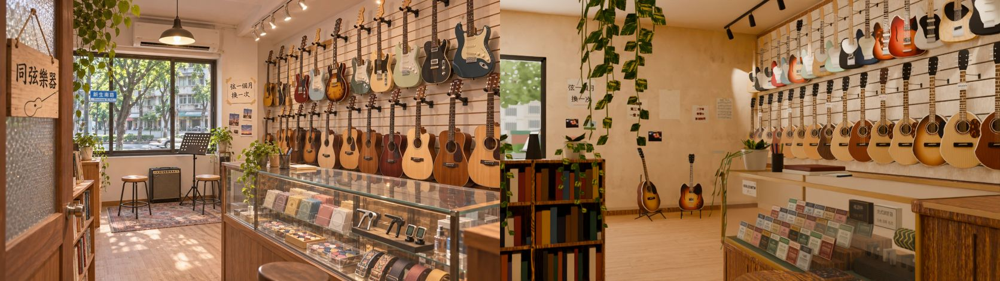
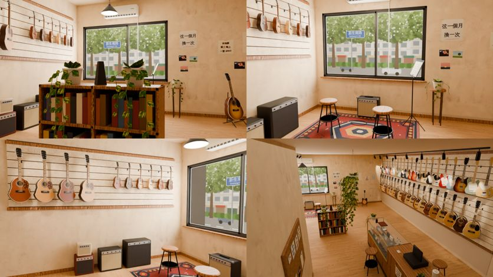
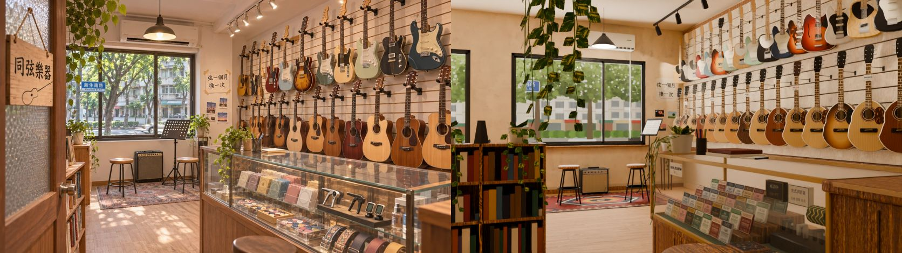
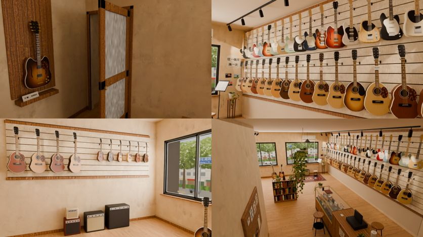
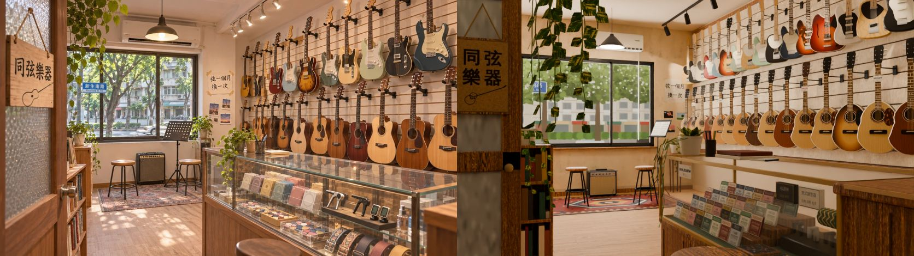
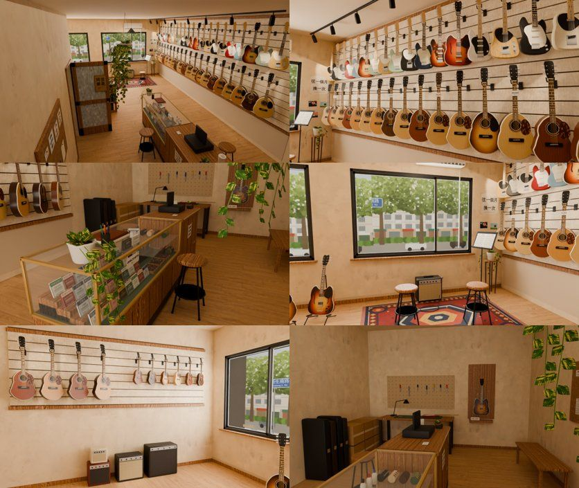

# CC_40 同弦樂器（吉他店）室內

- 做的人：CC（帳號 A）的建模子代理。v1～v3：2026-11-03；**v4：2026-11-04 照參考圖重做**。外觀由 LAWWW2 做。做完給 BB／LAWWW2 驗收。
- 規格：AA_619 第 1 節、2-3 節；SCENE_RULES 第 9、11、12 節（參考圖就是規格）。參考圖：`ref_images/shops/tongxian_int.webp`（室內）、`tongxian_ext.webp`（外觀，用來對樓梯和門）。
- **狀態（v4c，11-04 00:5x UTC）：`READY_FOR_REVIEW`（雲端 Cycles 預覽；PC 正式渲染、遊戲內截圖還沒做）**。v4 已由 LAWWW2 標 MODEL_READY、CC commit；v4b 是 P2 修正，v4c 是窗照外觀（見下面兩節）。v1～v3 被 LAWWW2 退回（shop_review_1103：「房間太長（看起來 20 m 深），吉他變得很小」）。v3 以前的紀錄留在最後面，已經過時。
- v4b、v4c 沒有 commit、沒有 push（CC 統一 commit）。

## v4c：二樓的窗照外觀（2026-11-04 00:5x UTC；LAWWW2 回覆 v4b）
狀態：`READY_FOR_REVIEW`（雲端預覽）。沒有 commit。LAWWW2 的決定：樓梯維持直跑，接受參考圖前景沒有店門；窗照外觀開；窗外照地圖（圖之後由 LAWWW2 給）。

### 改了什麼
- **窗**：只留一扇，位置照外觀（`3a81bf5a1` 同弦 `up`：本地 x 0.4～3.0）。用 v4b 的換算（室內 x ＝ −本地 x）→ 室內 x −3.0～−0.4（2.6 m 寬、窗台 0.87、窗頂 2.53、中框 −1.55）。
  - 室內 x −0.4～3.2 是外觀的招牌那一段，改成實牆。
  - v4 參考圖角度的大窗（x −0.1～2.39）和西邊的第二扇窗（x −2.85～−0.75）都拿掉。
  - layout `windows` 改成一筆；模型的窗框、玻璃、窗台、窗外景的板都照 `windows` 自動跟著搬。
- **跟著窗搬的**（layout 和模型都改）：
  - 試琴角整個搬到新窗前：地毯 (−1.6, −4.15)、兩張試琴椅 (−2.2, −4.05)／(−1.1, −3.85)、音箱 (−1.65, −4.95)、譜架 (−0.65, −4.45)、吊燈 (−1.65, 2.55, −4.15)、冷氣 (−1.7, 2.84)、花台 (−0.15, −4.92)。
  - 「弦一個月換一次」紙條和三張照片：一樣在窗的右邊（x 0.12）。
  - seats、`try` 互動點、子晴 CG 站位 (−1.65, −3.3)、blocks 都跟著改。
- **原本的試琴角位置**（窗牆東段，現在是實牆）：放兩把琴架上的吉他 (1.1, −4.6)／(1.75, −4.55)；牆上貼吉他課公告、傳單、二手琴紙條、照片、樂譜，加膠帶痕。
- 窗外景：**沒換圖**，還是 v4 程式畫的街景（對面的公寓）。照地圖應該是校園圍牆和大王椰子，**等 LAWWW2 從新生南路 GLB 渲染給圖**，到時候只換 `tongxian_props.png` 的 `view` 那一格。
- 數字：drawn 57,262（網格 42,404）、材質 12、GLB 2.94 MB。

### ref_match v4c（836×470、12 samples）
- **照 v4 的光（曝光 0）：FAIL 一項**。平均亮度 0.340，參考 0.460，差 0.120（門檻 0.08）。
  - 原因：參考圖畫面中左那一大片亮的窗（約佔畫面 1/6），在參考圖角度變成實牆加公告；午後的太陽也照不到那一帶。
  - 其他四項：對比 0.576（門檻 ≥ 0.474）、冷暖 +0.283（差 0.035）、ΔE 8.8、九宮格 0.120（剛好在門檻上）。
- **曝光 +0.55：五項 PASS**（`tongxian_v4c_refmatch_*`、並排圖 `tongxian_v4c_ref_vs_render.jpg` 都是這一版）。
  - 平均亮度 0.416、對比 0.631、冷暖 +0.295（差 0.047，最接近門檻）、ΔE 8.7、九宮格 0.063。
  - 說明：亮度是靠渲染的曝光補回來的，不是模型更像參考圖。參考圖的「窗在畫面中左」已經照外觀改掉，屬於第 12 節的遊戲必要改動（對齊外觀）。
- 第 12 節「遊戲必要改動」另外拍的一張：`ref_window`（眼睛 (0.3, 1.17, 0.4)、看 (−1.6, 1.21, −5.0)、30 mm），對著新的窗拍參考圖的那個角落（窗、冷氣、吊燈、紙條、照片、琴架上的吉他）。缺點：前面的矮書架擋住試琴椅和音箱。




### 給 PC 的渲染
同 v4 的指令，加 `--exposure 0.55`。views.json 已經加了 `ref_window`、`entry`，`window` 鏡頭也改成對著新的窗。

### 還沒做、要注意
- 窗外的圖（等 LAWWW2）。
- 參考圖角度不再有那扇大窗；要像參考圖那樣「窗在畫面中央」，只能看 `ref_window` 那張。
- 沒在遊戲裡看過：新的 blocks、試琴椅位置要 LAWWW2 跑導航驗（地毯 x −2.7～−0.5 和西牆音箱 x −3.15～−2.85 之間有空隙，試琴椅離音箱 0.5 m）。

## v4b：P2 修正（2026-11-04 00:4x UTC；LAWWW2 收 v4 標 MODEL_READY 以後的三項）
狀態：`READY_FOR_REVIEW`（雲端預覽）。沒有 commit。

### ① 吉他掛勾縮小一半 — FIXED
- 牆上的底座、手臂粗細、Y 形托、橡膠托柱都縮成一半（底座 4.5 × 2.2 cm、手臂 ø6 mm、托寬 5.6 cm）。
- 手臂長度沒辦法縮一半：吉他轉了 30～35°，琴身邊緣會碰到牆。只縮到不碰牆的最短：電吉他 16→13.5 cm、木吉他 22→19.5 cm、烏克麗麗 15→13 cm、古典吉他另外一組 19 cm（v4 和烏克麗麗共用 15 cm，琴身會頂到牆，順便修掉）。
- 三角形數一樣（網格的面數相同，只有尺寸變小）。

### ② 樓梯間對齊外觀 — FIXED（門搬了位置，參考圖鏡頭看不到門了）
- 依據：LAWWW2 `3a81bf5a1` 的 `wz_street.py`／`wz_shopkit.xs_stair`，以及 `docs/art-rebuild/second_ai/wip/xinsheng/xinsheng_layout.js`。
  - 同弦店面：新生南路 z −12.4～−6.0（寬 6.4，中心 −9.2）。一樓店面在 x −16.5，二樓立面（臨街的窗）在 x −13.0。
  - 本地 x：參考圖的左→右；西側的樓本地 +x＝北＝新生南路 −z。
  - 樓梯口：本地 x 1.45～2.95，從一樓店面往裡 4.4 m（磨石子踏階：每階高 0.19、深 0.27；一樓高 4.2）。
- 換算：室內 x ＝ 新生南路 z ＋ 9.2，室內 z ＝ −18.2 − 新生南路 x（臨街的窗牆 z −5.2 ＝ 新生南路 x −13.0）。
  - 樓梯口落在室內 x −2.95～−1.45，起點在室內 z −1.7 的正下方（也就是騎樓）。
  - 直直往南爬，22 階到二樓，在室內 z ≈ 4.2。
- 改了什麼：
  - **樓梯間**：二樓只圍 x −3.2～−1.14、z 1.0～5.2。z 1.0 以北，樓梯還在二樓地板下面、淨高 2.1 m 以上，那一段改成店的地板。
  - **店門**：開在樓梯頂的平台東邊，x −1.14、z 4.2～5.1。門鉸在北邊；門片開著貼在 z 4.2，往東伸到 x −0.24，「同弦樂器」木牌朝南。
  - **layout**：`door`、`stair`（加上 `flight`：x −2.95～−1.45、zStart −1.7、zTop 4.2）、`spawn`（−0.6, 4.65，面向東）、blocks（樓梯間 [-2.17, 3.1, 2.18, 4.32]、門片 [-0.69, 4.22, 0.9, 0.06]、長椅）都跟著改；長椅搬到 z 2.6、軟木板搬到 z 2.4（門片和長椅之間 0.9 m 只有 x −1.07～−0.63 那一段，往東就有 1.3 m）。
- **和參考圖的差別（新增）**：參考圖左邊前景那片開著的門（木牌、壓花玻璃）是店門。照外觀的樓梯，店門只能在店的最裡面，所以參考圖鏡頭現在看到的是西半邊：第二扇窗、書架、吊著的黃金葛。
  - 店的裡面另外拍一張 `entry`，看得到門、木牌、老闆的那把。
  - 要讓參考圖的門回來，只有一個辦法：外觀的樓梯改成折返梯（兩段各約 1 m 寬、平台在 z 2.6 附近），上來的平台在 z 0 附近。這要 LAWWW2 把樓梯口改窄（1.5 → 約 1.0 m），**我沒有改外觀，留給 LAWWW2／使用者決定**。
- 另外發現（沒改，報給 LAWWW2）：外觀 `up` 只有一扇二樓窗（本地 x 0.4～3.0 ＝ 室內 x −3.0～−0.4，對應室內的第二扇窗）。室內參考圖那扇大窗（室內 x −0.1～2.39 ＝ 本地 x −2.39～0.1）在外觀上是招牌的位置。外觀參考圖二樓整排都是窗，建議外觀把這一段也開窗。

### ③ 窗外的照片窗景 — 等 LAWWW2 給圖（維持 v4 的程式畫）
- `3a81bf5a1` 裡沒有從二樓往外看的新生南路渲染圖：`xs_fronts_atlas.jpg` 是從參考圖裁的店面招牌、店內，`fronts_v1_vs_ref.jpg` 是並排圖。
- 注意：照 xinsheng_layout，同弦在新生南路西側，二樓的窗看出去是馬路對面的**校園圍牆、大王椰子、樟樹**，不是公寓。參考圖畫的是對面的公寓。
  - 等 LAWWW2 的渲染圖來了，要先決定照參考圖還是照地圖。
  - 換圖只要換 `tongxian_props.png` 的 `view` 那一格（1024×640）；窗外板子的比例是 1.6:1，整張圖＝從窗口看出去的那一段街。

### ref_match v4b（836×470、12 samples）：五項 PASS
| 項目 | 參考 | 渲染 | |
|---|---|---|---|
| 平均亮度 | 0.460 | 0.429 | PASS |
| 對比 | 0.593 | 0.684 | PASS |
| 冷暖 | +0.248 | +0.247 | PASS |
| 色票 ΔE | | 8.8 | PASS |
| 九宮格 | | 0.070 | PASS |




- 數字：drawn 57,742（不變）、網格 42,884、材質 12、GLB 2.97 MB。
- views.json 加了 `entry`（看新的店門）。PC 渲染指令同 v4。
- 沒在遊戲裡看過；新的門、spawn、blocks 要 LAWWW2 跑導航驗。

## v4：照參考圖重做

### 檔案
| 檔 | 內容 |
|---|---|
| `src/data/tongxian_layout.js` | v4：6.4 × 10.4 × 3.2 m；items、blocks、seats、interact、npc、door、stair、windows、`camRef`（參考圖的鏡頭） |
| `tools/blender/env_second/bb_support/tongxian_tex.py` | 自製貼圖 v4：道具圖集 1024→2048，加印刷品（中文字用文泉驛正黑）：弦的包裝 8 種、Pick 吊卡 4 種、移調夾／調音器盒、店名木牌、手寫紙條 6 張（新台幣）、價錢牌 8 張、名片、樂譜、紙膠帶／膠帶痕、新的窗外景（新生南路的路樹、對面公寓、路牌）；吉他圖集加深藍、灰綠兩種烤漆 |
| `tools/blender/env_second/bb_support/tongxian_interior.py` | 建模 v4（場景部分重寫；吉他造型沿用 v3 的 build_guitar） |
| `tools/blender/env_second/bb_support/tongxian_render.py` | 新：Cycles 預覽（相機預設＝camRef；投射燈照 GLB 旁 json 的 spots） |
| `tools/blender/env_second/textures/gen/tongxian_{guitar,props,props_emit}.png`、`tongxian_atlas.json` | 貼圖輸出 |
| `assets/models/env/second_ai/bb_support/tongxian.glb`、`.json` | 輸出 |
| `docs/story_planning/CC/shots/model/tongxian/tongxian_v4_*` | 並排圖、ref_match 比對圖＋報告、六個角度、views.json |

### 數字
- 三角形（drawn，含 instancing）**57,742**（預算 60k）；網格本身 42,816。材質 **12 個**（預算 12）。GLB **2.97 MB**（預算 6 MB）。
- 樂器：東牆電吉他 22 把（14 個原型）、木吉他 20 把（11 個原型）；西牆烏克麗麗 6、古典吉他 4；琴架上 2、工作桌上 1、老闆的 1。一把 510～700 個三角形（琴身倒角外形、琴頸、指板、琴頭、弦鈕、六條弦、護板、拾音器）。
- instancing：吉他、掛勾（東牆 42 個、西牆 10 個）。匯出後 instancing 節點改名成網格名（`WALL_right_gtr_e0_inst`…）並補 `extras.dir`（好拍 v2 的做法；38 個節點）。**LAWWW2 整合時請確認 InstancedMesh 有跟著牆淡出**（沒開瀏覽器，沒驗證）。

### ref_match（`tongxian_v4_refmatch_cmp.jpg`、`_report.json`；渲染 836×470、Cycles 12 samples、AgX）：**五項 PASS**
| 項目 | 參考 | 渲染 | 門檻 | |
|---|---|---|---|---|
| 平均亮度 | 0.460 | 0.393 | 差 ≤ 0.08 | PASS（差 0.067，最接近門檻：渲染偏暗一點） |
| 對比 | 0.593 | 0.673 | ≥ 0.474 | PASS |
| 冷暖（R−B） | +0.248 | +0.237 | 差 ≤ 0.05 | PASS |
| 色票 ΔE | | 9.2 | ≤ 18 | PASS |
| 九宮格 | | 0.090 | ≤ 0.12 | PASS |




鏡頭（camRef）：眼睛 (−0.36, 1.17, 2.9)、看 (1.58, 1.21, −1.71)、34.4 mm（感光元件寬 36 mm）。從參考圖反推：吉他牆頂和櫃台前緣的消失點 (163, 462) → 往右轉 22.8°、水平；窗框上下緣幾乎平行 → 焦距約 1600 px（34 mm，不是 24～28 mm）；窗台、天花板、試琴椅座面高度三者一致 → 眼睛 1.17 m、窗牆在前方 8.1 m。50% 疊圖：窗、牆角、試琴椅、音箱、櫃台北端、書架、門片邊緣都對得上。

### v4 拆圖清單（參考圖由左到右、前到後；色碼是在參考圖上取 5×5 平均，暗處偏暗）
| # | 是什麼 | 畫面位置 | 尺寸（m） | 參考圖色碼 | 材質 | 模型物件 | 做了 |
|---|---|---|---|---|---|---|---|
| 1 | 開著的店門（木框、上下兩塊壓花玻璃、圓門把） | 左緣前景 | 0.9 × 2.08 × 0.04 | 木 #8f7869、玻璃 #826e60 | 木（Poly Haven）＋印刷（壓花）＋金屬頂點色 | `tx_wood`、`tx_props`、`tx_metal`（門片不淡出）；門框 `WALL_left_wood` | ✓ |
| 2 | 「同弦樂器」木牌（麻繩、吉他線稿） | 左上、門片上 | 0.31 × 0.45 | #a07959 | 印刷圖集 `sign` | `tx_props` | ✓ |
| 3 | 吊著的黃金葛（一大叢往下垂） | 左上 | 盆 ø0.26、藤 0.9～1.6 | 葉 #3e3403（逆光） | 葉片卡（雙面）＋頂點色 | `tx_leaf_pothos` | ✓ |
| 4 | 臨街的窗（深灰鋁框、兩扇橫拉、木窗台） | 中左 | 2.49 × 1.66，窗台 0.87 | 框 #3f3428 | 金屬頂點色＋玻璃＋木 | `WALL_back_metal`、`WALL_back_glass` | ✓ |
| 5 | 窗外：新生南路的路樹、對面公寓（鐵窗、冷氣）、騎樓、綠籬、汽車 | 窗裡 | 窗外 1.6 m 的板 | 樹 #9ca395 | 印刷＋自發光 `view` | `WALL_back_props` | ✓ |
| 6 | 路牌「新生南路 Xinsheng S. Rd.」 | 窗的左半 | | #2f6fa7 | 同上 | 同上 | ✓ |
| 7 | 冷氣（分離式室內機） | 窗上方 | 1.0 × 0.3 × 0.23 | #efeee8（暗處 #704b2a） | 頂點色 | `WALL_back_vc` | ✓ |
| 8 | 吊燈（深色搪瓷燈罩、白內面、燈泡） | 中上 | ø0.42 | #946239（亮） | 金屬頂點色＋發光 | `tx_metal`、`tx_lamp` | ✓ |
| 9 | 手寫紙條「弦一個月換一次」（四角紙膠帶） | 窗右邊 | 0.42 × 0.46 | #d3af89 | 印刷 `note_string`、`tape` | `WALL_back_props` | ✓ |
| 10 | 三張照片（夕陽、舞台、天空）＋膠帶 | 紙條下面 | 0.2 × 0.15 | #946a66 | 印刷 `photo0～2` | 同上 | ✓ |
| 11 | 兩張試琴椅（木面、黑鐵腳、腳踏圈） | 窗前 | 座面 0.6、ø0.34 | 座面 #eed4bf、腳 #523d2e | 木＋金屬頂點色 | `tx_wood`、`tx_metal` | ✓ |
| 12 | 小音箱（黑皮面、米色斜紋面網、銀邊、旋鈕、電源燈、提把）＋導線 | 窗下 | 0.5 × 0.46 × 0.26 | #62462f | 頂點色＋印刷 `grille` | `tx_vc`、`tx_props` | ✓ |
| 13 | 譜架（三腳、黑鐵板圓孔、樂譜） | 窗前右 | 板 0.5 × 0.34，高 1.1 | #99897a | 印刷 `mstand`、`score` | `tx_props`、`tx_metal` | ✓ |
| 14 | 波斯風地毯 | 試琴角地上 | 2.4 × 1.6 | #b79088 | 印刷 `rug` | `tx_props` | ✓ |
| 15 | 窗邊花台＋黃金葛 | 窗右下 | 台 0.72 | #78492f | 木＋頂點色＋葉 | `tx_wood`、`tx_vc`、`tx_leaf_pothos` | ✓ |
| 16 | 矮書架（樂譜、教本；上面兩盆黃金葛、節拍器） | 左中（門片後面） | 1.05 × 0.3 × 1.05 | 木 #765f47、書 #805e45 | 木＋頂點色 | `tx_wood`、`tx_vc` | ✓ |
| 17 | 淺橡木地板 | 下 | | #c59984 | Poly Haven laminate_floor_02 | `tx_floor_oak` | ✓ |
| 18 | 地上的斑駁陽光（樹影） | 地板 | | | 渲染的燈光（窗外樹影板＋太陽），不在 GLB | `tongxian_render.py` | ✓（只在渲染） |
| 19 | 天花板（暖白，不是純白） | 上 | 3.2 | #b38870（暗處） | 純色、單面朝下 | `tx_ceiling` | ✓ |
| 20 | 軌道投射燈（黑色軌道、7 盞，打在吉他牆） | 右上 | 軌道 x 2.45 | #b58866 | 金屬頂點色＋發光 | `tx_metal`、`tx_lamp` | ✓ |
| 21 | 米色溝槽板（木條＋細的深色溝，0.82～3.12 m） | 右 | 7.5 × 2.3 | 板 #b38a6e、溝 #6c4a38 | Poly Haven fine_grained_wood（調淡、降對比）＋頂點色 | `WALL_right_slatwall`、`WALL_right_vc` | ✓ |
| 22 | 上排電吉他（雙切口、單切口、半空心；藍、日暉、紅、灰綠、奶油、薄荷、黑、深藍…） | 右上 | 全長約 0.98 | 深藍 #2e4566、日暉 #c06a0a | 吉他圖集 | `WALL_right_gtr_e*`（instancing） | ✓ |
| 23 | 下排木吉他（原木、日暉、桃花心、深紅、黑護板） | 右中 | 全長 1.05、琴身寬 0.40 | 原木 #cb905d、桃花心 #422518 | 吉他圖集 | `WALL_right_gtr_a*` | ✓ |
| 24 | 黑色掛勾（牆上底座＋手臂＋Y 形托） | 每把吉他 | 臂 0.16／0.22 | #311d0c | 頂點色 | `WALL_right_hook*` | ✓ |
| 25 | 長櫃台：木頭底座（板縫、踢髒）＋黃銅框玻璃展示櫃 | 右下 | 0.6 × 3.05 × 1.0 | 木 #834f31、框 #cd936a | 木＋金屬頂點色＋玻璃 | `tx_wood`、`tx_metal`、`tx_glass` | ✓ |
| 26 | 櫃裡：弦的包裝 32 盒（四排階梯、斜立） | 櫃台北段 | 0.11 × 0.11 | #907c61 | 印刷 `spack0～7`（中文品名、規格） | `tx_props` | ✓ |
| 27 | 櫃裡：移調夾 4 個（黑台子上）、夾式調音器 3 個 | 櫃台中段 | | #8e6444、#555742 | 金屬／頂點色 | `tx_metal`、`tx_vc` | ✓ |
| 28 | 櫃裡：Pick 盒 3 盒、背帶（捲起來）8 捲、清潔油 3 瓶、盒裝移調夾／調音器 | 櫃台前排、層板 | | 背帶 #cc956c | 印刷 `picks_*`、`strap*`、`capobox`、`tunerbox` | `tx_props` | ✓ |
| 29 | 櫃台上：黃金葛（藤垂到櫃台前面）、筆筒、帳本、一盒剛賣的弦 | 櫃台北端 | | 筆筒 #624733、帳本 #e3bf94 | 頂點色＋葉 | `tx_vc`、`tx_leaf_pothos` | ✓ |
| 30 | 櫃台前的木凳 | 下中 | 座面 0.66 | #885d45 | 木＋金屬 | `tx_wood`、`tx_metal` | ✓ |
| 31 | 收銀的木頭檯面（磨白的邊、價目紙、膠帶痕）＋收銀機、刷卡機、名片、Pick 罐、小盆栽 | 右下角 | 0.6 × 1.25 × 1.0 | #4a2512 | 木＋頂點色＋印刷 | 同上 | ✓ |

另外加的（參考圖鏡頭看不到、或遊戲需要）：西牆溝槽板（烏克麗麗 6、古典吉他 4）、四台音箱、琴架上兩把吉他、第二扇臨街的窗；裡面的修琴工作桌（綠色切割墊、拆了弦的電吉他、檯燈、工具、洞洞板）、硬盒四個、紙箱、等人的長木椅、軟木板（「吉他課 週三晚上 一堂 $600」「二手琴 寄賣中」「試彈前請先洗手」、名片、傳單、照片、樂譜）、「不賣，老闆的」那一把（後牆展示板＋專用投射燈＋標籤）；吉他上 7 張價錢牌（NT$4,800～22,000）；櫃台正面「換弦 $150／調琴 $300／當天可取」。

### 第 11 節醜點清單
- [x] **比例**：面寬 6.4 m、深 10.4 m、高 3.2 m；參考圖鏡頭裡窗牆在 8 m 外（不是 20 m）；吉他真實尺寸（電吉他約 0.98 m、木吉他 1.05 m），在畫面裡和參考圖一樣大。
- [x] **光**：牆 #e8d5b6、天花板 #ecdcc2、溝槽板 #ecdcc0，都不是純白；暖色投射燈打在吉他牆、暖色吊燈、窗的天光＋午後太陽（樹影）。
- [x] **密度**：吉他牆從 0.82 m 掛到 3.12 m（兩排、一把壓一把）；櫃台擺滿；小東西 15 種以上（木牌、紙條、照片、價錢牌、弦的包裝、Pick 卡、移調夾、調音器、背帶、清潔油、筆筒、帳本、名片、收銀機、樂譜、節拍器、黃金葛、導線、工具…）。
- [x] **商品不是單色方塊**：吉他有琴身輪廓（倒角）、琴頸、指板、琴頭、弦鈕、弦、護板、拾音器；包裝全是印刷圖集。
- [x] **歲月感**：櫃台踢腳被鞋踢髒、檯面邊緣磨白、舊膠帶痕（櫃台、窗牆）、牆腳一條灰、木牌邊緣變深、紙條下緣變黃、地毯用久了不均勻。（地板磨損沒有另外做：地板是 Poly Haven 的整片貼圖。）
- [x] **在地感**：手寫中文紙條、新台幣價格、新生南路路牌、虛構店名；沒有任何真實品牌（吉他琴頭沒有字、包裝只有中文品名和規格）。
- [x] **預算**：57.7k 三角形、12 材質、2.97 MB；重複的東西 instancing。

### 和參考圖不一樣的地方（只有三種）
1. **品牌拿掉（D77）**：參考圖音箱面板、包裝、吉他琴頭上的字都沒有；包裝只有「民謠吉他弦 磷青銅 012-053」這類中文品名。吉他外形是通用的雙切口／單切口／半空心，琴頭形狀照通用比例、沒有標誌。
2. **尺寸照 layout**：參考圖的店看起來只有約 3.5 m 寬；layout 面寬 6.4 m → 參考圖鏡頭只看到東半邊（西半邊被門片擋住），西半邊另外放烏克麗麗牆和音箱（參考圖看不到的地方）。木牌是兩行「同弦／樂器」（參考圖是一行，木牌比例照門片）。
3. **遊戲必要**：店門開在樓梯間的東牆（外觀參考圖：樓梯在騎樓西側往裡爬；店的西南角是樓梯間）；參考圖前景的木凳貼著櫃台放（走道 1.4 m 以上）；櫃台裡沒有燈條（參考圖看不出來）。
4. （說明）參考圖是 AI 生成的，透視不完全一致（吉他牆和窗牆算出來的焦距差一些），取折衷：窗、牆角、櫃台北端、試琴椅對齊優先。

### 還沒做到參考圖的地方（誠實列出）
- **窗外景**是程式畫的，樹是一團一團的色塊，比參考圖的照片感假；LAWWW2 可以換成遊戲裡拍的新生南路。
- **吉他牆比參考圖疏一點、亮一點**：參考圖下排木吉他幾乎碰到櫃台、上排頂到天花板；掛勾的黑手臂比參考圖明顯。
- **櫃台的玻璃**沒有參考圖那麼多反光；包裝比參考圖小、排得比較整齊。
- **吊著的黃金葛**葉子是卡片，從正下方看會變薄；比參考圖暗（逆光）。
- 平均亮度比參考圖暗 0.067（門檻 0.08），PC 渲染可以加一點曝光（`--exposure 0.2`）。
- 地上的樹影是渲染的燈光，遊戲（three.js）裡沒有，要 LAWWW2 決定要不要用貼圖或光源做。
- **都沒在遊戲裡看過**：沒開瀏覽器（使用者規定）。導航（新的門在樓梯間東牆，不在 ±z）、淡出（樓梯間的牆分到 left／front 組）、instancing 淡出、試琴椅 seatH 0.6 的坐姿，都要 LAWWW2 驗。

### 整合注意（給 LAWWW2）
- （v4b 改了：門、spawn、樓梯間見上面 v4b 一節。以下是 v4 當時的值，已過時）layout 版本 4：門不在 +z，`door: {wall:'stair', x:−1.14, z0:0.02, z1:0.92}`；`spawn` (−0.6, 0.47) 面向東；樓梯間 `stair` 範圍用 blocks 擋（[-2.17, 2.45, 2.18, 5.62]）。`exit`、`enterAt` 留空。
- 字都印在貼圖上，模型裡**沒有 PLATE_FACE_**（v3 有三片，v4 拿掉了）。
- 天花板單面朝下；燈具、吊燈、吊盆從天花板上面的遊戲鏡頭看會浮在空中。
- 吉他牆淡出組：牆、溝槽板、吉他（instancing 節點名 `WALL_right_*_inst`，有 extras.dir）、掛勾、價錢牌都在 `WALL_right_*`。

### 給 CC 排 PC 的渲染
```
# ref（參考圖角度，一定先渲）＋六個角度；PC 用 GPU、64 samples、1672×941（和參考圖同尺寸）
CC_BLENDER_DEVICE=GPU CC_SAMPLES=64 blender -b --python tools/blender/env_second/bb_support/tongxian_render.py -- \
  assets/models/env/second_ai/bb_support/tongxian.glb <輸出資料夾> --views docs/story_planning/CC/shots/model/tongxian/tongxian_v4_views.json --res 1672x941 --sun 2.4 --exposure 0.15
# 之後：python3 tools/blender/env_second/ref_match.py <參考圖 tongxian_int.jpg> <輸出>/tongxian_ref.png <前綴>
```
（重建：`python3 tools/blender/env_second/bb_support/tongxian_tex.py` → `nice -n 15 /opt/blenv/bin/python tools/blender/env_second/bb_support/tongxian_interior.py -- --lib <second-ai-env-art 的 tools/blender/env_second>`。雲端預覽 836×470、12 samples，一張約 20 秒。）
- 渲染腳本只給 Cycles 用的處理：渲染前把 single_side 補的、和正面疊在一起的反面刪掉（不然 Cycles 會整片變黑：地毯、壓花玻璃、木牌第一次都是黑的）；窗外景的板不擋太陽。GLB 本身不受影響。

---
（以下是 v1～v3 的紀錄，已過時）

## 1. 已經做好的（都還沒 commit）

| 檔案 | 內容 |
|---|---|
| `tools/blender/env_second/bb_support/tongxian_interior.py` | 建模腳本，Blender bpy。用 `TX_LIB2` 或 `--lib` 指定 lib2／cafe_layout 的位置，這次用的是 wt_l2 那一份 |
| `tools/blender/env_second/bb_support/tongxian_tex.py` | 自製貼圖的產生腳本（系統 python3、PIL、numpy） |
| `tools/blender/env_second/textures/gen/tongxian_guitar.png` | 吉他貼圖集（1024²，45 格）：面板木紋、側板、烤漆、指板（含琴格和圓點）、護板、五金、弦、拾音器 |
| `tools/blender/env_second/textures/gen/tongxian_props.png` | 道具貼圖集：波斯風地毯、窗外的新生南路、壓花玻璃、音箱面網、Pick、背帶、弦盒、照片、紙、木板、軟木板 |
| `tools/blender/env_second/textures/gen/tongxian_props_emit.png` | 發光貼圖，只有窗外景那一格會亮 |
| `tools/blender/env_second/textures/gen/tongxian_atlas.json` | 貼圖集每一格的位置 |
| `src/data/tongxian_layout.js` | 配置：7×14×3.4 m；店門在 +z，x −2.75；後窗；blocks、seats、interact、npc；exit 和 enterAt 留空 |
| 試作 GLB（**不在正式路徑**） | 在 scratchpad：`/tmp/claude-0/-home-user-Lawstudent/d06332e2-ec70-5e42-a15c-5a4b27dbdb56/scratchpad/model/out_tx/tongxian.glb` |
| 預覽渲染的腳本和鏡頭（scratchpad） | `/tmp/claude-0/-home-user-Lawstudent/d06332e2-ec70-5e42-a15c-5a4b27dbdb56/scratchpad/model/out_tx/render_tx.py`、`/tmp/claude-0/-home-user-Lawstudent/d06332e2-ec70-5e42-a15c-5a4b27dbdb56/scratchpad/model/out_tx/views.json` |

### 試作 GLB 的數字（v1 試作，glb_specs.py 量的）
- 三角形 56,759（沒有用 instancing，畫出的數量相同）。預算 ≤ 6 萬。
- 37 個網格，約 37 次 draw call。
- 材質 12 個（預算 ≤ 12）。
- 3.49 MB（預算 ≤ 6 MB）。
- 貼圖 12 張，webp 330 KB。

### 模型內容
- **右牆**：橫條溝槽板。上排 22 把電吉他，三種琴形：雙切口、單切口、半空心，換色加上不同護板。下排 21 把木吉他，兩種琴形：dreadnought、OM，面板有原木、琥珀、紅木、深色、日暉。每把都用曲線外形擠出並倒角，有音孔花紋、琴橋、指板琴格、琴頭、弦鈕、弦。吉他掛在黑色 Y 形掛勾上。木吉他有幾把掛著空白價錢牌。**所有吉他都沒有字或標誌**（D77）。
- **L 形玻璃櫃台**：木頭下櫃加玻璃展示櫃，裡面有玻璃層板、絨布墊和燈條。展示的東西有弦的紙盒（抽象圖案）、Pick 盒、移調夾、夾式調音器、捲起來的背帶、清潔油。櫃台上有老闆的帳本、茶杯、筆筒、垂下來的黃金葛、刷卡機。櫃台後面有老闆的高腳椅。
- **試琴角**：波斯風地毯、兩張木面鐵腳的圓凳（座面 0.6 m）、小音箱、譜架（上面放空白的譜）、A 字琴架上一把木吉他、導線、工業風吊燈。
- **後牆**：鋁框大窗，窗外的景是自己畫的新生南路，會自己發光。窗上方有冷氣。牆上有「弦一個月換一次」的紙和三張照片（抽象色塊）。
- **「不賣，老闆的」**：放在後牆的木頭展示板上，是一把半空心電吉他，配金色五金，下面有標籤和老闆樂團的照片，最後一盞軌道燈照著它。
- **左牆**：書架（放書和樂譜，上面有黃金葛垂下來）、軟木板（貼著空白傳單）、邊櫃（上面有黃金葛）、靠牆放的琴袋。門口上方有一個吊盆。
- **天花板**：兩條軌道投射燈。
- **淡出牆組**：節點分成 `WALL_<front|back|left|right>_*`。字牌是 `PLATE_FACE_tx_door_sign`、`PLATE_FACE_tx_notice`、`PLATE_FACE_tx_owner_tag`，自訂屬性有 text／sub、bg、color，空白的，字由遊戲畫。玻璃材質是 `tx_glass`。

## 2. 還沒做、還沒驗證的

1. **Blender 渲染一張都沒有**。第一張（參考圖角度）在渲染途中中止。所以畫面也還沒自己看過，造型、比例、光線都**沒有驗證**。
2. 參考圖對照圖、3 張以上的 jpg、`docs/story_planning/CC/shots/model/tongxian/` 都還沒做。
3. 正式 GLB 還沒輸出到 `assets/models/env/second_ai/bb_support/tongxian.glb`。目前只有 scratchpad 裡的試作。
4. 沒檢查穿插和懸空。特別要看這幾處：
   - 掛勾和琴頭的位置；
   - 門片和書架；
   - 琴袋和左牆；
   - 老闆那把吉他和下面的層板、照片；
   - 譜架和琴架的方向。
5. 沒在遊戲裡測過（要等 LAWWW2 整合）。`seatH 0.6` 比一般的 0.45 高，坐下的動畫可能要調。
6. 交件說明裡，和參考圖不同的地方、還沒達到參考品質的缺點，都還沒寫。
7. 新用到的 Poly Haven 貼圖不用補進 LICENSES：`laminate_floor_02`、`painted_plaster_wall`、`fine_grained_wood`、`wood_table_001` 都是 wt_l2 裡已經有的 CC0 貼圖。自製貼圖全部由腳本產生。

## 3. 下一步（恢復時）

1. 先確認沒有別的 Blender 在跑（`ps -eo args | grep "[b]lenv"`），要用 nice。
2. 重新輸出到正式路徑：
   ```
   TX_LIB2=$S/wt_l2/tools/blender/env_second nice -n 15 /opt/blenv/bin/python tools/blender/env_second/bb_support/tongxian_interior.py
   ```
3. 渲染：
   ```
   nice -n 15 /opt/blenv/bin/python $S/model/out_tx/render_tx.py -- <glb> <輸出資料夾> $S/model/out_tx/views.json [鏡頭名]
   ```
   鏡頭有 ref、gamecam、corner、wall、counter、owner。看完再修造型和光線。
4. 做參考圖對照圖，所有圖轉成 jpg（每張 ≤ 300 KB），寫完交件說明，狀態最多標到 READY_FOR_REVIEW。
5. 用完清掉 `$S/model/out_tx/`。

## CC 自己看第一版渲染（2026-11-03 14:2x UTC；WORK_IN_PROGRESS，還不能交驗收）
截圖：`docs/story_planning/CC/shots/model/tongxian/tx_cmp_ref_vs_render_wip1.jpg`（左：參考圖，右：渲染）、`tx_gamecam_wip1.jpg`（遊戲鏡頭的角度）。

和參考圖比，差最多的地方：
1. **後牆（窗那一面）整面是黑的**。查過 GLB：WALL_back_plaster 的材質、貼圖、法線都正常，牆是有厚度的盒子，兩面都在，所以不是法線的問題。可能是光照，或窗外景那片的大小和位置有問題，還要再查。
2. **空間太空**。7×14 m 的地板中間整片沒東西；參考圖是又小又擠的店。要補的有：地毯、垂下來的黃金葛、盆栽、書架上的雜物、紙箱、琴袋、試琴角那一區。
3. **吉他太小、掛太高、距離太遠**。參考圖是兩排滿滿的、比較大的吉他，下排木吉他幾乎碰到櫃台。
4. **玻璃櫃台太暗、裡面太空**。參考圖是暖色木頭加玻璃，裡面滿是彩色的弦盒、Pick、移調夾、背帶。
5. **光太冷、太平**。少了午後從窗戶進來的暖光、吊燈的暖色，還有投射燈打在吉他牆上的光斑。
6. 左牆有一個看起來像班卓琴的東西，比例怪怪的，要查是什麼東西。

狀態：WORK_IN_PROGRESS。三角形 5.7 萬、材質 12、3.49 MB 在預算內，但美術還沒到參考圖的水準。下一步依 1→5 的順序改，渲染改排到 PC 上跑。

### 缺點 1 修好了：後牆整面黑（14:3x UTC）
- **原因**：前牆和後牆都是在窗或門的四周用幾個方盒拼起來的。L.single_side 判斷它們是「開口零件」，每一面都補了一份反過來的面，正好和正面疊在同一個平面上（後牆的 y=7.0、7.12 兩個平面，各有朝內、朝外兩面）。Cycles 渲染時這兩面互相遮光，整面就變黑。左右牆各是一個完整的方盒，不受影響。
- **修法**：`single_side(..., nodup=r'plaster')`，牆只會從室內看到，不需要補反面。修完以後 tx_plaster 補的反面是 0。
- **對照**：`shots/model/tongxian/tx_backwall_before.jpg`（左：原本、右：把玻璃和窗外景藏起來，還是黑的）→ `tx_backwall_after.jpg`（後牆、窗、告示、老闆的琴展示板都看得到）。
- GLB 已更新：assets/models/env/second_ai/bb_support/tongxian.glb，3.65 MB。
- 地毯還是很暗，下一輪跟著光線（缺點 5）一起看。

### v2（11-03 15:xx UTC，CC；451bb65ee；WORK_IN_PROGRESS，還沒渲染驗證）
- 缺點 2（太空）：店中間加一座矮木台（x −1.0、z −1.3，0.9×2.5 m），四把吉他放在 A 字琴架上，正面朝兩邊的走道；左牆加兩台疊起來的音箱（z −2.35）和吉他紙箱（三個立著、一個平放，z 2.1）。配置 v2 補了 items、blocks；台子兩邊的走道各有 1.2 m 以上。
- 缺點 3（吉他掛太高）：兩排都往下 15 cm（掛勾 y 2.85／1.80）。吉他本身是真實尺寸，數量不變（三角形預算）。
- 缺點 4（櫃台太暗）：玻璃改淡（alpha 0.14→0.1，顏色偏暖）。內容物本來就有 27 盒弦、移調夾、調音器、Pick、背帶，先不加。
- 缺點 5（光太冷）：只改預覽渲染的光：太陽更暖更強、窗的天光改暖白、天花板補光減半、投射燈偏暖、光錐收窄。遊戲裡的光由 LAWWW2 整合時決定。
- 缺點 6（像班卓琴的東西）：是靠在左牆的琴袋。原本琴頸只有 9 cm 寬，看起來像班卓琴。改成琴頸 15 cm，琴頭的袋子 20 cm。
- 三角形 59,889（預算 6 萬；省下來的：台子上五把改四把、藤的步長 0.055→0.07、軌道燈 seg 10→8、書本加厚）；材質 12；3.84 MB。
- 試過但不用：掛牆吉他拿掉背面。結果反而多出 6 千個三角形，因為 lib2 single_side 會幫開口的網格補反面。
- 渲染：PC 佇列 MD_tx_v2（960×540，六個鏡頭，CPU）。結果回來以後 CC 先自己看，再決定能不能標 READY_FOR_REVIEW。

### v2b 渲染（11-03 19:2x UTC，PC MD_tx_v2b，bae31acad）CC 自己看
- 櫃台下櫃：不再整片黑（木頭不補反面以後），暖色木紋。玻璃裡的弦盒、Pick、移調夾、背帶都看得清楚。截圖：shots/model/tongxian/tx_counter_v2b.jpg。
- 展示台的吉他斜斜朝店門，看得出是吉他。左牆的音箱、紙箱都在；光變暖了；後窗外是樹。截圖：tx_ref_v2b.jpg。
- 還差的：Pick 盒的絨布墊太暗；吉他牆整體比參考圖鬆；地板中段還是有點空；遊戲裡的光（three.js）還沒看過。
- 狀態：WORK_IN_PROGRESS（還沒在遊戲裡整合、測試，不能標 READY_FOR_REVIEW）。
