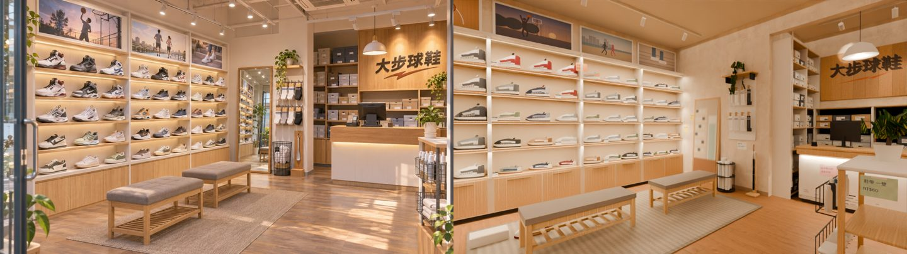

# CC_41 大步球鞋室內（BB 分派；外觀由 LAWWW2 做）

狀態：**READY_FOR_REVIEW（v2，雲端低取樣預覽；遊戲內未驗）**。不是 ART_APPROVED。v1 被使用者、LAWWW2 退回（「像廉價的遊戲」：店太大太空、天花板管線、光太平太白、ref_match 對比與冷暖 FAIL），v2 照 SCENE_RULES 第 11、12 節「參考圖就是規格」整個重做。

## 檔案
| | 路徑 |
|---|---|
| 腳本（建模） | `tools/blender/env_second/bb_support/dabu_interior.py`（v2 重寫；lib2、cafe_layout 用 `claude/second-ai-env-art` 那一份，`--lib`） |
| 自製貼圖 | `tools/blender/env_second/bb_support/dabu_tex.py` → `bb_support/textures/gen/dabu_print.png`（2048 印刷圖集）、`dabu_shoe.png`（1024 鞋子圖集）；建模腳本會自己呼叫 |
| 預覽渲染 | `tools/blender/env_second/bb_support/dabu_render.py`（Cycles；視角 `docs/story_planning/CC/shots/model/dabu/dabu_views.json`、投射燈 `dabu_spots.json`） |
| 配置 | `src/data/dabu_layout.js`（version 2：w/d/h、items、blocks、seats、interact、staff、`refView`＝參考圖鏡頭；exit、enterAt 留空） |
| GLB | `assets/models/env/second_ai/bb_support/dabu.glb`（＋`.json`） |
| 截圖、比對 | `docs/story_planning/CC/shots/model/dabu/`（v1 的兩張 `*_sm.jpg` 刪掉了） |

執行：
```
nice -n 15 /opt/blenv/bin/python tools/blender/env_second/bb_support/dabu_interior.py -- --lib $S/wt_l2/tools/blender/env_second --spots docs/story_planning/CC/shots/model/dabu/dabu_spots.json
nice -n 15 /opt/blenv/bin/python tools/blender/env_second/bb_support/dabu_render.py -- assets/models/env/second_ai/bb_support/dabu.glb <輸出> docs/story_planning/CC/shots/model/dabu/dabu_views.json --spots docs/story_planning/CC/shots/model/dabu/dabu_spots.json --samples 16 --res 960x540 --led 0.25 --emit 1.5 --exposure -0.4 --lamp 0.8 --fill 150
python3 tools/blender/env_second/ref_match.py dabu_int.jpg <輸出>/dabu_01_ref_angle.png <前綴>
```
建模一次約 30 秒；960×540、16 samples 的預覽一張約 1 分鐘（雲端 CPU，nice 15）。

## 尺寸、配置（v2）
- **7.4 × 12 × 3.4 m**（面寬＝新生南路騎樓開間）；平頂（暖米色 `#ddd1bf`），**沒有管線**。
- 參考圖那一角（從參考圖反推的鏡頭：眼高 1.38 m、18 mm〔36 mm 片幅〕、站在 (0.99, 0)、朝西北 47°；`refView`）：
  - 左牆（西）鞋牆五格，每格 1.3 m、五層、每層三雙（共 75 雙），層板淺木、每層底下暖色燈條，上面一排海報；
  - 正後方 z −4.1 一道隔間牆（後面是封起來的倉庫）：落地鏡、襪子掛架、毛巾桶、鞋拔；
  - 隔間牆右邊凹進去 1.9 m 的櫃台區：左側牆鞋盒層架到頂、後牆鞋盒層架＋木頭招牌「大步球鞋」、收銀台、吊燈、員工門；
  - 櫃台前面一座白檯面的展示架（參考圖右前）。
- 參考圖鏡頭後面（前半間，參考圖看不到）：右牆鞋牆三格（45 雙）、新品展示桌、西側櫥窗（兩層玻璃層架）、東側玻璃門、門口地墊、鞋盒推車、門邊鐵網架、兩盆大盆栽、右牆前段直條木板＋系隊團購傳單。
- 走道：鞋牆前 1.2 m、長凳和展示架 2.2 m、櫃台前到展示架 1.21 m、店員通道（櫃台後）0.745 m。我用 Node 跑了一個粗略的格子檢查（人半徑 0.33 m、0.1 m 格，`src/data/dabu_layout.js` 的 blocks）：出生點、6 個互動點、3 個店員站位都走得到（座位在長凳的阻擋裡面，照慣例由坐下處理）。**這不是遊戲的導航格，LAWWW2 整合時要跑正式的檢查。**

## v2 拆圖清單（參考圖 dabu_int，由左到右、由前到後）
色碼：「取樣」＝用 PIL 從參考圖 5×5 像素取平均（受光影影響）；「目測」＝取樣點落在別的東西上時，看圖給的色碼。

| # | 東西 | 畫面位置 | 大約尺寸 | 顏色 | 材質 | 模型物件 | 做了 |
|---|---|---|---|---|---|---|---|
| 1 | 店門玻璃框＋長門把 | 左邊緣、前 | 門高 2.4 m | 鋁 #b9bcbe | vcm、glass | `WALL_front_*` | ☑（在前牆，參考圖鏡頭看不到，見「不同處」1） |
| 2 | 門外的盆栽葉子 | 左下、前 | — | 綠 | leaf | — | ☐ 沒做（店外，LAWWW2 的街道） |
| 3 | 左牆鞋牆：5 格 × 5 層 × 3 雙 | 左、前→中 | 每格 1.3 m、層距 0.41 m | 層板前緣 #e0b58a（取樣）| oak（Poly Haven walnut_veneer 校色） | `WALL_left_left_wood` | ☑ |
| 4 | 層板下暖色燈條 | 左 | 每層一條 | #ffd59a 發光 | led | `WALL_left_left_led` | ☑ |
| 5 | 鞋牆背板（暖米） | 左 | — | #f3c693（取樣，燈照到）→ 模型 #ecdcc2 | vc | `WALL_left_left_vc` | ☑ |
| 6 | 白色直隔板 | 左 | 寬 4.4 cm | #eedabc（取樣） | vc | 同上 | ☑ |
| 7 | 下櫃（每格兩扇淺木門＋把手溝） | 左下 | 高 0.6 m | #c99160（取樣） | oak | `WALL_left_left_wood` | ☑ |
| 8 | 鞋子（高筒、中筒、跑鞋、休閒、復古） | 左 | 鞋長約 35 cm | 白、灰、深灰、海軍藍、紅、米、綠… | shoe 圖集（鞋面展開圖、中底、大底） | `WALL_left_shoes.*`（instancing） | ☑（品牌勾勾拿掉，見「不同處」2） |
| 9 | 鞋牆上一排運動海報（3 張看得到：跳投、河濱跑步、階梯上的球鞋） | 左上 | 1.2 × 0.56 m | 黃昏橘紫 #dfaa9f（取樣） | print（poster0–2） | `WALL_left_print` | ☑（虛構插畫） |
| 10 | 海報白框 | 左上 | 4 cm 厚 | #f3efe8 | vc | `WALL_left_left_vc` | ☑ |
| 11 | 層板上的價格卡（參考圖看不清楚，第 11 節要求） | 左 | 9 × 5.5 cm | 白＋橘／深灰條 | print（price0–11） | `WALL_left_print` | ☑ |
| 12 | 兩張原木長凳（灰布格子座墊、下層木條） | 中下 | 1.25 × 0.45 × 0.47 m | 座墊 #b19281（取樣）、木 #a6724a（取樣） | cushion（rough_linen）、oak | `dabu_cushion`、`dabu_oak` | ☑ |
| 13 | 編織地毯 | 中下 | 2.1 × 3.6 m | 灰米 #b0a696（目測） | print（rug） | `dabu_print` | ☑ |
| 14 | 木地板（暖色中間色、有陽光斑） | 下 | — | #b78e76（取樣） | floor（laminate_floor_02 校色 #a97d55） | `dabu_floor` | ☑（陽光斑在渲染裡沒出來，見缺點 4） |
| 15 | 落地鏡（原木框、往後靠） | 中後 | 0.8 × 2.0 m | 框 #a08b7f（取樣） | oak＋print（鏡中倒影） | `WALL_back_*` | ☑ |
| 16 | 鏡子旁的盆栽（鏡中倒影裡） | 中後 | — | — | — | — | ☐ 倒影裡畫成門口的光（印刷），沒有另放盆栽 |
| 17 | 襪子掛架（白色洞洞板、兩排、牛皮紙吊卡） | 中後 | 0.62 × 1.25 m | 襪子白／黑 | vc＋print（sockcard） | `WALL_back_back_vc` | ☑ |
| 18 | 襪子架上的小木架＋垂下來的黃金葛 | 中上 | — | 葉 #403a05（取樣） | oak、leaf | `dabu_leaf_pothos` | ☑ |
| 19 | 鐵網桶（捲好的毛巾） | 中後 | 直徑 0.38 m | 黑網、白毛巾 | vcm、vc | `dabu_metal_parts` | ☑ |
| 20 | 長鞋拔（木座、白色鞋拔、紅掛繩） | 中後 | 高 0.98 m | 木＋白 | oak、vcm | 同上 | ☑ |
| 21 | 隔間牆轉角（柱） | 中 | — | 牆 #ab8262（取樣，暗部）→ 模型 #e6d8c4 | paint | `WALL_back_back_paint` | ☑ |
| 22 | 櫃台區左側的鞋盒層架（白、灰、深灰、牛皮紙） | 右中 | 到頂 2.95 m | 白 #efede7、灰 #b9bdc2（目測） | vc＋print（boxend 標籤） | `WALL_back_back_vc`、`WALL_back_print` | ☑ |
| 23 | 木頭招牌「大步球鞋」＋橘色步紋 | 右上 | 1.4 × 1.0 m | 木 #cfa070、字 #4e3c2e（目測）、步紋 #c4622c | print（sign；比例 1.4，字不擠扁） | `WALL_back_print` | ☑ |
| 24 | 招牌旁的直條木板 | 右上 | — | 同上 | print（woodpanel） | `WALL_back_print` | ☑ |
| 25 | 招牌下的鞋盒層架（四層） | 右中 | 高 1.72 m | — | vc＋print | `WALL_back_back_vc` | ☑ |
| 26 | 白色圓頂吊燈 | 右上 | 直徑 0.46 m | 罩 #f3f0ea | vc＋led | `dabu_vc_parts` | ☑ |
| 27 | 收銀台：白檯身、原木檯面、檯面下燈條 | 右中 | 2.7 × 0.55 × 1.0 m | 檯身 #c6a99b（取樣，暖光下）→ 模型 #ebe6de | vc＋print（counterfront：踢腳的磨痕）＋oak＋led | `dabu_vc_parts`、`dabu_print` | ☑ |
| 28 | 收銀螢幕 | 右中 | 0.5 × 0.33 m | 黑框 | vc＋print（monitor：POS 畫面、NT$） | 同上 | ☑ |
| 29 | 刷卡機 | 右中 | — | 黑 | vc＋print（reader） | 同上 | ☑ |
| 30 | 筆筒、筆 | 右中 | — | 米 | vc | 同上 | ☑ |
| 31 | 櫃台上的盆栽（右端） | 右 | — | 綠 | leaf | `dabu_leaf_pothos` | ☑ |
| 32 | 鞋盒層架頂上的盆栽（招牌右邊） | 右上 | — | 綠 | leaf | 同上 | ☑ |
| 33 | 軌道投射燈（白色燈頭） | 上 | 縱向三條＋櫃台區一條，29 盞 | 白 #f1ede6 | vc＋led | `dabu_vc_parts` | ☑ |
| 34 | 吸頂冷氣 | 上中 | 0.84 m 見方 | #eeebe5 | vc | 同上 | ☑ |
| 35 | 天花板（平頂、暖米） | 上 | — | #a78265（取樣，暗部）→ 模型 #ddd1bf | ceiling（單面朝下） | `dabu_ceiling` | ☑ |
| 36 | 右前的白檯面展示架（兩側鐵網籃：噴霧、毛巾） | 右下、前 | 0.5 × 0.9 × 1.05 m | 檯面 #e3cdc3（取樣） | vc、oak、vcm | `dabu_vc_parts`、`dabu_metal_parts` | ☑ |
| 37 | 展示架上的盆栽、右下角的落地盆栽 | 右下 | — | 綠 | leaf＋vc 陶盆 | `dabu_leaf_pothos` | ☑ |
| 38 | 參考圖右下角最邊上的直柱 | 右邊緣 | — | 灰 | — | — | ☐ 沒做（鏡頭邊緣、看不出是什麼） |

**第 11 節要求、參考圖看不清楚而加的小東西**：手寫紙條 8 張（試穿請坐這邊、運動襪 3 雙 NT$299、本週新到籃球鞋、出示學生證全面 95 折、鞋帶一雙 NT$60、請勿在店內試跑、鞋墊加購 NT$350；7 天內尺寸可換在圖集裡但沒貼）、價格卡（NT$）、鞋盒尺寸標籤（US／cm、條碼）、紙提袋（印店名）、打開的鞋盒＋地上試穿中的一雙鞋、員工專用門牌、支付貼紙（沒有品牌的色塊）、月曆（2026 年 11 月）、系隊團購傳單、營業時間（門玻璃）、門口地墊「歡迎光臨」、壓條走線＋插座、鞋盒推車、門邊鐵網架（鞋帶包、鞋墊盒、噴霧）、櫥窗的籃球。

## ref_match（參考圖 vs 同角度渲染，960×540、Cycles 16 samples、AgX Medium High Contrast、曝光 −0.4）
| 項目 | 參考圖 | 渲染 | 門檻 | |
|---|---|---|---|---|
| 平均亮度 | 0.541 | 0.539 | 差 ≤ 0.08 | PASS |
| 對比 | 0.566 | 0.568 | ≥ 0.453 | PASS |
| 冷暖（R−B） | +0.256 | +0.297 | 差 ≤ 0.05（差 0.041） | PASS |
| 色票 ΔE | — | 6.2 | ≤ 18 | PASS |
| 九宮格亮度差 | — | 0.051 | ≤ 0.12 | PASS |

比對圖 `shots/model/dabu/ref_match_dabu_v2_cmp.jpg`、報告 `ref_match_dabu_v2_report.json`、並排 `dabu_v2_ref_vs_render.jpg`。50% 疊圖：鞋牆的隔板、層板線、長凳、鏡子、隔間牆轉角大致對上；櫃台比參考圖近、偏右（店員通道要 0.7 m，見「不同處」4）。
**注意**：這是雲端低取樣預覽，光是 `dabu_render.py` 的 Blender 燈（投射燈 SPOT、層板下面光、天花板補光、從店門進來的太陽）；遊戲裡的光要 LAWWW2 烘焙，數字要在遊戲截圖上重量一次。



## 第 11 節醜點清單
- [x] **比例**：面寬 7.4 m、深 12 m、高 3.4 m；參考圖角度的空地板約佔畫面 1/5（長凳、地毯、展示架之間）。
- [x] **光**：天花板 `#ddd1bf`、牆 `#e6d8c4`（都不是純白，渲染裡牆面亮度 < 0.9）；主光是 29 盞軌道投射燈（暖色約 3000K）打在兩面鞋牆、招牌、鞋盒，層板下燈條、吊燈、櫃台燈條；角落暗。
- [x] **密度**：鞋牆擺滿（左 75 雙、右 45 雙、櫥窗 10、展示桌 6、地上 2）；鞋盒牆三面擺滿；小東西 20 種以上（上面那一段）。
- [x] **商品不是單色方塊**：鞋子是 10 個斷面的放樣（鞋口凹下去、鞋頭收圓）、厚中底、大底，鞋面印刷（側片、縫線、鞋頭透氣孔、鞋帶孔、後跟布標）；鞋盒有標籤；噴霧是旋轉體；毛巾、襪子是倒角件。
- [x] **歲月感**：櫃台踢腳一帶的磨痕和鞋印、海報褪色＋四角暗、鞋盒層架空一兩格（被拿走）、踢腳板邊上偏暗、紙條用膠帶貼、壓條走線。**沒有烘焙 AO**（LAWWW2）。
- [x] **在地感**：手寫中文紙條、價格 NT$、店名「大步球鞋」虛構、系隊團購傳單、學生證 95 折、月曆；沒有真實品牌。
- [x] **預算**：drawn **59,502**（≤ 6 萬）、unique 33,542、材質 **12**、GLB **2.29 MB**、貼圖 9 張 webp（2048 印刷圖集 1、1024 鞋子圖集 1、其他 ≤ 512）、金屬度最高 0.4。

## 和參考圖不同的地方（只有三種原因）
1. 〔尺寸照 layout〕參考圖是從店門往裡看（左邊緣是門框）；照 7.4 × 12 m 排下來，參考圖畫面裡的東西（鞋牆 3 格、鏡子、櫃台區）在店的後半，鏡頭要站在店中間（z 0）才對得上，門框在鏡頭後面。
2. 〔品牌〕參考圖的鞋側有勾勾 → 換成本店虛構的「步紋」側片（一條等寬往前微升的色片＋縫線）；招牌的橘色線改成兩段斜折的筆刷（不像任何品牌）。
3. 〔尺寸〕參考圖的鞋在層板上特別大：鞋放大 1.2 倍（鞋長約 35 cm、厚中底），還是比參考圖小一點；鞋頭往牆裡斜 24°，從店中間看是側面（參考圖每一雙都是側面朝人）。
4. 〔遊戲必要〕櫃台往前移：參考圖的櫃台後面沒有空間，這裡留 0.745 m 店員通道（人半徑 0.33 m）；所以櫃台在畫面裡比參考圖大、偏右。櫃台前到展示架 1.21 m（走道 ≥ 1.2 m）。
5. 〔尺寸照 layout〕參考圖的天花板有幾道梁；這裡照 LAWWW2 的意見做平頂，只在櫃台區上方留一道垂壁（隔間牆的延伸）。
6. 〔遊戲必要〕隔間牆後面的倉庫封起來（沒有門）；員工門放在櫃台區後牆右端（關著）。

## 已知缺點（還沒做到參考圖的）
1. 鞋子近看還是偏「整塊」：鞋面一個殼、沒有分片的厚度、鞋帶只有一條；高筒的側面輪廓接近斜坡。遠景（玩家視角）看得出是鞋。
2. 鞋的配色比參考圖淡（白、灰多），參考圖深色、彩色的比例高一點。
3. 海報是簡單的剪影插畫，沒有參考圖照片那種質感。
4. 地上的陽光斑：渲染裡太陽從店門進來，被櫥窗、展示桌擋掉，參考圖右下那片光斑沒出來（遊戲裡要 LAWWW2 的烘焙／光照決定）。
5. 店門玻璃在預覽裡是灰的（後面沒有街景）。
6. 葉子是葉片卡；沒有烘焙 AO。
7. 沒有在遊戲裡載入、沒有遊戲截圖、沒有正式導航檢查（LAWWW2）；Playwright／瀏覽器沒開（照規定）。

## 建議 CC 排 PC 的正式渲染
```
blender -b --python tools/blender/env_second/bb_support/dabu_render.py -- assets/models/env/second_ai/bb_support/dabu.glb <輸出> docs/story_planning/CC/shots/model/dabu/dabu_views.json --spots docs/story_planning/CC/shots/model/dabu/dabu_spots.json --samples 128 --res 1920x1080 --led 0.25 --emit 1.5 --exposure -0.4 --lamp 0.8 --fill 150
```
（`dabu_render.py` 用 `bpy` 跑，在 PC 上 `blender -b --python` 也可以；它用 `node` 讀 `src/data/dabu_layout.js`，PC 要有 node。只要參考圖角度：第三個參數寫 `ref`。）六個視角：01 參考圖同角度、02 遊戲鏡頭高度（3.1 m 往下）、03 籃球鞋區、04 櫃台、05 往店門看、06 鞋子近照。

## 貼圖與授權
- Poly Haven CC0（已經在 wt_l2 裡，沒有新下載）：`laminate_floor_02`（地板）、`walnut_veneer`（淺橡木）、`rough_linen`（座墊）、`painted_plaster_wall`（牆）。
- 本作程式產生：`dabu_print.png`、`dabu_shoe.png`（`dabu_tex.py`，PIL／numpy）；字型文泉驛正黑（系統字型 wqy-zenhei，GPL＋字型例外，產生的圖不受 GPL 約束）。黃金葛葉片 `env_second/textures/gen/pothos_leaf.png`（既有）。LICENSES 由 LAWWW2 補。

## 工具
Blender 5.2 bpy（無介面）＋lib2 建模；Cycles CPU 預覽；PIL 印刷圖集；ref_match.py 比對。

## v1（11-03，退回）
9 × 16 × 3.6 m、外露風管管線、整片白光、鞋子單色頂點色；LAWWW2 驗收退回（`wip/shop_review_1103/README.md`）。v1 腳本已被 v2 取代（git 歷史裡有）。
