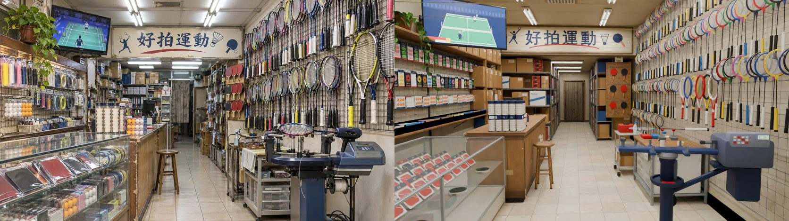
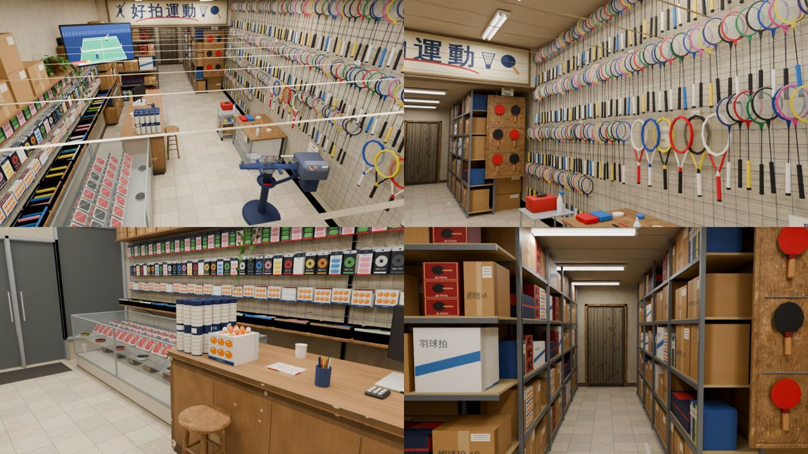

# CC_42 好拍運動室內（羽球、桌球、網球用品店）

- 做的人：CC（帳號 A）的建模子代理，2026-11-03。外觀由 LAWWW2 做。做完給 BB 驗收。
- 規格：AA_620 第 1、2 節、3-3、3-4；SCENE_RULES 第 10 節。
- 參考圖：`haopai_int.jpg`（室內）、`haopai_ext.webp`（外觀，用來對門的位置）。
- **狀態（v2，11-03 23:5x）：`READY_FOR_REVIEW`（雲端預覽）**。v1 已被 LAWWW2 退回（「15 m 寬的空倉庫」），v2 照參考圖重做，見下面「v2」幾節。PC 的正式渲染、遊戲內截圖還沒做。
- v1 的 WIP 紀錄留在最後面（「WIP 暫停」以下），已經過時。

## v2：照參考圖重做（2026-11-03 23:1x～23:5x）

### 檔案
| 檔 | 內容 |
|---|---|
| `src/data/haopai_layout.js` | v2：4.4 × 14 × 3.4 m（騎樓開間）；items、blocks、seats、interact、npc、`camRef`（參考圖的鏡頭） |
| `tools/blender/env_second/bb_support/haopai_tex.py` | 自製貼圖 v2：`haopai_alpha.png`（網格、8 色羽球拍頭、網球拍線、黃金葛葉）、`haopai_goods.png`（印刷圖集 2048²：手寫紙條、價目卡、包裝、紙箱、櫃台掉漆面板、褪色海報、月曆）、`haopai_emit.png`、`haopai_sign.png`（招牌）、`haopai_floor.png`（30 cm 米色磚） |
| `tools/blender/env_second/bb_support/haopai_interior.py` | 建模 v2（重寫） |
| `tools/blender/env_second/bb_support/haopai_render.py` | 新：Cycles 預覽（相機預設＝layout 的 camRef） |
| `assets/models/env/second_ai/bb_support/haopai.glb`、`.json` | 輸出 |
| `docs/story_planning/CC/shots/model/haopai/haopai_v2_*` | 並排圖、ref_match 比對圖＋報告、四個角度 |

### 數字
- 三角形（drawn，含 instancing）**55,228**（預算 60k）；網格本身 36k。材質 **11 個**（預算 12）。GLB **2.95 MB**（預算 6 MB）。
- 主要分配：右牆球拍 268 支羽球拍（16 個原型、instancing，一支 48 個三角形）＋15 支網球拍（5 原型）約 1.5 萬；左牆網格的商品、籃子約 1.2 萬；雜物（櫃台、穿線機、工作桌、推車、後段鐵架與紙箱）約 2 萬；殼、燈約 0.6 萬。
- instancing：羽球拍、網球拍、桌球拍、羽球筒、日光燈。Blender 匯出的 instancing 節點原本叫 `haopai_interior.N`、沒有自訂屬性——遊戲用名字 `/WALL_/` 認淡出的牆，右牆的球拍會認不到。腳本在匯出後改 GLB：instancing 節點改成網格的名字（`WALL_right_bad00_0_alpha_inst`…），右牆的補 `extras.dir=[-1,0,0]`。**LAWWW2 整合時請確認 three.js 的 InstancedMesh 有跟著右牆淡出**（我沒開瀏覽器，沒驗證）。

### ref_match（`haopai_v2_refmatch_cmp.jpg`、`_report.json`；渲染 836×470、Cycles 16 samples、AgX）：**五項 PASS**
| 項目 | 參考 | 渲染 | 門檻 | |
|---|---|---|---|---|
| 平均亮度 | 0.450 | 0.471 | 差 ≤ 0.08 | PASS |
| 對比 | 0.689 | 0.658 | ≥ 0.551 | PASS |
| 冷暖（R−B） | +0.075 | +0.111 | 差 ≤ 0.05 | PASS（差 0.036，最接近門檻的一項） |
| 色票 ΔE | | 6.7 | ≤ 18 | PASS |
| 九宮格 | | 0.066 | ≤ 0.12 | PASS |




鏡頭：眼睛 (0.25, 1.55, 6.55)、看 (0.66, 1.08, 0)、24 mm（往右轉 3.6°、往下 4°；從參考圖的消失點、招牌兩端和牆的位置估的）。50% 疊圖：招牌、櫃台、凳子、穿線機、右牆大致對得上。

### v2 拆圖清單（參考圖從左到右、前到後；色碼是從參考圖用 PIL 取的 3×3 平均）
| # | 是什麼 | 畫面位置 | 尺寸（m） | 參考圖色碼 | 材質 | 模型物件 | 做了 |
|---|---|---|---|---|---|---|---|
| 1 | 電視（播羽球賽：綠色場地、兩個人影、比分色塊） | 左上 | 1.15 × 0.68，支架從左牆伸出，y 2.58 | 場地 #6db2b2、框 #2c434a | emit 圖集＋頂點色 | `WALL_left_tv_*`、`tv_arm` | ✓ |
| 2 | 黃金葛吊盆（陶盆、藤垂到網格前） | 左上、電視左邊 | 盆 ø0.28；藤 0.3～1.2 | 盆 #7a4c3c、葉 #4f7d3a 有黃斑 | 頂點色＋葉片卡（alpha） | `WALL_left_pothos_*` | ✓ |
| 3 | 左牆鐵網格 | 左、中段高度 | z 6.6～−0.85、y 1.12～2.26 | 灰 #7f8388 | alpha（網格） | `WALL_left_grid_*` | ✓ |
| 4 | 握把布吊卡（白、粉紅、黃、藍、黑、綠、橘、紫；一勾掛四包） | 左牆網格上排 | 0.11 × 0.22 | 白 #f5f3ee、粉 #eba9b3、黃 #f5d561 | 印刷圖集 | `WALL_left_lgoods_goods` | ✓ |
| 5 | 拍線包（深色紙卡、彩色線圈） | 左牆網格中排 | 0.11 × 0.22 | 藍 #3f7fd0、黃 #f0d23a | 印刷圖集 | 同上 | ✓ |
| 6 | 桌球盒（橘球、白球） | 左牆網格下排、玻璃櫃、櫃台上 | 0.17 × 0.15 × 0.05 | 橘 #f08a24、白 #f4f2ec | 印刷圖集 | 同上、`glasscase`、`counter_top` | ✓ |
| 7 | 籃子（藤籃、藍色、白色塑膠籃，裡面一卷卷握把布） | 左牆下層木板 y 1.05 | 0.27 × 0.38 × 0.1 | 藤 #9e8368、藍 #3a78c0 | 頂點色 | `WALL_left_lower_shelf_*` | ✓ |
| 8 | 上層木板（紙箱、羽球拍盒、桌球拍盒） | 左上 y 2.3 | 深 0.32 | 木 #96744f | 木（Poly Haven）＋印刷 | `WALL_left_upper_shelf_*` | ✓ |
| 9 | 玻璃展示櫃（鋁框、兩層玻璃）：膠皮斜靠、拍線捲、桌球盒 | 左前（畫面左下） | 1.04 × 3.35 × 0.95 | 玻璃面 #76796f；膠皮紅 #b8262a／黑 | 玻璃＋頂點色＋印刷 | `glasscase`、`case_reel_*` | ✓ |
| 10 | 木櫃台（客人那面和前端面：掉漆、邊框露白、下緣踢黑、膠帶痕） | 左中 | 0.77 × 2.55 × 1.0 | 木 #96744f | 印刷圖集（`counter_face`、`counter_top`） | `counter_goods` | ✓ |
| 11 | 羽球筒一排（白筒、深藍蓋） | 櫃台前端上面 | ø0.088 × 0.40，5 × 3 | 筒 #c2b39c、蓋 #1b202d | 印刷＋頂點色（instancing） | `tube_a_*` | ✓ |
| 12 | 電腦螢幕（朝老闆；背面朝客人）＋鍵盤 | 櫃台中段 | 0.5 × 0.32 | 黑 #1c1c1e | 頂點色＋emit | `monitor_*` | ✓ |
| 13 | 筆筒（七支筆）、計算機、收據、馬克杯、一疊膠皮 | 櫃台 | | 筆筒 #3a4f7a | 頂點色 | `counter_top` | ✓ |
| 14 | 高腳木凳（腳套、兩圈橫撐） | 中、櫃台旁 | 座面 0.72、ø0.35 | 木 #372f26（暗處） | 木 | `stool_high` | ✓ |
| 15 | 招牌橫匾「好拍運動」：米白底、深藍字、紅弧線、羽球人／羽球／桌球拍圖示 | 中上（樑的正面） | 3.6 × 0.7 | 底 #bbb09d、字 #535969、紅 #8c413c | 招牌貼圖（字畫在貼圖上，2048×400，不擠扁） | `soffit_sign` | ✓ |
| 16 | 下垂的樑（後段天花板比較低） | 中上 | z −0.95～−1.25，底 2.6 | | 牆 | `soffit_*` | ✓ |
| 17 | 後段兩側鐵架堆紙箱、資料夾、白盒（到天花板） | 中後 | 架高 2.55 | 紙箱 #685439、資料夾藍 | 頂點色（角鋼）＋印刷（紙箱有麥克筆字） | `back_L`、`back_L_front`、`back_R`、`storage` | ✓ |
| 18 | 最裡面的布簾（竹葉、下襬髒） | 中後正中 | 0.9 × 2.05 | #665d51 | 印刷圖集 | `WALL_back_curtain_*` | ✓ |
| 19 | 立扇 | 布簾右邊 | 高 1.1 | #6b685f | 頂點色 | `fan` | ✓ |
| 20 | 右牆鐵網格（0.35 m 到天花板） | 右 | z 6.62～−1.25 | 灰 | alpha | `WALL_right_grid_*` | ✓ |
| 21 | 羽球拍（頭朝上四排＋穿線機上方一排；框 8 色、握把白黑黃藍；拍頭＝框＋線＋拍喉，中管、握把、尾蓋是幾何） | 右牆 | 全長 0.70 | 藍 #1c3f96、紅 #b81c26、黃 #d8c41a、黑 | alpha 拍頭卡＋頂點色 | `WALL_right_bad*_inst` | ✓ |
| 22 | 網球拍（前段一排；框＋拍喉＋線＋握把） | 右前 | 0.685 | 黃 #d8c92d、黑、紅、白 | 頂點色＋alpha 線 | `WALL_right_ten*_inst` | ✓ |
| 23 | 桌球拍板（深色木板、兩排橫桿、紅黑成品拍 2 × 3） | 右中（樑後面、面向店門） | 0.7 × 1.6 | 紅 #a84e4e、木 #726353 | 木＋頂點色 | `ttboard`、`tt_*_inst` | ✓ |
| 24 | 穿線機（深藍底座立柱、轉盤、夾頭、灰藍拉線頭＋按鍵＋小螢幕、線軸、工具盤、保溫杯；轉盤上夾一支穿到一半的拍子） | 右前 | 轉盤 0.88、高 1.22 | 深藍 #181a22、拉線頭 #6a6972 | 頂點色＋emit | `stringer_*`、`badf0_*` | ✓ |
| 25 | 工作桌＋兩組塑膠抽屜櫃、毛巾、噴瓶、工具盤、膠帶、剪刀 | 右中 | 0.8 × 1.1 × 0.78 | 抽屜 #91887f、毛巾 #bfbcb5 | 木＋印刷（抽屜面）＋頂點色 | `workbench_*` | ✓ |
| 26 | 有輪子的小推車（紅色工具箱、噴瓶、拍線） | 右中、工作桌前 | 0.46 × 0.5 × 0.78 | | 頂點色 | `cart_*` | ✓ |
| 27 | 日光燈管天花板（前段沿 z 兩排、後段橫向） | 上 | 1.2 m 雙管 | 燈 #ffffff | emit＋頂點色金屬 | `fixture_*_inst`、`GLOW_tube_*` | ✓ |
| 28 | 出風口 | 中上 | 0.55 × 0.5 | #998b7e | 頂點色 | `aircon` | ✓ |
| 29 | 米色磁磚地板（30 cm、每片色差、磚縫積灰、鞋底磨痕） | 下 | | 近 #bab1a9、中 #898378 | 自製貼圖 | `floor` | ✓ |
| 30 | 天花板（輕鋼架 60 cm） | 上 | 前段 3.4、後段 2.6 | #998b7e | Poly Haven ceiling_interior（單面朝下） | `ceiling`、`tbar` | ✓ |

另外加的（參考圖鏡頭看不到的位置，或是在地感必要的）：手寫紙條 9 張（「穿線 $250 起 約20分鐘」「握把布 3條 $100」「特價 NT$1,680」「請勿試揮 謝謝」「網球拍 $2,980 起」「拍線久了會鬆 記得來換」「桌球拍 代貼膠皮」「營業 12-21點 週日休」「球拍穿線 當天可取」）、價目卡 11 張（新台幣）、褪色的「第十二屆新生盃羽球賽」海報（虛構，前段左牆上面）、月曆（櫃台後面）、電視電線的白色壓條、延長線、地上剪下來的線頭。

### 第 11 節醜點清單
- [x] **比例**：面寬 4.4 m、一樓 3.4 m；空地板＜畫面 1/3（參考角度約 1/5）。
- [x] **光**：不是整片白天花板；日光燈管是發光材質＋（渲染時）每支一片面光、暖白；牆 #c8bfaa、天花板 #c4b8a2，都不是純白，牆面亮度 < 0.9。參考圖本身是日光燈管（不是軌道燈），照參考圖做。
- [x] **密度**：右牆從 0.35 m 掛到天花板；左牆網格擺滿；小東西 15 種以上（招牌、電視、黃金葛、手寫紙條、價目卡、海報、月曆、羽球筒、桌球盒、膠皮、拍線、握把布、籃子、螢幕、筆筒、計算機、馬克杯、噴瓶、毛巾、工具箱、紙箱、資料夾、布簾、立扇、延長線、線頭）。
- [x] **商品不是單色方塊**：羽球拍＝拍頭（框＋線＋拍喉）＋中管＋握把＋尾蓋；網球拍有開放式拍喉；桌球拍有膠皮兩面、木握把、飾片；包裝全部是印刷圖集。
- [x] **歲月感**：櫃台面板掉漆、邊框露白、下緣踢黑、膠帶痕；地磚色差、磚縫積灰、鞋底磨痕；玻璃櫃下緣被踢髒；牆腳一條髒；海報褪色、四角膠帶；招牌邊緣變黃、鏽水痕；地上的線頭。
- [x] **在地感**：手寫中文紙條、新台幣價格、虛構店名「好拍運動」、虛構比賽海報；沒有任何真實品牌或標誌（拍子、包裝、電視都沒有）。
- [x] **預算**：55k 三角形、11 材質、2.95 MB；重複的東西 instancing。

### 和參考圖不一樣的地方（只有三種）
1. **品牌拿掉（D77）**：參考圖的拍子、包裝、電視的標誌全部沒有；包裝上只有中文品名（「握把布」「拍線 10m」「反膠」「三星球 6入」）。
2. **尺寸照 layout**：面寬 4.4 m（參考圖看起來略寬）→ 前段的櫃台＋玻璃櫃、穿線機區比參考圖窄一點；參考圖前景的玻璃櫃在畫面裡比較大。招牌 3.6 × 0.7 m（參考圖約 3.7 × 0.87），樑底 2.6 m。
3. **遊戲必要**：走道最窄 1.32 m（參考圖的高腳凳擋在走道中間，這裡貼著櫃台放）；穿線機的拉線頭不能超出右牆，轉盤比參考圖往走道多伸一點；前牆是門＋落地窗（參考圖鏡頭在門內，看不到）。
4. （說明，不是改動）參考圖是 AI 生成的，透視不完全一致（左牆、右牆、招牌三者算出來的相機位置不同），鏡頭取折衷：招牌、櫃台、凳子對齊優先。

### 還沒做到參考圖的地方（誠實列出）
- **右牆的拍子比參考圖疏、比參考圖亮**：參考圖的拍子一支壓一支、框多半深色；這裡拍頭是 alpha 卡片，從門口斜看比較細，拍線的白比較搶眼。拍子轉了 30～40° 朝店門，讓拍面看得到（真實店裡掛勾上的拍子也會轉）。
- **左牆比參考圖整齊**：一排一排像超商，參考圖比較亂、包比較大。
- **玻璃櫃**在畫面裡比參考圖小、暗；參考圖的膠皮更大、斜得更陡。
- **後段**比參考圖亮、乾淨；布簾的門框太顯眼。
- 冷暖差 0.036（門檻 0.05），偏暖一點。
- 拍頭是卡片：從牆邊貼著看會變一條線（玩家大多從店中間看，影響不大）。
- 天花板的燈具從天花板上面的遊戲鏡頭看會浮在空中（天花板本身單面朝下看得穿；燈具、出風口不是）。輕鋼架改成只做朝下的一片。
- 都沒在遊戲裡看過：沒開瀏覽器（使用者規定），導航、淡出、instancing 的淡出都要 LAWWW2 驗。

### 給 CC 排 PC 的渲染
```
# 參考圖角度（ref）＋四個角度；PC 用 GPU、64 samples、1672×941（和參考圖同尺寸）
CC_BLENDER_DEVICE=GPU CC_SAMPLES=64 blender -b --python tools/blender/env_second/bb_support/haopai_render.py -- \
  assets/models/env/second_ai/bb_support/haopai.glb <輸出資料夾> --views <views.json> --res 1672x941 --tube 25 --emit 2 --door 15 --rack 8
# views.json（遊戲座標）：
[["game", [-0.4, 3.2, 6.7], [0.6, 0.6, 1.4], 20],
 ["rackets", [0.0, 1.6, 4.8], [2.08, 1.9, 1.6], 26],
 ["counter", [0.9, 1.6, 1.0], [-1.2, 0.9, 3.4], 26],
 ["back", [0.2, 1.6, 0.6], [0.2, 1.2, -6.8], 26]]
# 之後跑：python3 tools/blender/env_second/ref_match.py <參考圖> <輸出>/haopai_ref.png <前綴>
```
（`ref` 一定會先渲染，相機在 layout 的 `camRef`。雲端預覽是 836×470、16 samples，一張約 20 秒。）

### 順便發現的 bug
`_new(c, n0)`（用面的 index 取「新加的面」）在 `create_cone` 之後不可靠：bmesh 的面順序不保證新面在最後，顏色會塗到別的零件（v2 第一版：球拍中管變白、握把一半黑一半白）。這份改成先記住原本的面集合再取差集（`_N0`）。我 grep 過 `bb_support/` 現在的腳本，沒有別的腳本用這個寫法（v1 的好拍有）；以後從 v1 抄這段的要注意。

---
（以下是 v1 的紀錄，已過時）

## WIP 暫停（2026-11-03，P0：使用者說瀏覽器測試優先）

收到暫停指令時，我的 Blender 還在排隊等空位，沒有真的開始跑，已經停掉。目前沒有任何 Blender 是我開的。

### 已經做好的（檔案都在原位，沒有 commit）
- **配置** `src/data/haopai_layout.js`
  - 格式照 `wz_shops_layout.js`，尺寸 9 × 16 × 3.6 m。
  - 門在 +z、x −0.6、寬 1.6 m，兩側落地窗。這是照外觀參考圖的「中間偏左雙開門」。
  - 已寫好的欄位：items、blocks、seats、interact、npc。
    - seats：門口小板凳（座面 0.32 m）、櫃台前高腳凳（座面 0.70 m）。
    - interact：看看（球拍牆）、買東西（櫃台）、穿線（穿線機）。
    - npc：老闆在穿線機前或櫃台後，柏翰站在櫃台前。
  - 另外寫了 walkNote、soffit（招牌樑 z −1.6）、wallsFade。exit、enterAt 留空。
  - 用 `node` 載入過，格式正確。
- **貼圖腳本** `tools/blender/env_second/bb_support/haopai_tex.py`
  - 已經跑過，輸出在 `tools/blender/env_second/textures/gen/`：
    - `haopai_alpha.png`：鐵網格、羽球拍線、網球拍線、洞洞板
    - `haopai_goods.png`：16 格商品
    - `haopai_emit.png`：燈管、電視抽象球場、櫃台螢幕、穿線機小螢幕
    - `haopai_atlas.json`
  - 全部用程式畫，沒有字、品牌或 logo，電視上沒有人。
  - 預覽圖在 scratchpad 的 `model/out_hp/atlases.jpg`，我看過，圖面正常。
- **建模腳本** `tools/blender/env_second/bb_support/haopai_interior.py`
  - 程式已寫完，但**一次都還沒跑過**。
  - 內容包括：
    - 房間：牆的淡出組、天花板（單面朝下）、輕鋼架、日光燈與光暈節點
    - 招牌樑和空白底板 `PLATE_FACE_HAOPAI`
    - 右牆網格，掛約 100 支羽球拍和 9 支網球拍
    - 桌球拍洞洞板（12 支）、拍線捲、矮櫃與球拍袋
    - 穿線機：底座、立柱、轉盤、夾頭、拉線頭、線軸，轉盤上夾一支羽球拍
    - 有抽屜的工作推車
    - 鐵網特價桶、高腳凳、小板凳
    - 左牆：網格掛握把布與拍線，上下兩層木板，籃子、電視、黃金葛
    - 玻璃展示櫃、木櫃台和櫃台上的東西
    - 後段：走道兩側鐵架、倉庫紙箱、布簾、立扇
  - 預計 11 個材質。Poly Haven CC0 貼圖用四張：
    - `large_floor_tiles_02`
    - `painted_plaster_wall`
    - `ceiling_interior`
    - `fine_grained_wood`
  - 球拍沒有用 instancing，改成合併進 `WALL_right` 的網格。原因是遊戲用 mesh 名稱認 `WALL_`，instancing 節點的名稱不確定能不能接上，三角形畫出的數量兩種做法一樣。

### 還沒驗證、還沒做的
1. 建模腳本沒跑過，可能有執行錯誤。
2. 三角形數、材質數、GLB 大小都還沒量，預算是 6 萬、12 個、6 MB。我估計右牆球拍佔 2.5 萬左右，超過的話要減少球拍數或段數。
3. 沒有渲染圖，也沒有「參考圖 vs 渲染」並排對照圖。
4. 沒跑 `glb_specs.py`。
5. 下面幾個疑點還沒用渲染確認：
   - 天花板的法線是不是朝下
   - 平放球拍的方向對不對
   - TV 和螢幕朝哪一面
   - 單面、雙面材質的表現
6. 交件說明裡的「和參考圖不同的地方」「還沒達到參考品質的缺點」還沒寫。

### 下一步（恢復時）
1. 先確認 `pgrep -fc "blenv/bin/python"` 是 0，再用 nice 跑：
   `nice -n 15 /opt/blenv/bin/python tools/blender/env_second/bb_support/haopai_interior.py -- --out $S/model/out_hp/haopai.glb`
2. 修掉執行錯誤，再看 `.json` 的三角形數和材質數，超過預算就減少。
3. 用 `render_cycles.py` 渲染三張以上，每個燈的位置加 `--point`，64 取樣、1280×720。其中一張從門口 (−0.6, 1.6, 7.6) 往裡看，盡量和參考圖同角度。
4. 做並排對照圖，所有圖轉成 300 KB 以內的 jpg，放到 `docs/story_planning/CC/shots/model/haopai/`。
5. 正式輸出到 `assets/models/env/second_ai/bb_support/haopai.glb`，跑 `glb_specs.py`，補完這份說明，狀態最多標 READY_FOR_REVIEW。

### 新增的檔案（都還沒 commit）
- `src/data/haopai_layout.js`
- `tools/blender/env_second/bb_support/haopai_tex.py`
- `tools/blender/env_second/bb_support/haopai_interior.py`
- `tools/blender/env_second/textures/gen/haopai_alpha.png`
- `tools/blender/env_second/textures/gen/haopai_goods.png`
- `tools/blender/env_second/textures/gen/haopai_emit.png`
- `tools/blender/env_second/textures/gen/haopai_atlas.json`
- `docs/story_planning/CC/CC_42_好拍運動室內.md`（這份）
