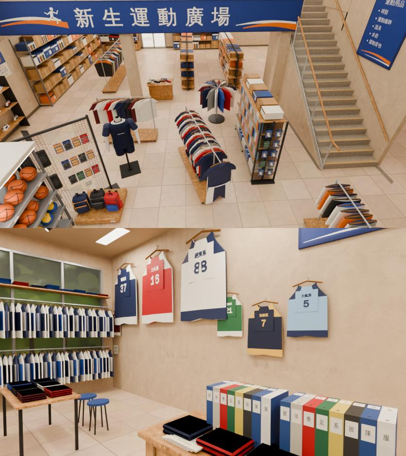
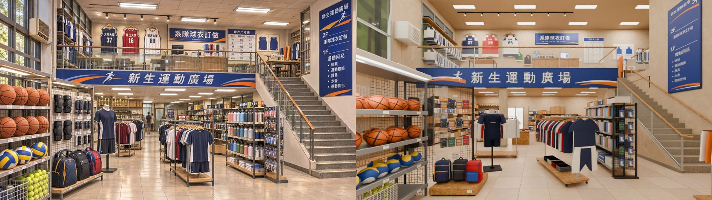
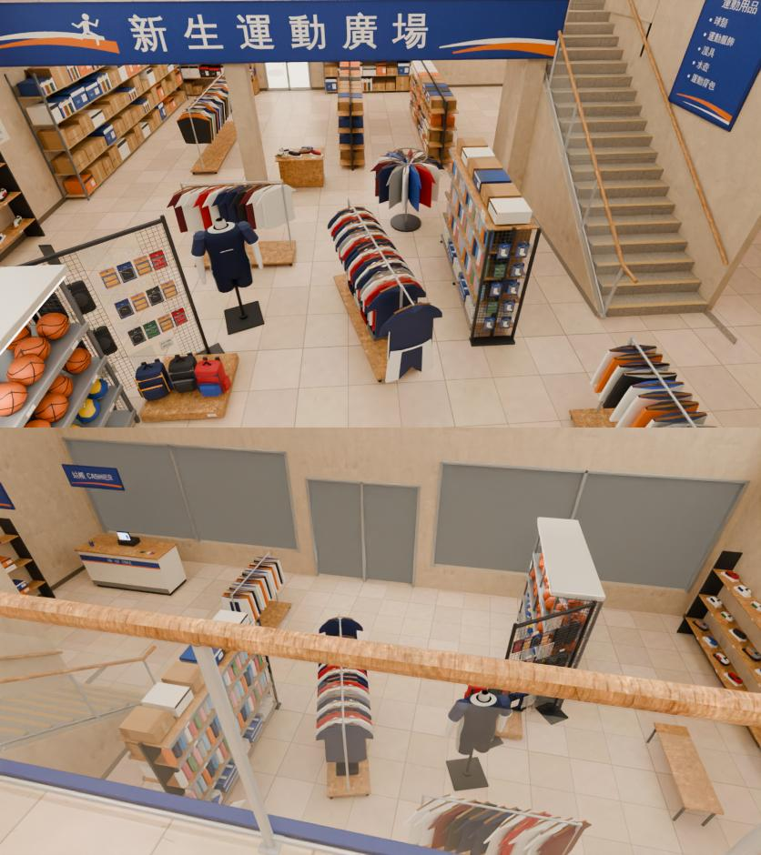
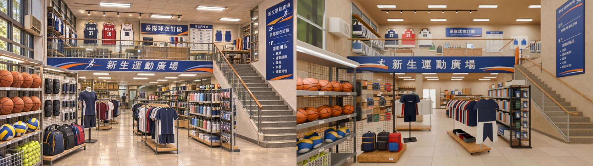
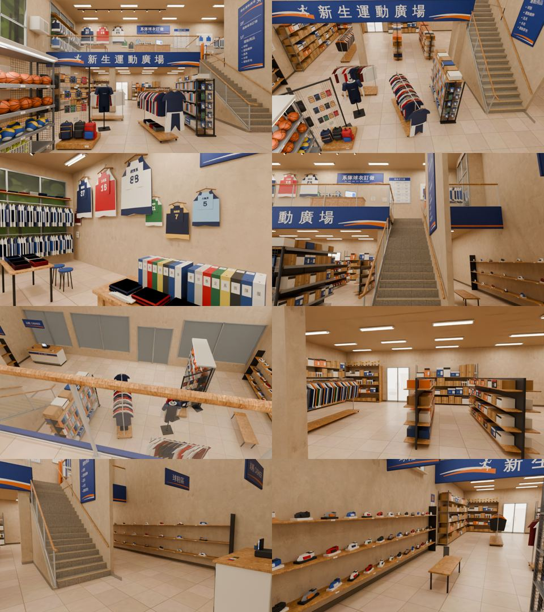

# CC_43 新生運動廣場室內（兩層：一樓＋二樓）

- 做的人：CC（帳號 A）的建模子代理。外觀、街道配置由 LAWWW2 做。做完給 BB 驗收。不准標 ART_APPROVED。
- 規格：參考圖 `xinsheng_sports_int`（使用者 11-03 給的；SCENE_RULES 第 9、11、12 節：參考圖就是規格）、AA_620 第 1、2 節、3-2、3-4。
- **狀態（v3c，2026-11-04 01:0x）：`READY_FOR_REVIEW`（雲端預覽；LAWWW2 已把 v3 標成 MODEL_READY）**。最新是 v3c（寬 14.0 m），見下一節；v3b 在它後面。v1／v2 被 LAWWW2 退回（「人台是方塊拼的、二樓欄杆一條藍色色塊、牆是空白的」，使用者：「怎麼可以做的這麼像廉價的遊戲」），v3 照參考圖整個重做。PC 的正式渲染、遊戲內截圖都還沒做；沒開瀏覽器（規定）。
- 沒有 commit／push（CC 統一 commit）。
- v1／v2 的紀錄留在最後面（「舊紀錄」以下），已經過時。

## v3c：室內縮成 14.0 m 寬（LAWWW2 決定；街道那邊不動，2026-11-04 01:0x）
- 狀態：`READY_FOR_REVIEW`（雲端預覽）；沒有 commit，沒開瀏覽器。
- **layout**：`w` 14.4 → **14.0**（內牆 x ±6.88），對上 `xinsheng_street` 的運動廣場（z −40～−26、門 z −33＝正中間；室內店門 x 0、寬 2.4，v3b 已經對齊）。
- **家具位置不動**。貼牆的東西跟著牆往內移 0.2 m（模型裡本來就照內牆位置畫的；這次改的是 layout 的座標和導航阻擋）：
  - 左牆球鞋牆 x −6.9 → −6.7、東邊球鞋牆 6.89 → 6.69、夾層下左牆層架 −6.85 → −6.64、二樓左牆衣架 −6.84 → −6.64、樣衣間 6.69 → 6.49。
  - 獎盃櫃 x −5.65 → −5.5：原本 −6.9～−4.4 會穿出新的牆，改成 −6.75～−4.25；阻擋 z −7.63 不變。
- **窗**：
  - 前牆一樓落地窗 [−6.9, −1.6]／[1.6, 6.9] 會碰到新的內牆（±6.88），改成 **[−6.6, −1.6]／[1.6, 6.6]**。
  - 二樓高窗原本在腳本裡寫死 ±6.9，改成讀 layout 的 `front.upper.x0/x1`（±6.6）。
  - 左牆大窗是沿 z 的，不受影響。
- **數字**（和 v3b 相同）：一樓 **59,994** 三角形（≤ 60k）、二樓 **33,794**；材質 12／10；GLB **3.80 MB**。
- **樓梯導航 Node 檢查重跑：17 項 ALL PASS**。
- **ref_match 五項 PASS**（`xinsheng_v3c_refmatch_cmp.jpg`、`_report.json`）：
  | 項目 | 參考 | 渲染 | 門檻 |
  |---|---|---|---|
  | 平均亮度 | 0.493 | 0.504 | 差 ≤ 0.08 |
  | 對比 | 0.669 | 0.629 | ≥ 0.535 |
  | 冷暖 | +0.136 | +0.154 | 差 ≤ 0.05 |
  | 色票 ΔE | | 6.5 | ≤ 18 |
  | 九宮格 | | 0.035 | ≤ 0.12 |
- 參考圖鏡頭 camRef 不動。左牆往內 0.2 m，所以招牌左端那段的左牆在畫面上稍微往右。




## v3b：LAWWW2 收件（MODEL_READY）後的三項 P2＋店門對齊（2026-11-04 00:5x）
- 狀態：`READY_FOR_REVIEW`（雲端預覽）；沒有 commit（CC 統一 commit），沒開瀏覽器。
- **① 中間地板補東西**：圓形衣架（運動 T 一圈 14 件，(−0.1, 0.75)）、店門右邊的直衣架（球褲 15 件，(1.6, 5.6)，沿 z）、球鞋展示台（木台＋6 隻鞋＋價目卡，(−2.2, −1.0)，夾層前緣下面）。layout 的 items、`levels[0].blocks` 都加了。
  - 省出來的三角形：東邊球鞋牆的鞋換成鞋盒（參考圖鏡頭看不到）、夾層下外套衣架少一半、左牆球鞋間距 0.42 → 0.5（45 → 39 隻）、網球每籃少幾顆。
- **② 人台加粗**：寬、厚 ×1.16（高度不變；整體原本就 ×1.08）。
- **③ 燈具不吊在半空**：雙管日光燈改成和輕鋼架齊平的嵌入式燈（鋁框＋發光面板，都只朝下；材質是天花板＋會亮的）——從天花板上面的遊戲鏡頭看和天花板一樣看不到。軌道燈照舊（軌道貼著天花板）。兩層都改。
- **店門對齊外觀**：LAWWW2 的 `xinsheng_street`（claude/second-ai-env-art 3a81bf5a1）運動廣場 z −40～−26、門 z −33、寬 2.4＝**店面正中間** → 室內店門從 x −1.5／寬 2.0 改成 **x 0／寬 2.4**，兩側落地窗改成 [−6.9, −1.6]、[1.6, 6.9]，spawn x 0。參考圖鏡頭（camRef）不動（在門內偏左 1.5 m）。
  - **還對不上的一點**：街道那邊這家寬 14.0 m（z −40～−26），室內是 14.4 m（任務規定的騎樓開間）。門在中間，所以門對得上；兩側牆差 0.2 m，請 LAWWW2 決定要街道改 14.4 還是室內縮成 14.0（室內縮的話改 layout 的 w、重跑腳本即可，家具位置不用動）。
- **數字**：一樓 **59,994** 三角形（≤ 60k）、二樓 **33,794**；材質 12／10；GLB **3.80 MB**。
- **ref_match 五項 PASS**（`xinsheng_v3b_refmatch_cmp.jpg`、`_report.json`）：平均亮度 0.493／0.502、對比 0.669／0.627（≥ 0.535）、冷暖 +0.136／+0.155、色票 ΔE 6.2、九宮格 0.034。
- **樓梯導航 Node 檢查重跑：17 項 ALL PASS**。只改了一項檢查的終點：「夾層下走一圈」原本的終點 (−1.6, −1.0) 現在離球鞋展示台太近，改成 (−1.05, −0.9)。指令照舊。




## v3：照參考圖重做

### 檔案
| 檔 | 內容 |
|---|---|
| `src/data/xinsheng_sports_layout.js` | v3：14.4 × 16 m（騎樓開間）；一樓 3.4 m（夾層下）、挑空 7.6 m、二樓樓板頂 3.75 m；items、levels（每層 blocks、二樓 walk）、stairs、interact、seats、`camRef`（參考圖的鏡頭，含鏡頭位移 shiftY） |
| `tools/blender/env_second/bb_support/xinsheng_tex.py` | 新：自製貼圖 `xs_goods.png`（2048²：籃球／排球／網球球面展開、球衣胸前字、護具吊卡、價目卡、手寫紙條、紙箱、鞋盒、資料夾、窗外行道樹、後門外、海報、收銀台面板、毛巾）、`xs_sign.png`（4096×1024：主招牌、系隊球衣訂做、尺寸表、樓層指示牌〔轉 90° 放〕、小吊牌）、`xs_alpha.png`（鐵網格、網籃）、`xs_emit.png`、`xs_floor.png`（60 cm 米色磚）、`xs_atlas.json` |
| `tools/blender/env_second/bb_support/xinsheng_sports_interior.py` | 建模 v3（重寫） |
| `tools/blender/env_second/bb_support/xinsheng_render.py` | 新：Cycles 預覽（相機預設＝layout 的 camRef；燈的位置從 GLB 旁邊的 .json 讀） |
| `assets/models/env/second_ai/bb_support/xinsheng_sports.glb`、`.json` | 輸出 |
| `docs/story_planning/CC/shots/model/xinsheng/xinsheng_v3_*` | 並排圖、ref_match 比對圖＋報告、八個角度、views json |

### 數字（每層分開算；instancing 照畫出來的算）
| | 一樓（L0） | 二樓（L1：樓板、欄杆、二樓的東西、挑空的天花板和燈） | 預算 |
|---|---|---|---|
| 三角形（drawn） | **59,950** | **35,894** | 每層 ≤ 60k |
| 材質 | **12** | **10** | 每層 ≤ 12 |
| GLB | 合計 **3.57 MB** | | ≤ 6 MB |

一樓最接近上限（剩 50）：網球 168 顆（一顆 24 三角形）、籃球 32 顆、排球 15 顆、運動 T／外套 54 件、水壺 75 支、鞋 72 隻、日光燈 19 支都是 instancing。再加東西要先減（例如東邊球鞋牆、夾層下的外套衣架，參考圖鏡頭看不到）。
材質（兩層共用 12 個）：地磚（自製）、牆 painted_plaster_wall、天花板 ceiling_interior（單面朝下）、木頭 fine_grained_wood、樓梯石材 granite_tile_03（Poly Haven CC0）、頂點色（霧面）、頂點色（金屬，0.4）、玻璃、透明圖集、印刷圖集、會亮的、招牌。金屬度都 ≤ 0.45。

### ref_match（`xinsheng_v3_refmatch_cmp.jpg`、`_report.json`；渲染 836×470、Cycles 16 samples、AgX）
**五項 PASS**
| 項目 | 參考 | 渲染 | 門檻 | |
|---|---|---|---|---|
| 平均亮度 | 0.493 | 0.466 | 差 ≤ 0.08 | PASS |
| 對比 | 0.669 | 0.611 | ≥ 0.535 | PASS |
| 冷暖（R−B） | +0.136 | +0.159 | 差 ≤ 0.05 | PASS（差 0.023，偏暖一點） |
| 色票 ΔE | | 6.6 | ≤ 18 | PASS |
| 九宮格 | | 0.036 | ≤ 0.12 | PASS |




鏡頭（layout 的 `camRef`）：眼睛 (−1.5, 1.55, 7.55)、水平往 −z、16 mm、shiftY 0.042。怎麼反推的：參考圖夾層前緣的主招牌是水平的 → 鏡頭正對 −z、不轉；直線（樓梯立柱、架子）都是直的 → 不仰頭，用鏡頭位移把地平線放到 y≈540/941（後門那幾個人頭的高度）；欄杆玻璃底（y 320）、扶手（y 215）兩條線 → 夾層前緣在 7.4～7.6 m 遠、樓板頂 3.75 m；招牌左端（x 265）＝左牆 → 眼睛 x −1.5；樓梯內側在 x 1460、4.3 m 遠 → 樓梯 x 2.5～4.0。50% 疊圖：主招牌、欄杆、三件展示球衣、尺寸表、樓層指示牌、球架、背包、人台、中間衣架、水壺架、樓梯都在差不多的位置。

### v3 拆圖清單（參考圖從左到右、前到後；色碼是從參考圖用 PIL 取的平均）
| # | 是什麼 | 畫面位置 | 尺寸（m） | 參考圖色碼 | 材質 | 模型物件 | 做了 |
|---|---|---|---|---|---|---|---|
| 1 | 左牆兩層高的大窗（鋁框、三片一組、橫楣）＋窗外行道樹 | 左上 | z 1.4～7.5、y 3.0～7.2 | 框 #a9adb0、樹 #5f8a3e | 頂點色金屬＋玻璃＋印刷（樹） | `WALL_left_L1_window_*` | ✓ |
| 2 | 窗型冷氣（白、格柵、水痕、排水管） | 左上 | 0.55 × 0.7 × 0.7 | #e4e0d6 | 頂點色 | `WALL_left_L1_aircon_*` | ✓ |
| 3 | 二樓左牆衣架（上下兩支桿，滿滿的深藍／白系隊球衣；最上層板摺好的衣服） | 左上 | z −3.4～−0.3 | 深藍 #1f2d55、白 #efefea | 頂點色（instancing） | `WALL_left_L1_wall_rack_*`、`L1_jersey_*_l_*` | ✓ |
| 4 | 二樓後牆三件展示球衣（37 深藍、16 紅、88 白；胸前系名＋號碼） | 中上 | 1.14 × 1.55（展示用大號） | #312f3e、#b8242c、#eeede6 | 頂點色＋印刷（字） | `L1_jd37/16/88_*` | ✓ |
| 5 | 軌道燈（黑色軌道＋投射燈頭） | 中上 | 6.8 m、7 個燈頭 | #1c1c1e | 頂點色金屬＋會亮的 | `L1_track_*`、`L1_spot_*_inst` | ✓ |
| 6 | 方格天花板（60 cm 輕鋼架）＋雙管日光燈 | 上 | 7.6 m；燈 1.2 m | 燈 #fdfcfa | 天花板（單面朝下）＋會亮的 | `L1_ceiling_*`、`L1_fixture_*_inst` | ✓ |
| 7 | 「系隊球衣訂做」橫幅（深藍、白字、橘白弧線） | 中上 | 3.0 × 0.73 | #233f8f | 招牌貼圖 | `WALL_back_L1_wall_signs_*` | ✓ |
| 8 | 球衣尺寸表（XS～2XL、胸圍、衣長） | 中右上 | 1.4 × 1.75 | 白 #f4f2ec、表頭 #233f8f | 招牌貼圖 | 同上 | ✓ |
| 9 | 白板＋兩件藍色樣衣 | 右上 | 1.5 × 1.1 | 板 #f2f1ec、衣 #2950a8 | 頂點色 | 同上、`L1_jsample_*` | ✓ |
| 10 | 訂做櫃台（木）＋電腦螢幕、資料夾一排、型錄、筆筒、摺好的樣衣 | 中、欄杆後 | 2.6 × 0.5 × 0.95 | 木 #a07856 | 木＋頂點色＋印刷＋會亮的 | `L1_order_counter_*`、`L1_monitor_*` | ✓ |
| 11 | 樣品桌＋兩張凳子（摺好的樣衣） | 左中、欄杆後 | 1.4 × 0.7 | | 木＋頂點色 | `L1_sample_table_*` | ✓ |
| 12 | 裁縫桌＋裁縫車（白）＋圓凳 | 右上、樓梯頂後面 | 1.6 × 0.6 | 車 #ecebe6 | 木＋頂點色 | `L1_sewing_*` | ✓ |
| 13 | 布料捲（橘、淺橘、藍、白、深藍） | 右上 | ø0.14 × 1.3～1.85 | 橘 #d66325 | 頂點色 | `L1_fabric_*` | ✓ |
| 14 | 玻璃樣衣間（鋁框玻璃、裡面一支衣架、「樣衣 試穿」） | 右上 | 0.78 × 1.6 | 框 #a9adb0 | 玻璃＋頂點色＋招牌 | `L1_sample_room_*` | ✓ |
| 15 | 夾層前緣玻璃欄杆＋不鏽鋼立柱＋**木扶手**（樓梯洞兩邊也有） | 中 | 扶手高 1.05 | 木 #a99584、柱 #c0c4c8 | 玻璃＋頂點色金屬＋木 | `L1_mezz_rail_*` | ✓ |
| 16 | 主招牌「新生運動廣場」（深藍、白字、跑步的人、橘白弧線） | 中 | 9.28 × 0.93 | #233f8f、橘 #e8782a | 招牌貼圖（4096 寬，字一個一個排，不擠扁） | `L1_fascia_*` | ✓ |
| 17 | 左前鐵網球架（四層：網球網籃、排球、籃球、籃球；擋條上價目卡；頂上一支燈） | 左 | 0.6 × 2.5 × 2.25 | 籃球 #d2704a、排球 黃 #f2c230／藍 #2a52a8、網球 #c9dc3c、鐵 #6f7378 | 印刷（球面展開）＋透明（網格）＋頂點色 | `L0_ball_rack_*`、`L0_bball/vball/tball_*_inst`、`L0_tbasket*` | ✓ |
| 18 | 護具網牆（黑色護膝一對一對、護腕／護肘／護踝／肌貼吊卡、價目卡、紙條） | 左中 | 1.28 × 2.2（斜放 35°） | 護膝 #26272b、網 #5e6166 | 頂點色＋透明＋印刷 | `L0_pad_wall_*` | ✓ |
| 19 | 背包木地台＋三個後背包（深藍黃邊、黑、紅藍；前袋、拉鍊、背帶、側袋、提把） | 左下 | 0.9 × 0.8 × 0.16 | #1f2d55、#26272b、#b32a30 | 木＋頂點色 | `L0_bag_*` | ✓ |
| 20 | 人台（深藍運動 T、白色側邊、袖口白邊、白色手臂、深藍球褲側邊白線、黑色立桿＋方形底座） | 中左 | 身高（到脖子）1.7 | #1f2d55、白 #eeede8 | 頂點色（一圈一圈的橢圓接起來：肩、胸、腰、臀的弧度） | `L0_mannequin_*` | ✓ |
| 21 | 後面那排衣架（酒紅、白、紅、深藍運動 T，斜斜露出正面） | 中 | 1.5 m | 酒紅 #6a1c26 | 頂點色＋木頭衣架 | `L0_rack_b_*`、`L0_tee_*_l_*` | ✓ |
| 22 | 中間衣架（深藍、白、紅、灰運動 T；最前面一套正面展示：深藍 T＋深藍球褲；木頭底板上摺好的 T） | 中 | 1.9 m | #2e2d3d、#cfbeb8、底板 #ae7c4b | 頂點色＋木 | `L0_rack_a_*`、`L0_tee_*`、`L0_tee_face_*`、`L0_shorts_face_*` | ✓ |
| 23 | 衣服：前後兩片曲面，有肩斜、袖子、圓領／U 領、下襬波浪、布紋；木頭衣架＋鐵掛勾（不是紙板） | — | T 長 0.70、肩 0.42 | | 頂點色 | `garment_into` | ✓ |
| 24 | 水壺雙面架（深灰立柱、四層木層板、擋條價目卡）：粉紅、淺藍、深藍、白、綠、灰、橘水壺 | 中右 | 0.6 × 2.2 × 1.85 | 粉 #e8a8b0、藍 #5d8fc8、層板 #c68f59 | 頂點色＋木＋印刷 | `L0_bottle_gondola_*`、`L0_bottle*_inst` | ✓ |
| 25 | 最下層疊好的毛巾（白、藍） | 中右下 | | #f2f0ea、#3a6ac0 | 印刷 | 同上 | ✓ |
| 26 | 端架（網格、運動襪／籃球襪吊卡） | 中右 | | #2a52a8 | 透明＋印刷 | `L0_endcap_*` | ✓ |
| 27 | 樓梯：灰色石材踏面、銅色止滑條、21 階 | 右 | 1.5 寬、一階 0.1786 × 0.255 | 踏面 #b19e8c | 石材（Poly Haven）＋頂點色 | `L0_stairs_*` | ✓ |
| 28 | 樓梯西側米白牆（石材踢腳）＋玻璃欄杆＋不鏽鋼立柱＋**木扶手**（下端水平伸出） | 右 | 扶手 0.92 | 木 #a99584 | 牆＋玻璃＋金屬＋木 | `L0_stair_wall_*`、`L0_stair_rail_*` | ✓ |
| 29 | 樓梯東側的牆（到天花板）＋牆上的木扶手 | 右 | | 牆 #6d5d50（暗處） | 牆＋木 | `L0_fin_*`、`L0_stair_rail_east_*` | ✓ |
| 30 | 樓層指示牌（新生運動廣場、跑步的人；2F 系隊球衣訂做／1F 運動用品：球類、運動服飾、護具、水壺、運動背包） | 右上 | 1.25 × 3.3 | #263770 | 招牌貼圖（轉 90° 放） | `L1_signs_*` | ✓ |
| 31 | 夾層下的吊頂（3.4 m）＋日光燈 | 中後 | | | 天花板＋會亮的 | `L0_ceiling_*`、`L0_fixture_*_inst` | ✓ |
| 32 | 夾層下後牆：獎盃櫃（上面一排金色獎盃）、紙箱貨架、後門（玻璃、外面亮） | 中後 | 獎盃 0.3～0.43 | 獎盃 #d9b45a | 木＋頂點色金屬＋印刷＋會亮的 | `WALL_back_L0_*`、`L0_trophy_*_inst` | ✓ |
| 33 | 夾層下兩座雙面貨架（盒裝商品）、外套衣架、左牆層架 | 中後 | | | 木＋印刷＋頂點色 | `L0_gondola*`、`L0_gbox*`、`L0_rack_c_*`、`WALL_left_L0_left_shelf_*` | ✓ |
| 34 | 夾層前緣的柱子（樓梯旁）、柱腳石材 | 中右 | 0.35 方 | #cfac84 | 牆＋石材 | `L0_column_*` | ✓ |
| 35 | 米色 60 cm 磁磚地板（每片色差、磚縫積灰、鞋底磨痕） | 下 | | 近 #d9bba3、遠 #b59a84 | 自製貼圖 | `L0_floor_*` | ✓ |
| 36 | 牆、天花板（暖米色，不是純白） | | | 牆 #c9b69c、天花板 #c2ae92 | Poly Haven | | ✓ |
| 37 | 後門外走過去的兩個人（參考圖深處） | 中後 | | | — | — | ✗（不做：人物由遊戲放 NPC） |

另外加的（參考圖鏡頭看不到、或在地感需要的）：左牆球鞋牆（三層、45 隻）＋試穿椅＋地上的試穿鏡、東邊球鞋牆（27 隻）＋試穿椅、收銀台（白色美耐板、深藍色帶「結帳　包裝　系服取貨」、收銀機、筆筒、髮帶）、「結帳」「球鞋區」吊牌、店門＋落地窗、二樓前面的高窗、法律系深藍 7 號（AA_620 第 2 節）＋化工系 12、森林系 21、大氣系 5 號掛在二樓後牆、手寫紙條（「系隊球衣 10件起訂 約兩週」「印字・號碼 每件 +$50」「籃球 可試拍」「試穿請找店員 謝謝」「水壺 $420 起」「系服訂做 請上二樓 ↑」）、價目卡（新台幣）、褪色的「第九屆新生盃 系際籃球賽」海報（虛構）。

### 第 11 節醜點清單
- [x] **比例**：面寬 14.4 m、深 16 m；一樓（夾層下）3.4 m、挑空 7.6 m；二樓 3.85 m 淨高；空地板＜畫面 1/3（參考角度約 1/4）。
- [x] **光**：不是整片白天花板；方格天花板＋雙管日光燈（參考圖就是日光燈）＋黑色軌道燈；牆 #c9b69c、天花板 #c2ae92，都不是純白；暖色（冷暖 +0.16，參考圖 +0.14）。
- [x] **密度**：左邊球架四層滿、護具網牆滿、二樓左牆兩支桿滿滿的球衣、水壺三層一整排；小東西 15 種以上（吊卡、價目卡、手寫紙條、毛巾、資料夾、筆筒、螢幕、型錄、裁縫車、布料捲、獎盃、紙箱、鞋盒、海報、收銀機、髮帶…）。
- [x] **商品不是單色方塊**：球是球（有接縫的球面展開貼圖）、衣服有肩袖領口、人台有肩腰手臂、背包有前袋拉鍊背帶、水壺有瓶身瓶蓋提把、鞋有鞋底鞋身鞋跟鞋口；包裝全部是印刷圖集。
- [x] **歲月感**：地磚色差、磚縫積灰、鞋底磨痕；招牌邊緣變暗、雜訊；海報褪色；收銀台下緣踢髒、刮痕；窗型冷氣下面的水痕；牆腳一條髒。（比好拍少：這家是新一點的店，參考圖也比較新。）
- [x] **在地感**：手寫中文紙條、新台幣價格、虛構店名「新生運動廣場」、系名、虛構比賽海報、窗型冷氣、騎樓開間；沒有任何真實品牌或標誌。
- [x] **預算**：每層 ≤ 60k 三角形、≤ 12 材質，3.57 MB；重複的東西 instancing。

### 和參考圖不一樣的地方（只有三種）
1. **品牌、真實校名拿掉（D77）**：參考圖球衣上的「大同大學」「華江大學」「明志大學」（有真的學校）換成虛構的系名「電機系 37」「土木系 16」「舊序章系所 88」；球、背包、衣服、水壺沒有任何標誌；主招牌下面那行小字（參考圖是看不清楚的英文）拿掉。
2. **尺寸照 layout**：面寬 14.4 m（參考圖看起來比較窄）→ 左牆球鞋區、東邊球鞋區＋收銀台在參考圖畫面外面；參考圖的二樓天花板比較高（展示球衣、橫幅、尺寸表都畫得很大很高），這裡二樓淨高 3.85 m，展示球衣做成 1.55 m 長的大號、掛在 5.6～7.2 m，尺寸表 1.4 × 1.75 m；參考圖的樓梯很陡（約 37°），這裡 0.1786 × 0.255（35°）。
3. **遊戲必要**：二樓只有 3.6 m 深（參考圖二樓也很淺），後牆後面是倉庫不開放；樓梯從一樓 z 3.3 爬到二樓 z −2.055，二樓樓板在樓梯上方開洞（洞的兩側玻璃欄杆＝參考圖樓梯頂旁邊的玻璃）；主走道（店門 → 人台和中間衣架之間 → 後段）最窄 1.22 m，水壺架和樓梯牆之間 1.33 m；中間衣架和水壺架之間是 0.8～1.3 m 的次要走道（參考圖這兩樣靠得更近）；前牆是店門＋落地窗（參考圖鏡頭在門內看不到）；後門關著。
4. （說明，不是改動）參考圖是 AI 生成的，透視不完全一致（樓梯、護具網牆、中間衣架的消失點和地磚不同）；鏡頭以主招牌（水平）、欄杆、地平線對齊為準，護具網牆、中間衣架照參考圖斜放。

### 還沒做到參考圖的地方（誠實列出）
- **二樓比參考圖暗、空**：參考圖欄杆後面看得到很多桌子、架子、亮的燈；這裡只有訂做櫃台、樣品桌，後牆比較空。
- **水壺**：參考圖西面一整面都是亮的水壺；這裡從參考角度看，端架的吊卡擋掉一部分，水壺比較小、比較暗。
- **球架**比參考圖小一點、籃球少一層的感覺（參考圖的籃球很大、很近）。
- **夾層下的後段**比參考圖整齊、顏色少；參考圖有很多彩色的商品盒。
- **人台**比參考圖瘦一點。
- 衣服是頂點色（沒有布料貼圖），近看是平的顏色；沒有吊牌。
- 天花板的燈具、軌道燈從天花板上面的遊戲鏡頭看會浮在空中（天花板本身單面朝下看得穿）。
- 一樓三角形剛好在上限（59,950），再加東西要先減。
- 都沒在遊戲裡看過：沒開瀏覽器（規定），導航、淡出、instancing 的淡出、兩層的切換都要 LAWWW2 驗。

### 整合注意（LAWWW2）
- 導航：`levels[0].blocks`（一樓）、`levels[1].walk`＋`blocks`（二樓：先整片擋起來再開 walk 那幾塊）、`stairs`（addSurf 格式，兩層共用）。我用 wt_l2 的 `engine3d.js`（NavGrid＋addSurf＋simWalk）跑了 17 項檢查，**ALL PASS**（只驗配置，不是遊戲畫面）：店門 → 一樓看看、收銀台、走樓梯上二樓訂做櫃台、二樓球衣牆（dt 1/30 和 0.1）；路一定經過樓梯；從二樓走下來；樓梯高度連續（每 5 cm 最多 0.035 m）；樓梯寬 1.5 m、21 × 0.255 ＝ 5.355；二樓挑空處和後牆後面站不住；一樓不能從側面踏上樓梯（要繞到樓梯底）；一樓夾層下到正上方二樓一定繞樓梯；一樓夾層下走一圈不會被換到二樓。指令：`node $S/xs/xs_nav_check.js $S/wt_l2 src/data/xinsheng_sports_layout.js`（$S＝這個工作階段的 scratchpad；腳本沒有進 repo）。
- 節點名：`L0_*`／`L1_*`＝層；牆 `WALL_<side>_L0_*`／`WALL_<side>_L1_*`（extras.dir＝往室內的法線）；instancing 節點已改名成 `…_inst`、牆上的補了 extras.dir（好拍子代理的做法）。**請確認 three.js 的 InstancedMesh 有跟著牆淡出**（二樓左牆的球衣、球鞋牆的鞋是 instancing）。
- 夜間光暈：`GLOW_tube_*` 空節點（照 cafe_layout.glow）。
- exit、enterAt 留空（null）；店門 x −1.5、寬 2.0。

### 給 CC 排 PC 的渲染
```
# 參考圖角度（ref，一定先渲染，相機＝layout 的 camRef）＋七個角度；PC 用 GPU、64 samples、1672×941（和參考圖同尺寸）
CC_BLENDER_DEVICE=GPU CC_SAMPLES=64 blender -b --python tools/blender/env_second/bb_support/xinsheng_render.py -- \
  assets/models/env/second_ai/bb_support/xinsheng_sports.glb <輸出資料夾> --views docs/story_planning/CC/shots/model/xinsheng/xinsheng_v3_views.json \
  --res 1672x941 --tube 40 --fill 120 --win 200 --fill1 45
# 之後：python3 tools/blender/env_second/ref_match.py <參考圖 xinsheng_sports_int> <輸出>/xinsheng_ref.png <前綴>
```
（雲端預覽是 836×470、16 samples，一張約 45 秒。燈的位置在 `xinsheng_sports.json` 的 lights，不用另外給。）

---
（以下是 v1／v2 的舊紀錄，已過時）

# 舊紀錄：CC_43 新生運動廣場室內（兩層：一樓＋夾層）——WIP 暫停

- 狀態：**WORK_IN_PROGRESS（暫停）**。還沒有 GLB、沒有渲染圖，**不是 READY_FOR_REVIEW**。不准標 ART_APPROVED（成品交給 BB 驗收）。
- 暫停原因（2026-11-03，協調者轉達的 P0）：使用者要先做瀏覽器測試，建模先停。停的時候，這支腳本的 Blender **還沒開始跑**。它在排隊等另一個子代理的 `render_tx.py`（同弦）跑完，排隊的程序已經停掉，所以沒有開新的 Blender，也沒有中斷任何正在跑的匯出。
- 沒有 commit／push（由 CC 處理）。

## 做到哪裡
| 項目 | 狀態 |
|---|---|
| 配置 `src/data/xinsheng_sports_layout.js` | **完成 v1**：9×16 m，兩層各 3.6 m。夾層在 z −8～−1.05，樓板厚 0.25 m，一樓夾層下的天花板高 3.35 m；前段挑空，天花板 7.2 m。有 `levels`（每層各自的 blocks；二樓另有 `walk`）、`stairs`。interact 四個：一樓「看看」、一樓「買東西」（收銀台在店門右邊、樓梯底前面）、二樓「看看」（系隊球衣牆）、二樓「系服訂做」。另外有 clerk、tailor、signs（字由遊戲畫）、jerseys。exit 和 enterAt 留空（null），由 LAWWW2 填。 |
| 樓梯 | 右牆直跑，21 階，每階高 3.6/21＝0.1714 m，踏面 0.28 m，全長 5.88 m，寬 1.28 m。底端在 z 4.88（y 0），頂端在 z −1.0（y 3.6，接夾層前緣）。 |
| 導航檢查 | **ALL PASS**（只驗證配置，不是遊戲畫面）。腳本是 `$S/model/xs_tools/xs_nav_check.js`，做法照 `tests/nav_levels_unit.js`，用 wt_l2 的 `engine3d.js` 跑 NavGrid＋addSurf＋simWalk。通過的項目：①店門走到一樓看看、收銀台；②走樓梯上二樓的訂做櫃台、系隊球衣牆（dt 1/30 和 0.1 都測了，模擬真的走上去，不是瞬移）；③路線一定經過樓梯；④從二樓走下來；⑤樓梯高度連續（每 5 cm 最多 0.031 m）；⑥站在挑空處站不住；⑦不能從側面踏上樓梯；⑧一樓夾層下走一圈不會被換到二樓。指令：`node $S/model/xs_tools/xs_nav_check.js $S/wt_l2 src/data/xinsheng_sports_layout.js`（$S＝本工作階段的 scratchpad） |
| Blender 腳本 `tools/blender/env_second/bb_support/xinsheng_sports_interior.py` | **寫完初稿，還沒跑過一次**。可能有語法或執行錯誤，要從第一次執行開始除錯。 |
| GLB `assets/models/env/second_ai/bb_support/xinsheng_sports.glb` | **還沒產生** |
| 渲染圖、參考圖對照、`glb_specs.py` 數字 | **還沒做**。視角檔已經寫好：`$S/model/out_xs/views.json`（和參考圖同角度、二樓球衣牆、樓梯、從二樓往下看、訂做櫃台） |

## 腳本裡已經寫了什麼（都還沒驗證）
- sys.path 加 wt_l2 的 env_second（lib2）；可以用環境變數 `XS_LIB2` 改路徑。配置用 node 從 Lawstudent 的 src/data 讀進來。輸出路徑以 Lawstudent 為根目錄。
- 材質一共 12 個，兩層共用：
  - 地磚 large_floor_tiles_02，調成淺米色
  - 牆 painted_plaster_wall
  - 天花板（cull，單面朝下）
  - 鋼、深色金屬、玻璃（名字裡有 glass）
  - 木 walnut_veneer，調成淺色
  - 樓梯石材 granite_tile_03
  - 頂點色兩種（霧面、亮面；亮面金屬度 0.2）
  - 日光燈
  - `xs_print`：PIL 產生的圖集，畫籃球、排球、網球的接縫，和背號 37、16、88、7、12、21、5、30
  - 金屬度都 ≤ 0.45；貼圖都是 Poly Haven CC0
- 衣服做三種款式：T 恤、球衣背心、球褲。前後兩片曲面，有肩斜、領口、下襬波浪和布紋，附衣架。換顏色就是另一個原型，用 instancing。球、水壺、背包也用 instancing。
- 節點：L0_*、L1_*。牆分成 `WALL_<side>_L0_*`、`WALL_<side>_L1_*`。instancing 的物件掛在 L0_inst／L1_inst 底下。
- 球衣上只做背號，學校名、logo 一律不做。法律系那件深藍 7 號放在二樓後牆中間。橫幅、尺寸表、樓層牌只做底板。

## 下一步（恢復時）
1. 先確認 `pgrep -fc "^(nice -n 15 )?/opt/blenv/bin/python"` 是 0，再跑：`nice -n 15 /opt/blenv/bin/python tools/blender/env_second/bb_support/xinsheng_sports_interior.py -- --tmp $S/model/out_xs`。可以直接用排隊腳本 `$S/model/xs_tools/run_build.sh`。
2. 除錯，直到 GLB 匯出成功。
3. 看 log 的 `per_level_tris`、`per_level_mats`：每層要 ≤ 6 萬三角形、≤ 12 個材質；GLB ≤ 6 MB。超過的話先減水壺、衣服的數量。
4. 用 `render_cycles.py` 渲染：Cycles CPU、64 取樣、1280×720，用 `--point` 補室內光。存成 jpg，每張 ≤ 300 KB，放在 `docs/story_planning/CC/shots/model/xinsheng/`。另外做一張參考圖和渲染的並排對照。
5. 跑 `glb_specs.py` 取得數字，補完這份說明：工具、貼圖和授權、規格、和參考圖的差異、缺點。改成 READY_FOR_REVIEW。
6. 清掉 `$S/model/out_xs/` 的暫存。

## 還沒驗證的
- 腳本能不能執行；頂點色經過 `add_bm` 後會不會保留（牆上的扁平球衣用到）；背號貼片會不會被布紋擋住；`single_side` 套在這些網格上的效果；三角形和材質預算；所有外觀；遊戲裡的整合（LAWWW2 做）。
- 和參考圖已知的差異（設計上的決定）：
  - 收銀台參考圖上沒有，放在店門右邊。
  - 三件展示球衣掛在欄杆上方吊著的橫桿上；後牆另外有一排系隊球衣牆。
  - 深處的出入口做成關著的員工門。
  - 店門的位置和正面的窗要和 LAWWW2 做的外觀對齊。

## v2（2026-11-03 22:5x UTC，CC）：牆面整面黑修正
- 原因：牆是窗、門四周幾個方盒拼的，lib2 single_side 把它們當開口零件補反面，和正面重疊，Cycles 渲染整面黑（MD_xinsheng_v1）。
- 修法：single_side(nodup=r'paint|plaster')（同 tongxian）。commit 07d0ce674；L0 58,320、L1 14,508 tris、12 材質、2.48 MB。
- PC 渲染 MD_xinsheng_v2（claude/cc-local b82fef502）：牆是米白漆，黑面消失。截圖 shots/model/xinsheng/xinsheng_01_ref_door_v2_sm.jpg、xinsheng_04_mezz_jersey_v2_sm.jpg（修正前 xinsheng_01_v1_blackwall_sm.jpg）。
- 狀態：WORK_IN_PROGRESS（還沒整合進遊戲、沒有遊戲截圖；不能標 READY_FOR_REVIEW）。
