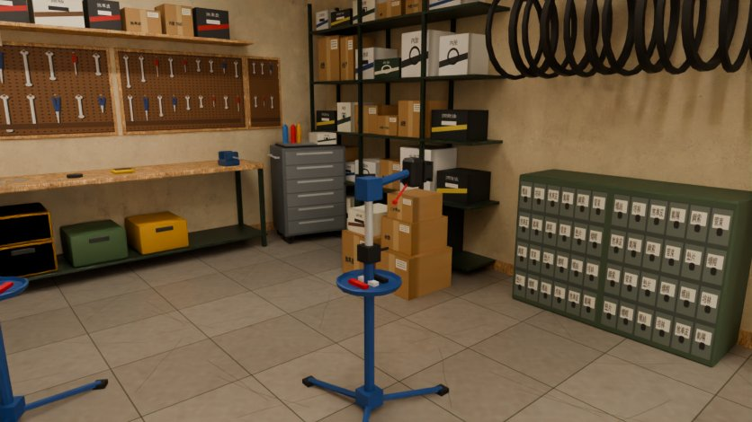
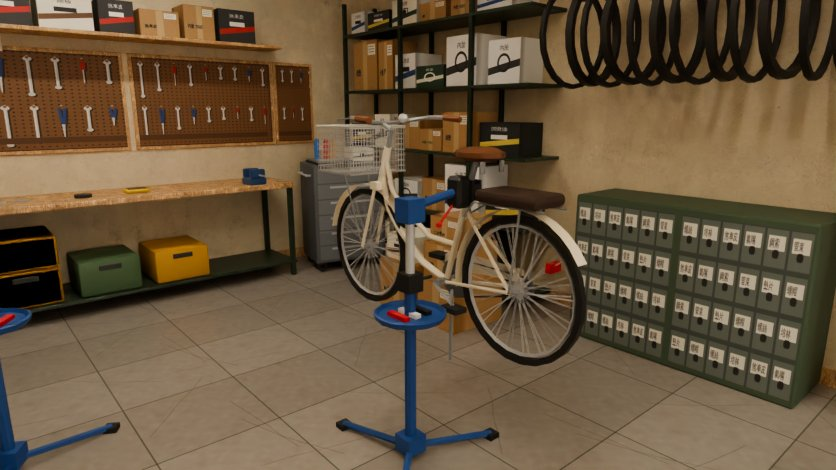
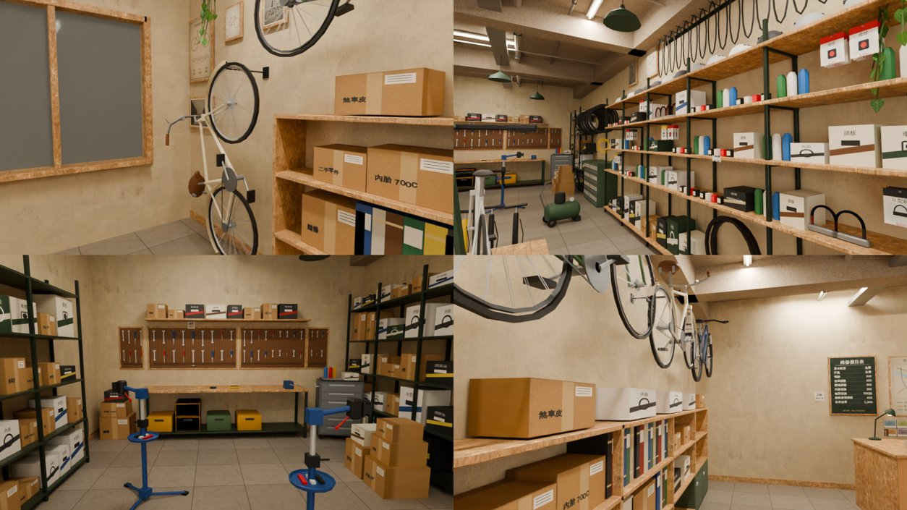
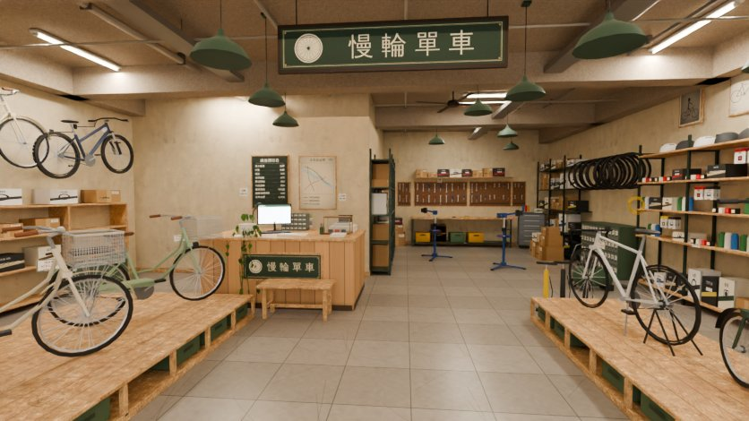
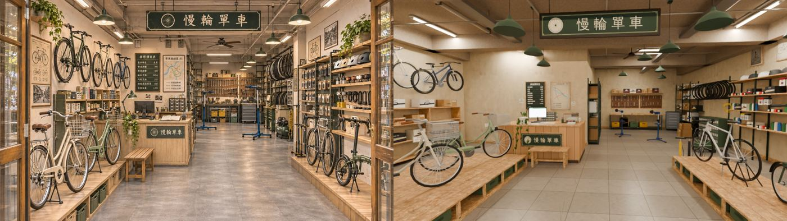
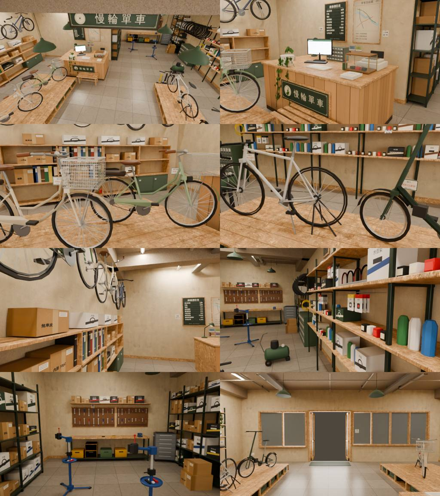

# CC_46 慢輪單車室內（公館 G06，原名輪轉單車）

- 做的人：CC（帳號 A）的建模子代理，2026-11-04。派工：BB 派的 AA_647（分工與驗收）＋AA_646（進得去、買車）。
- 規格：參考圖 `ref_images/shops/gongguan_bike_int.webp`（參考圖就是規格，SCENE_RULES §12）；外觀照 **LAWWW2 外觀 v1**（`claude/second-ai-env-art` 8de87af16，`wip/gongguan4/README.md`）。
- 收件：LAWWW2（MODEL_READY）；ART_APPROVED 由 BB 標。
- **狀態：`READY_FOR_REVIEW`（只有雲端低解析度預覽；沒進遊戲，沒開瀏覽器）**。v1b（同日）：修車架夾一台車（REPAIR_BIKE，預設關）＋ LAWWW2 驗收 v1 的三項密度，見下面「v1b」。

## v1b（2026-11-04，CC 子代理；BB 11-04 判定＋BB 定案＋LAWWW2 驗收 v1 的意見）

**和參考圖不同：參考圖的維修架是空的；照 AA_646／BB 11-04 夾一台車（重用店裡的單車模型，不加材質）。**（BB 定案：預設關，畫面照參考圖空著，AA_646 那一幕才打開。）

### 1. 修車架夾一台車：節點 `REPAIR_BIKE`（預設關）
- 夾在 **bike_repair 互動點（2.0, −2.3）旁那一支**（x 2.7、z −2.3）。AA_646 只寫「立式修車架上夾著一台車」，沒說哪一支、什麼車；老闆白天的站位面向另一支（1.3, −3.35），分不出來，照派工夾靠近 bike_repair 的那一支。layout `repairBike.stand: 1`。
- 車：**重用左展示台那台米白淑女車的網格**（linked duplicate：同一個網格、同一組材質；GLB 裡 `bk_repair_bike_vc/vcm/alpha` 指向和 `bk_bike_lady_*` 同一個 mesh，兩個輪子是同一個輪子原型的 instancing）。不帶車價卡（那一片沒複製）。AA_646 沒寫車種，學生最常騎的淑女車。**沒有新增材質**（仍 11 種）。
- **GLB 節點名稱固定 `REPAIR_BIKE`**（bike_interior 的子節點；底下 3 個車架網格＋2 個輪子的 instancing 節點），extras `{"defaultVisible": false, "show": "AA_646 劇情"}`。glTF 沒有隱藏屬性，**遊戲載入時要 `getObjectByName('REPAIR_BIKE').visible = false`，AA_646 那一幕再改成 `true`**。打開時把 layout 的 `repairBike.blockWhenShown`（[3.05, −2.55, 0.66, 1.8]，車身 x 2.72～3.38、z −1.65～−3.45）加進導航阻擋（關著的時候不要加）。
- 怎麼夾（量測，Blender 讀回匯出的 GLB 算的）：
  - 這支修車架的轉軸改朝東（layout `yaw: 0`；v1 是 3.4、朝兩支修車架中間的走道）：車身平面和轉軸垂直、車頭朝北（−z），整台車在 x 2.74～3.35、z −1.68～−3.42，不伸進兩支修車架中間的走道（x 1.6～2.4）；東邊的走道剩 x 3.35～4.4（1.05 m）。
  - 夾口改成左右兩片（`stand_build`，兩支修車架共用）：夾的是**座管露出來的那一段**（座管頂端以下、車架以上）。夾片內面到座管表面 **2.5 mm（兩側一樣）**，沒有任何三角形交疊（BVH overlap＝0）；車和修車架最近 5.1 mm。
  - 坐墊底 1.331 m、夾頭頂 1.27 m（離 6 cm）；v1 的紅色快拆把手在夾頭上面、會頂到坐墊，v1b 移到夾頭後面、轉軸下方。
  - 架高：最低點（輪子、側柱）離地 **0.469 m**，後輪、前輪都懸在空中（真實的修車架就是這樣），整台車的重量在夾口上。
- 渲染：`bike_render.py` 照遊戲的預設不畫 extras.defaultVisible=false 的節點；`--show REPAIR_BIKE` 才畫。




### 2. 密度（LAWWW2 驗收 v1）：都是重用的網格或 instancing，不新增材質
| 項目 | v1 | v1b 補了多少 |
|---|---|---|
| 左牆 | 三台橫掛的車（參考角度只看得到兩台）、海報＋黑白照 | **＋1 台車**：直掛在左牆最前面（前輪朝上、掛勾從輪框裡面勾住；重用左牆中間那台米白城市車的網格，instancing）＝**四台**；**＋2 個小相框**（騎車人照片、單車線稿，直掛那台上面）；海報、黑白照挪到 z 5.55 |
| 右牆層架 | 四層（0.9～2.25） | **＋最下面一層板（0.12）**：**12 個零件盒**、**4 條外胎**（兩疊，外胎原型 instancing）；**＋一整排掛著的內胎 16 條**（一條一支掛釘；內胎原型 instancing，封閉的管子） |
| 後面工作區 | 兩片洞洞板、工具車、地上兩箱 | 工具牆 **＋2 片洞洞板**（工作台左邊、工具車上面）；工具車上 **＋托盤、3 罐噴罐、1 盒零件、1 支扳手**；紙箱 **＋6 箱**（地上那疊加一箱、旁邊一疊兩箱、左後角一疊三箱） |
- 也修了 v1 的一個穿模：地上那疊紙箱的下面那箱插進右牆高層架的最下層板（x 4.35～4.45），往西挪 0.1 m。
- 導航：layout `blocks` 加三個（直掛的車 [−4.6, 4.7, 0.56, 1.2]、紙箱 [4.08, −3.86, 0.48, 0.44]、左後角紙箱 [0.3, −5.62, 0.54, 0.46]）。用 v1 的格子檢查（0.05 m 格、半徑 0.33）：REPAIR_BIKE 關、開兩種都跑過，所有互動點、老闆站位都走得到；長凳座位「reach 0.55」和 v1 一樣（座位在長凳上、從前面坐）。
- 量測（Blender 讀回 GLB）：直掛的車後輪最低 0.157 m（不碰地）、掛勾在前輪框內緣下 3 mm 左右（掛勾穿過輻條卡——真的掛勾也是從輻條之間穿過去）、和其他東西沒有交疊；內胎頂端壓在掛釘上（最近 4.8 mm，掛釘 y 3.1：牆邊的樑底 3.18）；層板上的外胎離板 0.5 mm 以內；新的紙箱、相框照座標放在空的地方（沒有逐一做 BVH）。



### 3. 規格與 ref_match
- 三角形（drawn，含 instancing）**59,874**（≤ 60k；v1 52,398，REPAIR_BIKE 佔 2,670）；網格本身 40,202。材質 **11**（≤ 12，沒加）。GLB **3.34 MB**（3,335,056 bytes，≤ 6 MB）。
- ref_match（主視角，REPAIR_BIKE 照預設關；836×470、Cycles 16 samples、CPU）：**五項 PASS**——平均亮度 0.449（參考 0.477）、對比 0.615（≥ 0.491）、冷暖 +0.202（參考 +0.208）、色票 ΔE 5.1、九宮格 0.046。報告 `shots/model/bike/bike_v1b_refmatch_report.json`、`_cmp.jpg`。



### v1b 沒做到／沒驗的
- 沒進遊戲、沒開瀏覽器：REPAIR_BIKE 的 visible 切換、打開時的導航阻擋、直掛車與內胎（instancing）跟著牆淡出，都要 LAWWW2 驗。
- 修車架上的車是展示台那台淑女車的同一個網格：同時看得到兩台一模一樣的米白淑女車（顏色也一樣；不加材質就不能換色）。
- 直掛的車和左牆中間那台是同一個網格（同色米白）。

## 檔案
| 檔 | 內容 |
|---|---|
| `src/data/bike_layout.js` | v2：10.2 × 12.0 × 3.6 m；front（門、兩個櫥窗）、windowKeep、spawn、camRef、partition、lights、items、blocks、seats、interact（含買車）、npc；exit／enterAt 留空 |
| `tools/blender/env_second/bb_support/bike_tex.py` | 自製貼圖 → `textures/gen/bike_{alpha,goods,emit,sign,floor}.png`＋`bike_atlas.json` |
| `tools/blender/env_second/bb_support/bike_interior.py` | 建模（讀 layout），輸出 GLB＋json |
| `tools/blender/env_second/bb_support/bike_render.py` | Cycles 預覽（相機預設＝camRef；燈的位置讀 layout.lights） |
| `assets/models/env/second_ai/bb_support/bike.glb`、`.json` | 輸出 |
| `docs/story_planning/CC/shots/model/bike/` | `bike_v1_ref_vs_render.jpg`（並排）、`bike_v1_refmatch_cmp.jpg`＋`_report.json`、`bike_v1_views.jpg`（八個角度）、`bike_v1_views.json` |

注意：貼圖檔 `tools/blender/env_second/textures/gen/bike_*` 也要一起收（腳本產生的，和好拍那批同一個位置）。

## 數字
- 三角形（drawn，含 instancing）**52,398**（預算 60k）；網格本身 39,112。材質 **11**（≤ 12）。GLB **3.25 MB**（≤ 6 MB）。
- instancing：輪子（7 種原型×2，外胎＋輪框＋輻條卡＋花鼓）、輪胎架的外胎（2 種，13 個）、安全帽（4 色，15 頂）、U 型鎖、打氣筒、修車架、吊燈（11）、日光燈（7）。匯出後 instancing 節點改名成網格名（`WALL_left_wheel4_0_vc_inst`…），牆上的補 `extras.dir`（40 個節點）。**左牆掛的三台車的輪子、右牆輪胎架是 instancing，請 LAWWW2 確認 InstancedMesh 有跟著那面牆淡出**（我沒開瀏覽器）。
- 單車不是方塊：車架管（頭管、上管／彎的低跨下管、座管、前後叉）、避震前叉（登山車）、坐墊（橢球＋彈簧）、龍頭、三種把手（後掠、平把／上揚、彎把）、齒盤、曲柄、踏板、鏈條、鏈條護蓋、擋泥板（弧形帶）、後貨架＋載人墊、鐵絲車籃（alpha）、車燈、側柱、車價卡；輪子＝圓環外胎＋輪框＋輻條卡（36／20 根，交叉編）＋花鼓。一台車架約 1k 三角形、一個輪子約 380。

## ref_match（渲染 836×470、Cycles 16 samples、AgX、曝光 +0.3）：**五項 PASS**
| 項目 | 參考 | 渲染 | 門檻 | |
|---|---|---|---|---|
| 平均亮度 | 0.477 | 0.451 | 差 ≤ 0.08 | PASS |
| 對比 | 0.614 | 0.612 | ≥ 0.491 | PASS |
| 冷暖（R−B） | +0.208 | +0.203 | 差 ≤ 0.05 | PASS |
| 色票 ΔE | | 5.0 | ≤ 18 | PASS |
| 九宮格 | | 0.045 | ≤ 0.12 | PASS |




鏡頭：眼睛 (0.55, 1.6, 5.6)、看 (0.03, 1.33, −0.4)、17 mm（往左轉約 5°、往下 2.6°）。參考圖的消失點在 (935, 420)；用左展示台邊、右展示台邊、櫃台右緣三條線反推：鏡頭在走道裡、焦距約 16～17 mm（24 mm 時鏡頭會在店外 1.7 m）。50% 疊圖：吊的大招牌、櫃台＋小招牌、左展示台的兩台淑女車、右展示台的兩台、右牆層架、後牆洞洞板大致對得上；左牆掛車比參考圖小、偏高（店寬 10.2 m，見下面）。

## 拆圖清單（參考圖由左到右、前到後；色碼是參考圖 9×9 平均）
| # | 是什麼 | 畫面位置 | 尺寸（m） | 參考圖色 | 材質 | 模型物件 | 做了 |
|---|---|---|---|---|---|---|---|
| 1 | 左右的木框玻璃門（鏡頭在門內） | 左右邊緣 | 門 2.1 × 2.6 | 木 #756857 | 木＋玻璃 | `WALL_front_*`、`door*` | ✓（門在中間、往外折，見不同處 1） |
| 2 | 左上的黃金葛（層板上、藤往下垂） | 左上 | 盆 ø0.25 | 葉 #4f7d3a | 頂點色＋葉片卡 | `WALL_left_pothos_tl_*` | ✓ |
| 3 | 左牆掛的三台車：綠色平把公路車、米白城市車、深藍（登山車） | 左上 | 輪徑 0.68～0.71 | 綠 #675c41、藍 #4a433e | 頂點色＋輻條卡 | `WALL_left_wallbike0..2_*`、`WALL_left_wheel*_inst` | ✓ |
| 4 | 掛車的掛勾 | 左上 | | 黑 | 頂點色金屬 | `WALL_left_wallhooks` | ✓ |
| 5 | 單車構造海報（米黃紙、木框） | 左牆最前 | 0.5 × 0.73 | #e4d6b6 | 印刷圖集 | `WALL_left_leftwall_deco` | ✓ |
| 6 | 黑白老街照（木框） | 海報下面 | 0.5 × 0.35 | 灰 | 印刷 | 同上 | ✓ |
| 7 | 低櫃（書背、資料夾、紙箱、零件盒）＋綠色鐵櫃 | 左中 | 0.34 × 4.6 × 1.45 | 木、綠 #4c5d4a | 木＋印刷＋頂點色 | `WALL_left_low_shelf_*` | ✓ |
| 8 | 左木頭展示台（板縫、朝走道的格子＋綠色收納箱） | 左下 | 2.0 × 3.2 × 0.3 | #7a6552、箱 #6f644c | 木＋頂點色 | `platform_L` | ✓ |
| 9 | 米白淑女車（車籃、咖啡色坐墊、後貨架＋載人墊、擋泥板、鏈條護蓋） | 左前 | 軸距 1.08 | #cdaf9a | 頂點色＋alpha | `bike_lady_*` | ✓ |
| 10 | 薄荷綠城市車（車籃、車燈） | 左 | 軸距 1.06 | #a9c4a6 | 同上 | `bike_city_*` | ✓ |
| 11 | 後輪的黑色立架 | 左前、右 | | 黑 | 頂點色 | `rstand` | ✓ |
| 12 | 木櫃台（直條松木板、下緣踢黑） | 中左 | 2.2 × 1.3 × 1.0 | #c7996b | 木＋印刷（`counter_face`） | `counter_*` | ✓ |
| 13 | 櫃台正面小招牌「慢輪單車」（深綠、米白字、車輪圖示） | 櫃台正面 | 1.1 × 0.34 | #2c4436 | 招牌貼圖（不擠扁） | `counter_sign` | ✓ |
| 14 | 螢幕＋鍵盤、檯燈（深綠）、攤開的書、筆筒、灰色小抽屜 | 櫃台上 | | 黑、綠 | 頂點色＋emit＋印刷 | `monitor`、`desklamp`、`counter_*` | ✓ |
| 15 | 櫃台上的黃金葛（垂到正面） | 櫃台前角 | | 綠 | 葉片卡 | `pothos_counter` | ✓ |
| 16 | 木條長凳 | 櫃台前 | 0.95 × 0.38 × 0.45 | #dba777 | 木 | `bench` | ✓ |
| 17 | 黑板「維修價目表」（粉筆字、新台幣） | 中左後 | 0.72 × 1.01 | #26362c | 印刷 | `partition_deco` | ✓ |
| 18 | 單車路線圖（虛構：河濱綠廊線、校園通勤線、帝大生活線） | 黑板右 | 0.7 × 1.0 | #bfa37e | 印刷 | 同上 | ✓ |
| 19 | 拍立得、手寫紙條、圖釘 | 黑板下 | | | 印刷＋頂點色 | 同上 | ✓ |
| 20 | 天花板吊的大招牌「慢輪單車」 | 中上 | 2.1 × 0.39 | 深綠／米白 | 招牌（2048×384，5.33:1） | `hang_sign` | ✓ |
| 21 | 深綠琺瑯吊燈（白色內面、燈泡） | 上 | 罩 ø0.41 | #5b553e | 頂點色＋emit | `pendant_*_inst`、`cords` | ✓（11 盞） |
| 22 | 日光燈 | 上 | 1.2 m | 白 | emit | `fixture_*_inst` | ✓ |
| 23 | 外露的樑、消防水管、導管、電纜線槽 | 上 | | #9d7a5c | 水泥＋頂點色金屬 | `beams`、`pipes` | ✓ |
| 24 | 吊扇 | 中上 | ø1.4 | 深木 | 頂點色＋alpha 扇葉 | `fan` | ✓ |
| 25 | 灰色水泥磚地（60 cm、磚縫、輪胎痕） | 下 | | #bda490 | 自製貼圖 | `floor` | ✓ |
| 26 | 修車區左邊的高鐵架（紙箱、零件盒） | 中後左 | 0.42 × 3.05 × 2.5 | 深綠鐵 | 頂點色＋印刷 | `shelf_ws_left` | ✓ |
| 27 | 藍色立式修車架兩支（三腳、伸縮柱、夾頭、工具盤） | 中後 | 夾頭 1.25 | #153955 | 頂點色 | `stand_*_inst` | ✓ |
| 28 | 後牆兩片洞洞板（扳手、鉗子、起子）＋上面的零件盒 | 後 | 3.0 × 0.75 | #7f5636 | 印刷 | `WALL_back_pegboard_*` | ✓ |
| 29 | 工作台、虎鉗、黃綠收納箱、手套、扳手 | 後 | 3.0 × 0.62 × 0.9 | 黃 #b47e2f | 木＋頂點色 | `workbench` | ✓ |
| 30 | 灰色工具車（抽屜、輪子） | 後右 | 0.72 × 0.5 × 1.05 | #6d645a | 頂點色＋印刷 | `tool_chest` | ✓ |
| 31 | 右牆輪胎架（一排外胎） | 中右 | 1.9 長 | #403124 | 頂點色 | `WALL_right_tire_*_inst` | ✓ |
| 32 | 綠色抽屜櫃 | 輪胎架下 | 0.48 × 1.4 × 1.0 | #4a5e4a | 頂點色＋印刷 | `WALL_right_drawer_cab` | ✓ |
| 33 | 綠色空壓機＋黃色風管 | 中右 | 0.75 × 0.4 | #3f432f | 頂點色 | `compressor`、`WALL_right_hose` | ✓ |
| 34 | 打氣筒三支（黃、黑、黑；錶、管子） | 右 | 高 0.68 | | 頂點色 | `pump_*_inst` | ✓ |
| 35 | 右牆層架（深色鐵架、淺木板四層） | 右 | 0.42 × 5.3 × 2.25 | #caa581 | 木＋頂點色金屬 | `WALL_right_shelf_right_*` | ✓ |
| 36 | 層架上：安全帽（白、淺灰、灰、深灰）、車燈、吊卡（車鈴、前後燈、鎖，標新台幣）、U 型鎖、零件盒、水壺 | 右 | | 白 #ccbaae、黑 | 頂點色＋印刷 | 同上、`helmet*_inst`、`lock_*_inst` | ✓ |
| 37 | 右上兩張相框（單車線稿、騎車的老照片） | 右上 | 0.42 × 0.53 | | 印刷 | 同上 | ✓ |
| 38 | 右上黃金葛（層架頂） | 右上 | | | 葉片卡 | `WALL_right_pothos_tr_*` | ✓ |
| 39 | 右木頭展示台 | 右下 | 1.15 × 3.4 × 0.3 | #715d44 | 木＋頂點色 | `platform_R` | ✓ |
| 40 | 銀色公路車（彎把、細胎、黑輪框） | 右 | 軸距 0.99 | #c9cbcb | 頂點色＋輻條卡 | `bike_road_*` | ✓ |
| 41 | 深綠小折（20 吋、長的立管、折疊關節） | 右前 | 輪徑 0.5 | #716b4f | 同上 | `bike_fold_*` | ✓ |

另外加的（AA_646 要求、參考圖沒畫到或看不到的）：收銀機、車鈴車燈的小玻璃櫃、型錄一疊（「慢輪單車 車款型錄」）、五張車價卡（淑女車 4,200／城市通勤車 6,800／小折 12,800／登山車 15,800／公路車 22,800）、手寫紙條（打氣免費 請自取、補胎 $100、營業 10-20 點 週一公休、二手車 收購・寄賣、試騎請先說一聲、鎖要買好一點的）、地上拆下來的一個輪子、兩箱貨、門口地墊。

## 第 11 節醜點清單
- [x] **比例**：一樓 3.6 m（天花板，外觀樓板 3.85）；店寬 10.2 m 照外觀；參考角度空地板約畫面的 1/4（< 1/3）。
- [x] **光**：不是整片白天花板＋均勻白光：外露水泥天花板（#a39482）、11 盞暖色吊燈（3000K 左右的點光／聚光）打在展示台和櫃台上、兩側日光燈；牆 #d2c2a4，牆面亮度 < 0.9。
- [x] **密度**：左牆（掛車＋低櫃塞滿）、右牆（四層層架＋相框）、後牆（洞洞板＋工作台）都擺滿；小東西 15 種以上（招牌兩塊、海報、老照片、相框、黑板價目表、路線圖、拍立得、手寫紙條、車價卡、型錄、螢幕、檯燈、收銀機、小玻璃櫃、筆筒、馬克杯、書、安全帽、車燈、吊卡、鎖、水壺、紙箱、零件盒、扳手、手套、虎鉗、收納箱、打氣筒、空壓機、輪胎、吊扇、植物三盆）。
- [x] **商品不是單色方塊**：七台車都是完整的車（見「數字」）；安全帽是旋轉體＋通風孔；鎖是 U 形；打氣筒、空壓機是旋轉體＋管子；包裝全部是自製印刷圖集。
- [x] **歲月感**：地磚色差、磚縫積灰、輪胎痕；櫃台下緣踢黑、板縫；海報、照片邊角變深（褪色）；招牌細細的掉漆；牆腳木條。
- [x] **在地感**：手寫中文紙條、新台幣價格、虛構店名「慢輪單車」、虛構路線圖（帝大生活線）；**沒有任何自行車品牌或標誌**（車架、包裝、海報都沒有，D77）。
- [x] **預算**：52k 三角形、11 材質、3.25 MB；重複的東西 instancing。

## 和參考圖不一樣的地方
1. **（外觀的決定，LAWWW2 外觀 v1）店門改到中間**：參考圖外觀的門在右邊，因為騎樓上那三台車擋著，外觀把門改到中間（整面拉開 x −0.5～1.6、高 2.6）；左櫥窗 x −4.4～−0.6（窗台 0.85、窗頂 2.55）、右櫥窗 x 1.75～4.1（窗台 0.75）。室內照外觀做。
2. **（尺寸照 layout）店寬 10.2 m**：參考圖的店看起來約 6.5～7 m 寬。多出來的寬度做成兩條逛的走道：左牆低櫃和左展示台之間 1.24 m（看牆上的車）、右展示台和右層架之間 1.26 m。所以參考角度裡左牆掛的三台車、右牆層架比參考圖遠、小，左牆的海報在畫面外。
3. **（遊戲必要）櫥窗後面留空**：遊戲另外擺的兩台櫥窗車（玻璃後 0.75 m、x −1.6 和 2.2）——室內 z 4.6 以前、x −2.6～−0.6 和 1.2～3.2 沒有家具（layout 的 `windowKeep`）；兩個展示台從 z 4.4 開始。
4. **（遊戲必要）走道**：中間走道 3.55 m、櫃台後面老闆的通道 0.75 m；長凳貼著櫃台正面東半邊（參考圖在走道上）；修車區兩支修車架之間留得過人。
5. **（遊戲必要）隔間牆**：參考圖櫃台後面掛黑板的那面牆，這裡做成一道隔間牆＋修車區左邊的牆，後面（x −4.98～−0.15、z −1.2 以後）是倉庫、不開放（看得懂是牆，不是隱形牆）。
6. （v1b）**和參考圖不同：參考圖的維修架是空的；照 AA_646／BB 11-04 夾一台車（重用店裡的單車模型，不加材質）**——節點 `REPAIR_BIKE`，預設關（畫面照參考圖空著），AA_646 那一幕才打開（見「v1b」）。
7. （說明）參考圖是 AI 生成的，左右展示台、櫃台三條線算出的鏡頭不完全一致，鏡頭取折衷（招牌、櫃台、兩側展示車對齊優先）；焦距約 17 mm（很廣）。

## 還沒做到參考圖的地方（誠實列出）
- **左牆掛車太遠、太小**（店比參考圖寬 3 m）；參考圖的掛車很顯眼。
- **右牆層架比參考圖疏、比參考圖整齊**；參考圖的包裝一排一排吊著、幾乎看不到架子。
- **地板比參考圖亮、反光少**；參考圖的灰磚比較暗、有拋光的倒影（Cycles 預覽 16 samples）。
- **後段比參考圖空**：參考圖後面兩側的高架子一路堆到天花板，這裡左邊一座、右邊是輪胎架和高層架。
- 車架的管子是 8 邊（細管 5～6 邊），近看有稜角；彎管（淑女車下管）是幾段直管接起來。
- 外胎沒有胎紋、輻條是卡片：貼著牆從側面看會變一條線。
- 都沒在遊戲裡看過：沒開瀏覽器（規定）。導航（用 layout 的 blocks 跑過自己的格子檢查：每個互動點、NPC 站位從 spawn 都走得到；座位在長凳上、從前面坐）、淡出、instancing 淡出、夜間光暈都要 LAWWW2 驗。

## 整合注意（給 LAWWW2／LAWWW）
- **店門**：layout `front.door` x 0.55、w 2.1、h 2.6（本地 x −0.5～1.6），spawn (0.55, 5.0) 面向店裡；exit／enterAt 留空。室內的折門往外折、貼在門框外側（z 6.0～6.6，在騎樓那一側）——如果和外觀的門板重疊，室內這四扇可以刪掉（物件 `WALL_front_*door*`，合併在 `WALL_front_bk_wood`／`bk_glass` 裡，要刪請叫我改腳本）。
- **買車的互動點**：`kind:'bike_shop'`（看看車／買車，櫃台東端收銀機前 (0.2, 0.55)）、`kind:'bike_parts'`（車燈・車鈴・鎖）、`kind:'bike_view'`＋`model`（lady／city／fold／road／mtb，五款各一個，站在展示台邊）、`kind:'bike_repair'`（打氣／補胎，修車架旁）。kind 和 label 都是草稿，台詞 AA 定。
- **老闆**：npc.owner 兩個站位（白天修車區、傍晚櫃台後面）。
- 停車點（AA_646 §3 的 bikePark）不在室內，layout 只留一句說明。
- 夜間光暈：`GLOW_pendant_*`（11）、`GLOW_tube_*`（7）。
- 光照烘焙 LAWWW2 做；渲染用的燈在 `bike_render.py`（讀 layout.lights）。

## 給 CC 排 PC 的渲染
```
# 參考圖角度（ref，相機＝camRef）＋八個角度；PC 用 GPU、64 samples、1672×941
CC_BLENDER_DEVICE=GPU CC_SAMPLES=64 blender -b --python tools/blender/env_second/bb_support/bike_render.py -- \
  assets/models/env/second_ai/bb_support/bike.glb <輸出資料夾> --views docs/story_planning/CC/shots/model/bike/bike_v1_views.json --res 1672x941
# 之後：python3 tools/blender/env_second/ref_match.py <參考圖 gongguan_bike_int> <輸出>/bike_ref.png <前綴>
# 重建（PC 工作樹＝second-ai-env-art 有 lib2）：python3 tools/blender/env_second/bb_support/bike_tex.py
#   blender -b --python tools/blender/env_second/bb_support/bike_interior.py -- --lib tools/blender/env_second
```
（預設燈：吊燈 130 W、日光燈 45 W、門口 160 W、補光 120 W、曝光 +0.3；雲端預覽 836×470、16 samples 一張約 20 秒。）

## 授權
- Poly Haven CC0：`painted_plaster_wall`、`granular_concrete`、`fine_grained_wood`（共用資料夾，已在 LICENSES）。
- 其他貼圖都是 `bike_tex.py` 程式畫的；字型文泉驛正黑（GPL＋字型例外，嵌進圖片可以）。LAWWW2 補 LICENSES 一行「慢輪單車室內自製貼圖」。
