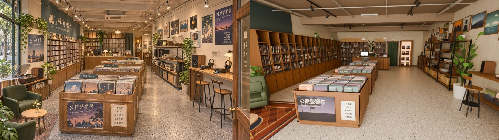
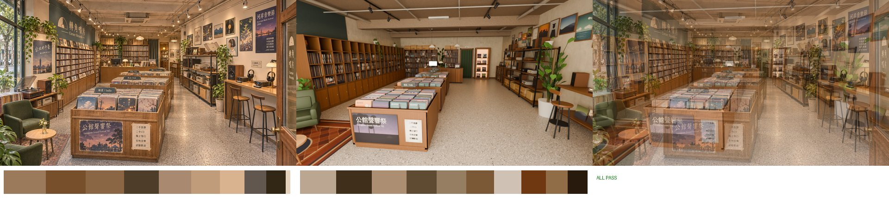
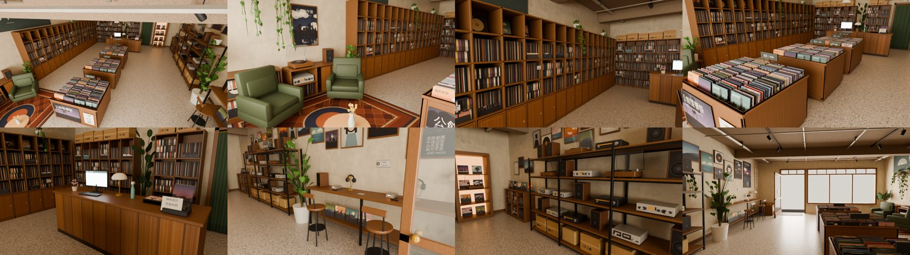

# CC_47 轉角唱片室內（公館 G12，取代「二手唱片」）

- 做的人：CC（帳號 A）的建模子代理，2026-11-04。分工：AA_650（CC 做轉角唱片室內；MODEL_READY 由 LAWWW2 收，功能和 ART_APPROVED 由 BB 判，CC 不判自己這間）。做法照 CC_46 慢輪單車。
- 規格：參考圖 `ref_images/shops/gongguan_corner_int.webp`（企劃線 24ae5d2ab；參考圖就是規格，SCENE_RULES §12）＋同資料夾 README 最後一段（店名、海報、分類牌照用；右邊是試聽區，有耳機和高腳椅；地板淺灰磨石子；營業時間改成每天 12:00～21:00）。外觀的門窗照 **LAWWW2 DOORS.md 的 G12**（`claude/second-ai-env-art` 5550948fb，`wip/gongguan5/DOORS.md`）。
- **狀態：`READY_FOR_REVIEW`**。只有雲端低解析度的 Cycles 預覽；沒有進遊戲，也沒有開瀏覽器。

## 檔案
| 檔 | 內容 |
|---|---|
| `src/data/corner_layout.js` | v1：8.0 × 11.5 × 3.3 m。包含 front（門、櫥窗、氣窗）、windowKeep、spawn、camRef、lights（軌道、投射燈、吊燈）、items、blocks、seats（2 張高腳椅、2 張沙發）、interact（corner_shop、corner_browse ×4、corner_listen、corner_view）、npc.staff（2 個站位）、hours。exit 和 enterAt 留空 |
| `tools/blender/env_second/bb_support/corner_tex.py` | 自製貼圖，輸出 `textures/gen/corner_{goods,alpha,emit,sign,floor}.png` 和 `corner_atlas.json` |
| `tools/blender/env_second/bb_support/corner_interior.py` | 建模腳本，讀 layout，輸出 GLB 和 json。共用的工具函式（UM、Part、Proto、ccyl、frame_on_wall、pothos…）照抄 bike_interior.py |
| `tools/blender/env_second/bb_support/corner_render.py` | Cycles 預覽：相機預設是 camRef；燈讀 layout.lights；店門外加一片只給渲染用的背景板（`--backdrop 0` 可以關） |
| `assets/models/env/second_ai/bb_support/corner.glb`、`.json` | 輸出 |
| `docs/story_planning/CC/shots/model/corner/` | `corner_v1_ref_vs_render.jpg`（左是參考圖，右是渲染）、`corner_v1_overlay50.jpg`（50% 疊圖）、`corner_v1_refmatch_cmp.jpg`＋`_report.json`、`corner_v1_views.jpg`（八個角度）、`corner_v1_views.json` |

貼圖檔 `tools/blender/env_second/textures/gen/corner_*` 是腳本產生的，也要一起收。

## 數字（Blender 讀回匯出的 GLB）
- 三角形：drawn（含 instancing）**41,080**，預算 60k；網格本身 31,210。
- 材質 **11 個**（上限 12）：
  - 地板：自製磨石子
  - 牆：painted_plaster_wall
  - 天花板：granular_concrete
  - 木頭：walnut_veneer
  - 頂點色兩種（霧面、金屬）
  - 玻璃
  - 透明圖集、印刷圖集、發光、招牌
- GLB **2.85 MB**（2,850,396 bytes），上限 6 MB。
- instancing（共 31 個 instancing 節點，已改名成 `<網格名>_inst`；牆上的補了 `extras.dir`）：
  - 唱片箱裡的唱片：10 種原型，一排 17～34 張，共 **490 張**
  - 投射燈 18、吊燈 2、沙發 2、高腳椅 2
  - 唱盤 5（音響櫃 1、鐵架 3、展示龕 1）
  - 書架喇叭 12、擴大機 4、收音機 3、卡帶座 2
- 單張唱片的做法：一片 0.305 m 的薄板，由前面封面、後面封面、上緣書背三個四邊形組成，往後靠 0.15～0.25 rad。封面是 40 張自製的動畫風景畫（夕陽、電線桿、城市夜景、櫻花、海、山、電車、橋），都是程式畫的，沒有任何真實專輯或品牌。
- 遊戲裡要淡出的牆：`WALL_left_*`、`WALL_right_*`、`WALL_back_*`、`WALL_front_*`。店面、門扇、唱片牆、海報、試聽桌、鐵架、後牆架子、布簾、展示龕都放進各自那面牆的組。鐵架上的音響是 instancing，所以節點是 `WALL_right_…_inst`。
- 夜間光暈：`GLOW_spot_*` 18 個、`GLOW_pendant_*` 2 個。
- `single_side` 的設定和 bike 一樣：nodup＝`cr_(plaster|wood|floor_terrazzo|concrete|goods|sign|alpha)`，玻璃維持雙面。

## ref_match：五項全部 PASS
渲染條件：836×470、Cycles 16 samples、CPU、AgX、曝光 +0.4。
| 項目 | 參考 | 渲染 | 門檻 | 結果 |
|---|---|---|---|---|
| 平均亮度 | 0.431 | 0.420 | 差 ≤ 0.08 | PASS |
| 對比 | 0.560 | 0.639 | ≥ 0.448 | PASS |
| 冷暖（R−B） | +0.227 | +0.202 | 差 ≤ 0.05 | PASS |
| 色票 ΔE | | 5.9 | ≤ 18 | PASS |
| 九宮格 | | 0.086 | ≤ 0.12 | PASS |





鏡頭（camRef）：眼睛 (0.8, 1.72, 5.4)，看 (0.15, 0.55, −0.6)，17 mm（往下約 11°、略往左）。

我先拿參考圖量了一次鏡頭：用最前面唱片箱和櫃台的 7 個角點反推，參考圖大約是 25 mm、眼高 1.73 m、往下 9°。但用這組鏡頭算回去，兩側的牆大約在 x ±2 m，也就是參考圖裡的店只有 5～5.5 m 寬，比 8 m 窄很多。所以我照慢輪單車的做法改用 17 mm，讓兩側牆上的東西進到畫面。

50% 疊圖的結果：
- 大致對得上：最前面那座唱片箱（位置、大小、正面的海報和紙卡）、櫃台、後牆、左邊的沙發和地毯、右邊的高腳椅和試聽桌。
- 對不上：兩側的牆比參考圖遠、比參考圖小（原因是店比參考圖寬，見「和參考圖不同」第 1 點）。

## 拆圖清單（參考圖由左到右、由前到後；色碼取自參考圖該區的平均色，暖光下偏褐）
| # | 是什麼 | 畫面位置 | 尺寸（m） | 參考圖色 | 材質 | 模型物件 | 做了 |
|---|---|---|---|---|---|---|---|
| 1 | 左邊大片玻璃（窗外街樹） | 左緣 | | #9a9782 | — | 外觀那一側（見不同處 2） | △ 室內看不到 |
| 2 | 龜背芋（左下角） | 左下 | 盆 ø0.4 | #5e5e39 | 頂點色＋葉片卡 | `monstera` | ✓ |
| 3 | 深綠單人沙發兩張 | 左下 | 0.74 × 0.7 | #50472d | 頂點色（圓角） | `armchair_*_inst` | ✓ |
| 4 | 圓邊几＋玻璃小花瓶、黃色小花 | 左下 | ø0.5、高 0.5 | #e2ac78 | 頂點色＋葉片卡 | `side_table` | ✓ |
| 5 | 波斯地毯（紅褐、深藍邊） | 左下 | 2.1 × 2.6 | #8e6e5a | 印刷 `rug` | `rug` | ✓ |
| 6 | 低唱片櫃（一排黑膠） | 左最邊 | 0.43 × 0.95 × 0.78 | #766047 | 木＋印刷 | `WALL_left_lp_low` | ✓ |
| 7 | 音響櫃（木門、下層擴大機） | 左中 | 0.45 × 1.3 × 0.72 | #674a2c | 木＋印刷 | `WALL_left_audio_cab` | ✓ |
| 8 | 唱盤（木座、黑轉盤、唱片、唱臂、打開的防塵蓋） | 音響櫃上 | 0.45 × 0.36 | #836953 | 木＋頂點色＋玻璃 | `turntable_*_inst` | ✓ |
| 9 | 書架喇叭（胡桃木箱、黑色單體） | 音響櫃上 | 0.22 × 0.34 | #614129 | 頂點色＋印刷 | `speaker_*_inst` | ✓ |
| 10 | 海報「台北的午後 獨立音樂合輯 Vol.2」 | 左上 | 0.62 × 0.88 | #7e6a5e | 印刷（黑框） | `WALL_left_leftwall_deco` | ✓ |
| 11 | 黃金葛（從上面垂下來） | 左上 | | #786a48 | 葉片卡 | `WALL_left_pothos_l1/l2` | ✓ |
| 12 | 小木凳上的小盆栽 | 左中 | | #775c30 | 木＋葉片卡 | `plant_stool`、`stool_plant` | ✓ |
| 13 | 深色飾板「轉角唱片 Corner Records」＋半圓黑膠圖示 | 左上 | 5.0 × 0.96 | #6e553a（暖光下；底色 #43504d） | 招牌貼圖（4.76:1，不擠扁） | `WALL_left_leftwall_deco_sign` | ✓ |
| 14 | 唱片牆：最上一排封面朝外、中間一格一格黑膠 / CD | 左 | 0.44 × 6.95 × 2.3 | #886547 | 木＋印刷 | `WALL_left_record_wall` | ✓ |
| 15 | 唱片牆下面的木門櫃 | 左下 | 高 0.7 | #8a6647 | 印刷 `cab_door` | 同上 | ✓ |
| 16 | 唱片牆上的植物 | 左後 | | | 葉片卡 | `WALL_left_pothos_l3/l4` | ✓ |
| 17 | 最前面的唱片箱（木框、上緣一圈、底座） | 中下 | 1.45 × 1.15 × 0.82 | #85614b | 木 | `bin0` | ✓ |
| 18 | 海報「公館聲響祭 Gongguan Sound Festival '02」 | 唱片箱正面 | 0.84 × 0.58 | #725a57 | 印刷 | `bin0` | ✓ |
| 19 | 手寫紙卡（二手黑膠、二手CD、獨立發行、在地音樂、試聽歡迎；四角膠帶） | 唱片箱正面右 | 0.3 × 0.43 | #c5a285 | 印刷 | `bin0` | ✓ |
| 20 | 箱子裡四欄黑膠（封面朝前、往後靠） | 中 | 0.305 一張 | #9e8474 | 印刷（40 張封面） | `lpstack*_inst` | ✓ |
| 21 | 分類牌「搖滾 / Indie」「民謠 / Folk」「電子 / Electronic」 | 中 | 0.36～0.43 × 0.11 | #605f5a | 印刷（深灰綠底、米白字） | `bin0..2` | ✓ |
| 22 | 第二、第三座唱片箱 | 中 | 1.45 × 1.15／1.5 | #926e50 | 木 | `bin1`、`bin2` | ✓ |
| 23 | 木櫃台（直條木板） | 中後 | 2.8 × 0.7 × 0.95 | #8a633e | 木＋印刷 `counter_face` | `counter` | ✓ |
| 24 | 櫃台上：螢幕＋鍵盤、蘑菇檯燈、綠色噴瓶、粉紅小盆花、一疊黑膠 | 中後 | | #41301f | 頂點色＋發光＋印刷 | `monitor`、`counter` | ✓ |
| 25 | 後牆唱片架＋上面一排紙箱 | 後 | 2.5／1.0 × 2.2 | #765633、箱 #96652f | 木＋印刷 | `WALL_back_back_shelf0/1` | ✓ |
| 26 | 後面的大盆栽 | 後中 | 高 1.9 | | 葉片卡 | `back_plant` | ✓ |
| 27 | 綠色布簾（倉庫門） | 後右 | 0.85 × 2.2 | #3e3320 | 印刷（皺褶鋸齒） | `WALL_back_curtain` | ✓ |
| 28 | 亮燈的後門口／小展示龕（層板、唱片、小唱盤） | 後右 | 0.85 × 2.2 | #865826 | 木＋發光 | `WALL_back_niche` | ✓（見不同處 4） |
| 29 | 白色圓罩吊燈兩盞 | 中上 | 罩 ø0.4 | #c9a172 | 頂點色＋發光 | `pendant_*_inst` | ✓ |
| 30 | 軌道燈（兩條黑軌道、18 盞投射燈） | 上 | | #7c5f42 | 頂點色金屬＋發光 | `tracks`、`spot_*_inst` | ✓ |
| 31 | 吸頂冷氣 | 中上 | 0.84 × 0.84 | #826243 | 頂點色＋印刷 | `ac` | ✓ |
| 32 | 外露的樑、管線 | 上 | | #977457 | 水泥＋頂點色 | `beams`、`pipes` | ✓ |
| 33 | 右牆一整面海報、畫框（演唱會、聽音樂的女孩、裱框的黑膠、山、城市、人像、唱盤線稿、封面框） | 右上 | 0.34～0.56 | #a2815e | 印刷＋木框 | `WALL_right_rightwall_deco` | ✓（19 張） |
| 34 | 大海報「河岸音樂節 Riverside Music Festival 2000」（星際樂團、午後回聲、白色電車、南方早晨、…and more） | 右上 | 0.74 × 1.3 | #624d4d | 印刷 | 同上 | ✓ |
| 35 | 黑色鐵架四層 | 右中 | 0.6 × 3.6 × 2.0 | #795c3e | 頂點色金屬＋木板 | `WALL_right_audio_rack` | ✓ |
| 36 | 鐵架上的唱盤、擴大機、收音機、卡帶座、喇叭；最下層紙箱、收納籃 | 右中 | | | 頂點色＋印刷面板 | `*_inst`、同上 | ✓ |
| 37 | 白色大盆的黃金葛柱 | 右中 | 盆 ø0.48 | #745e38 | 頂點色＋葉片卡 | `big_plant`、`big_plant_pole` | ✓ |
| 38 | 鐵架上面的黃金葛 | 右上 | | | 葉片卡 | `WALL_right_pothos_rack` | ✓ |
| 39 | 試聽區長桌（木桌面、黑鐵腳、下層板） | 右 | 0.56 × 3.2 × 0.98 | #8d623c | 木＋頂點色 | `WALL_right_listen_desk` | ✓ |
| 40 | 耳機兩組＋黃銅耳機架 | 右 | | #907153 | 頂點色 | 同上 | ✓ |
| 41 | 小擴大機（DAC，琥珀色表頭）、遙控器 | 右 | | | 頂點色＋發光 | 同上 | ✓ |
| 42 | 桌上的書架喇叭、蘑菇檯燈 | 右 | | #cfae83 | 頂點色＋發光 | 同上、`speaker_*_inst` | ✓ |
| 43 | 「試聽區 Listening」小牌 | 右 | 0.27 × 0.12 | | 頂點色金屬＋印刷 | `WALL_right_rightwall_deco` | ✓ |
| 44 | 高腳椅兩張（木圓座、黑鐵四腳＋腳踏環、矮靠背） | 右下 | 座高 0.74 | #80634c | 木＋頂點色 | `stool_*_inst` | ✓ |
| 45 | 直掛的布旗「轉角唱片 Corner Records」 | 右緣 | 0.42 × 1.25 | #7b6348 | 招牌貼圖（直的，不擠扁） | `WALL_right_rightwall_deco_sign` | ✓ |
| 46 | 打開的木門（玻璃、黃銅門把） | 右緣 | 1.52 × 2.45 | #7c5739 | 木＋玻璃＋頂點色 | `WALL_front_door_leaf_*` | ✓ |
| 47 | 淺灰磨石子地板 | 下 | | #ad8c70（暖光下） | 自製貼圖（1.0 m 無縫） | `floor` | ✓ |

**47 項裡 46 項打勾**；第 1 項是外觀那一側的東西，室內看不到（見「和參考圖不同」第 2 點）。

小東西有 15 種以上：飾板、布旗、海報 5 種、畫框 8 種、分類牌 3 塊、手寫紙卡、價錢卡、「本週新進貨」、「耳機請輕輕放回」、「倉庫 員工專用」、營業時間牌（櫃台上、門內側玻璃）、試聽區牌、唱片 490 張以上、唱盤、喇叭、擴大機、收音機、卡帶座、耳機、耳機架、DAC、遙控器、蘑菇檯燈、螢幕、鍵盤、噴瓶、收銀小機、紙箱、收納籃、地毯、門墊、花瓶、植物 9 盆、冷氣、吊燈、投射燈。

另外加的（參考圖看不到、遊戲需要的）：
- 門邊的特價唱片箱「二手黑膠 每張 150 元起」（外觀圖的文字）。這一箱也擋住門扇後面那一角，不擋的話會變成孤島。
- 櫃台上和門內側玻璃的營業時間「每天 12:00～21:00」（BB 的要求）。

## 和參考圖不同的地方（每一處都寫原因）
1. **尺寸照外觀（店寬 8.0 m）**：用參考圖反推的店只有 5～5.5 m 寬。多出來的寬度做成兩條走道：唱片箱西側逛唱片牆的走道 2.27 m、東側主走道 2.45～3.0 m。所以參考角度裡兩側牆上的東西（唱片牆、海報、試聽區、鐵架）比參考圖遠、比參考圖小；鏡頭也改用 17 mm（參考圖約 25 mm）。
2. **外觀的決定（LAWWW2 DOORS.md）**：參考圖左邊那一大片看得到街樹的玻璃，在外觀裡是左鄰的牆；店面的櫥窗在正面（x −3.39～0.69），從參考角度看在鏡頭後面，所以室內畫面裡沒有那片窗。櫥窗後面 z 4.87 以前留空（`windowKeep`），給外觀那一側的櫥窗擺設（外觀圖：低台上的唱片、唱盤、海報、檯燈）。
3. **遊戲必要（走道、出入口）**：唱片箱之間 0.65 m（站著翻唱片），第三座和櫃台之間 1.48 m，櫃台後面店員的通道 1.14 m。門扇往裡開、貼在東側門框，門邊放一箱特價唱片，擋住門扇後面那一角。
4. **遊戲必要（不開放的空間）**：參考圖後牆右邊是一個亮著燈、通往後面房間的門口。這裡改成一個淺的亮燈展示龕（0.5 m 深，放唱片和一台小唱盤），旁邊的綠色布簾後面是倉庫（暗，貼「倉庫 員工專用」）。看得出是展示龕和布簾，不是隱形牆。
5. **尺寸**：店深 11.5 m、天花板 3.3 m 是我照參考圖比例定的（DOORS.md 沒寫）。中間那一條從店門到後牆依序是：
   - 門口 2.4 m（參考圖的鏡頭位置）
   - 三座唱片箱
   - 櫃台前的走道
   - 櫃台
   - 店員的通道
   - 後牆架子

   天花板高度：參考圖後牆的天花板大約是眼睛高度的 1.9 倍；外觀一樓 3.85 m，上面算樓板和管線。
6. **材質說明**：參考圖整張是很暖的調色，ref_match 量到的牆、地、飾板都是褐色。模型的底色照實物給：牆米色、地淺灰磨石子（偏一點暖灰 #b8afa3）、飾板深灰綠 #43504d。暖色是渲染時用 2700～3000K 的燈打出來的。遊戲裡的光照烘焙由 LAWWW2 做，顏色會跟著 LAWWW2 的光走。

## 第 11 節醜點清單
- [x] **比例**：一樓天花板 3.3 m（外觀 3.85）；店寬 8.0 m 照外觀；參考角度裡空的地板不到畫面 1/3。
- [x] **光**：不是一整片白天花板加均勻白光。外露水泥天花板（#94806c）、18 盞暖色軌道投射燈（打在唱片牆、唱片箱、海報、試聽桌）、2 盞白色吊燈、檯燈 2 盞、亮燈的展示龕；牆面亮度 < 0.9。
- [x] **密度**：
  - 左牆：唱片牆塞滿，最上一排封面朝外
  - 右牆：19 張海報和畫框、四層鐵架
  - 後牆：兩座唱片架加紙箱、布簾、展示龕
  - 三座唱片箱裡共 490 張唱片
  - 小東西 15 種以上（見清單後面）
- [x] **商品不是單色方塊**：
  - 唱片是一張一張的薄板，有封面、背面、書背
  - 唱盤有轉盤、唱片、唱臂、防塵蓋
  - 喇叭有單體面板
  - 擴大機、卡帶座有旋鈕和面板
  - 耳機是旋轉體耳罩加彎的頭帶
  - 沙發是圓角座墊和靠背
  - 高腳椅是旋轉體座面、斜腳、腳踏環
- [x] **歲月感**：海報褪色、邊角變深；封面邊緣有陰影；櫃台面板下緣踢黑；飾板有細細的掉漆；地毯邊緣磨舊；磨石子有色差。
- [x] **在地感**：手寫中文紙條（二手黑膠、每張 150 元起、本週新進貨、耳機請輕輕放回、倉庫 員工專用）、新台幣、虛構店名和樂團名；**沒有任何真實品牌、唱片公司或專輯**（D77）。
- [x] **預算**：41k 三角形、11 個材質、2.85 MB；重複的東西都用 instancing。
- **自己量到、已修好的**：
  - v1 的沙發穿進音響櫃 3.5 cm、龜背芋的盆子穿進低唱片櫃：兩件都挪開了。
  - 特價唱片箱碰到試聽桌的桌腳：往店門挪了 0.1 m。
  - 店面那一面牆漏了 `done()`，一開始沒有輸出：已補上，「從裡面看店門」那一張可以確認。
- **還醜、沒修的**：
  - 唱片箱裡的唱片從高處看，上緣像一排一排粉色、淺綠色的色條（封面上半部大多是天空）。參考圖每一欄最前面那張的封面比較顯眼。
  - 「公館聲響祭」海報在斜角看字不清楚。
  - 遊戲高度那一張，鏡頭貼著樑底。

## 導航檢查（v1 的格子：0.05 m 格、人物半徑 0.33、layout.blocks＋外牆）
- 從 spawn 走得到：corner_shop（reach 0.03）、corner_browse ×4（0.02～0.03）、corner_listen（0.03）、corner_view（0.03）、店員兩個站位（0.03）。
- **孤島 0**（可以走的 15,600 格全部連在一起）。v1 開發中出現過兩個孤島，都已處理：門扇後面那一角放了特價唱片箱，兩張沙發中間那一塊挪了邊几。
- 座位：
  - 高腳椅從背後坐：0.60 m 以內走得到。
  - 單人沙發從正面坐：0.75 m 和 **0.90 m**。休息區比較擠；慢輪單車的長凳是 0.55 m。
- 主要走道都 ≥ 1.2 m：唱片箱東側 2.45～3.0 m、西側 2.27 m、第三座和櫃台之間 1.48 m。例外是唱片箱之間 0.65 m，那是站著翻唱片的位置。

## 整合注意（給 LAWWW2／LAWWW）
- **店門**：layout `front.door` x 1.63、w 1.58、h 2.47、氣窗到 2.81；spawn (1.63, 4.65) 面向店裡。exit 和 enterAt 留空。
  - 室內的門扇往裡開，貼在東側門框（`WALL_front_door_leaf_*`，門軸 x 2.42）。如果外觀那邊也做了門扇，可以刪掉這一組。
  - 打開時的導航阻擋是 blocks 裡的 [2.39, 4.85, 0.08, 1.56]。
- **互動點**：kind 和 label 都是草稿，台詞由 AA 寫（AA_650：試聽要台詞）。
  - `corner_shop`：櫃台前，問店員、結帳
  - `corner_browse`：genre 分 indie、folk、electronic、wall，四個點
  - `corner_listen`：兩張高腳椅中間、耳機旁
  - `corner_view`：看鐵架上的音響
- **營業時間**：layout `hours`「每天 12:00～21:00」。
- **店員**：npc.staff 兩個站位：櫃台後面面向店門；整理唱片牆，面向牆。
- **燈**：夜間光暈 `GLOW_spot_*`、`GLOW_pendant_*`；光照烘焙 LAWWW2 做。渲染用的燈在 `corner_render.py`（讀 layout.lights）；店門外的背景板只給渲染用，GLB 裡沒有。

## 還沒驗的事
- 沒進遊戲、沒開瀏覽器（規定）。以下都要 LAWWW2 驗：
  - 牆的淡出（含 `WALL_right_*_inst` 的音響、唱盤跟著右牆淡出）
  - 單面材質從遊戲鏡頭看有沒有破面
  - 葉片卡和唱片（大量四邊形）在手機上的效能
  - 夜間光暈
  - 和外觀 GLB 的門窗是否對齊（我照 DOORS.md 的數字做，沒有拿外觀 GLB 疊過）
- 渲染只有雲端低解析度預覽：836×470、16 samples、CPU。
- 導航只用自己的格子檢查跑過，沒用遊戲的 NavGrid、`tests/reachability_all.py`。

## 給 CC 排 PC 的渲染
```
# 參考圖角度（ref，相機＝camRef）＋八個角度；PC 用 GPU、64 samples、1672×941
CC_BLENDER_DEVICE=GPU CC_SAMPLES=64 blender -b --python tools/blender/env_second/bb_support/corner_render.py -- \
  assets/models/env/second_ai/bb_support/corner.glb <輸出資料夾> --views docs/story_planning/CC/shots/model/corner/corner_v1_views.json --res 1672x941
# 之後：python3 tools/blender/env_second/ref_match.py <參考圖 gongguan_corner_int> <輸出>/corner_ref.png <前綴>
# 重建：python3 tools/blender/env_second/bb_support/corner_tex.py
#   blender -b --python tools/blender/env_second/bb_support/corner_interior.py -- --lib tools/blender/env_second
```
渲染預設：投射燈 90 W、吊燈 90 W、櫥窗天光 420 W、門口 160 W、補光 110 W、曝光 +0.4。雲端預覽 836×470、16 samples，一張大約 25 秒。

## 授權
- Poly Haven CC0：`painted_plaster_wall`、`granular_concrete`（共用資料夾）、`walnut_veneer`（LICENSES 裡已有，Café、總圖用過）。
- 其他貼圖都是 `corner_tex.py` 程式畫的：封面、海報、招牌、地毯、磨石子、葉子。字型是文泉驛正黑（GPL＋字型例外，嵌進圖片可以）。請 LAWWW2 在 LICENSES 補一行「轉角唱片室內自製貼圖」。
