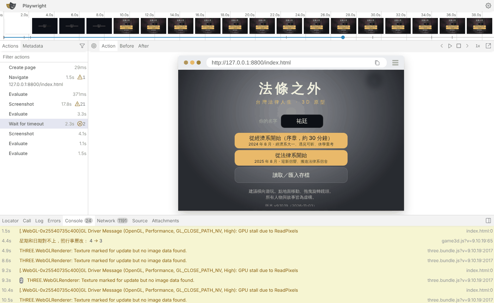

# CC_48 Playwright 失敗自動追蹤系統（TEST-TRACE-1104／BB_256）

- 規格：企劃線 a9b2ec19d `docs/story_planning/BB_256_Playwright失敗追蹤規格.md`（V1～V14）。CC 實作，BB 驗收。
- 狀態：**雲端自測通過，還沒在 PC 驗收**。BB 補充第 1 點：正式驗收要在 PC 用 GPU 跑，佇列區塊見第 6 節。
- 預設關。開法：佇列 ENV `CC_AUTORETRY=1`，或 runner 加 `--autoretry`。使用說明：`tools/cc_local/README.md`「失敗自動追蹤」一節。
- 改的檔案：
  - `tools/cc_local/run_queue.py`：重跑、分類、report、清理、trace 的推送上限。
  - `tools/cc_local/gpu_wrap.py`：`CC_TRACE=1` 時才載入 cc_trace。
  - 新增 `tools/cc_local/cc_trace.py`：Tracing、events、state、env。
  - 新增 `docs/story_planning/test_tools/cc/selftest/st_*.py`：10 支自測探針。
  - `tools/cc_local/README.md`。
- 範例證據：`docs/story_planning/CC/CC_48_samples/`。有 report.json 六份、game 頁的 state 和 env、一份 Trace Viewer 開得起來的 trace.zip（2.0 MB，已清理）。

## 1. 盤點（改之前已經有的、還缺的）

### 已經有、沒動的
| 功能 | 在哪裡 | 內容 |
|---|---|---|
| 佇列格式 | `queue.txt` | `ID \| SHA \| KIND \| script \| url \| 逾時分 \| ENV`。`#` 開頭跳過；`#HOLD雲端 ` 暫停 |
| 跳過規則／RERUN | `run_queue.py` `is_done` | `local_out/<ID>/meta.json` 的 sha 和 RERUN 都相同就跳過，不管 exit。要重跑就換 `RERUN=<新字>`。逾時、error 也一樣。attempted 鍵是 `id@sha#RERUN` |
| 每項輸出 | `local_out/<ID>/` | `run.log`（stdout）、`err.log`（stderr）、`out/`（探針自己的截圖等）、`meta.json` |
| meta.json 欄位 | `run_item` | rerun、id、sha、kind、script、env、machine、start、end、seconds、exit、error、runner（runner sha256 前 10 碼）、rf_round、url（url2、sha2）、res_peak（cpu／mem／used_gb／chrome_testing）、blender 才有的 blender_threads、device_forced |
| 推送上限 | `commit()` | PNG 每項合計 `PNG_CAP` 25 MB，超過的不推，`notes.txt` 記「screenshots not pushed (over 25 MB): n」。PNG 以外單檔超過 `BIG_CAP` 50 MB 不推，notes.txt 記路徑和大小。notes.txt 是附加寫入 |
| 逾時 | `run_item` | `p.wait(tmin*60)`，逾時 `kill_tree` 整個程序樹，meta error 寫 `timeout N min`。沒有任何重跑 |
| 被打斷的項目 | `running.json`、`_interrupted.jsonl` | 下次啟動時記錄，會從頭重跑 |
| 平行 | `--parallel`、`config.txt PARALLEL`（目前是 3） | 各項各自的 worktree（`wt_cc_<ID>`）、http server（8800 起）、`CC_SLOT`、`CC_ITEM`。blender 和 SOLO 項目獨佔 |
| 自我更新 | `RESTART_EXIT 75` | 合併 cc-testing 以後雜湊不同，就跑完手上的項目再 exit 75，run_forever.ps1 立刻重跑新版 |
| 摘要／畫面輸出 | `summary.md`、`_console/console.log` | 每項一行加 err.log 最後 5 行；畫面輸出留最後 2000 行 |
| 瀏覽器診斷 | `gpu_wrap.py` | 在 stderr 印 `PAGE CRASH`、`page close`、`pageerror <200 字>`、`BROWSER DISCONNECTED`，只記在 async 的 new_context／new_page 上。**探針正常 `browser.close()` 也會印 BROWSER DISCONNECTED**，所以這一行單獨出現不能當環境問題 |
| 探針斷言 | `playlib.Run.check`、各探針的 `check()` | 印 `PASS／FAIL 名稱  info`，結尾 `ALL PASS／FAILED`，exit 0／1；`[前置／捷徑]` 行；`Run.shot` 截圖 |
| JS 錯誤（探針自己收） | `playlib.launch` 回傳 `errs`（pageerror）；部分探針另外收 console（例：cc_noodle_exit_probe 的 CONSOLE） | 只印在 run.log，格式各探針不同 |
| 靜態檢查 | `probe_lint.py` | py_compile、`%` 參數數目、node --check |

### 缺的（這次做的）
- Playwright Tracing（Trace Viewer）。以前完全沒有。
- 結構化的錯誤紀錄：console、pageerror 含 stack、requestfailed、crash、意外斷線、FAIL 行，都要有時間。
- 失敗當下的遊戲狀態快照。
- 環境資訊：瀏覽器版本、GPU renderer、playwright 版本。
- 失敗自動重跑一次、FLAKY 判定，以及 CASE 層級的重跑。
- 分類（GAME_BUG、TEST_BUG、ENVIRONMENT、FLAKY、UNKNOWN、TIMEOUT）和判斷依據。
- 推送前清理本機路徑、使用者名稱、Cookie、Token。
- trace 的大小上限。
- `tests/screencheck.py`：**不存在**，沒有可以沿用的東西。
- repo 沒有 `.github/workflows`。

## 2. 設計

```
第一次（照舊，不開 trace）──exit 0──> meta: attempt 1, final PASS（其他一字不變）
        │exit≠0、沒逾時          │逾時：預設不重跑（CC_RETRY_TIMEOUT=1 且 tmin≤20 才重跑一次）
        ▼                        ▼
 run.log／err.log／out/ 搬到 attempt1/
        ▼
 同一個 worktree（同 SHA）、同一份腳本（SCRIPT_FROM 重抓、blob 再算一次）、同一份 ENV
 ＋CC_TRACE=1、CC_TRACE_DIR=attempt2/trace（有 CASES 的探針：只帶 FAIL 的 CASE）
        ▼
 attempt2/{run.log, err.log, out/, trace/{trace_<ID>_<n>.zip, events.jsonl, state_<ID>_<n>.json, env.json}}
        ▼
 分類 → report.json／report.md → 清理（路徑、使用者名稱、秘密）→ trace 瘦身 → commit（trace 和截圖共用 25 MB）
```

- **gpu_wrap／cc_trace**：
  - monkeypatch async 和 sync 的 `BrowserType.launch`、`Browser.new_context`、`Browser.new_page`、`BrowserContext.close`、`Browser.close`、`PlaywrightContextManager.__aexit__／__exit__`。
  - context 一建好就 `tracing.start(screenshots=True, snapshots=True, sources=False)`。
  - 關閉前讀 state，再 `tracing.stop(path=…)`。
  - 探針在 `async with async_playwright()` 裡 `sys.exit`，或根本沒關瀏覽器，也會在 playwright 結束前存到。
  - runpy 外面包 try/except SystemExit，收尾後再丟出。atexit 補寫 env.json。
  - 出錯只寫一行 `[cc_trace] …` 警告。`CC_TRACE` 沒設時根本不 import cc_trace。
- **runner**：
  - 新程式都包在 try/except 裡，出錯時寫一行 `WARNING autoretry … (old behaviour kept)`，第一次的結果照記。
  - `ar_on` 為假時，新程式一行都不執行。
- **平行**：證據都在各自的 `local_out/<ID>/`，trace 和 state 檔名也帶 ID。
- **BB 補充 2（CASES）**：
  - 判斷探針支不支援 CASES：原始碼有 `os.environ.get('CASES')`。
  - CASE 清單：ENV 的 CASES，沒寫就用原始碼裡的預設值。
  - FAIL 歸屬：照 run.log 的 `== X` 或 `== case X` 段落歸到 CASE。
  - FAIL 行不在任何段落裡（例如「遊戲載入」FAIL）、或全部 CASE 都 FAIL，就整支重跑，原因寫在 `rerun_scope`。
- **BB 補充 3（FLAKY）**：report 的 `conditions` 列出兩次的 `game_sha`、`script_blob`（git hash-object，重跑前實際檔案再算一次）、`input_hash`（佇列 ENV 去掉 RERUN／CASES／CC_AUTORETRY，加 XARGS，sha256 前 16 碼）、`cases`。
  - 有任何一項不同就判 UNKNOWN，並寫原因。
  - CASES 的差別只有「只重跑 FAIL 的 CASE」時，算相同。
- **BB 補充 4**：每個分類都在 `basis` 寫依據，找不到依據的一律 UNKNOWN。

## 3. 雲端自測結果（極小頁面＋兩項遊戲頁；runner `--parallel 2 --headless --no-push`，config.txt 把並行改成 3）

SHA 3bc7e2f02（cc-testing）＝自測頁；d2e36f6eb＝有 `GAME.stateSnapshot` 的遊戲。秒數是 meta 的 seconds，包含 worktree add／remove（每次約 8 秒）。

| 項目 | 對應 | 預期 | exit／exit2 | final | 分類（初判） | 秒數 | trace.zip | events | 依據（report.basis 節錄） |
|---|---|---|---|---|---|---|---|---|---|
| ST_pass | V1 | PASS、沒有 trace | 0／- | PASS | - | 22（r4：11） | 無 | 無 | 目錄只有 err.log、meta.json、out/pass.png、run.log（12 KB） |
| ST_assert | V2 | FAIL→重跑→FAIL＋trace | 1／1 | FAIL | UNKNOWN/assert | 16（r4：14） | 65,938 | 1,003 | 斷言 FAIL 1 行，兩次一致；沒有 JS 例外、traceback、環境訊號，要看預期／實際 |
| ST_flaky | V3 | FLAKY，不是 PASS | 1／0 | **FLAKY** | FLAKY | 14（r4：12） | 刪掉（PASS 不留） | 636 | 第一次 exit 1、重跑 exit 0；conditions.same=true（blob 5ff0a95…兩次相同、input 9fa1f541…） |
| ST_selector | V4 | TEST_BUG | 1／1 | FAIL | TEST_BUG/初判 | 21（r2：16） | 39,025 | 448 | `TimeoutError: Page.wait_for_selector: Timeout 3000ms exceeded.`；st_selector.py line 13；等的是 `#no-such-button`；**trace 的 DOM snapshot 裡沒有這個 selector**；沒有 pageerror |
| ST_jserror | V5 | 例外＋截圖 | 1／1 | FAIL | GAME_BUG/初判 | 16 | 91,874 | 1,643 | pageerror TypeError `Cannot read properties of null (reading 'notAFunction')`，stack `at boom (file://<REPO>/…/st_jserror_page.html:4:208)`；截圖 before／after 兩次各一組；console.error 也有記 |
| ST_jserror_game | V5（遊戲頁） | 同上，用遊戲 index.html | 1／1 | FAIL | GAME_BUG/初判 | 92（r3：77） | 原始 64,374,405 → 瘦身 2,065,131 | 7,137 | pageerror `GAME.ccSelftestMissingFn is not a function`；state 有完整的 `GAME.stateSnapshot()`（zone dorm、day 1、hour 17.55、pos、player、busyDepth、flags、npcs…） |
| ST_jserror_gold | V10 退回 | 舊 SHA 沒有 stateSnapshot | 1／1 | FAIL | GAME_BUG/初判 | 55 | 26,793,855（瘦身功能加上之前，超過 20 MB 不推，notes.txt 有記） | 2,551 | state 退回自己的 evaluate：zone、day、hour、weekday、player x/z/y/lv/pose/busy、dlg、flagKeys、lastTalkError、walkFallbacks |
| ST_crash | V6 | ENVIRONMENT | 1／1 | FAIL | ENVIRONMENT/browser | 34（r2：37） | 無（瀏覽器死了，tracing.stop 回 TargetClosedError） | 739 | `TargetClosedError: Page.evaluate: Target page, context or browser has been closed`；events：browser_disconnected（expected=false，rel 1.6s）；在那之前沒有 FAIL 行 |
| ST_timeout | V7 | 中止、不重跑 | -9／- | TIMEOUT | TIMEOUT/UNKNOWN | 71（逾時 1 分） | 無 | 無 | 只憑逾時不判 GAME_BUG；「逾時不重跑（預設…）」 |
| ST_timeout_r | V7 | 最多重跑 1 次 | -9／-9 | TIMEOUT | TIMEOUT/UNKNOWN | 127（64＋60） | 無（被 kill） | 182 | 重跑一次也逾時，就結束了，沒有第三次 |
| ST_par_a／ST_par_b | V8 | 證據分開 | 1／1、1／1 | FAIL | UNKNOWN/assert | 31／42 | 60,584／60,609 | 915／912 | 第一次 04:55:40 同時開跑；out/who.txt 各自只有自己的 ID 和 pid（a：9903、10117；b：10185、10451）；trace sha1 29f07ee…／29a4da2…不同；檔名分別帶 `ST_par_a`、`ST_par_b` |
| ST_cases | BB 補充 2 | 只重跑 B | 1／1 | FAIL | UNKNOWN/assert | 11 | 30,600 | 931 | rerun_scope「只重跑 FAIL 的 CASE B（第一次跑了 A,B；前置操作照探針原樣做）」；attempt2 的 run.log 只有 `== B` |
| ST_noar | 舊行為 | 沒開 autoretry | 1／- | （沒有新欄位） | - | 9 | 無 | 無 | 目錄只有 err.log、meta.json、out、run.log，meta 欄位和舊 runner 跑的 ST_noar_old 完全相同 |
| N20X_moku_ar | V12 | node＋autoretry、PASS | 0／- | PASS | - | 8 | 無 | 無 | meta 只多 attempt、final |

**V12 既有功能**：
- 同一支 node 單元測試 `tests/mokuyobi_unit.js @ aa8cb5beb`：舊 runner（origin/claude/cc-testing 的 run_queue.py）和新 runner 各跑一次，都是 19 行 PASS、ALL PASS，PASS／FAIL 行逐行相同，meta 的鍵完全相同，目錄內容也相同。
- 同一支 probe（ST_noar／ST_noar_old）：run.log 除了路徑以外相同。
- gpu_wrap 新舊版直接跑 st_assert：stdout 逐行相同；stderr 把時間去掉以後也逐行相同。
- `guard_unit.py`、`lock_unit.py`、`restart_unit.py`、`solo_unit.py` 都是 ALL PASS。
- `probe_lint.py`（13 個檔）ALL PASS；py_compile 全部通過。
- 還沒在 PC 測過：GPU 加速、run_forever 自動接續。runner 改版會觸發一次 exit 75 換新版，這一點和以前每次改 runner 一樣。

## 4. Trace Viewer（V9）

`python3 -m playwright show-trace --host 127.0.0.1 --port 9323 trace_ST_jserror_game_1.zip`（瘦身＋清理後的那份）用 headless chromium 開：



畫面上看得到這些：
- 上方是時間軸，有 0～40 秒的畫面截圖 filmstrip：載入畫面，接著是標題畫面。
- 左邊是 Actions 清單：Create page、Navigate 127.0.0.1:8800/index.html、Evaluate、Screenshot、Wait for timeout（⊗2＝這段時間有 2 個錯誤）、Evaluate…。
- 中間是選中動作的 DOM snapshot，也就是遊戲標題畫面「法條之外」、名字欄、兩個開始按鈕，可以切 Before／After。
- 下方 Console 分頁有 24 筆，包含遊戲自己的警告（`星期和日期對不上…`、`THREE.WebGLRenderer: Texture marked…`）；Network 分頁 1191 筆。
- 拿掉的下載內容（GLB、wrl、字型）在 Network 裡還列得出請求，只是看不到內容。

## 5. 成本（V14，雲端 SwiftShader 實測；GPU 數字要等 PC）

| 項目 | 數字 |
|---|---|
| 第一次就 PASS | 0（不開 trace、不重跑；ST_pass、N20X_moku_ar 的目錄和舊版相同） |
| 失敗多花的時間 | 每次重跑都要再跑一次探針。極小頁面的探針本體只要 1～4 秒（worktree 不重開）。遊戲頁 ST_jserror_game：第一次 32 秒，開 trace 重跑 42 秒（+31%，trace 截圖和 snapshot 的負擔）。逾時重跑（要手動開）最多再多一倍逾時 |
| trace.zip | 極小頁面 30～92 KB。遊戲頁原始 26.8 MB（舊 SHA）和 64.4 MB（d2e36f6eb），裡面有 46 MB 的 .wrl、12.8 MB 的 .glb、2.3 MB 的字型，瘦身後 2.07 MB（其中截圖幀 61 張約 1.4 MB）。長探針大約每分鐘多 2 MB 截圖幀，超過 20 MB 會自動抽幀 |
| events.jsonl | 0.4～1.6 KB（極小頁面）、7.1 KB（遊戲頁 40 秒，主要是 console warning） |
| state／env | state 0.15～3 KB（有 stateSnapshot 時 3 KB），env 0.6 KB |
| 整項目錄（失敗） | 極小頁面 40～150 KB；遊戲頁 2.8 MB（兩次的截圖＋瘦身的 trace） |
| CPU／記憶體 | 雲端只有 res_peak。這幾項是 2～3 項並行跑的峰值，分不出是哪一項造成的：極小頁面 cpu 11～98%、記憶體 1.0～3.4 GB；遊戲頁 cpu 95～96%、2.9～3.2 GB。**GPU 在雲端量不到**，PC 驗收時看 meta 的 res_peak 和第一次／重跑的秒數比 |
| 清理 | 每項掃描、改寫 < 1 秒；64 MB 的 zip 瘦身約 1 秒 |

## 6. PC 驗收用佇列區塊（BB 補充 1；交給 BB 排）

前提：
- 主代理先把這次的改動推上 cc-testing。runner 會 exit 75 自己換新版。
- selftest 探針在 cc-testing 上，probe kind 從 Lawstudent_cclocal 讀，所以不用寫 SCRIPT_FROM。
- 都用 GPU（CC_GPU 預設 1）。並行照 config.txt；V8 需要 ≥2。
- **至少 V2、V3、V5、V8 用真的遊戲頁**（`ST_PAGE=game`，SHA d2e36f6eb 有 stateSnapshot）。

```
TT_V2_assert   | d2e36f6eb | probe | docs/story_planning/test_tools/cc/selftest/st_assert.py   | index.html | 10 | CC_AUTORETRY=1;ST_PAGE=game
TT_V3_flaky    | d2e36f6eb | probe | docs/story_planning/test_tools/cc/selftest/st_flaky.py    | index.html | 10 | CC_AUTORETRY=1;ST_PAGE=game
TT_V4_selector | d2e36f6eb | probe | docs/story_planning/test_tools/cc/selftest/st_selector.py | index.html | 10 | CC_AUTORETRY=1;ST_PAGE=game
TT_V5_jserror  | d2e36f6eb | probe | docs/story_planning/test_tools/cc/selftest/st_jserror.py  | index.html | 10 | CC_AUTORETRY=1;ST_PAGE=game
TT_V6_crash    | d2e36f6eb | probe | docs/story_planning/test_tools/cc/selftest/st_crash.py    | index.html | 10 | CC_AUTORETRY=1
TT_V7_timeout  | d2e36f6eb | probe | docs/story_planning/test_tools/cc/selftest/st_timeout.py  | index.html | 1  | CC_AUTORETRY=1
TT_V7_timeout_r| d2e36f6eb | probe | docs/story_planning/test_tools/cc/selftest/st_timeout.py  | index.html | 1  | CC_AUTORETRY=1;CC_RETRY_TIMEOUT=1
TT_V8_par_a    | d2e36f6eb | probe | docs/story_planning/test_tools/cc/selftest/st_parallel.py | index.html | 10 | CC_AUTORETRY=1;ST_PAGE=game
TT_V8_par_b    | d2e36f6eb | probe | docs/story_planning/test_tools/cc/selftest/st_parallel.py | index.html | 10 | CC_AUTORETRY=1;ST_PAGE=game
TT_cases       | d2e36f6eb | probe | docs/story_planning/test_tools/cc/selftest/st_cases.py    | index.html | 10 | CC_AUTORETRY=1
TT_V12_moku    | aa8cb5beb | node  | tests/mokuyobi_unit.js                                      | index.html | 5  | CC_AUTORETRY=1
TT_V12_noodle  | 809163ee4 | probe | docs/story_planning/test_tools/cc/cc_noodle_exit_probe.py   | index.html | 15 | CC_AUTORETRY=1;CC_HEADLESS=0
```

- TT_V8_par_a、TT_V8_par_b 要排在相鄰的兩行，才會同時跑。
- V12 的對照組：
  - TT_V12_moku 對照 cc-local 上已經跑過的 `N20X_moku_u`（aa8cb5beb）。
  - TT_V12_noodle 對照已經跑過的 `NOODLE_exit`（809163ee4）。這是真的遊戲探針，CASES A、B。
  - 如果還是 FAIL，重跑就只會帶 FAIL 的 CASE，正好也驗證 CASE 重跑。
- 想再試一支已知會 FAIL 的長測試，可以排：`TT_GG_ext_nav2 | 23eaaa7ae | game | tests/gongguan_layout_nav.py | index.html | 40 | CC_AUTORETRY=1;CC_HEADLESS=0`。重跑最多再 40 分；它不是 CASES 探針，會整支重跑。
- PC 跑完看：
  1. 每項的 `meta.json`（final／class）和 `report.json`。
  2. `attempt2/trace/*.zip` 下載回來用 `python -m playwright show-trace` 開。
  3. `env.json` 的 gpu_renderer 應該是 RX 6600M（d3d11）。
  4. 兩次秒數的比例＝GPU 下的 trace 成本。

## 7. 保存規則與 GitHub Actions 評估（V13）

**目前的保存規則**：
- PASS 不留 trace，FLAKY 也刪掉重跑的 zip。
- 單一 trace 上限 `CC_TRACE_MAX_MB=20`。超過先瘦身：拿掉 resources 裡的模型、字型、音效和超過 512 KB 的內容，還是超過就抽掉截圖幀；再超過就不推，在 notes.txt 記一行。
- trace 和截圖共用每項 25 MB 的 PNG_CAP。
- 推送前清理：
  - attempt 目錄的文字檔和 zip 內文字 entry，路徑換成 `<REPO>`、`<WTROOT>`、`<HOME>`、`<TMP>`，路徑裡的使用者名稱換成 `<USER>`。
  - Cookie、Authorization、Set-Cookie、token、api key、password 的值換成 `<REDACTED>`。
  - 清完再掃一次，記在 `report.sanitize.left_hits`。這次最後一輪的 12 份 report 全部是空的。
  - 另外手動掃了範例 trace.zip 的所有 entry，裡面沒有 `/tmp/claude`、`/root/`、`/home/user`、`Cookie`、`Authorization`。
- **清理政策（建議，還沒自動化）**：
  - cc-local 上 `attempt2/trace/*.zip` 超過 14 天，或該項已經由 BB 判定，就由 CC 用一個 commit `git rm`。
  - report.json、events、state 很小，永久保留。
  - 注意：`git rm` 只讓分支變乾淨，歷史還在。真的要減少 repo 大小得重寫歷史，這個不做，所以上限才是主要的控制手段。
- **GitHub Actions Artifacts**：
  - repo 目前**沒有 `.github/workflows`**，這個 session 也沒有 gh CLI，所以只能做評估，沒有實測。
  - Artifacts 只能在 workflow run 裡用 `actions/upload-artifact` 上傳，PC 的 runner 不在 Actions 裡，沒辦法直接傳。
  - 要用的話有兩條路：一是 PC 用 token 呼叫 REST API 觸發 workflow_dispatch，再把檔案傳給 workflow；二是改成 self-hosted runner。兩條都要在 PC 存一個有權限的 token，或是改 PC 的執行方式。
  - 另外，artifact 預設 90 天就刪，Free 方案有儲存額度。
  - 結論：瘦身以後 trace 多半只有 0.03～2 MB，**現在不值得導入**。如果之後長探針的 trace 經常超過 20 MB，再評估 Releases assets 或 self-hosted runner。

## 8. BB 驗收清單對照

| # | 狀態 | 證據 |
|---|---|---|
| V1 | 雲端 OK | ST_pass 目錄清單（第 3 節） |
| V2 | 雲端 OK（分類是 UNKNOWN/assert：這個注入點沒有 JS 錯誤也沒有 traceback，依規則不判 GAME／TEST）；PC 待跑 | ST_assert、TT_V2_assert |
| V3 | 雲端 OK | ST_flaky report（`CC_48_samples/ST_flaky_report.json`） |
| V4 | 雲端 OK | `CC_48_samples/ST_selector_report.json` |
| V5 | 雲端 OK（自測頁＋遊戲頁） | `CC_48_samples/ST_jserror_game_report.json`、state、截圖 |
| V6 | 雲端 OK（trace 存不下來，證據是 events＋err.log） | `CC_48_samples/ST_crash_report.json` |
| V7 | 雲端 OK | ST_timeout、ST_timeout_r |
| V8 | 雲端 OK | ST_par_a／b |
| V9 | 雲端 OK | 第 4 節截圖、`CC_48_samples/trace_ST_jserror_game_1.zip` |
| V10 | 雲端 OK（有／沒有 stateSnapshot 兩種） | `CC_48_samples/state_ST_jserror_game_1.json`；日期字串：G.dateKey 在那個狀態是 null，所以 date 也是 null（遊戲剛開到標題畫面）；day、weekday、hour 有值 |
| V11 | 雲端 OK | report 的 sha、id、cc_testing_sha、script_blob、env.browser、env.gpu_renderer、shortcuts |
| V12 | 雲端部分 OK；GPU、run_forever 待 PC | 第 3 節 |
| V13 | 規則寫好、掃描結果在 report | 第 7 節 |
| V14 | 雲端數字有了，GPU 數字待 PC | 第 5 節 |

## 9. 還沒做到的地方、限制、PC runner 的風險

- 被逾時 kill、或瀏覽器整個當掉的那一次，沒有 trace.zip。逾時時也沒有 state，因為程序直接被 kill。可以考慮之後在逾時前 30 秒送訊號讓 gpu_wrap 先存，這次沒做。
- 分類只是初判。ST_jserror 和 V5 的例外是自測故意注入的，用頁面自己的 `<script>` 丟出來，所以照規則會被判成 GAME_BUG（初判）。如果是探針用 `page.evaluate` 丟的例外，就不會算成遊戲的錯。
- 斷言 FAIL、但沒有其他訊號的情況，一律 UNKNOWN。這類是真實探針最常見的失敗，要看 report 的 `fails[].info`（預期／實際）和 state 判斷。
- 狀態讀取用 page.evaluate，所以 Trace Viewer 的 Actions 會多 2～3 個 Evaluate。sync API 的探針在頁面卡死時，evaluate 沒有逾時。
- 開 trace 的重跑比較慢，對時間敏感的探針（fps、touch_flow）可能因此改變結果。這種重跑 PASS 時，report 仍然會判 FLAKY，BB 要對照兩次的秒數。
- 使用者名稱的替換：文字證據用整個字（不分大小寫）替換。Windows 使用者名稱如果是一般單字，事件文字裡同一個字也會被換成 `<USER>`。trace.zip 裡只換路徑裡的部分，免得弄壞 JSON。
- **PC 風險**：
  1. 推上 cc-testing 以後 runner 會 exit 75 換新版一次（跟以前一樣）。
  2. 沒開 CC_AUTORETRY 的項目，雲端實測行為不變。
  3. 開了 CC_AUTORETRY 的項目失敗時，會多跑一次（最多再一個逾時時間），推送量多 0.03～2.8 MB。
  4. Windows 上搬 attempt1 時，如果瀏覽器還鎖著截圖檔，那個檔留在原地，report 的 notes 會記下來，不會讓 runner 當掉。
  5. 新程式出錯一律寫一行 WARNING，退回舊行為。
