# CC_49 阿德影印輸出室內（溫州街 A1，區域 `wz_print`，不改名）

- 做的人：CC（帳號 A）的建模子代理，2026-11-04。
- 分工：AA_654（溫州街第一批：阿德影印室內歸 CC；MODEL_READY 由 LAWWW2 收，ART_APPROVED 由 BB 判，CC 不判自己這間）。做法照 CC_47 轉角唱片、CC_46 慢輪單車。
- 規格：
  - 參考圖 `ref_images/shops/wz_ade_int.webp`（企劃線 `origin/claude/story-planning`；參考圖就是規格，SCENE_RULES §12）。
  - 同資料夾 README：阿德影印那一列寫「**等使用者確認**」，最後一段沒有阿德影印的專門注意事項（只有 2:30 AM、小路的）。這一版照 CC 主代理的派工開工；**使用者還沒確認參考圖**這件事要讓 LAWWW2／BB 知道。
  - AA_654：價目照室內圖，原本的打工照舊，內部 id 不改。
  - 尺寸、門窗：照 LAWWW2（11-04，經 CC 主代理轉達）：沿用現在 `src/data/wz_shops_layout.js` 的 `print`，不要動。
- **狀態：`READY_FOR_REVIEW`**。只有雲端低解析度的 Cycles 預覽（836×470、16 samples、CPU）。沒有進遊戲、沒有開瀏覽器。
- **最新是 v1c**（下一節）：回應 BB_257 §7 退件（不能動的點、搬點清單、資料夾一本一本、紙包紙箱多種尺寸、影印機不同機型）。v1b 那一節的導航規則照舊有效；位置、數字以 v1c 為準。

## v1c（2026-11-04，CC 子代理）：BB_257 §7 退件

- **狀態：`READY_FOR_REVIEW`**（只有雲端 Cycles 預覽 836×470、16 samples；沒有進遊戲、沒有開瀏覽器）。
- 退件 5 項（BB_257 §7「退件要改的」）都改了；不能動的點照 `WZ_SHOPS1_FIXED_COORDS.md`（`6d0ab65b9`）§4、§7 對過。

### 1. 不能動的點、搬點清單（給 LAWWW）

放回原座標的：

| FIXED §4 # | 點 | FIXED 原座標 | v1b | **v1c** | 說明 |
|---|---|---|---|---|---|
| 1 | 出口「離開影印店」 | (0, 4.15) r 1.3 | 同 | **同（沒動）** | |
| 2 | 出生點 | 配置 (0, 3.9)，程式改成 3.65 | 3.9 | **(0, 3.65, π)** | FIXED §7-1：3.9 站不住。改了以後 `zones3d.js:1046` 的店門 `exit.spawn`、`crowd3d.js:371` 路人的門口都跟著是 3.65（兩處都讀 `L.spawn`），不必改程式 |
| 3 | 打工上班的落點 | (0, 3.3, π) | 同 | **同（沒動）** | `jobs3d.js:315` 的 `Math.min(spawn.z, 3.3)` 照舊 |
| 4 | 印東西 | (−0.6, 1.75) r 1.0 | (−1.3, −1.95) | **(−0.6, 1.75)（放回）** | 西側走道、兩台自助影印機前面。`dl09_shop_menu_unit.js`、`wz_shops_unit.js` 2b 讀配置，不用改 |
| 5 | 買文具 | (1.45, 2.7) r 1.0 | (1.0, 2.4) | **(1.45, 2.7)（放回）** | 鐵層架前面 |

放不回、要 LAWWW 改程式的：

| 點 | 舊座標（程式寫死） | 新座標 | 為什麼搬 | 要改的程式 | 要跑的測試 |
|---|---|---|---|---|---|
| §4 #6 店員（阿德） | (−0.9, 0.4, 0)，`story3d.js:360` 寫死 | **配置新欄位 `clerk: {x: −0.95, z: −3.4, yaw: 0}`** | 櫃台照參考圖搬到後牆（z −2.38～−2.92）。舊點在這一版是西側走道正中間（站得住），阿德會站在客人走的地方 | `story3d.js:360` 改成讀 `WZ_SHOPS_LAYOUT.print.clerk`（和林家、定食讀 `clerk` 一樣，FIXED §7-4） | `wz_shops_unit.js`、`reachability_all.py`；阿德的劇情站位（`shopenc3d.js` 的 keeperLine 不讀座標） |
| §4 #7 打工的告示「櫃台」 | (1.05, 0.9) r 1.0，`wz_jobs.js:17` | **(−0.2, −2.95)**（＝配置 `jobDesk`＝`staff_gate`） | 舊點在這一版是工作檯前的東側走道，按鈕會在工作檯前面出現 | `wz_jobs.js:17` 的 `copy.desk` 改成 `{x: −0.2, z: −2.95, label: '櫃台'}`（或讀配置的 `jobDesk`） | `aa420_jobs_unit.js`、`wz_work_spots_unit.js` |
| 站著的客人、店內偶遇的三個站點 | (−1.55, 1.95, π)、(1.15, 3.25, π/2)、(0.25, 1.95, π)，`crowd3d.js:371` 寫死 | **配置新欄位 `stands`**：① (−1.0, 2.6, −π/2) ② (1.0, 3.2, π/2) ③ (−1.0, −1.8, π) | 舊的第一點在自助影印機裡、第三點在長桌裡（BB simWalk 卡住） | `crowd3d.js:371` 改成讀 `WZ.print.stands`；`shopenc3d.js:46`、`120`～`122` 從同三點挑 | `shop_diners_unit.js` 第 6 項、`shop_enc_seat_unit.js`（柏翰「他站在影印機旁邊」＝①） |
| 客人座位 0 → 4 | `wz_shops_unit.js` 允許影印店 0 個 | 4 個：(−0.07, 2.6)、(−0.07, 0.85)、(−0.07, 0.25)、(−0.2, −0.45)，面向 +x | v1 起照參考圖有長桌和自助電腦 | `crowd3d.js` 影印店的客人要不要坐下由 LAWWW 定（`cap:2` 照舊） | `wz_shops_unit.js` 第 2 項（座位數）、`shop_diners_unit.js`（同時最多 2 位、坐著的人「旁邊站得起來」）、`shop_enc_seat_unit.js`（「站著的店」這個前提變了：偶遇的人可能坐下）、`reachability_all.py` |

三個站點（`stands`）的量法（Node 跑遊戲的 zones3d／engine3d，`E.canStand` 半徑 0.3、0.4 m 格）：

| 站點 | 面向 | canStand | 從出生點走得到 | 前面 0.75 m 是家具 | 離出口 | 離最近的按鈕 |
|---|---|---|---|---|---|---|
| ① (−1.0, 2.6) | 自助影印機 1 | ✓ | ✓ | ✓（影印機） | 1.84 m | 0.94 m（印東西） |
| ② (1.0, 3.2) | 鐵層架前地上的紙箱 | ✓ | ✓ | ✓（紙箱） | 1.38 m | 0.67 m（買文具） |
| ③ (−1.0, −1.8) | 櫃台（等取件） | ✓ | ✓ | ✓（櫃台） | 6.03 m | 3.57 m |

- 「印東西」放回 (−0.6, 1.75) 以後，原本前面那張長桌的第二張椅子 (−0.07, 1.65) 站在旁邊時最近的變成「印東西」。所以椅子重排：前面那張長桌只留北端一張（z 2.6），後面那張長桌三張（z 0.85、0.25、−0.45）。
- z −0.45 那一張沒推進去（x −0.2、轉 18°）。它再往北，和大圖輸出機中間的走道就不到 1.2 m。
- `clerk` (−0.95, −3.4)、阿德的三個站位、打工 b me、c me／boss、end：canStand、走得到都 ✓。

### 導航（shopchk2，遊戲的 0.4 m 格）
- LAWWW2 的 shopchk2（`021262b9b`），跑在開發分支 `3424d8e66` 的 worktree：**`wz_print 互動點 7 NG 0`**（客人座位 4、印東西、買文具、出口）。
- 把自助影印、進櫃台、膠裝、jobDesk 也加進去，用同一套規則：**互動點 10 NG 0**。jobDesk 和進櫃台是同一點，只算一次。
- 主走道（block 外緣到外緣）：**西側最窄 1.20 m、東側最窄 1.20 m**。
- 格子圖和 v1b 幾乎一樣，只有椅子那一欄不同：前面那張長桌西側 z 1.2～2.2 這一段空出來，「印東西」就站在那裡。

### 2～5. 模型改了什麼
| BB_257 §7 | 改了什麼 | 物件 |
|---|---|---|
| 2 資料夾、筆記本一本一本 | 鐵層架上兩排（筆記本 37 本、資料夾 21 本），後牆鐵層板上兩排，都改成一本一本的幾何（`book_row`）。資料夾厚 2～6 cm、高 25～32 cm；筆記本厚 1.2～3.5 cm、高 21～30 cm；深度也不同。空位後面那一本倒向空位（傾斜 14～29°），有的稍微歪，約 1／10 抽出來 6～12 cm，中間留空位。書背是新的貼圖 `spines1`：20 種，資料夾有白色標籤、拉環孔；牛皮紙本有標籤；線圈本有線圈點 | `WALL_right_stat_rack_goods`、`WALL_back_back_wallshelf_goods` |
| 3 紙包、紙箱至少三種尺寸 | 紙包：A4 包（21 × 29.7 cm）、A3 包（29.7 × 42 cm）、半包（2.5 cm 厚）、拆開的（包裝紙只剩下半、上面散的白紙），每一包都歪一點。層架上五疊高度不同（5～24.5 cm）。紙箱：A4 箱 31 × 43 × 27、A3 箱 32 × 46 × 20、半箱 26 × 36 × 17、牛皮紙箱好幾種；地上那疊是 A3 箱上面放一個開著蓋子、轉了 9° 的箱子，裡面看得到紙包。木格櫃 20 格：白紙疊 7 格（一到三疊、高度不同、歪的）、紙包 3 格（有的拆開）、牛皮紙袋 3 格（直立，最後一個斜靠）、完成的裝訂本 3 格（躺著一疊或直立）、色紙 1 格、混的 1 格、**空格 2 格** | `stat_rack`、`floor_boxes`、`worktable`、`cubby` |
| 4 影印機不同機型 | 自助 a（AD-3020，店門那台）：高 1.22、送稿機上放著稿子、四層紙匣、斜的觸控面板、左側手送紙盤。自助 b（AD-2510）：高 1.03、沒有送稿機（平板蓋開了一點）、白色掃描器、三層紙匣＋深灰大容量紙匣、平的橫條操作面板、右側出紙盤有印好的紙、蓋子上放著一疊紙、「自助」貼紙換位置。生產用 a（AD-7500）：送稿機上一疊論文原稿、左側出紙盤一疊印好的紙。生產用 b（AD-7800）：平板蓋、兩層紙匣＋大容量、操作面板在左前方、**上半部前蓋開著**（裡面深灰、綠色卡紙把手、碳粉匣）、正面和蓋子上貼「維修中 請用左邊那台 ── 阿德」、地上幾張抽出來的卡紙。四台都**不是 instancing**，各自一個網格 | `ad_mfp_a_*`、`ad_mfp_b_*`、`ad_prod_a_*`、`ad_prod_b_*` |
| 5 牛皮紙箱尺寸、角度不同 | 格櫃上：A4 箱（轉 3°）、大牛皮紙箱 52 × 30 × 34（轉 −5°）、上面疊一個小的（轉 13°）、旁邊一個沒封膠帶的扁箱（轉 20°）。後牆鐵層板上三個：42 × 24、34 × 17、50 × 30，轉 3°、−8°、5°。層架下層、工作檯下層的牛皮紙箱也各不同 | `WALL_back_cubby_top_vc`、`WALL_back_back_wallshelf_vc` |
| BB 的醜點（順便） | 椅子 yaw 在配置裡打散（+5°、−6°、+3°），一張沒推進去（往外拉、轉 18°）。前景影印機頂部被切到：鏡頭沒動（ref_match 要對參考圖），但後面那台 b 比較矮、頂上有一疊紙，兩台看起來不再是同一塊白板 | |

### GLB（Blender 讀回）
| 項目 | v1c | v1b | 預算 |
|---|---|---|---|
| 三角形 drawn（含 instancing） | **20,076** | 18,100 | 5 萬 |
| 網格本身 | 18,466 | 15,796 | |
| 材質 | **11** | 11 | ≤ 12 |
| GLB | **1.70 MB**（1,704,624 bytes） | 1.50 MB | 3 MB |
| 金屬度最大 | 0.40 | 0.40 | ≤ 0.45 |
| instancing 節點 | 6（平板燈 10、長桌 2、椅子 4） | 14 | |

- 印刷圖集 `ade_goods.png` 從 2048×1280 改成 **2048×1536**。多了兩台影印機的正面（AD-2510、AD-7800）、「維修中」、20 本書背（`spines1`）。
- 天花板照舊：單面、法線朝下，沒有改。

### ref_match：五項 PASS（`shots/model/ade/ade_v1c_refmatch_report.json`）
REFMATCH_TABLE

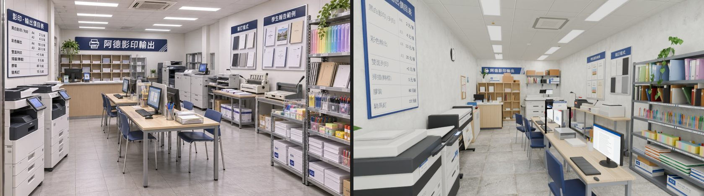
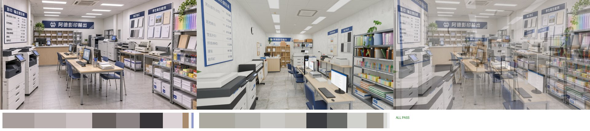
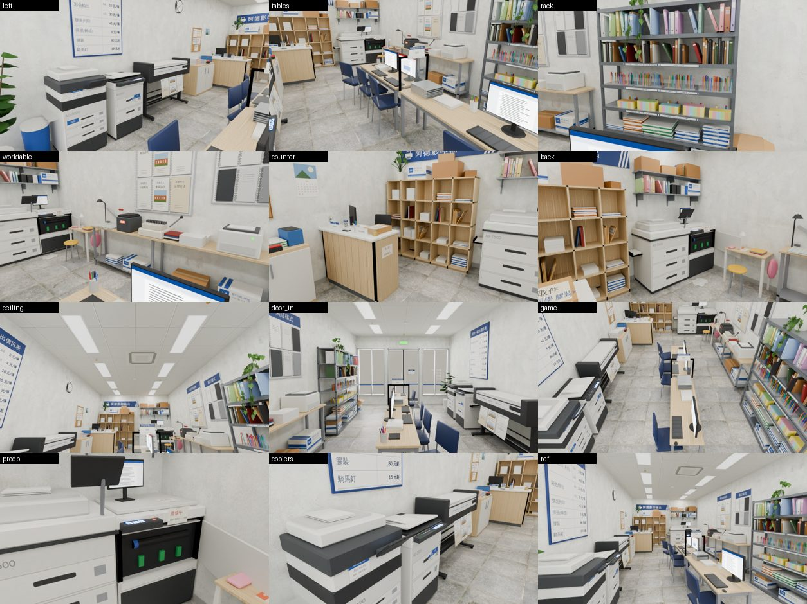

近景的角度照 BB 用的 `ade_v1b_views.json`（left、tables、rack、worktable、counter、back、ceiling、door_in、game）。另外加了兩個：`prodb`（生產用影印機 b，前蓋開著）、`copiers`（兩台自助影印機）。角度存在 `ade_v1c_views.json`。

### 還沒做到、還醜的
- **沒有進遊戲**：`clerk`、`stands`、`jobDesk` 要等 LAWWW 改 `story3d.js:360`、`crowd3d.js:371`、`wz_jobs.js:17` 才會生效。改之前，阿德照樣站在 (−0.9, 0.4)，也就是西側走道。這一點我沒辦法在配置裡修。
- 「印東西」放回西側走道以後，按鈕在自助影印機前面，阿德在後面的櫃台。印完的台詞（「影印機吐出最後一張」）對得上；可是「找阿德付錢」要走到後面的櫃台，這件事沒有畫面上的提示（隔板上有「列印請至櫃台付款」小牌）。
- 前面那張長桌只剩一張椅子，比參考圖更空。參考圖兩側都有人坐；這一版只有西側 4 張。
- 生產用影印機 b 的前蓋從主視角（ref）看不到，被長桌和電腦擋住，只有近景 `back`、`prodb` 看得到。
- 書、紙包都是方盒（沒有倒角、沒有書背的圓弧），近看邊很硬。數量多，倒角會多一萬多個三角形，所以先不做。
- 第 3 項「木格櫃每格高度不同」：格子本身還是 5 × 4 等分的，只有放的東西不同。
- v1／v1b 的其他醜點照舊：螢幕過亮、書包是橢球、價目表字淡、地磚有石紋。

## v1b（2026-11-04，CC 子代理）

LAWWW2 用遊戲真正的導航格驗收 v1：8 個互動點有 7 個 NG，導航退回。
- **狀態仍是 `READY_FOR_REVIEW`**。
- 美術方向 LAWWW2 說沒問題（ref_match 全 PASS、拆圖 42／45）。
- 外觀價目表的 2 元由 LAWWW2 處理。
- 這一版只改導航，和跟著動的家具、鏡頭。後面「v1」那幾節的拆圖清單、醜點照舊有效；數字、位置以這一節為準。

### 原因
- v1 用 0.05 m 的細格子量，0.8～0.9 m 的走道看起來夠。
- 遊戲的 room() 是 **0.4 m 格**，規則是：
  - 牆內 0.4 m 不能站
  - 家具往外擴 0.05 m
  - 人的半徑 0.33 m
  - 一格要站得住，它自己和前後左右四格都要空；格子中心落在家具裡，那一整格就擋住
- 所以 v1 的 0.8～0.9 m 走道，在 0.4 m 格上整條站不住。
- 前面那張長桌的前緣在 z 3.1，把出生點那一格的出路也堵住了。從出生點幾乎哪裡都走不到。

### 改了什麼
照 LAWWW2 的規則：主走道從 block 外緣量到外緣要 ≥ 1.2 m；要坐的椅子至少一邊 ≥ 1.2 m。

店寬 4.4 m，扣掉兩側牆內 0.4 m，只剩 3.6 m。我沒有拿掉東側的鐵層架（參考圖右前最顯眼的就是它），也沒有把長桌靠牆。做法是每一排都收窄，讓家具的邊對齊 0.4 m 格子。格子中心在 x …−1.4、−1.0、−0.6、−0.2、0.2、0.6、1.0、1.4…。

1. **左邊一排變淺**：自助影印機、大圖輸出機深 0.58 m，正面在 x −1.50（v1 是 −1.40）。影印機的模型跟著改。
2. **長桌**：
   - 寬 0.65 → **0.5**（x −0.04～0.46），兩張接成一排。
   - 前緣從 z 3.1 退到 **z 2.9**：z 3.0 那一列要空，從出生點才走得進店裡。
   - 後緣在 z −0.6。
3. **椅子**：
   - 西側四張往桌下收 0.2 m：中心 x −0.27 → **−0.07**，z 2.45、1.65、0.7、−0.1。
   - **東側那張拿掉**：放了東側走道就不到 1.2 m。
4. **右邊一排變淺**：工作檯、阿芃的小桌深 0.6／0.5 → **0.42**，正面在 x 1.66，和鐵層架對齊。
   - 工作檯上的機器跟著縮，膠裝機、線圈裝訂機、裁紙刀都在 0.42 m 內。
5. **櫃台**：
   - 位置 x −2.05～−0.85、**z −2.38～−2.92**（v1 是 1.5 m 長、z −2.65～−3.25）。
   - 櫃台前後各要空一列格子：客人站 z −1.8 那一列，店員站 z −3.4 那一列。
   - 檯面上的東西重排：叫人鈴、「有事請按鈴」小牌、掃碼付款、待取件的紙袋、取件處小牌。
6. **辦公椅**貼西牆（x −1.84；v1 是 −1.6），不擋 −1.4 那一欄。店員從櫃台東端進到櫃台後面。
7. **阿芃的凳子**挪到 x 1.5，不擋導航。這是 NPC 坐的位子；舊配置 `wz_shops_layout.js` 也不擋。
8. 層架前面地上的兩箱紙補上 block（v1 漏了）。
9. 互動點、站位跟著挪：
   | 項目 | 新位置 |
   |---|---|
   | print | (−1.3, −1.95) |
   | copier_self | (−1.0, 3.05) |
   | stationery | (1.0, 2.4) |
   | staff_gate／jobDesk | (−0.2, −2.95) |
   | binding | (1.0, −1.35) |
   | 阿德的三個站位 | (−0.95, −3.4)、(0.6, −3.05)、(1.0, −1.35) |
   | 打工 end | (−0.6, 3.4) |
   - 打工 a／b／c 的站位也跟著換。
10. **鏡頭（camRef）往西挪 0.5 m**：眼睛 (−0.8, 1.62, 4.38)、看 (0.4, 1.1, −4.0)、18 mm。
    - 長桌變窄、椅子收到桌下以後，原本的鏡頭在桌子東邊，一排藍椅子被桌子擋住。

### 走道（block 外緣到外緣，m）
| 哪裡 | v1 | v1b |
|---|---|---|
| 西側主走道（影印機、大圖輸出機 → 椅子西緣） | 0.90 | **1.20**（紙樣櫃那一段 1.34） |
| 東側（長桌 → 鐵層架／工作檯／小桌） | 0.83～1.01 | **1.20** |
| 長桌前緣 → 店門內 0.4 m | 1.38 | 1.30 |
| 長桌後面 → 櫃台 | 1.95 | 1.78 |
| 櫃台後面（店員） | 0.83 | **1.16** |
| 櫃台東端 → 生產用影印機 A | 0.80 | **1.10** |

遊戲格子上站得住的線：
- 直的兩條：x −1.0、x 1.0（整條通）
- 橫的兩條：z 3.4、z −1.8
- 櫃台後面：z −3.4（x −1.0～−0.2）
- 生產用影印機前：z −3.0

### shopchk2
- 工具：LAWWW2 的 shopchk2（021262b9b），跑在開發分支 3f4d17409 的 worktree 上。
- 配置變數：`globalThis.ADE_P = ADE_LAYOUT.print`。

```
node tools/dev_scratch/shopchk2.js <開發分支> wz_print print <ade_layout.js＋包一層的變數> ADE_P
wz_print 互動點 7 NG 0
```

- v1 用同一個工具跑是 `互動點 8 NG 7`。NG 的是：四張西側椅子、東側椅子、印東西、買文具。
- 遊戲的互動點只有 7 個：客人座位 4、印東西、買文具、出口。
  - copier_self、staff_gate、binding 現在不是遊戲的互動點。
  - 我把這三個也加進去，照同樣的規則再跑一次：`互動點 10 NG 0`。
- 阿德的三個站位、打工 a／b／c 的 me 和 boss、end：用同一套格子量。
  - 站著的：都在站得住、走得到的格子上。
  - 坐著的：辦公椅離最近站得住的格子 0.65 m、阿芃 0.35 m，都在座位半徑 0.9 m 內。
  - **站位 NG 0**。
- nearestInteractable 照工具的判斷：每個互動點的範圍內，至少有一個走得到的點，在那裡最近的互動是它自己。

格子圖（shopmap2，x −2.2～2.2、z −4.6～4.6，每 0.2 m 一格；`.` 走得到、`o` 空的但站不住或走不到、`#` 擋住）：
```
x -2.2..2.2
 -4.6 #######################
 -4.4 #######################
 -4.2 #######################
 -4.0 ###ooooooooo###########
 -3.8 ###ooooooooo###########
 -3.6 ###oo.......oooooooooo#
 -3.4 ###oo.......oooooooooo#
 -3.2 #ooooooo.........ooo###
 -3.0 #ooooooo.........ooo###
 -2.8 ########oo.......ooo###
 -2.6 ########oo.......ooo###
 -2.4 #ooooooo.........ooo###
 -2.2 #ooooooo.........ooo###
 -2.0 ###oo............ooo###
 -1.8 ###oo............ooo###
 -1.6 ###oo............ooo###
 -1.4 ###oo............ooo###
 -1.2 ###oo.......o....ooo###
 -1.0 ###oo.......o....ooo###
 -0.8 #oo.......oo#oo..ooo###
 -0.6 #oo.......oo#oo..ooo###
 -0.4 ###oo...oo###oo..ooo###
 -0.2 ###oo...oo###oo..ooo###
  0.0 ###oo.....oo#oo..ooo###
  0.2 ###oo.....oo#oo..ooo###
  0.4 ###oo...oo###oo..ooo###
  0.6 ###oo...oo###oo..ooo###
  0.8 ###oo.....oo#oo.....oo#
  1.0 ###oo.....oo#oo.....oo#
  1.2 #oo.....oo###oo..ooo###
  1.4 #oo.....oo###oo..ooo###
  1.6 ###oo...oo###oo..ooo###
  1.8 ###oo...oo###oo..ooo###
  2.0 ###oo...oo###oo..ooo###
  2.2 ###oo...oo###oo..ooo###
  2.4 ###oo...oo###oo..ooo###
  2.6 ###oo...oo###oo..ooo###
  2.8 ###oo.....ooo....ooo###
  3.0 ###oo.....ooo....ooo###
  3.2 ###oo............ooo###
  3.4 ###oo............ooo###
  3.6 ###ooooooooo.ooooooooo#
  3.8 ###ooooooooo.ooooooooo#
  4.0 #######################
  4.2 #######################
  4.4 #######################
```

### 數字（Blender 讀回 GLB）
| 項目 | v1b | v1 | 預算 |
|---|---|---|---|
| 三角形 drawn（含 instancing） | **18,100** | 18,560 | 5 萬 |
| 材質 | **11** | 11 | ≤ 12 |
| GLB | **1.50 MB**（1,503,164 bytes） | 1.50 MB | 3 MB |

- instancing 14 個節點：平板燈 10、自助影印機 2、長桌 2、椅子 4、生產用影印機 2。
- 天花板、`ad_ceilfx_*` 照 v1：單面、法線朝下。

### ref_match：五項 PASS（`shots/model/ade/ade_v1b_refmatch_report.json`）
| 項目 | 參考 | v1b | 門檻 |
|---|---|---|---|
| 平均亮度 | 0.594 | 0.644 | 差 ≤ 0.08（差 0.050） |
| 對比 | 0.665 | 0.584 | ≥ 0.532 |
| 冷暖 | +0.035 | +0.022 | 差 ≤ 0.05 |
| 色票 ΔE | | 6.1 | ≤ 18 |
| 九宮格 | | 0.085 | ≤ 0.12 |

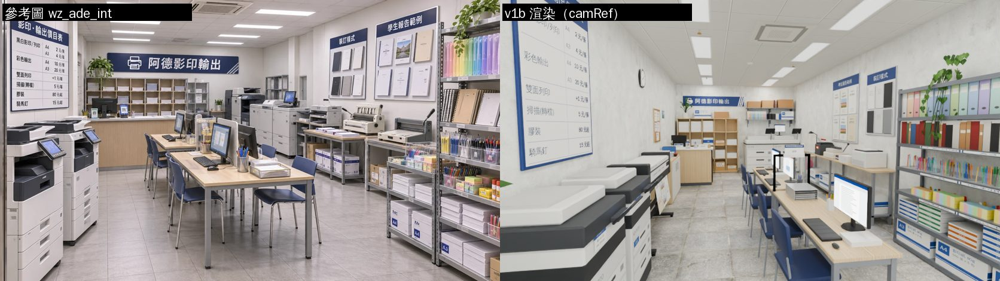
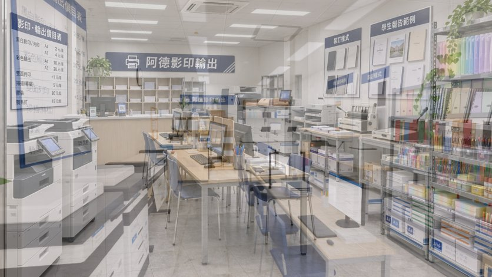
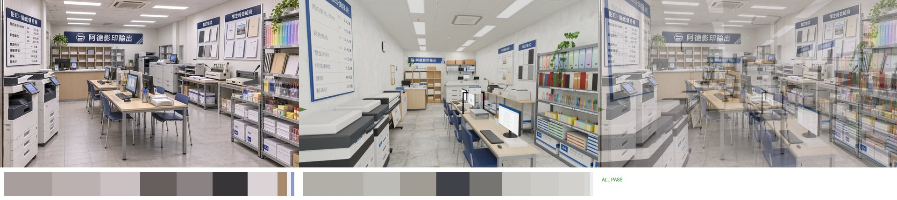
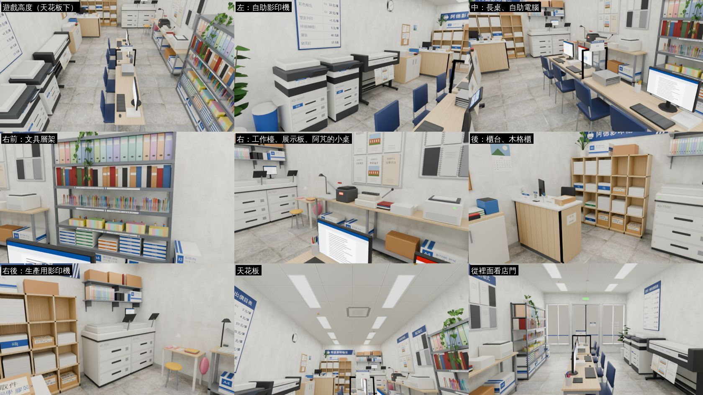

### 和參考圖差在哪（v1b 新增或變大的）
- 長桌比參考圖窄（0.5 m），椅子收在桌下，只有西側一排四張。參考圖的桌子比較寬，兩側都有椅子，大約 6 張。
- 左右兩排都比參考圖淺：自助影印機 0.58 m、工作檯 0.42 m。工作檯上的機器擠在一起。
- 櫃台比參考圖短（1.2 m）。參考圖的櫃台幾乎佔滿左後方。
- 其他照 v1：店比參考圖深、後牆遠；生產用影印機在後牆，看起來小；沒有白色門。

### 醜點（v1b 新增）
- 椅子收到桌下 0.2 m，從正側面看座墊前緣插在桌面下。真的椅子推進去也是這樣，但沒人坐時看起來有點擠。
- 阿芃的凳子不擋導航：她不在的時候，玩家走得過凳子（和舊配置一樣）。要擋的話，就得把小桌和凳子搬到別的地方。
- 東側走道沒有座位，整條只有層架、工作檯的互動，比西側空。
- v1 的其他醜點照舊：螢幕過亮、書包像浮著、生產用影印機小、價目表字淡、地磚有石紋。

### 還要在遊戲裡驗
- 這一版的格子檢查是在 Node 裡跑遊戲的 zones3d／engine3d（shopchk2），**不是瀏覽器**，也沒有真的走路。`tests/reachability_all.py`、遊戲裡的找路都沒跑。
- 打工 runShift 的站位換了。`wz_jobs.js` 的 `copy.desk` 要改成 (−0.2, −2.95)。

## 對應哪個區域
- 新的配置檔 `src/data/ade_layout.js`（全域 `ADE_LAYOUT.print`）對應遊戲的 **`wz_print`** 區域，也就是 `WZ_SHOPS_LAYOUT.print`。
  - layout 裡寫了 `id: 'wz_print'`、`zone: 'wz_print'`、`layoutKey: 'print'`。
  - 打工的 key `copy`（`src/data/wz_jobs.js`）、存檔 key 都沒動。
- 整合時要做的事：
  - 把 `WZ_SHOPS_LAYOUT.print` 的 `items`、`blocks`、`seats`、`interact`、`work` 換成 `ade_layout.js` 的，或者讓 `wzShop('print')` 改讀 `ADE_LAYOUT.print`。
  - `front`、`spawn`、`exit`、`enterAt`、`moved` 的數字和現在的 `print` 一樣，是抄過來的，沒有改。
  - 正式模型：`assets/models/env/second_ai/bb_support/ade.glb`。`ASSETS` 的 `bldg.wz_print_interior` 現在指向 LAWWW2 的舊檔 `wz_print_interior.glb`，換不換由 LAWWW 決定。舊檔留著當備用。
  - `src/data/wz_jobs.js` 的 `copy.desk` 現在是 (1.05, 0.9)，那是舊配置的櫃台缺口。換成這份配置時，要改成 layout `jobDesk` 的 (0.0, −3.0)，和 `staff_gate` 同一個位置。

## 尺寸與門窗（照 LAWWW2，沒改）
- 房間：4.4 × 9.2 × 3.0 m。外牆 0.12 m，所以內面是 x ±2.08、z ±4.48。店面那面牆在 +z＝4.6。
- 門：中心 x 0、寬 1.4（x −0.7～0.7）。LAWWW2 沒給門高，照窗頂用 2.5。
  - 室內做了一組關著的鋁框雙開玻璃門（`WALL_front_door_leaf_*`）。外觀那一側如果也做了門扇，可以刪掉室內這組。
- 窗：兩扇，x −2～−0.85、0.85～2，窗台 0.4、窗頂 2.5。鋁框、中間一支直框，玻璃上有一條藍線（照外觀圖）。
  - 左窗的玻璃上有白色貼字：影印・複印、掃描建檔、彩色列印、論文裝訂。從店裡看是反的，照外觀圖。
  - 門內側的玻璃上貼營業時間：「週一～週六 09:00–22:00、週日公休」，照 `places.js` 的 `wz_print`。
- `windowKeep`：兩扇窗後面 z 4.0～4.48 留空，給外觀那一側用。
- 出口 (0, 4.15)、出生點 (0, 3.9)。
  - 注意：`zones3d.js` 的 `wzShop` 會把出生點改成 z ≤ d/2 − 0.95＝3.65，因為 room() 的牆內 0.4 m 不能站。

## 檔案
| 檔 | 內容 |
|---|---|
| `src/data/ade_layout.js` | 配置。包含尺寸、門窗、windowKeep、spawn、exit、enterAt、camRef、燈（LED 平板燈 10 盞）、items（28 件）、blocks（22 個）、seats（7 個：客人 5、打工 1、阿芃 1）、interact（5 個）、npc（阿德 3 個站位、阿芃 1 個）、work（a／b／c／end）、jobDesk、價目（prices）、營業時間 |
| `tools/blender/env_second/bb_support/ade_tex.py` | 自製貼圖，輸出 `textures/gen/ade_{goods,alpha,emit,sign,ceil}.png` 和 `ade_atlas.json` |
| `tools/blender/env_second/bb_support/ade_interior.py` | 建模腳本，讀 layout，輸出 GLB 和 json。共用的工具函式（UM、Part、Proto、ccyl、clathe、crb…）照抄 corner_interior.py |
| `tools/blender/env_second/bb_support/ade_render.py` | Cycles 預覽。相機預設是 camRef；燈讀 layout.lights（每盞平板燈一個往下的面光）；窗、門外是天光；店門外有一片只給渲染用的背景板 |
| `assets/models/env/second_ai/bb_support/ade.glb`、`ade.json` | 輸出 |
| `docs/story_planning/CC/shots/model/ade/` | `ade_v1_ref_vs_render.jpg`（左參考、右渲染）、`ade_v1_overlay50.jpg`、`ade_v1_refmatch_cmp.jpg`＋`_report.json`、`ade_v1_views.jpg`（九個角度）、`ade_v1_views.json`。jpg 都小於 400 KB（最大 268 KB） |

重建：
```
python3 tools/blender/env_second/bb_support/ade_tex.py
/opt/blenv/bin/python tools/blender/env_second/bb_support/ade_interior.py -- --lib <env_second 資料夾>
/opt/blenv/bin/python tools/blender/env_second/bb_support/ade_render.py -- assets/models/env/second_ai/bb_support/ade.glb <輸出> [--views docs/story_planning/CC/shots/model/ade/ade_v1_views.json] --res 836x470 --samples 16
python3 <ref_match.py> <wz_ade_int> <輸出>/ade_ref.png <前綴>
```
- 渲染預設：平板燈每盞 25 W、窗 120 W、門 80 W、補光 30 W、發光 1.5、曝光 −1.0、燈色約 4500～5000K。
- PC 用 GPU 時：`CC_BLENDER_DEVICE=GPU CC_SAMPLES=64`。

## GLB 規格（Blender 讀回匯出的 GLB）
| 項目 | 數字 | 預算（LAWWW2 收緊後） |
|---|---|---|
| 三角形 drawn（含 instancing） | **18,560** | 50,000 |
| 網格本身 | 約 15.8k | |
| 材質 | **11** | ≤ 12 |
| 檔案 | **1.50 MB**（1,503,200 bytes） | 3 MB |

- 11 個材質：
  - `ad_floor_tile`：Poly Haven `large_floor_tiles_02`，調成淺灰 #b3b1ad，一片 60 cm
  - `ad_plaster`：`painted_plaster_wall`，白 #eceeeb
  - `ad_ceil`：自製輕鋼架天花板
  - `ad_wood`：`walnut_veneer`，調成淺木 #d8bf96（D112）
  - `ad_vc`、`ad_vc_metal`：頂點色，霧面、金屬
  - `ad_glass`：玻璃
  - `ad_alpha`、`ad_goods`、`ad_emit`、`ad_sign`：透明、印刷、會亮的、招牌
- instancing（14 個節點，已改名成 `<網格名>_inst`）：
  - LED 平板燈 10
  - 自助影印機 2
  - 長桌 2
  - 椅子 5
  - 生產用影印機 2
  - 辦公椅只有一張，沒有用 instancing。
- 遊戲裡要淡出的牆：`WALL_left_*`、`WALL_right_*`、`WALL_back_*`、`WALL_front_*`。
  - 價目表、公告板、時鐘、月曆放在左牆的組。
  - 鐵層架、黃金葛、兩塊展示板放在右牆的組。
  - 木格櫃、招牌、上面的盆栽、影印機上面的牆面鐵層板放在後牆的組。
  - 店面、門、貼字、出口燈放在店面那一組。
  - 這一版牆上沒有 instancing 的東西，所以 `_inst` 節點都沒有 `extras.dir`。
- 天花板（`ad_ceiling_ceil`）：單面，法線朝下。讀回 GLB 量過，兩個三角形的法線都是 −1；`use_backface_culling` 開著。
  - 天花板上的東西（`ad_ceilfx_*`：平板燈、冷氣、收邊、灑水頭、偵煙器）只做朝下的面，`single_side` 不幫它們補反面。
  - 例外：灑水頭、偵煙器的頂蓋還有 24 個很小（直徑 6 cm 以內）的朝上面。
- 夜間光暈：`GLOW_panel_*` 10 個，在每盞平板燈下面 0.1 m。
- `single_side` 照轉角唱片的設定：
  - 不補反面：`ad_(plaster|wood|floor_tile|ceil|goods|sign|alpha)`
  - 玻璃維持雙面。

## ref_match：五項 PASS（`shots/model/ade/ade_v1_refmatch_report.json`）
| 項目 | 參考 | v1 | 門檻 |
|---|---|---|---|
| 平均亮度 | 0.594 | 0.635 | 差 ≤ 0.08（差 0.041） |
| 對比 | 0.665 | 0.578 | ≥ 0.532 |
| 冷暖（R−B） | +0.035 | +0.024 | 差 ≤ 0.05（差 0.011） |
| 色票 ΔE | | 5.9 | ≤ 18 |
| 九宮格 | | 0.091 | ≤ 0.12 |

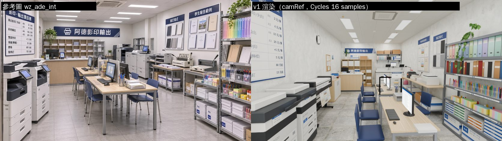
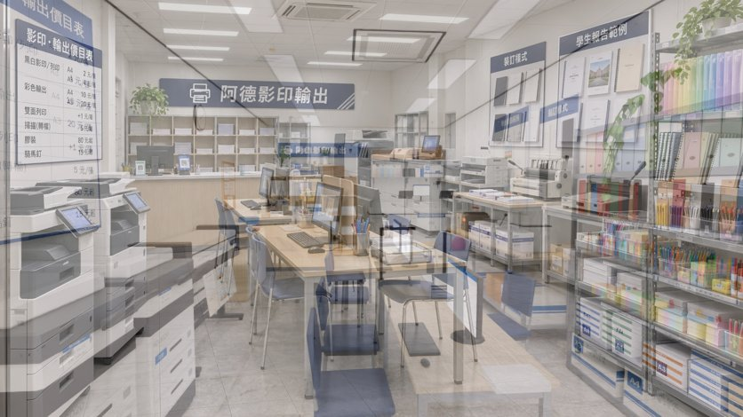
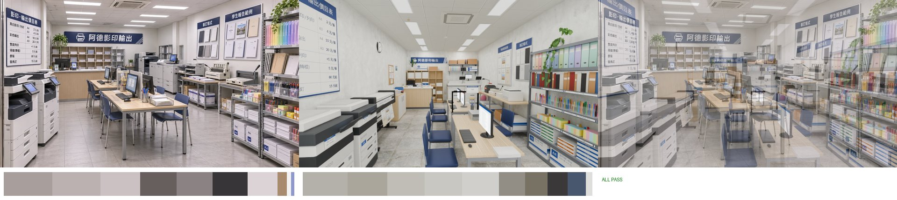
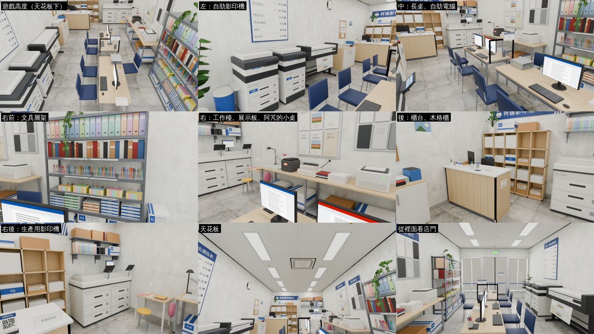

鏡頭（camRef）：眼睛 (−0.3, 1.62, 4.38)，看 (0.3, 1.1, −4.0)，18 mm。站在店門內側、長桌西邊往裡看，往下約 4°。
- 先試的 14 mm、站在門口中間：店看起來太深，左邊的影印機、右邊的層架只剩邊。
- 再試 20 mm、站在 z 3.6：影印機到了鏡頭旁邊，看不到。
- 最後退到牆內 0.1 m、用 18 mm：參考圖裡左邊兩台影印機、左上的價目表、右邊整座層架被畫面邊緣切到的樣子才對得上。

50% 疊圖：
- 大致對得上：
  - 左邊的影印機、左上的價目表
  - 中間的長桌和一排藍椅子
  - 右邊的鐵層架（最上面一排粉彩色資料夾）
  - 右牆兩塊展示板
  - 後牆的藍色招牌、木格櫃、櫃台
  - 天花板的平板燈和冷氣
- 對不上：
  - 後牆比參考圖遠、比參考圖小。店深 9.2 m 照現在的配置，參考圖的店看起來大約只有 6～7 m 深。
  - 參考圖中間偏右那兩台生產用影印機很顯眼；這裡它們在後牆右邊，看起來比較小。

## 拆圖清單（參考圖由左到右、由前到後）
| # | 是什麼 | 模型物件 | 做了 |
|---|---|---|---|
| 1 | 左牆藍框白底「影印・輸出價目表」（價錢照室內圖：黑白 A4 2／A3 4、彩色 A4 10／A3 20、雙面 +1、掃描 5、膠裝 80 起、騎馬釘 15 起） | `WALL_left_leftwall_deco_*` | ✓ |
| 2 | 自助影印機兩台：白機身、深灰掃描器、送稿機、觸控面板、四層紙匣、出紙口、手送紙盤 | `mfp_*_inst` | ✓ |
| 3 | 後牆左邊格櫃上的盆栽 | `WALL_back_cubby_plant` | ✓ |
| 4 | 後牆木格櫃（一格一格的紙）：參考圖 5 × 3，這裡做 5 × 4 | `WALL_back_cubby_*` | ✓ |
| 5 | 藍色招牌「阿德影印輸出」：印表機圖示、白色斜線 | `WALL_back_back_sign_sign` | ✓ |
| 6 | 木櫃台：淺木直條正面、白色檯面 | `counter` | ✓ |
| 7 | 櫃台上的電腦螢幕、鍵盤 | `counter_monitor`、`counter` | ✓ |
| 8 | 櫃台上的掃碼小牌（QR 是亂數畫的，不是任何真的支付） | `counter` | ✓ |
| 9 | 櫃台上的筆筒 | `counter` | ✓ |
| 10 | 櫃台上的小盆花 | `counter` | ✓ |
| 11 | 櫃台右後的灰色鐵架 | `WALL_back_back_wallshelf`（改成影印機上面的牆面鐵層板，見不同處 3） | △ |
| 12 | 生產用大型影印機兩台、操作螢幕 | `prod_*_inst` | ✓ |
| 13 | 影印機上面的小螢幕 | `prod_top` | ✓ |
| 14 | 後牆右邊的白色門 | — | ✗（見不同處 3） |
| 15 | 輕鋼架天花板 | `ceiling` | ✓ |
| 16 | LED 平板燈 | `ceilfx_panel_*_inst`（10 盞） | ✓ |
| 17 | 吸頂冷氣 | `ceilfx_ac` | ✓ |
| 18 | 淺木長桌兩張（灰色鐵腳） | `table_*_inst` | ✓ |
| 19 | 自助電腦三台：螢幕、鍵盤、滑鼠 | `pc_0..2` | ✓ |
| 20 | 深藍色椅子：參考圖約 6 張，這裡 5 張 | `chair_*_inst` | ✓ |
| 21 | 桌上的隔板 | `desk_items` | ✓ |
| 22 | 筆筒（各色的筆） | `desk_items` | ✓ |
| 23 | 鐵絲文件籃（裡面有紙） | `desk_items` | ✓ |
| 24 | 桌上的紙疊 | `desk_items` | ✓ |
| 25 | 「裝訂樣式」展示板（線圈本一本一本凸出來） | `WALL_right_rightwall_deco` | ✓ |
| 26 | 「學生報告範例」展示板（報告封面寫「首都帝大」，有校園照片的封面） | 同上 | ✓ |
| 27 | 工作檯：淺木、灰鐵腳 | `worktable` | ✓ |
| 28 | 雷射印表機 | `worktable` | ✓ |
| 29 | 線圈裝訂機（打孔把手、齒） | `worktable` | ✓ |
| 30 | 膠裝機 | `worktable` | ✓ |
| 31 | 裁紙刀：刻度底板、刀臂、紅把手 | `worktable` | ✓ |
| 32 | 工作檯下層的紙箱 | `worktable` | ✓ |
| 33 | 工作檯上的紙疊、裝訂好的報告 | `worktable` | ✓ |
| 34 | 灰色鐵層架（六層） | `WALL_right_stat_rack_*` | ✓ |
| 35 | 彩色資料夾（粉彩色一排） | 同上 | ✓ |
| 36 | 筆記本、活頁本、牛皮紙本 | 同上 | ✓ |
| 37 | 透明收納盒裡的筆、麥克筆 | 同上 | ✓ |
| 38 | 便利貼 | 同上 | ✓ |
| 39 | 口紅膠、修正帶 | 同上 | ✓ |
| 40 | 紙包（A4、A3、色紙） | 同上 | ✓ |
| 41 | A4／A3 紙箱（藍色標籤，沒有品牌） | 同上、`floor_boxes` | ✓ |
| 42 | 層架上面的黃金葛 | `WALL_right_rack_pothos` | ✓ |
| 43 | 淺灰地磚（60 cm） | `floor` | ✓ |
| 44 | 白牆 | `WALL_*_wall` | ✓ |
| 45 | 右邊那兩張高低不同的工作檯 | `worktable`（併成一張 3.1 m 的長檯） | △ |

**45 項：42 項 ✓、2 項 △、1 項 ✗。**

小道具超過 15 種：
- 筆、筆筒、鍵盤、滑鼠
- 紙疊、紙包、A4／A3 紙箱、牛皮紙箱、待取件的牛皮紙袋
- 掃碼付款小牌、叫人鈴
- 告示五種：列印請至櫃台付款、有事請按鈴、取件處、員工區 請勿進入、自助影印 黑白 A4 2 元
- 釘書機、回收盒、廢紙回收桶
- 便利貼、口紅膠、碳粉盒、資料夾、筆記本
- 軟木公告板（傳單：徵家教、雅房出租 溫州街、讀書會 民法總則、二手書 六法全書、社團招生）
- 時鐘、月曆
- 阿芃的習作、鉛筆盒、小檯燈、書包
- 夾燈、膠帶台、尺、手機
- 盆栽四盆：左前角的大葉盆栽、層架上的黃金葛、格櫃上的盆栽、櫃台的小花
- 營業時間貼紙、窗上的貼字、出口燈、腳踏墊

參考圖看不到、遊戲需要的東西：
- 阿芃寫功課的小桌和圓凳。舊配置就有，打工的劇情（阿芃睡著、外套蓋在她身上）會用到。
- 大圖輸出機。舊配置就有。
- 紙樣櫃
- 櫃台後面的辦公椅（打工的座位）
- 廢紙回收桶
- 軟木公告板

## 互動點、座位、站位（全部用格子檢查過）
| 種類 | 位置 | 說明 |
|---|---|---|
| `print` 印東西 | (−1.3, −2.2) | 櫃台前（客人） |
| `copier_self` 自助影印 | (−1.0, 3.1) | 前面那台影印機的北端 |
| `stationery` 買文具 | (1.25, 2.55) | 鐵層架前 |
| `staff_gate` 進櫃台（打工時） | (0.0, −3.0) | 櫃台東端 |
| `binding` 膠裝（打工時） | (1.05, −1.35) | 工作檯前 |
| 座位：客人 5 張 | | 西側四張（z 2.35、1.6、0.45、−0.3，面向 +x）、東側一張 (0.93, 1.45) |
| 座位：辦公椅 | (−1.6, −3.65) | 打工時坐 |
| 座位：阿芃 | (1.38, −2.85) | `npcOnly` |
| 阿德的站位 | (−0.8, −3.65)、(0.7, −3.3)、(1.05, −1.35) | 櫃台後面、生產用影印機前、工作檯前 |
| 打工 a／b／c／end | | me、boss、kid 都照舊有的格式，換到新的位置 |

- 舊的互動 kind 都保留了：`print`、`stationery`、`copier_self`、`staff_gate`、`binding`。
  - 這一版拿掉了草稿的 `plotter`（大圖輸出），因為它和長桌的椅子靠得太近。
  - 營業時間沒改。
- 導航格檢查（0.05 m 格、人物半徑 0.33、layout.blocks＋外牆內面）：
  - 可以走的 3,821 格全部連在一起，**孤島 0**。
  - 從出生點走得到每個互動點、每個站位，距離 0.03。
  - 客人的座位 0.56～0.58、辦公椅 0.57、阿芃 0.51，都是從椅子旁邊坐。
- **nearestInteractable**：照 `engine3d.js` 的判斷（距離在 radius 內取最近；互動 1.0、座位 0.9、出口 1.3）。
  - 站在每個互動點上，最近的都是它自己。
  - 從走道走到每張椅子旁邊時，最近的也是那張椅子。
  - 第一版的自助影印點在 (−0.98, 2.27)，站在前面那張椅子旁邊時，最近的是「自助影印」。所以挪到影印機北端，椅子也重新排過。
- 走道（LAWWW2 的店內標準：主走道 ≥ 0.8 m）：
  - 西側主走道：0.90～1.14 m
  - 長桌東側到工作檯：0.83 m；到層架：1.01 m
  - 長桌後面到櫃台：1.95 m
  - 進櫃台的缺口（櫃台東端到生產用影印機 A）：0.80 m
  - 櫃台後面的店員通道：0.83 m
  - 東側那張椅子把東側走道分成前後兩段，前段到層架、後段到工作檯，各自從前面、後面走得進去。
- 舊配置的註記寫「櫃台中間的缺口只剩一格，人走不進櫃台後面，下班要放回客人區」。**這一版櫃台後面從客人區走得進去**（櫃台東端開 0.8 m）。`work.end` 留著相容，位置在門口 (−0.55, 3.45)。

## 和參考圖不同的地方（每一處都寫原因）
1. **尺寸照現在的配置**（LAWWW2：不要動）：參考圖的店看起來比 4.4 m 寬、比 9.2 m 淺。
   - 所以左右兩排照圖排，中間的長桌往東靠，西側是主走道。
   - 主視角的後牆比參考圖遠、比參考圖小，鏡頭改用 18 mm。
   - 長桌只能放一排（0.65 m 寬）；參考圖的桌子比較寬，兩側都坐人。這裡東側只放一張椅子，不然東側走道會小於 0.8 m。
2. **店深多出來的地方，放舊配置原本就有的東西**：大圖輸出機、紙樣櫃、軟木公告板、阿芃的小桌。打工劇情會用到阿芃的位子。
3. **後牆右邊被生產用影印機佔滿**：參考圖右後那座灰色鐵架和白色門沒有位置。
   - 鐵架改成影印機上面的兩層牆面鐵層板（碳粉盒、資料夾、紙箱）。
   - 白色門沒有做。這間店的室內沒有要通到別的房間；要做的話要先改配置。
4. **遊戲必要**：
   - 櫃台東端開 0.8 m 讓人走進櫃台後面（打工）
   - 主走道 ≥ 0.8 m
   - 互動點之間留距離（nearestInteractable）
   - 自助影印的互動點在影印機北端，不在兩台中間
5. **品牌（D77）**：
   - 影印機、印表機、紙箱、電腦都沒有品牌；影印機的型號寫虛構的「AD-3020」「AD-7500」，大圖輸出機寫「AD-PLOT 36」。
   - 掃碼付款的 QR 是亂數畫的，牌子只寫「掃碼付款」，沒有任何支付品牌。
   - 報告範例上的學校寫「首都帝大」（D115）。
6. **價目**：照 AA_654 用室內圖那一份（黑白 A4 2 元）。外觀圖的價目表寫黑白 NT$1／頁，兩張不同。外觀那張是 LAWWW2 的，要 AA 或 LAWWW2 統一。layout 的 `prices` 和 `pricesNote` 有寫。
7. **門**：參考圖看不到店門。室內做了關著的鋁框雙開玻璃門，照外觀圖。

## 醜點清單
- 已經修掉的：
  - 第一版太亮、像白色模型屋：曝光、燈都調過，平均亮度 0.775 降到 0.635。
  - 第一版用 `fine_grained_wood` 調淺，看起來像粒片板。改成 `walnut_veneer` 調淺木色，表面是細的直紋。
  - 影印機一整台都是白的：參考圖的掃描器、出紙口那一段、最下面一格紙匣是深灰，已經照改。
  - 天花板的平板燈框、冷氣、收邊原本是方盒，`single_side` 又補了反面，遊戲鏡頭從天花板上面往下看時會看到一格一格的黑框（「遊戲高度」那一張第一次渲染就是這樣）。改成只有朝下的面、不補反面。
  - 價目表左上角被畫面切掉：從影印機後面挪到影印機上面（z 2.05）。
  - 後牆的鐵層板和招牌重疊：招牌改短（2.1 m）。
- 還醜、沒修的：
  - 三台自助電腦的螢幕在渲染裡過亮，幾乎是一片白；參考圖的螢幕是藍色介面。螢幕和平板燈共用一個發光材質，分開要多一個材質。
  - 阿芃的書包是一個粉紅色的橢球，貼在小桌邊上，近看像浮在空中。
  - 主視角裡，參考圖中間偏右那兩台生產用影印機很顯眼；這裡在後牆，看起來小。
  - 長桌比參考圖窄，只有西側一排椅子（見不同處 1）。
  - 價目表在主視角裡字比參考圖淡：左牆被窗光打得很亮。
  - 灑水頭、偵煙器的頂蓋還有 24 個很小的朝上面，從天花板上面看是幾個小點。
  - 地磚是 Poly Haven 的石材地磚調淺，近看有一點石紋，參考圖是很乾淨的磁磚。
  - 參考圖的影印機是從正面看到觸控面板；這裡從門口看，兩台影印機是側面朝鏡頭（它們面向東，和參考圖一樣），觸控面板比較小。

## 要在遊戲裡驗的東西（給 LAWWW2／LAWWW）
沒進遊戲、沒開瀏覽器（規定）。以下都要在遊戲裡驗：
- 換到新配置以後跑：
  - `node tests/wz_shops_unit.js`
  - `tests/reachability_all.py`
  - 遊戲自己的 NavGrid（0.4～0.5 m 格）會不會比我的 0.05 m 格更擠，尤其櫃台東端 0.8 m 的缺口和櫃台後面 0.83 m 的通道
- 打工 runShift 的 a／b／c 站位、阿芃坐的位子（`npcOnly`）、`work.end`。
- `wz_jobs.js` 的 `copy.desk` 要跟著改。
- 牆的淡出：
  - 左牆的價目表、公告板
  - 右牆的鐵層架、展示板
  - 後牆的格櫃、招牌、鐵層板
  - 店面的門、貼字、出口燈
- 天花板從遊戲鏡頭（camDist 4.0，在天花板上面）看：天花板、`ad_ceilfx_*` 應該都看不到。
- 單面材質從遊戲鏡頭看有沒有破面。
- 夜間光暈 `GLOW_panel_*`。
- 阿德影印是日光燈（`cool:true`），光照烘焙由 LAWWW2 做。
- 和外觀 GLB 的門窗對齊。我照 LAWWW2 給的數字做，沒有拿外觀 GLB 疊過。
- 手機上的效能：葉片卡、紙疊（很多小方盒），三角形總數只有 1.9 萬。

## 授權
- Poly Haven CC0：`large_floor_tiles_02`、`painted_plaster_wall`（共用資料夾）、`walnut_veneer`（LICENSES 裡已有）。
- 其他貼圖都是 `ade_tex.py` 程式畫的：價目表、展示板、紙箱、資料夾、傳單、螢幕畫面、天花板、招牌。
- 字型是文泉驛正黑（GPL＋字型例外，嵌進圖片可以）。
- 植物的模型葉子用 `tools/blender/plants.py`。
- 請 LAWWW2 在 LICENSES 補一行「阿德影印室內自製貼圖」。
