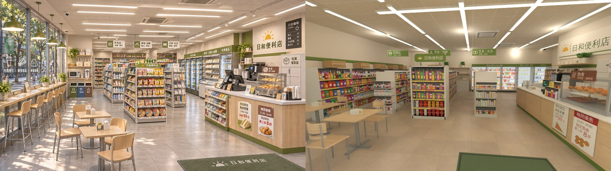
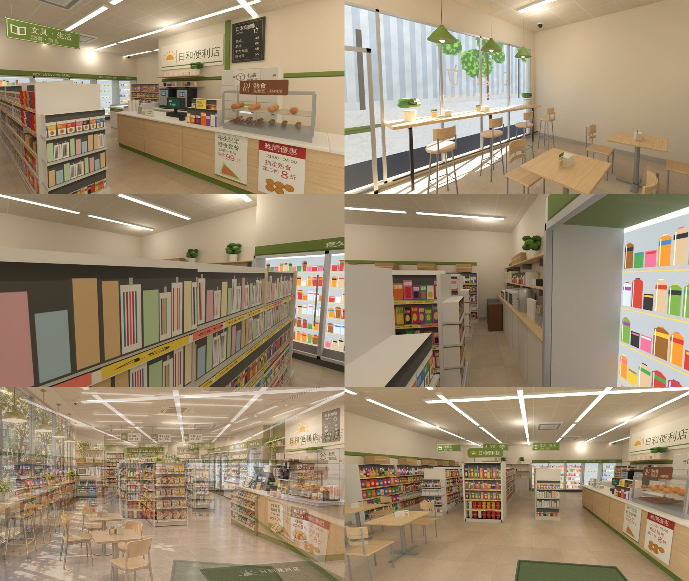
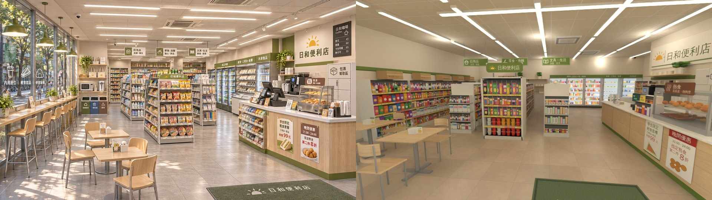
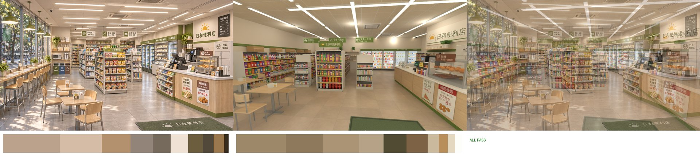
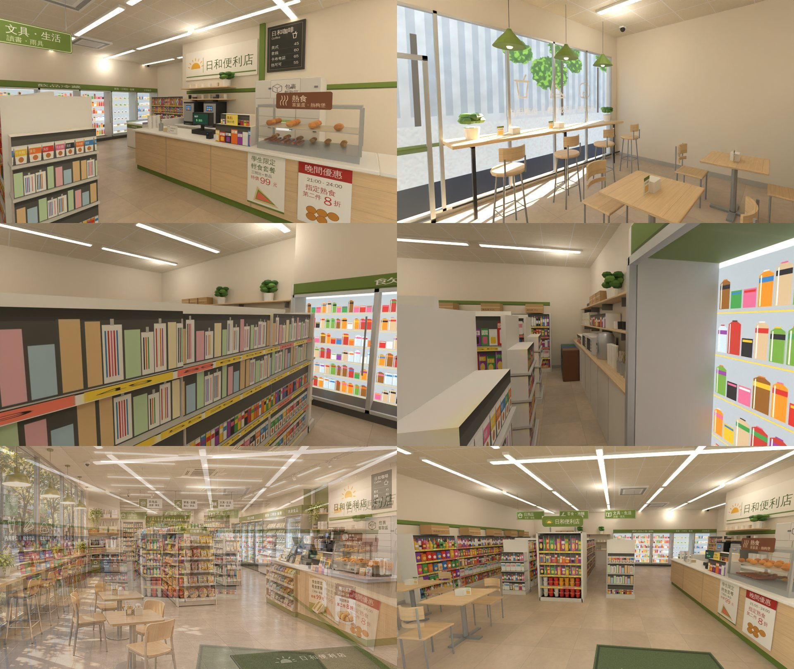
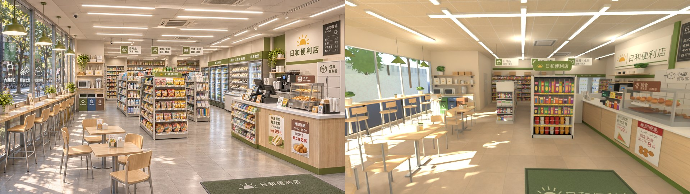
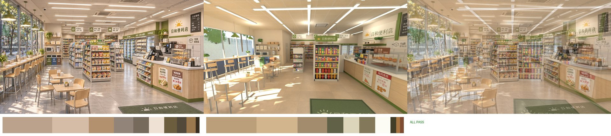
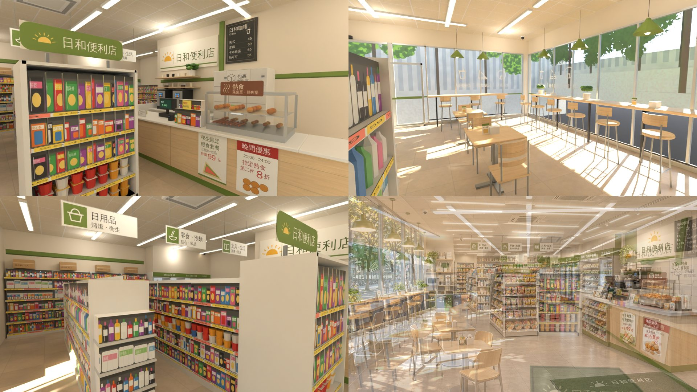

# 日和便利店（cvs 區域，原「日日便利」，AA_647 G03）室內：BB（帳號 A）2026-11-04

- **v2b（2026-11-04）**：LAWWW2 把 v2 接進遊戲後量到，三排貨架之間的走道只有 0.8 m，只有中線站得住（P1）。這一版只把貨架往兩邊挪開。
  - 現在的 GLB、`cvs_layout.js`（version 4）是 v2b。
  - v2 的 GLB 在 commit `53275eaf4`。

## v2b（11-04）：加寬貨架走道

### 改了什麼
- 三排貨架中心 x：−3.2、−1.6、0.0 → **−3.7、−1.7、0.3**，寬照舊 0.8。
- 第二排的端架（寬 1.2）跟著移到 x −1.7（−2.3～−1.1），吊牌也跟著貨架移。
- `cvs_layout.js` 只改 gondolas 的 x，blocks 會自己重算，版本升到 4。
- `cvs_interior.py` 沒有改，照同一份配置重出 GLB。
- 窗沒有動，窗景由 LAWWW2 重拍。

### 走道（用 node 讀配置量的；人的半徑 0.33 m）
| 走道 | 寬 | 站得住的寬度（中心可以放的範圍） |
|---|---|---|
| 西牆壁架 → 第一排 | 1.05 m | 0.39 m |
| 第一排 → 第二排 | 1.20 m | 0.54 m |
| 第二排 → 第三排 | 1.20 m | 0.54 m |
| 第三排 → 櫃台（x 1.9） | 1.20 m | 0.54 m |

- 站得住的寬度，是沿 z −3.6～0.3 每 0.1 m 量一次取最小值。v2 時是 0.8 − 0.66 ＝ 0.14 m，所以只有中線站得住。
- 端架那一段（z 0.6～0.87）比較窄：第一排的端面到端架 1.0 m，端架到第三排的端面也是 1.0 m。
- **結帳排隊**：(1.5, 0.75)、(1.5, 1.25)、(1.5, 1.75)、(1.5, 2.25) 都站得住，可以沿櫃台往店門排。(1.2, 0.75) 也可以站。
- **內用桌 2 到端架**：桌面邊緣到端架 1.39 m，符合 ≥ 1.2。但從靠端架那張椅子的導航阻擋邊緣量，只有 0.99 m。
- 所有互動點和 spawn 都不在阻擋裡。

### 補一步：內用桌 2 往門那邊移
- 內用桌 2 從 (−2.7, 3.0) 移到 **(−2.7, 3.22)**。
  - 改量法：以椅子的導航阻擋為準，靠端架那張椅子的阻擋邊緣到端架是 **1.21 m**（≥ 1.2）。
  - 移 0.2 m 只到 1.19 m，所以多移 0.02 m。
- 用 node 量（同一份配置）：
  - 不擋門進來那一條直線：x 0.4～1.2、z 5.0～1.4 全部站得住；桌子連椅子的 x 範圍是 −3.06～−2.34，門在 x −0.56～1.36。
  - 不擋結帳排隊那一列（x 1.5）。
  - 離門口地墊 1.89 m、離出口 (0.4, 5.0) 2.92 m（都 ≥ 0.8）。
  - 兩個座位、所有互動點、spawn 都不在阻擋裡；四條走道照舊 1.05／1.2／1.2／1.2 m。
  - 遠端那張椅子的阻擋到正面吧台高腳椅的阻擋只有 0.36 m，人過不去；但兩邊的座位都從別的方向走得到，不影響。
- 只動了座位，構圖沒變（同角度圖裡桌子位置差 0.22 m），所以 ref_match 沒有重跑，數字照下表。
- GLB 重出：5.13 MB、56,880 三角形、12 材質。

### ref_match（同角度鏡頭照 v2：(−0.2, 1.7, 5.4) 看 (−1.4, 0.4, −5.5)、15 mm；`--exposure -1.0`）
| 項目 | 門檻 | 參考圖 | v2b | 結果 |
|---|---|---|---|---|
| 平均亮度差 | ≤ 0.08 | 0.586 | 0.528 | PASS |
| 對比 | ≥ 參考 × 0.8（0.473） | 0.591 | 0.566 | PASS |
| 冷暖（R−B）差 | ≤ 0.05 | +0.172 | +0.192 | PASS |
| 色票平均 ΔE | ≤ 18 | — | 6.4 | PASS |
| 九宮格亮度差 | ≤ 0.12 | — | 0.078 | PASS |

**ALL PASS**。

### 交件
- 同角度比較：`cvs_v2b_ref_vs_render.jpg`
- ref_match：`cvs_v2b_refmatch_cmp.jpg`、`cvs_v2b_refmatch_report.json`
- 其他角度：`cvs_v2b_views.jpg`
- GLB 規格（和 v2 相同）：5.13 MB、56,880 三角形、12 材質、18 個 draw call，見 `glb_specs.json`。

---

# v2（留著對照）

- **v2（2026-11-04）＝MODEL_READY（LAWWW2）；已被 v2b 取代（走道加寬）**：LAWWW2 退回 v1b，照七點改。**現在的 GLB、`cvs_layout.js`（version 3）是 v2**。
  - v1b 的 GLB 在 commit `e5d939078`，v1 的在 `affe19017`；兩版的圖和說明都留在下面。
- 模型收件、`ART_APPROVED` 都由 LAWWW2 驗收、標記（這間是 BB 做的，AA_647 第 3 節）。

## v2（11-04）

### 交件
- `cvs_v2_ref_vs_render.jpg`：參考圖｜同角度渲染。
- `cvs_v2_refmatch_cmp.jpg`、`cvs_v2_refmatch_report.json`：ref_match 比對圖（含 50% 疊圖）和報告。
- `cvs_v2_views.jpg`：其他角度。
  - 第一列：櫃台與標誌牆、窗前吧台與三盞吊燈。
  - 第二列：貨架與冷藏櫃、後牆左半層架。
  - 第三列：疊圖、同角度渲染。
- GLB：`assets/models/env/second_ai/bb_support/cvs_interior.glb`，規格在 `glb_specs.json`（v2）。

### GLB 規格
| 檔案 | 大小 | 三角形 | 材質 | draw call | 貼圖 |
|---|---|---|---|---|---|
| `cvs_interior.glb`（v2） | 5.13 MB | 56,880 | 12 | 18 | 9 張 webp，747 KB |

- 三項都在預算內（≤ 6 萬三角形、≤ 12 材質、≤ 6 MB），但都很接近上限：
  - 三角形只剩約 3 千；
  - 大小只剩約 0.9 MB。
- 再加東西之前要先減面。例如近景的瓶子、杯麵可以改成 instancing。

### ref_match（960 × 540、32 取樣）
- 鏡頭：眼睛 (−0.2, 1.7, 5.4) 看 (−1.4, 0.4, −5.5)，15 mm。
- 渲染：`render_cycles.py --view Standard --exposure -1.0`，白天天空＋9 盞 30 W 點光源。
- **沒有光斑、樹影的卡片**，以 GLB 實際的樣子為準。窗外只有正面一張街景卡片（`--preview`），西牆是實牆。

| 項目 | 門檻 | 參考圖 | v2 渲染 | 結果 |
|---|---|---|---|---|
| 平均亮度差 | ≤ 0.08 | 0.586 | 0.530 | PASS |
| 對比 | ≥ 參考 × 0.8（0.473） | 0.591 | 0.568 | PASS |
| 冷暖（R−B）差 | ≤ 0.05 | +0.172 | +0.192 | PASS |
| 色票平均 ΔE | ≤ 18 | — | 6.5 | PASS |
| 九宮格亮度差 | ≤ 0.12 | — | 0.077 | PASS |

**ALL PASS**。

### 改了什麼（LAWWW2 的七點）
1. **中後段三排雙面貨架**
   - 三排：x −3.2（日用品）、−1.6（零食，靠門那頭是端架）、0.0（泡麵、沖泡、文具）。
   - 位置 z −3.8～0.6，每排寬 0.8、高 1.65。
   - 每面 5 層，商品塞滿；兩頭的端面也有商品。
2. **後牆右半整排冷藏櫃**
   - 位置 x −0.25～5.6，高 2.2，面向店門，共 5 扇玻璃門：
     - 飲品冷藏 3 扇；
     - 鮮食・三明治・飯糰 1 扇；
     - 冷凍食品 1 扇。
   - 裡面是發光貼圖（`GLOW_cvs_cooler`，發光強度 2.0，比 v1b 亮），綠色頂框寫字。
3. **後牆左半層架**（x −5.5～−0.45）
   - 下面是矮櫃，檯面上有：微波爐兩台、熱水瓶、紙杯疊、湯匙／筷子／吸管筒、餐巾紙、咖啡沖泡包。
   - 上面兩層木層板：環保袋 4 個（太陽標誌）、咖啡豆和即溶咖啡、馬克杯、咖啡豆罐、紙箱、盆栽。
   - 前面是三色回收桶。
   - 貨架頂上的分類吊牌改成**綠底白字**：日用品／零食・泡麵／文具・生活，在印刷圖集新增 `hangG0`～`hangG2`。
4. **窗前吧台上方三盞綠色吊燈**
   - 吧台在正面左段落地窗前：x −5.2～−1.6，高腳椅 4 張。
   - 吊燈在 x −4.45／−3.4／−2.35、z 5.05。
5. **光**
   - 曝光從 v1b 的 −1.1 加上 9 盞點光源，改成 −1.0 加 30 W；拿掉太陽穿過葉子的卡片之後，畫面暗了很多，對比也出來了（陽光照到的發白不見了）。
   - 商品圖集的顏色照舊，在比較暗的光下看得出來。
6. **近景真包裝**
   - 每排貨架靠門那一段（1.1 m），每一層最前面一排是真的模型：
     - 瓶裝（瓶身＋標籤）
     - 杯麵（前排疊兩個）
     - 袋裝（枕頭形、上緣封口、正面一塊亮色）
     - 罐裝
   - 後面和遠的還是貼圖方塊。
   - 西牆壁架、右牆壁架、端架的近景也一樣。
7. **西牆改成實牆**
   - 不開窗（隔壁是頁間書屋），牆上是整面壁架：z −4.2～1.8，高 1.8，放日用品、零食、飲料，頂上有紙箱。
   - 窗只留正面，照外觀做：x −5.3～−0.66、1.46～2.93；左段 −5.3～−1.45 是吧台座位區。

### 配置（`src/data/cvs_layout.js` version 3）
- 尺寸 11.2 × 11 × 3.3。
- blocks 27 個、seats 8 個（窗前吧台 4、內用桌 2 × 2）、interact 6 個。
- 和 v1b 不一樣的：
  - 員工室拿掉了（西牆實牆、後牆左半是層架）；
  - 櫃台旁的小貨架拿掉了（和第三排貨架之間太窄）；
  - 微波加熱 (−3.0, −4.5)；
  - 冷藏櫃 (1.5, −4.4)。
- 照舊：
  - 出口 (0.4, 5.0)、spawn (0.4, 4.5)、結帳 (1.5, 0.75)；
  - 櫃台 x 1.9～2.65、標誌牆 x 3.75、包裹暫取櫃在標誌牆前（店員幫拿）。

### 和參考圖不同的地方（v2）
1. **門窗照外觀**
   - 參考圖的左側整排窗，在這裡是正面左段的窗加窗前吧台。
   - 西牆是實牆加壁架，所以同角度圖的左邊是壁架，不是窗。
2. **吧台、吊燈在鏡頭後面**：同角度鏡頭站在店門內，正面窗前的吧台和三盞吊燈在鏡頭旁邊、後面，拍不到，另外拍在 `cvs_v2_views.jpg` 第一列右邊。
3. **標誌牆、包裹櫃**：照 v1b，標誌牆在櫃台後面、牆後是倉庫，包裹暫取櫃由店員幫拿。
4. **地墊往店裡挪**：在 z 2.95～4.15，對位鏡頭才拍得到。

### 還不夠好的地方（v2）
- 預算很緊：三角形 56,880、5.13 MB。
- 冷藏櫃離鏡頭約 10 m，而且被貨架擋住下半，比參考圖小。
- 西牆壁架在同角度圖裡佔掉左邊很大一塊，參考圖那裡是亮的窗。
- 近景只有最前面一排是真的模型，第二排以後還是貼圖方塊，斜看是平的。
- 後牆左半層架的東西（微波爐、熱水瓶）在同角度圖裡很小、被貨架擋住。
- 只有 Blender 渲染，還沒有遊戲截圖、手機模擬。

---

# v1b（留著對照）

- **v1b（2026-11-04）＝已被 v2 取代**（LAWWW2 退回）：BB 看過 v1 的同角度圖退回（構圖差太多），也對齊 LAWWW2 的外觀 v1。**現在的 GLB、`cvs_layout.js`（version 2）是 v1b**；v1 的圖和說明留在下面（v1 的 GLB 在 commit `affe19017`）。
- 模型收件和 `ART_APPROVED` 都由 LAWWW2 驗、LAWWW2 標（這間是 BB 自己做的，AA_647 第 3 節）。

## v1b（11-04）

### 交件
- 同角度：`cvs_v1b_ref_vs_render.jpg`（參考圖｜渲染）
- ref_match：`cvs_v1b_refmatch_cmp.jpg`（含 50% 疊圖）、`cvs_v1b_refmatch_report.json`
- 其他角度：`cvs_v1b_views.jpg`（櫃台與標誌牆、窗邊吧台、貨架與冷藏櫃；右下是參考圖和渲染 50% 疊圖）
- GLB：`assets/models/env/second_ai/bb_support/cvs_interior.glb`，規格 `glb_specs.json`（v1b）

### GLB 規格
| 檔案 | 大小 | 三角形 | 材質 | draw call | 貼圖 |
|---|---|---|---|---|---|
| `cvs_interior.glb`（v1b） | 3.33 MB | 38,244 | 12 | 20 | 9 張 webp（2048² × 3、1024² × 4、512² × 2），730 KB |

- 材質和 v1 相同（12 個，發光的都以 `GLOW_` 開頭）。
- 新增兩個不合併的物件 `GLASS_front`、`DECAL_front`：正面的玻璃和貼紙。照規則它們不進淡出群組（放在 root），但分開一個物件，鏡頭在店外時可以單獨藏起來。

### ref_match（960 × 540、32 取樣）
- 鏡頭：眼睛 (−0.5, 1.72, 5.4)，看 (−0.9, 0.35, −5.5)，14 mm，16:9。
- 渲染：`render_cycles.py --view Standard --exposure -1.1`，白天天空＋太陽，9 盞 40 W 點光源。
- 用 `--preview`：窗外有街景卡片和行道樹葉子卡片（正式 GLB 沒有）。太陽穿過葉子，地上有暖色光斑和樹影。

| 項目 | 門檻 | 參考圖 | v1b 渲染 | 結果 |
|---|---|---|---|---|
| 平均亮度差 | ≤ 0.08 | 0.586 | 0.609 | PASS |
| 對比 | ≥ 參考 × 0.8（0.473） | 0.591 | 0.658 | PASS |
| 冷暖（R−B）差 | ≤ 0.05 | +0.172 | +0.204 | PASS |
| 色票平均 ΔE | ≤ 18 | — | 8.7 | PASS |
| 九宮格亮度差 | ≤ 0.12 | — | 0.084 | PASS |

**ALL PASS**。

### 改了什麼（BB 的六點＋LAWWW2 外觀）

**外觀對齊**（LAWWW2 外觀 v1：`claude/second-ai-env-art` 8de87af16，`docs/art-rebuild/second_ai/wip/gongguan4/README.md`）
- 尺寸改成 **11.2 × 11 × 3.3**：寬照外觀；v1 是 10 × 14。外觀一樓到 3.85，室內做到 3.3 加天花板。
- 自動門 x −0.56～1.36：門高 2.13，上面固定玻璃和橫框到 2.73。
- 正面落地窗 x −5.3～−0.66、1.46～2.93，窗高 0.08～2.73；−5.6～−5.3 是轉角柱，2.93～5.6 是白牆。
- 正面左段（外觀的內用座位區）放一排吧台：x −4.4～−1.6，高腳椅 3 張。
- 西牆照舊開整排落地窗、做窗邊吧台（7 張），撐起參考圖「左側整排窗」。遊戲裡這是中間的店，西牆窗外的景由 LAWWW2 決定。

**BB 的六點**
1. **前景**
   - 端架正對店門：x 0.4，寬 1.2、高 1.85，頂上綠色「日和便利店」招牌 1.15 m；下兩層是泡麵碗（真的模型，前排疊兩個），上三層是零食。
   - 兩組內用小方桌在左前，每組兩張椅子。
   - 門口綠色地墊在右下：z 2.95～4.15（往店裡挪，對位鏡頭才拍得到）。
2. **深度**
   - 深 14 → 11。冷藏櫃改到後牆右段、面向店門：x 1.9～5.6，飲品冷藏 2 扇、鮮食・三明治・飯糰 1 扇、冷凍食品 1 扇，綠色頂框。
   - 貨架改成 z −3.6～1.55。後牆壁架 x −2.9～1.8。
3. **右側辨識點**
   - 櫃台往左移到 x 1.9～2.65，地墊就在櫃台頭前面，和參考圖一樣。
   - 櫃台後面加一道標誌牆（x 3.75，z −1.05～3.85），牆後是倉庫，關著。
   - 牆上有太陽＋「日和便利店」標誌、綠色柱子、日和咖啡價目黑板。
   - 黑板下面是包裹暫取區櫃：在櫃台後面，店員幫客人拿。外觀那幾個置物櫃在店外白牆前，室內不重複。
   - 櫃台後面有咖啡機兩台；熱食櫃裡是炸物（雞塊、炸雞、可樂餅）、熱狗。
4. **貨架**
   - 商品塞滿：段距 0.8 cm、上方留 1.5～3.5 cm、深度 86～96%。
   - 三張吊牌排成一列（z −0.7）、放大到 1.05 m。
5. **窗**
   - 窗框直條改成每 0.9 m 一條、寬 4 cm，拿掉中間的橫框。
   - 陽光和樹影只有渲染有（`--preview` 的葉子卡片＋太陽），正式 GLB 沒有。
6. **椅子**：內用椅和高腳椅都改成彎椅背的淺木椅（弧形板，內用椅兩片）。

### 配置（`src/data/cvs_layout.js` version 2）
- blocks 36 個、seats 14 個：西窗吧台 7、正面吧台 3、內用桌 2 × 2。
- interact 6 個：結帳、熱食櫃、日和咖啡、包裹暫取（在櫃台）、微波加熱、冷藏櫃。
- 舊座標要改的（LAWWW2／LAWWW）：
  - 出口 (0, 4.2) → (0.4, 5.0)
  - spawn (0, 3.5) → (0.4, 4.5)
  - 結帳 (3.2, −0.6) → (1.5, 0.75)
  - room 的 w／d／h 改成 11.2 × 11 × 3.3
  - 從溫州街進來的 spawn 也要改
- 公館的店門互動點照外觀 v1，在門中心。
- 員工區（櫃台後面）和倉庫整塊擋：店員站在 (2.9, 0.75)，店員走道 x 2.65～3.15 只有 0.5 m 寬。

### 和參考圖不同的地方（v1b）
1. **門和窗照外觀**：門在正面中間偏左，正面左段多一排吧台。對位鏡頭站在正面吧台旁邊；地墊往店裡挪到 z 2.95，所以前面離門 1.35 m 沒有地墊。
2. **包裹暫取櫃放在櫃台後面**：參考圖在熱食櫃右後方，可能是客人自己拿的；這裡做成店員幫拿。
3. **冷藏櫃在後牆右段**：參考圖是從右牆斜著看過去；這裡在對位鏡頭裡被文具架、端架擋住一部分，只看得到上半和綠色頂框。
4. **櫃台後面多一道標誌牆**：參考圖的標誌在右牆，這裡為了讓標誌、黑板進對位鏡頭，做成櫃台後面的牆，牆後是倉庫。
5. **參考圖是 AI 圖**：透視比較誇張。對位鏡頭用 14 mm 超廣角，邊緣比參考圖拉長。

### 還不夠好的地方（v1b）
- 冷藏櫃在對位鏡頭裡還是比參考圖小、被擋住一部分。
- 咖啡價目黑板在對位鏡頭的右上角被裁掉一半。
- 商品還是大多為貼圖方塊，近看是平的。
- 渲染比參考圖亮一點、暖一點（冷暖 +0.204，參考 +0.172）；陽光照到的地方發白。
- 店員走道只有 0.5 m。
- 只有 Blender 渲染，還沒有遊戲截圖、手機模擬。

---

# v1（留著對照）

- **v1＝已被 v1b 取代**（BB 退回：前景太空、後段太遠；GLB 在 commit `affe19017`）。
- **模型收件（MODEL_READY）由 LAWWW2 驗；這間是 BB 自己做的，`ART_APPROVED` 也由 LAWWW2 標**（AA_647 第 3 節）。BB 不自己驗。
- 參考圖（就是規格）：`docs/story_planning/ref_images/shops/gongguan_cvs_int.webp`；外觀 `gongguan_cvs_ext.webp`（轉角店：左邊側面整排落地窗、正面自動門）。

## 交件
| 檔案 | 內容 |
|---|---|
| `assets/models/env/second_ai/bb_support/cvs_interior.glb` | 正式 GLB（窗外沒有街景卡片） |
| `src/data/cvs_layout.js` | 配置 v1（Blender 用 node 讀同一份）：尺寸、門窗、blocks 30 個、seats 13 個、interact 6 個、spawn、exit、clerk、lights |
| `tools/blender/env_second/bb_support/cvs_interior.py` | 建模腳本（`/opt/blenv/bin/python tools/blender/env_second/bb_support/cvs_interior.py [-- --out <glb>] [--preview]`；要在美術線 worktree 跑：用 `lib2.py`、`b3lib.py`） |
| `tools/blender/env_second/bb_support/cvs_tex.py` | 貼圖（PIL＋numpy，跑腳本時自動產生到 `tools/blender/env_second/textures/gen/cvs/`）：地磚、天花板、橡木、印刷圖集、商品圖集、冷藏櫃發光圖、螢幕、玻璃貼紙；共用 `shaola_tex.py` 的雜訊與字型 |
| `cvs_v1_ref_vs_render.jpg` | 參考圖｜同角度渲染 |
| `cvs_v1_refmatch_cmp.jpg`、`cvs_v1_refmatch_report.json` | ref_match：參考圖｜渲染｜50% 疊圖＋色票 |
| `cvs_v1_views.jpg` | 其他角度：櫃台與標誌牆、窗邊吧台、貨架與後牆、右下＝參考圖和渲染 50% 疊圖 |
| `glb_specs.json` | GLB 規格（已換成 v1b；v1 的數字在下表） |

## GLB 規格（SCENE_RULES §10：≤ 6 萬三角形、≤ 12 材質、≤ 6 MB）
| 檔案 | 大小 | 三角形 | 材質 | draw call | 貼圖 |
|---|---|---|---|---|---|
| `cvs_interior.glb` | 3.42 MB | 39,602 | 12 | 19 | 9 張 webp（2048² × 3、1024² × 4、512² × 2），730 KB |

- 材質 12 個：`cvs_floor`（淺灰石紋 60 cm 地磚＋粗糙度圖）、`cvs_ceiling`（單面朝下）、`cvs_wood`（淺色橡木）、`cvs_print`（印刷圖集）、`cvs_goods`（商品圖集）、`cvs_vc`（頂點色）、`cvs_vc_metal`（頂點色金屬，金屬度 0.45）、`cvs_glass`（alpha 0.08，props `glass:1`）、`cvs_decal`（玻璃貼紙，透明貼圖）、`GLOW_cvs_led`（燈條、吊燈燈泡）、`GLOW_cvs_cooler`（冷藏櫃裡面）、`GLOW_cvs_screen`（收銀機、咖啡機、包裹櫃螢幕、熱食櫃燈）。
- 金屬度都 ≤ 0.45；沒有 instancing（合併以後只有 19 個 draw call）。
- 淡出牆：`WALL_front／back／left／right`（props `dir`），右牆的標誌、咖啡黑板、綠色柱子跟著右牆淡出；**玻璃不在淡出群組**（放在 root）。
- 舊的程序化 cvs 用的材質名 `cvs_led`、`cvs_cooler_light`、`cvs_goods`、`cvs_poster`（zones3d.js 的 `attachCvsInterior`、`CVS_BOUNCE`）和這版不一樣：這版發光的材質都以 `GLOW_` 開頭、商品是貼圖不是頂點色。**LAWWW2 接的時候 `attachCvsInterior` 要跟著改**（或照 `GLOW_` 前綴通用處理）。

## ref_match（960 × 540、32 取樣）
鏡頭：眼睛 (0.2, 1.6, 6.6) → 看 (−2.2, 0.4, −7.0)、15 mm、16:9；`render_cycles.py --view Standard --exposure -0.5`，白天天空＋9 盞 30 W 點光源（燈條位置 x −4.2／−0.6／3.0 × z −4.5／0／4.5、高 3.0）；`--preview` 的窗外街景卡片。

| 項目 | 門檻 | 參考圖 | v1 渲染 | 結果 |
|---|---|---|---|---|
| 平均亮度差 | ≤ 0.08 | 0.586 | 0.618 | PASS |
| 對比 | ≥ 參考 × 0.8（0.473） | 0.591 | 0.547 | PASS |
| 冷暖（R−B）差 | ≤ 0.05 | +0.172 | +0.155 | PASS |
| 色票平均 ΔE | ≤ 18 | — | 6.6 | PASS |
| 九宮格亮度差 | ≤ 0.12 | — | 0.059 | PASS |

**ALL PASS**。數字只量光和顏色；構圖的差距見「和參考圖不同的地方」。

## 12-1 拆圖清單（室內參考圖，從左到右、由前到後；■＝做到）
| # | 東西 | 位置 | 顏色 | 模型物件 | 狀態 |
|---|---|---|---|---|---|
| 1 | 左邊整排落地窗、鋁窗框（直的 6 格＋腰帶） | 左 | 鋁 #c6cacc | `WALL_left_vm`、`cvs_glass` | ■（西牆 z −2.75～7） |
| 2 | 窗上的白色貼紙「內用座位｜輕食飲品｜便當新鮮」＋杯子、三明治、飯糰圖示 | 左、前 | 白 | `cvs_decal` | ■（從店裡看是正的） |
| 3 | 窗外的「公館」直幅旗、行道樹 | 左、窗外 | — | — | 不做（窗外景歸 LAWWW2；渲染只放一張預覽卡片） |
| 4 | 綠色吊燈 4 盞（窗邊） | 左、上 | #708a3a | `cvs_vc`、`GLOW_cvs_led` | ■ |
| 5 | 窗邊木吧台＋黑色鐵支架、腳踏桿 | 左 | 橡木 #e2c69c | `cvs_wood`、`cvs_vc_metal` | ■（長 8.2 m、高 1.05） |
| 6 | 高腳椅（木座、木椅背、銀色鋼腳、腳踏環） | 左 | 木、#9a9ea2 | `cvs_wood`、`cvs_vc_metal` | ■（9 張＝ seats bar 1～9） |
| 7 | 吧台上的盆栽、面紙盒、桌上立牌 | 左 | 綠、白 | `cvs_vc`、`cvs_print` | ■ |
| 8 | 內用小方桌兩張（木面、銀色腳）、木椅每桌兩張、桌上餐巾盒＋立牌 | 左、前 | 橡木 | `cvs_wood`、`cvs_vc_metal` | ■（seats table 1、2） |
| 9 | 左後：微波爐、熱水瓶、木層板、帆布袋（太陽標誌）、盆栽 | 左、後 | 白、木 | `cvs_vc`、`cvs_print`、`cvs_wood` | ■（兩台微波爐） |
| 10 | 三色回收桶「資源回收／一般垃圾／廚餘」 | 左、後 | 綠、藍、褐 | `cvs_vc`、`cvs_print` | ■ |
| 11 | 中間三排雙面貨架：日用品（清潔、衛生）、零食泡麵、文具生活；黃色價格條 | 中 | 白架、彩色商品 | `cvs_vc`、`cvs_goods` | ■（貼圖方塊有深度；日用品兩層、泡麵一層是真的瓶子和碗） |
| 12 | 端架：「日和便利店」綠色招牌、泡麵碗、零食 | 中、前 | 綠 | `cvs_print`、`cvs_vc`、`cvs_goods` | ■（泡麵碗兩層是真的模型） |
| 13 | 天花板吊牌三張（綠色圖示＋兩行字） | 中、上 | 白、綠 | `cvs_print`（雙面） | ■ |
| 14 | 後牆整排壁架、頂上的紙箱 | 中、後 | — | `cvs_vc`、`cvs_goods`、`cvs_print` | ■ |
| 15 | 冷藏櫃（綠色頂框）：飲品冷藏、鮮食・三明治・飯糰、冷凍食品；玻璃門、把手、裡面亮 | 右、後 | 綠 #708a3a | `cvs_vc`、`cvs_vc_metal`、`cvs_glass`、`GLOW_cvs_cooler` | ■（5 扇門） |
| 16 | 平台冷凍櫃（玻璃上蓋） | 右、後 | 白 | `cvs_vc`、`GLOW_cvs_cooler` | ■ |
| 17 | 櫃台靠冷藏櫃那頭的小貨架（零食） | 右、中 | 綠腳 | `cvs_vc`、`cvs_goods` | ■ |
| 18 | 櫃台：橡木正面、綠色踢腳、白色檯面 | 右 | 橡木、#708a3a | `cvs_wood`、`cvs_vc` | ■ |
| 19 | 收銀機（兩面螢幕）、刷卡機、行動支付牌 | 右 | 黑 | `cvs_vc`、`GLOW_cvs_screen`、`cvs_print` | ■ |
| 20 | 熱食櫃（玻璃、燈、熱狗、包子）＋「熱食」牌 | 右 | 不鏽鋼、褐 | `cvs_vc_metal`、`cvs_glass`、`GLOW_cvs_screen`、`cvs_print` | ■（「熱食　茶葉蛋・熱狗堡」） |
| 21 | 咖啡機（櫃台後面）、杯子、吸管筒 | 右、後 | 黑、不鏽鋼 | `cvs_vc`、`cvs_vc_metal`、`GLOW_cvs_screen` | ■（兩台） |
| 22 | 「日和咖啡 Coffee」價目黑板：美式 45、拿鐵 60、卡布奇諾 65、熱可可 55 | 右、上 | 黑 | `WALL_right_print` | ■ |
| 23 | 右牆大標誌：太陽＋「日和便利店」、綠色柱子、綠色長條 | 右、上 | 米白、深綠字 | `WALL_right_print`、`WALL_right_vc` | ■ |
| 24 | 櫃台正面海報：「學生限定 輕食套餐 三明治＋飲品 特價 99 元」、「晚間優惠 21:00-24:00 指定熟食 第二件 8 折」 | 右、前 | 白、紅 | `cvs_print` | ■ |
| 25 | 包裹暫取區櫃（格子門、觸控螢幕、牌子） | 右、前 | #ecebe6 | `cvs_vc`、`GLOW_cvs_screen`、`cvs_print` | ■ |
| 26 | 門口綠色地墊（太陽＋日和便利店） | 右下 | #465c3c | `cvs_print` | ■ |
| 27 | 淺灰地磚（60 cm、石紋、有反光） | 下 | #cebea8 | `FLOOR` | ■（D112：不是深色木地板） |
| 28 | 白色方格天花板、長條 LED 燈、嵌入式冷氣、監視器 | 上 | 暖白 | `CEILING`、`cvs_vc`、`GLOW_cvs_led` | ■（燈條沿 z 6 排＋前面 2 條橫的；冷氣 2 台；監視器 3 個） |

拆圖清單之外另外加的（參考圖看不到、但遊戲裡會走到）：自動門（兩扇開著的玻璃門、感應器、門上綠條和「營業時間 07:00-24:00／內用座位／包裹取件／免費 Wi-Fi」貼紙）、傘架、員工室的門「員工專用」、櫃台活板、員工區隔板、貨架兩頭的端面商品。

## 第 11 節醜點清單
- [x] 比例：10 × 14 × 3.3 m；貨架高 1.65（端架 1.75）、櫃台 0.95、吧台 1.05、桌子 0.76、高腳椅座 0.78。對位鏡頭裡空的地板約占畫面 1/4（門口到貨架的走道），沒有超過 1/3。
- [x] 光：不是均勻白光——燈條是一條一條的發光、冷藏櫃和熱食櫃自己亮、窗邊有吊燈；天花板、牆是暖白（#f0e6d4、#ece3d2），不是純白。
- [x] 密度：參考圖擺滿的地方都擺了；小東西超過 15 種（收銀機、刷卡機、行動支付牌、熱食櫃、熱狗、包子、咖啡機、杯子、吸管、海報、黑板、標誌、吊牌、價格條、泡麵碗、瓶子、紙箱、微波爐、熱水瓶、帆布袋、盆栽、回收桶、面紙盒、立牌、傘架、包裹櫃、監視器、冷氣……）。
- [x] 商品不是單色方塊：每一層是商品圖集的一排（洋芋片袋、泡麵碗、洗髮精瓶、餅乾盒、衛生紙、筆記本、飲料），有深度；最靠走道的幾層是真的瓶子和泡麵碗。
- [x] 在地感：新台幣價錢、中文商品名、行動支付／悠遊卡牌、三色回收桶（資源回收、一般垃圾、廚餘）、包裹暫取櫃、內用座位。
- [x] 預算：39,602 三角形、12 材質、3.42 MB。
- [x] D112：淺灰地磚；D77：沒有真實品牌（商品只有品名，「悠遊卡」是付款方式的名稱、沒有標誌）；D115：沒有真實校名（參考圖窗外的「公館」旗子在窗外，不在模型裡）。

## 和參考圖不同的地方
1. **尺寸照配置**：10 × 14 m（參考圖看起來前景更擠、後牆更近，約 10 m 深）。對位鏡頭裡貨架、冷藏櫃、後牆比參考圖遠、小；前景（門口到內用桌）比參考圖空。**舊的 cvs 是 12 × 9 × 3.2，這版改成 10 × 14 × 3.3，請 LAWWW2 決定**；改尺寸要改 zones3d 的 `cvs` 區域（room 的 w／d／h、出口 (0, 4.2) → (1.6, 6.3)、spawn (0, 3.5) → (1.6, 5.8)、結帳 (3.2, −0.6) → (2.7, 1.05)），從公館、溫州街進來的 spawn 也要跟著改。
2. **出入口（遊戲必須）**：參考圖看不到門；這裡的門在正面 x 0.6～2.6（自動門開著），門口留 2 m 寬的走道，所以地墊、櫃台前段比參考圖靠右。
3. **員工室**：參考圖左後的微波爐層架後面看不清楚；這裡做成員工室的隔牆（x −5～−2.6、z −7～−2.9，關著），微波爐層架貼在隔牆上。
4. **冷藏櫃**：參考圖的冷藏櫃從後牆轉到右牆；這裡只放右牆後段（5 扇門），後牆是一般壁架。
5. 窗外景不做（LAWWW2 的 view；溫州街 A5 進來的也是同一個區域）。

## 給 LAWWW2：整合備註
- 窗外：西牆前段（z −2.75～7）和正面（x −5～0.45、2.75～3.6）是落地窗，窗台 0.12、窗頂 2.9。公館那一家是轉角店（外觀圖），西牆窗外是側街；溫州街 A5 不是轉角，西牆窗外要另外決定（可以放鄰居的騎樓）。
- 燈（烘焙或補燈）：天花板燈條 x −3.4／−1.88／−0.36／1.16／2.68／4.2（沿 z，員工室上面沒有），前面兩條橫的 z 5.6／3.2；窗邊吊燈 x −4.55、z 5.2／3.4／1.6／−0.2、燈泡高 2.37；冷藏櫃、平台冷凍櫃、熱食櫃本身發光。
- 導航阻擋全部在 `cvs_layout.js` 的 `blocks`（櫃台後面的員工區整塊擋，店員站在 (4.15, 1.05)）。
- seats：窗邊高腳椅 9 張（面向窗 yaw −π/2）、內用桌 2 張 × 2 張椅子；interact：結帳、熱食櫃、日和咖啡、包裹暫取、微波加熱、冷藏櫃。

## 還不夠好的地方（誠實說）
- **構圖**：參考圖是 AI 圖、透視比較誇張（前景擠、後面近）；照配置的尺寸做，對位鏡頭只能大致對上左窗吧台、內用桌、中間端架、右邊櫃台的位置，後段比參考圖遠。
- **商品**：大部分是貼圖方塊，近看（< 1 m）看得出是平面畫的，商品之間沒有前後高低；真的模型只有瓶子和泡麵碗。
- **冷藏櫃裡面**：是一張發光貼圖，沒有立體的層板，斜著看會平。
- **吊燈、椅子**：造型簡單（椅子是直角的板子）；參考圖的椅子有彎的椅背。
- **窗邊陽光**：參考圖有樹影灑在地上；遊戲沒有，渲染也沒有。
- 只有 Blender 渲染，還沒有遊戲截圖、手機模擬；遊戲裡材質名和舊的 cvs 不一樣（見上面），整合要改 `attachCvsInterior`。
