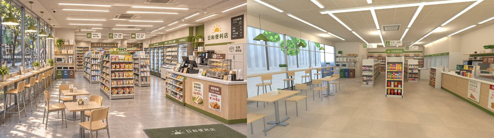
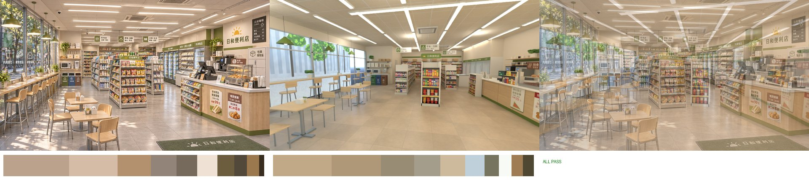
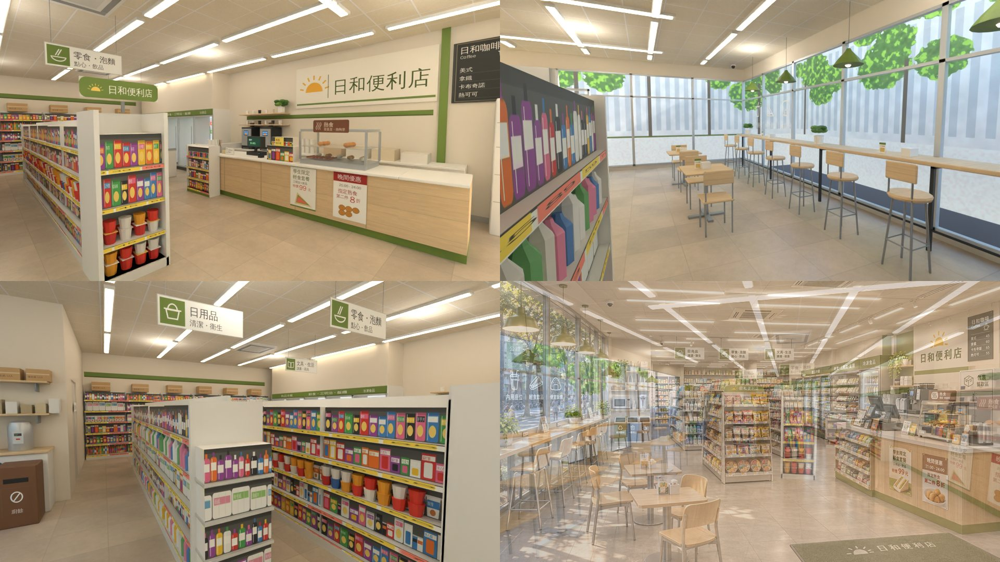

# 日和便利店（cvs 區域，原「日日便利」，AA_647 G03）室內：BB（帳號 A）2026-11-04

- **v1＝`READY_FOR_REVIEW`**（照 SCENE_RULES §10～§12 做；Blender Cycles 渲染，不是遊戲畫面；還沒接進遊戲、沒有手機模擬）。
- **模型收件（MODEL_READY）由 LAWWW2 驗；這間是 BB 自己做的，`ART_APPROVED` 也由 LAWWW2 標**（AA_647 第 3 節）。BB 不自己驗。
- 參考圖（就是規格）：`docs/story_planning/ref_images/shops/gongguan_cvs_int.webp`；外觀 `gongguan_cvs_ext.webp`（轉角店：左邊側面整排落地窗、正面自動門）。

## 交件
| 檔案 | 內容 |
|---|---|
| `assets/models/env/second_ai/bb_support/cvs_interior.glb` | 正式 GLB（窗外沒有街景卡片） |
| `src/data/cvs_layout.js` | 配置 v1（Blender 用 node 讀同一份）：尺寸、門窗、blocks 30 個、seats 13 個、interact 6 個、spawn、exit、clerk、lights |
| `tools/blender/env_second/bb_support/cvs_interior.py` | 建模腳本（`/opt/blenv/bin/python tools/blender/env_second/bb_support/cvs_interior.py [-- --out <glb>] [--preview]`；要在美術線 worktree 跑：用 `lib2.py`、`b3lib.py`） |
| `tools/blender/env_second/bb_support/cvs_tex.py` | 貼圖（PIL＋numpy，跑腳本時自動產生到 `tools/blender/env_second/textures/gen/cvs/`）：地磚、天花板、橡木、印刷圖集、商品圖集、冷藏櫃發光圖、螢幕、玻璃貼紙；共用 `shaola_tex.py` 的雜訊與字型 |
| `cvs_v1_ref_vs_render.jpg` | 參考圖｜同角度渲染 |
| `cvs_v1_refmatch_cmp.jpg`、`cvs_v1_refmatch_report.json` | ref_match：參考圖｜渲染｜50% 疊圖＋色票 |
| `cvs_v1_views.jpg` | 其他角度：櫃台與標誌牆、窗邊吧台、貨架與後牆、右下＝參考圖和渲染 50% 疊圖 |
| `glb_specs.json` | GLB 規格 |

## GLB 規格（SCENE_RULES §10：≤ 6 萬三角形、≤ 12 材質、≤ 6 MB）
| 檔案 | 大小 | 三角形 | 材質 | draw call | 貼圖 |
|---|---|---|---|---|---|
| `cvs_interior.glb` | 3.42 MB | 39,602 | 12 | 19 | 9 張 webp（2048² × 3、1024² × 4、512² × 2），730 KB |

- 材質 12 個：`cvs_floor`（淺灰石紋 60 cm 地磚＋粗糙度圖）、`cvs_ceiling`（單面朝下）、`cvs_wood`（淺色橡木）、`cvs_print`（印刷圖集）、`cvs_goods`（商品圖集）、`cvs_vc`（頂點色）、`cvs_vc_metal`（頂點色金屬，金屬度 0.45）、`cvs_glass`（alpha 0.08，props `glass:1`）、`cvs_decal`（玻璃貼紙，透明貼圖）、`GLOW_cvs_led`（燈條、吊燈燈泡）、`GLOW_cvs_cooler`（冷藏櫃裡面）、`GLOW_cvs_screen`（收銀機、咖啡機、包裹櫃螢幕、熱食櫃燈）。
- 金屬度都 ≤ 0.45；沒有 instancing（合併以後只有 19 個 draw call）。
- 淡出牆：`WALL_front／back／left／right`（props `dir`），右牆的標誌、咖啡黑板、綠色柱子跟著右牆淡出；**玻璃不在淡出群組**（放在 root）。
- 舊的程序化 cvs 用的材質名 `cvs_led`、`cvs_cooler_light`、`cvs_goods`、`cvs_poster`（zones3d.js 的 `attachCvsInterior`、`CVS_BOUNCE`）和這版不一樣：這版發光的材質都以 `GLOW_` 開頭、商品是貼圖不是頂點色。**LAWWW2 接的時候 `attachCvsInterior` 要跟著改**（或照 `GLOW_` 前綴通用處理）。

## ref_match（960 × 540、32 取樣）
鏡頭：眼睛 (0.2, 1.6, 6.6) → 看 (−2.2, 0.4, −7.0)、15 mm、16:9；`render_cycles.py --view Standard --exposure -0.5`，白天天空＋9 盞 30 W 點光源（燈條位置 x −4.2／−0.6／3.0 × z −4.5／0／4.5、高 3.0）；`--preview` 的窗外街景卡片。

| 項目 | 門檻 | 參考圖 | v1 渲染 | 結果 |
|---|---|---|---|---|
| 平均亮度差 | ≤ 0.08 | 0.586 | 0.618 | PASS |
| 對比 | ≥ 參考 × 0.8（0.473） | 0.591 | 0.547 | PASS |
| 冷暖（R−B）差 | ≤ 0.05 | +0.172 | +0.155 | PASS |
| 色票平均 ΔE | ≤ 18 | — | 6.6 | PASS |
| 九宮格亮度差 | ≤ 0.12 | — | 0.059 | PASS |

**ALL PASS**。數字只量光和顏色；構圖的差距見「和參考圖不同的地方」。

## 12-1 拆圖清單（室內參考圖，從左到右、由前到後；■＝做到）
| # | 東西 | 位置 | 顏色 | 模型物件 | 狀態 |
|---|---|---|---|---|---|
| 1 | 左邊整排落地窗、鋁窗框（直的 6 格＋腰帶） | 左 | 鋁 #c6cacc | `WALL_left_vm`、`cvs_glass` | ■（西牆 z −2.75～7） |
| 2 | 窗上的白色貼紙「內用座位｜輕食飲品｜便當新鮮」＋杯子、三明治、飯糰圖示 | 左、前 | 白 | `cvs_decal` | ■（從店裡看是正的） |
| 3 | 窗外的「公館」直幅旗、行道樹 | 左、窗外 | — | — | 不做（窗外景歸 LAWWW2；渲染只放一張預覽卡片） |
| 4 | 綠色吊燈 4 盞（窗邊） | 左、上 | #708a3a | `cvs_vc`、`GLOW_cvs_led` | ■ |
| 5 | 窗邊木吧台＋黑色鐵支架、腳踏桿 | 左 | 橡木 #e2c69c | `cvs_wood`、`cvs_vc_metal` | ■（長 8.2 m、高 1.05） |
| 6 | 高腳椅（木座、木椅背、銀色鋼腳、腳踏環） | 左 | 木、#9a9ea2 | `cvs_wood`、`cvs_vc_metal` | ■（9 張＝ seats bar 1～9） |
| 7 | 吧台上的盆栽、面紙盒、桌上立牌 | 左 | 綠、白 | `cvs_vc`、`cvs_print` | ■ |
| 8 | 內用小方桌兩張（木面、銀色腳）、木椅每桌兩張、桌上餐巾盒＋立牌 | 左、前 | 橡木 | `cvs_wood`、`cvs_vc_metal` | ■（seats table 1、2） |
| 9 | 左後：微波爐、熱水瓶、木層板、帆布袋（太陽標誌）、盆栽 | 左、後 | 白、木 | `cvs_vc`、`cvs_print`、`cvs_wood` | ■（兩台微波爐） |
| 10 | 三色回收桶「資源回收／一般垃圾／廚餘」 | 左、後 | 綠、藍、褐 | `cvs_vc`、`cvs_print` | ■ |
| 11 | 中間三排雙面貨架：日用品（清潔、衛生）、零食泡麵、文具生活；黃色價格條 | 中 | 白架、彩色商品 | `cvs_vc`、`cvs_goods` | ■（貼圖方塊有深度；日用品兩層、泡麵一層是真的瓶子和碗） |
| 12 | 端架：「日和便利店」綠色招牌、泡麵碗、零食 | 中、前 | 綠 | `cvs_print`、`cvs_vc`、`cvs_goods` | ■（泡麵碗兩層是真的模型） |
| 13 | 天花板吊牌三張（綠色圖示＋兩行字） | 中、上 | 白、綠 | `cvs_print`（雙面） | ■ |
| 14 | 後牆整排壁架、頂上的紙箱 | 中、後 | — | `cvs_vc`、`cvs_goods`、`cvs_print` | ■ |
| 15 | 冷藏櫃（綠色頂框）：飲品冷藏、鮮食・三明治・飯糰、冷凍食品；玻璃門、把手、裡面亮 | 右、後 | 綠 #708a3a | `cvs_vc`、`cvs_vc_metal`、`cvs_glass`、`GLOW_cvs_cooler` | ■（5 扇門） |
| 16 | 平台冷凍櫃（玻璃上蓋） | 右、後 | 白 | `cvs_vc`、`GLOW_cvs_cooler` | ■ |
| 17 | 櫃台靠冷藏櫃那頭的小貨架（零食） | 右、中 | 綠腳 | `cvs_vc`、`cvs_goods` | ■ |
| 18 | 櫃台：橡木正面、綠色踢腳、白色檯面 | 右 | 橡木、#708a3a | `cvs_wood`、`cvs_vc` | ■ |
| 19 | 收銀機（兩面螢幕）、刷卡機、行動支付牌 | 右 | 黑 | `cvs_vc`、`GLOW_cvs_screen`、`cvs_print` | ■ |
| 20 | 熱食櫃（玻璃、燈、熱狗、包子）＋「熱食」牌 | 右 | 不鏽鋼、褐 | `cvs_vc_metal`、`cvs_glass`、`GLOW_cvs_screen`、`cvs_print` | ■（「熱食　茶葉蛋・熱狗堡」） |
| 21 | 咖啡機（櫃台後面）、杯子、吸管筒 | 右、後 | 黑、不鏽鋼 | `cvs_vc`、`cvs_vc_metal`、`GLOW_cvs_screen` | ■（兩台） |
| 22 | 「日和咖啡 Coffee」價目黑板：美式 45、拿鐵 60、卡布奇諾 65、熱可可 55 | 右、上 | 黑 | `WALL_right_print` | ■ |
| 23 | 右牆大標誌：太陽＋「日和便利店」、綠色柱子、綠色長條 | 右、上 | 米白、深綠字 | `WALL_right_print`、`WALL_right_vc` | ■ |
| 24 | 櫃台正面海報：「學生限定 輕食套餐 三明治＋飲品 特價 99 元」、「晚間優惠 21:00-24:00 指定熟食 第二件 8 折」 | 右、前 | 白、紅 | `cvs_print` | ■ |
| 25 | 包裹暫取區櫃（格子門、觸控螢幕、牌子） | 右、前 | #ecebe6 | `cvs_vc`、`GLOW_cvs_screen`、`cvs_print` | ■ |
| 26 | 門口綠色地墊（太陽＋日和便利店） | 右下 | #465c3c | `cvs_print` | ■ |
| 27 | 淺灰地磚（60 cm、石紋、有反光） | 下 | #cebea8 | `FLOOR` | ■（D112：不是深色木地板） |
| 28 | 白色方格天花板、長條 LED 燈、嵌入式冷氣、監視器 | 上 | 暖白 | `CEILING`、`cvs_vc`、`GLOW_cvs_led` | ■（燈條沿 z 6 排＋前面 2 條橫的；冷氣 2 台；監視器 3 個） |

拆圖清單之外另外加的（參考圖看不到、但遊戲裡會走到）：自動門（兩扇開著的玻璃門、感應器、門上綠條和「營業時間 07:00-24:00／內用座位／包裹取件／免費 Wi-Fi」貼紙）、傘架、員工室的門「員工專用」、櫃台活板、員工區隔板、貨架兩頭的端面商品。

## 第 11 節醜點清單
- [x] 比例：10 × 14 × 3.3 m；貨架高 1.65（端架 1.75）、櫃台 0.95、吧台 1.05、桌子 0.76、高腳椅座 0.78。對位鏡頭裡空的地板約占畫面 1/4（門口到貨架的走道），沒有超過 1/3。
- [x] 光：不是均勻白光——燈條是一條一條的發光、冷藏櫃和熱食櫃自己亮、窗邊有吊燈；天花板、牆是暖白（#f0e6d4、#ece3d2），不是純白。
- [x] 密度：參考圖擺滿的地方都擺了；小東西超過 15 種（收銀機、刷卡機、行動支付牌、熱食櫃、熱狗、包子、咖啡機、杯子、吸管、海報、黑板、標誌、吊牌、價格條、泡麵碗、瓶子、紙箱、微波爐、熱水瓶、帆布袋、盆栽、回收桶、面紙盒、立牌、傘架、包裹櫃、監視器、冷氣……）。
- [x] 商品不是單色方塊：每一層是商品圖集的一排（洋芋片袋、泡麵碗、洗髮精瓶、餅乾盒、衛生紙、筆記本、飲料），有深度；最靠走道的幾層是真的瓶子和泡麵碗。
- [x] 在地感：新台幣價錢、中文商品名、行動支付／悠遊卡牌、三色回收桶（資源回收、一般垃圾、廚餘）、包裹暫取櫃、內用座位。
- [x] 預算：39,602 三角形、12 材質、3.42 MB。
- [x] D112：淺灰地磚；D77：沒有真實品牌（商品只有品名，「悠遊卡」是付款方式的名稱、沒有標誌）；D115：沒有真實校名（參考圖窗外的「公館」旗子在窗外，不在模型裡）。

## 和參考圖不同的地方
1. **尺寸照配置**：10 × 14 m（參考圖看起來前景更擠、後牆更近，約 10 m 深）。對位鏡頭裡貨架、冷藏櫃、後牆比參考圖遠、小；前景（門口到內用桌）比參考圖空。**舊的 cvs 是 12 × 9 × 3.2，這版改成 10 × 14 × 3.3，請 LAWWW2 決定**；改尺寸要改 zones3d 的 `cvs` 區域（room 的 w／d／h、出口 (0, 4.2) → (1.6, 6.3)、spawn (0, 3.5) → (1.6, 5.8)、結帳 (3.2, −0.6) → (2.7, 1.05)），從公館、溫州街進來的 spawn 也要跟著改。
2. **出入口（遊戲必須）**：參考圖看不到門；這裡的門在正面 x 0.6～2.6（自動門開著），門口留 2 m 寬的走道，所以地墊、櫃台前段比參考圖靠右。
3. **員工室**：參考圖左後的微波爐層架後面看不清楚；這裡做成員工室的隔牆（x −5～−2.6、z −7～−2.9，關著），微波爐層架貼在隔牆上。
4. **冷藏櫃**：參考圖的冷藏櫃從後牆轉到右牆；這裡只放右牆後段（5 扇門），後牆是一般壁架。
5. 窗外景不做（LAWWW2 的 view；溫州街 A5 進來的也是同一個區域）。

## 給 LAWWW2：整合備註
- 窗外：西牆前段（z −2.75～7）和正面（x −5～0.45、2.75～3.6）是落地窗，窗台 0.12、窗頂 2.9。公館那一家是轉角店（外觀圖），西牆窗外是側街；溫州街 A5 不是轉角，西牆窗外要另外決定（可以放鄰居的騎樓）。
- 燈（烘焙或補燈）：天花板燈條 x −3.4／−1.88／−0.36／1.16／2.68／4.2（沿 z，員工室上面沒有），前面兩條橫的 z 5.6／3.2；窗邊吊燈 x −4.55、z 5.2／3.4／1.6／−0.2、燈泡高 2.37；冷藏櫃、平台冷凍櫃、熱食櫃本身發光。
- 導航阻擋全部在 `cvs_layout.js` 的 `blocks`（櫃台後面的員工區整塊擋，店員站在 (4.15, 1.05)）。
- seats：窗邊高腳椅 9 張（面向窗 yaw −π/2）、內用桌 2 張 × 2 張椅子；interact：結帳、熱食櫃、日和咖啡、包裹暫取、微波加熱、冷藏櫃。

## 還不夠好的地方（誠實說）
- **構圖**：參考圖是 AI 圖、透視比較誇張（前景擠、後面近）；照配置的尺寸做，對位鏡頭只能大致對上左窗吧台、內用桌、中間端架、右邊櫃台的位置，後段比參考圖遠。
- **商品**：大部分是貼圖方塊，近看（< 1 m）看得出是平面畫的，商品之間沒有前後高低；真的模型只有瓶子和泡麵碗。
- **冷藏櫃裡面**：是一張發光貼圖，沒有立體的層板，斜著看會平。
- **吊燈、椅子**：造型簡單（椅子是直角的板子）；參考圖的椅子有彎的椅背。
- **窗邊陽光**：參考圖有樹影灑在地上；遊戲沒有，渲染也沒有。
- 只有 Blender 渲染，還沒有遊戲截圖、手機模擬；遊戲裡材質名和舊的 cvs 不一樣（見上面），整合要改 `attachCvsInterior`。
