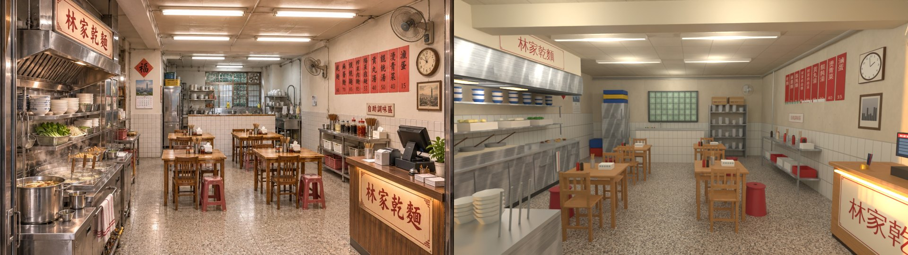
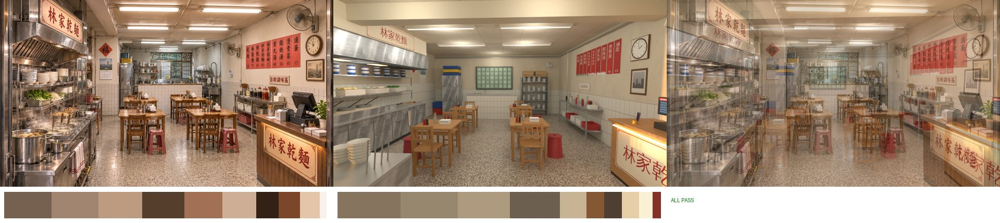
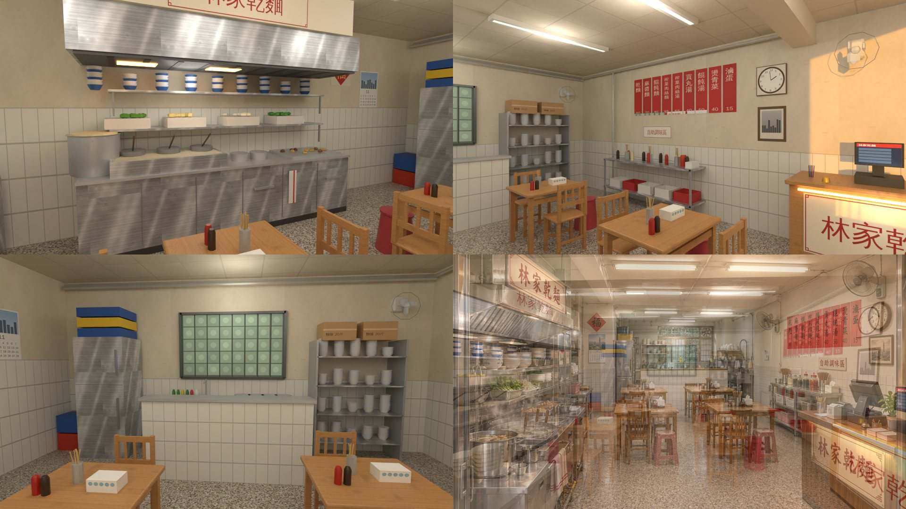

# 林家乾麵（溫州街 A4，zone id `wz_lin`，AA_654）室內：BB（帳號 A）2026-11-04

- **v1＝`READY_FOR_REVIEW`**：照 SCENE_RULES §10～§12 做。
  - 目前只有 Blender Cycles 渲染，不是遊戲畫面；還沒接進遊戲，也還沒在手機上試。
  - 模型收件和 `ART_APPROVED` 都由 **LAWWW2** 處理（這間是 BB 做的，AA_654 第 3 節）。
- **參考圖**：`docs/story_planning/ref_images/shops/wz_lin_int.webp`；外觀是 `wz_lin_ext.webp`。
- **房間、門窗、出口、出生點**：照 LAWWW2 的意見，沿用 `claude/confident-ritchie-8rwh7t` 的 `src/data/wz_shops_layout.js` 的 `lin`，沒有改動。
  - 房間 6.4 × 8 × 3，店面在 +z＝4。
  - 正面整面開著，開口 x −3～2.1：左邊是攤車，右邊 2.2 m 是入口。
  - 出口 (1, 3.55)，出生點 (1, 3.05)。
  - `enterAt`、`exit.spawn`（溫州街的世界座標）照舊。
- **外觀**（綠色雨遮、招牌、攤車朝街的那一面）是 LAWWW2 的 GLB。室內只做攤車在店裡的這一側。
- 菜單照室內圖的紅紙價目牌（AA_654 第 4 節）。營業時間照 `places.js`。

## 交件
| 檔案 | 內容 |
|---|---|
| `assets/models/env/second_ai/bb_support/lin_interior.glb` | 正式 GLB（正面開口外沒有街景卡片） |
| `src/data/lin_layout.js` | 配置 v1：blocks 24 個、seats 12 個、interact 4 個 |
| `tools/blender/env_second/bb_support/lin_interior.py` | 建模腳本。要在美術線 worktree 跑；配置用 node 讀 |
| `tools/blender/env_second/bb_support/lin_tex.py` | 貼圖：磨石子、天花板、米白牆、木頭、不鏽鋼、印刷圖集、收銀機螢幕 |
| `lin_v1_ref_vs_render.jpg` | 參考圖｜同角度渲染 |
| `lin_v1_refmatch_cmp.jpg`、`lin_v1_refmatch_report.json` | ref_match |
| `lin_v1_views.jpg` | 其他角度：煮麵台、右牆與收銀台、後面；右下是 50% 疊圖 |
| `glb_specs.json` | GLB 規格 |

## GLB 規格（LAWWW2 這批：≤ 5 萬三角形、≤ 3 MB、≤ 12 材質）
| 檔案 | 大小 | 三角形 | 材質 | draw call |
|---|---|---|---|---|
| `lin_interior.glb` | 1.57 MB | 18,732 | 11 | 22 |

- **材質**：`lin_floor`、`lin_ceiling`、`lin_wall`、`lin_wood`、`lin_print`、`lin_steel`、`lin_vc`、`lin_vc_metal`、`lin_vc_gloss`、`GLOW_lin_warm`、`GLOW_lin_screen`。
  - `lin_ceiling` 單面朝下。
  - `lin_vc_gloss` 用在瓷碗、塑膠凳、醬料瓶。
  - `GLOW_lin_screen` 用在日光燈管和收銀機。
- 金屬度 ≤ 0.45。
- 淡出牆：`WALL_front／back／left／right`。正面沒有玻璃。

## ref_match（960 × 540、32 取樣）
- **鏡頭**：站在店門口（店面線外 0.6 m），往裡看。藏起 `WALL_front`（遊戲裡鏡頭在店外時，前牆會淡出）。
  - 眼睛 (0.6, 1.65, 4.6)，看 (0.2, 1.05, −4.0)，18 mm。
- **渲染**：`--night --nosun --exposure -0.4`，加 9 盞點光源（燈管的位置 6 盞、抽油煙機、收銀台、後面）。

| 項目 | 門檻 | 參考圖 | 渲染 | 結果 |
|---|---|---|---|---|
| 平均亮度差 | ≤ 0.08 | 0.477 | 0.513 | PASS |
| 對比 | ≥ 參考 × 0.8（0.516） | 0.645 | 0.569 | PASS |
| 冷暖（R−B）差 | ≤ 0.05 | +0.208 | +0.176 | PASS |
| 色票平均 ΔE | ≤ 18 | — | 7.1 | PASS |
| 九宮格亮度差 | ≤ 0.12 | — | 0.057 | PASS |

**ALL PASS**。曝光 0 的時候平均亮度 0.578，沒過；改成 −0.4。

交件前已經把參考圖和渲染並排看過：
- 左邊不鏽鋼煮麵台、抽油煙機和上面的招牌，中間兩欄方桌，右牆紅紙菜單和時鐘，右前收銀台的小招牌，後面白磁磚矮牆、玻璃磚窗、冰箱、碗盤架，位置都對得上。
- 第一次並排時，菜單是反過來排的（乾麵在最右邊），時鐘也在鏡頭外。這兩個都改了再交。

## 走道和座位（node 讀配置量，人的半徑 0.33 m）
- **主走道淨寬**（都 ≥ 0.8）：
  - 中間走道（兩欄桌子中間）1.10 m；
  - 煮麵台到左欄塑膠凳 0.84 m；
  - 右欄塑膠凳到調味區 0.93 m。
- **12 個座位、4 個互動點都從出生點走得到**（格點 BFS，0.05 m）。
- **站在每個座位、互動點最近的那一格時，最近的互動都是它自己**。
  - 第一次量有兩處不是：桌 1 遠端的椅子最近的是「點餐」，桌 4 的塑膠凳最近的是「調味區」。
  - 把桌 1 往後移 0.1 m、調味區的互動點移到 z −2.0，兩處都改好了。

## 舊 → 新對照表（給 LAWWW；舊＝`wz_shops_layout.js` 的 `lin`）
| 項目 | 舊 | 新 | 說明 |
|---|---|---|---|
| zone id、name、glb 路徑 | `wz_lin`、林家乾麵、`assets/models/env/second_ai/wz_lin_interior.glb` | `wz_lin`、林家乾麵、**`assets/models/env/second_ai/bb_support/lin_interior.glb`** | 換 GLB：`ASSETS` 那一行要改，或用新的配置檔 `LIN_LAYOUT` |
| 房間、front（open、views、view） | 6.4 × 8 × 3；開口 −3～2.1 | 一樣 | 不動 |
| spawn、exit、enterAt | (1, 3.05)、(1, 3.55)、溫州街 (35, 4.6) | 一樣 | 不動 |
| clerk | (−1.7, 2.55)，yaw 0 | 一樣 | 不動（攤車後面）；新增 `clerk2` (2.85, 2.45)：收銀台後面 |
| interact `order` | (−0.1, 2.55) | 一樣 | 不動 |
| interact `menu` | (−1.3, −0.3) | **(2.05, −0.1)**，朝 +x | 舊位置在新的桌子上，搬到右牆紅紙菜單下面 |
| interact `pay`、`condiments` | 沒有 | (2.05, 2.45)、(2.35, −2.0) | 新增：收銀台、自助調味區 |
| 桌 1 | (−2.2, 1.6)，座位 z 1.05／2.15（`ap` 從走道走近） | **(−0.85, 1.2)**，座位 z 0.7／1.7＋塑膠凳 (−1.45, 1.2) | 「門口那桌」（明軒的 shop_enc）照舊是桌 1 |
| 桌 2 | (−2.2, −0.1) | **(1.05, 0.9)**，座位 z 0.4／1.4＋凳 (1.65, 0.9) | |
| 桌 3 | (−2.2, −1.8) | **(−0.85, −1.0)**，座位 z −1.5／−0.5＋凳 (−1.45, −1.0) | |
| 桌 4 | (1.9, 1.0) | **(1.05, −1.3)**，座位 z −1.8／−0.8＋凳 (1.65, −1.3) | |
| 桌 5 | (1.9, −0.7) | **拿掉** | 參考圖是四張桌子。用到桌 5 的劇情或 crowd，請改成桌 2 或桌 4 |
| seats 數 | 10（5 桌 × 2） | 12（4 桌 × 2 張木椅＋1 張紅凳），凳子有 `stool: true` | |
| blocks | 9 個 | 24 個 | 照新的室內重算 |

## 拆圖清單（室內參考圖，從左到右、由前到後；■＝做到）
| # | 東西 | 位置 | 模型物件 | 狀態 |
|---|---|---|---|---|
| 1 | 抽油煙機（不鏽鋼、往前傾、網格）＋上面「林家乾麵」招牌（米白底紅字、回紋角） | 左、上 | `lin_steel`、`lin_vc`、`lin_print` | ■ |
| 2 | 不鏽鋼煮麵台（櫃門、把手、掛著的紅線毛巾） | 左 | `lin_steel`、`lin_vc_metal`、`lin_vc` | ■ |
| 3 | 煮麵機三格、麵杓（木把手）、大湯鍋、小鍋、滷味盤 | 左 | `lin_vc_metal`、`lin_vc_gloss` | ■（沒有蒸氣） |
| 4 | 兩層層架：碗疊（白、藍邊）、青菜籃、豆芽、生麵、蔥 | 左、上 | `lin_steel`、`lin_vc_gloss`、`lin_vc` | ■ |
| 5 | 左牆：白磁磚（到 1.6 m）、福、月曆 | 左、中 | `WALL_left_*`、`lin_print` | ■ |
| 6 | 方桌（木頭、四腳、橫檔）四張，兩欄 | 中 | `lin_wood` | ■ |
| 7 | 木椅（直條椅背）、紅色塑膠凳 | 中 | `lin_wood`、`lin_vc_gloss` | ■（每桌 2 張椅子＋1 張凳子） |
| 8 | 桌上：筷子筒、面紙盒、辣椒醬、醬油 | 中 | `lin_vc_metal`、`lin_vc`、`lin_vc_gloss`、`lin_print` | ■ |
| 9 | 磨石子地（米灰底、小石子） | 下 | `FLOOR` | ■（D112：淺色磨石子，不是木頭） |
| 10 | 天花板：方格板、日光燈管 6 組、大樑、管線 | 上 | `CEILING`、`GLOW_lin_screen`、`lin_vc`、`lin_vc_metal` | ■ |
| 11 | 後面：白磁磚矮牆＋不鏽鋼檯面 | 後 | `lin_vc`、`lin_print` | ■ |
| 12 | 後面：洗碗槽、水龍頭、鍋、洗碗精 | 後 | `lin_steel`、`lin_vc_metal`、`lin_vc_gloss` | ■ |
| 13 | 後面：不鏽鋼冰箱（兩門）、上面的藍黃塑膠籃 | 左、後 | `lin_steel`、`lin_vc` | ■ |
| 14 | 後面：碗盤架、紙箱 | 右、後 | `lin_steel`、`lin_vc_gloss`、`lin_print` | ■ |
| 15 | 後牆：玻璃磚窗＋鐵框 | 後、上 | `WALL_back_print`、`WALL_back_vm` | ■ |
| 16 | 右牆：紅紙菜單九張（乾麵 60…滷蛋 15） | 右、上 | `WALL_right_print` | ■ |
| 17 | 右牆：時鐘、相框 | 右、上 | `WALL_right_print`、`WALL_right_vc` | ■ |
| 18 | 壁扇（右牆前段、後牆右邊牆角） | 右、上 | `lin_vc`、`lin_vc_metal` | ■ |
| 19 | 自助調味區：不鏽鋼兩層架、籃子、醬料瓶、辣椒醬罐、筷子湯匙筒、面紙、「自助調味區」牌 | 右 | `lin_steel`、`lin_vc`、`lin_vc_gloss`、`lin_print` | ■ |
| 20 | 收銀台：木頭、正面有燈的「林家乾麵」小招牌、收銀機、叫人鈴、名片、價錢卡、筆、小盆栽 | 右、前 | `lin_wood`、`lin_print`、`GLOW_lin_warm`、`GLOW_lin_screen` | ■ |
| 21 | 右牆白磁磚腰牆（到 1.25 m）、牆角的管線 | 右 | `WALL_right_print`、`lin_vc_metal` | ■ |

## 第 11 節醜點清單
- [x] **比例**：6.4 × 8 × 3 m；桌高 0.77、椅座 0.47、凳 0.46、煮麵台 0.88、收銀台 1.0。對位鏡頭裡空地板約佔畫面 1/4。
- [x] **光**：日光燈管一組一組的；收銀台小招牌、抽油煙機下面的燈是暖色；牆是米白、天花板發黃，不是純白。
- [x] **密度**：小東西超過 15 種（碗疊、青菜、豆芽、生麵、湯鍋、麵杓、滷味、毛巾、筷子筒、面紙、醬料、籃子、冰箱上的籃子、紙箱、洗碗精、時鐘、相框、月曆、福、壁扇、收銀機、叫人鈴、名片、盆栽…）。
- [x] **歲月感**：牆上半發黃（油煙）、補漆、膠帶痕；天花板方格板發黃；磨石子地有銅條。
- [x] **在地感**：紅紙直書菜單、新台幣價錢、紅色塑膠凳、福、月曆、自助調味區。
- [x] **預算**：18,732 三角形、11 材質、1.57 MB。
- [x] **D112**：磨石子地。**D77**：沒有真實品牌。

## 和參考圖不同的地方
1. **攤車照外觀**：參考圖左前景是煮麵台的前段（大湯鍋、蒸氣）。這間的店面左邊是外觀的攤車，所以對位鏡頭的左前景是攤車在店裡這一側（碗疊、麵杓、湯鍋）。煮麵台沿左牆做在攤車後面。
2. **後面的廚房**：參考圖後面的矮牆後有一條通道和窗。這裡把矮牆後面整塊（冰箱、洗碗區、碗盤架）設成導航阻擋，客人不能進去。
3. **右牆的順序**：參考圖從前到後是收銀台、時鐘、菜單、調味區。這裡把調味區放在菜單下面、靠後面，讓收銀台前面留出排隊的位置。
4. **月曆、相框**：參考圖的風景照是一座有名的塔，這裡改成看不出是哪裡的城市剪影。

## 還不夠好的地方
- 煮麵台沒有蒸氣；湯鍋、碗是簡單的旋轉體，近看不夠油、不夠舊。
- 冰箱和抽油煙機的不鏽鋼貼圖，斜著看有明顯的斜紋。
- 壁扇的扇葉是簡化的。
- 參考圖整體比較暖、比較擠；這裡的後半段比較空。
- 只有 Blender 渲染，還沒有遊戲截圖、手機模擬。
