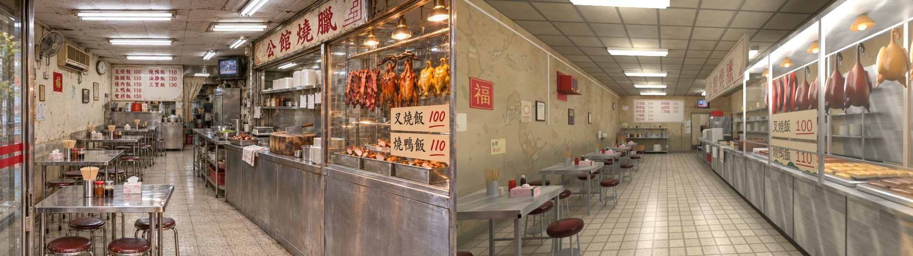
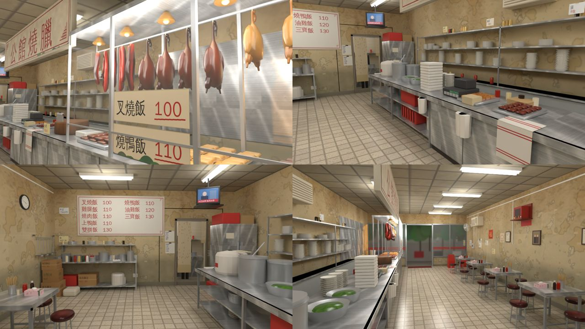

# 公館燒臘室內（noodle 區域＝阿鳳麵店改燒臘，AA_612 A 表）——BB 協助建模（2026-11-03）

- 參考圖（使用者 11-03）：`docs/story_planning/ref_images/shops/gongguan_shaola_int.webp`（室內）、`gongguan_shaola_ext.webp`（店面）。
- 照 SCENE_RULES 第 11、12 節做：參考圖就是規格。交件附四樣：拆圖清單全部打勾、ref_match 五項 PASS、醜點清單打勾、和參考圖不同的地方。
- 配置：`src/data/shaola_layout.js` v1（LAWWW2 11-03 23:08 選 A：6 × 13 × 3.2 m 窄長老店）。**配置的數字一個都沒改。**
- 腳本：`tools/blender/env_second/bb_support/shaola_interior.py`（v6）＋貼圖 `shaola_tex.py`（PIL＋numpy 自己畫，執行時自動產生到 `tools/blender/env_second/textures/gen/shaola/`，沒有下載任何素材）。
  `/opt/blenv/bin/python tools/blender/env_second/bb_support/shaola_interior.py`（在美術線的 worktree 跑：要 `lib2.py`、`b3lib.py`）
- GLB：`assets/models/env/second_ai/bb_support/shaola_interior.glb`；規格 `glb_specs.json`。
- 狀態：**READY_FOR_REVIEW**（v6，11-03；v5 退回改的五點見下面「v6 改了什麼」）。Blender Cycles 渲染，**不是遊戲截圖**；還沒接進遊戲、還沒在手機上看過。

## 交件圖（v6）
- 參考圖｜同角度渲染：`shaola_v6_ref_vs_render.jpg`
- ref_match：`shaola_v6_refmatch_cmp.jpg`、`shaola_v6_refmatch_report.json`
- 其他角度：`shaola_v6_views.jpg`（燒臘櫃近看、砧板檯與盛飯台、後牆與廚房門、從裡面往店門看）
- v5 的圖（`shaola_v5_*`）留著對照。

## v6 改了什麼（照 v5 回饋的五點）
1. **燒臘櫃是視覺中心**：吊的肉擠滿一排、互相貼近——叉燒 9 條、燒鴨 4 隻（身長 0.45 m）、油雞 3 隻；一排 5 盞暖色燈泡（發光強度 2.5 → 5）直接照在肉上，渲染時櫃子裡另外 5 盞 28 W，日光燈調暗一點（30／26 W），櫃子比店裡其他地方亮；下層肉盤 4 個、每盤兩層 36 塊；兩張價目卡放大到 0.96 × 0.31 m，貼在玻璃正面、兩根玻璃框中間；鏡頭改成從走道看向櫃子的斜側面（往右移到 x −0.5），櫃子在畫面右半邊佔很大。
2. **鴨、雞的造型**：鴨身長、胸窄、前後扁；皮有一圈一圈不整齊的皺褶（頂點往外推，凹處顏色深）；脖子細長、往上吊在勾子上；鴨頭、鴨嘴深色。叉燒的截面不規則（每一圈頂點的半徑都亂一點、會扭轉），邊角往外翹、焦黑。
3. **密度**：後牆工作檯多了鍋、6 個罐子、一捆塑膠袋、紙箱、延長線（插座排＋電線＋牆上插座）；廚房門左邊兩張夾著的外送單、手寫紙條；左牆後段掛勺子和漏勺的橫桿（7 支）；盛飯台多一個大電鍋、飯匙、湯桶、延長線、掛在檯邊的塑膠袋；左後角、櫃台後面靠門那一角堆紙箱（免洗餐盒、白米）、米袋、藍色塑膠桶；走道邊（店門左邊）一疊 7 張、左前角一疊 5 張紅色塑膠椅。
4. **不鏽鋼**：貼圖亮度 168 → 176、髮絲紋對比加倍；加上斜的反光亮條、凹痕（暗心＋亮邊）、深淺兩種刮痕。金屬度照舊 0.45。
5. **牆**：水漬改成一塊一塊、有邊緣的黃斑，加上剝落（露出比較白的底層灰泥、邊緣一圈深色），不再是噴槍那種漸層。

## 12-2 鏡頭對位
- 參考圖的鏡頭（估）：站在店門內偏左、左邊第一桌的右後方；眼睛 1.45 m；超廣角（約 18 mm，全片幅）；往店裡深處、稍微往右看（消失點在畫面 0.4 左右）。
- 渲染用同一個鏡頭（v6）：眼睛 (−0.5, 1.45, 6.4) → 看 (0.6, 1.4, −6.5)、18 mm、16:9（`render_cycles.py --night --view Standard` ＋ 日光燈、燒臘櫃燈泡位置的點光源，清單在下面「光」）。
- 疊圖：左牆、桌子那一排、走道、右邊櫃台、後牆的位置大致重疊；後牆比參考圖遠（配置 13 m 深，參考圖看起來約 10 m）。

## 12-4 ref_match（v6，960 × 540、32 取樣）
| 項目 | 門檻 | 參考圖 | v6 渲染 | 結果 | （v5） |
|---|---|---|---|---|---|
| 平均亮度差 | ≤ 0.08 | 0.466 | 0.521 | PASS | 0.490 |
| 對比 | ≥ 參考 × 0.8（0.501） | 0.626 | 0.584 | PASS | 0.530 |
| 冷暖（R−B）差 | ≤ 0.05 | +0.157 | +0.150 | PASS | +0.143 |
| 色票平均 ΔE | ≤ 18 | — | 5.5 | PASS | 6.3 |
| 九宮格亮度差 | ≤ 0.12 | — | 0.070 | PASS | 0.053 |

**ALL PASS**。對比比 v5 有餘裕（亮部 0.86：櫃子裡的燈和肉）。數字只量光和顏色，肉眼的差距見最後一節。

## 12-1 拆圖清單（室內參考圖，從左到右、由前到後；■＝做到）
| # | 東西 | 位置 | 尺寸（約） | 顏色 | 材質 | 模型物件 | 狀態 |
|---|---|---|---|---|---|---|---|
| 1 | 玻璃門框（左前景）、門上兩條紅線 | 左、前 | 高 2.5 m | 鋁框 #9aa0a4，紅 #c8342c | 鋁、玻璃 | `WALL_front_vm`（鋁框、窗上和門扇上的紅線）、`WALL_front_glass` | ■（窗、門框、紅線都有；門扇開在騎樓那一側，見「不同的地方」1） |
| 2 | 不鏽鋼方桌一排 | 左、前→後 | 0.8 × 0.8、高 0.76 | 刷紋 #bfc3c4 | 不鏽鋼（髮絲紋貼圖、折邊） | `sl_steel`、`sl_vc_metal`（桌腳、橫桿） | ■（5 張，配置的位置） |
| 3 | 紅色圓凳，每桌 4 張 | 左 | 座徑 0.34、高 0.48 | 暗紅 #5a1418～#8a2c30（中間磨亮），腳 #b4b8bc | 人造皮、鋼管 | `sl_vc_gloss`、`sl_vc_metal` | ■（前後兩張＝遊戲坐的位置；靠牆、靠走道各多一張） |
| 4 | 桌上：竹筷筒、辣椒醬玻璃罐、醬油瓶、牙籤罐、粉紅花紋面紙盒 | 每桌 | — | 竹 #dcbc7e、辣椒 #a8200e、面紙 #f4cdd4 | 不鏽鋼、玻璃、紙（印刷） | `sl_vc`、`sl_vc_gloss`、`sl_prints` | ■（26 根竹筷一根一根插在筒裡） |
| 5 | 左牆：發黃的舊灰泥、水漬、下半一圈灰綠色的髒 | 左 | 0～1.0 m 灰綠 | #d8c69e、水漬 #96703f、下緣 #969078 | 自畫貼圖 | `WALL_left_wall` | ■ |
| 6 | 左牆高處：壁扇、窗型冷氣 | 左、前 | 冷氣 0.9 × 0.45 | #e6dcc4 | 塑膠 | `WALL_left_vc` | ■（壁扇有網罩、扇葉；冷氣有百葉、排水管、下面一條水漬） |
| 7 | 左牆：紅色「福」、相框、公告紙 | 左、中 | 0.4 m | 紅 #c4221e | 紙（印刷）、木框 | `WALL_left_print`、`WALL_left_vc` | ■（福、營業登記、合照、月曆、舊海報、手寫紙條 7 張） |
| 8 | 左牆：圓鐘（白面黑框） | 左、後 | 直徑 0.35 | #f0ece2、框 #2a2a2c | 塑膠 | `WALL_left_vc`、`WALL_left_print` | ■ |
| 9 | 後牆：白底紅字大價目表（兩欄 8 項） | 中、後 | 2.8 × 1.25 | #f0ece2、紅 #b0201c | 板（印刷） | `WALL_back_print` | ■（字照抄參考圖：叉燒飯 100…三寶飯 130） |
| 10 | 後牆：不鏽鋼工作檯、湯鍋、紅罐、調味罐 | 中、後 | 2.55 × 0.58 | 不鏽鋼 | 不鏽鋼 | `WALL_back_steel`、`WALL_back_vm`、`WALL_back_gloss` | ■（下層舊電鍋、紅籃；牆上層板） |
| 11 | 後面：往廚房的門、米色花布簾、廚房裡的人 | 中、後 | 門寬 1.0 | 布 #decfae 小花 | 布（印刷、皺褶） | `WALL_back_print`、`WALL_back_vc` | ■（布簾拉到左邊；廚房深 1.8 m：磁磚牆、不鏽鋼檯、鍋、日光燈、背對著在忙的人） |
| 12 | 後面：不鏽鋼大冰箱（兩門） | 右、後 | 0.97 × 2.0 | 不鏽鋼 | 不鏽鋼 | `sl_steel`、`sl_vc_metal` | ■（上面紅籃、紙箱；旁邊地上紅籃） |
| 13 | 天花板：方格輕鋼架板（舊、有水漬）、一排排雙管日光燈 | 上 | 0.6 m 格 | #b2aa94、鋼架 #76726a | 自畫貼圖 | `CEILING`、`sl_tube`（GLOW_）、`sl_vc`（燈座） | ■（左排 6 組橫的、右排 3 組直的，和參考圖同方向） |
| 14 | 右上：舊的方形電視（吊架） | 右、後 | 0.54 × 0.4 | 黑 #222326 | 塑膠、發光畫面 | `sl_vc`、`sl_screens`（GLOW_） | ■（斜斜面向用餐區，播午間新聞） |
| 15 | 右上：「公館燒臘」舊招牌（米白底、紅字、回紋） | 右、上 | 4.1 × 0.8 | #e2d6bc、紅 #a41c1a | 板（印刷、髒） | `sl_prints`、`sl_vc`（橫樑） | ■（在砧板檯上方的橫樑，面向走道） |
| 16 | 右：長不鏽鋼工作檯：圓木砧板＋菜刀、肉盤、白抹布（紅線）、電子秤、收銀機 | 右、中 | 長 3.2 m | 不鏽鋼、木 #8a5c38 | — | `sl_steel`、`sl_vc`、`sl_prints`（年輪、秤的面板、抹布） | ■（菜刀插在砧板上） |
| 17 | 右：燒臘玻璃櫃：叉燒 9 條、燒鴨 4 隻、油雞 3 隻（掛勾，擠滿一排） | 右、前 | 長 3.2 m、高 1.56；鴨身長 0.45 | 叉燒 #b0301c→焦黑、鴨 #84320e→#3e1004、鴨頭 #1e0a04、雞 #d29c44 | 玻璃、不鏽鋼、油亮頂點色 | `sl_glass`、`sl_vc_gloss`（MEATS）、`sl_vc_metal`（吊桿、勾子） | ■（鴨身長、胸窄、皮有皺褶，脖子細長吊在勾子上；叉燒截面不規則、邊角焦黑外翹） |
| 18 | 燒臘櫃裡：黃燈 5 盞（銅燈罩），直接照在肉上 | 右、上 | — | 燈 #ffb85c | 銅、發光 | `sl_vc_metal`、`sl_warm`（GLOW_） | ■ |
| 19 | 燒臘櫃下層：不鏽鋼淺盤 4 個，堆滿兩層（叉燒、燒肉、油雞、燒鴨） | 右、前 | 0.7 × 0.72 | — | — | `sl_vc_metal`、`sl_vc_gloss` | ■（燒肉有脆皮、白肥、粉紅肉三層） |
| 20 | 燒臘櫃上的價目卡「叉燒飯 100」「燒鴨飯 110」（貼在玻璃正面） | 右、前 | 0.96 × 0.31 | #f0e2c4、紅字 | 紙（手寫印刷） | `sl_prints` | ■ |
| 21 | 右：工作檯後面的層架：白色碗盤疊、調味罐、小紙條 | 右、中 | — | 白 #f4f2ea | 瓷 | `sl_steel`、`sl_vc`、`sl_vc_gloss`、`WALL_right_print` | ■ |
| 22 | 地板：米白小方磚、磨石子點、縫髒、走道比較亮 | 下 | 0.2 m 磚 | #e2d8c4 | 自畫貼圖（粗糙度 0.22，反光） | `FLOOR` | ■（牆邊、桌子下、櫃台前比較髒） |
| 23 | 右下：工作檯下面紅色塑膠籃、不鏽鋼架 | 右、中 | — | 紅 #c8342c | 塑膠 | `sl_vc` | ■（盛飯台下兩層：紅籃 2 個、疊起來的不鏽鋼盆、碗、白水桶） |

拆圖清單之外另外加的（參考圖看不到、但台北老店都有，讓別的角度不空）：神明桌（紅色小佛龕＋兩盞紅燈）、一串塑膠袋、湯匙杯架、右牆另一台冷氣、門口紅色腳踏墊、窗外的街（對面騎樓、行道樹、機車）、櫃台後面的地墊；v6 再加：紅色塑膠椅兩疊、紙箱（免洗餐盒、白米）、米袋、藍色塑膠桶、外送單、延長線、掛勺子和漏勺的橫桿、第二個大電鍋、飯匙、外帶紙袋。

## 第 11 節醜點清單
- [x] 比例：6 × 13 × 3.2 m（配置）；空的地板在對位鏡頭裡約占畫面 1/5（走道），沒有超過 1/3。
- [x] 光：不是整片白天花板＋均勻白光——天花板是暗沉的方格板，日光燈一組一組，燒臘櫃裡是暖色燈泡；牆、天花板的貼圖最亮的地方 0.85 以下（牆 #d8c69e、天花板 #b2aa94）。
- [x] 密度：參考圖擺滿的地方都擺了；小東西超過 15 種（招牌、菜單板、價目卡、手寫紙條、月曆、福、相框、舊海報、電視、收銀機、電子秤、砧板菜刀、抹布、壁扇、冷氣、時鐘、神明桌、筷筒、辣椒醬、醬油、牙籤、面紙盒、紅籃、碗盤疊、外帶餐盒、電鍋、湯桶、塑膠袋……）。
- [x] 商品不是單色方塊：燒鴨、油雞有頭、頸、身體、翅膀、腿的輪廓，吊在勾子上，焦糖色漸層、粗糙度 0.2＋畫進頂點色的反光；叉燒是長條、邊緣焦黑；切好的燒肉有三層。
- [x] 歲月感：牆有一塊一塊的黃斑和剝落（有邊緣）、水漬、撕掉的膠帶痕、裂縫、下緣髒；天花板有水漬圈、換過的板子顏色不一樣；地磚縫髒、牆邊和桌子下面髒；不鏽鋼有髮絲紋、凹痕、刮痕、反光亮條；冷氣下面有水漬；電線用壓條沿牆走。
- [x] 在地感：手寫中文紙條（今日公休、外帶加 10 元、滷蛋一顆 15、徵外場工讀、湯自取、不收信用卡）、新台幣價錢、虛構店名（D77）、沒有真實品牌、神明桌、窗型冷氣、壁扇。
- [x] 預算：57,946 三角形（≤ 6 萬，剩 2 千）、材質 12（≤ 12）、3.82 MB（≤ 6 MB）。重複的小東西（凳子、碗）沒有用 instancing：合成幾個大網格以後 draw call 只有 31。
- [x] D112：地板是淺色小方磚，沒有深色木地板。金屬度 ≤ 0.45（不鏽鋼 0.45、粗糙度 0.3）。天花板單面朝下。

## 和參考圖不同的地方（只有 §12 的三種）
1. **出入口（遊戲必須）**：參考圖左前景是往裡開的玻璃門扇。配置的門在 x −0.8～0.8、出口在 (0, 5.6)；鏡頭站在 x −0.5（門的範圍裡），往裡開的門扇會擋在鏡頭旁邊、也會占走道，所以門扇改成往外開（開在騎樓那一側），參考圖左邊那條門框和紅線在渲染裡看不到（窗框、窗上的紅線都有）。
2. **尺寸照配置**：店 13 m 深（參考圖看起來約 10 m），後牆、菜單板、廚房門在畫面裡比參考圖小、遠；桌子 0.8 × 0.8（參考圖的桌子看起來比較長）；5 張桌子（參考圖看得到 4 張）。
3. **尺寸照配置**：參考圖的冰箱在布簾門右邊緊貼著，這裡照配置的阻擋 [2.4, −5.6, 1.2, 0.9] 放在門右邊、離牆 0.45 m。
4. 品牌：參考圖沒有真實品牌；店名「公館燒臘」是遊戲裡的虛構店名（使用者給的圖照用）。

## 給 LAWWW2：配置之外要加的導航阻擋
GLB 根節點 `shaola_interior` 的 extras `extraBlocks` 也有同一份（[x 中心, z 中心, 寬, 深, 說明]）：
- `[-1.625, -6.21, 2.55, 0.58]` 後牆不鏽鋼工作檯（參考圖第 10 項）。
- `[-2.74, z, 0.36, 0.36]` × 5（z＝4.0／2.2／0.4／−1.4／−3.2）：靠牆那一側的圓凳。
- `[-1.5, z, 0.36, 0.36]` × 5：靠走道那一側的圓凳（保留，走道剩 x −1.32～0.9＝2.2 m）。
- v6 新加：`[-1.82, 5.78, 0.46, 0.46]` 紅色塑膠椅疊（走道邊、店門左邊）；`[-2.62, 5.9, 0.46, 0.46]` 紅色塑膠椅疊（左前角）；`[-2.47, -5.65, 0.96, 0.44]` 左後角紙箱、米袋；`[2.63, 5.47, 0.7, 1.8]` 櫃台後面靠門那一角的紙箱；`[2.6, 3.9, 0.46, 0.46]` 櫃台後面的藍色塑膠桶。
- 門扇開在店外（騎樓那一側、x −0.94～−0.8、z 6.46～7.25）：在公館那一邊的導航裡，不在室內。
- 廚房（後牆門後面、z −6.5～−8.3）是看得到、走不到的背景，屬於 `WALL_back` 那一組（會跟著後牆淡出）。

## 光（渲染用；遊戲裡請照這個位置烘焙或放燈）
- 日光燈：左排 x −1.1、z 5.4／3.3／1.2／−0.9／−3.0／−5.1（橫的，沿 x）；右排 x 1.45、z 0.9／−1.9／−4.6（直的，沿 z）；高 3.1。渲染用 30 W、26 W 點光源。
- 燒臘櫃燈泡（v6）：x 1.3、z 2.5／3.15／3.8／4.45／5.1、高 2.38（GLOW_sl_warm，發光強度 5）；渲染用 x 1.15、高 2.15 的 28 W 點光源。**遊戲裡櫃子要比店裡其他地方亮**（烘焙或補燈）。
- 廚房：x 1.5、z −7.4、高 2.4。
- 渲染沒有太陽、天空 0.05（`--night`）：參考圖是室內燈打的光。

## 還不夠好的地方（誠實說）
- **燒臘櫃**：比 v5 擠、亮很多，但還不是參考圖那種「整張圖的主角」：
  - 參考圖的肉是深焦糖色、亮面反光很強；v6 的鴨在暖光下偏粉褐、反光弱（遊戲沒有點光源，油亮是畫在頂點色裡的）。
  - 參考圖的鏡頭比較靠近櫃子，肉在畫面裡比較大。
- **鴨、雞、叉燒**：鴨有皺褶、胸窄，但近看皺褶還是太規則、太淺；油雞的顏色偏黃、偏平；叉燒的截面不規則了，遠看還是有點像紅色長條。
- **不鏽鋼**：比 v5 亮、有亮條和凹痕，但沒有參考圖那種鏡面倒影（金屬度上限 0.45、沒有環境貼圖）。亮條和凹痕是 0.7 m 重複一次的貼圖，櫃台正面看得出重複。
- **牆**：剝落和黃斑是一塊一塊的了，但遠看有點像地圖的等高線，邊緣太一致。
- **配置的限制**：店 13 m 深（參考圖看起來約 10 m），後段在對位鏡頭裡還是比較空、比較遠；廚房裡的人在對位鏡頭裡看不到。
- **預算**：57,946 三角形，離 6 萬上限只剩約 2 千，之後再加東西要先減面（例如圓凳、碗改 instancing）。
- `wip_v3_4views.jpg`、`shaola_v5_*` 是舊版，留著對照用。
- 只有 Blender 渲染，還沒有遊戲截圖、手機模擬。
