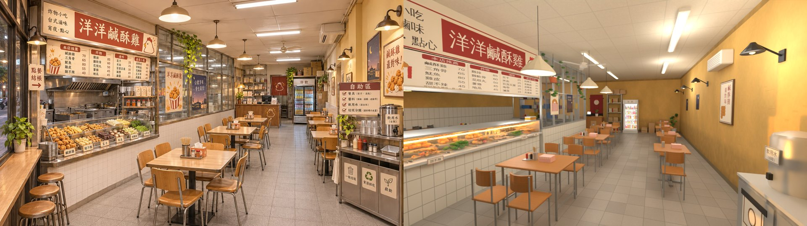
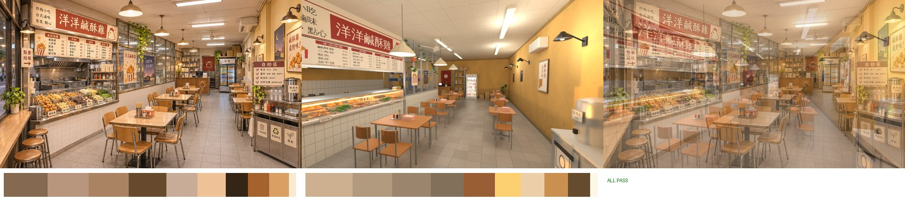
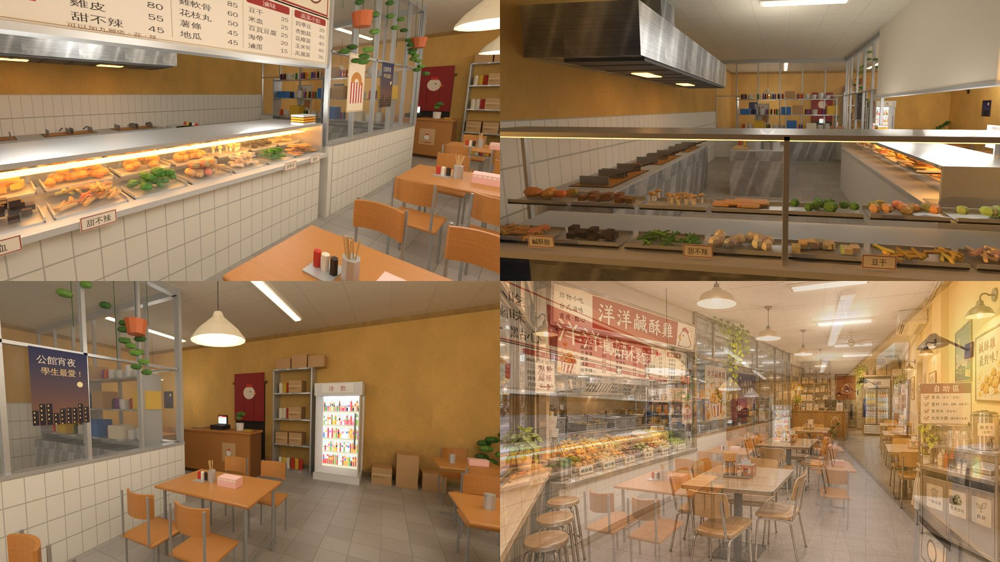
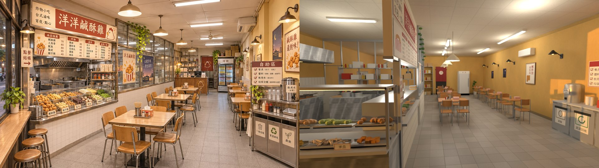
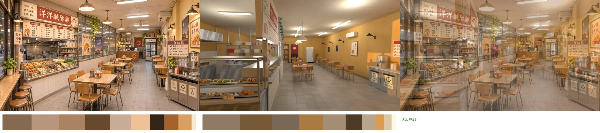
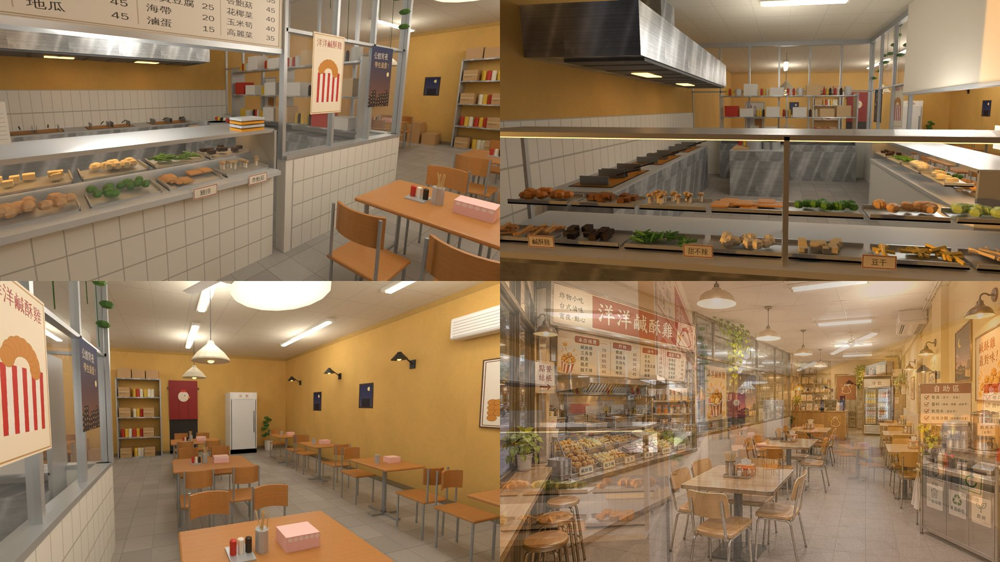

# 洋洋鹹酥雞（公館 G05，原「滷味・鹹酥雞」，AA_650；內部 id `luwei`）室內：BB（帳號 A）2026-11-04

- **v1b（2026-11-04）＝`READY_FOR_REVIEW`**：BB 看過 v1 的同角度圖後退回（構圖不像參考圖），照六點改。
  - 現在的 GLB 和 `yangyang_layout.js`（version 2）是 v1b。
  - v1 的 GLB 在 commit `9eeab9122`，下面的 v1 說明照舊保留。

## v1b（11-04）

### 交件
- `yangyang_v1b_ref_vs_render.jpg`：參考圖｜同角度渲染。
- `yangyang_v1b_refmatch_cmp.jpg`、`yangyang_v1b_refmatch_report.json`：ref_match。
- `yangyang_v1b_views.jpg`：店內炸物櫃近看、從騎樓看臨街櫃台與油鍋、往後看結帳木櫃與冷飲櫃；右下是 50% 疊圖。
- GLB 規格寫在 `glb_specs.json`（v1b）。

### GLB 規格
| 檔案 | 大小 | 三角形 | 材質 | draw call |
|---|---|---|---|---|
| `yangyang_interior.glb`（v1b） | 4.19 MB | 48,734 | 12 | 23 |

### ref_match（960 × 540、32 取樣）
- 鏡頭：在店內門後右邊，眼睛 (3.0, 1.7, 5.3)，看 (0.0, 1.15, −5.5)，15 mm。
- 渲染：`--night --exposure -0.5`，12 盞 35 W 點光源，放在吊燈、炸物櫃、壁燈、燈管的位置。
- **沒有太陽**：用渲染工具的本機副本，加了 `--nosun`，在 scratchpad，沒有改 LAWWW2 的 `render_cycles.py`。

| 項目 | 門檻 | 參考圖 | v1b | 結果 |
|---|---|---|---|---|
| 平均亮度差 | ≤ 0.08 | 0.508 | 0.575 | PASS |
| 對比 | ≥ 參考 × 0.8（0.507） | 0.634 | 0.549 | PASS |
| 冷暖（R−B）差 | ≤ 0.05 | +0.264 | +0.279 | PASS |
| 色票平均 ΔE | ≤ 18 | — | 6.9 | PASS |
| 九宮格亮度差 | ≤ 0.12 | — | 0.086 | PASS |

**ALL PASS**。

### 改了什麼（BB 的六點）
1. **同角度鏡頭**
   - 鏡頭移到店內門後右邊，對準店內那座炸物櫃和招牌，招牌和菜單板在畫面左上。
   - 店內炸物櫃加長、往前（z 1.0～4.7，深 0.8）。
   - 菜單板只到 z 4.3，靠門那一頭不會擠到鏡頭邊。
2. **前景兩組木桌椅、右前自助區**
   - 四人桌改到 x 1.2，z 2.9 和 0.6 兩組在前景，桌上有筷子筒、面紙盒、醬料。
   - 右前景是自助區：三格垃圾桶、飲水桶。
3. **炸物堆滿、堆高**
   - 店內炸物櫃改成三排階梯盤子，每盤數量加倍、中間堆高、顏色有深淺。
   - 順序照參考圖：鹹酥雞、甜不辣、雞排、地瓜、米血、四季豆……
   - 櫃裡兩條暖黃燈，渲染時炸物櫃上方另外補兩盞暖光。
4. **左牆、後牆**
   - 左牆上半是白磁磚腰牆加不鏽鋼框玻璃（廚房玻璃窗），玻璃上貼海報。廚房加深到 z −2.5，玻璃窗沿著座位區一路往後。
   - 黃金葛垂吊，另外兩個吊盆。
   - 後牆中間是結帳木櫃（裝飾，結帳互動照舊併在點餐），上面有收銀機、外帶袋、盆栽、零錢盤；旁邊是冷飲櫃（裡面亮）、紅色門簾、層架。
5. **老店感**
   - 黃牆加上補漆、下半的水漬油漬、椅背高度以下磨髒、膠帶痕、刮痕。
   - 廚房層架的東西多、顏色雜：瓶罐 8 種顏色、紙箱 7 種。
6. **光**
   - 吊燈、壁燈是暖色白熾燈（更亮、更橘），日光燈管改成暖白、變暗。
   - 右牆的低角度陽光拿掉了。

### 配置（`src/data/yangyang_layout.js` version 2）
- **廚房、炸物櫃**：
  - 廚房 z −2.5～5.5。
  - 店內炸物櫃 x −1.05～−0.25、z 1.0～4.7。
  - 玻璃隔間 z −2.5～1.0。
  - 店內點餐 (0.2, 3.4)，看菜單 (0.2, 1.6)。
- **座位**：
  - 四人桌 4 張：(1.2, 2.9)、(1.2, 0.6)、(1.1, −1.7)、(−2.9, −4.3)。
  - 兩人桌 4 張，沿右牆。
  - seats 共 24 個。
- **後牆**：
  - 結帳木櫃 x −1.6～0.2（裝飾，擋住）。
  - 冷飲櫃 x 1.3～2.2，拿冷飲 (1.75, −4.3)。
  - 門簾 x −0.6、層架 x 0.25～1.15。
- 騎樓點餐、門、spawn、exit 照 v1。

### 和參考圖不同的地方（v1b）
- 參考圖左前景的窗邊吧台和圓凳照舊沒做：外觀的左邊是炸物櫃台開口，西牆是實牆。
- 參考圖裡從門口就看得到的開放式廚房（油鍋、抽油煙機），這裡在臨騎樓的那一段，從同角度看過去，在店內炸物櫃的後面。
- 自助區在右前景，但比參考圖更靠近鏡頭，飲水桶在畫面右邊被切掉一點。

### 還不夠好的地方（v1b）
- 炸物是頂點色的小橢球、方塊，近看不油亮。
- 吊燈燈罩是素面的錐形，參考圖是金屬圓頂。
- 預算用到 48,734 三角形、4.19 MB，還有餘裕，但炸物很吃面數。
- 只有 Blender 渲染，還沒有遊戲截圖、手機模擬。

---

# v1（留著對照）

- **v1＝已被 v1b 取代**（BB 退回：構圖不像參考圖）。
  - 目前只有 Blender Cycles 渲染，不是遊戲畫面；還沒接進遊戲，也沒有手機模擬。
  - 模型收件和 `ART_APPROVED` 都由 **LAWWW2** 驗、LAWWW2 標（這間是 BB 做的，AA_650 第 3 節）。
- 參考圖（就是規格）：`docs/story_planning/ref_images/shops/gongguan_yangyang_int.webp`（外觀 `_ext.webp`）。
- 門窗照 LAWWW2 外觀：`claude/second-ai-env-art` 5550948fb，`docs/art-rebuild/second_ai/wip/gongguan5/DOORS.md`。
- 菜單照 AA_650 第 4 節。營業時間 17:00～01:00。門牌 **132**：136 是頁間書屋，照 LAWWW2；室內看不到門牌。

## 交件
| 檔案 | 內容 |
|---|---|
| `assets/models/env/second_ai/bb_support/yangyang_interior.glb` | 正式 GLB（窗外沒有騎樓卡片） |
| `src/data/yangyang_layout.js` | 配置 v1：blocks 41 個、seats 28 個、interact 5 個，另有 spawn、exit、兩個店員 |
| `tools/blender/env_second/bb_support/yangyang_interior.py` | 建模腳本：在美術線 worktree 跑；配置用 node 讀 |
| `tools/blender/env_second/bb_support/yangyang_tex.py` | 貼圖：地磚、天花板、黃牆、木桌、不鏽鋼、印刷圖集、冷飲櫃發光圖；共用 `shaola_tex.py`、`cvs_tex.py` 的函式 |
| `yangyang_v1_ref_vs_render.jpg` | 參考圖｜同角度渲染 |
| `yangyang_v1_refmatch_cmp.jpg`、`yangyang_v1_refmatch_report.json` | ref_match（含 50% 疊圖） |
| `yangyang_v1_views.jpg` | 店內炸物櫃與菜單板、從騎樓看臨街的炸物櫃台與油鍋、往後看座位與冷飲櫃；右下是 50% 疊圖 |
| `glb_specs.json` | GLB 規格 |

## GLB 規格（≤ 6 萬三角形、≤ 12 材質、≤ 6 MB）
| 檔案 | 大小 | 三角形 | 材質 | draw call | 貼圖 |
|---|---|---|---|---|---|
| `yangyang_interior.glb` | 2.73 MB | 33,114 | 12 | 23 | 8 張 webp，334 KB |

- **12 個材質**：`yy_floor`、`yy_ceiling`（單面朝下）、`yy_wall`、`yy_wood`、`yy_print`、`yy_steel`、`yy_vc`、`yy_vc_metal`、`yy_glass`、`GLOW_yy_tube`、`GLOW_yy_warm`、`GLOW_yy_screen`。
- 金屬度 ≤ 0.45。
- **淡出牆**：`WALL_front／back／left／right`。
- **正面玻璃**另外分一個物件 `GLASS_front`：門、窗、臨騎樓展示櫃的正面玻璃都在這裡，不進淡出群組，鏡頭在店外時可以單獨藏。

## ref_match（960 × 540、32 取樣）
- **鏡頭**：站在騎樓，從門口往裡看，藏起 `WALL_front`、`GLASS_front`（遊戲裡鏡頭在店外時，前牆本來就會淡出）。
  - 眼睛 (0.3, 1.7, 7.3)，看 (1.6, 0.9, −5.5)，18 mm。
- **渲染**：`render_cycles.py --night --view Standard --exposure -0.5`，加 9 盞 40 W 點光源，放在燈管、吊燈、廚房燈的位置。
  - 參考圖是晚上，用室內燈打光。

| 項目 | 門檻 | 參考圖 | 渲染 | 結果 |
|---|---|---|---|---|
| 平均亮度差 | ≤ 0.08 | 0.508 | 0.473 | PASS |
| 對比 | ≥ 參考 × 0.8（0.507） | 0.634 | 0.535 | PASS |
| 冷暖（R−B）差 | ≤ 0.05 | +0.264 | +0.221 | PASS |
| 色票平均 ΔE | ≤ 18 | — | 8.3 | PASS |
| 九宮格亮度差 | ≤ 0.12 | — | 0.058 | PASS |

**ALL PASS**。

## 配置（`src/data/yangyang_layout.js`，改數字就跟著算）
**尺寸**
- 9.2 × 11 × 3.3。外觀一樓高到 3.85，室內做到 3.3 再加天花板。

**正面（照外觀）**
- 炸物櫃台開口 x −4.3～−0.25：沒有玻璃，開口頂 2.85。櫃台面 0.82，上面是玻璃展示櫃 0.82～1.55，朝騎樓。
- 玻璃對開門 x 0.45～1.95，高 2.47。
- 落地窗 x 1.95～3.5，窗高 0.3～2.47。
- 實牆：x −4.6～−4.3、−0.25～0.45、3.5～4.6。

**廚房和炸物櫃**
- 廚房 x −4.6～−0.25、z 0～5.5，整塊擋住，店員在裡面。
- 炸物櫃台、油鍋在左邊開口後面，客人在騎樓點餐。
- 店內那一側另有一座炸物櫃（x −0.85～−0.25、z 2.3～4.8），面向 +x，上面是招牌和菜單板；店內也能點。
- 廚房後段是白磁磚腰牆加不鏽鋼框玻璃，在 x −0.25、z 0～2.3 和 z 0 那一面。

**座位、自助區、後牆**
- 四人桌 5 張、兩人桌 4 張，放在門和窗後面、店的中後段。
- 自助區在右牆前段（z 3.0～4.9）。
- 冷飲櫃、紅色門簾、層架在後牆。

**互動點**
- **`order_street`（騎樓點餐）在店外**：(−2.3, 6.1)，騎樓上離店面 0.6 m，`outside: true`，要由 LAWWW 接在公館區域，不是室內。
- 店內：`order`（店內點炸物）(0.2, 3.6)、`menu`、`drink`、`selfserve`。
- 結帳併在點餐裡。
- spawn (1.2, 4.7)，exit (1.2, 5.2)：門的中心 x 1.2。

## 拆圖清單（室內參考圖，從左到右、由前到後；■＝做到）
| # | 東西 | 位置 | 模型物件 | 狀態 |
|---|---|---|---|---|
| 1 | 左前景：窗邊木吧台、圓凳 | 左、前 | — | 不做：西牆不能開窗，外觀左前是炸物櫃台開口（見「不同的地方」1） |
| 2 | 「點餐 結帳 →」牌 | 左 | `yy_print` | ■（掛在店內炸物櫃靠門那一頭的柱子上） |
| 3 | 大招牌「洋洋鹹酥雞」＋「炸物小吃／台式滷味／宵夜・點心」＋小雞標誌 | 左、上 | `yy_print` | ■ |
| 4 | 菜單板四欄：本店推薦、炸物、滷味、蔬菜小點（AA_650 價錢） | 左、上 | `yy_print` | ■（加「可以加九層塔・蒜・辣」） |
| 5 | 抽油煙機、油鍋、炸籃 | 左、中 | `yy_steel`、`yy_vc`、`yy_vc_metal` | ■（油鍋三個、炸籃六個，靠西牆） |
| 6 | 調味料架、鍋盆、紙袋、夾子 | 左、中 | `yy_vc`、`yy_vc_metal` | ■ |
| 7 | 炸物櫃：斜玻璃、一盤一盤的生料（鹹酥雞、甜不辣、豆干、米血、杏鮑菇、四季豆、花椰菜…）、價目牌 | 左、前 | `yy_vc`、`yy_vc_metal`、`yy_glass`、`yy_print` | ■（店內一座、臨騎樓一座，共 26 盤） |
| 8 | 炸物櫃下面的白磁磚 | 左、前 | `yy_print`（tile） | ■ |
| 9 | 一疊不鏽鋼盤 | 左、前 | `yy_vc_metal` | ■ |
| 10 | 不鏽鋼框玻璃隔間、白磁磚腰牆 | 左、中後 | `yy_vc`、`yy_vc_metal`、`yy_glass` | ■ |
| 11 | 隔間玻璃上的海報：「洋洋鹹酥雞」炸物桶、「公館宵夜 學生最愛！」夜景 | 左、中 | `yy_print` | ■ |
| 12 | 黃金葛（吊在隔間上） | 左、上 | `yy_vc` | ■ |
| 13 | 四人桌（淺木面、鋼管腳）、木椅（彎椅背、鋼管腳） | 中 | `yy_wood`、`yy_vc_metal` | ■（5 張） |
| 14 | 桌上：筷子筒、粉紅面紙盒、醬料瓶 | 中 | `yy_vc`、`yy_vc_metal`、`yy_print` | ■ |
| 15 | 琺瑯吊燈 | 中、上 | `yy_vc`、`GLOW_yy_warm` | ■（每張四人桌一盞） |
| 16 | 天花板日光燈管、方格天花板、吊扇、分離式冷氣 | 上 | `CEILING`、`GLOW_yy_tube`、`yy_vc` | ■ |
| 17 | 右牆：暖黃色舊漆、黑色鵝頸壁燈、相框（月亮）、海報「鹹酥雞最對味！」 | 右 | `WALL_right_*`、`GLOW_yy_warm` | ■（壁燈 5 盞） |
| 18 | 兩人桌一排 | 右 | `yy_wood`、`yy_vc_metal` | ■（4 張） |
| 19 | 自助區：不鏽鋼櫃、三格垃圾分類（一般垃圾／資源回收／廚餘）、飲用水桶＋「飲用水（自取）」、紙杯、醬料、胡椒粉、鐵盤、毛巾、「自助區」牌（四項） | 右、前 | `yy_steel`、`yy_vc_metal`、`yy_print` | ■ |
| 20 | 盆栽（自助區旁、後面） | 右 | `yy_vc` | ■ |
| 21 | 後面：冷飲櫃（「冷飲」、裡面亮） | 後 | `GLOW_yy_screen`、`yy_vc`、`yy_glass` | ■ |
| 22 | 後面：紅色門簾（小雞） | 後 | `WALL_back_print` | ■ |
| 23 | 後面：層架、紙箱、罐子 | 後 | `yy_steel`、`yy_vc` | ■ |
| 24 | 後面：木頭結帳櫃台、收銀機 | 後 | — | 不做：結帳在點餐的炸物櫃（見「不同的地方」3） |
| 25 | 地板：淺灰小方磚 | 下 | `FLOOR` | ■（D112） |

## 第 11 節醜點清單
- [x] **比例**：9.2 × 11 × 3.3 m。桌高 0.76、椅座 0.45、炸物櫃台面 0.82、店內炸物櫃 0.88。
- [x] **光**：不是整片均勻白光。
  - 燈管是一條一條的，吊燈和壁燈是暖色。
  - 牆是暖黃色、天花板是暖白。
- [x] **密度**：參考圖擺滿的地方都擺了，小東西超過 15 種。
  - 炸物 16 種、價目牌、夾子、炸籃、油鍋、抽油煙機、調味罐、紙袋、鍋盆、不鏽鋼盤、筷子筒、面紙盒、醬料瓶、飲用水桶、紙杯、毛巾、海報、相框、黃金葛、盆栽、紙箱、冷飲櫃、門簾、吊扇、冷氣…
- [x] **商品不是單色方塊**：炸物是一顆一顆的小橢球、條、塊、菇，一盤一盤放在不鏽鋼淺盤上。
- [x] **在地感**：台式宵夜菜單、新台幣價錢、三格垃圾分類、自取的飲用水、手寫點餐單、紅色門簾。
- [x] **預算**：33,114 三角形、12 材質、2.73 MB。
- [x] **D112**：淺灰小方磚。**D77**：沒有真實品牌。**D115**：海報寫「公館」（地名），沒有校名。

## 和參考圖不同的地方
1. **門窗照外觀**：參考圖左前景是一排窗邊吧台和圓凳、左牆是窗。這間是中間的店，左邊在外觀上是臨騎樓的炸物櫃台開口，西牆是實牆，所以沒有窗邊吧台。
   - 同角度鏡頭站在騎樓、往門裡看。左前景是臨騎樓的炸物櫃台從背面看過去，參考圖這裡是窗邊吧台。
2. **炸物櫃有兩座**：外觀要客人在騎樓點，參考圖是店裡面對座位的炸物櫃，所以兩座都做。
   - 臨騎樓的一座，玻璃朝外；店內的一座，在菜單板下面。
3. **結帳**：參考圖後面有一座木頭櫃台。這裡把後面讓給座位（四人桌 5 張），結帳併在點餐那裡，後牆只有冷飲櫃、門簾和層架。
4. **自助區位置**：參考圖在右前景，這裡在右牆前段，z 3.0～4.9。

## 還不夠好的地方（誠實說）
- 同角度圖裡，左前景是臨騎樓炸物櫃台的背面，不像參考圖那樣一進門就是整座斜玻璃櫃。
- 炸物是簡單的橢球、方塊，近看不像油亮的炸物，也沒有畫進反光。
- 廚房裡的層架東西偏白、偏少，參考圖的廚房比較擠、比較舊。
- 牆、地板乾淨，沒有油污和歲月感。宵夜老店可以再髒一點（第 11 節的「歲月感」只有地磚縫和下緣）。
- 渲染時窗外有一點低角度的太陽光，照在右牆上。
- 只有 Blender 渲染，還沒有遊戲截圖、手機模擬。
