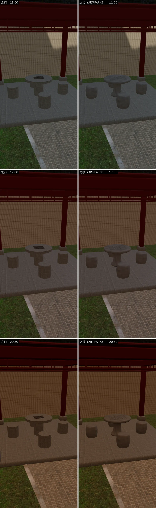
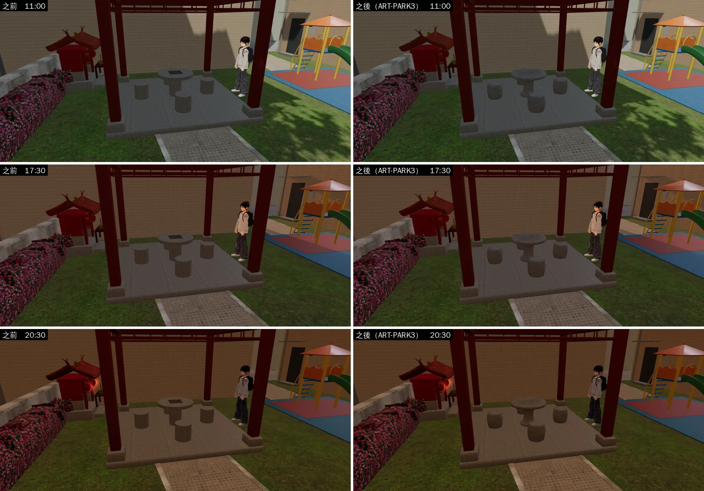
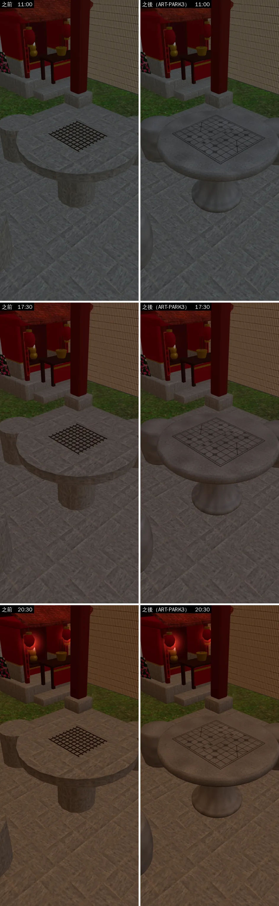
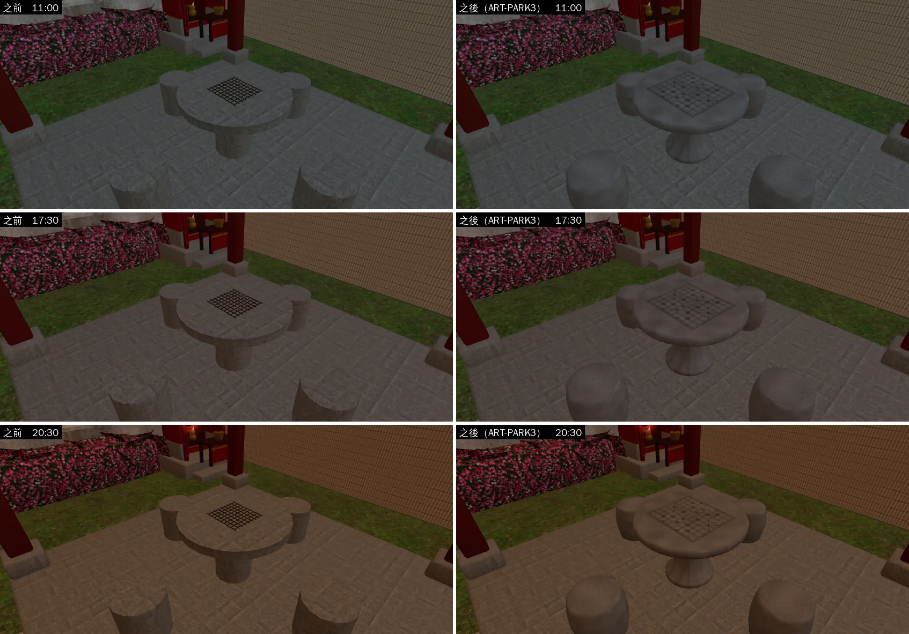
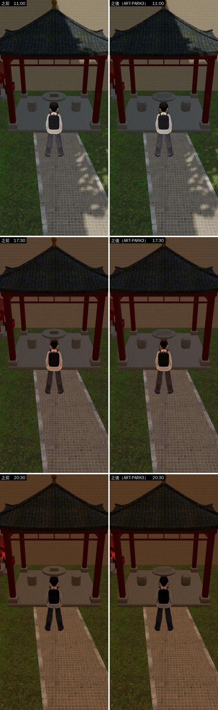
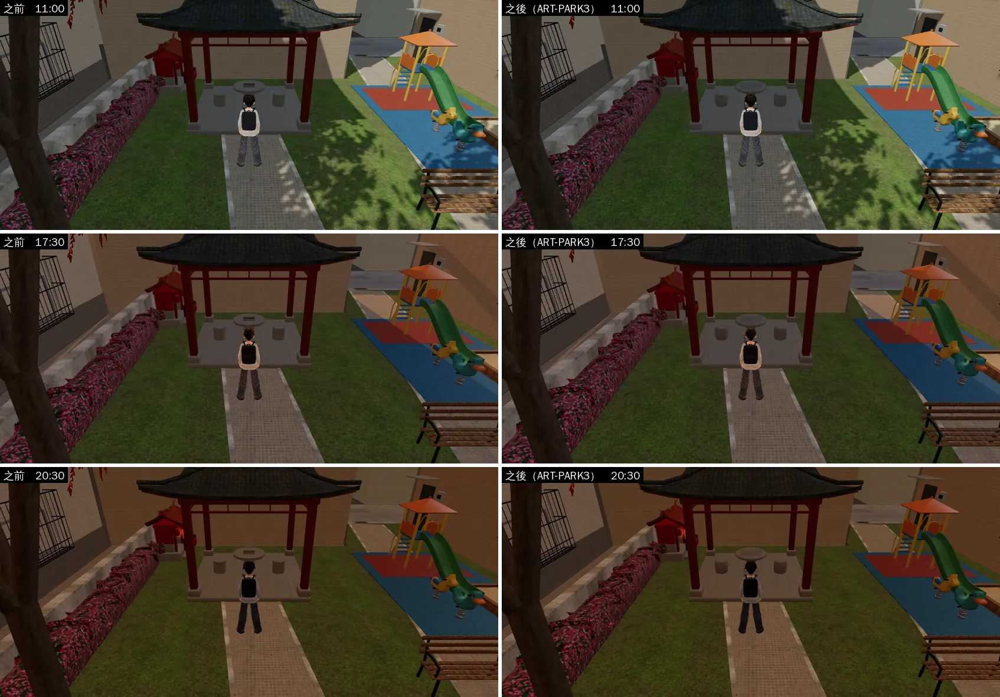
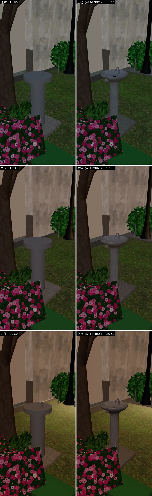
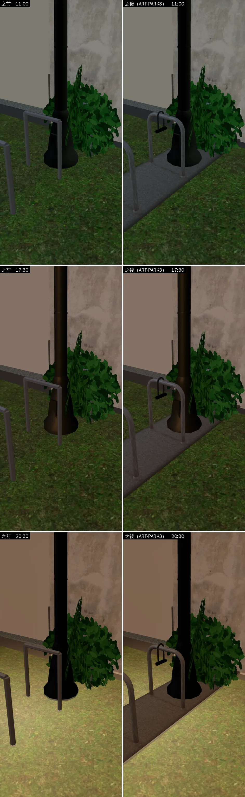
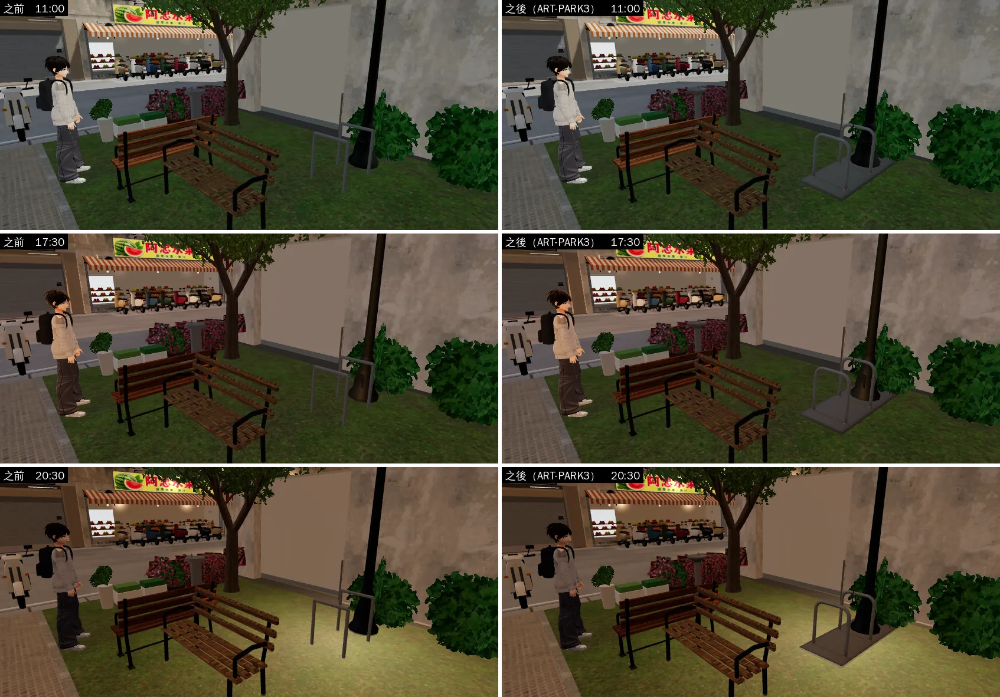

# bb_support：BB-B 支援 LAWWW2-B 的美術

> 使用者 2026-10-16：
> - 「如果晚一點你和AA手上都沒工作了 就去支援LAWWW2美術 要跟他要他生成場景的規則 你們三個要分工 不要重複做 照LAWWW2原本的3D規則」
> - （AA-B 轉達）「你如果幫忙美術，做之前要問清楚規格要求方式，做完要給LAWWW2確認」
>
> - **規格**：LAWWW2-B 2026-10-16 08:1x 的訊息（ART-GYM-P1）＋`docs/art-rebuild/second_ai/SCENE_RULES.md`。BB-B 開工前已回「確認規格」。
> - **所有權**：仍是 LAWWW2-B 的。BB-B 只在自己的分支（`claude/elegant-brown-fcos7n`）commit；LAWWW2-B 驗收、merge 以後，照原流程交 LAWWW-B。
> - **不改**：`src/`、`zones3d`、`assets3d`、`lib2.py`、`cafe_layout.py`、LAWWW2-B 的腳本。
> - **狀態**：美術最多到 `READY_FOR_REVIEW`，LAWWW2-B 確認前不算完成。
> - **ART-GYM-P1：LAWWW2-B 2026-10-16 09:01 驗收通過、merge（`f2bebf72`）**。之後交 LAWWW-B 整合；建築、場景的 `ART_APPROVED` 只有使用者能標。

## ART-GYM-P1 新體育館 B1 健身中心的器材：`gym_b1_props.py` → `assets/models/env/second_ai/bb_support/gym_b1_props.glb`

```
/opt/blenv/bin/python tools/blender/env_second/bb_support/gym_b1_props.py
/opt/blenv/bin/python tools/blender/env_second/render_cycles.py -- assets/models/env/second_ai/bb_support/gym_b1_props.glb <輸出資料夾> gym_b1 tools/blender/env_second/bb_support/gym_views.json --res 1280x640 --samples 48 --ground --view Standard --exposure -2.5
```

- **需要** LAWWW2-B 分支的 `lib2.py`（`rbox_bm`、`CMesh.crbox`、`vc_metal`）和 `b3lib.py`。BB-B 分支上的 `lib2.py` 可能是舊版：請在 LAWWW2-B 的分支跑。BB-B 是把那兩個檔讀出來、在暫存資料夾跑的，沒有改它們。
- **工具**：Blender 5.2.2（bpy，`/opt/blenv`，照 `docs/art-rebuild/TOOLCHAIN_AUDIT.md` 裝）。
- **做法**：
  - 管件用 `cyl`（8～12 邊），圓的東西（槓片、飛輪、風扇罩、阻力旋鈕、捲起來的墊子）用 `lathe` 旋轉體；
  - 平板、坐墊、護蓋用倒角方塊（`rbox_bm`／`crbox`），沒有直角方塊；
  - 每件做完合併重疊頂點（`remove_doubles`），再 `smooth_mesh`（0.6 弧度以上保留硬邊）。
- **材質**：兩個，都是頂點色（一次 draw call 一個材質）。
  - `gymb1_metal`：`vc_metal`，金屬度 0.40（上限 0.45）、粗糙度 0.42。用在深灰烤漆的框架 `#2e3136`、淺灰的護蓋與托盤 `#4a5058`、鍍鉻的槓、導桿、套筒 `#b9bdc3`。
  - `gymb1_vc`：`vc_material`，粗糙度 0.72。用在黑橡膠（槓片、六角啞鈴頭、握把、腳墊）`#1d1d1f`、皮墊 `#2b2b2e`、塑膠罩 `#3a3e44`、跑帶 `#232325`、螢幕 `#0f1820`、阻力旋鈕 `#7a1f1f`、運動墊 `#45525c`。
  - 沒有貼圖、沒有 Poly Haven，`LICENSES.md` 不用加。
- **D77**：沒有任何字、品牌、標誌。跑步機和划船機的螢幕是沒有字的暗色面板；槓片沒有刻重量。

| 節點 | 物件 | 尺寸（約） | 三角形 | 說明 |
|---|---|---|---|---|
| `GYM_TREADMILL` | 跑步機 | 長 2.0（z）× 寬 0.85 × 高 1.45 m | 1,456 | 使用的人面向 +z；馬達罩、立柱、側扶手（橡膠握把）、傾斜的儀表板和螢幕、放手機的托盤；跑帶兩側是防滑踏台 |
| `GYM_BIKE` | 飛輪 | 1.2 × 0.55 × 1.25 m | 1,992 | 「λ」形車架：主樑從後腳到把手，座管從主樑中段往後傾；前叉夾住飛輪（鍍鉻）和一側護蓋；阻力旋鈕（暗紅）、曲柄、踏板、可調的座管和把手立管 |
| `GYM_ROWER` | 划船機 | 2.4 × 0.6 × 0.9 m | 1,820 | 風扇罩和腳踏板在 +z；鋁色單軌、座椅和滑車、前後腳、拉把、螢幕支臂和沒有字的小螢幕 |
| `GYM_SQUAT_RACK` | 深蹲架＋槓 | 1.3（x）× 1.2（z）× 2.3 m | 2,044 | 四根 75 mm 方管立柱、頂底樑、地上橡膠墊；前排立柱內側 J 鉤（1.4 m）、安全槓（0.65 m）；2.2 m 奧林匹克槓掛在 J 鉤上，兩邊各兩片 45 cm 黑色槓片 |
| `GYM_SMITH` | 史密斯機 | 2.1 × 1.4 × 2.2 m | 2,152 | 外框＋中間上下橫樑；兩根鍍鉻導桿、滑套、槓（1.25 m）兩邊各一片槓片；後排立柱外側的掛片桿，各掛一片 |
| `GYM_DB_RACK` | 啞鈴架＋一組啞鈴 | 2.0 × 0.7 × 0.85 m | 2,236 | 兩層斜托盤、三組梯形側框；10 對六角啞鈴：上層 2、4、6、8、10 kg，下層 12、14、16、18、20 kg，頭的大小照重量變 |
| `GYM_BENCH` | 可調式臥推椅 | 1.35 × 0.6 m，座面 0.45 m | 1,792 | 椅背在 −z、立 30°；座墊、主樑、前後腳架、椅背撐桿、調整梯（5 格）、前面勾腳的滾筒 |
| `GYM_MAT` | 運動墊（平放） | 1.8 × 0.6 × 0.012 m | 108 | 倒角的薄墊 |
| `GYM_MAT_ROLL` | 運動墊（捲起來，**備用**） | 長 0.6 m、直徑 0.16 m | 144 | LAWWW2-B 不要可以直接刪這個節點 |

- **合計**：13,744 三角形（上限 15k）；每件都在 3k 以下；2 個材質；16 個網格（每件 metal、vc 各一個；兩張墊子只有 vc）；GLB 約 0.7 MB。
- **原點**：每件的底面中心，y=0 是地面，正面朝 +z（遊戲端用 yaw 轉）。
- GLB 裡的物件位置只是排開給人看（`SPREAD`，x 從 −7.2 到 +7.2），遊戲端用每件的網格本身擺。
- **渲染**（`render_cycles.py`）：
  - Cycles CPU 48 spp、OIDN、Nishita 天空＋太陽、地面；
  - 色彩轉換用 **Standard、曝光 −2.5**（和 AA-B 的 aa_support 同一個理由：預設 AgX 在這個光下會把深灰框架、黑橡膠洗成淺灰，看不出真正的顏色）；
  - 圖在 `docs/art-rebuild/second_ai/blender_renders/bb_support/`（webp）：總覽（1600×640）、有氧器材 45°、飛輪近景、兩座架子、啞鈴架＋臥推椅＋墊子（1280×640）。鏡頭在 `gym_views.json`；總覽是 1600×640，其他 1280×640。

### 還沒做、要注意的

- **沒有遊戲內截圖**：GLB 還沒接進 manifest（那是 LAWWW2-B 驗收、LAWWW-B 整合的事），只有 Blender 渲染（D38 第 8 點：Blender 渲染≠遊戲驗收）。
- 沒有 `_lod1`：每件都在 2.3k 以下，健身中心是近景；要的話可以補。
- 立柱沒有打孔（真的深蹲架、史密斯機有一排調整孔）：用貼圖或法線比較省，幾何做孔會超過預算。
- 跑步機、划船機的螢幕是純色面板，沒有發光；要晚上亮的話可以改成 `emit`，或加 `GLOW_` 空節點。
- 數量：真的健身中心有氧機 40 台、深蹲架 3 組、史密斯機 2 組（`BB_151` 4b），這裡每種一件，擺放時用 instancing 重複。

## ART-GYM-P2／P3a：B1 健身中心與泳池邊還缺的道具：`gym_b1_entry.py` → `assets/models/env/second_ai/bb_support/gym_b1_entry.glb`

- **派工**：LAWWW2-B 2026-10-16 HANDOFF（`d58dfec5`）「BB-B：GYM-P2／P3a 合併，B1 服務櫃台、置物櫃、鏡牆、地墊、泳池邊」。
- **對照 LAWWW2-B 的 B1**（`f3180c69`）：
  - B1 已經有鏡牆（南牆整面）、橡膠地坪（貼圖）、閘門三道、水道繩、仰泳旗、出發台、扶梯、大時鐘。
  - 他寫還缺、等 BB-B 交的是：**服務櫃台、置物櫃、飲水機、救生員椅**。這四件是主件。
  - 鏡牆、地墊、體重計、毛巾籃、浮板架是備用，不要可以直接刪。
  - 泳池邊的出發台、扶梯、水道繩、旗繩，B1 已經有了，BB-B 不做（避免重複）。
- 櫃台照 B1 配置 `(21, 0.95)`、客人站 z 1.9：櫃台的客人面朝 +z，擺進去不用轉。

```
/opt/blenv/bin/python tools/blender/env_second/bb_support/gym_b1_entry.py
/opt/blenv/bin/python tools/blender/env_second/render_cycles.py -- assets/models/env/second_ai/bb_support/gym_b1_entry.glb <輸出資料夾> gym_b1e tools/blender/env_second/bb_support/gym_entry_views.json --res 1280x640 --samples 48 --ground --view Standard --exposure -2.5
```

- 工具、做法、兩個頂點色材質（`gymb2_metal`、`gymb2_vc`）的規則都和 P1 一樣；沒有貼圖、沒有 Poly Haven，`LICENSES.md` 不用加。
- **D77**：沒有字、品牌、標誌。刷卡機、平板、螢幕、體重計的顯示都是沒有字的暗色面板；置物櫃的號碼牌是空白的；救生員椅沒有字。

| 節點 | 物件 | 尺寸（約） | 三角形 | 說明 |
|---|---|---|---|---|
| `GYM2_COUNTER` | 服務櫃台 | 2.4（x）× 0.75（z）× 1.05 m | 2,860 | 客人站 +z、櫃台人員在 −z。客人那面是淺色美耐板加 15 根木條，有深色踢腳；檯面深灰，往客人那邊多出 3 cm。檯面上有刷卡機、報到用平板（立架）、筆筒、五條摺好的毛巾。櫃台人員那邊有坐著高度的工作檯，螢幕背對客人 |
| `GYM2_LOCKERS` | 置物櫃 | 1.8 × 0.45 × 1.05 m | 1,800 | 上下兩層 × 6 格＝12 格；淺灰本體、藍灰門、不鏽鋼把手、空白號碼牌；0.1 m 深色底座 |
| `GYM2_WATER` | 飲水機 | 0.42 × 0.38 × 1.1 m | 568 | 不鏽鋼；上面的水槽、出水口、正面按鈕、後擋板 |
| `GYM2_LIFEGUARD` | 救生員高椅 | 0.72 × 1.0 m，座面離地 1.6 m | 768 | 白色烤漆鋼管、前面五階梯子、橘色座墊和椅背 |
| `GYM2_SCALE` | 體重計（備用） | 0.4 × 0.5 × 1.45 m | 468 | 立柱式 |
| `GYM2_TOWEL_BIN` | 毛巾回收籃（備用） | 直徑 0.46、高 0.62 m | 456 | 裡面露出兩條毛巾 |
| `GYM2_KICKBOARD_RACK` | 浮板架＋五塊浮板（備用） | 0.6 × 0.3 × 0.75 m | 820 | 池邊用；藍、黃浮板 |
| `GYM2_MIRROR` | 鏡牆（備用） | 3.0 × 2.0 m，離地 0.3 m | 308 | B1 已經有整面鏡牆；鏡面是獨立的網格 `gymb2_mirror_pane` |
| `GYM2_FLOOR` | 橡膠地墊拼塊（備用） | 2 × 2 m（16 塊 0.5 m） | 704 | B1 已經用橡膠地坪貼圖 |

- **合計**：8,752 三角形（上限 15k）；每件都在 3k 以下；2 個材質；GLB 約 0.5 MB。
- **原點**：每件的底面中心，y=0 是地面，正面朝 +z。GLB 裡的位置只是排開給人看（`SPREAD`）。
- **渲染**（Cycles 48 spp、Standard、曝光 −2.5，和 P1 相同）：總覽、櫃台（客人那面、櫃台人員那面）、置物櫃＋飲水機、救生員椅＋備用三件，在 `docs/art-rebuild/second_ai/blender_renders/bb_support/gym_b1e_*.webp`。
- **狀態**：`READY_FOR_REVIEW`，等 LAWWW2-B 驗收；沒有遊戲內截圖（B1 區域還沒建）。

### 還沒做、要注意的

- 櫃台後面的開館時間牌、健身中心的規定告示沒有做：B1 沿用 1F 的開館時間、公告欄。
- 置物櫃只有一組 12 格；真的有好幾排，用 instancing 重複。

## ART-TUTOR1：家教學生家客廳的道具組：`tutor_props.py` → `assets/models/env/second_ai/bb_support/tutor_props.glb`

- **派工**：LAWWW2-B 2026-10-16 11:01「ART-TUTOR1：家教學生家客廳的道具組（tutor_home，大一下第 3 週起；BB_132 55b 的提示詞當規格）。我用 bg_home.py 組場景、打光、算 2D 背景；道具你做。」BB-B 11:0x 回「確認規格」。
- **場景**：明軒介紹的家教（`BB_96` 3-2），國中生補公民，平日晚上七點多；一般三房兩廳公寓的客廳。和「臺北的家」（`home_living`）不能是同一間：沙發換款（米灰、方圓扶手、坐墊塌）、換色（臺北的家是咖啡色）。

```
/opt/blenv/bin/python tools/blender/env_second/bb_support/tutor_props.py
/opt/blenv/bin/python tools/blender/env_second/render_cycles.py -- assets/models/env/second_ai/bb_support/tutor_props.glb <輸出資料夾> tutor tools/blender/env_second/bb_support/tutor_views.json --res 1280x640 --samples 48 --ground --view Standard --exposure -2.5
```

- 工具、兩個頂點色材質的規則和 GYM 一樣：`tutor_metal`（`vc_metal`，金屬度 0.40、粗糙度 0.42）、`tutor_vc`（`vc_material`，粗糙度 0.78）。沒有貼圖、沒有 Poly Haven，`LICENSES.md` 不用加。
- **布面不做方塊**：坐墊、沙發的座墊和靠背墊、扶手、底座都是超橢球的軟方塊（`soft_box`：方的程度、頂面中間凹、側面鼓、中央釘扣），平滑著色。中間那個座墊最塌（最常坐）。
- **D77**：沒有任何字、校名、品牌。課本封面是色塊，內頁是一行一行的灰線；日曆是色塊和格子；相框裡是一家四口的剪影色塊（看不到臉）；電視關著；外套沒有校名。

| 節點 | 物件 | 尺寸（約） | 三角形 | 說明 |
|---|---|---|---|---|
| `TUTOR_TABLE` | 木頭矮桌 | 1.0（x）× 0.6（z）× 0.40 m | 1,310 | 桌面四角倒圓、邊緣小倒角；頂點色的木紋、中間寫字的地方磨亮、邊緣深、一圈淡淡的杯子水痕（在麥茶杯的位置）；四支往下收的桌腳、牙條 |
| `TUTOR_CUSHIONS` | 兩個方形坐墊 | 0.50 × 0.50 × 0.085 m | 776 | 鼠尾草綠、土黃；中間壓扁的凹、中央一顆另一個顏色的釘扣；兩個稍微轉了角度，中心距 0.68 m |
| `TUTOR_STUDY` | 桌上一組 | 約 0.85 × 0.40 m | 1,368 | **y=0 是桌面**（擺在矮桌上：y＋0.40）。攤開的國中公民課本（藍綠封面、靠書脊往下凹的頁面、灰色字行、兩塊插圖色塊）、攤開的練習簿（黃封面、格線）、藍筆和黑筆（金屬筆尖、筆蓋夾）、白色橡皮擦（藍色紙套）、半杯麥茶（不透明：茶面以下茶色、以上玻璃色、杯緣淺色） |
| `TUTOR_SOFA` | 舊的三人布沙發＋國中運動外套 | 1.95 × 0.86 m，座面 0.45 m | 4,028 | 米灰；方圓扶手、三個座墊（中間最塌）、三個往後倒 11° 的靠背墊、短木腳。外套（深藍、兩條白條紋、沒有校名）用 **Blender 布料模擬**：一張布從右邊扶手上方落下，碰撞體就是這張沙發自己的扶手、右邊座墊、椅背，順著扶手的圓角垂下來，再加 8 mm 厚度；一隻袖子從外側的肩線垂下（白條紋、白色袖口） |
| `TUTOR_TVSTAND` | 矮電視櫃＋電視＋相框＋植物 | 1.6 × 0.42 × 0.45 m | 2,310 | 淺橡木：左右各兩個抽屜（金屬把手）、中間開放層（層板上一台小路由器、三顆綠燈）；電視（約 43 吋，關著的深色螢幕、底座）；全家福相框（立架、往後仰 10°）；白色小盆的黃金葛 |
| `TUTOR_LAMP` | 立燈 | 高 1.53 m，燈罩直徑 0.41 m | 992 | 深銅色圓底座、細燈桿、三支燈罩支架；布燈罩外面米白、上下收邊。**燈罩內面＋燈泡＝獨立網格 `TUTOR_LAMP_GLOW`**（法線朝內，給你做發光） |
| `TUTOR_WALL` | 牆上小物 | 0.66 × 0.55 m | 586 | **原點＝貼牆面的底部中央，正面 +z**。時鐘（木框、沒有數字、只有刻度；七點二十分，對上「平日晚上七點多」）、日曆（上面風景照色塊、月份色條、5×7 格子、一格紅色記號；金屬夾條、掛在釘子上） |
| `TUTOR_RUG` | 小地毯 | 1.6 × 1.2 m | 586 | 底色米棕、深色邊框、米白細框、中間三層菱形、四角小菱形；短邊（x 兩端）各 18 條流蘇 |

- **合計**：11,956 三角形（上限 12k）；2 個材質；13 個網格（`tutor_<件>_vc`、有金屬零件的再一個 `tutor_<件>_metal`，立燈另外一個 `TUTOR_LAMP_GLOW`）；GLB 約 0.5 MB。
- **原點**：每件的底面中心，y=0 是地面，正面 +z；`TUTOR_STUDY` 的 y=0 是桌面，`TUTOR_WALL` 的原點貼牆。
- **GLB 裡的位置只是排開給人看**：地毯、矮桌、課本組（y=0.40）、坐墊排成一組（看得出彼此的比例），沙發、立燈、電視櫃、牆上小物排一排。遊戲端用每件的網格自己擺。
- **渲染**（`render_cycles.py`，Cycles CPU 48 spp、Standard、曝光 −2.5）：總覽、矮桌一組、桌上近景、沙發＋立燈、外套近景、電視櫃、牆上小物，7 張 1280×640，在 `docs/art-rebuild/second_ai/blender_renders/bb_support/tutor_*.webp`；鏡頭在 `tutor_views.json`。

### 還沒做、要注意的

- **沒有遊戲內截圖**：只有 Blender 渲染（D38 第 8 點）。`tutor_home` 的 2D 背景由 LAWWW2-B 用 `bg_home.py` 組場景、打光、算圖。
- 渲染是戶外的太陽光；室內（吸頂燈＋立燈）下沙發的米灰會比渲染圖暗、偏灰。
- 麥茶杯不透明（兩個材質的限制）；要透明的話要第三個材質。
- 課本的字行是幾何的細線（約 320 三角形）；遠景可以換成一塊色塊省三角形。
- **外套**（v2，布料模擬）：v1 是照扶手斷面算出來的布套，近看很硬；v2 改成 Blender cloth 模擬（`cloth_drape`：品質 10、50 格、碰撞體＝扶手、座墊、椅背），順著扶手垂下。條紋對齊布的格子（一排 3 cm）。還是一片平順的布，沒有衣服的領口、拉鍊；袖子是另外一根管子，從外側肩線垂下。
- 課本字行的右端近看有很小的暗點（平滑著色的接縫），2D 背景的距離看不到。
- **重跑不會逐位元相同**：倒角（`crbox`）用 Python set 收集頂點，順序每次不同；三角形數、材質、節點、檔案大小相同。比對請用三角形數和渲染圖，不要用檔案雜湊（2026-10-16 實測）。
- 渲染兩輪改過：外套貼合扶手（v2 再換成布料模擬）；坐墊釘扣貼回凹下去的頂面；課本內頁從淡色塊改成一行一行的字；練習簿格線加深；日曆月份條和格子重疊（閃爍）移開；相框裡的人從長條改成剪影。
- 窗、窗簾、落地窗外的對面公寓不在這裡（`bg_home.py` 的場景本身）。

## ART-US3：美國公寓臥室的家具：`us_bedroom_props.py` → `assets/models/env/second_ai/bb_support/us_bedroom_props.glb`

- **派工**：LAWWW2-B 2026-10-16 12:14「要不要接美國公寓臥室那一組（床、床頭櫃、書桌、椅子、行李箱、吸頂燈；規格照 src/data/us_apartment_layout.js 的 furniture，和 AA-B 的 ART-US1 同一套做法）？」BB-B 12:1x 回「接」＋規格確認（三個問題）。LAWWW2-B 12:25 回：a 床頭板要（矮的深色木板）、b 辦公椅、c 檯燈＋闔上的筆電要（燈罩內面 `US_DESK_GLOW` 用 US_glow）；**改名 ART-US3**（AA-B 接了廚房＝ART-US2）；渲染放 `test_shots/us_apartment/us3_*.webp`。
- **場景**：SCN-US-01，大三下美國交換時祐廷租的校外學生公寓（D47）。外觀照 `docs/art-rebuild/second_ai/research/us_apartment_photos.md` 的照片一（從客廳看進臥室：米灰色地毯、灰白人字紋被子、黑色小方格櫃、吸頂燈）；位置、尺寸照 `us_apartment_layout.js` v2 的 `furniture`（`room:'bedroom'`）。

```
/opt/blenv/bin/python tools/blender/env_second/bb_support/us_bedroom_props.py
/opt/blenv/bin/python tools/blender/env_second/render_cycles.py -- assets/models/env/second_ai/bb_support/us_bedroom_props.glb <輸出資料夾> us3 tools/blender/env_second/bb_support/us3_views.json --res 1280x640 --samples 48 --ground --view Standard --exposure -2.5
```

- **做法和 AA-B 的 ART-US1（`aa_support/us_living_props.py`）一樣**：兩個材質 `us_bedroom`（不透明：1024 底色貼圖集＋256 ORM，金屬度最高 0.40）、`US_glow`（燈罩內面、吸頂燈玻璃罩：奶油色＋發光，亮度由遊戲控制）；網格工具（`PM`、`rbox`、`lathe`、`sweep`、`box`、`cushion`）照抄，另外加了 `Rz`、`rrect`（圓角長方形）、`drape`（沿折線的布條，可以有皺褶）。貼圖集在 `tools/blender/env_second/bb_support/textures/gen/us_bedroom_props_{atlas,orm}.png`。
- **貼圖**（Poly Haven CC0，下載到 `tools/blender/env_second/bb_support/textures/<id>/`）：被子＝`poly_wool_herringbone` 的纖維明暗＋畫上去的人字紋印花（白底灰色斜紋，一欄 5.5 cm、斜紋間距 2.2 cm）；床單、枕頭、床座、收納籃、椅墊、行李箱襯布、盥洗包＝`rough_linen` 的纖維明暗；T 恤＝`cotton_jersey`；牛仔褲＝`denim_fabric`（原色，只取兩條縫線中間那一塊）；木頭＝`walnut_veneer`（`env_second/textures/` 已經有的，加深；方格櫃更深）。畫的只有本來就是畫上去的東西：人字紋印花、便條本的橫線、T 恤的領口、收納籃的提把洞、行李箱殼的凹凸紋（只有明暗）、網背的網目。
- **D77**：沒有字、品牌、校名、校徽。筆電闔著、沒有標誌；書是色塊；便條本只有橫線。

| 節點 | 物件 | 尺寸（約） | 三角形 | 說明 |
|---|---|---|---|---|
| `US_BED` | Full 床 | 床架 1.40（x）× 2.00（z），床頭板高 1.03，床墊上緣 0.58 | 3,552 | 床頭在 −z：深色胡桃木床頭板（兩支柱子直紋、中間板子橫紋、中段一條橫木、頂蓋）；黑色鐵床架（角鐵＋三條橫的）＋五支腳＋黑腳墊；灰色床座、白色床單包的床墊（側面鼓一點）；兩個淺灰枕頭（後緣靠床頭板翹起來）。**被子用 Blender 布料模擬**：1.97 × 1.69 的布放在床墊上（床墊上面中間一塊固定，不然 Blender 的布會整條往床尾滑掉），兩側和床尾自己垂下約 0.3 m，再做厚度（中間 3.2 cm、邊上 1 cm），壓在床墊上看不到的底面不做 |
| `US_NIGHTSTAND` | 黑色方格櫃（兩格疊起來） | 0.40 × 0.39 × 0.62 | 408 | 開口朝 +z；上格四本直立的書（最後一本斜靠）＋一本平放；下格灰色帆布收納籃（上緣包邊、正面提把洞）；頂上手機（螢幕朝下）、一本平裝書 |
| `US_DESK` | 書桌＋桌上的東西 | 1.20 × 0.55 × 0.75 | 1,196 | 胡桃木：左邊側板、右邊兩個抽屜的櫃子（金屬拉把、內縮的踢腳板）、後面的擋板。桌上：闔上的筆電（銀色、中間一條縫）、黃色橫線便條本（藍線、左邊兩條紅線、上面深紅膠裝）＋藍色原子筆、兩本厚的教科書、白色馬克杯（裡面有咖啡）、黑色檯燈（圓底座、兩段燈臂、圓錐燈罩朝下往前）。**燈罩內面＝子節點 `US_DESK_GLOW`**（36 三角形） |
| `US_DESKCHAIR` | 黑色辦公椅 | 腳的半徑 0.31，座面上緣 0.46，椅背頂 1.10 | 1,946 | 五爪腳（一爪朝前）＋五個輪子、氣壓桿＋伸縮蓋、座墊下的機構和調高度的把手、布面座墊（中間塌一點）、網背（兩側往前包、往後仰 8°）＋一圈框、支架、兩邊扶手（上緣 0.65，比桌面低）。椅背在 −z |
| `US_SUITCASE` | 攤平在地上的硬殼行李箱 | 每一半 0.45 × 0.70 × 0.13 | 2,814 | 深藍綠的殼（側面圓角）、灰藍襯布、開口一圈拉鍊、−z 端兩個輪子、+x 側邊提把。放東西的那一半在原點：後半折好的牛仔褲＋深藍 T 恤＋橄欖綠盥洗包＋一捲深灰襪子，前半折好的灰 T 恤；**一件淺藍 T 恤拉出來，越過 +z 那一端垂到地上**（`drape`：三條順著布走的皺褶、布邊往外翹，攤在地上的那一段是衣服的寬度、末端是領口）。蓋子攤在 −x 那一邊，裡面一片黑色網狀隔層（鼓起來一點） |
| `US_CEILINGLIGHT` | 吸頂燈 | 直徑 0.37、高 0.156 | 552 | **原點＝頂面中央（貼天花板），往 −y 長**。白色底盤、鎳色金屬圈、中間的小螺帽；**霧面玻璃罩＝子節點 `US_CEILINGLIGHT_GLOW`**（312 三角形；整個罩子都是 US_glow，白天也會亮，亮度要遊戲控制） |

- **合計**：10,468 三角形（上限 12k）；2 個材質；8 個網格（6 件＋2 個發光子節點）；GLB 約 0.52 MB。
- **原點**：每件的底面中心，y=0 是地面，正面（坐的人臉朝的方向、櫃子開口那一面）朝 +z；吸頂燈的原點貼天花板。
- **GLB 裡的位置只是排成臥室給人看**：照 layout 的位置減 (3.2, −1.0)（床 ry −90°、書桌 0、椅子 180°、吸頂燈 y=2.6）；床頭櫃、行李箱用下面建議的擺法。遊戲端用每件的節點自己擺。
- **渲染**（`render_cycles.py`，Cycles CPU 48 spp、Standard、曝光 −2.5）：總覽、床、床頭（枕頭＋床頭板＋床頭櫃）、書桌、椅子、行李箱、床頭櫃、吸頂燈（從下面看），8 張 1280×640，在 `docs/art-rebuild/second_ai/test_shots/us_apartment/us3_*.webp`（和 AA-B 的 us1 放在一起）；鏡頭在 `us3_views.json`。

### 擺放要注意的（和 layout 不一樣的地方，給 LAWWW2-B 決定）

- **行李箱比 layout 的 0.45 × 0.70 大**：攤平以後整體約 x −0.68～+0.27（蓋子在 −x）、z −0.43～+0.56（輪子往 −z、T 恤往 +z）、最高 0.17。layout 原本的 (1.8, −2.55) ry 0.4 會讓蓋子穿過西牆（x=1.4）。建議 **(2.12, −2.45) ry 0**：輪子朝北牆、蓋子靠西牆（離牆約 5 cm）、T 恤朝房間；在書桌（x≥2.6）的左邊，不擋路。只想要 0.45 × 0.70 的話，要另外做一個闔著或蓋子立起來的版本（蓋子立起來要靠牆才站得住）。
- **床頭櫃**：layout 沒有 ry；ry=0 的話開口正對床的側邊（只隔 20 cm，看不到裡面）。建議 **ry=−π/2**（開口朝西，和床尾同方向）。
- **床**：床頭板在模型的 −z，layout 的 ry −π/2 讓床頭靠東牆 ✓。被子垂到兩側（離地約 0.28 m），模型的 x 範圍比床架多約 5 cm（−0.80～+0.90，床尾兩個角的布往外散一點），床尾到 z≈+1.2（角）／+1.0（中間）。碰撞用 1.40 × 2.00 就好。
- **椅子**：layout 的 (3.2, −2.1) ry π 和書桌前緣（z=−2.425）之間約 9 cm，扶手比桌面低，可以推進去。

### 授權（給 LAWWW2-B 合併進 `LICENSES.md`；BB-B 不改 LICENSES.md）

| 來源 | 下載 | 授權 | 用在 |
|---|---|---|---|
| Poly Haven `poly_wool_herringbone`（colormass 攝影、Rico Cilliers 處理） | https://polyhaven.com/a/poly_wool_herringbone ，`fetch_polyhaven.fetch()` 下載 1k JPG 到 `tools/blender/env_second/bb_support/textures/` | CC0 | 美國公寓臥室的被子：纖維明暗（人字紋印花是畫的）（`us_bedroom_props.glb`） |
| Poly Haven `rough_linen`（colormass 攝影、Rico Cilliers 處理） | https://polyhaven.com/a/rough_linen | CC0 | 床單、枕頭套、床座、收納籃、辦公椅座墊、行李箱襯布、盥洗包的纖維明暗 |
| Poly Haven `cotton_jersey`（colormass 攝影、Rico Cilliers 處理） | https://polyhaven.com/a/cotton_jersey | CC0 | 行李箱裡的 T 恤 |
| Poly Haven `denim_fabric`（Rob Tuytel） | https://polyhaven.com/a/denim_fabric | CC0 | 行李箱裡的牛仔褲（原色） |
| Poly Haven `walnut_veneer` | 已在 `tools/blender/env_second/textures/`（LICENSES.md 已登記） | CC0 | 床頭板、書桌、方格櫃（加深） |

### 還沒做、要注意的

- **沒有遊戲內截圖**：只有 Blender 渲染（D38 第 8 點）。整合、遊戲內驗收照原流程：LAWWW2-B 驗收、組裝房間，再交 LAWWW-B。
- 渲染是戶外的太陽光、米色地面；室內吸頂燈下被子的灰白和人字紋會比渲染圖清楚、偏暗。
- 被子是一整片：沒有往下折的被頭、沒有床裙；床尾兩個角的布垂下來是自然的錐形，近看邊緣是 1 cm 的薄邊。
- 拉出來的 T 恤是一條有皺褶的布（沒有袖子），2D／遊戲的距離看起來是衣服垂在箱子外面；近看會覺得像一塊布。
- 吸頂燈的玻璃罩整個是發光材質：白天要遊戲把亮度關小，不然會比天花板亮。
- **重跑不會逐位元相同**：被子是布料模擬，倒角也用 Python set；三角形數、材質、節點相同，比對請用三角形數和渲染圖。
- 下載的貼圖只留 diff（nor_gl、rough 沒用到，沒有 commit）。

## ART-PARK1：溫州街小公園的遊戲場道具組：`park_play_props.py` → `assets/models/env/second_ai/bb_support/park_play_props.glb`

- **派工**：LAWWW2-B 2026-10-16 15:06（使用者 07:1x「日系加一點寫實 不要很像積木」，點名公園的搖搖馬、溜滑梯還像積木）；BB-B 15:08 回「確認規格」：兩隻搖搖動物做馬（黃）和小鴨（藍綠），沙坑也做。換掉 `wz_park.py`「小遊戲場」那一段用橢球、圓柱拼的溜滑梯、搖搖馬、沙坑。

```
/opt/blenv/bin/python tools/blender/env_second/bb_support/park_play_props.py
/opt/blenv/bin/python tools/blender/env_second/render_cycles.py -- assets/models/env/second_ai/bb_support/park_play_props.glb <輸出資料夾> park1 tools/blender/env_second/bb_support/park1_views.json --res 1280x640 --samples 48 --ground --view Standard --exposure -2.5
```

- **做法同 ART-US3**：一個材質 `park_play`（1024 底色貼圖集＋256 ORM，金屬度最高 0.40：只有鋼彈簧、握把和腳踏的鋼管）；網格工具照抄，另外加了 `silhouette`（側面輪廓擠出、邊緣圓角，搖搖動物用）、`chaikin`／`smooth_open`（輪廓、扶手的圓角）、`coil`（彈簧）。貼圖集在 `textures/gen/park_play_props_{atlas,orm}.png`。
- **造型**（不是方塊拼）：溜滑梯的柱子、圓帽是旋轉體；護板是波浪上緣＋兩端圓角；屋頂是四角錐（有厚度，角朝四根柱子）＋頂上圓球；扶手、入口橫桿是沿圓滑曲線的管子；滑道是 U 形截面（內面、外面、上緣、兩端）沿平順下降的曲線掃出來。搖搖動物照真的公園一體成型塑膠件：側面輪廓擠出、邊緣一圈圓角，眼睛、鬃毛、馬鞍、翅膀、嘴畫在側面貼圖上（兩面共用一張）。
- **使用痕跡**：滑道出口那一段中間磨亮（底色淺一點、ORM 粗糙度 0.45→0.24）；底盤上面外緣一圈髒；沙有幾塊濕的深色、中間一個挖過的小坑；水桶、鏟子留在角落。
- **貼圖**（Poly Haven CC0，**沒有新下載**，用 repo 裡已經有的）：沙＝`granular_concrete`（`tools/blender/textures/`）的顆粒明暗；木框＝`dark_planks`（`tools/blender/env_second/textures/`）的木紋明暗，調成曬過的淺棕。塑膠和烤漆是單色＋很淡的起伏。
- **D77**：沒有字、品牌、標誌。

| 節點 | 物件 | 尺寸（約） | 三角形 | 說明 |
|---|---|---|---|---|
| `PARK_SLIDE` | 共融式溜滑梯 | x −0.95～+2.90、z ±0.62（屋頂角）、最高 2.36 | 2,924 | **原點＝平台中心的地面**。平台 0.9×0.9、上緣 1.10（藍色打孔鋼板）；四根黃色圓柱（Ø0.09、圓帽在屋頂下）；±z 兩片橘色波浪護板（高到 1.52～1.56）；橘色四角錐屋頂＋圓球。−x：五片藍色踏板（每階 0.19）＋兩條側樑＋兩條扶手（下端落地、上端接到柱子）。+x：綠色 U 形滑道（內寬 0.47、壁高 0.19），從 1.10 平順地下到 0.22（x 2.45），再平到 2.90；入口上方一支拱形橫桿；出口下面兩支短腳 |
| `PARK_SPRING_A` | 彈簧搖搖馬 | 身體 x −0.37～+0.49（含尾巴、鼻子）、厚 0.15、最高 0.88 | 1,540 | **原點＝底盤中心**，頭朝 +x，座高 0.50。黃色身體、橘棕鬃毛和尾巴、藍色馬鞍、蹄；握把穿過脖子（z ±0.165，黑色握套）、腳踏穿過下腹（z ±0.215）；鋼彈簧 4.5 圈、底盤 Ø0.34 |
| `PARK_SPRING_B` | 彈簧搖搖小鴨 | 身體 x −0.39～+0.44（含尾巴、嘴）、厚 0.19、最高 0.87 | 1,492 | 同上；藍綠身體、橘色嘴、臉頰、淺色翅膀（三條羽毛線） |
| `PARK_SANDBOX` | 木框沙坑 | 外框 1.8（x）× 1.3（z）、框高 0.25＋座板 0.03 | 748 | **原點＝中心地面**。長邊整條、短邊夾在中間（不重疊，角不會閃）；上面一圈 12 cm 寬的座板；沙面約 0.17、靠牆高一點；水桶（紅，提把倒在一邊）在 (+0.52, +0.32)、鏟子（藍）在 (+0.28, +0.42) |

- **合計**：6,704 三角形（上限 8k）；1 個材質；4 個網格；GLB 約 0.30 MB。
- **GLB 裡的位置**照 LAWWW2-B 給的遊戲場本地座標：溜滑梯平台中心 (−1.55, 0)、馬 (0.9, 0.6)、鴨 (1.85, 0.6)、沙坑 (1.4, −0.9)（`SPREAD`）。擺在這裡互相不碰：滑道到 x 1.35、z ±0.27；馬的身體在 z 0.52～0.68。
- **渲染**：總覽（前、後）、溜滑梯（側、平台）、馬、鴨、兩隻 45°、沙坑，8 張 1280×640 在 `docs/art-rebuild/second_ai/test_shots/wz_park/park1_*.webp`；鏡頭在 `park1_views.json`。

### 和規格不一樣的地方（給 LAWWW2-B 決定）

- **階梯底端到 x −0.87**（規格寫 −0.6）：−0.6 只比平台多出 15 cm，五階會變成直梯；−0.87 是約 70° 的陡梯（社區公園常見）。擺在 (−1.55, 0) 時到 −2.42（扶手落地處 −2.50），還在遊戲場 x −2.6 以內。要更短的話改 `LAD_X`。
- 屋頂四個角到 z ±0.62（比平台寬），是正常的出簷；碰撞照平台 0.9×0.9＋滑道就好。

### 授權（給 LAWWW2-B 合併進 `LICENSES.md`；BB-B 不改 LICENSES.md）

| 來源 | 下載 | 授權 | 用在 |
|---|---|---|---|
| Poly Haven `granular_concrete` | 已在 `tools/blender/textures/`（LICENSES.md 已登記） | CC0 | 沙坑的沙（顆粒明暗） |
| Poly Haven `dark_planks` | 已在 `tools/blender/env_second/textures/`（LICENSES.md 已登記） | CC0 | 沙坑的木框、座板 |

### 還沒做、要注意的

- **沒有遊戲內截圖**：只有 Blender 渲染（D38 第 8 點）。照原流程：LAWWW2-B 驗收、擺進 `wz_park.py`，再交 LAWWW-B。
- 搖搖動物是「一片有厚度的側面輪廓」：從正面（頭的方向）看是一片 15～19 cm 厚的塑膠，和真的公園搖搖馬一樣；耳朵只做一隻（側面看兩隻會疊在一起，凹口內縮時會破面）。
- 搖搖動物不會搖：要搖的話，遊戲端把身體以上（y 0.30 以上）當一個子節點轉，這一版是一個網格；需要拆的話告訴我。
- 渲染是戶外太陽光、米色地面；遊戲裡的藍綠色橡膠地墊上，滑道的綠和地墊的綠要看一下會不會太接近（LAWWW2-B 的地墊 `rubber_g` 是 #5f9a54，滑道是 #56925f）。

## ART-PARK3：小公園剩下還像積木的三樣：`park3_props.py` → `assets/models/env/second_ai/bb_support/park3_props.glb`

- **派工**：LAWWW2-B 2026-10-16 16:11。換掉 `wz_park.py` 用圓柱、方塊拼的涼亭石桌石凳、直飲台、腳踏車架。標準照 `SCENE_RULES.md` 第 9 節。
- **規格確認**：BB-B 16:13 回「確認規格」，LAWWW2-B 16:18 確認：河和本地 x 平行，下棋的人坐 ±z；「楚河」「漢界」各轉 180°。
- **狀態**：**LAWWW2-B 2026-10-16 18:0x 驗收通過**，擺進小公園 v7（`5e688f34`；驗收紀錄在 LAWWW2-B 分支這份 README 的最後）。原本：`READY_FOR_REVIEW`（17:4x 交件）。Blender 渲染＋遊戲內同鏡頭前後比較都有；整合 patch 給參考；有三件給 LAWWW2-B 決定（「遊戲內截圖」一節）。

```
/opt/blenv/bin/python tools/blender/env_second/bb_support/park3_props.py
/opt/blenv/bin/python tools/blender/env_second/render_cycles.py -- assets/models/env/second_ai/bb_support/park3_props.glb <輸出資料夾> park3 tools/blender/env_second/bb_support/park3_views.json --res 1280x640 --samples 48 --ground --view Standard --exposure -2.5
```

| 節點 | 物件 | 尺寸 | 三角形 | 說明 |
|---|---|---|---|---|
| `PARK_CHESS_TABLE` | 圓形花崗岩象棋桌 | 直徑 1.00、高 0.66 | 1,880 | **原點＝底部中央**。桌腳是束腰的石柱＋圓座（旋轉體，40 邊）；桌面厚 8 cm，上下倒角。棋盤淺刻在桌面上：9×10 線、九宮斜線、炮和兵的記號、外框；河和本地 x 平行。「楚河」給 +z 的人看，「漢界」給 −z 的人看 |
| `PARK_STOOL` | 鼓形石凳 | 最大半徑 0.215、高 0.41 | 700 | **原點＝底部中央**。腰微凸、上下倒角（旋轉體，28 邊）；座面中間被坐亮。只做一個 |
| `PARK_FOUNTAIN` | 不鏽鋼直飲台 | 底座 0.55×0.55×0.07；盆緣 0.95、出水口頂 1.03 | 1,440 | **原點＝底部中央，人站 +z**。<br>柱身、盆是旋轉體 24 邊（20 邊的盆緣近看有角）。<br>混凝土底座（倒角）＋前面一塊鑄鐵排水蓋（五條縫）。<br>拉絲不鏽鋼柱身（Ø0.144，底下有法蘭）往上張開成接水盆：盆有厚度，盆底有排水孔。<br>鵝頸出水口從盆後側長出來，往前彎、朝前下出水。<br>+z 側盆緣下一顆按壓鈕 |
| `PARK_BIKE_RACK` | 四格鍍鋅腳踏車架 | 墊子 x ±0.34、z ±1.28；管子高 0.72 | 1,424 | **原點＝底部中央**。四根倒 U 鋼管（管徑 48 mm、10 邊、彎角 R 0.12，每個彎 6 個點），在 z −1.05、−0.35、0.35、1.05，腳在 x ±0.25；腳埋進 3.5 cm 高的混凝土墊、腳下一圈焊接套。z −0.35 那一格的橫桿上掛一把 U 型鎖（鎖環繞過橫桿，沒有字） |

- **合計**：5,444 三角形（上限 6k；桌＋凳 2,580 ≤3k、直飲台 1,440 ≤1.5k、車架 1,424 ≤1.5k）；1 個材質 `park3`；4 個網格；GLB 約 0.22 MB。
- **GLB 裡的位置**先排開（`SPREAD`）：桌 (0, 0)、凳 (0, +0.95)、直飲台 (2.2, 0)、車架 (4.2, 0)。擺放時用各自的原點。
- **渲染**：9 張 1280×640，在 `docs/art-rebuild/second_ai/test_shots/wz_park/park3_*.webp`；鏡頭在 `park3_views.json`。
  - 有金屬的 5 張（總覽、直飲台兩張、車架兩張）是金屬調亮以後重渲染的：Blender 預覽裡白鐵、鍍鋅偏白。**以遊戲內截圖為準**（下面「遊戲內截圖」一節）。
  - 總覽。
  - **遊戲鏡頭高度**：`game_cam`，2.5 m、往下約 25°，看桌子。
  - 棋盤近景、桌 45°、凳子、直飲台 45°、盆裡、車架 45°、U 型鎖。

### 第 9 節清單（做了／沒做）

| 項目 | 做了什麼 |
|---|---|
| 9-1 輪廓 | 做了。桌、凳、柱身、盆、出水口都是旋轉體或掃掠，沒有方塊、圓柱拼的主體；車架是沿圓角路徑掃掠的管子 |
| 9-1 倒角 | 做了。桌面上下緣 8～15 mm、凳子上下、底座和墊子 10～12 mm、排水蓋 3 mm |
| 9-1 邊數 | 桌 40、凳 28、直飲台 24；管子 10、鎖環 8（細管照「6～8 邊」，車架的管子近看所以多一點）；車架的平滑角度 1.12 rad（6 邊焊接套，SOP 第 11 節第 3 點） |
| 9-1 比例、結構 | 照派工單的尺寸。凳子座面 0.55（放在 0.14 的基座上）；車架的腳埋進墊子；鎖環內徑比橫桿大，不穿插；按壓鈕的座從盆裡長出來，不懸空 |
| 9-2 來源 | 花崗岩是 Poly Haven `granite_tile_03`：只取一片磚的內部、避開磚縫，只留細顆粒，大的明暗另外加，不會看出鏡像接縫。混凝土是 `granular_concrete`。兩個都已經在 repo，沒有新下載 |
| 9-2 校色 | 花崗岩 #96928c（淺灰偏暖）、混凝土 #8a8882、不鏽鋼 #aaadb1、鍍鋅 #a2a6a8。沒有純白。<br>・第一版 #b0aca5、#acafb3、#9ca0a2：Blender 預覽在太陽下整片過曝，照 SOP 第 11 節第 10 點調暗。<br>・第二版不鏽鋼 #808387、鍍鋅 #74787a、金屬度 0.30～0.35：**遊戲內截圖幾乎是黑的**（遊戲沒有環境貼圖，金屬的部分只剩直射光的高光；舊的程序化版本反而比較亮）。<br>・第三版（現在）：底色調亮、金屬度降到 0.15～0.2，遊戲內是銀灰，和舊版同一個明度。石材在遊戲內不暗不曝，沒改 |
| 9-2 粗糙度變化 | 做了（ORM 逐像素）：<br>・桌面手肘處、桌緣 0.55→0.35；刻線粗一點。<br>・凳面中間 0.35。<br>・不鏽鋼隨拉絲紋 ±0.05，下面濺水的地方粗一點。<br>・盆的水漬圈 0.46。<br>・鍍鋅管頂端磨亮 0.34、兩端鏽 0.82。<br>・按壓鈕 0.16（發亮） |
| 9-2 金屬度 | 不鏽鋼 0.18、盆 0.18、鍍鋅 0.15、焊接套 0.15、出水口 0.2、按鈕 0.2、鎖環 0.22、鎖芯 0.35；都 ≤0.40。第二版是 0.30～0.38，遊戲內發黑（上一列） |
| 9-2 磨損髒污 | 做了：<br>・桌面四個方向手肘的地方比較亮、桌緣一圈手摸亮、靠桌角一個淡淡的杯子印。<br>・桌腳、凳子落地處髒。<br>・直飲台底座落地處和前面滴水的地方發暗；柱身下面一截水痕；盆裡乾掉的水漬一圈。<br>・車架：墊上每支腳往 +x 流的鏽水、四條輪胎壓過的泥痕、邊角灰；管子兩端鏽。<br>程度是「用了幾年、有人在維護」 |
| 9-2 字 | 只有棋盤的「楚河」「漢界」：文泉驛正黑渲染，佔一塊正方形，沒有擠扁。沒有品牌、標誌（D77） |
| 9-3 AO | 畫在底色上：桌面底下、柱子和桌面接合處、圓座和柱子交界、凳子腰下 |
| 9-4 生活痕跡 | 杯子印、被坐亮的凳面、被按亮的按鈕、盆裡水漬、掛著的 U 型鎖、輪胎泥痕 |
| 9-5 預算格式 | 見上。原點、朝向、節點名照派工單，每件一個頂層節點 |
| 9-6 截圖 | Blender 渲染 9 張，含遊戲鏡頭高度一張；**遊戲內截圖 BB-B 自己拍**（下面「遊戲內截圖」一節）：同鏡頭之前／之後，11:00、17:30、20:30，390×844、844×390 |

- **參考的真實樣子**（文字描述）：
  - 台灣社區公園涼亭裡常見的圓形磨光花崗岩象棋桌，配四個鼓形石凳，棋盤直接刻在桌面上。
  - 學校、公園常見的落地式不鏽鋼飲水台，混凝土底座、碗形接水盆、鵝頸出水口、前面一顆按鈕。
  - 熱浸鍍鋅的倒 U 形腳踏車架，鋼管埋在混凝土墊或地坪裡。

### 和規格不一樣的地方（給 LAWWW2-B 決定）

- **車架沒有底板和螺栓座、也沒有底下的連結管**（16:13 確認規格時我寫了要做）：
  - 改成鋼管直接埋進一條 3.5 cm 高的混凝土墊、腳下一圈焊接套，台灣常見這種做法。
  - 原因是預算：底板加螺栓會多 300 個三角形左右，超過 1.5k。要的話告訴我，我把管子的邊數從 10 降到 8，換出來。
- **管子 10 邊**（確認規格時寫了 16 邊）：一樣是預算。從遊戲鏡頭高度看輪廓還是圓的。
- **直飲台高 1.03**（出水口頂；盆緣 0.95）：規格寫「約 0.95」，我把 0.95 當盆緣，出水口的鵝頸再高 8 cm。

### 授權（給 LAWWW2-B 合併進 `LICENSES.md`；BB-B 不改 LICENSES.md）

| 來源 | 下載 | 授權 | 用在 |
|---|---|---|---|
| Poly Haven `granite_tile_03` | 已在 `tools/blender/textures/`（LICENSES.md 已登記） | CC0 | 石桌、石凳 |
| Poly Haven `granular_concrete` | 已在 `tools/blender/textures/`（LICENSES.md 已登記） | CC0 | 直飲台底座、車架的墊子 |
| 文泉驛正黑（`/usr/share/fonts/truetype/wqy/wqy-zenhei.ttc`，系統字型） | 不進 repo，只把四個字渲染進貼圖 | GPLv2＋字型例外（嵌入、渲染成圖不受 GPL 影響） | 棋盤的「楚河」「漢界」 |

### 遊戲內截圖（BB-B 自己拍；SOP 第 9 節）

**怎麼拍的**
- 在 scratchpad 開一個 LAWWW2-B 分支（`f0c2bfec`）的工作樹。
- 套 `park3_wz_park_integration.patch`（照 ART-PARK1 的接法，見下一節），重跑 `wz_park.py`。**沒有推到 LAWWW2-B 的分支。**
- `park3_game_shots.js`（Node 版的 fast_shots；這個環境的 Python 沒有 playwright）：
  - 讀檔進溫州街，藏路人，電影鏡頭。
  - 「之前」＝用 `page.route` 把 `wz_park.glb` 換回原本那一份。同一個遊戲、同鏡頭、同時段拍兩版。
- 時段：11:00、17:30、20:30。畫面：390×844（dpr 2）、844×390。

**比較圖**：每張三列（時段）× 兩欄（之前／之後）。

| 鏡頭 | 直向 | 橫向 |
|---|---|---|
| 涼亭東邊看石桌、四張石凳；玩家站在象棋的互動點 |  |  |
| 涼亭裡看棋盤 |  |  |
| 跟隨鏡頭（玩家平常的角度）朝涼亭 |  |  |
| 直飲台（主巷走進入口 A） |  | — |
| 車架 |  | — |
| 公園裡往主巷看：直飲台＋車架 | — |  |

**遊戲內才看得到的問題（已處理）**
- 白鐵、鍍鋅第二版在遊戲裡幾乎是黑的。原因：遊戲沒有環境貼圖，金屬度 0.3～0.35 的部分只剩直射光的高光。
- 已改成第三版（上面 9-2 兩列）：底色調亮、金屬度 0.15～0.2，遊戲內是銀灰，和舊版同一個明度。

**給 LAWWW2-B 決定**
- **（已解決，LAWWW2-B 18:08）路燈桿是我用的舊程式才有**：那是 LAWWW-B `zones3d.js` 舊小公園的 else 分支（沒有 `WZ_PARK_LAYOUT` 才建），我拍的工作樹是 LAWWW2-B 分支、`src` 比較舊才會出現；LAWWW-B `f1651491` 沒有這根桿子（LAWWW2-B 的 `v7_park3_front_east.webp`）。以下是當時的紀錄：
- **車架的位置原本就有一根黑色路燈桿**：
  - 位置：遊戲內打射線量到大約 (31.0, 9.6)，就是 layout 的車架中心。網格名是空的，是合併過的路燈，應該是 `wz_props` 或 `wenzhou_street` 的。
  - 舊的程序化車架也穿過它，不是 PARK3 造成的。
  - 新車架比較長（墊子 2.56 m），燈桿正好在第 2、3 格中間。
  - 可以：(a) 燈桿移開；(b) 車架往西挪——但 `bench_f2`（28.4, 9.0）擋著，要一起動；(c) 車架轉 90°、靠東牆。
- 從主巷看，直飲台和車架被行道樹 `tree_f2` 和杜鵑花籬擋住。所以截圖改從公園裡往主巷拍。玩家從主巷走進入口 A 時，直飲台在花籬後面半露，這樣也自然，沒有要改。
- 兩版的杜鵑花籬開花程度不一樣，和 PARK3 無關：
  - LAWWW2-B 的分支沒有季節切換（`SEASON_*` 的切換在 LAWWW-B 的 `zones3d.js:971`）。
  - 所以開花、不開花兩層一起畫，看起來是哪一層要看畫的順序。

### 整合 patch（給 LAWWW2-B 參考）

- `park3_wz_park_integration.patch`：對 `wz_park.py` 的修改，照 ART-PARK1 的寫法。
  - 匯入 `park3_props.glb`。
  - 石桌擺在涼亭中心，y 0.135：涼亭石基座頂面 0.14，往下埋 5 mm。
  - 四張石凳在 (0, ±0.95)、(±0.95, 0)：和 layout 的兩個座位對得上。各轉不同角度（0.35＋1.83k rad），花紋才不會一模一樣。
  - 直飲台、車架照 layout 的位置和 yaw。
  - 缺檔時照舊用程序化的版本。
- 套上以後重跑 `wz_park.py`：
  - 三角形：37,580 → 42,072；畫出來的 44,172（凳子 instancing）。
  - 材質：98 → 99（多 `park3`）。
  - GLB：3.83 → 3.99 MB。
- 導航：桌、凳、直飲台的範圍和舊版一樣。
- **（已解決）車架方向**：LAWWW2-B 把 layout 的 yaw 改成 π，外觀沿南北，導航 `[31.0, 9.6, 0.7, 2.6]` 本來就對，不用改。以下是當時的紀錄：
- **車架的阻擋方向是反的**（舊版就這樣）：
  - layout 的 `[31.0, 9.6, 0.7, 2.6]`＝x 寬 0.7、z 深 2.6。
  - 可是車架 yaw π/2，長邊在世界 x：x 29.72～32.28、z 9.26～9.94。
  - 現在玩家可以從車架兩端穿過去。應該是 `[31.0, 9.6, 2.6, 0.7]`（如果車架不搬；給 LAWWW-B）。
- 要不要用、怎麼擺，由 LAWWW2-B 決定。

### 還沒做、要注意的

- **棋盤的字只有四個**：文泉驛正黑是黑體。石桌常見的是楷書，系統沒有楷書字型，沒有用來源不明的字型。要換楷書的話，需要一個授權清楚的字型。
- 凳子只做一個，四個方向的擺放由 LAWWW2-B 複製。

## LAWWW2-B 驗收紀錄

### ART-GYM-P1（2026-10-16 09:0x UTC）：通過

- 八件器材的比例、構造正確（跑步機、飛輪、划船機、深蹲架、史密斯機、啞鈴架、臥推椅、運動墊）；沒有品牌。
- 13,744 三角形、2 材質（頂點色）。在 LAWWW2-B 分支重跑過：可以跑，三角形數相同。
- 已經擺進 B1（`gym_b1.glb`，f3180c69）：22 件，GPU instancing。

### ART-GYM-P2／P3a 第一部分（2026-10-16 09:4x UTC）：通過

- 服務櫃台：客人那一面是木條，有刷卡機、報到平板、毛巾，螢幕背對客人。置物櫃 12 格、鏡牆模組、地墊拼塊。6,596 三角形。
- 置物櫃做成兩層 12 格（我原本寫全高 3×6），可以接受。
- 櫃台、置物櫃擺進 B1 的 `gym_b1.glb`。B1 已經有整面鏡牆，鏡牆模組、地墊、備用的兩件先不擺。
- 下次改 README 前先 fetch 我的分支（這次 GYM-P1 的驗收紀錄被蓋掉，我補回來了）。

### ART-GYM-P2／P3a 改版 c561cbfe（2026-10-16 09:5x UTC）：通過

- 照 B1 README 寫的「還缺」改成主件四件：櫃台、置物櫃、飲水機、救生員高椅；備用：體重計、毛巾籃、浮板架、鏡牆、地墊。8,752 三角形、2 材質。
- 飲水機：不鏽鋼水槽、出水口、按鈕、後擋板，比例對。救生員椅：白色鋼管、五階梯子、橘色座墊，沒有字。浮板架藍黃交錯。
- 擺進 B1（`gym_layout.js` v5 `b1.entryProps`、`gym_b1.glb`）：櫃台 (21, 0.95)、置物櫃兩組健身中心東牆、體重計、毛巾籃、飲水機（走廊北牆）、救生員椅（東邊池畔）、浮板架（泳池門口）。鏡牆、地墊沒用。
- 這次 README 又把 `## LAWWW2-B 驗收紀錄` 蓋掉了（你的改版是從 merge 之前的版本改的），我接回來了。之後請先 `git fetch origin claude/funny-albattani-iawshm`，從我的版本接著改，或只改你自己那一節。

### ART-TUTOR1 家教學生家客廳的道具組（v2 939421a4，2026-10-16 12:2x UTC）：通過

- 八件照規格：矮桌、兩個坐墊（鼠尾草綠、土黃，中間凹）、桌上一組（課本、練習簿、筆、橡皮擦、半杯麥茶）、米灰三人布沙發（和臺北的家那張不同款）、電視櫃＋電視＋相框＋小盆栽、立燈（TUTOR_LAMP_GLOW）、牆上的時鐘（七點二十分）和日曆、小地毯。11,956 三角形、2 材質、沒有字。
- v2 的外套用布料模擬順著扶手垂下，比 v1 自然；近看還是有一點厚，2D 背景的距離看不出來。
- 下一步：我用 bg_home.py 組 tutor_home 客廳（三房兩廳的公寓、晚上七點多的吸頂燈＋立燈、落地窗外對面公寓的窗），算成 `assets/bg/tutor_home.webp`。

## ART-SHOP1 機車行道具組（交件 SHA：b8938d9c，GLB 最後一次改在 fe13f714；BB-B 2026-10-16 21:2x 看過渲染；狀態 READY_FOR_REVIEW）

- **用途**：給 LAWWW2-B 放進「公館機車行」的 2D 背景（傍晚）。BB-B 支援製作（2026-10-16）。
- **這件是新美術標準 `ART_SOP.md` v1 的驗證件**：照 SOP 第 2 節的順序做、照第 6 節交件。
- **版本**：
  - v1（含 BB-B 19:3x 的中途意見）：LAWWW2-B 驗收通過（舊標準，`905d7a27`）。
  - v2：LAWWW2-B 的三件必修＋兩件可選。
  - SOP 版：照 SOP 補參考與尺寸、倒角、金屬度 0.40、粗糙度變化、AO、參考柱、白天／傍晚兩組渲染、背景試擺（見下面「改了什麼」）。
- **只有 Blender 渲染**。遊戲內截圖以「背景試擺」的 Cycles 渲染代替；這組是給 2D 背景用的，實機截圖由 LAWWW2-B 擺進背景後拍。

### 參考與尺寸（SOP 2-1；完整的表在 `scooter_shop_props.py` 檔頭）

- **來源**：公開規格（輪胎規格的換算、200 L 標準鐵桶、4×8 呎洞洞板、台灣角鋼架的尺寸），以及一般款式的量法（升降台、空壓機、塑膠矮凳、手工具）。
- 這次**沒有附照片**：參考是文字規格（SCENE_RULES 9-6 第 2 點允許）。表上寫「一般款式」的，是沒有查到單一規格、照常見款式估的。
- **台灣機車行的辨識點**（照這張清單做）：
  - 牆邊疊著的機車外胎；
  - 掛滿工具的洞洞板；
  - 角鋼架上的機油瓶和紙箱；
  - 機車用的低升降台；
  - 紅色小空壓機＋捲起來的紅風管；
  - 接廢機油的藍色鐵桶＋黃色大漏斗；
  - 紅、藍塑膠矮凳（四面拱門）；
  - 換下來的電瓶、傳動皮帶；
  - 店面是騎樓、鐵捲門（只在試擺的渲染裡）。
- 沒有真實店名、商標、品牌（D77）。

| 物件 | 參考（規格／款式） | 實際尺寸 | 模型 |
|---|---|---|---|
| 機車外胎 10 吋 | 外徑＝輪框＋2×胎寬×扁平比：90/90-10 約 41.6、100/90-10 約 43.4、120/90-10 約 47 cm | 外徑 42～47 cm、胎寬 9～12 cm；截面圓 | 外徑 **45 cm**、寬 10 cm、輪框 25.4 cm（LAWWW2-B v2 指定約 45） |
| 機車外胎 12 吋 | 110/70-12 約 45.9、120/70-12 約 47.3、130/70-12 約 48.7 cm | 外徑 46～49 cm、胎寬 11～13 cm | 外徑 **49 cm**、寬 11.5 cm、輪框 30.5 cm |
| 洞洞板 | 4×8 呎硬質纖維板 | 1.22×2.44 m、厚 6 mm、孔距 25.4 mm、孔徑約 6 mm | 2.4×1.2 m、6 mm、93×46 孔；木條撐離牆 2 cm |
| 手工具（一般款式） | 開口梅花扳手、起子、鉗子、套筒、棘輪、撬棒、黃油槍、捲尺、鐵鎚 | 扳手 8～21 mm／長 12.5～25.5 cm；鉗子 14～17 cm；起子 17～26 cm；鎚頭 12 cm、柄 30 cm；黃油槍 Ø 5.2×27 cm | 同左（39 件，見下表） |
| 角鋼架 | 台灣常見「角鋼」架 4 尺×1.5 尺×6 尺 | 寬 120、深 45、高 180 cm；角鋼 40×40×2 mm；層板折邊 3 cm | 同左；5 層 |
| 機油瓶、電瓶、噴罐 | 1 L 機油瓶、機車電瓶、噴罐 | 10×6.5×20 cm；15×8.8×13 cm；Ø 6.6×22.7 cm | 同左 |
| 機車升降台（一般款式） | 剪刀式低升降台 | 全長 2.0～2.2 m、寬 0.6～0.7 m、最低約 0.2 m、最高 0.75～0.8 m | 全長 1.99 m、底座 1.8×0.6、檯面 1.6×0.55；半升起（頂面 0.34 m） |
| 空壓機（一般款式） | 24 L 直驅式儲氣筒 | 氣筒長約 55 cm、Ø 約 28 cm | 同左；風管在地上捲 4 圈（Ø 約 33 cm） |
| 廢油桶 | 200 L 標準鐵桶 | Ø 57～58.5 cm、高約 88 cm、兩道滾筋、2 吋＋3/4 吋桶塞 | Ø 58 cm、高 88 cm；漏斗 Ø 40 cm |
| 塑膠矮凳（一般款式） | 台灣常見的一體成型塑膠矮凳 | 高 22～30 cm、座面 28～30 cm 見方；四面拱門、腳是側板延伸 | 座高 26 cm、座面 29.6 cm；殼往下張到 32.4 cm；拱門寬 18、高 15.5 cm |
| 比例參考（只在渲染） | 祐廷 1.75 m；速克達 | 座高約 0.76～0.8 m、輪徑約 46 cm、軸距約 1.2～1.3 m | 1.75 m 參考柱（每 0.5 m 一道刻度）；升降台上一台灰色機車量體（輪徑 46 cm、軸距 1.2 m、座墊離檯面 0.8 m） |

### 腳本與指令

- **模型**：`tools/blender/env_second/bb_support/scooter_shop_props.py`
- **渲染**：`tools/blender/env_second/bb_support/render_dusk.py`（新寫的，寫法照 `render_cycles.py`，那份沒有改）
- **鏡頭**：`tools/blender/env_second/bb_support/scooter_shop_views.json`

```bash
# ① 模型＋貼圖（約 10 秒）→ GLB＋.json、textures/gen/scooter_shop_props_atlas.png／_orm.png
/opt/blenv/bin/python tools/blender/env_second/bb_support/scooter_shop_props.py
# ② 傍晚一組、白天一組（各 23 張；1280×640／試擺 1600×800、40 spp＋OIDN、CPU；一組約 12～15 分鐘）
/opt/blenv/bin/python tools/blender/env_second/bb_support/render_dusk.py -- assets/models/env/second_ai/bb_support/scooter_shop_props.glb docs/art-rebuild/second_ai/test_shots/bb_support/scooter_shop shop1_dusk tools/blender/env_second/bb_support/scooter_shop_views.json
/opt/blenv/bin/python tools/blender/env_second/bb_support/render_dusk.py -- assets/models/env/second_ai/bb_support/scooter_shop_props.glb docs/art-rebuild/second_ai/test_shots/bb_support/scooter_shop shop1_day tools/blender/env_second/bb_support/scooter_shop_views.json --day
# 試算：加 --scale 0.5 --samples 16、--only 名稱,名稱
```

- **做法**：
  - 照 ART-PARK3 `park3_props.py`：一個材質、一張 1024 底色貼圖集＋一張 256 ORM（R＝255、G＝粗糙度、B＝金屬度）；區塊 `REG`＋小色塊 `SW`；numpy／PIL 畫貼圖。
  - 網格工具 `PM`、`rbox`、`disk`、`sweep`、`smooth_open`、`to_blender` 照抄。另外加了：
    - `Rx`、`Rz`、`align_y`；
    - `extrude`：平面多邊形擠出，可以凹；`bevel` 參數在側面加一圈倒角（`inset_ring`）；
    - `lathe_parts`：一條剖面分好幾段、各段用自己的區塊；u 繞一圈重複但不來回翻（胎紋的 V 字才不會被鏡像）。
  - 這個分支的 `lib2.py` 沒有 `rbox_bm`：腳本裡放了一份一樣的（`_rbox_bm`），`lib2` 有就用 `lib2` 的。沒有改 `lib2.py`、`b3lib.py`、`render_cycles.py`。
- **渲染的光**：
  - 傍晚：天空 Nishita（Blender 5 叫 `MULTIPLE_SCATTERING`；天空裡的太陽圓盤關掉，不然是物理亮度、整張過曝）仰角 8°、0.08；太陽燈偏橘 (1.0, 0.72, 0.45)、4.5、從左前方；店裡 3000K 點光 120～220 W（看鏡頭）；曝光 +0.2。
  - 白天：太陽仰角 50°、白光、4.0；天空 0.35；店裡的點光關掉（試擺場景的日光燈照樣開）；曝光 −0.1。
  - 色彩 Standard（AgX 會把紅、藍洗淡）；PNG 轉 WebP（quality 82）後刪 PNG。

### 輸出（GLB 規格）

| 項目 | 數值 |
|---|---|
| 檔案 | `assets/models/env/second_ai/bb_support/scooter_shop_props.glb`＋同名 `.json`（各件三角形、bbox、原點、`checks`：斜靠輪胎的位置與間隙、工具件數…） |
| 大小 | 1,053,116 bytes（約 1.0 MB；底色＋ORM 的 WebP 不到 0.1 MB，其他是網格） |
| 三角形 | **29,936**（上限 30,000） |
| 材質 | **1 個** `shop1` |
| 貼圖 | 底色 1024×1024（`textures/gen/scooter_shop_props_atlas.png`，GLB 裡是 WebP）＋ORM 256×256（`..._orm.png`） |
| 金屬度 | 最高 **0.40**：工具、套筒 0.40；軸、鉤子、銷 0.2；檯面花紋鋼板、散熱片 0.15；烤漆、塑膠、橡膠、紙、布 0 |
| 網格 | 8 個（每件一個頂層節點；遊戲可以各自搬、各自藏） |

| 節點 | 物件 | 尺寸（遊戲座標，m；原點都在底部中央的地面） | 三角形（預算） |
|---|---|---|---|
| `SHOP_TIRE_STACK` | 機車外胎兩疊＋斜靠一條 | x −0.49～0.51、y 0～0.71、z −0.27～0.41 | 6,864（8,000） |
| `SHOP_TOOL_WALL` | 洞洞板工具牆（z 0＝牆面，板面朝 +z） | x ±1.2、y 0.9～2.1、z 0～0.125 | 10,326（10,500） |
| `SHOP_PARTS_SHELF` | 角鋼層架＋上面的東西 | x ±0.6、y 0～1.98、z −0.23～0.25 | 2,900（3,000） |
| `SHOP_LIFT` | 機車升降台＋接油盤 | x −0.99～1.0、y 0～0.62、z −0.30～0.71 | 2,076（2,200） |
| `SHOP_AIR_PUMP` | 空壓機＋地上捲的風管 | x −0.28～0.77、y 0～0.58、z −0.19～0.47 | 4,506（4,800） |
| `SHOP_OIL_DRUM` | 200 L 廢油桶＋漏斗＋抹布 | x −0.39～0.29、y 0～1.06、z ±0.29 | 2,344（2,500） |
| `SHOP_STOOL_RED` | 紅色塑膠矮凳 | ±0.162、y 0～0.26 | 460（470） |
| `SHOP_STOOL_BLUE` | 藍色塑膠矮凳 | 同上 | 460（470） |

- **預算**：總數上限 30,000 不變；每件的預算在 v2、SOP 版重新分配過（LAWWW2-B v2 同意「每件可以重新分配、assert 跟著改」），`build()` 裡 assert。
- **GLB 裡的擺法**：先排成店的一角（`SPREAD`，牆面 z −1.8），背景試擺的渲染就是這個擺法：
  - 工具牆 (−0.35, −1.8)、層架 (1.75, −1.545)、輪胎 (−2.25, −1.42, 轉 8°)；
  - 升降台 (−0.05, 0.05)、打氣機 (1.45, 0.62, 轉 −18°)、油桶 (2.4, −0.55, 轉 25°)；
  - 紅椅 (−1.75, 0.85, 轉 22°)、藍椅 (0.95, 1.35, 轉 −38°)。
  - 擺進背景時用各自的原點。

**各件的內容**

- **`SHOP_TIRE_STACK`**：
  - 甲疊 10 吋 7 條（中心 x −0.26）、乙疊 12 吋 5 條（x +0.26、z −0.015），新舊混疊；每條偏移 ±1.3 cm、轉角隨機、少數微傾 <0.6°。
  - 截面是機車胎的圓、窄截面：胎面是半徑＝半個胎寬的半圓，胎側往胎唇收窄（胎唇寬 0.32×胎寬）。旋轉體 24 邊。
  - 胎紋：V 字斜溝＋中間直溝；胎側細同心圓紋；沒有字。
  - 斜靠的 10 吋是最舊的一條：立著、往後倒 14°，中心 (0.285, 0.215, 0.315)。位置照真的截面算（點在不在胎體截面多邊形裡）：往後推，每次 2 mm，碰到就退一步；間隙 3 mm，`build()` 再驗一次不穿插。
- **`SHOP_TOOL_WALL`**：
  - 板子：硬質纖維板 #745e4a（用舊的灰咖啡色）。
  - **39 件**，排得不整齊、有幾件明顯掛歪；全部真的掛在穿進孔裡的鉤子上：
    - 開口梅花扳手 12 支（兩排）、起子 5 支（起子架）；
    - 老虎鉗、尖嘴鉗、斜口鉗各 2；
    - 套筒軌道 8 顆、套筒盒、棘輪扳手；
    - 輪胎撬棒 3、黃油槍（軟管下垂）、捲尺、鐵鎚；
    - 束帶一捆、電工膠帶 3 捲、捲起來的打氣管、機車傳動皮帶 2 條；
    - 抹布、零件盒 2 個。
  - 另外有空鉤子 6 支。
- **`SHOP_PARTS_SHELF`**：
  - 四根 L 形角鋼（成排長圓孔、塑膠腳墊）＋5 層板（3 cm 折邊、三角補強片），灰綠烤漆。
  - 架上：素面紙箱 7（封箱膠帶、各轉 1.5°～5°）、無標籤機油瓶 8、零件盒 6、機車電瓶 2、噴罐 2、第三層前緣掛一塊沾油的抹布。
- **`SHOP_LIFT`**：
  - 底座框、菱形花紋鋼板檯面（中間輪子走的地方有油污和胎痕）、X 形剪刀臂、油壓缸。
  - +x 端前輪夾座，−x 端斜坡板。
  - 腳踩油壓幫浦＋踏板＋油管；檯面上一塊垂下來的抹布。
  - 前面地上一個接油盤（Ø 36 cm，裡面黑油）。
  - 藍色烤漆 #4a78ad。
- **`SHOP_AIR_PUMP`**：
  - 臥式紅色氣筒（焊道、汽缸那段往下流的油）、馬達、鋁散熱片汽缸。
  - 壓力錶（沒有字）、壓力開關、出氣閥＋快速接頭。
  - 一端 2 個輪子，另一端提把＋橡膠腳。
  - 紅色風管在旁邊地上捲 4 圈，一頭接出氣閥、一頭是打氣頭。
- **`SHOP_OIL_DRUM`**：
  - 藍色 200 L 桶，上下捲邊、兩道滾筋。
  - 大桶塞插著黃色大漏斗（外面油滴、裡面黑油），小桶塞蓋著。
  - 桶蓋上一塊沾油的抹布，一角翻過捲邊垂在外面。
- **`SHOP_STOOL_RED`／`BLUE`**：
  - 圓角方座面：中間手提長孔是畫的、防滑小凹點；邊緣一圈往下翻的薄邊（2.2 cm）。
  - 往下變大的圓角方殼（轉角圓 3 cm）。**四個側面各一個大拱門，腳是側板往下延伸到地面**。

### 八項紀錄（SOP 3-2）

| 項目 | 結果 | 說明 |
|---|---|---|
| 輪廓與倒角 | 做了（小零件的倒角沒到 SOP 寬度，原因見右） | **旋轉體（`lathe_parts`）**：<br>• 輪胎 24 邊，截面圓、胎肩圓<br>• 油桶 30 邊（上下捲邊、滾筋）、漏斗 24 邊<br>• 氣筒 24 邊；馬達、壓力錶、接油盤 16 邊<br>• 輪子、膠帶、噴罐 14 邊<br>**掃掠（`sweep`）**：風管、打氣管、傳動皮帶、黃油槍軟管、油管、剪刀臂、提把<br>**擠出＋側面倒角（`extrude` 的 `bevel`）**：扳手、鉗子、撬棒 1.2 mm；鐵鎚頭 3 mm；凳子的四片拱門側板<br>**`rbox`**：升降台、層架的金屬零件 3～6 mm；檯面 6 mm；紙箱 6 mm；機油瓶 8 mm；塑膠的套筒盒 12 mm、捲尺 14 mm；零件盒 4 mm；洞洞板四周 2 mm<br>**凳子**：座面邊緣 1 cm 圓角、殼的轉角 3 cm 圓角，剪影是圓的<br>**沒到的（原因）**：<br>• 扳手、鉗子、撬棒只有 4～10 mm 厚，3 mm 倒角會把整支削成圓棒，所以用 1.2 mm<br>• 層架角鋼（2 mm 厚）、層板折邊、凳殼的邊（壁厚 3.5 mm）沒有倒角：板比倒角薄<br>• 零件盒是薄壁小盒，4 mm（SOP 塑膠 10～30 mm）<br>• 起子柄、套筒、銅接頭 8～10 邊：看不到輪廓的小零件，SCENE_RULES 9-1 允許 6～8 邊 |
| 材質 | 做了 | **一個材質**（1024 貼圖集＋256 ORM）。**Poly Haven（CC0）只取明暗，照目標色校色後畫進貼圖集**：<br>• `metal_plate`：升降台檯面、斜坡板的菱形花紋（法線圖算明暗、染鋼灰）<br>• `green_metal_rust`：層架烤漆的明暗、鏽點（目標 #809183）<br>• `rusty_painted_metal`：油桶的流痕、底部鏽（目標 #325c96）<br>• `rubber_tiles`：輪胎橡膠的細顆粒（只取一塊磚的內部、鏡像接，避開磚縫；目標新胎 #1f1f21、舊胎 #2a2927）<br>• `fine_grained_wood`：鐵鎚木柄<br>**金屬**：工具底色 #7d8084、金屬度 0.40（SOP 指定）、粗糙度 0.32～0.44（沾油、髒的地方高一點）<br>**粗糙度有變化**（常摸的地方低一點）：<br>• 扳手、撬棒中段手握的地方 0.44 → 0.32<br>• 凳子座面邊緣 0.42（其他 0.58～0.6）<br>• 升降台踏板中間被踩亮 0.88 → 0.53<br>• 洞洞板沾油的地方 0.8 → 0.46<br>• 漏斗裡的油 0.26<br>**程式畫的**：只有圖樣（胎紋、洞洞、長圓孔、刻度）、污漬、灰、刮痕、紙箱、塑膠。沒有拿隨機斑點冒充石材、木頭 |
| AO | 做了：SOP 2-5 第 1 種（畫進底色，乘 0.75～0.9） | **輪胎**：疊起來的接觸處（胎側最寬那一圈 ×0.82）、胎面兩側的胎肩 ×0.85<br>**凳子**：腳落地那一段、座面底下<br>**油桶**：底部一圈、兩道滾筋下面<br>**層架**：柱腳、層板折邊下面、靠角鋼的地方<br>**升降台**：每個零件的下緣（藍漆下段）<br>**洞洞板**：下緣越往下越暗（和髒的漸層一起）<br>**做不到的**：零件和零件之間的接觸（例：油桶和地面、紙箱和層板）——沒有自動烘焙 AO 的工具（SOP 2-5 第 4 點），只能各畫各的下緣；地面的暗角在背景裡畫 |
| 磨損 | 做了（集中在常碰的地方，不是均勻撒） | **工具**：扳手握把亮、套筒口內暗<br>**洞洞板**：<br>• 下半部越往下越髒（每一列一種區塊，漸層連續）<br>• 常拿工具的 8 格：手印、油<br>• 兩支空鉤子下面：拿走的扳手留下的乾淨輪廓印、滴下來的油<br>• 板邊一圈磨毛、露出淺色纖維<br>**升降台**：邊角掉漆、檯面中間的胎痕和油、踏板中間被踩亮<br>**油桶**：上緣往下流的油痕、下半截髒、刮痕、底部鏽、滾筋磨到露鐵<br>**層架**：烤漆的鏽點、層板前緣的磨痕<br>**凳子**：座面邊緣被摸亮、刮痕、腳底灰<br>**舊胎**：胎側灰、胎肩刮痕、細裂紋 |
| 生活痕跡 | 做了（不對齊） | **工具牆**：工具掛歪（第二排第二支扳手 13°、撬棒 −10°、尖嘴鉗 9°，其他 ±4.5°）、6 支空鉤子、抹布搭在鉤子上<br>**層架**：紙箱轉 1.5°～5°、瓶子高低不齊、掛著沾油的抹布<br>**升降台**：檯面上的抹布、接油盤裡的油<br>**油桶**：漏斗插著、抹布丟在桶蓋上<br>**地上**：風管隨手捲在地上、兩張凳子轉不同角度<br>**輪胎**：新舊混疊、一條斜靠 |
| 比例 | 做了 | 實際尺寸表在上面；每件的 3/4 和側面渲染都放了 **1.75 m 參考柱**（每 0.5 m 一道刻度）。背景試擺：參考柱、升降台上的機車量體、3.2 m 天花板、騎樓柱子、鐵捲門，比得出大小 |
| 效能 | 做了（遊戲內沒有量） | **29,936 三角形**（上限 30,000）、1 個材質、8 個網格、1,053,116 bytes；貼圖 1024＋256。2D 背景用，不進即時場景；遊戲內的 draw call、FPS 沒有量 |
| 遊戲截圖 | 背景用：以背景試擺的 Cycles 渲染代替 | 實機截圖由 LAWWW2-B 擺進背景後拍。<br>代替的圖：`shop1_dusk_bg_trial`、`shop1_day_bg_trial`（騎樓、眼睛高度 1.75 m）、`shop1_dusk_game_cam`、`shop1_day_game_cam`（遊戲鏡頭高度：離地 2.85 m、往下約 21°，前面的梁和鐵捲門剖面拿掉） |

### 圖（`docs/art-rebuild/second_ai/test_shots/bb_support/scooter_shop/`，Blender Cycles）

- **傍晚** `shop1_dusk_<鏡頭>.webp`、**白天** `shop1_day_<鏡頭>.webp`，各 23 張，共 46 張。
- 每件都有正面 3/4、側面、特寫；3/4 和側面有 1.75 m 參考柱。
- 每件的渲染只放那一件，搬到原點：灰色地面；工具牆另外加一面背牆。

| 鏡頭 | 內容 | 大小 |
|---|---|---|
| `bg_trial` | **背景試擺**：全部道具照 `SPREAD` 擺在機車行一角。<br>場景：後牆、左右側牆、天花板＋日光燈（傍晚、白天都開）、水泥地（油漬、靠牆暗角、輪胎痕）、騎樓柱子、拉到一半的鐵捲門、升降台上一台灰色機車量體、參考柱。<br>鏡頭在騎樓、眼睛高度 | 1600×800 |
| `game_cam` | **背景試擺，從遊戲鏡頭的高度看**（離地 2.85 m、往下約 21°）。<br>前面的梁和鐵捲門用剖面拿掉（`cut`：鏡頭看不到，但照樣擋光、有陰影），等於遊戲室內鏡頭把擋住的牆淡出 | 1600×800 |
| `tire_34`、`tire_side`、`tire_close` | 輪胎疊：3/4、側面（斜靠那條和乙疊的間隙）、特寫（胎紋、圓截面、新舊） | 1280×640 |
| `tool_wall_34`、`tool_wall_side`、`tool_wall_close` | 工具牆：3/4、側面（鉤子、工具離板的距離）、特寫（扳手、起子、鉗子、鐵鎚、套筒盒） | 1280×640 |
| `shelf_34`、`shelf_side`、`shelf_close` | 角鋼層架：3/4、側面、特寫（角鋼長圓孔、機油瓶、紙箱、電瓶） | 1280×640 |
| `lift_34`、`lift_side`、`lift_close` | 升降台：3/4、側面（剪刀臂、斜坡板）、特寫（踏板、油壓幫浦、接油盤） | 1280×640 |
| `pump_34`、`pump_side`、`pump_close` | 空壓機：3/4、側面、特寫（壓力錶、馬達、散熱片） | 1280×640 |
| `drum_34`、`drum_side`、`drum_close` | 油桶：3/4、側面、特寫（漏斗、桶塞、抹布） | 1280×640 |
| `stools_34`、`stools_side`、`stools_close` | 塑膠矮凳兩張：3/4、側面（四面拱門）、紅色特寫（座面邊緣、往下翻的薄邊） | 1280×640 |

### 授權（給 LAWWW2-B 合併進 `LICENSES.md`；BB-B 不改 LICENSES.md）

| Poly Haven id | 網址 | 授權 | 檔案 | 用在 |
|---|---|---|---|---|
| `metal_plate` | https://polyhaven.com/a/metal_plate | CC0 1.0 | `bb_support/textures/metal_plate/metal_plate_diff_1k.jpg`、`_nor_gl_1k.jpg` | 升降台檯面、斜坡板的菱形花紋 |
| `green_metal_rust` | https://polyhaven.com/a/green_metal_rust | CC0 1.0 | `bb_support/textures/green_metal_rust/green_metal_rust_diff_1k.jpg` | 層架烤漆的明暗、鏽點 |
| `rusty_painted_metal` | https://polyhaven.com/a/rusty_painted_metal | CC0 1.0 | `bb_support/textures/rusty_painted_metal/rusty_painted_metal_diff_1k.jpg` | 油桶的流痕、底部鏽 |
| `rubber_tiles` | https://polyhaven.com/a/rubber_tiles | CC0 1.0 | `bb_support/textures/rubber_tiles/rubber_tiles_diff_1k.jpg` | 輪胎橡膠的細顆粒 |
| `fine_grained_wood` | https://polyhaven.com/a/fine_grained_wood | CC0 1.0 | `tools/blender/textures/fine_grained_wood/`（repo 已有，LICENSES.md 已登記） | 鐵鎚木柄 |
| `painted_plaster_wall` | https://polyhaven.com/a/painted_plaster_wall | CC0 1.0 | `tools/blender/textures/painted_plaster_wall/`（repo 已有，已登記） | **只在渲染**：背牆、試擺的牆、柱子；不進 GLB |
| `granular_concrete` | https://polyhaven.com/a/granular_concrete | CC0 1.0 | `tools/blender/textures/granular_concrete/`（repo 已有，已登記） | **只在渲染**：試擺的水泥地；不進 GLB |

- Poly Haven 授權頁：https://polyhaven.com/license（全部 CC0，不用標示作者；照專案習慣在 `LICENSES.md` 記一筆）。
- 前四個資料夾在 BB-B 的工作樹裡還沒 commit（各有 diff／nor_gl／rough 1k JPG）。沒用到的 `_rough`（四個都沒用）、`_nor_gl`（`metal_plate` 以外沒用）可以不進 repo。
- 其他紋理都是 numpy／PIL 畫的（腳本會 commit）。

### 沒做到的（原因）

1. **遊戲內截圖**：這組是 2D 背景用的，以背景試擺的 Cycles 渲染代替；實機截圖要 LAWWW2-B 的工作樹和背景組起來才能拍。
2. **小工具的倒角只有 1.2 mm、薄板沒有倒角**：見八項表「輪廓與倒角」。
3. **沒有法線貼圖**：遊戲這組只有底色＋ORM。胎紋、洞洞、長圓孔、刮痕是畫的，很斜的角度看溝是平的。
4. **物件之間的 AO**（油桶和地面、紙箱和層板）沒有烘焙：沒有共用工具（SOP 2-5 第 4 點），只畫了每件自己的下緣。
5. **效能沒有在遊戲裡量**：只有三角形、材質、貼圖、檔案大小。
6. **參考沒有附照片**：用文字規格和常見款式。
7. **手印格固定 8 格＋2 格**（貼圖集放不下更多）；同一列的格子左右鏡像，仔細看整列的細纖維有重複。
8. **束帶**是一整捆對折的形狀，沒有一條一條分開；零件盒、套筒盒裡的東西是畫的。
9. **凳子**：拱門頂是 8 段折線；側板上沒有加強肋；四面的刮痕、灰是同一張貼圖。

### 還不滿意的地方（給 LAWWW2-B 驗收時看）

1. **試擺圖裡的機車**是灰色方塊量體（只在渲染裡，比例用），畫面裡最搶眼；2D 背景要換成真的機車。
2. **輪胎**：近看輪廓有折角（24 邊）；舊胎在傍晚的低角度光下還是偏灰褐。
3. **洞洞板**：髒和手印在試擺的距離幾乎看不出來；工具遠看還是排得滿整齊的。
4. **紙箱、瓶罐**：紙箱的面還有一點雲狀深淺，沒有瓦楞切口、壓痕；機油瓶、噴罐太乾淨（沒有油滴、殘膠）。
5. **抹布**（層架、升降台、油桶、工具牆）：一片布＋貼圖，皺褶少，看起來偏硬。
6. **金屬工具**：Blender 裡會反射天空、看起來比較亮；遊戲沒有環境貼圖，會比渲染暗。要在 2D 背景或遊戲裡看過才知道。
7. **白天的單件渲染**：天空光偏藍，地面、輪胎偏藍灰。看顏色以試擺圖和傍晚為準。
8. **整間店偏空、偏乾淨**：地上沒有螺絲、零件、舊內胎、安全帽這類雜物（不在這組的範圍）。

### 改了什麼

**SOP 版（v2 之後，照 ART_SOP v1）**

1. **參考與尺寸**：腳本檔頭改成每件的實際尺寸、規格來源、台灣辨識點（上面的表）。
2. **倒角**：
   - 扳手、鉗子、撬棒的擠出加側面倒角 1.2 mm；鐵鎚頭 3 mm；洞洞板四周 2 mm；
   - 凳子座面邊緣 1 cm 圓角；
   - 升降台、層架的零件 3～6 mm。
3. **圓的輪廓 ≥14 邊**：膠帶、噴罐、空壓機輪子改 14 邊；油桶蓋多一圈。
4. **金屬度 0.45 → 0.40**（SOP 指定；SCENE_RULES 9-2 也是 ≤0.40）。工具底色照舊 #7d8084，粗糙度 0.3～0.5。
5. **粗糙度變化**：扳手握把、凳子座面邊緣、升降台踏板（新的區塊 `pedal_top`）。
6. **AO**：輪胎接觸圈和胎肩、凳腳、桶底和滾筋下面、層架柱腳和折邊下面、升降台零件下緣（上面的表）。
7. **鐵鎚木柄**改用 Poly Haven `fine_grained_wood` 的明暗（原本是程式畫的木紋）。
8. **三角形**：29,862 → 29,936。每件的預算重新分配：輪胎 8,000、工具牆 10,500、層架 3,000、升降台 2,200、打氣機 4,800、油桶 2,500、凳子各 470；總數上限 30,000 不變。
9. **渲染**：
   - `render_dusk.py` 加白天光（`--day`）、1.75 m 參考柱、背景試擺的店面一角；
   - 每件 3/4、側面、特寫；遊戲鏡頭高度一張；
   - 傍晚、白天各 23 張（v1 是 11 張傍晚，已刪掉）。

**v2（LAWWW2-B 驗收 v1 通過後：三件必修＋兩件可選）**

1. **塑膠矮凳（必修）**：整個重做。
   - v1 是座面＋裙邊＋四片細的 L 形腳，像金屬凳。
   - v2：圓角方座面、中間手提長孔、邊緣一圈往下翻的薄邊；往下變大的圓角方殼，**四面各一個大拱門，腳是側板往下延伸到地面**。
   - 塑膠粗糙度 0.42～0.5 → 0.56～0.6。
2. **機車胎（必修）**：
   - 截面改成圓、窄（胎面半圓、胎側往胎唇收窄）。
   - 外徑 10 吋 43.4 → 45 cm、12 吋 47.2 → 49 cm。
   - 斜靠那條改成照真的截面測接觸：間隙 3 mm、不穿插。
3. **金屬工具（必修）**：底色 #aeb0b4 → #7d8084、金屬度 0.2 → 0.45（SOP 版再改成 0.40）。
4. **工具牆亂一點（可選）**：
   - 幾件明顯掛歪；
   - 兩支空鉤子下面：拿走的扳手留下的乾淨輪廓印、滴下來的油。
5. **洞洞板下緣再髒一點（可選）**：y 1.12 以下多一層漸層。

**v1 的中途意見（BB-B 19:3x）**

- **洞洞板**：
  - 工具 17 → 39 件，排得不整齊；
  - 下半部的油污漸層、8 格手印（底色＋粗糙度，沒有貼花物件）；
  - 板邊磨損；
  - 板子調暗、偏灰（#866546 → #745e4a）。
- **輪胎**：確認是機車胎尺寸（汽車胎外徑多在 60 cm 以上）；斜靠那條改成最舊的。
- **其他幾件**：多放東西、多一點用過的痕跡：層架加電瓶、噴罐；升降台加接油盤、抹布；氣筒加流下來的油。
- Poly Haven 出處寫進 README（上面的授權表）。

### 自己看圖後修過的

- **天空**：第一版整張過曝（天空含物理亮度的太陽圓盤）→ 關掉圓盤。
- **輪胎**：
  - 第一版截面太圓（像甜甜圈）、胎紋看不出來 → 改溝寬、溝深；
  - 新胎粗糙度 0.52 → 0.7（太亮會反射天空、黑胎變灰）；
  - 舊胎底色調暗兩次。
- **洞洞板**：
  - 沾油的格子第一版看得出棋盤格；
  - 每格之間有一條淡綠線：GLB 的 WebP 滲色，隔壁是層架的綠漆 → 每塊區塊四周留 4 px，用繞回來的內容補。
- **抹布**：油桶抹布第一版像沙堆 → 改成有摺痕、一角垂下的布。
- **油痕**：油桶油痕原本在鏡頭看不到的那一側 → 前面也加。
- **漏斗裡的油**：第一版像鏡子 → 粗糙度 0.12 → 0.26。
- **鉗子**：鉗口中間加一條縫（不然像剪刀）。
- **管子、皮帶**：打氣管、傳動皮帶看得出折角 → 加段數。
- **試擺場景**：
  - 地面的貼圖座標照世界座標重鋪；參考柱的刻度位置修正；
  - 右邊看得到場景外的天空和地平線 → 加一面和隔壁店的隔間牆；
  - 遊戲高度的鏡頭（2.85 m）被半開的鐵捲門擋住上半張 → 加 `cut`（剖面），只對鏡頭隱藏，照樣擋光；
  - 機車量體從淺灰改成暗灰（淺灰太搶眼，像一個箱子）；
  - 白天的試擺店裡太暗、整片偏藍 → 天花板的日光燈白天也開（營業中，中性白）。
- **SOP 版看圖後**：
  - 紙箱側面滿是深色小斑點（像海綿）→ 拿掉斑點，改成一塊有邊的乾水漬，底色從 #b68f61 調到 #ae8c66（暖光下太橘）；
  - 凳子座面的灰一塊一塊（像大理石）→ 改成大片、淡的一層，小凹點裡積多一點；
  - 舊胎再暗一點（#2f2e2c → #2a2927）；
  - 層架的側面鏡頭切到頂，重新取景。

### 和規格不一樣的地方（給 LAWWW2-B 決定）

- **每件的三角形預算**重新分配過（上表），總數 30,000 不變。
- **洞洞板一格 4×4 孔（0.1016 m）**，不是 0.2 m 一格。
  - 原因：孔距要 25.4 mm、格子要剛好接得起來，又要有連續的上下漸層和手印。
  - 做法：12 列＋8 格手印＋2 格（輪廓印、油）＋1 條板邊。
- **兩疊中心相距 0.52**（規格「約 0.5」）：兩條外徑半徑加起來 0.47，再加上每條 ±1.3 cm 的偏移，0.5 會太擠。
- **升降台總長 1.99 m**：底座框 1.8＋斜坡板伸出去 0.19。
- 工具的位置、空鉤子的數量、斜靠輪胎的位置（乙疊 +z 前面、稍微偏 +x）是 BB-B 排的。
